# [PC样本分析] 【BootCDN Staticfile投毒分析】供应链投毒后，我们的选择还剩下哪些？

- 原帖: https://www.52pojie.cn/forum.php?mod=viewthread&tid=1944970
- 抓取时间: 2026-11-01T23:47:33

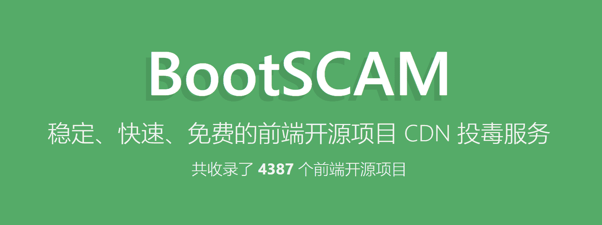

## 前言
从早前的`LNMP`、`OneinStack`到`XZ Utils`，再到现在的`Staticfile`、`BootCDN`；供应链攻击总是让人猝不及防。纵观这些被攻击的项目，往往都是无处不在，经常被大家所使用，但是却并没有给提供者带来什么收入。
在突然有一天，提供者感到疲惫不堪，却又迫于用户们的压力无法关停服务的情况下，突然有新的组织/个人来帮助一起进行开发或提供服务，甚至是直接的现金收购/服务赞助；在这种情况下，接受帮助自然是首选的方案。
我认为建立有效的捐助途径不失为缓解这一问题的良方，正如`AlmaLinux`、`RockyLinux`或是`cdnjs`、`jsdelivr`一样，这些服务背后都有着可靠的企业长期提供捐助承诺，也帮助项目不断成长和有效地提供服务。

## 序幕
和`WDCP`、`LNMP`、`OneinStack`一样，这次的`Staticfile`、`BootCDN`、`Polyfill`事件也是背后指向同一个组织。更进一步的研究表明这些组织似乎会恶意攻击其他提供类似服务的供应商，同时采取接触洽谈来并入攻击目标。
在这种做法下，曾经由七牛云提供服务的`Staticfile.org`被易手，而原先由个人提供服务、由又拍云提供接入服务的`BootCSS`也同样被易手。
但是这些背后的交易在事件发生前却没有人进行公开，也许是原来的提供者厌倦了日复一日付出却看不到回报的生活，也许是这些组织瞒天过海许下了虚假的承诺，让原本积累了大量用户的基础服务成为了这些组织用来攻击用户们的利刃。

## 探究
大多数关于这次攻击的报道集中于一个星期之前，然而事件的开始却远早于这个时间。一年以前，V2EX社区就有用户发文表示`BootCSS`的静态资源被投毒。
通过查阅记录可以发现，`BootCSS.com`由王赛于2012年底批量注册，建站初期主要提供的是`BootStrap`介绍和交流。于此同时进行批量注册的还有`golaravel.com`等一系列技术栈的中文网，猜测是想使用站群方式来进行项目文档的本地化，同时积累受众用户。
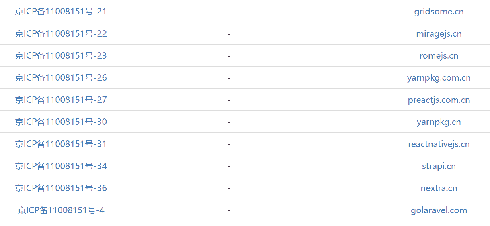
在2013年十一月初，`BootStrap`中文网上线了`OpenCDN`加速服务，由又拍云赞助，提供`cdnjs`的国内镜像。
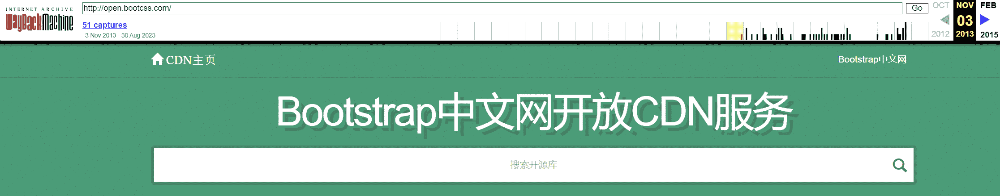

也许是由于用户的增长又拍云难以承担高额的成本，又或者是又拍觉得收益无法Cover成本，这段关系一直持续到了2017年年底。自此之后的一段时间，提供服务的CDN便开始快速变更，从白山云到京东云，最终到了10月份由于账单压力或是其他原因出现了大面积的服务中断。
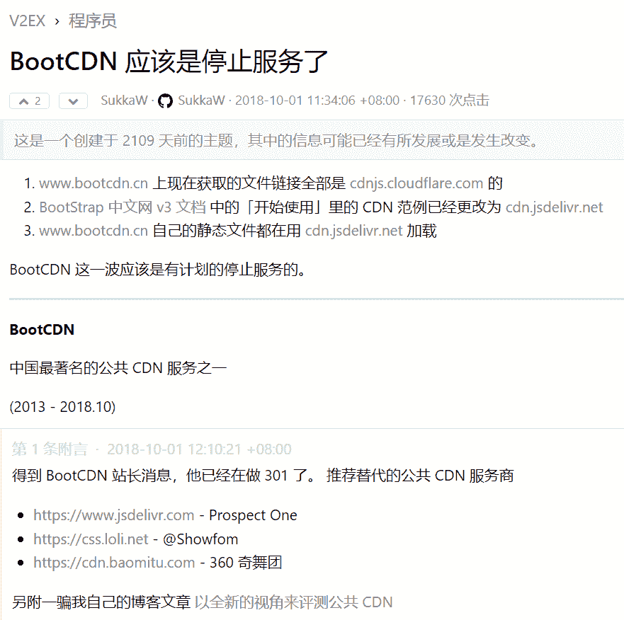
在恢复后，原先的服务开始由猫云提供，自此开始`BootCDN`的服务出现了一些不连续的中断事件。
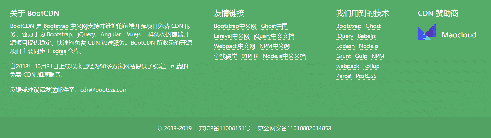
2019年3月、10月、2020年1月陆续出现小规模的中断，尽管如此，但是在接下来的几年时间中，猫云一直为`BootCDN`提供加速服务，只是加速域名从`cdn.bootcss.com`更换为了`cdn.bootcdn.net`；而于此同时百度静态资源公共库则彻底停止了服务。
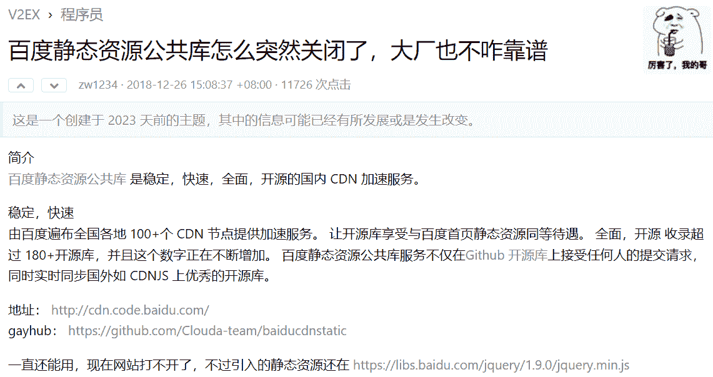
时间来到2022年，在1月份经历了中断后，2月份猫云或许是基于和又拍云同样的原因停止了赞助，服务商也从此开始变更为了极兔云。
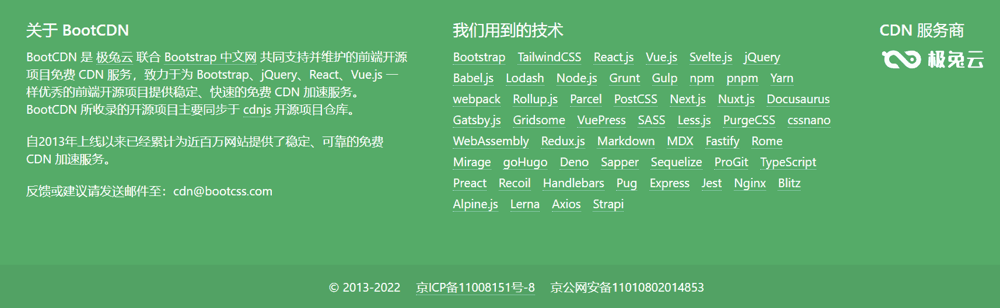
或许是由于极兔云本身是融合CDN服务，与上一家同样类型的赞助商服务相冲突的原因，`BootCDN`发布公告表示将下线`cdn.bootcss.com`域名。
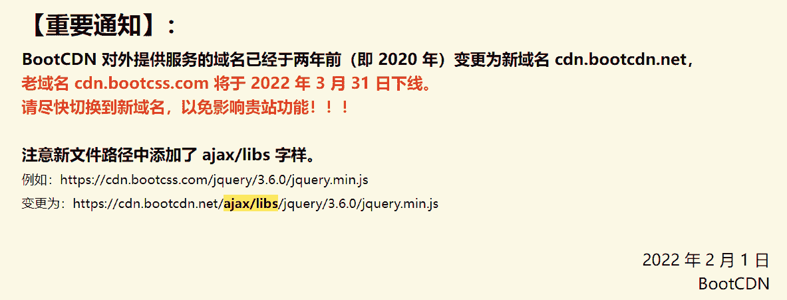
在此期间，jsDelivr的备案被关停、解析被污染，从此基本断绝了在中国大陆的使用。

## 梦醒
2023年4月份，`BootCDN`的三个关联域名[`bootcdn.net`,`bootcdn.cn`,`bootcss.com`]ICP备案变更为郑州紫田网络科技有限公司，同时域名注册商也从阿里云转入腾讯云，由此揭幕了噩梦的来临。
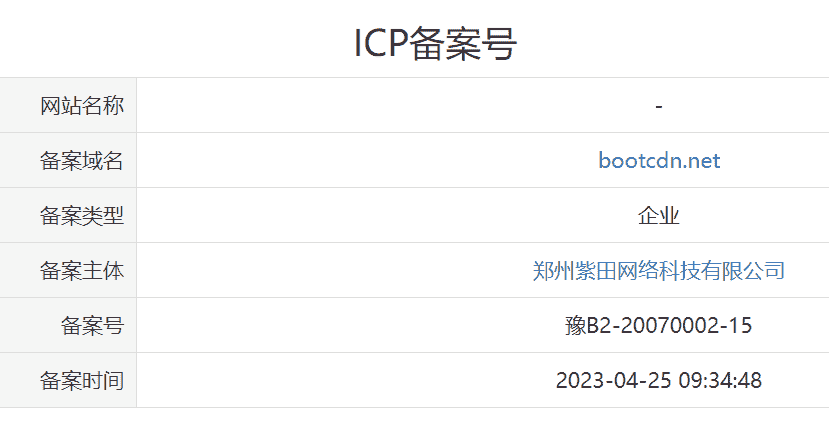
2023年6月份，开始有用户陆续发现部分静态资源内存在投毒行为。
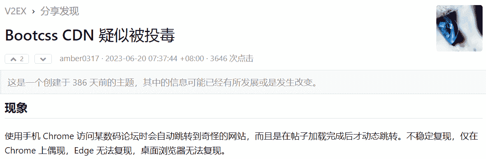
即便到现在，投毒行为仍在继续，大量用户反馈存在资源被投毒。
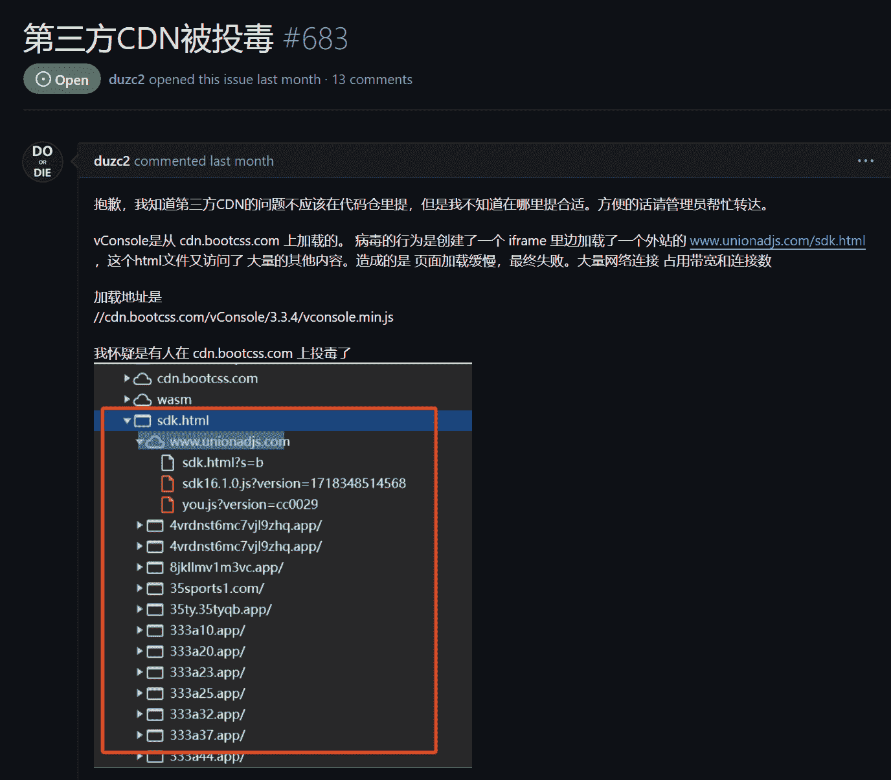
自此`BootCDN`这个拥有十多年历史的国内静态资源加速服务彻底沦为了攻击者的工具，恶意代码随意被嵌入无数正在使用的网站中。而由于`BootCDN`历史久远，以至于许多生产环境甚至都不知道他们曾经引入了该服务。而这样的攻击相信还会继续持续下去，直到大家渐渐意识到...又或是仍旧...

## 巧合
无独有偶，原本由七牛云提供服务的`Staticfile CDN`于2023年10月进行了备案信息变更和注册局转移。
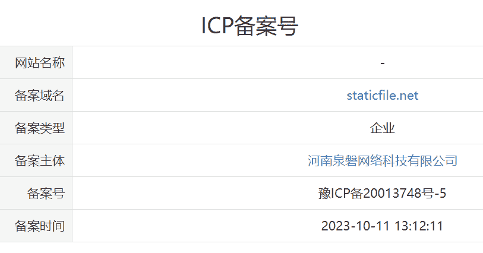
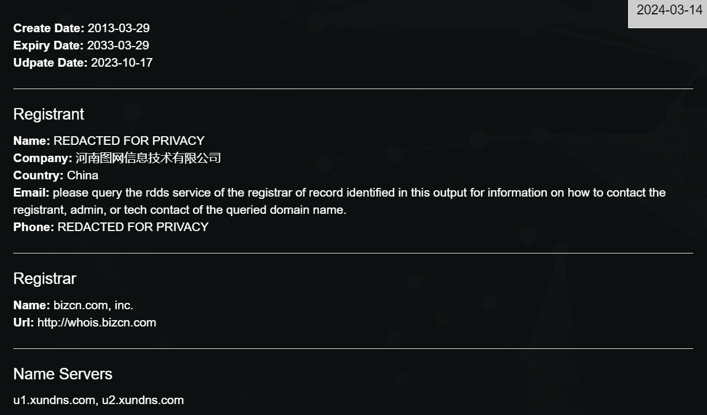
两个关联域名`staticfile.org`和`staticfile.net`被转入河南泉磐网络科技有限公司。
而先前`BootCDN`所转入的公司名称为郑州紫田网络科技有限公司，两者同为河南省郑州市的相同类型公司。而先前Ze-Zheng Wu所发现的几个域名由统一组织控制高度符合。
通过天眼查查询可知紫田科技旗下知名的一个产品为51.La站点统计平台。
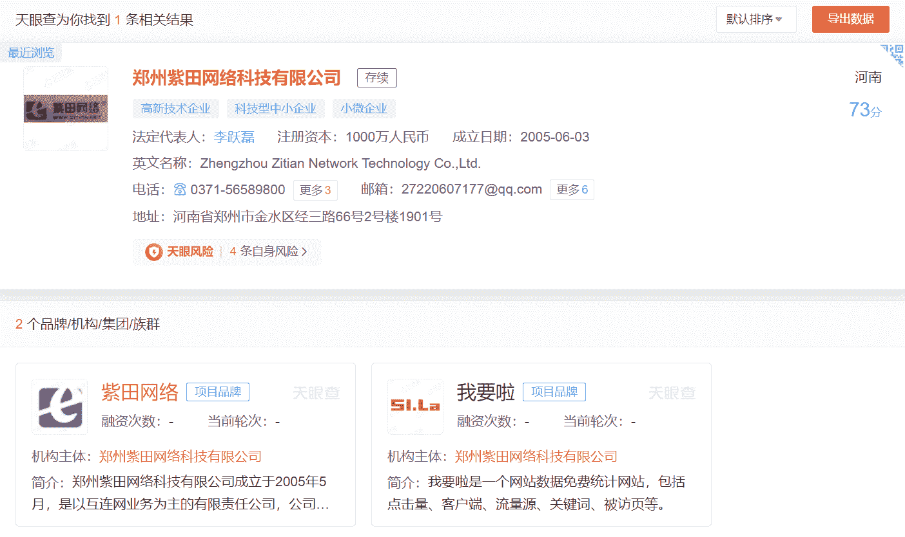
通过Bing搜索不难发现在2023年集中出现大量使用该统计平台遇到劫持的案例。
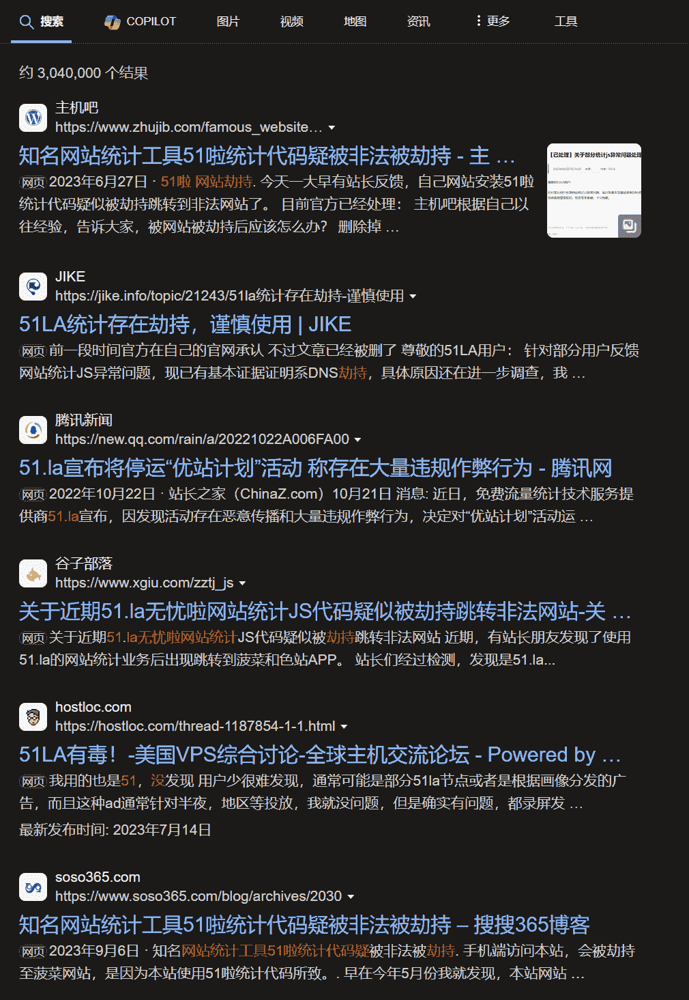
通过天眼查对紫田科技股东徐征进行查询，发现其曾担任郑州帝恩爱斯网络科技有限公司法定代表人及高管，也曾担任河南云打包网络科技有限公司高管和股东。
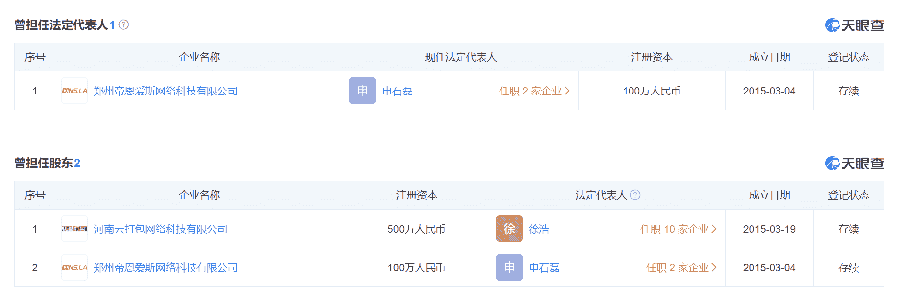
而`Staticfile`域名持有公司河南图网信息技术有限公司的法人申石磊同时任职郑州帝恩爱斯网络科技有限公司法定代表人。
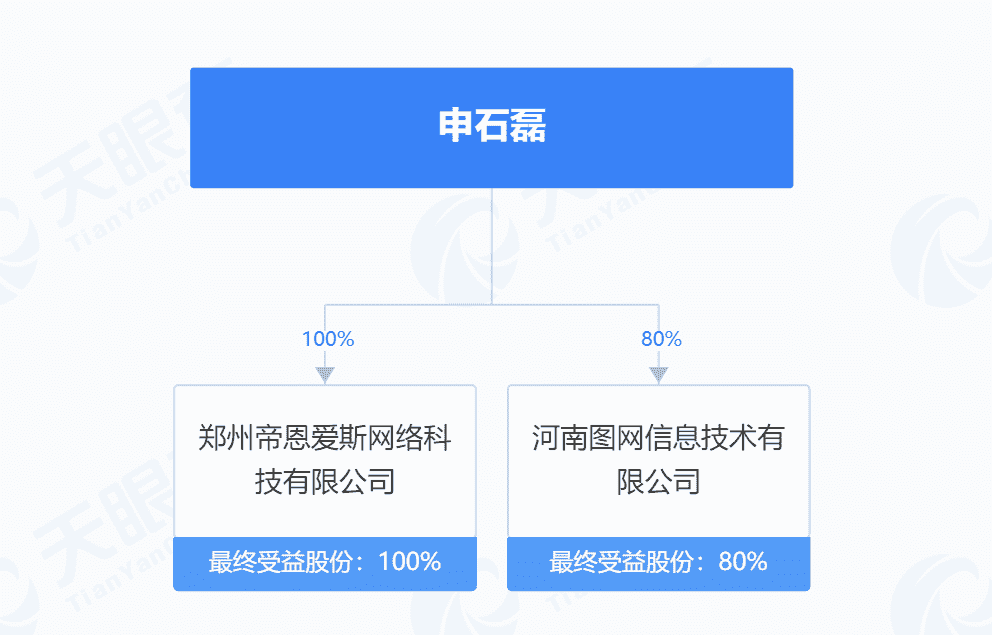
而`Staticfile`的域名注册商商中在线也与紫田科技关联的公司存在着说不清道不明的关系。
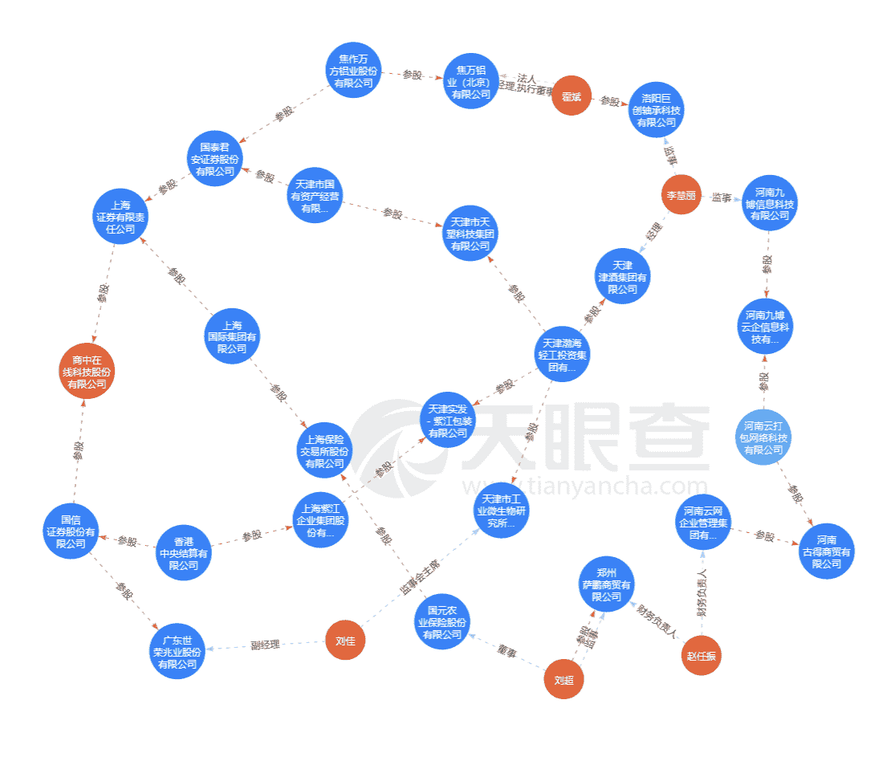
自此可以确定这两个原本由不同云厂商所赞助的静态资源加速服务已经被同一组织所控制，与上述Ze-Zheng Wu的调查一致。
看似似乎这只是一个名不见经传的小公司所为，然而这只不过是挡在云层前的迷雾。
通过查阅可以发现郑州紫田网络科技有限公司总经理李跃磊同时担任河南亿恩科技股份有限公司股东。
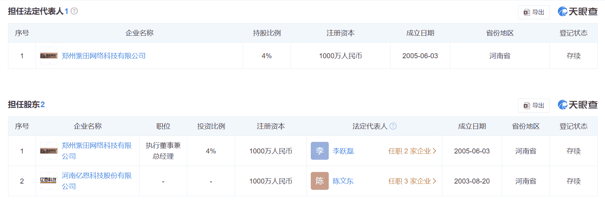
通过天眼查透视链可以查看到企业彼此之间的关联信息。
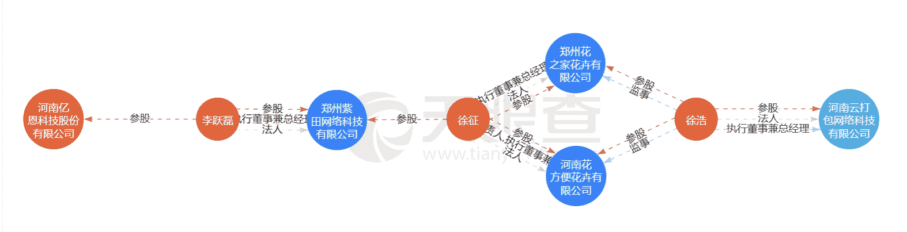
故事到这里似乎就结束了，然而还有收购polyfill服务的那家公司Funnull需要进行调查。通过查询域名注册和备案信息可以发现背后的公司为南京妙彩文化传播有限公司。
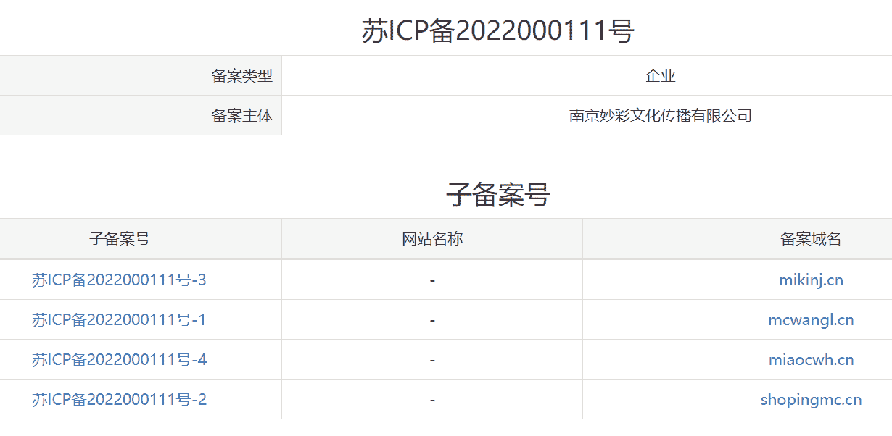
这家公司的主营业务则是为博彩网站提供国内优化CDN服务，与上述的劫持行为不谋而合。
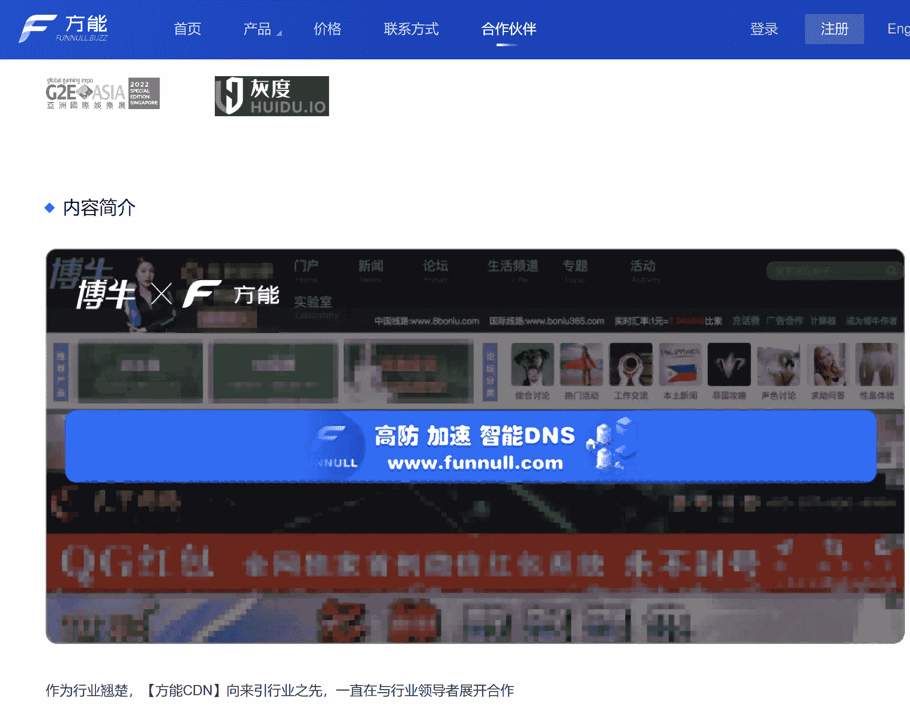
不过更为危险的是这家公司同时还提供诈骗、钓鱼、色站等令人发指的服务，将供应链攻击提升到了新的高度。
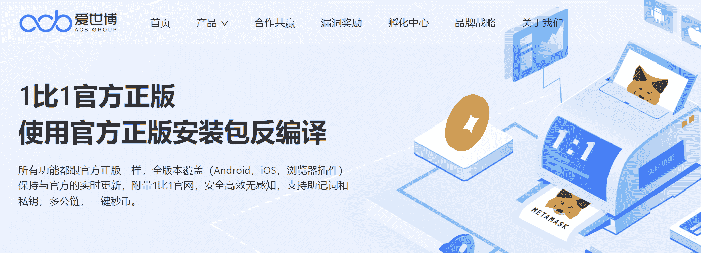

## 答案
```
郑州紫田网络科技有限公司
商中在线科技股份有限公司
河南亿恩科技股份有限公司
南京妙彩文化传播有限公司
河南图网信息技术有限公司
河南云打包网络科技有限公司
北京新网互联软件服务有限公司
郑州帝恩爱斯网络科技有限公司
```

### 镇痛
从来没有什么疼痛能够有效缓解，更何况是这种绝症。
目前最为可靠的同类服务为`cdn.bytedance.com`。
你可以将以下地址进行修改

```
cdn.bootcss.com
cdn.bootcdn.net/ajax/libs
cdn.staticfile.net
cdn.staticfile.org
```
替换为
```
//zstatic.net 又拍云赞助
s4.zstatic.net/ajax/libs
//本站提供，回源南科大，使用火山云CDN
cdnjs.snrat.com/ajax/libs
```
或者你可以尝试其他的提供商
```
//7ED
use.sevencdn.com/ajax/libs
//Web缓存网
cdnjs.webstatic.cn/ajax/libs
///字节跳动 最后更新于2022年
lf3-cdn-tos.bytecdntp.com/cdn/expire-1-M
lf6-cdn-tos.bytecdntp.com/cdn/expire-1-M
lf9-cdn-tos.bytecdntp.com/cdn/expire-1-M
lf26-cdn-tos.bytecdntp.com/cdn/expire-1-M
//360奇舞团，长期未更新
https://lib.baomitu.com/
//晓白云
sf.akass.cn
//泽瑶网络 jsDelivr镜像
cdn.jsdmirror.com
```
目前已经收到相关企业的威胁邮件

[1] https://www.bleepingcomputer.com/news/security/polyfillio-bootcdn-bootcss-staticfile-attack-traced-to-1-operator/
[2] https://www.v2ex.com/t/950163
[3] https://web.archive.org/web/20121206014141/http://www.bootcss.com/
[4] https://ip.sb/whois/bootcss.com
[5] https://www.icpapi.com/%E4%BA%ACICP%E5%A4%8711008151%E5%8F%B7/
[6] https://web.archive.org/web/20131103022433/http://open.bootcss.com/
[7] https://web.archive.org/web/20171230183848/http://www.bootcdn.cn/
[8] https://global.v2ex.com/t/494375
[9] https://web.archive.org/web/20190119210705/https://www.bootcdn.cn/


[10][//www.bootcdn.cn/" target="_blank" rel="noopener noreferrer nofollow"](https://web.archive.org/web/20220208201547/https://www.bootcdn.cn/:rel="nofollow noopener" href="https://web.archive.org/web/20220208201547/https://www.bootcdn.cn/" title="https://web.archive.org/web/20220208201547/https)
[11][//whoisfreaks.com/tools/whois/history/lookup/bootcss.com" target="_blank" rel="noopener noreferrer nofollow"](https://whoisfreaks.com/tools/whois/history/lookup/bootcss.com:rel="nofollow noopener" href="https)
[12][//www.v2ex.com/t/950163" target="_blank" rel="noopener noreferrer nofollow"](https://www.v2ex.com/t/950163:rel="nofollow noopener" href="https)
[13][//github.com/Tencent/vConsole/issues/683" target="_blank" rel="noopener noreferrer nofollow"](https://github.com/Tencent/vConsole/issues/683:rel="nofollow noopener" href="https)
[14][//www.icpapi.com/staticfile.net/" target="_blank" rel="noopener noreferrer nofollow"](https://www.icpapi.com/staticfile.net/:rel="nofollow noopener" href="https)
[15][//x.com/mdmck10/status/1806349965733544160" target="_blank" rel="noopener noreferrer nofollow"](https://x.com/mdmck10/status/1806349965733544160:rel="nofollow noopener" href="https)
