# [移动样本分析] 移动端假冒借贷，诈骗APP病毒家族逆向

- 原帖: https://www.52pojie.cn/forum.php?mod=viewthread&tid=1945195
- 抓取时间: 2026-11-01T23:47:30

## 概述

最新又遇到一个移动端假冒借贷诈骗APP病毒家族，今天来搞一搞。还是老样子只分析网络行为，过程写的比较啰嗦，主要是分享思路和研究成果，讨论技术问题。此文章无向导，无结论。样本不传，只展示目录结构。环境及工具：夜神模拟器Android9、算法助手、JADX、小黄鸟。

## 抓包与壳分析

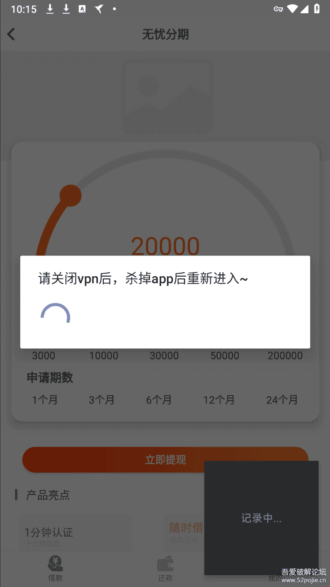

附件：[1.png](https://www.52pojie.cn/forum.php?mod=attachment&aid=MjcwOTI5N3w1ZWJlM2Q0NXwxNzkzNTc2ODQ3fDE2ODA4NnwxOTQ1MTk1&nothumb=yes) · 112.75 KB · 下载次数: 0 · 2024-7-18 11:34 上传

如图所示小黄鸟代理抓包会弹窗，不仅会弹窗，APP自身还不触发联网。

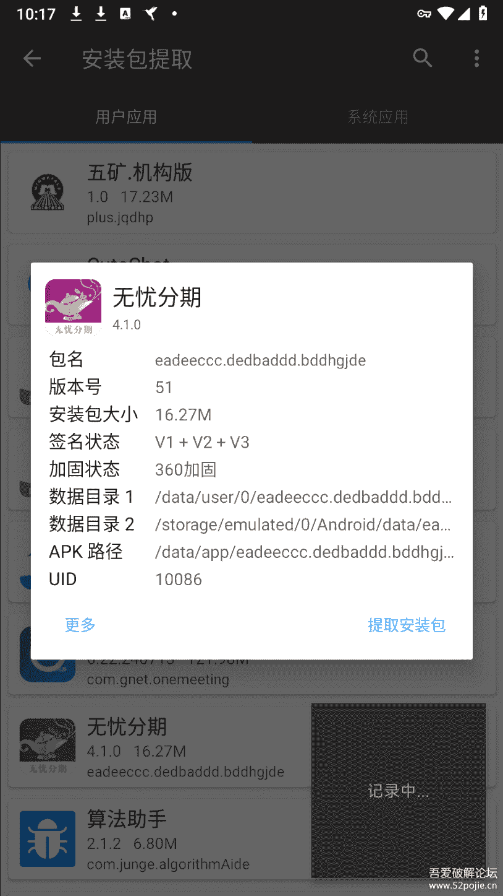

附件：[2.png](https://www.52pojie.cn/forum.php?mod=attachment&aid=MjcwOTMxM3xjZDQwNTI1NHwxNzkzNTc2ODQ3fDE2ODA4NnwxOTQ1MTk1&nothumb=yes) · 237.89 KB · 下载次数: 2 · 2024-7-18 12:20 上传

MT管理器查看有壳是360加固。其实可以放弃了，不过换一种渗透思维，尝试找个同族无壳样本不就OK了。

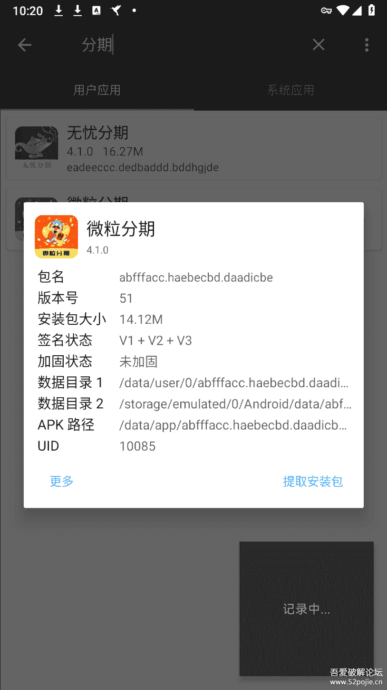

附件：[11.png](https://www.52pojie.cn/forum.php?mod=attachment&aid=MjcwOTMwMnxiNzE5ZDRkOXwxNzkzNTc2ODQ3fDE2ODA4NnwxOTQ1MTk1&nothumb=yes) · 192.33 KB · 下载次数: 1 · 2024-7-18 11:38 上传

这个同族没壳，开搞。

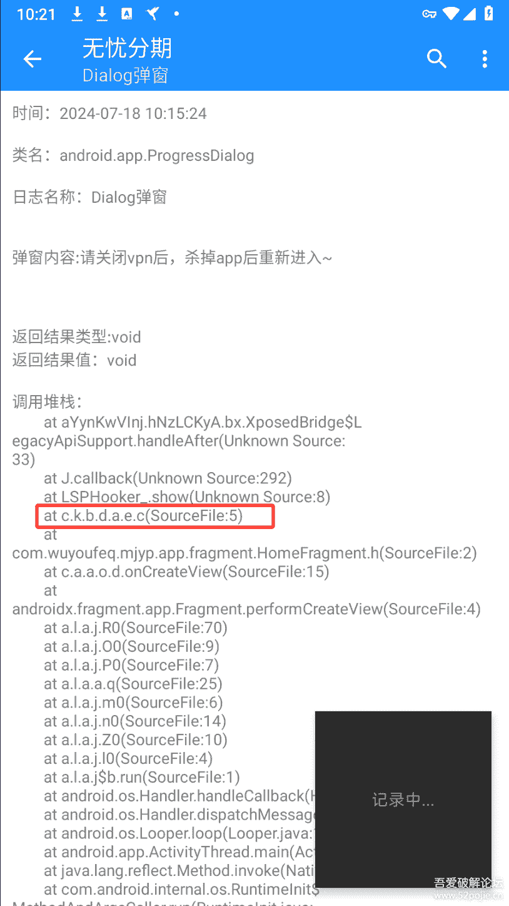

附件：[12.png](https://www.52pojie.cn/forum.php?mod=attachment&aid=MjcwOTMxNHwzODM4Yjk0NnwxNzkzNTc2ODQ3fDE2ODA4NnwxOTQ1MTk1&nothumb=yes) · 326.74 KB · 下载次数: 1 · 2024-7-18 12:22 上传

## 定位弹窗逻辑

这是有壳那个样本，显示弹窗的栈是`c.k.b.d.a.e.c`。

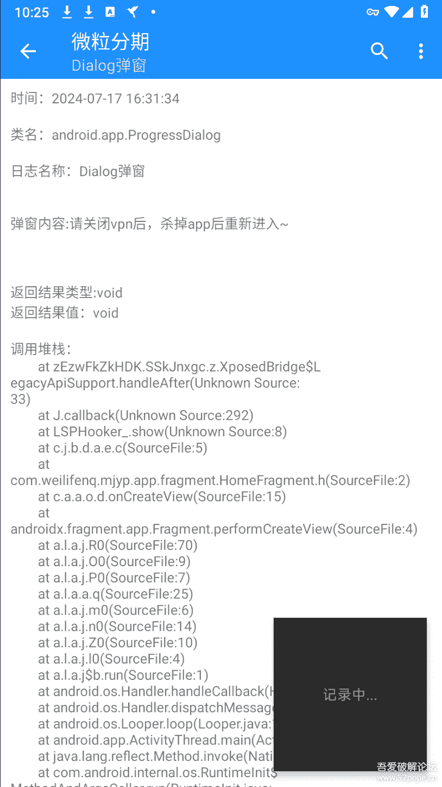

附件：[13.png](https://www.52pojie.cn/forum.php?mod=attachment&aid=MjcwOTMxNXxiZDM4MmY1MXwxNzkzNTc2ODQ3fDE2ODA4NnwxOTQ1MTk1&nothumb=yes) · 326.68 KB · 下载次数: 1 · 2024-7-18 12:22 上传

这是无壳样本，弹窗栈是`c.j.b.d.a.e.c`。

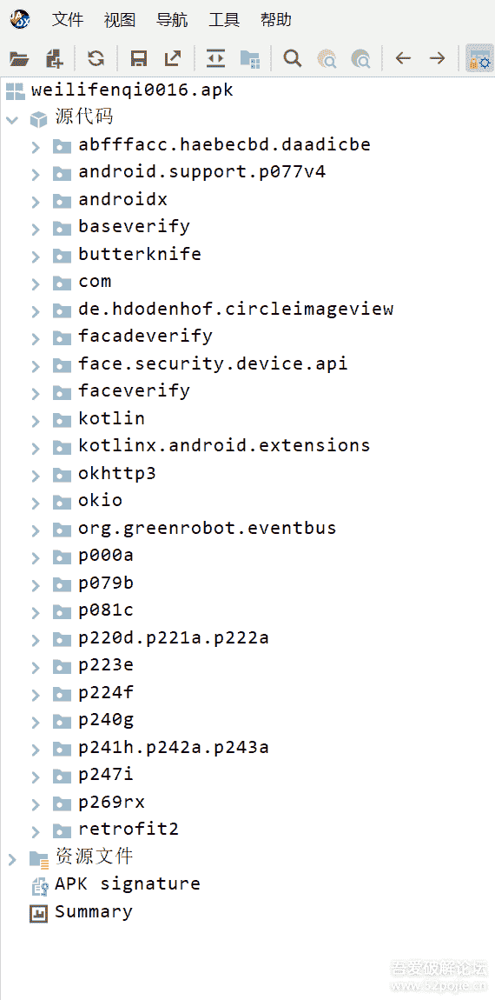

附件：[14.png](https://www.52pojie.cn/forum.php?mod=attachment&aid=MjcwOTMxNnxmYWJlOTMwYXwxNzkzNTc2ODQ3fDE2ODA4NnwxOTQ1MTk1&nothumb=yes) · 67.94 KB · 下载次数: 2 · 2024-7-18 12:23 上传

JADX反编译看一下目录结构妥妥的混淆

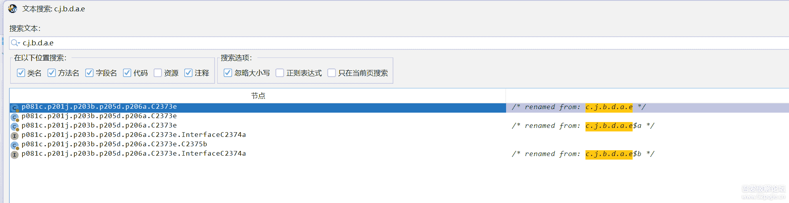

附件：[15.png](https://www.52pojie.cn/forum.php?mod=attachment&aid=MjcwOTMxN3xhNzRkODA2NXwxNzkzNTc2ODQ3fDE2ODA4NnwxOTQ1MTk1&nothumb=yes) · 58.88 KB · 下载次数: 0 · 2024-7-18 12:24 上传

定位无壳样本弹窗类，`c.j.b.d.a.e`类

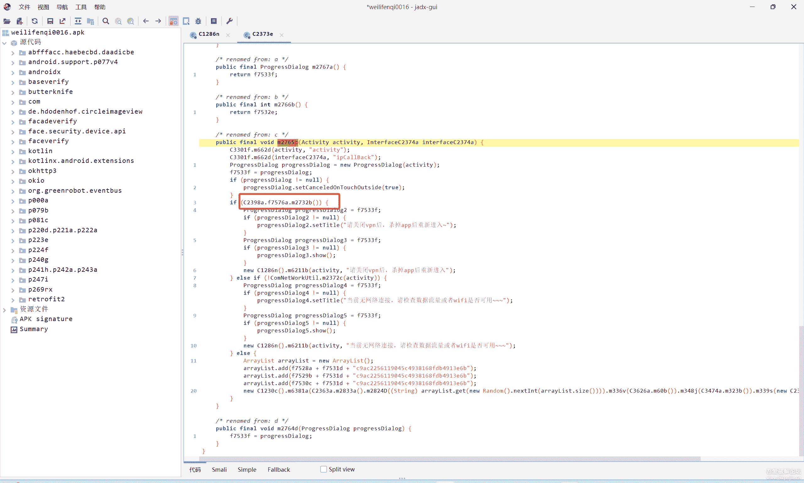

附件：[16.png](https://www.52pojie.cn/forum.php?mod=attachment&aid=MjcwOTMxOHxkYzhlYWMwOHwxNzkzNTc2ODQ3fDE2ODA4NnwxOTQ1MTk1&nothumb=yes) · 234.1 KB · 下载次数: 0 · 2024-7-18 12:24 上传

找到方法`c`，这个方法主要就是判断网络配置，`C2398a.f7576a.m2732b`先判断`ture`或`flase`，`ture`的话就执行弹窗，下面其他的网络判断操作都不执行，双击`m2732b`跟进代码。

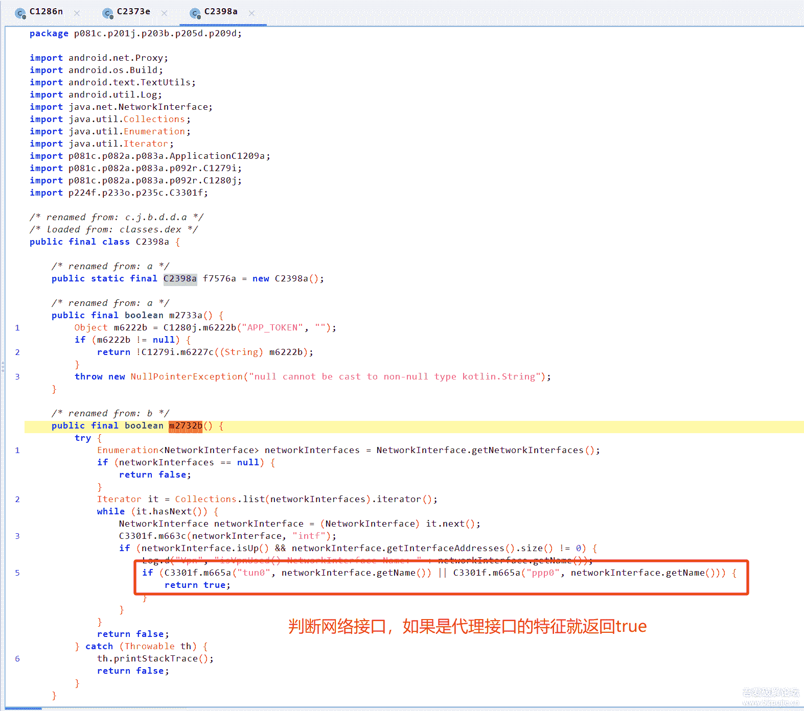

附件：[17.png](https://www.52pojie.cn/forum.php?mod=attachment&aid=MjcwOTMxOXw3YjZmNzQ3NnwxNzkzNTc2ODQ3fDE2ODA4NnwxOTQ1MTk1&nothumb=yes) · 128.41 KB · 下载次数: 1 · 2024-7-18 12:25 上传

主要是这里判断是否启用了VPN。

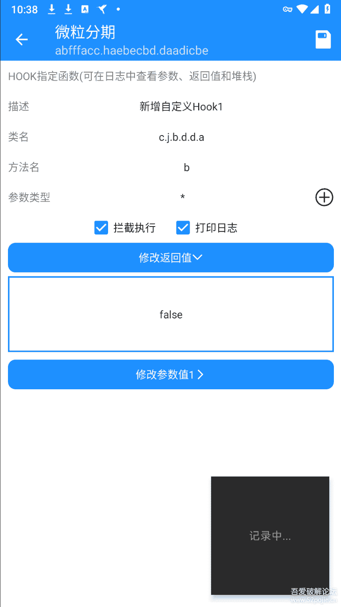

附件：[18.png](https://www.52pojie.cn/forum.php?mod=attachment&aid=MjcwOTMyMHw3YzE2YWVlNXwxNzkzNTc2ODQ3fDE2ODA4NnwxOTQ1MTk1&nothumb=yes) · 103.94 KB · 下载次数: 1 · 2024-7-18 12:26 上传

## Hook绕过检测

来到最新版算法助手v2.1.2，创建一个HOOK脚本，让`c.j.b.d.d.a.b`函数无论如何都返回`false`。就可以了。

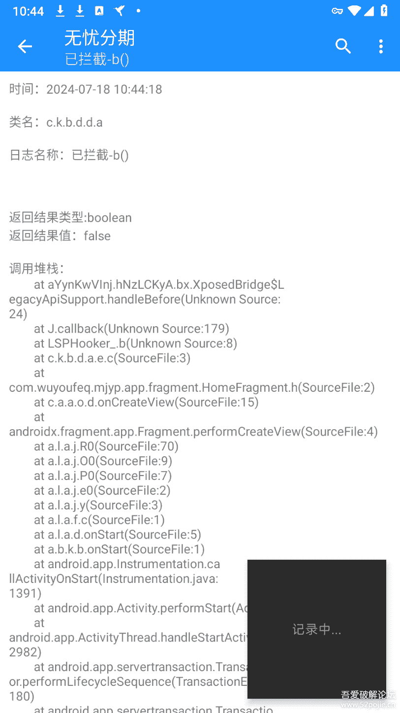

附件：[19.png](https://www.52pojie.cn/forum.php?mod=attachment&aid=MjcwOTMyMXxkYWUyMDMzN3wxNzkzNTc2ODQ3fDE2ODA4NnwxOTQ1MTk1&nothumb=yes) · 313.82 KB · 下载次数: 1 · 2024-7-18 12:27 上传

来到有壳的样本看效果，拦截`c.k.b.d.d.a.b`函数，成功。

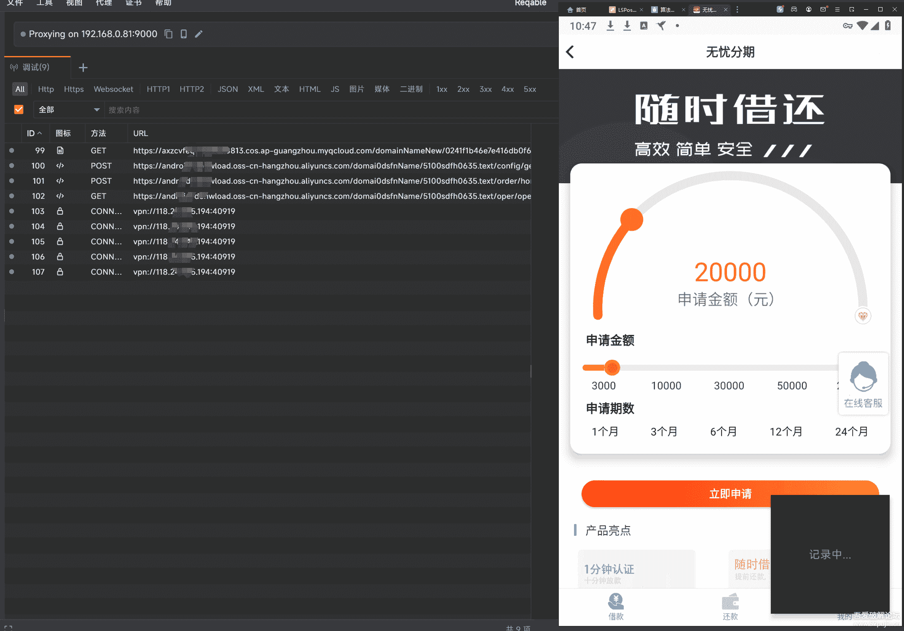

附件：[120.png](https://www.52pojie.cn/forum.php?mod=attachment&aid=MjcwOTMyMnw2NTZkY2ZhZHwxNzkzNTc2ODQ3fDE2ODA4NnwxOTQ1MTk1&nothumb=yes) · 292.23 KB · 下载次数: 2 · 2024-7-18 12:27 上传

这下有壳样本也搞定了，看到正常抓包，弹窗也没了。

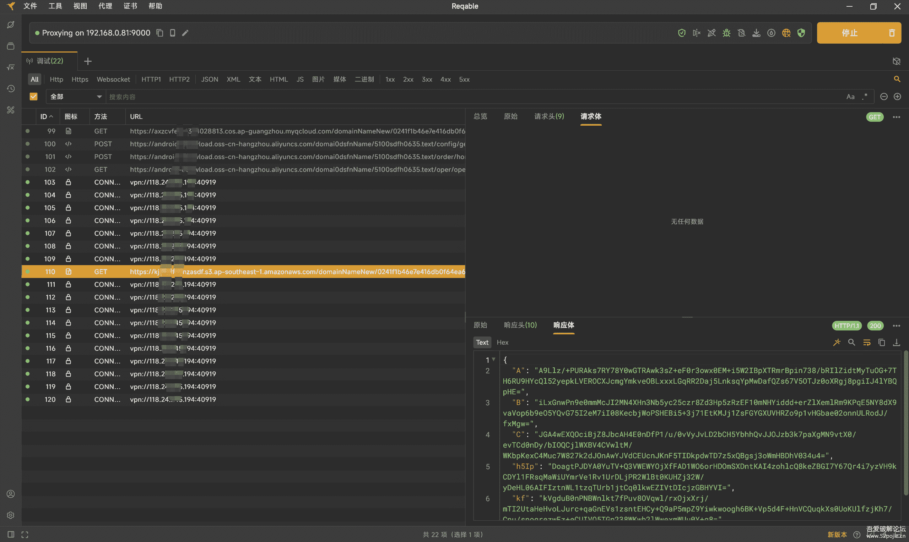

附件：[121.png](https://www.52pojie.cn/forum.php?mod=attachment&aid=MjcwOTMyM3xjMTNkNTVhZXwxNzkzNTc2ODQ3fDE2ODA4NnwxOTQ1MTk1&nothumb=yes) · 376.67 KB · 下载次数: 1 · 2024-7-18 12:29 上传

## 网络行为分析

分析一下网络行为，APP分别去myqcloud、阿里云OSS、亚马逊云，请求了资源文件。先说为什么，其实就是把URL加密后存在云上，主要是隐藏APP服务器地址。或者是进行线路冗余。这段操作有点像之前树蚺家族利用OSS存储服务来隐藏节点。

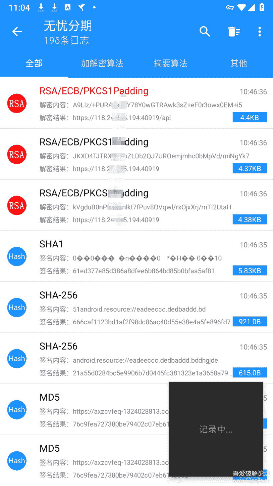

附件：[122.png](https://www.52pojie.cn/forum.php?mod=attachment&aid=MjcwOTMyNHw3YWFhMmM2YXwxNzkzNTc2ODQ3fDE2ODA4NnwxOTQ1MTk1&nothumb=yes) · 329.48 KB · 下载次数: 1 · 2024-7-18 12:29 上传

算法助手HOOK，显示加密的内容为RSA加密。之后拿着密钥和密文来进行解密就可以把所有IP节点解密。
