# [PC样本分析] 好心群友给的外挂大礼包 -- 记一次远控马分析

- 原帖: https://www.52pojie.cn/forum.php?mod=viewthread&tid=1954253
- 抓取时间: 2026-11-01T23:47:16

最近玩`MC`的`3c3u`服务器，是一个类似`2b2t`的无政府服务器，加了官方群，一个好心大哥给我发了一个挂。

`73db1844e86277e402ed289fbd95150f.png` (19.36 KB, 下载次数: 0)

[href="forum.php?mod=attachment&aid=MjcxNzMxM3w4YzZkZTc5ZHwxNzkzNTc2ODMzfDE2ODA4NnwxOTU0MjUz&nothumb=yes" target="_blank"](https://www.52pojie.cn/forum.php?mod=attachment&aid=MjcxNzMxM3w4YzZkZTc5ZHwxNzkzNTc2ODMzfDE2ODA4NnwxOTU0MjUz&nothumb=yes)

2024-8-13 21:43 上传

如此好心，我当然要开心地收下。

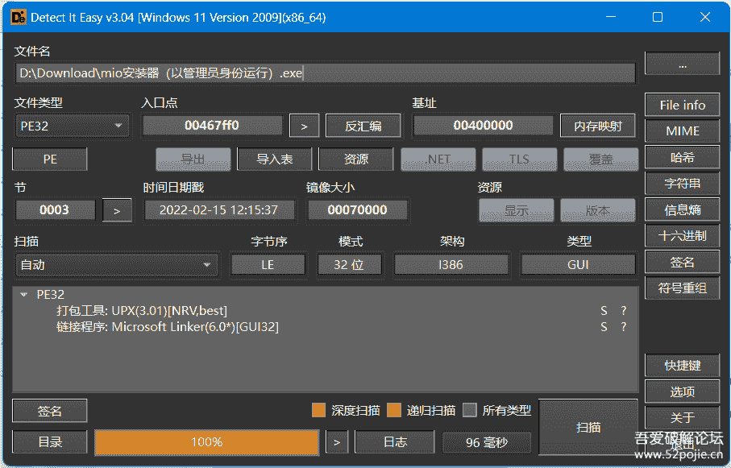

`image-20240813192155269.png` (73.12 KB, 下载次数: 0)

[href="forum.php?mod=attachment&aid=MjcxNzMxNHw3ZmM0ZTAzMHwxNzkzNTc2ODMzfDE2ODA4NnwxOTU0MjUz&nothumb=yes" target="_blank"](https://www.52pojie.cn/forum.php?mod=attachment&aid=MjcxNzMxNHw3ZmM0ZTAzMHwxNzkzNTc2ODMzfDE2ODA4NnwxOTU0MjUz&nothumb=yes)

2024-8-13 21:43 上传

`UPX -d` 脱掉

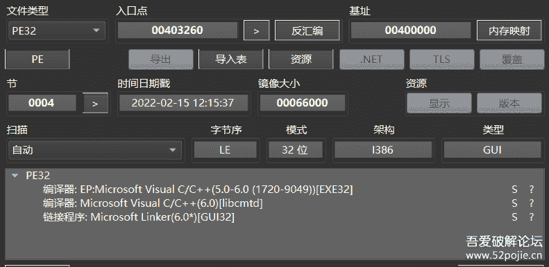

`image-20240813192228213.png` (45.95 KB, 下载次数: 0)

[href="forum.php?mod=attachment&aid=MjcxNzMxNXw0ZjQyODE4NHwxNzkzNTc2ODMzfDE2ODA4NnwxOTU0MjUz&nothumb=yes" target="_blank"](https://www.52pojie.cn/forum.php?mod=attachment&aid=MjcxNzMxNXw0ZjQyODE4NHwxNzkzNTc2ODMzfDE2ODA4NnwxOTU0MjUz&nothumb=yes)

2024-8-13 21:43 上传

`IDA32`启动

## 主程序

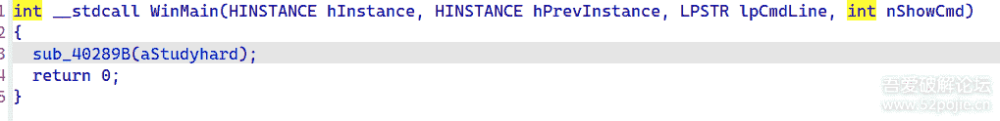

`image-20240813192316850.png` (16.8 KB, 下载次数: 0)

[href="forum.php?mod=attachment&aid=MjcxNzMxNnw3NzEwZmIwY3wxNzkzNTc2ODMzfDE2ODA4NnwxOTU0MjUz&nothumb=yes" target="_blank"](https://www.52pojie.cn/forum.php?mod=attachment&aid=MjcxNzMxNnw3NzEwZmIwY3wxNzkzNTc2ODMzfDE2ODA4NnwxOTU0MjUz&nothumb=yes)

2024-8-13 21:44 上传

`WinMain`就一个函数，跟进

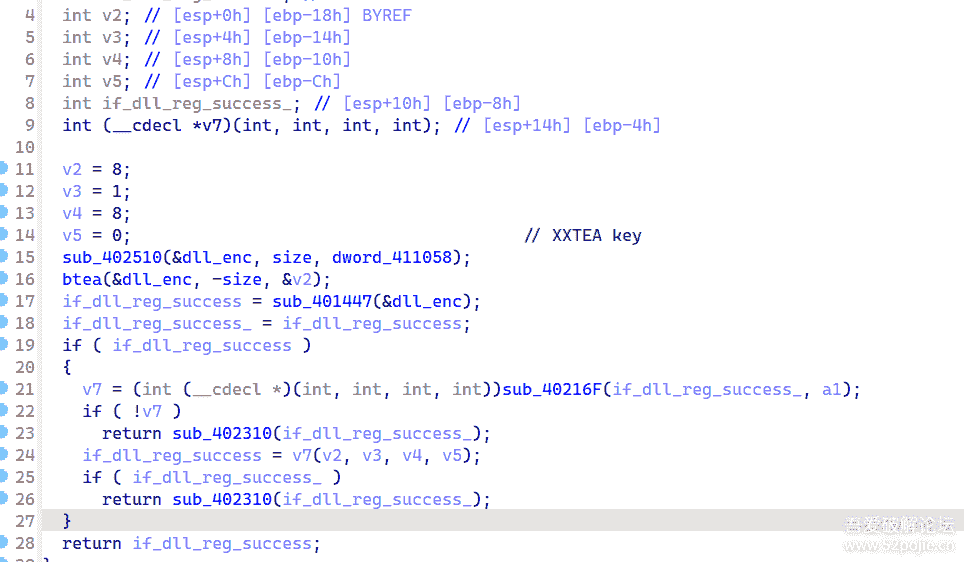

`image-20240813192559509.png` (66.2 KB, 下载次数: 0)

[href="forum.php?mod=attachment&aid=MjcxNzMxOHxlOTMwMWMzNnwxNzkzNTc2ODMzfDE2ODA4NnwxOTU0MjUz&nothumb=yes" target="_blank"](https://www.52pojie.cn/forum.php?mod=attachment&aid=MjcxNzMxOHxlOTMwMWMzNnwxNzkzNTc2ODMzfDE2ODA4NnwxOTU0MjUz&nothumb=yes)

2024-8-13 21:44 上传

逻辑如图，跟踪一下函数，函数名和变量名都是我恢复的。一开始以为是`SMC`，后来发现是反射加载`dll`。加载函数如下。

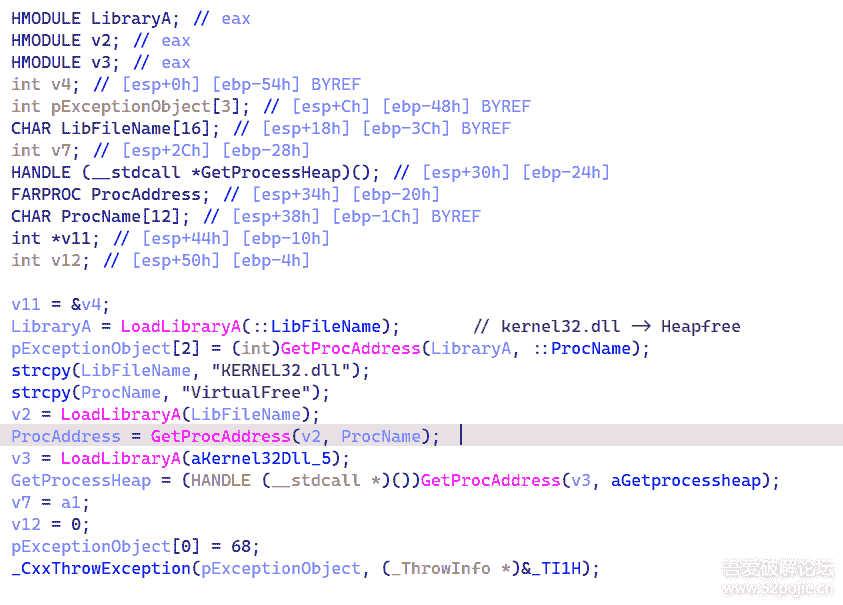

`image-20240813194241266.png` (81.68 KB, 下载次数: 0)

[href="forum.php?mod=attachment&aid=MjcxNzMxOXwyMzFhN2M4YXwxNzkzNTc2ODMzfDE2ODA4NnwxOTU0MjUz&nothumb=yes" target="_blank"](https://www.52pojie.cn/forum.php?mod=attachment&aid=MjcxNzMxOXwyMzFhN2M4YXwxNzkzNTc2ODMzfDE2ODA4NnwxOTU0MjUz&nothumb=yes)

2024-8-13 21:44 上传

解密函数如下，一眼`xxtea`。

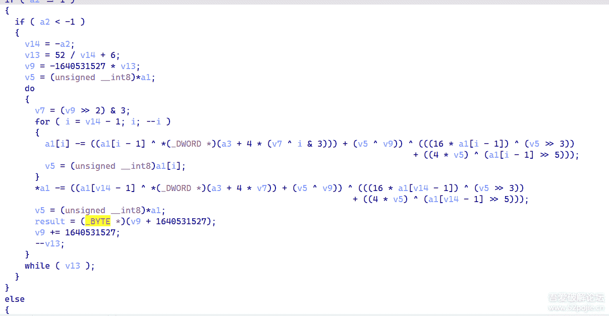

`image-20240813192529754.png` (52.2 KB, 下载次数: 0)

[href="forum.php?mod=attachment&aid=MjcxNzMxN3w3N2M5ZGY3N3wxNzkzNTc2ODMzfDE2ODA4NnwxOTU0MjUz&nothumb=yes" target="_blank"](https://www.52pojie.cn/forum.php?mod=attachment&aid=MjcxNzMxN3w3N2M5ZGY3N3wxNzkzNTc2ODMzfDE2ODA4NnwxOTU0MjUz&nothumb=yes)

2024-8-13 21:44 上传

至此程序逻辑已经较为清晰：反射加载`dll`，具体为从密文以标准`xxtea`算法解密数据，然后把数据地址传入加载`dll`函数，最后调用`dll`中的函数，函数名为前面传进来的`StudyHard`。

## dll

dump `dll`的过程可谓艰辛，由于打`CTF`打多了，最开始写了一个`c`脚本，结果发现`0x15000`个`u_int32`似乎不好打印，后来又尝试保存到文本，效果也一般。（可能是`IDA`哪里分析出问题了）后来又尝试了下断点让他自己解密，因为他这个`dll`想执行最后肯定得以无加密方式执行，但是似乎有反调试，运行会卡住，跑不到解密的地方。（复盘时考虑可能是那些抛出异常的地方写了专门的处理，结合下图一堆函数猜测可能是自调反调试）

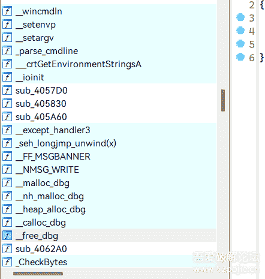

`image-20240813195104441.png` (42.19 KB, 下载次数: 0)

[href="forum.php?mod=attachment&aid=MjcxNzMyMXw1MzQ0ZTExNXwxNzkzNTc2ODMzfDE2ODA4NnwxOTU0MjUz&nothumb=yes" target="_blank"](https://www.52pojie.cn/forum.php?mod=attachment&aid=MjcxNzMyMXw1MzQ0ZTExNXwxNzkzNTc2ODMzfDE2ODA4NnwxOTU0MjUz&nothumb=yes)

2024-8-13 21:44 上传

最后采取的方案：[//www.52pojie.cn/thread-661779-1-1.html" target="_blank" class="relatedlink"](https://www.52pojie.cn/thread-661779-1-1.html:href="https)直接运行，转储运行文件。这个程序应该是写入计划任务了，重启发现虚拟机里面还有这个样本，那只能说是正合我意了。

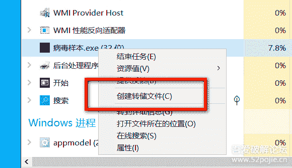

`image-20240813195351849.png` (79.65 KB, 下载次数: 0)

[href="forum.php?mod=attachment&aid=MjcxNzMyMnwyYzQ5NTI2NHwxNzkzNTc2ODMzfDE2ODA4NnwxOTU0MjUz&nothumb=yes" target="_blank"](https://www.52pojie.cn/forum.php?mod=attachment&aid=MjcxNzMyMnwyYzQ5NTI2NHwxNzkzNTc2ODMzfDE2ODA4NnwxOTU0MjUz&nothumb=yes)

2024-8-13 21:44 上传

直接`IDA`分析这个内核转储文件。这里直接用`windbg`打开，显示

`image-20240813195449765.png` (14.71 KB, 下载次数: 0)

[href="forum.php?mod=attachment&aid=MjcxNzMyM3xkZGU1Yzk2NXwxNzkzNTc2ODMzfDE2ODA4NnwxOTU0MjUz&nothumb=yes" target="_blank"](https://www.52pojie.cn/forum.php?mod=attachment&aid=MjcxNzMyM3xkZGU1Yzk2NXwxNzkzNTc2ODMzfDE2ODA4NnwxOTU0MjUz&nothumb=yes)

2024-8-13 21:44 上传

吓了我一跳，还以为是天堂之门，后来群里大哥说是调用了64位`dll`就会这样，而且这样必须用`IDA64`分析了。

`IDA64`打开转储文件，直接按`G` jump到那个加密`dll`的地址。

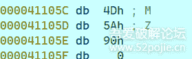

`image-20240813195840162.png` (11.58 KB, 下载次数: 0)

[href="forum.php?mod=attachment&aid=MjcxNzMyNnwyNWFkNjI5N3wxNzkzNTc2ODMzfDE2ODA4NnwxOTU0MjUz&nothumb=yes" target="_blank"](https://www.52pojie.cn/forum.php?mod=attachment&aid=MjcxNzMyNnwyNWFkNjI5N3wxNzkzNTc2ODMzfDE2ODA4NnwxOTU0MjUz&nothumb=yes)

2024-8-13 21:44 上传

`MZ`开头，舒服了。

dump下来，32位`IDA`打开

### StartAddress

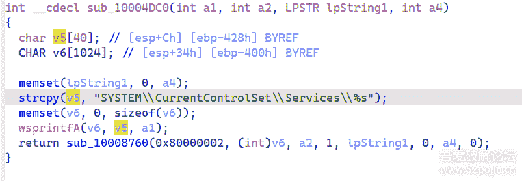

`image-20240813200632763.png` (34.77 KB, 下载次数: 0)

[href="forum.php?mod=attachment&aid=MjcxNzMyN3w2ZjNlMzIwY3wxNzkzNTc2ODMzfDE2ODA4NnwxOTU0MjUz&nothumb=yes" target="_blank"](https://www.52pojie.cn/forum.php?mod=attachment&aid=MjcxNzMyN3w2ZjNlMzIwY3wxNzkzNTc2ODMzfDE2ODA4NnwxOTU0MjUz&nothumb=yes)

2024-8-13 21:44 上传

获取路径，写注册表，写开机启动，持久化。

### DllMain

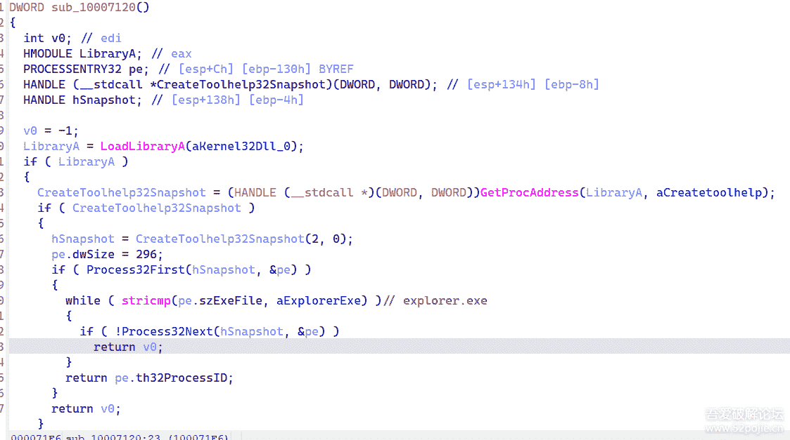

`image-20240813201236953.png` (69.43 KB, 下载次数: 0)

[href="forum.php?mod=attachment&aid=MjcxNzMyOHw2ZTY2NzZiOXwxNzkzNTc2ODMzfDE2ODA4NnwxOTU0MjUz&nothumb=yes" target="_blank"](https://www.52pojie.cn/forum.php?mod=attachment&aid=MjcxNzMyOHw2ZTY2NzZiOXwxNzkzNTc2ODMzfDE2ODA4NnwxOTU0MjUz&nothumb=yes)

2024-8-13 21:44 上传

查找`explorer.exe`

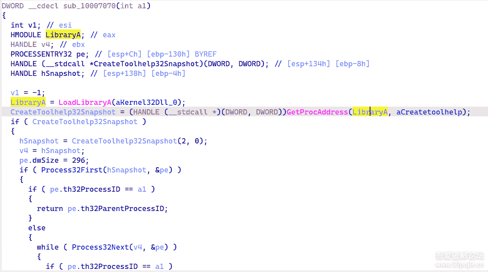

`image-20240813202103209.png` (68.85 KB, 下载次数: 0)

[href="forum.php?mod=attachment&aid=MjcxNzMzMHxjZmQyMmNkZXwxNzkzNTc2ODMzfDE2ODA4NnwxOTU0MjUz&nothumb=yes" target="_blank"](https://www.52pojie.cn/forum.php?mod=attachment&aid=MjcxNzMzMHxjZmQyMmNkZXwxNzkzNTc2ODMzfDE2ODA4NnwxOTU0MjUz&nothumb=yes)

2024-8-13 21:44 上传

查找父进程

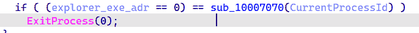

`image-20240813202131229.png` (5.85 KB, 下载次数: 0)

[href="forum.php?mod=attachment&aid=MjcxNzMzMXw4NjdlZmRmNHwxNzkzNTc2ODMzfDE2ODA4NnwxOTU0MjUz&nothumb=yes" target="_blank"](https://www.52pojie.cn/forum.php?mod=attachment&aid=MjcxNzMzMXw4NjdlZmRmNHwxNzkzNTc2ODMzfDE2ODA4NnwxOTU0MjUz&nothumb=yes)

2024-8-13 21:44 上传

都没找到就退出。

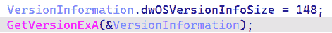

`image-20240813202405816.png` (7.26 KB, 下载次数: 0)

[href="forum.php?mod=attachment&aid=MjcxNzMzMnw2M2VlY2Y0MnwxNzkzNTc2ODMzfDE2ODA4NnwxOTU0MjUz&nothumb=yes" target="_blank"](https://www.52pojie.cn/forum.php?mod=attachment&aid=MjcxNzMzMnw2M2VlY2Y0MnwxNzkzNTc2ODMzfDE2ODA4NnwxOTU0MjUz&nothumb=yes)

2024-8-13 21:44 上传

获取`win`版本。

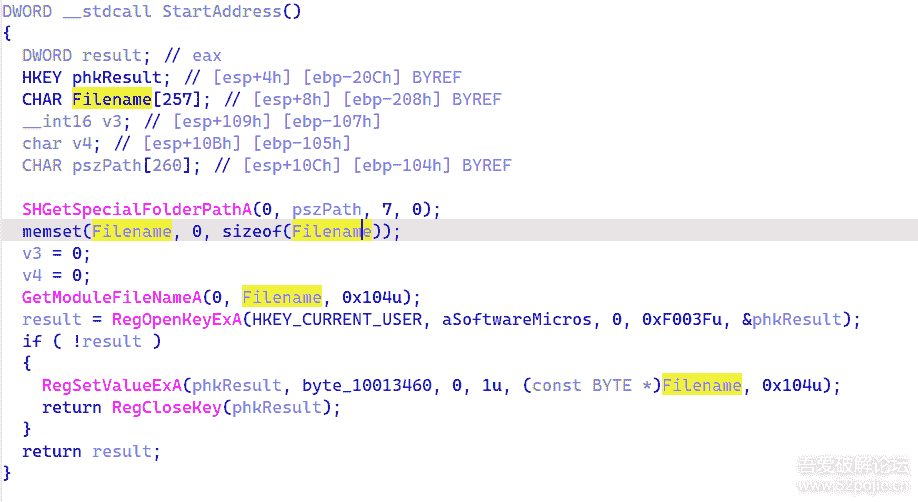

`image-20240813203054571.png` (58.77 KB, 下载次数: 0)

[href="forum.php?mod=attachment&aid=MjcxNzMzM3xlMDNiNjQwNHwxNzkzNTc2ODMzfDE2ODA4NnwxOTU0MjUz&nothumb=yes" target="_blank"](https://www.52pojie.cn/forum.php?mod=attachment&aid=MjcxNzMzM3xlMDNiNjQwNHwxNzkzNTc2ODMzfDE2ODA4NnwxOTU0MjUz&nothumb=yes)

2024-8-13 21:44 上传

从`URL`下载文件，写入构造的地址（就是前面获取的）。

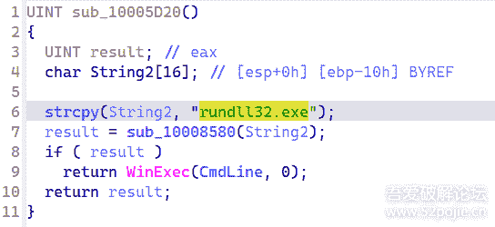

`image-20240813210033453.png` (27.55 KB, 下载次数: 0)

# 恶意软件分析记录

## 进程清理
查找`rundll32.exe`，找到就`taskkill`了。

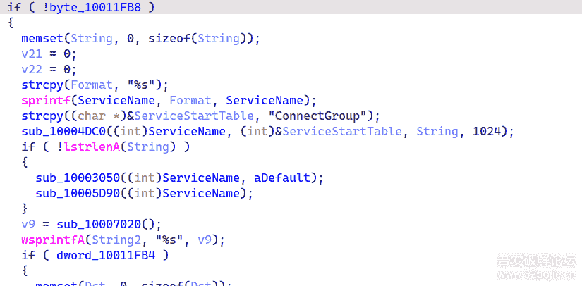

## 服务注册
注册成服务。

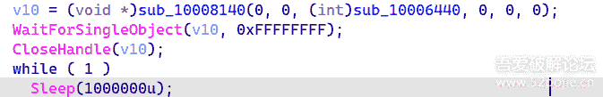

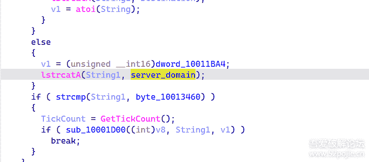

## C2 通信
等待服务器发送指令（域名不贴了，就是`server_domin`），控完`while(1) sleep`。

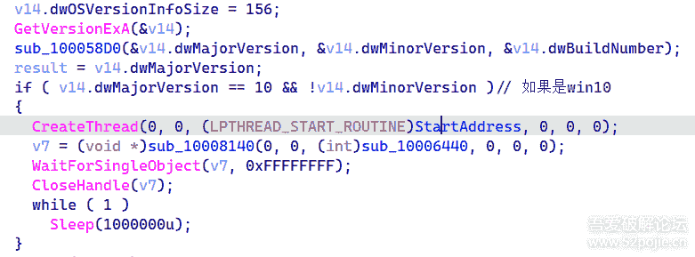

## 启动驻留
根据系统版本写启动项，驻留。其中win10就用前面分析的`StartAdress`。

`StudyAdress`

本来以为这才是正餐，分析了一下，大部分跟`dllmain`一样。。。

剩余部分有意思的函数

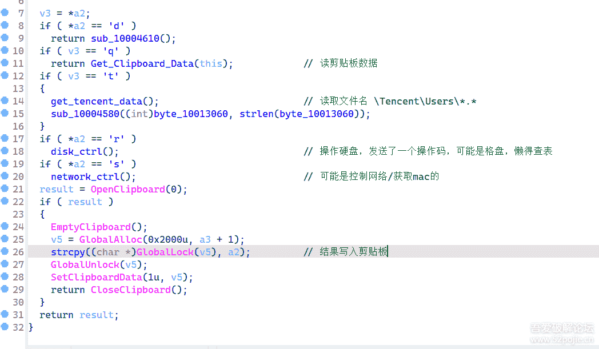

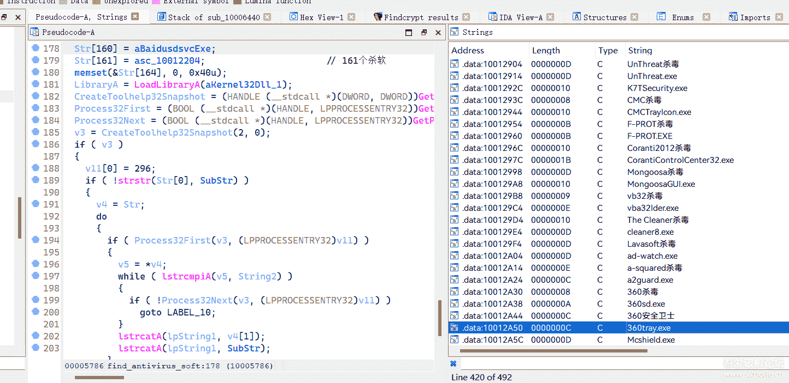

查找这161个杀软是否存在，看到这玩意我第一反应是真牛逼。。。。。

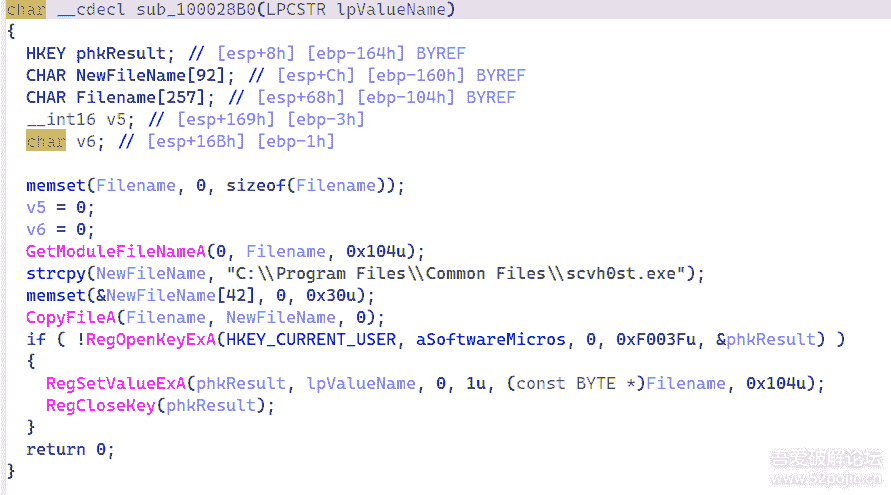

`scvh0st.exe`，6.

至此已经拆的差不多了，控制方发送字符组成的指令序列，在被控机执行。

另外有意思的是作者把网站的80端口伪装成了一个没备案被拦截的页面，`nmap`扫了只有22 443 80开着，微步沙箱测到是在`3xxxx`上通信的，后面有空在研究了。

感谢这位群友送的大礼物。
