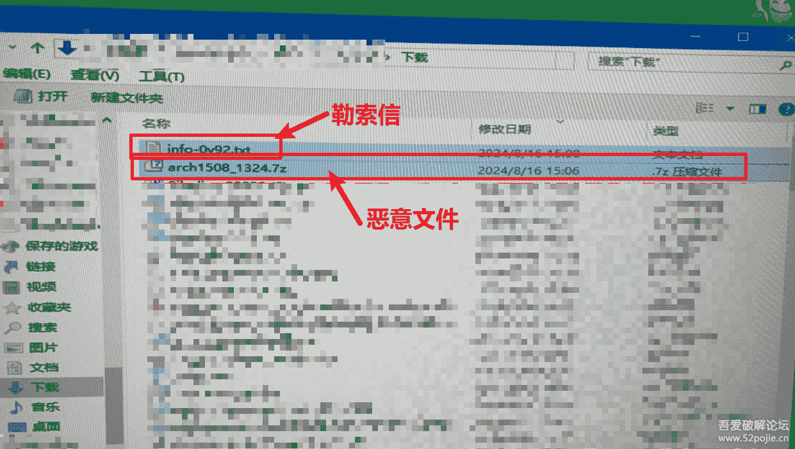
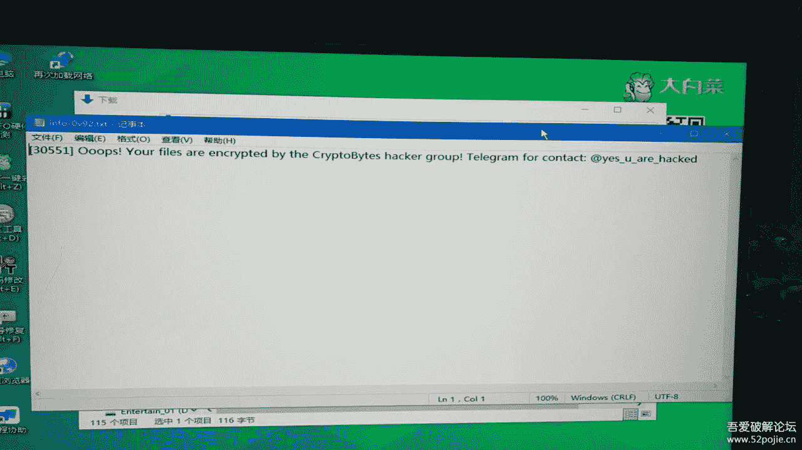
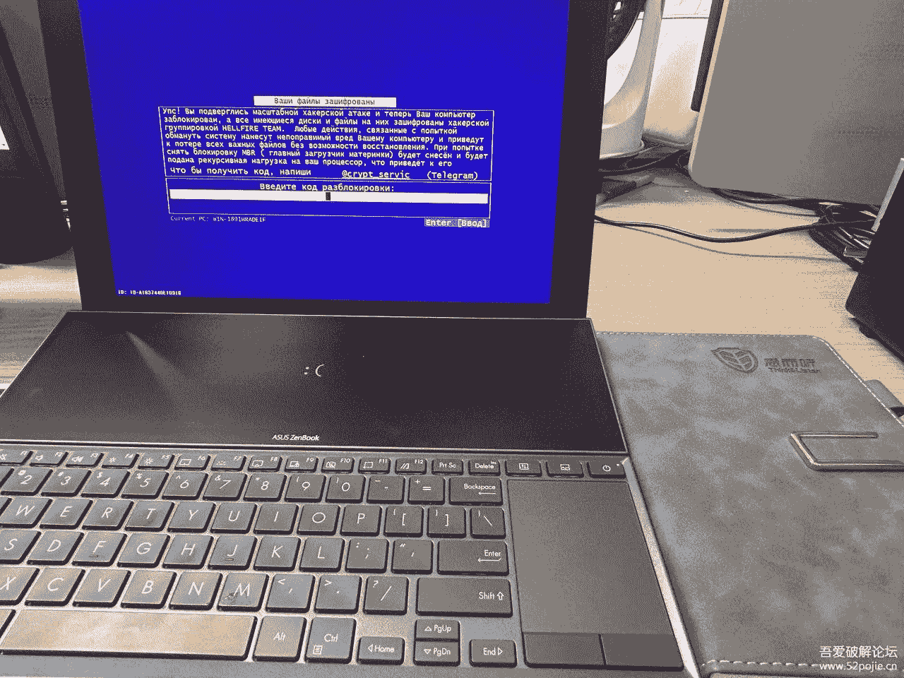
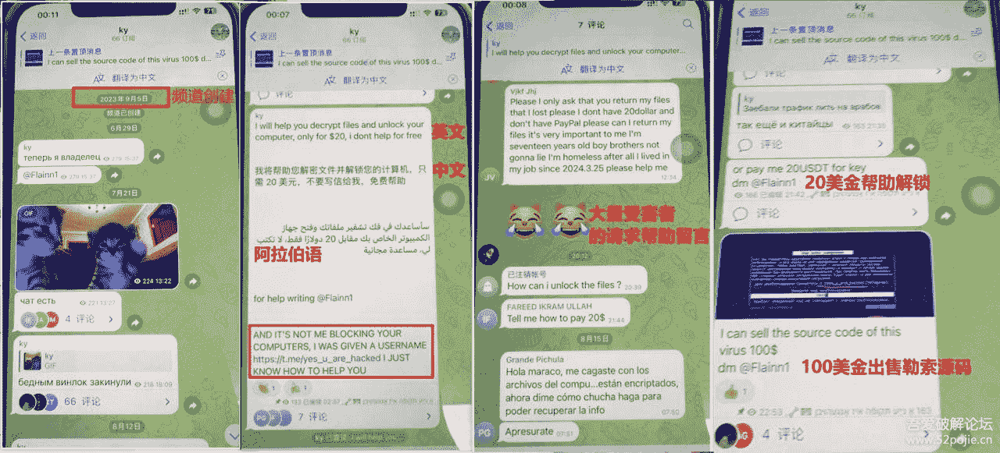
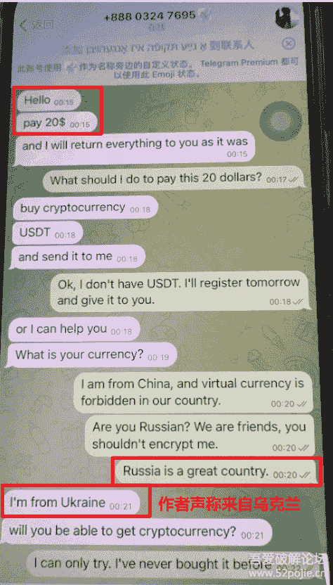

# [PC样本分析] 【独家破解】揭秘境外黑客组织的20美元锁机病毒：深度逆向分析+破解攻略！

- 原帖: https://www.52pojie.cn/forum.php?mod=viewthread&tid=1960658
- 抓取时间: 2026-11-01T23:47:09

## 1.背景

### 1.1 客户被锁机及盗号情况

在2024年8月17日，某客户联系上我们，称其重要的电脑系统被勒索加密，询问详情得知，该客户于24年8月16日下午从外网上下载了一个文件，该文件为其行业的一个专业工具的破解器（如下图的“`arch1508_1324.7z`”），解压运行之后电脑CPU开始飙升，磁盘读写拉满，短短半分钟内开始弹出勒索信息，

1.PNG (700.26 KB, 下载次数: 0)
[href="forum.php?mod=attachment&aid=MjcyMTIwNXxkNzliYjhjMXwxNzkzNTc2ODI3fDE2ODA4NnwxOTYwNjU4&nothumb=yes" target="_blank"](https://www.52pojie.cn/forum.php?mod=attachment&aid=MjcyMTIwNXxkNzliYjhjMXwxNzkzNTc2ODI3fDE2ODA4NnwxOTYwNjU4&nothumb=yes)
2024-9-2 17:49 上传

客户意识到情况不对之后，当即拔掉电源断开网线，但是再次重新进入系统也无法进入，通过`PE`进入系统之后，发现了勒索信txt文件，文件内容为“[30551] Ooops! Your files are encrypted by the `CryptoBytes` hacker group! Telegram for contact: `@yes_u_are_hacked` ”，该勒索信声称其为 `CryptoBytes`的黑客组织，需要通过telegram联系他们获取解密密钥。

2.JPG (73.34 KB, 下载次数: 1)
[href="forum.php?mod=attachment&aid=MjcyMTIwN3xhZjU1ZDIyZXwxNzkzNTc2ODI3fDE2ODA4NnwxOTYwNjU4&nothumb=yes" target="_blank"](https://www.52pojie.cn/forum.php?mod=attachment&aid=MjcyMTIwN3xhZjU1ZDIyZXwxNzkzNTc2ODI3fDE2ODA4NnwxOTYwNjU4&nothumb=yes)
2024-9-2 17:53 上传

由于客户的系统已无法正常进入，因此我们将恶意文件提取出来，在我们的模拟环境中运行，下图即为运行之后的勒索信息和加密后的屏幕界面。

3.JPG (217.94 KB, 下载次数: 0)
[href="forum.php?mod=attachment&aid=MjcyMTIwOHw0NjM0MjA4MHwxNzkzNTc2ODI3fDE2ODA4NnwxOTYwNjU4&nothumb=yes" target="_blank"](https://www.52pojie.cn/forum.php?mod=attachment&aid=MjcyMTIwOHw0NjM0MjA4MHwxNzkzNTc2ODI3fDE2ODA4NnwxOTYwNjU4&nothumb=yes)
2024-9-2 17:54 上传

最终在我们的协助下，我们成功帮助客户恢复了系统，同时对恶意文件的逆向分析发现了该恶意文件不仅仅是加密系统的行为，还有其他恶意行为，我们也都为客户一一排查清理了相关的病毒后门，本文便是对该恶意文件的详细文件，以及其释放的加密器的破解方案。

### 1.2 和锁机黑客的对话沟通

通过黑客留下的勒索信，关注了Telegram的频道`@yes_u_are_hacked`，可以看到该频道最早于2023年9月5日创建，并且频道内还留下了中、英、阿三语的勒索信息，以及大量受害者的求助留言，频道作者声称收费20美金帮助解锁被加密的电脑系统，以100美金出售该勒索软件源码。

4.JPG (150.22 KB, 下载次数: 1)
[href="forum.php?mod=attachment&aid=MjcyMTIwOXwxNGQzNzQ0ZXwxNzkzNTc2ODI3fDE2ODA4NnwxOTYwNjU4&nothumb=yes" target="_blank"](https://www.52pojie.cn/forum.php?mod=attachment&aid=MjcyMTIwOXwxNGQzNzQ0ZXwxNzkzNTc2ODI3fDE2ODA4NnwxOTYwNjU4&nothumb=yes)
2024-9-2 17:55 上传

频道中也留下提示，需要解锁联系 `@Flainn1`的telegram用户，在客户与该黑客的沟通谈判中还闹出了个乌龙，因为频道中有大量俄语内容，客户便以为是大毛黑客，结果是二毛……

5.JPG (520.45 KB, 下载次数: 1)
[href="forum.php?mod=attachment&aid=MjcyMTIxMHxmMWFjMDg0NXwxNzkzNTc2ODI3fDE2ODA4NnwxOTYwNjU4&nothumb=yes" target="_blank"](https://www.52pojie.cn/forum.php?mod=attachment&aid=MjcyMTIxMHxmMWFjMDg0NXwxNzkzNTc2ODI3fDE2ODA4NnwxOTYwNjU4&nothumb=yes)
2024-9-2 17:55 上传

可以看到该作者勒索20美金以`USDT`支付才会给解锁。既然客户寻找到了我们的帮助，那么这赎金是万万不能支付的，接下来我们将详细的分析该恶意文件的行为以及其加密器定的破解方法，无需缴纳一分钱赎金，解锁被加密的系统，赎金？给你付个🥚！

## 2.恶意文件基础信息

### 2.1 病毒基本信息

文件名: `AppFile.exe`
编译器:
大小: 755603531(720.60 MiB)
操作系统: Windows(2000)
架构: I386
模式: 32 位
类型: GUI
字节序: LE
MD5: 490f6e8fb98238758571d6aea92ccea4
SHA1: fb24934f5ce41901e8d138046d33f6af2d0bd2cc
SHA256: 280c852ae170716d0f6f3da8532b77b7d88f5abab084e630b0d94c4ed47e0198

文件名: `DocumentsKKFCAAKFBA.exe`
编译器:
大小: 285184(278.50 KiB)
操作系统: Windows(2000)
架构: I386
模式: 32 位
类型: GUI
字节序: LE
MD5：9cf14b0c62311b27ace3c25c21a722ff
SHA1：4037b8cee08d09db0fce2d485ca3a83ca3f4871a
SHA256: 6419a4d08ba5c07e14c2d75b14ea8da5f2f340d4747e498fe515685c48542b33

文件名: `lc.exe`
编译器:
大小: 184832(180.50 KiB)
操作系统: Windows(2000)
架构: I386
模式: 32 位
类型: GUI
字节序: LE
MD5：7924c0f21738fab05f61102c0caf3da2
SHA1：09e6fd5797381eeb9ec60d5214f2932154636247
SHA256：9b29f5a1f0b6c270c90b343f4c6d0e0843201d687068dc5273cbf5074083609f

### 2.2 勒索信

> [30551] Ooops! Your files are encrypted by the `CryptoBytes` hacker group! Telegram for contact: `@yes_u_are_hacked`

## 3.加密后文件分析

### 3.1威胁分析

病毒家族 | `CryptoBytes` （乌克兰） |
首次出现时间/捕获分析时间
