# [PC样本分析] 一个远控木马加载器的逻辑分析

- 原帖: https://www.52pojie.cn/forum.php?mod=viewthread&tid=1963598
- 抓取时间: 2026-11-01T23:47:05

本人不是干这行的，抽摸鱼时间断断续续分析的，用word文档记录，写完才发现图片压缩了，糊的一批，复制过来更糊了，凑合看吧。该样本是在7月份发现的，当时测试发现还可以过火绒的扫描，运行起来也没有告警（8月底看最新的更新已经可以检测出来了，火绒的反应还是非常快的），当时没时间，找工具人测了一下，如图：

图片.png (29.11 KB, 下载次数: 1)

[href="forum.php?mod=attachment&aid=MjcyMzA0MXxlOTBlNmIxMHwxNzkzNTc2ODIyfDE2ODA4NnwxOTYzNTk4&nothumb=yes" target="_blank"](https://www.52pojie.cn/forum.php?mod=attachment&aid=MjcyMzA0MXxlOTBlNmIxMHwxNzkzNTc2ODIyfDE2ODA4NnwxOTYzNTk4&nothumb=yes)

2024-9-11 18:54 上传

微步检测：

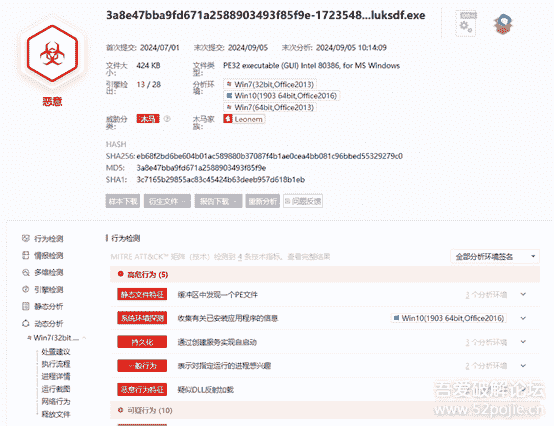

图片.png (122.85 KB, 下载次数: 2)

[href="forum.php?mod=attachment&aid=MjcyMzA0Mnw3ZmFiYTJjMXwxNzkzNTc2ODIyfDE2ODA4NnwxOTYzNTk4&nothumb=yes" target="_blank"](https://www.52pojie.cn/forum.php?mod=attachment&aid=MjcyMzA0Mnw3ZmFiYTJjMXwxNzkzNTc2ODIyfDE2ODA4NnwxOTYzNTk4&nothumb=yes)

2024-9-11 18:54 上传

该样本只是个加载器，本身中并没有微步分析出的恶意行为，恶意行为来源于本身解密出的`dll`和去网络上分多次下载的`dll`。由于篇幅原因加上`dll`暂未分析完（只是个运维马喽，技术不行也没时间，只能抽摸鱼时间分析），本文只分析该样本本身行为，`dll`行为日后补充。附上部分分析时打的断点：

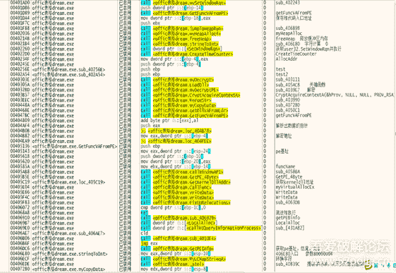

图片.png (280.5 KB, 下载次数: 2)

[href="forum.php?mod=attachment&aid=MjcyMzA0M3w0ODA0ODNlY3wxNzkzNTc2ODIyfDE2ODA4NnwxOTYzNTk4&nothumb=yes" target="_blank"](https://www.52pojie.cn/forum.php?mod=attachment&aid=MjcyMzA0M3w0ODA0ODNlY3wxNzkzNTc2ODIyfDE2ODA4NnwxOTYzNTk4&nothumb=yes)

2024-9-11 18:57 上传

## 基本信息

`HASH`

`SHA256`:eb68f2bd6be604b01ac589880b37087f4b1ae0cea4bb081c96bbed55329279c0

`MD5`:3a8e47bba9fd671a2588903493f85f9e

`SHA1`:3c7165b29855ac83c45424b63deeb957d618b1eb

通信IP:206.238.197.107 www.yydsyoyo.com 端口：8888

### 通信流量

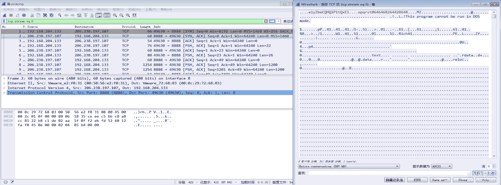

图片.png (407.16 KB, 下载次数: 2)

[href="forum.php?mod=attachment&aid=MjcyMzA0NHw0NjZmYmVjNnwxNzkzNTc2ODIyfDE2ODA4NnwxOTYzNTk4&nothumb=yes" target="_blank"](https://www.52pojie.cn/forum.php?mod=attachment&aid=MjcyMzA0NHw0NjZmYmVjNnwxNzkzNTc2ODIyfDE2ODA4NnwxOTYzNTk4&nothumb=yes)

2024-9-11 18:59 上传

没定位到落地文件，应该是直接从缓冲区加载进内存的，从数据包中提取出该`dll`查看导出表可以基本确定是个远控木马了，下载的`dll`名字为`install.pg.dll`：

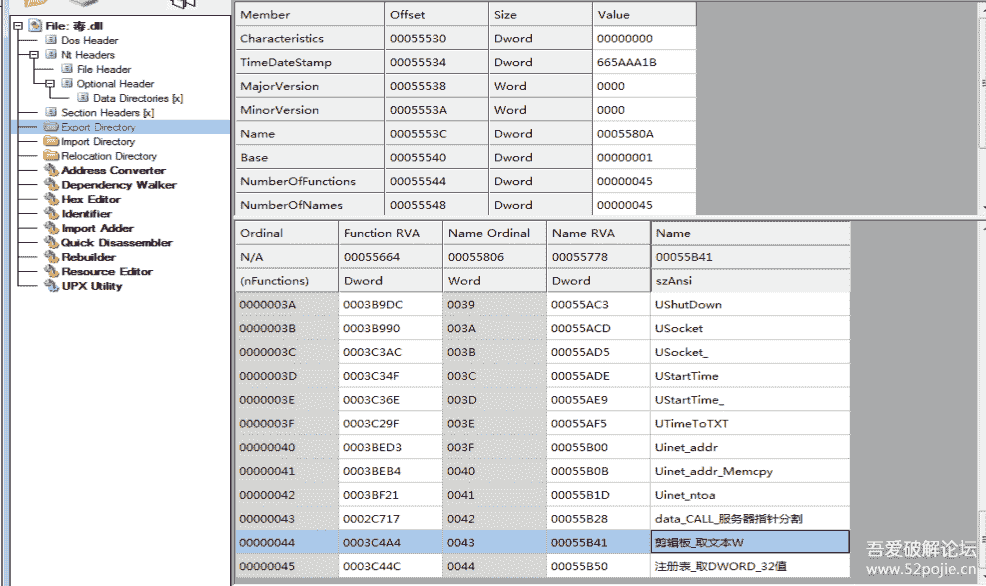

图片.png (196.41 KB, 下载次数: 2)

[href="forum.php?mod=attachment&aid=MjcyMzA0NXw5ZjA1YzdlNHwxNzkzNTc2ODIyfDE2ODA4NnwxOTYzNTk4&nothumb=yes" target="_blank"](https://www.52pojie.cn/forum.php?mod=attachment&aid=MjcyMzA0NXw5ZjA1YzdlNHwxNzkzNTc2ODIyfDE2ODA4NnwxOTYzNTk4&nothumb=yes)

2024-9-11 19:02 上传

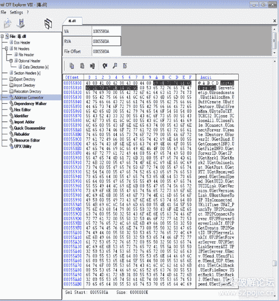

图片.png (294.4 KB, 下载次数: 2)

[href="forum.php?mod=attachment&aid=MjcyMzA0NnxjZTg0ZTUxMHwxNzkzNTc2ODIyfDE2ODA4NnwxOTYzNTk4&nothumb=yes" target="_blank"](https://www.52pojie.cn/forum.php?mod=attachment&aid=MjcyMzA0NnxjZTg0ZTUxMHwxNzkzNTc2ODIyfDE2ODA4NnwxOTYzNTk4&nothumb=yes)

2024-9-11 19:03 上传

该样本执行后会将本身重命名后写入到`public/download`下，首次名字为`RLOJNg.exe`，以后如果再次运行，它会以其他随机名字写入，文件日期可以发现是修改过的（这个日期有意思）。

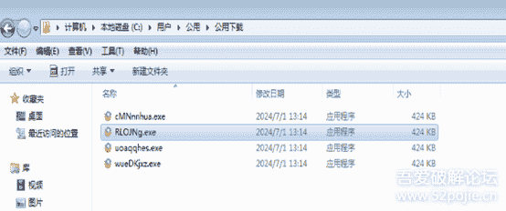

图片.png (60.74 KB, 下载次数: 1)

[href="forum.php?mod=attachment&aid=MjcyMzA0N3xlYTgyYmFiYnwxNzkzNTc2ODIyfDE2ODA4NnwxOTYzNTk4&nothumb=yes" target="_blank"](https://www.52pojie.cn/forum.php?mod=attachment&aid=MjcyMzA0N3xlYTgyYmFiYnwxNzkzNTc2ODIyfDE2ODA4NnwxOTYzNTk4&nothumb=yes)

2024-9-11 19:04 上传

最后会启动`ROLJNg`来接替自己并删除自身，删除自身用了点小技巧，并未调用删除文件的`api`，而是使用`TerminateProcess`无条件强制退出程序来间接删除自身文件。从进程来看其下载了一个`dll`文件，第一阶段只是解密并加载`install.dat`的`dll`文件。

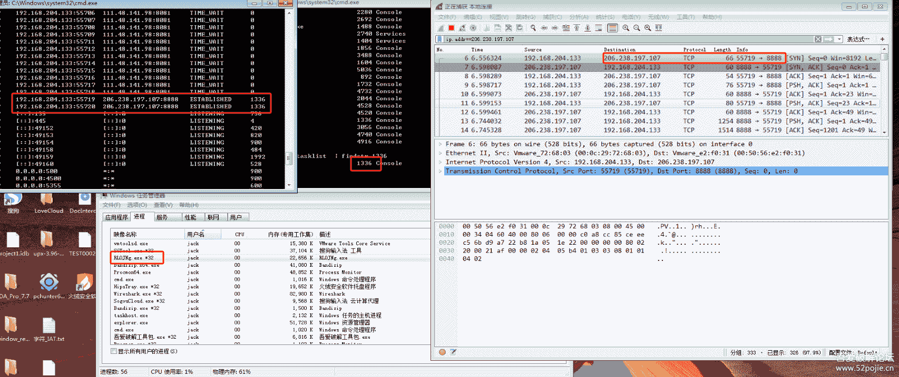

图片.png (659.34 KB, 下载次数: 3)

[href="forum.php?mod=attachment&aid=MjcyMzA0OHw3NmQyNjY1ZnwxNzkzNTc2ODIyfDE2ODA4NnwxOTYzNTk4&nothumb=yes" target="_blank"](https://www.52pojie.cn/forum.php?mod=attachment&aid=MjcyMzA0OHw3NmQyNjY1ZnwxNzkzNTc2ODIyfDE2ODA4NnwxOTYzNTk4&nothumb=yes)

2024-9-11 19:05 上传

PE文件中删除了调试信息，符号表异常，因此函数功能基本无法识别。

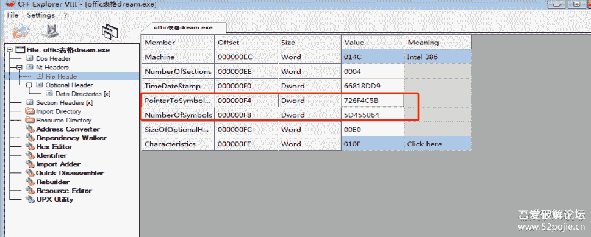

图片.png (107.44 KB, 下载次数: 2)

[href="forum.php?mod=attachment&aid=MjcyMzA0OXxlOGQwNzZjOXwxNzkzNTc2ODIyfDE2ODA4NnwxOTYzNTk4&nothumb=yes" target="_blank"](https://www.52pojie.cn/forum.php?mod=attachment&aid=MjcyMzA0OXxlOGQwNzZjOXwxNzkzNTc2ODIyfDE2ODA4NnwxOTYzNTk4&nothumb=yes)

2024-9-11 19:08 上传

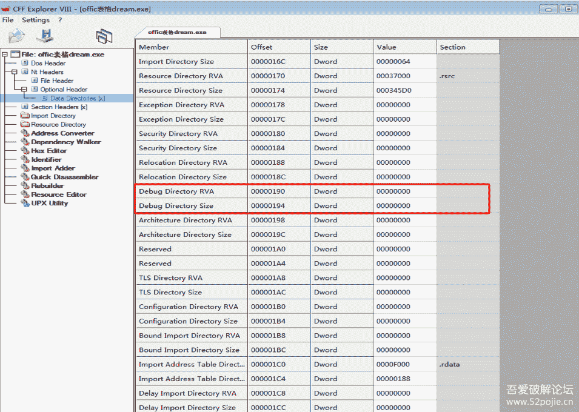

图片.png (224.47 KB, 下载次数: 2)

[href="forum.php?mod=attachment&aid=MjcyMzA1MHwzMjUxY2Q4M3wxNzkzNTc2ODIyfDE2ODA4NnwxOTYzNTk4&nothumb=yes" target="_blank"](https://www.52pojie.cn/forum.php?mod=attachment&aid=MjcyMzA1MHwzMjUxY2Q4M3wxNzkzNTc2ODIyfDE2ODA4NnwxOTYzNTk4&nothumb=yes)

2024-9-11 19:09 上传

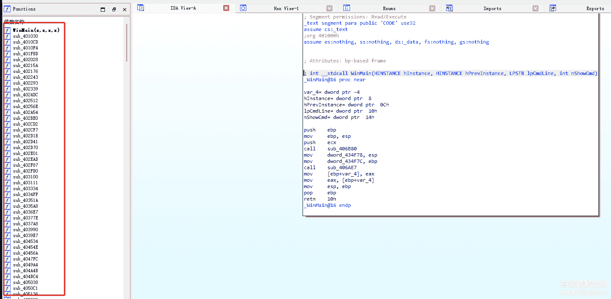

图片.png (72.63 KB, 下载次数: 3)

[href="forum.php?mod=attachment&aid=MjcyMzA1MXxkZjZjZTk2OXwxNzkzNTc2ODIyfDE2ODA4NnwxOTYzNTk4&nothumb=yes" target="_blank"](https://www.52pojie.cn/forum.php?mod=attachment&aid=MjcyMzA1MXxkZjZjZTk2OXwxNzkzNTc2ODIyfDE2ODA4NnwxOTYzNTk4&nothumb=yes)

2024-9-11 19:11 上传

## 代码分析

由于断断续续的分析，`x64dbg`很容易跑飞的BUG，其中涉及到动态调试的地方可能有地址上下衔接不上，这是由于多次运行申请堆内存随机导致的，程序步骤没有问题，如有错误还望大佬指正。

主程序逻辑：获取系统版本信息后开始执行，因为在`sub_406AE7`中最终会跳进`dll`执行后强制退出，所以整个`WinMain`不会全部执行完。

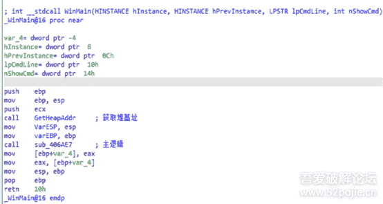

图片.png (57.16 KB, 下载次数: 1)

[href="forum.php?mod=attachment&aid=MjcyMzA1Mnw3MTFmMzQxMXwxNzkzNTc2ODIyfDE2ODA4NnwxOTYzNTk4&nothumb=yes" target="_blank"](https://www.52pojie.cn/forum.php?mod=attachment&aid=MjcyMzA1Mnw3MTFmMzQxMXwxNzkzNTc2ODIyfDE2ODA4NnwxOTYzNTk4&nothumb=yes)

2024-9-11 19:13 上传

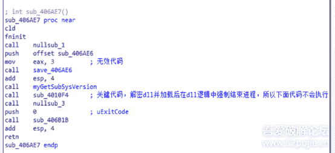

图片.png (49.29 KB, 下载次数: 2)

[href="forum.php?mod=attachment&aid=MjcyMzA1M3w1ODY1NzFjOHwxNzkzNTc2ODIyfDE2ODA4NnwxOTYzNTk4&nothumb=yes" target="_blank"](https://www.52pojie.cn/forum.php?mod=attachment&aid=MjcyMzA1M3w1ODY1NzFjOHwxNzkzNTc2ODIyfDE2ODA4NnwxOTYzNTk4&nothumb=yes)

2024-9-11 19:14 上传

获取版本号信息`myGetSubSysVersion`部分主要代码：创建`0x18`字节缓冲区，获取`NtQueryInformationProcess`的地址并调用，从获取的`0x18`字节中获取到`peb`基址，然后经过偏移找到版本信息：

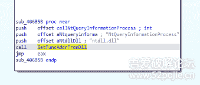

图片.png (20.86 KB, 下载次数: 3)

[href="forum.php?mod=attachment&aid=MjcyMzA1NHw0YzIzOWRhNXwxNzkzNTc2ODIyfDE2ODA4NnwxOTYzNTk4&nothumb=yes" target="_blank"](https://www.52pojie.cn/forum.php?mod=attachment&aid=MjcyMzA1NHw0YzIzOWRhNXwxNzkzNTc2ODIyfDE2ODA4NnwxOTYzNTk4&nothumb=yes)

2024-9-11 19:15 上传

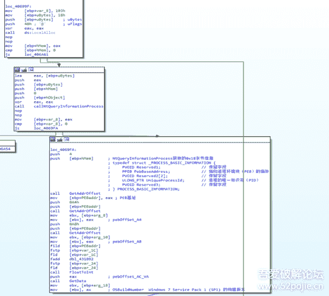

图片.png (95 KB, 下载次数: 1)

[href="forum.php?mod=attachment&aid=MjcyMzA1NXwwOTdiMDBlZXwxNzkzNTc2ODIyfDE2ODA4NnwxOTYzNTk4&nothumb=yes" target="_blank"](https://www.52pojie.cn/forum.php?mod=attachment&aid=MjcyMzA1NXwwOTdiMDBlZXwxNzkzNTc2ODIyfDE2ODA4NnwxOTYzNTk4&nothumb=yes)

2024-9-11 19:15 上传

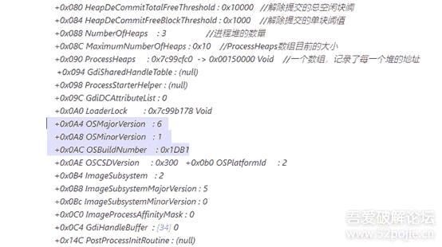

图片.png (110.04 KB, 下载次数: 2)

[href="forum.php?mod=attachment&aid=MjcyMzA1Nnw1YThiMmVhZXwxNzkzNTc2ODIyfDE2ODA4NnwxOTYzNTk4&nothumb=yes" target="_blank"](https://www.52pojie.cn/forum.php?mod=attachment&aid=MjcyMzA1Nnw1YThiMmVhZXwxNzkzNTc2ODIyfDE2ODA4NnwxOTYzNTk4&nothumb=yes)

2024-9-11 19:16 上传

### 得到结果

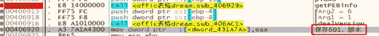

图片.png (49.42 KB, 下载次数: 1)

[href="forum.php?mod=attachment&aid=MjcyMzA1N3w1YTZhZGIzN3wxNzkzNTc2ODIyfDE2ODA4NnwxOTYzNTk4&nothumb=yes" target="_blank"](https://www.52pojie.cn/forum.php?mod=attachment&aid=MjcyMzA1N3w1YTZhZGIzN3wxNzkzNTc2ODIyfDE2ODA4NnwxOTYzNTk4&nothumb=yes)

2024-9-11 19:16 上传

关键的代码中使用了很多迷惑性的重复代码逻辑来增加分析复杂度（也可能是迷惑安全软件的检查，不排除有其他用处，毕竟它换名字“`ROLJNg.exe`”换路径重新执行了，在之后重启阶段的动作暂未分析，待分析后补充。目前阶段可视为无用代码），实际是无用的。重复代码中使用字符转数字来计算出一个大大超出屏幕的坐标值，最终为`GetPointWindowText`和`SetWindowRgn`来服务，但是这两个`api`由于故意传递违规参数实际执行都是无效的（传入坐标大大超出了屏幕范围），与实际要执行的恶意代码也无关联。

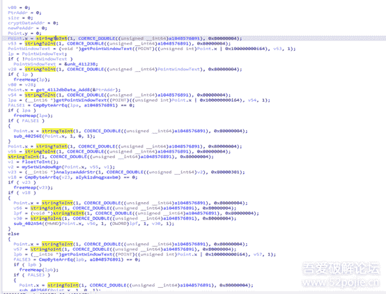

图片.png (138.76 KB, 下载次数: 3)

[附件](https://www.52pojie.cn/forum.php?mod=attachment&aid=MjcyMzA1OHw0ZWYwOWY1YnwxNzkzNTc2ODIyfDE2ODA4NnwxOTYzNTk4&nothumb=yes)

2024-9-11 19:17 上传

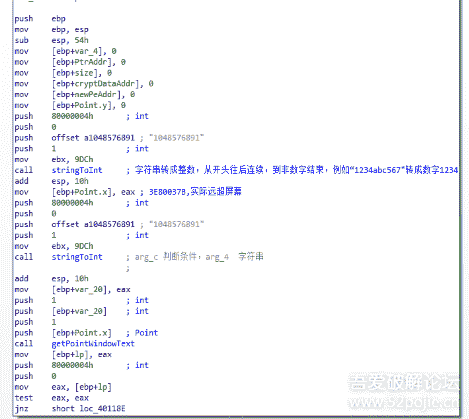

图片.png (60.97 KB, 下载次数: 3)

[附件](https://www.52pojie.cn/forum.php?mod=attachment&aid=MjcyMzA1OXw3NjcxMjMyOXwxNzkzNTc2ODIyfDE2ODA4NnwxOTYzNTk4&nothumb=yes)

2024-9-11 19:18 上传

可以看到执行后缓冲区没有任何变化：

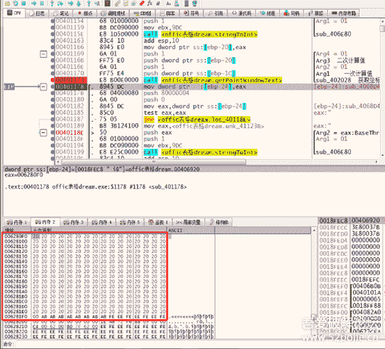

图片.png (311.28 KB, 下载次数: 3)

[附件](https://www.52pojie.cn/forum.php?mod=attachment&aid=MjcyMzA2MHw4MzljNjQzYXwxNzkzNTc2ODIyfDE2ODA4NnwxOTYzNTk4&nothumb=yes)

2024-9-11 19:19 上传

密文地址在pe的固定`4112DB`位置，格式为01+大小+pe密文（该样本很多地方都是这种格式的数据组成结构）：

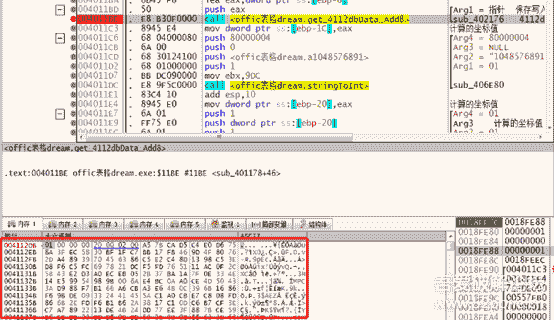

图片.png (201.49 KB, 下载次数: 3)

[附件](https://www.52pojie.cn/forum.php?mod=attachment&aid=MjcyMzA2MXw0NWU2NWQ5M3wxNzkzNTc2ODIyfDE2ODA4NnwxOTYzNTk4&nothumb=yes)

2024-9-11 19:20 上传

F5的类C代码可以更直观的看到中间确实有很多的无用代码干扰分析，实际功能之间跨度很大：

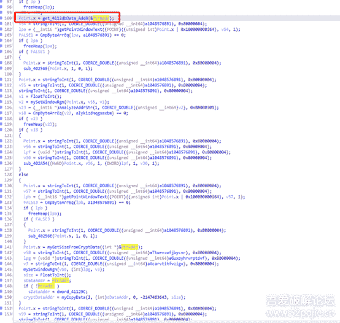

图片.png (184.42 KB, 下载次数: 2)

[附件](https://www.52pojie.cn/forum.php?mod=attachment&aid=MjcyMzA2Mnw3ZDRhNGZhYXwxNzkzNTc2ODIyfDE2ODA4NnwxOTYzNTk4&nothumb=yes)

2024-9-11 19:21 上传

在复制密文的逻辑中，前段也用了重复的老套路来干扰，即`GetPointWindowText`：

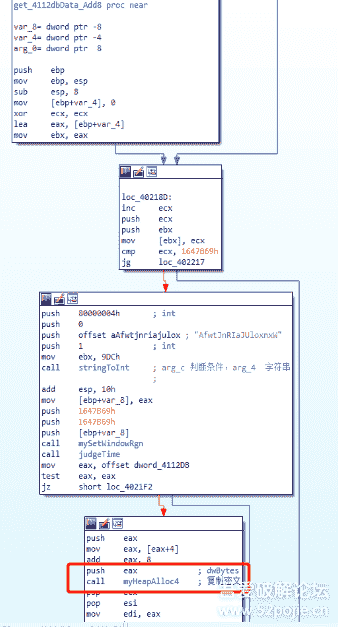

图片.png (64.07 KB, 下载次数: 3)

[附件](https://www.52pojie.cn/forum.php?mod=attachment&aid=MjcyMzA2M3wzMmQwYWJjYnwxNzkzNTc2ODIyfDE2ODA4NnwxOTYzNTk4&nothumb=yes)

2024-9-11 19:23 上传

干扰代码中创建计时器验证时间这一段着实没想明白目的是什么，实际动态调试好像也没有什么实际效果：

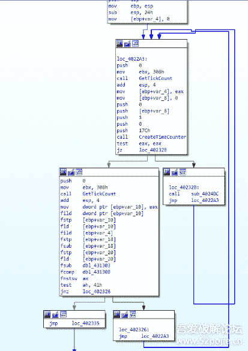

图片.png (64.77 KB, 下载次数: 3)

[附件](https://www.52pojie.cn/forum.php?mod=attachment&aid=MjcyMzA2NHxhMzdhM2RlOXwxNzkzNTc2ODIyfDE2ODA4NnwxOTYzNTk4&nothumb=yes)

2024-9-11 19:24 上传

动态调试也可以印证密文确实就是在`4112DB`处：

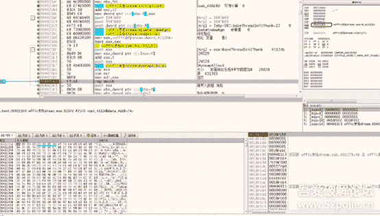

图片.png (183.09 KB, 下载次数: 3)

[附件](https://www.52pojie.cn/forum.php?mod=attachment&aid=MjcyMzA2NXxiMGRmM2UwMnwxNzkzNTc2ODIyfDE2ODA4NnwxOTYzNTk4&nothumb=yes)

2024-9-11 19:25 上传

获取密文后再次复制一份并调用解密函数进行解密：

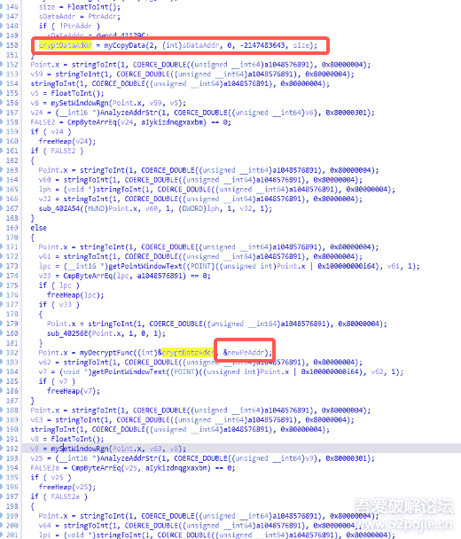

图片.png (187.89 KB, 下载次数: 3)

[附件](https://www.52pojie.cn/forum.php?mod=attachment&aid=MjcyMzA2Nnw5ZjEzOTFkZHwxNzkzNTc2ODIyfDE2ODA4NnwxOTYzNTk4&nothumb=yes)

2024-9-11 19:26 上传

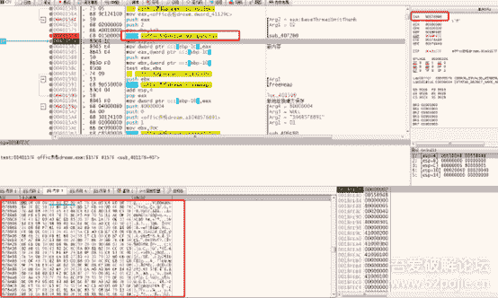

图片.png (188.91 KB, 下载次数: 3)

[附件](https://www.52pojie.cn/forum.php?mod=attachment&aid=MjcyMzA2N3w4MmZhNTBlMXwxNzkzNTc2ODIyfDE2ODA4NnwxOTYzNTk4&nothumb=yes)

2024-9-11 19:26 上传

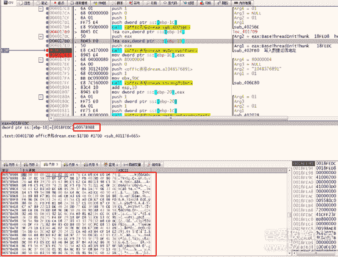

图片.png (256.87 KB, 下载次数: 3)

[附件](https://www.52pojie.cn/forum.php?mod=attachment&aid=MjcyMzA2OHxhMTNhNWVhNnwxNzkzNTc2ODIyfDE2ODA4NnwxOTYzNTk4&nothumb=yes)

2024-9-11 19:27 上传

图片.png (256.87 KB, 下载次数: 3)

[附件](https://www.52pojie.cn/forum.php?mod=attachment&aid=MjcyMzA3NHw0ZjFiNmU1ZXwxNzkzNTc2ODIyfDE2ODA4NnwxOTYzNTk4&nothumb=yes)

2024-9-11 19:36 上传

解密函数分析：获取字符串后进入解密逻辑：

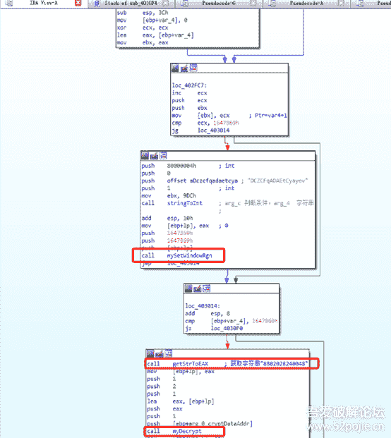

图片.png (94.08 KB, 下载次数: 3)

[附件](https://www.52pojie.cn/forum.php?mod=attachment&aid=MjcyMzA3NXxkZjZjYzcxZnwxNzkzNTc2ODIyfDE2ODA4NnwxOTYzNTk4&nothumb=yes)

2024-9-11 19:38 上传

`MyDecrypt`逻辑：

获取加密服务：

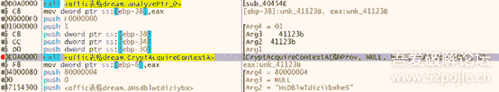

图片.png (64.07 KB, 下载次数: 3)

[附件](https://www.52pojie.cn/forum.php?mod=attachment&aid=MjcyMzA3Nnw0NmU2MTg4MnwxNzkzNTc2ODIyfDE2ODA4NnwxOTYzNTk4&nothumb=yes)

2024-9-11 19:39 上传

获取字符串（解密获得`advapi32.dll`字符串）并截取，&$分隔：

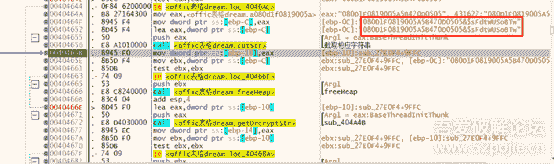

图片.png (125.94 KB, 下载次数: 3)

[附件](https://www.52pojie.cn/forum.php?mod=attachment&aid=MjcyMzA4MXwyYTIxZjEzNXwxNzkzNTc2ODIyfDE2ODA4NnwxOTYzNTk4&nothumb=yes)

2024-9-11 19:43 上传

解密字符串算法：

获取密文长度后获取需要异或的参数并循环遍历进行解密，异或参数来源于`4316AC`数据的计算：

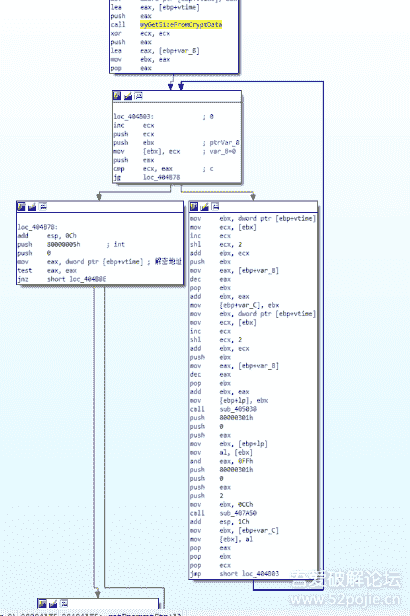

图片.png (75.36 KB, 下载次数: 1)

[附件](https://www.52pojie.cn/forum.php?mod=attachment&aid=MjcyMzA4MnxjM2M3YTM5NnwxNzkzNTc2ODIyfDE2ODA4NnwxOTYzNTk4&nothumb=yes)

2024-9-11 19:43 上传

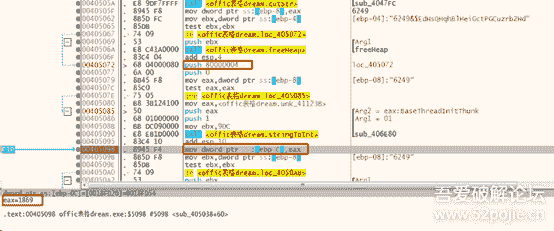

图片.png (114.54 KB, 下载次数: 2)

[附件](https://www.52pojie.cn/forum.php?mod=attachment&aid=MjcyMzA4M3w4ZWQwMGI3ZXwxNzkzNTc2ODIyfDE2ODA4NnwxOTYzNTk4&nothumb=yes)

2024-9-11 19:44 上传

异或解密：

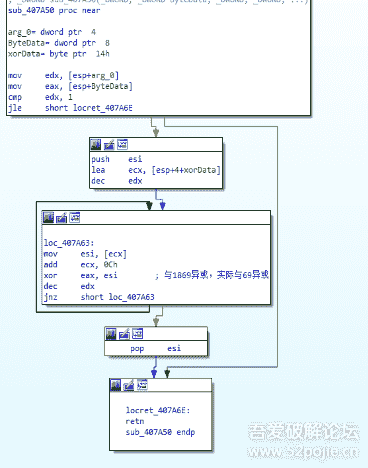

图片.png (43.89 KB, 下载次数: 4)

[附件](https://www.52pojie.cn/forum.php?mod=attachment&aid=MjcyMzA4NHxiMjA0Mzc1ZXwxNzkzNTc2ODIyfDE2ODA4NnwxOTYzNTk4&nothumb=yes)

2024-9-11 19:44 上传

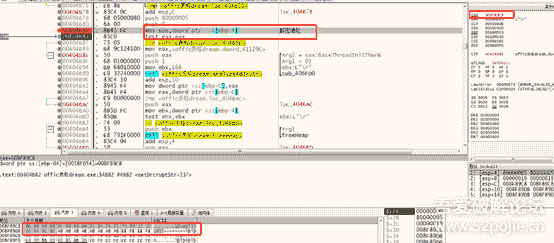

图片.png (126.2 KB, 下载次数: 2)

[附件](https://www.52pojie.cn/forum.php?mod=attachment&aid=MjcyMzA4NXxkNjNlYTg1MnwxNzkzNTc2ODIyfDE2ODA4NnwxOTYzNTk4&nothumb=yes)

2024-9-11 19:45 上传

接下来就是获取该`dll`的地址，该程序并没使用`Loadlibrary`来获取，而是自己编写代码使用了比较通用的一种方式：从`peb`的`ldr`中去遍历模块，取出模块名字并跟解密的字符串进行比较，找到后获取其基址，即`dll`的句柄了。

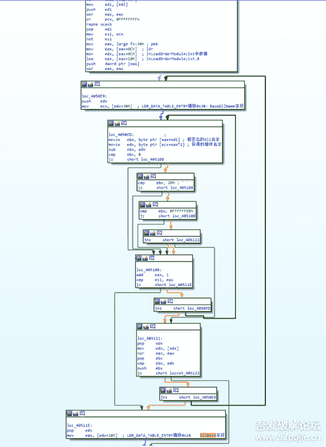

图片.png (99.76 KB, 下载次数: 1)

[附件](https://www.52pojie.cn/forum.php?mod=attachment&aid=MjcyMzA4NnxiYWU2YjM1MHwxNzkzNTc2ODIyfDE2ODA4NnwxOTYzNTk4&nothumb=yes)

2024-9-11 19:46 上传

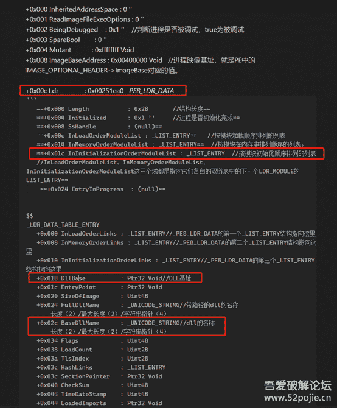

图片.png (258.12 KB, 下载次数: 3)

[附件](https://www.52pojie.cn/forum.php?mod=attachment&aid=MjcyMzA4NnxiYWU2YjM1MHwxNzkzNTc2ODIyfDE2ODA4NnwxOTYzNTk4&nothumb=yes)

2024-9-11 19:46 上传

图片.png (35.21 KB, 下载次数: 3)

# 逆向分析笔记

[href="forum.php?mod=attachment&aid=MjcyMzA4N3w3NjhjY2FhM3wxNzkzNTc2ODIyfDE2ODA4NnwxOTYzNTk4&nothumb=yes" target="_blank"](https://www.52pojie.cn/forum.php?mod=attachment&aid=MjcyMzA4N3w3NjhjY2FhM3wxNzkzNTc2ODIyfDE2ODA4NnwxOTYzNTk4&nothumb=yes)

2024-9-11 19:46 上传

## 解密 `CryptAcquireContextA` 字符串

接着用上述异或老套路，解密出“`CryptAcquireContextA`”字符串：

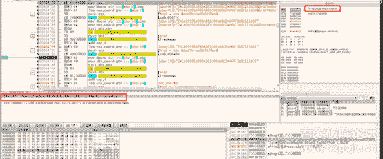

图片.png (147.05 KB, 下载次数: 3)

[href="forum.php?mod=attachment&aid=MjcyMzA4OHxiMTZiYmE2ZHwxNzkzNTc2ODIyfDE2ODA4NnwxOTYzNTk4&nothumb=yes" target="_blank"](https://www.52pojie.cn/forum.php?mod=attachment&aid=MjcyMzA4OHxiMTZiYmE2ZHwxNzkzNTc2ODIyfDE2ODA4NnwxOTYzNTk4&nothumb=yes)

2024-9-11 19:47 上传

## 自实现导出表查找

自己实现的代码查找模块导出表，遍历导出表找到函数地址，这个函数在后面会多次用到，包括最后加载解密的pe后跳进去执行，详细解析主要代码：

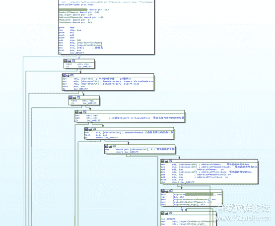

图片.png (77.62 KB, 下载次数: 2)

[href="forum.php?mod=attachment&aid=MjcyMzA4OXw2N2UyZWMzMXwxNzkzNTc2ODIyfDE2ODA4NnwxOTYzNTk4&nothumb=yes" target="_blank"](https://www.52pojie.cn/forum.php?mod=attachment&aid=MjcyMzA4OXw2N2UyZWMzMXwxNzkzNTc2ODIyfDE2ODA4NnwxOTYzNTk4&nothumb=yes)

2024-9-11 19:49 上传

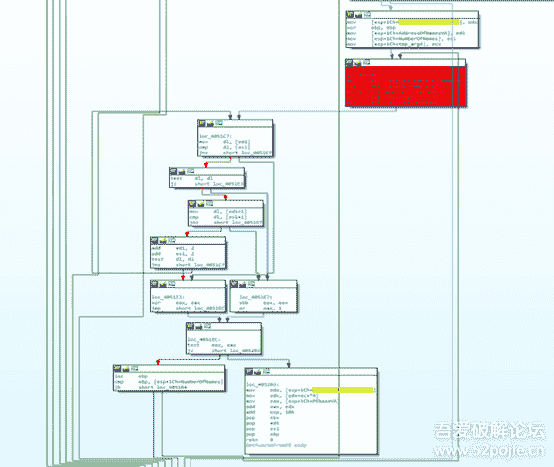

图片.png (69.6 KB, 下载次数: 2)

[href="forum.php?mod=attachment&aid=MjcyMzA5MHw2NTM1ZTIyMnwxNzkzNTc2ODIyfDE2ODA4NnwxOTYzNTk4&nothumb=yes" target="_blank"](https://www.52pojie.cn/forum.php?mod=attachment&aid=MjcyMzA5MHw2NTM1ZTIyMnwxNzkzNTc2ODIyfDE2ODA4NnwxOTYzNTk4&nothumb=yes)

2024-9-11 19:49 上传

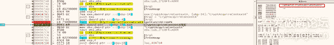

图片.png (53.28 KB, 下载次数: 2)

[href="forum.php?mod=attachment&aid=MjcyMzA5MXw2ZjhjM2JhYXwxNzkzNTc2ODIyfDE2ODA4NnwxOTYzNTk4&nothumb=yes" target="_blank"](https://www.52pojie.cn/forum.php?mod=attachment&aid=MjcyMzA5MXw2ZjhjM2JhYXwxNzkzNTc2ODIyfDE2ODA4NnwxOTYzNTk4&nothumb=yes)

2024-9-11 19:49 上传

## 调用 `CryptAcquireContextA` 获取加密服务

在调用`CryptAcquireContextA`获取加密服务时也用了点技巧，除api需要的五个参数外压入了api的`VA`，并使用`retn`跳转过去执行以获取加密服务：

图片.png (48.29 KB, 下载次数: 2)

[href="forum.php?mod=attachment&aid=MjcyMzA5MnwxMmZkNDVjY3wxNzkzNTc2ODIyfDE2ODA4NnwxOTYzNTk4&nothumb=yes" target="_blank"](https://www.52pojie.cn/forum.php?mod=attachment&aid=MjcyMzA5MnwxMmZkNDVjY3wxNzkzNTc2ODIyfDE2ODA4NnwxOTYzNTk4&nothumb=yes)

2024-9-11 19:50 上传

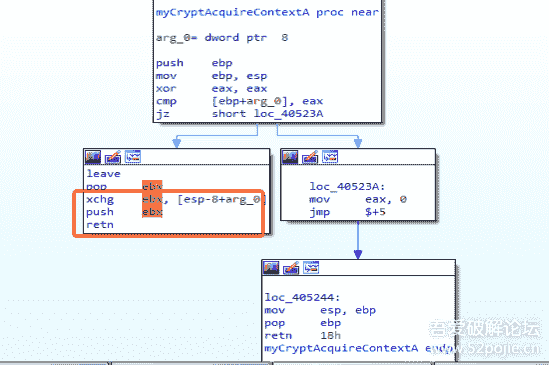

图片.png (49.24 KB, 下载次数: 3)

[href="forum.php?mod=attachment&aid=MjcyMzA5M3wzOTAzYzUyMXwxNzkzNTc2ODIyfDE2ODA4NnwxOTYzNTk4&nothumb=yes" target="_blank"](https://www.52pojie.cn/forum.php?mod=attachment&aid=MjcyMzA5M3wzOTAzYzUyMXwxNzkzNTc2ODIyfDE2ODA4NnwxOTYzNTk4&nothumb=yes)

2024-9-11 19:51 上传

## 导入密钥

然后是导入密钥，密钥来源于三个数据的合并，格式一如既往（01+长度+数据）：

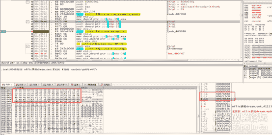

图片.png (167.61 KB, 下载次数: 3)

[href="forum.php?mod=attachment&aid=MjcyMzA5NHwxNGQ2NjBmOXwxNzkzNTc2ODIyfDE2ODA4NnwxOTYzNTk4&nothumb=yes" target="_blank"](https://www.52pojie.cn/forum.php?mod=attachment&aid=MjcyMzA5NHwxNGQ2NjBmOXwxNzkzNTc2ODIyfDE2ODA4NnwxOTYzNTk4&nothumb=yes)

2024-9-11 19:51 上传

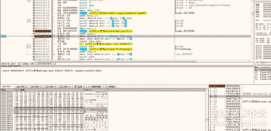

图片.png (160.78 KB, 下载次数: 2)

[href="forum.php?mod=attachment&aid=MjcyMzA5NXw5M2RkNWNlNnwxNzkzNTc2ODIyfDE2ODA4NnwxOTYzNTk4&nothumb=yes" target="_blank"](https://www.52pojie.cn/forum.php?mod=attachment&aid=MjcyMzA5NXw5M2RkNWNlNnwxNzkzNTc2ODIyfDE2ODA4NnwxOTYzNTk4&nothumb=yes)

2024-9-11 19:52 上传

经过一大段无意义的代码后开始导入密钥，导入密钥函数中同样使用异或解密密文获得字符串`advapi32.dll`、`kernel32.dll`、`LoadLibraryA`、`CryptImportKey`、`GetProcAddress`，然后经过ldr遍历获取地址，最后入栈`retn`执行，至此获取了加密服务并导入了密钥：

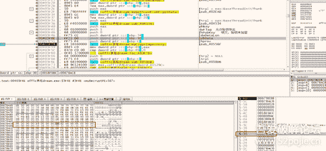

图片.png (166.63 KB, 下载次数: 3)

[href="forum.php?mod=attachment&aid=MjcyMzA5NnxmZjg3NTM2MnwxNzkzNTc2ODIyfDE2ODA4NnwxOTYzNTk4&nothumb=yes" target="_blank"](https://www.52pojie.cn/forum.php?mod=attachment&aid=MjcyMzA5NnxmZjg3NTM2MnwxNzkzNTc2ODIyfDE2ODA4NnwxOTYzNTk4&nothumb=yes)

2024-9-11 19:53 上传

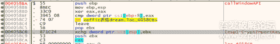

图片.png (47.68 KB, 下载次数: 3)

[href="forum.php?mod=attachment&aid=MjcyMzA5N3w1ZmQ3Y2JlNnwxNzkzNTc2ODIyfDE2ODA4NnwxOTYzNTk4&nothumb=yes" target="_blank"](https://www.52pojie.cn/forum.php?mod=attachment&aid=MjcyMzA5N3w1ZmQ3Y2JlNnwxNzkzNTc2ODIyfDE2ODA4NnwxOTYzNTk4&nothumb=yes)

2024-9-11 19:53 上传

## 解密 DLL

解密dll：将密文拼接，复制两份，最后结构即重复两次的密文：

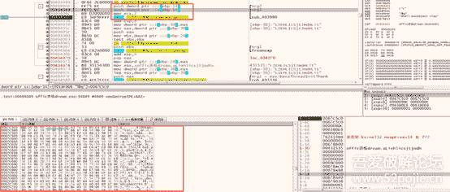

图片.png (157.4 KB, 下载次数: 3)

[href="forum.php?mod=attachment&aid=MjcyMzA5OHwyMWQ4MjUwMnwxNzkzNTc2ODIyfDE2ODA4NnwxOTYzNTk4&nothumb=yes" target="_blank"](https://www.52pojie.cn/forum.php?mod=attachment&aid=MjcyMzA5OHwyMWQ4MjUwMnwxNzkzNTc2ODIyfDE2ODA4NnwxOTYzNTk4&nothumb=yes)

2024-9-11 19:55 上传

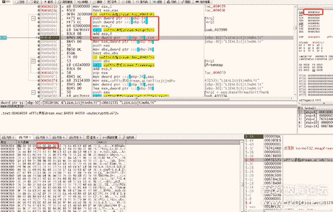

图片.png (225.91 KB, 下载次数: 3)

[href="forum.php?mod=attachment&aid=MjcyMzA5OXxiYmMxZTM3Y3wxNzkzNTc2ODIyfDE2ODA4NnwxOTYzNTk4&nothumb=yes" target="_blank"](https://www.52pojie.cn/forum.php?mod=attachment&aid=MjcyMzA5OXxiYmMxZTM3Y3wxNzkzNTc2ODIyfDE2ODA4NnwxOTYzNTk4&nothumb=yes)

2024-9-11 19:55 上传

## 解密 PE 数据

开始解密pe数据（dll）:

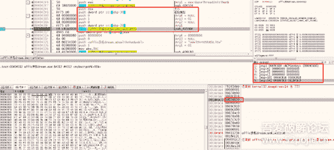

图片.png (155.71 KB, 下载次数: 3)

[href="forum.php?mod=attachment&aid=MjcyMzEwMHxhZGFjNzRmM3wxNzkzNTc2ODIyfDE2ODA4NnwxOTYzNTk4&nothumb=yes" target="_blank"](https://www.52pojie.cn/forum.php?mod=attachment&aid=MjcyMzEwMHxhZGFjNzRmM3wxNzkzNTc2ODIyfDE2ODA4NnwxOTYzNTk4&nothumb=yes)

2024-9-11 19:56 上传

分析该解密的内部逻辑：先固定地址获取密文后截取字符串，然后进行解密该字符串，解出字符串“`advapi32.dll`”，这种简短的字符串解密过程上文已说明，都是同一种解法。

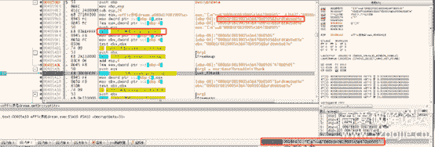

图片.png (123.12 KB, 下载次数: 2)

[href="forum.php?mod=attachment&aid=MjcyMzEwMXw1YTVlODRjYXwxNzkzNTc2ODIyfDE2ODA4NnwxOTYzNTk4&nothumb=yes" target="_blank"](https://www.52pojie.cn/forum.php?mod=attachment&aid=MjcyMzEwMXw1YTVlODRjYXwxNzkzNTc2ODIyfDE2ODA4NnwxOTYzNTk4&nothumb=yes)

2024-9-11 19:57 上传

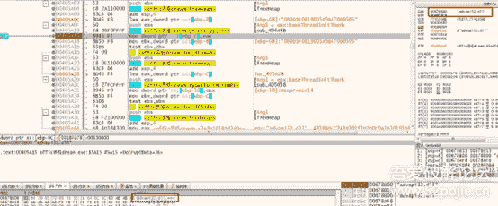

图片.png (137.8 KB, 下载次数: 3)

[href="forum.php?mod=attachment&aid=MjcyMzEwMnwzZTA1NTcxNHwxNzkzNTc2ODIyfDE2ODA4NnwxOTYzNTk4&nothumb=yes" target="_blank"](https://www.52pojie.cn/forum.php?mod=attachment&aid=MjcyMzEwMnwzZTA1NTcxNHwxNzkzNTc2ODIyfDE2ODA4NnwxOTYzNTk4&nothumb=yes)

2024-9-11 19:58 上传

## 加载 `advapi32.dll`

接着加载该`advapi32.dll`，加载方式如下：

这个函数有两种字符串解密，一种为`kernel32.dll`，一种是当前走的分支即`LoadLibraryA`，因为当前已经有了`kernel32.dll`的绝对地址，所以跳过了开始的解密`kernel32.dll`字符串并寻址`kernel32.dll`。

图片.png (69.15 KB, 下载次数: 3)

[href="forum.php?mod=attachment&aid=MjcyMzEwM3wzZGYzYTU2MnwxNzkzNTc2ODIyfDE2ODA4NnwxOTYzNTk4&nothumb=yes" target="_blank"](https://www.52pojie.cn/forum.php?mod=attachment&aid=MjcyMzEwM3wzZGYzYTU2MnwxNzkzNTc2ODIyfDE2ODA4NnwxOTYzNTk4&nothumb=yes)

2024-9-11 19:59 上传

图片.png (42.54 KB, 下载次数: 3)

[href="forum.php?mod=attachment&aid=MjcyMzEwNHxmMjcwOWZhOHwxNzkzNTc2ODIyfDE2ODA4NnwxOTYzNTk4&nothumb=yes" target="_blank"](https://www.52pojie.cn/forum.php?mod=attachment&aid=MjcyMzEwNHxmMjcwOWZhOHwxNzkzNTc2ODIyfDE2ODA4NnwxOTYzNTk4&nothumb=yes)

2024-9-11 20:12 上传

再然后就是通过`GetFuncVAFromPE`解析pe导出表直接获取到`LoadLibraryA`的地址，这种方式上述也有讲。

图片.png (139.15 KB, 下载次数: 3)

[href="forum.php?mod=attachment&aid=MjcyMzEwNXw3ZmMyMDNmZnwxNzkzNTc2ODIyfDE2ODA4NnwxOTYzNTk4&nothumb=yes" target="_blank"](https://www.52pojie.cn/forum.php?mod=attachment&aid=MjcyMzEwNXw3ZmMyMDNmZnwxNzkzNTc2ODIyfDE2ODA4NnwxOTYzNTk4&nothumb=yes)

2024-9-11 20:12 上传

调用`LoadLibraryA`的方式使用的非正常方式：压栈上面获取到的`LoadLibraryA`的`VA`后`ret`进系统领空执行，至此`advapi32.dll`就在没有显式调用`LoadlibraryA`的情况下加载了。

图片.png (37.54 KB, 下载次数: 2)

[href="forum.php?mod=attachment&aid=MjcyMzEwNnw1YTA1M2ZiMHwxNzkzNTc2ODIyfDE2ODA4NnwxOTYzNTk4&nothumb=yes" target="_blank"](https://www.52pojie.cn/forum.php?mod=attachment&aid=MjcyMzEwNnw1YTA1M2ZiMHwxNzkzNTc2ODIyfDE2ODA4NnwxOTYzNTk4&nothumb=yes)

2024-9-11 20:13 上传

图片.png (180.88 KB, 下载次数: 2)

[href="forum.php?mod=attachment&aid=MjcyMzEwN3w3MGI0OGRkNHwxNzkzNTc2ODIyfDE2ODA4NnwxOTYzNTk4&nothumb=yes" target="_blank"](https://www.52pojie.cn/forum.php?mod=attachment&aid=MjcyMzEwN3w3MGI0OGRkNHwxNzkzNTc2ODIyfDE2ODA4NnwxOTYzNTk4&nothumb=yes)

2024-9-11 20:13 上传

下面就是从加载的`advapi32.dll`中找到函数`CryptDecrypt`并调用进行解密（获取字符串、解密出字符串`CryptDecrypt`、获取该函数的VA，然后压栈`rtn`调用`CryptDecrypt`进行解密）。

图片.png (136.53 KB, 下载次数: 3)

[href="forum.php?mod=attachment&aid=MjcyMzExMHxjM2EyY2QzN3wxNzkzNTc2ODIyfDE2ODA4NnwxOTYzNTk4&nothumb=yes" target="_blank"](https://www.52pojie.cn/forum.php?mod=attachment&aid=MjcyMzExMHxjM2EyY2QzN3wxNzkzNTc2ODIyfDE2ODA4NnwxOTYzNTk4&nothumb=yes)

2024-9-11 20:34 上传

图片.png (160.54 KB, 下载次数: 3)

[href="forum.php?mod=attachment&aid=MjcyMzExMXxmZTA4NjdmZnwxNzkzNTc2ODIyfDE2ODA4NnwxOTYzNTk4&nothumb=yes" target="_blank"](https://www.52pojie.cn/forum.php?mod=attachment&aid=MjcyMzExMXxmZTA4NjdmZnwxNzkzNTc2ODIyfDE2ODA4NnwxOTYzNTk4&nothumb=yes)

2024-9-11 20:34 上传

解密完成后数据结构为`01`+长度（明文+密文）+明文+密文

图片.png (291.75 KB, 下载次数: 2)

[href="forum.php?mod=attachment&aid=MjcyMzExMnwwMTM5MmQ3YXwxNzkzNTc2ODIyfDE2ODA4NnwxOTYzNTk4&nothumb=yes" target="_blank"](https://www.52pojie.cn/forum.php?mod=attachment&aid=MjcyMzExMnwwMTM5MmQ3YXwxNzkzNTc2ODIyfDE2ODA4NnwxOTYzNTk4&nothumb=yes)

2024-9-11 20:35 上传

然后就涉及到通过不同的方式多次将解密的pe在内存中多次换位置：

图片.png (220 KB, 下载次数: 1)

[href="forum.php?mod=attachment&aid=MjcyMzExNHxjNjg0ODA3ZnwxNzkzNTc2ODIyfDE2ODA4NnwxOTYzNTk4&nothumb=yes" target="_blank"](https://www.52pojie.cn/forum.php?mod=attachment&aid=MjcyMzExNHxjNjg0ODA3ZnwxNzkzNTc2ODIyfDE2ODA4NnwxOTYzNTk4&nothumb=yes)

2024-9-11 20:36 上传

图片.png (62.08 KB, 下载次数: 3)

[href="forum.php?mod=attachment&aid=MjcyMzExNXw0MzYwZWQ0OHwxNzkzNTc2ODIyfDE2ODA4NnwxOTYzNTk4&nothumb=yes" target="_blank"](https://www.52pojie.cn/forum.php?mod=attachment&aid=MjcyMzExNXw0MzYwZWQ0OHwxNzkzNTc2ODIyfDE2ODA4NnwxOTYzNTk4&nothumb=yes)

2024-9-11 20:36 上传

分析该PE文件，从PE装载基址来看基本是dll无疑了。接下来的函数也确实是非显式的加载该dll。

图片.png (202.19 KB, 下载次数: 3)

[href="forum.php?mod=attachment&aid=MjcyMzExOHw5ZGYwY2QzOHwxNzkzNTc2ODIyfDE2ODA4NnwxOTYzNTk4&nothumb=yes" target="_blank"](https://www.52pojie.cn/forum.php?mod=attachment&aid=MjcyMzExOHw5ZGYwY2QzOHwxNzkzNTc2ODIyfDE2ODA4NnwxOTYzNTk4&nothumb=yes)

2024-9-11 20:37 上传

分析加载dll逻辑：

加载函数

图片.png (216.6 KB, 下载次数: 2)

[href="forum.php?mod=attachment&aid=MjcyMzEyMHwzZTdhZGM5OHwxNzkzNTc2ODIyfDE2ODA4NnwxOTYzNTk4&nothumb=yes" target="_blank"](https://www.52pojie.cn/forum.php?mod=attachment&aid=MjcyMzEyMHwzZTdhZGM5OHwxNzkzNTc2ODIyfDE2ODA4NnwxOTYzNTk4&nothumb=yes)

2024-9-11 20:38 上传

根据PE文件加载基址进行偏移量寻址，找到`characteristics`属性值，与2做与运算判断是否是可执行文件。

图片.png (70.21 KB, 下载次数: 3)

[href="forum.php?mod=attachment&aid=MjcyMzEyNnxjMWZjNzE5MnwxNzkzNTc2ODIyfDE2ODA4NnwxOTYzNTk4&nothumb=yes" target="_blank"](https://www.52pojie.cn/forum.php?mod=attachment&aid=MjcyMzEyNnxjMWZjNzE5MnwxNzkzNTc2ODIyfDE2ODA4NnwxOTYzNTk4&nothumb=yes)

2024-9-11 20:39 上传

通过`peb`中`ldr`查找`kernel32.dll`地址，逻辑如下：从`PEB`中找到`LDR`的地址，然后遍历循环链表，找到dll名字，通过逐字节计算出最终值后与特定值对比，若相等则获取dll基址并返回。

图片.png (78.56 KB, 下载次数: 1)

[href="forum.php?mod=attachment&aid=MjcyMzEyN3xhYWU2NzA0ZXwxNzkzNTc2ODIyfDE2ODA4NnwxOTYzNTk4&nothumb=yes" target="_blank"](https://www.52pojie.cn/forum.php?mod=attachment&aid=MjcyMzEyN3xhYWU2NzA0ZXwxNzkzNTc2ODIyfDE2ODA4NnwxOTYzNTk4&nothumb=yes)

2024-9-11 20:40 上传

计算的算法已用`python`复现相同逻辑，由此也可以爆破出这个算法确实是在找`kernel32.dll`的基址，`0x6A4ABC5B`是该dll名计算的值。

图片.png (78.18 KB, 下载次数: 3)

[href="forum.php?mod=attachment&aid=MjcyMzEyOHwxYzhlY2E0MXwxNzkzNTc2ODIyfDE2ODA4NnwxOTYzNTk4&nothumb=yes" target="_blank"](https://www.52pojie.cn/forum.php?mod=attachment&aid=MjcyMzEyOHwxYzhlY2E0MXwxNzkzNTc2ODIyfDE2ODA4NnwxOTYzNTk4&nothumb=yes)

2024-9-11 20:41 上传

通过获取的`kernel32.dll`基址，从导出表中找出函数功能地址`VirtualAllocEx`和`VirtualFreeEx`，这两个函数在将dll数据手动映射到内存时会用到（非显式的调用）：

图片.png (51.05 KB, 下载次数: 2)

[href="forum.php?mod=attachment&aid=MjcyMzEyOXxhMjMwZjBkMXwxNzkzNTc2ODIyfDE2ODA4NnwxOTYzNTk4&nothumb=yes" target="_blank"](https://www.52pojie.cn/forum.php?mod=attachment&aid=MjcyMzEyOXxhMjMwZjBkMXwxNzkzNTc2ODIyfDE2ODA4NnwxOTYzNTk4&nothumb=yes)

2024-9-11 20:42 上传

内容太多，这边挑主要的讲：遍历节表，计算大小确保数据大小一致性：

图片.png (145.27 KB, 下载次数: 3)

[href="forum.php?mod=attachment&aid=MjcyMzEzMXw4ZTJhMGI2ZnwxNzkzNTc2ODIyfDE2ODA4NnwxOTYzNTk4&nothumb=yes" target="_blank"](https://www.52pojie.cn/forum.php?mod=attachment&aid=MjcyMzEzMXw4ZTJhMGI2ZnwxNzkzNTc2ODIyfDE2ODA4NnwxOTYzNTk4&nothumb=yes)

2024-9-11 20:43 上传

图片.png (114.51 KB, 下载次数: 1)

[href="forum.php?mod=attachment&aid=MjcyMzEzMnxjOWUxNWQ1MXwxNzkzNTc2ODIyfDE2ODA4NnwxOTYzNTk4&nothumb=yes" target="_blank"](https://www.52pojie.cn/forum.php?mod=attachment&aid=MjcyMzEzMnxjOWUxNWQ1MXwxNzkzNTc2ODIyfDE2ODA4NnwxOTYzNTk4&nothumb=yes)

2024-9-11 20:43 上传

以获取到的`VirtualAllocEx`函数地址去调用api申请前面获取到的`VirtualSize`大小内存，即开辟dll内存实际大小的空间。然后将dll头部映射进该内存

图片.png (92.21 KB, 下载次数: 3)

[href="forum.php?mod=attachment&aid=MjcyMzEzM3wyMDljOTg2YXwxNzkzNTc2ODIyfDE2ODA4NnwxOTYzNTk4&nothumb=yes" target="_blank"](https://www.52pojie.cn/forum.php?mod=attachment&aid=MjcyMzEzM3wyMDljOTg2YXwxNzkzNTc2ODIyfDE2ODA4NnwxOTYzNTk4&nothumb=yes)

2024-9-11 20:45 上传

根据偏移量去查找每个节的地址和大小，然后将节数据写进内存，循环进行，即可将dll每个节的数据手动映射进内存。

图片.png (78.41 KB, 下载次数: 3)

[href="forum.php?mod=attachment&aid=MjcyMzEzNHxkNTMyM2M1OHwxNzkzNTc2ODIyfDE2ODA4NnwxOTYzNTk4&nothumb=yes" target="_blank"](https://www.52pojie.cn/forum.php?mod=attachment&aid=MjcyMzEzNHxkNTMyM2M1OHwxNzkzNTc2ODIyfDE2ODA4NnwxOTYzNTk4&nothumb=yes)

2024-9-11 20:47 上传

以上步骤之后即手动加载了该dll文件，此时还需修复重定位数据。根据偏移定位到重定位表并进行修复：

图片.png (53.38 KB, 下载次数: 3)

[href="forum.php?mod=attachment&aid=MjcyMzEzNXxlMTZiYzk5N3wxNzkzNTc2ODIyfDE2ODA4NnwxOTYzNTk4&nothumb=yes" target="_blank"](https://www.52pojie.cn/forum.php?mod=attachment&aid=MjcyMzEzNXxlMTZiYzk5N3wxNzkzNTc2ODIyfDE2ODA4NnwxOTYzNTk4&nothumb=yes)

2024-9-11 20:48 上传

图片.png (96.19 KB, 下载次数: 3)

[href="forum.php?mod=attachment&aid=MjcyMzEzNnxmN2EzZmMyYXwxNzkzNTc2ODIyfDE2ODA4NnwxOTYzNTk4&nothumb=yes" target="_blank"](https://www.52pojie.cn/forum.php?mod=attachment&aid=MjcyMzEzNnxmN2EzZmMyYXwxNzkzNTc2ODIyfDE2ODA4NnwxOTYzNTk4&nothumb=yes)

2024-9-11 20:48 上传

图片.png (93.59 KB, 下载次数: 3)

[href="forum.php?mod=attachment&aid=MjcyMzEzN3wxNTIwY2NhYXwxNzkzNTc2ODIyfDE2ODA4NnwxOTYzNTk4&nothumb=yes" target="_blank"](https://www.52pojie.cn/forum.php?mod=attachment&aid=MjcyMzEzN3wxNTIwY2NhYXwxNzkzNTc2ODIyfDE2ODA4NnwxOTYzNTk4&nothumb=yes)

2024-9-11 20:48 上传

图片.png (105.57 KB, 下载次数: 2)

[href="forum.php?mod=attachment&aid=MjcyMzEzOHw1MDI1YzdjNHwxNzkzNTc2ODIyfDE2ODA4NnwxOTYzNTk4&nothumb=yes" target="_blank"](https://www.52pojie.cn/forum.php?mod=attachment&aid=MjcyMzEzOHw1MDI1YzdjNHwxNzkzNTc2ODIyfDE2ODA4NnwxOTYzNTk4&nothumb=yes)

2024-9-11 20:48 上传

加载并解析导入表，这边图表太大，就用f5的伪代码凑合看吧，附上主要解析块的注释：

图片.png (125.87 KB, 下载次数: 3)

[href="forum.php?mod=attachment&aid=MjcyMzEzOXxhZDllZDg2NXwxNzkzNTc2ODIyfDE2ODA4NnwxOTYzNTk4&nothumb=yes" target="_blank"](https://www.52pojie.cn/forum.php?mod=attachment&aid=MjcyMzEzOXxhZDllZDg2NXwxNzkzNTc2ODIyfDE2ODA4NnwxOTYzNTk4&nothumb=yes)

2024-9-11 20:49 上传

图片.png (122.87 KB, 下载次数: 3)

[href="forum.php?mod=attachment&aid=MjcyMzE0MHwxNzcwODllMXwxNzkzNTc2ODIyfDE2ODA4NnwxOTYzNTk4&nothumb=yes" target="_blank"](https://www.52pojie.cn/forum.php?mod=attachment&aid=MjcyMzE0MHwxNzcwODllMXwxNzkzNTc2ODIyfDE2ODA4NnwxOTYzNTk4&nothumb=yes)

2024-9-11 20:50 上传

图片.png (104.54 KB, 下载次数: 2)

[href="forum.php?mod=attachment&aid=MjcyMzE0MXxmMjRiNTY2NHwxNzkzNTc2ODIyfDE2ODA4NnwxOTYzNTk4&nothumb=yes" target="_blank"](https://www.52pojie.cn/forum.php?mod=attachment&aid=MjcyMzE0MXxmMjRiNTY2NHwxNzkzNTc2ODIyfDE2ODA4NnwxOTYzNTk4&nothumb=yes)

2024-9-11 20:50 上传

获取dll入口点，从头部获取`Characteristics`值并判断了一下是否是dll文件，然后调用了一次`DllMain`，至此，该dll算是成功加载上了。

图片.png (122.07 KB, 下载次数: 3)

[href="forum.php?mod=attachment&aid=MjcyMzE0M3wxNDI3OGZhY3wxNzkzNTc2ODIyfDE2ODA4NnwxOTYzNTk4&nothumb=yes" target="_blank"](https://www.52pojie.cn/forum.php?mod=attachment&aid=MjcyMzE0M3wxNDI3OGZhY3wxNzkzNTc2ODIyfDE2ODA4NnwxOTYzNTk4&nothumb=yes)

2024-9-11 20:51 上传

中间经过一堆没什么意义的操作后开始获取导出函数`ds15_6e1v5ew9_74y`的地址，可以发现它巧妙地用了坐标变量去存储关键的数据：

图片.png (186.82 KB, 下载次数: 3)

[href="forum.php?mod=attachment&aid=MjcyMzE0NHw4MjVjNGVkYnwxNzkzNTc2ODIyfDE2ODA4NnwxOTYzNTk4&nothumb=yes" target="_blank"](https://www.52pojie.cn/forum.php?mod=attachment&aid=MjcyMzE0NHw4MjVjNGVkYnwxNzkzNTc2ODIyfDE2ODA4NnwxOTYzNTk4&nothumb=yes)

2024-9-11 20:52 上传

图片.png (51.53 KB, 下载次数: 2)

[href="forum.php?mod=attachment&aid=MjcyMzE0NXxmNTkwOWU5M3wxNzkzNTc2ODIyfDE2ODA4NnwxOTYzNTk4&nothumb=yes" target="_blank"](https://www.52pojie.cn/forum.php?mod=attachment&aid=MjcyMzE0NXxmNTkwOWU5M3wxNzkzNTc2ODIyfDE2ODA4NnwxOTYzNTk4&nothumb=yes)

2024-9-11 20:52 上传

再次经过一堆无意义代码后跳转进`ds15_6e1v5ew9_74y`执行：

图片.png (28.03 KB, 下载次数: 1)

[href="forum.php?mod=attachment&aid=MjcyMzE0NnxmMWZmMWE1OXwxNzkzNTc2ODIyfDE2ODA4NnwxOTYzNTk4&nothumb=yes" target="_blank"](https://www.52pojie.cn/forum.php?mod=attachment&aid=MjcyMzE0NnxmMWZmMWE1OXwxNzkzNTc2ODIyfDE2ODA4NnwxOTYzNTk4&nothumb=yes)

2024-9-11 20:53 上传

图片.png (52.57 KB, 下载次数: 2)

[href="forum.php?mod=attachment&aid=MjcyMzE0N3w2NzlkZjU0MnwxNzkzNTc2ODIyfDE2ODA4NnwxOTYzNTk4&nothumb=yes" target="_blank"](https://www.52pojie.cn/forum.php?mod=attachment&aid=MjcyMzE0N3w2NzlkZjU0MnwxNzkzNTc2ODIyfDE2ODA4NnwxOTYzNTk4&nothumb=yes)

2024-9-11 20:53 上传

这个dll提取出来可以看到导出函数确实只有一个，从导出表字段中可以看到该dll的实际名字为`install.dat`。

图片.png (87.87 KB, 下载次数: 4)

[href="forum.php?mod=attachment&aid=MjcyMzE0OHw2MDkyZmQ2ZnwxNzkzNTc2ODIyfDE2ODA4NnwxOTYzNTk4&nothumb=yes" target="_blank"](https://www.52pojie.cn/forum.php?mod=attachment&aid=MjcyMzE0OHw2MDkyZmQ2ZnwxNzkzNTc2ODIyfDE2ODA4NnwxOTYzNTk4&nothumb=yes)

2024-9-11 20:54 上传

图片.png (84.03 KB, 下载次数: 3)

[href="forum.php?mod=attachment&aid=MjcyMzE0OXxhZmExYTdlOHwxNzkzNTc2ODIyfDE2ODA4NnwxOTYzNTk4&nothumb=yes" target="_blank"](https://www.52pojie.cn/forum.php?mod=attachment&aid=MjcyMzE0OXxhZmExYTdlOHwxNzkzNTc2ODIyfDE2ODA4NnwxOTYzNTk4&nothumb=yes)

2024-9-11 20:54 上传

图片.png (150.62 KB, 下载次数: 3)

[href="forum.php?mod=attachment&aid=MjcyMzE1MHw3Mjk1OTA3NnwxNzkzNTc2ODIyfDE2ODA4NnwxOTYzNTk4&nothumb=yes" target="_blank"](https://www.52pojie.cn/forum.php?mod=attachment&aid=MjcyMzE1MHw3Mjk1OTA3NnwxNzkzNTc2ODIyfDE2ODA4NnwxOTYzNTk4&nothumb=yes)

2024-9-11 20:54 上传

至此，该`pe`本身的工作就算完成了，剩余工作交给加载的dll中`ds15_6e1v5ew9_74y`函数。
