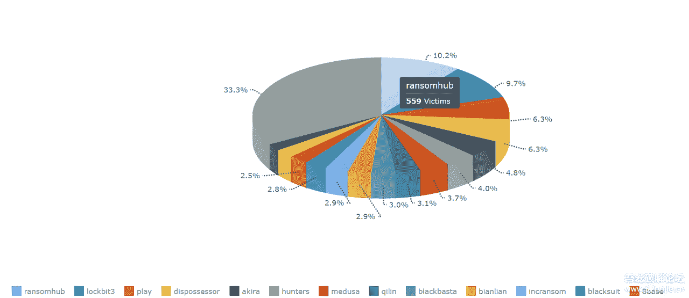
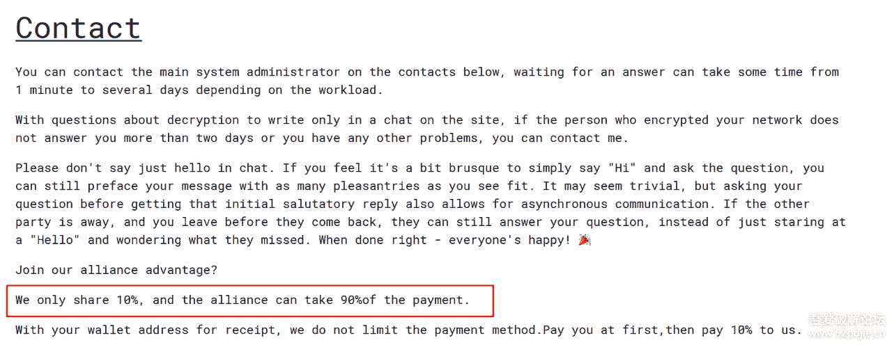
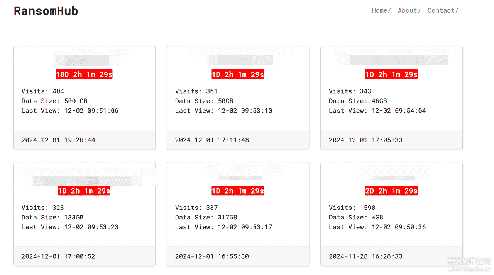
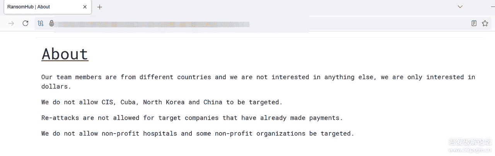
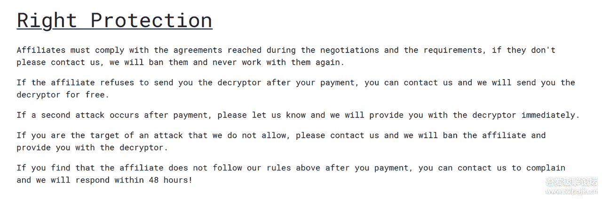

# [PC样本分析] 【病毒分析】RansomHub：唯一不攻击中国的2024全球Top1勒索家族——ESXi加密器深度...

- 原帖: `https://www.52pojie.cn/forum.php?mod=viewthread&tid=1987975`
- 抓取时间: `2026-11-01T23:46:30`

引言：根据`ransomware.live`网站的最新统计数据，`RansomHub`家族的全球攻击数量首次超过`LockBit 3`，跃升为全球第一大勒索家族。同时，`RansomHub`也是目前全球前十大勒索家族中唯一一个公开声明其附属组织不得攻击中国的家族。

引言.PNG (162.61 KB, 下载次数: 1)

[href="forum.php?mod=attachment&aid=Mjc0MTA3NHw0NThlYmQxN3wxNzkzNTc2Nzg3fDE2ODA4NnwxOTg3OTc1&nothumb=yes" target="_blank"](https://www.52pojie.cn/forum.php?mod=attachment&aid=Mjc0MTA3NHw0NThlYmQxN3wxNzkzNTc2Nzg3fDE2ODA4NnwxOTg3OTc1&nothumb=yes)

2024-12-3 16:33 上传

## 1.背景

### 1.1 家族信息

该组织于2024年2月中旬出现，攻击方式涉及加密勒索和数据泄露，在暗网平台公布了多个受害用户及信息（包括窃取数据量、用户官网地址等）。关于`RansomHub`新发布的勒索病毒即服务（`RaaS`）项目的公告，发布于一个俄罗斯来源的论坛，该论坛是网络犯罪分子用来宣传恶意服务的平台，名为`RAMP4U`（或`RAMP`）。一名化名为‘`koley`’的用户在2024年2月2日宣布了该联盟计划，基于这种新兴的勒索软件即服务（`RaaS`），迅速成为目前运营的最大勒索软件集团之一。

在新发布的勒索病毒即服务公告中提到，支付赎金的洗钱操作由联盟成员负责。这意味着所有与受害者的沟通和解密器的发送都通过聊天完成。该`RaaS`的收益分配为，联盟成员获得90%的赎金，而开发者，即‘`koley`’这一身份，获得10%。

1.1.0.PNG (309 KB, 下载次数: 1)

[href="forum.php?mod=attachment&aid=Mjc0MTA3NXwyZDEwNDEwY3wxNzkzNTc2Nzg3fDE2ODA4NnwxOTg3OTc1&nothumb=yes" target="_blank"](https://www.52pojie.cn/forum.php?mod=attachment&aid=Mjc0MTA3NXwyZDEwNDEwY3wxNzkzNTc2Nzg3fDE2ODA4NnwxOTg3OTc1&nothumb=yes)

2024-12-3 16:34 上传

此外，根据该公告，勒索病毒的载荷是用`Golang`语言编写的，使用基于`x25519`的非对称算法和`AES256`、`ChaCha20`、`xChaCha20`等加密算法，以其加密速度为特色。加密过程还采用了`AST`进行混淆处理。

该勒索病毒的载荷支持网络传播，可以在安全模式和本地模式下加密数据。根据`Koley`的说法，该勒索病毒可在`Windows`、`Linux`、`ESXi`等平台上运行，并支持`ARM`和`MIPS`等其他架构。此外，`Koley`还指出，管理面板使用了`.onion`域名，允许联盟成员组织和管理目标、聊天房间，查看访问日志，提供离线自动响应，并创建私密博客页面。

1.1.1.PNG (186.6 KB, 下载次数: 1)

[href="forum.php?mod=attachment&aid=Mjc0MTA3N3xkY2NlZGE3MHwxNzkzNTc2Nzg3fDE2ODA4NnwxOTg3OTc1&nothumb=yes" target="_blank"](https://www.52pojie.cn/forum.php?mod=attachment&aid=Mjc0MTA3N3xkY2NlZGE3MHwxNzkzNTc2Nzg3fDE2ODA4NnwxOTg3OTc1&nothumb=yes)

2024-12-3 16:34 上传

### 1.2 家族介绍

值得注意的是，在它的官网上有一份声明，上面写着：

1.我们的团队成员来自不同的国家，我们对其他任何东西都不感兴趣，我们只对美元感兴趣。

2.我们不允许独联体[独联体（`CIS`，独立国家联合体）是由苏联解体后，前苏联的多个国家组成的一个地区性国际组织。]、古巴、朝鲜和中国成为攻击目标。

3.对于已经付款的目标公司，不允许再次攻击。

4.我们不允许针对非营利性医院和一些非营利性组织。

1.2.0.PNG (116.3 KB, 下载次数: 1)

[href="forum.php?mod=attachment&aid=Mjc0MTA3OHwxYmVlYmViZHwxNzkzNTc2Nzg3fDE2ODA4NnwxOTg3OTc1&nothumb=yes" target="_blank"](https://www.52pojie.cn/forum.php?mod=attachment&aid=Mjc0MTA3OHwxYmVlYmViZHwxNzkzNTc2Nzg3fDE2ODA4NnwxOTg3OTc1&nothumb=yes)

2024-12-3 16:34 上传

在后续的权利保护中提到五点保护措施：

1.子公司必须遵守谈判达成的协议和要求，如果他们不联系我们，我们将禁止他们，不再与他们合作；

2.如果在您付款后，关联公司拒绝发送解密器，您可以联系我们，我们将免费发送解密器给您；

3.如果付款后发生第二次攻击，请让我们知道，我们将立即为您提供解密；

4.如果您是我们不允许的攻击目标，请联系我们，我们将禁止该联盟并为您提供解密器；

5.如果您在付款后发现会员不遵守我们的上述规定，您可以联系我们投诉，我们将在48小时内给予回复！

1.2.1.png (214.61 KB, 下载次数: 1)

[href="forum.php?mod=attachment&aid=Mjc0MTA4MHw3ODFjNGZmOHwxNzkzNTc2Nzg3fDE2ODA4NnwxOTg3OTc1&nothumb=yes" target="_blank"](https://www.52pojie.cn/forum.php?mod=attachment&aid=Mjc0MTA4MHw3ODFjNGZmOHwxNzkzNTc2Nzg3fDE2ODA4NnwxOTg3OTc1&nothumb=yes)

2024-12-3 16:34 上传

### 1.3 攻击手法

`Ransomhub`家族采用常见的勒索软件策略，例如通过钓鱼攻击、利用已知漏洞和双重勒索等方式进行入侵。在初步入侵后，攻击者会禁用受害者的`EDR`工具，并在其网络内进行侦察。接着，`Ransomhub`家族会泄露凭证或通过暴力破解密码进行横向移动，进一步入侵其他有效账户。在加密数据之前，`Ransomhub`家族会窃取敏感信息并删除影子卷备份。

`Ransomhub`家族利用以下列出的已知和关键漏洞来获取对目标组织的初始访问权限：

受影响的产品 |

漏洞 |

评分 |

Citrix NetScaler ADC and NetScaler Gateway
