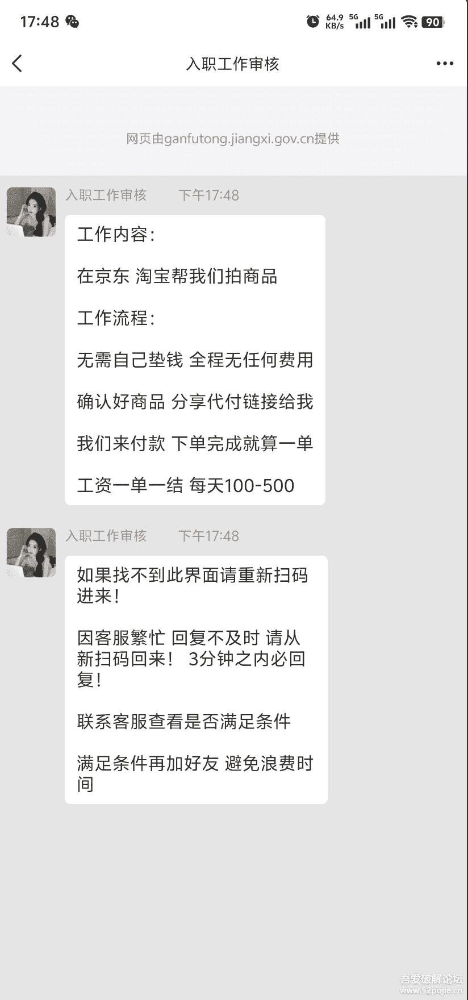
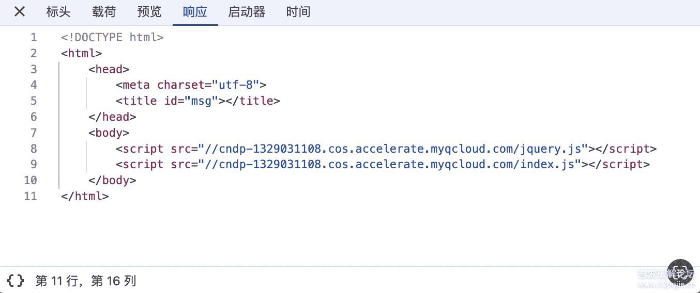

# [PC样本分析] 【技术分析】QQ被盗滥发广告后的24小时

- 原帖: https://www.52pojie.cn/forum.php?mod=viewthread&tid=1989424
- 抓取时间: 2026-11-01T23:46:25

## 【技术分析】QQ被盗滥发广告后的24小时

### 0x01 > 背景
2024年12月6日星期五早8:55分，我的QQ在毫无征兆的情况下自动向164位好友批量发送了携带二维码的垃圾图片。9:02经过微信好友提醒QQ异常后，立刻拨打了腾讯客服对QQ进行自助冻结处理。

### 0x02 > QQ日常使用情况
这个QQ使用了十多年，微信盛行后QQ逐渐沦为游戏扫码登录器，有且只有部分游戏好友偶尔寒暄。十几年前登录方式从传统的键盘输入账密升级成扫码登录的形式之后我就一直使用扫码进行所有互联网账号的登录，且当时宣传很牛的“QQ安全中心”，号称永远不会被盗号，我现在登录QQ安全中心app之后还显示“至尊宝”的title……并且也早就开启了所有的异地登录提醒，二次验证等所有的安全措施。我的QQ账号密码从来都不借人，密码也和所有的互联网平台账号独立分离，不存在利用撞库登录我的QQ。偶尔会有游戏好友在QQ上叫我上号打lol，QQ也仅仅是7*24小时处于手机登录状态，几乎从未在电脑上登录。在这样的情况下，QQ是如何被别人接管，从而批量向部分好友发送的广告图片？

### 0x03 > 异常
2024年10月以来去网吧的次数越来越多，几乎每到周末都会蹲网吧包时被人虐（lol）。每次的lol都是通过网吧桌面“wegame网吧版”以扫码方式登录。2024年12月5日20:00左右，像往常一样我扫码登录了wegame，开了Seraphine分析别人战绩。一级团过后wegame突然弹窗账号异常，附带了个重登二维码。点开wegame，整个界面无响应，于是通过手机QQ顺理成章又扫了一遍二维码，手机显示的界面依旧是“WeGame请求登录”的通知，点了同意，继续lol，之后再没出现过异常，直到第二天事发。不清楚现在是否有这种技术可以劫持wegame，然后利用扫码的方式去接管QQ的聊天，从而滥发广告。在我印象中从来都是通过键盘输入的方式，安全措施没有做到位才有可能导致账号被盗，然后被拿来批量发送垃圾信息，或者在QQ空间捣乱。

### 0x04 > 164位好友的二维码分析
既然我确定了账号的安全性，也不知道背后的团伙通过什么技术实现这样的牛b操作，所以只能浅析这些二维码，看看有没有什么关联。当天晚上六点半对QQ解冻，开始分析二维码。

解析二维码的Python代码如下：

```
import os
from PIL import Image
import zxing

def detect_qr_codes_in_folder(folder_path, output_file):
    """
    在指定文件夹内的所有图片中检测二维码，并将结果保存到文件。

    :param folder_path: 存放图片的文件夹路径
    :param output_file: 保存结果的文件路径
    """
    results = []
    # 遍历文件夹内的所有文件
    for root, dirs, files in os.walk(folder_path):
        for file in files:
            file_path = os.path.join(root, file)
            # 读取图片
            img = Image.open(file_path)
            # 转换为灰度图像
            img = img.convert('L')
            # 识别二维码
            reader = zxing.BarCodeReader()
            barcode = reader.decode(img)
            if barcode:
                result = {
                    "file_name": file,
                    "type": barcode.type,
                }
                if hasattr(barcode, 'parsed'):
                    result["data"] = barcode.parsed
                results.append(result)

    with open(output_file, 'w', encoding='utf-8') as f:
        for result in results:
            f.write(f"{result['file_name']},{result['type']},{result['data']}\n")

folder_path = "164张二维码图"
output_file = "qr_codes_results(164).txt"
detect_qr_codes_in_folder(folder_path, output_file)
```

对解码结果归类分析：

```
from collections import defaultdict

result_dict = defaultdict(set)

# 打开文件并逐行处理

with open('qr_codes_results(164).txt', 'r') as file:

    for line in file.readlines():

        # 分割每行数据，获取网址部分

        url = line.split(',')[2].strip()

        # 提取主域名、路径和 key

        parts = url.split('/')

        domain = parts[2]

        path = '/'.join(parts[3:-1])

        key = parts[-1].split('=')[1]

        # 将 key 添加到对应（主域名，路径）的集合中

        result_dict[(domain, path)].add(key)

for (domain, path), keys in result_dict.items():

    print(f"主域名: {domain}, 路径: {path}, 参数: Keys: {', '.join(keys)}")
```

结果：

```
主域名: yshj.jxlc.gov.cn, 路径: interface/profile/upload/2024/12/05/ld111_20241205165717A685.html, 参数: keys: FGJfocin, OTtIEeCB
主域名: dzsp.tjfsu.edu.cn, 路径: file/20241202/1733118355080_rk.xml, 参数: keys: OHAiWbmY, RIQwjmHZ, NBuPiXkg
主域名: www.cryshj.cn, 路径: profile/upload/2024/12/05/ld_20241205235206A009.html, 参数: keys: IJhwSvFc, jVxRGnzM
主域名: ganfutong.jiangxi.gov.cn, 路径: yscsyyjhpub/evaluation470/020009404b47462b996f680b2ytr78pb.html, 参数: keys: AkZdQgWz, pGXxAslP
```

### 0x05 > 浅析网页
一旦有人扫描二维码，则会出现下图界面：



截屏2024-12-08 20.21.05.png (311.8 KB, 下载次数: 0)

[href="forum.php?mod=attachment&aid=Mjc0MjI2N3wwZTMwNWQyN3wxNzkzNTc2NzgyfDE2ODA4NnwxOTg5NDI0&nothumb=yes" target="_blank"](https://www.52pojie.cn/forum.php?mod=attachment&aid=Mjc0MjI2N3wwZTMwNWQyN3wxNzkzNTc2NzgyfDE2ODA4NnwxOTg5NDI0&nothumb=yes)

扫码后出现的网页

2024-12-8 20:22 上传

对网页进行调试，发现用户扫码后首先进入的网页结构是这样的：



截屏2024-12-08 20.22.01.png (95.28 KB, 下载次数: 0)

[href="forum.php?mod=attachment&aid=Mjc0MjI3N3xhZGExYTRlZnwxNzkzNTc2NzgyfDE2ODA4NnwxOTg5NDI0&nothumb=yes" target="_blank"](https://www.52pojie.cn/forum.php?mod=attachment&aid=Mjc0MjI3N3xhZGExYTRlZnwxNzkzNTc2NzgyfDE2ODA4NnwxOTg5NDI0&nothumb=yes)

扫码后网页结构

2024-12-8 20:22 上传
```
js的路径来自于腾讯对象存储，应该是利用了html自动加载js的逻辑去获取了这两个js文件，然后做后续操作。`jquery.js`没什么好分析的，重点在于`index.js`，应该是用了`jsjiami.com`混淆。如果有对js逆向感兴趣的欢迎提供一下思路，构造请求看看返回的是什么内容。
```
var _0xodG = 'jsjiami.com.v7';
var _0x344aa0 = _0x5494;
(function(_0x5726a3, _0x5a9fdb, _0xdde841, _0x3767a2, _0x4b49ae, _0x1ebbe7, _0x5d71af) {
    return _0x5726a3 = _0x5726a3 >> 0x7,
    _0x1ebbe7 = 'hs',
    _0x5d71af = 'hs',
    function(_0x34a7e2, _0x43eadb, _0x46273d, _0x435c67, _0x2f4a9c) {
        var _0x47fa7e = _0x5494;
        _0x435c67 = 'tfi',
        _0x1ebbe7 = _0x435c67 + _0x1ebbe7,
        _0x2f4a9c = 'up',
        _0x5d71af += _0x2f4a9c,
        _0x1ebbe7 = _0x46273d(_0x1ebbe7),
        _0x5d71af = _0x46273d(_0x5d71af),
        _0x46273d = 0x0;
        var _0x29a2e0 = _0x34a7e2();
        while (!![] && --_0x3767a2 + _0x43eadb) {
            try {
                _0x435c67 = -parseInt(_0x47fa7e(0xee, 'pGk]')) / 0x1 * (parseInt(_0x47fa7e(0x101, 'dTyM')) / 0x2) + parseInt(_0x47fa7e(0xf5, 'pGk]')) / 0x3 + -parseInt(_0x47fa7e(0xe9, 'h6ty')) / 0x4 * (parseInt(_0x47fa7e(0xff, 'r2UP')) / 0x5) + -parseInt(_0x47fa7e(0xfd, 'dTyM')) / 0x6 + -parseInt(_0x47fa7e(0x106, '8Q%6')) / 0x7 + parseInt(_0x47fa7e(0xfc, 'bvPc')) / 0x8 + parseInt(_0x47fa7e(0xf7, ')SDx')) / 0x9 * (parseInt(_0x47fa7e(0xed, 'pGk]')) / 0xa);
            } catch (_0x173440) {
                _0x435c67 = _0x46273d;
            } finally {
                _0x2f4a9c = _0x29a2e0[_0x1ebbe7]();
                if (_0x5726a3 > (-0x2 * _0x33edc7 & 0x6)) : 0x0) {
                    _0x3eb3e0 = _0x281773['indexOf'](_0x3eb3e0);
                }
                for (var _0x6a5393 = 0x0, _0xce0ae = _0x3df68f['length']; _0x6a5393


```

逆向让我头大，整个逻辑看来看去好像就是从`url`中获取了`key`，然后带着对应`key`去请求`ayxtfn.cn`，返回了新的html代码，最后插入到网页当中。`ayxtfn.cn`网站显示是一个外链网，主域名是[//www.wailiantu.com/" target="_blank" rel="noopener noreferrer nofollow"](https://www.wailiantu.com/:rel="nofollow noopener" href="https)，这个团伙可能是用了外链兔又跳了一次，才最终将开头的界面返回给用户。这个最终的界面是类似聊天客服系统，可能是使用`websocket`实现的，还没具体测试就挂了。要追查的话除非从外链兔那边，或者腾讯的对象存储那边开始。

### 0x06 > 后续
写这篇文章的时候是2024年12月8日星期天，当我再对网页进行分析的时候发现所有的二维码对应网页都返回：无可用域名池，意味着现在有人扫码进去也看不到之前那个魔幻的界面了。

刚一开始我被惊讶到，一个gov.cn结尾的网页居然还能被人黑了放广告，网络安全工作还有待加强，甚至四个域名里，有5aSp5rSl5aSW5Zu96K+t5aSn5a2m，有5bSH5LuB5Y6/5Y+R5bGV5pS56Z2p5LqL5Yqh5Lit5b+D，有5rGf6KW/55yB6LWj5pyN6YCa，还有5rGf6KW/5oqa5bee5biC5Li05bed5Yy65Lq65rCR5pS/5bqc5Yqe5YWs5a6k，想不到怎么会有人专门利用这些zf机构，教育系统的网站漏洞进行非法活动，胆子很大。但是更惊讶的是怎么在我毫不知情的情况下掌控我的QQ聊天的。后续我再去这个网吧的任意一台机器上又测试了一遍这几个域名，第一次进入的时候，`index.js`文件居然显示“从内存中加载”，完全说明这个网吧确实是有问题的了。

我不会逆向exe，所以把网吧桌面的“wegame网吧版”上传上来供大神分析一下看是不是有什么鬼。

（附件疑似木马或可疑文件，请在特定环境解压分析）
[href="forum.php?mod=attachment&aid=Mjc0MjI3Mnw2NDUzZjQ5ZHwxNzkzNTc2NzgyfDE2ODA4NnwxOTg5NDI0" target="_blank"](https://www.52pojie.cn/forum.php?mod=attachment&aid=Mjc0MjI3Mnw2NDUzZjQ5ZHwxNzkzNTc2NzgyfDE2ODA4NnwxOTg5NDI0)

(44.35 KB, 下载次数: 18)

2024-12-10 19:52 上传

点击文件名下载附件
`index.js`和`rungame.exe`文件下载积分: 吾爱币 -1 CB

[//www.123865.com/s/pH7djv-Vlwr3" target="_blank" rel="noopener noreferrer nofollow"](https://www.123865.com/s/pH7djv-Vlwr3:rel="nofollow noopener" href="https)也上传上来了。
```
