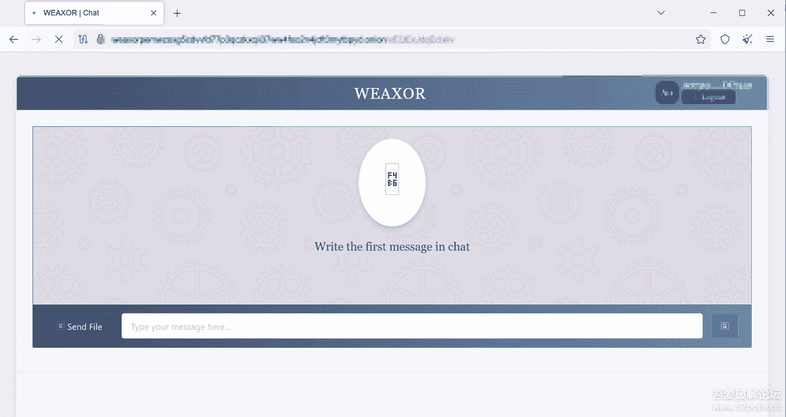

# [PC样本分析] 【病毒分析】新崛起的weaxor勒索家族：疑似mallox家族衍生版，深度解析两者关联！

- 原帖: `https://www.52pojie.cn/forum.php?mod=viewthread&tid=1992738`
- 抓取时间: 2026-11-01T23:46:16

## 1. 背景

### 1.1 家族介绍
Weaxor家族在2024年11月首次现身，该勒索病毒会将`.rox`扩展名附加到受感染文件的名称后，并留下名为`RECOVERY INFO.txt`的勒索信。信中包含了Weaxor家族的暗网地址，受害者可以通过该地址进入一个一对一的聊天界面，其他人无法访问。值得注意的是，暗网地址的首页为空白，这一设计显得格外耐人寻味。


`1.png` (212.17 KB, 下载次数: 1)
[href="forum.php?mod=attachment&aid=Mjc0NDY5NXwyZDk3NWIwMnwxNzkzNTc2Nzc0fDE2ODA4NnwxOTkyNzM4&nothumb=yes" target="_blank"](https://www.52pojie.cn/forum.php?mod=attachment&aid=Mjc0NDY5NXwyZDk3NWIwMnwxNzkzNTc2Nzc0fDE2ODA4NnwxOTkyNzM4&nothumb=yes)
2024-12-19 16:34 上传
一对一聊天界面


`2.png` (26.64 KB, 下载次数: 0)
[href="forum.php?mod=attachment&aid=Mjc0NDY5NnxmNTMzNjY5YXwxNzkzNTc2Nzc0fDE2ODA4NnwxOTkyNzM4&nothumb=yes" target="_blank"](https://www.52pojie.cn/forum.php?mod=attachment&aid=Mjc0NDY5NnxmNTMzNjY5YXwxNzkzNTc2Nzc0fDE2ODA4NnwxOTkyNzM4&nothumb=yes)
2024-12-19 16:34 上传
首页

### 1.2 疑似mallox源码修改
此加密器与mallox家族极其相似，疑似为mallox源码修改之后编译得到，mallox具体分析请参考文章`https://www.52pojie.cn/thread-1988804-1-1.html`。
相似之处
- 都为不加密固定的五个语言俄语、哈萨克语、白俄罗斯语、乌克兰语和土库曼语；
- 都调整电源计划为高性能模式；
- 删除的注册表内容一致；
- 密钥生成和加密算法基本一致，但是rox在生成随机数的情况下又再次生成了`0x38`个字节的随机数，修复了mallox会被破解出密钥的情况；


`1.1.png` (22.68 KB, 下载次数: 0)
[href="forum.php?mod=attachment&aid=Mjc0NDY5NHwzMjE5Mzk1OXwxNzkzNTc2Nzc0fDE2ODA4NnwxOTkyNzM4&nothumb=yes" target="_blank"](https://www.52pojie.cn/forum.php?mod=attachment&aid=Mjc0NDY5NHwzMjE5Mzk1OXwxNzkzNTc2Nzc0fDE2ODA4NnwxOTkyNzM4&nothumb=yes)
2024-12-19 16:34 上传
- 信息回传的格式，以及url极其相似，mallox url如下：

```
http://193.106.191.141/QWEwqdsvsf/ap.php
```

weaxor url如下：

```
http://193.143.1.139/Ujdu8jjooue/biweax.php
```

不同之处
- weaxor未对关机键进行隐藏；
- 获取文件方式不同，mallox获取文件方式为遍历文件，然后通过完成端口将文件提交到队列中，加密线程通过队列获取文件，而weaxor则是通过一个全局列表来传输；
- weaxor开启了较高的编译优化，而malllox则没有。

## 2. 恶意文件基础信息

### 2.1 加密器基本信息
文件名 | 
`QcmDAENTDj.exe` | 
编译器
