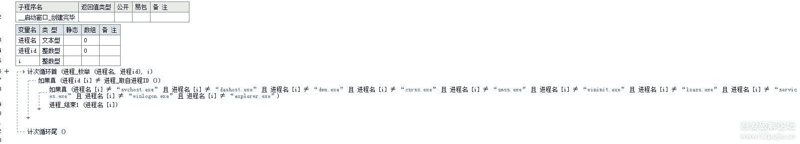

# [分享] 记一次未重装系统解决银狐木马案例

- 原帖: https://www.52pojie.cn/forum.php?mod=viewthread&tid=1997161
- 抓取时间: 2026-11-01T23:46:07

上午接到朋友求助，告知电脑微信自动给群里发诱导链接，火绒，360杀毒窗口打开会被关闭。想着这不就是很火的银狐木马么，遂让朋友把电脑送来看看，通过测试重装360，火绒，都会被关闭窗口，无法操作查杀，杀软的主动防御没有任何反应。通过任务管理器进程分析，可以看到异常进程，但是结束后会再次变换名称启动。也就是子母进程在互相守护。既然任务管理器能看到异常进程，可以得知该木马技术原理并不高深，不涉及驱动级进程隐藏和守护，也不涉及系统进程注入自身。对抗杀软投机取巧，不具备破坏杀软查杀引擎的能力，也就是说只要杀软能打开就可以干掉它，遂想出解决方案，写个软件，

`as5d.jpg` (50.22 KB, 下载次数: 1)  
[下载附件](https://www.52pojie.cn/forum.php?mod=attachment&aid=Mjc0NzkzNHw4NDkwYzdjOHwxNzkzNTc2NzY1fDE2ODA4NnwxOTk3MTYx&nothumb=yes)  
2025-1-5 11:35 上传

过滤系统进程，结束其他进程，然后我再运行杀毒，果不其然，杀软窗口不会被关闭了，用360全盘查杀，检测到银狐木马，查杀完毕重启，运行杀软此时一切正常。

看到好几次火绒官方发布的查杀银狐木马的帖子，但是火绒在此次表现中处于翻车状态。还得继续加油。
