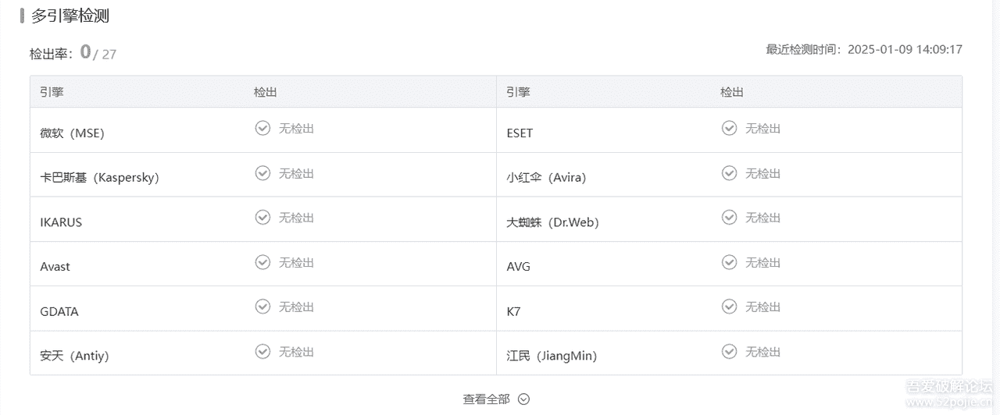

# [PC样本分析] 【病毒分析】R3强杀360：银狐远控病毒再进化

- 原帖: https://www.52pojie.cn/forum.php?mod=viewthread&tid=2000659
- 抓取时间: 2026-11-01T23:46:01

## 1. 背景

### 1.1 病毒介绍
银狐病毒自2022年起活跃，主要针对中国用户和企事业单位，尤其是财务、管理和专业领域的从业人员。该病毒通过多种攻击手段传播，包括伪装为税务、财务相关文件的钓鱼邮件、社交平台的恶意链接，以及利用SEO（搜索引擎优化）确保其钓鱼网站在中国搜索引擎中的排名靠前。此外，银狐还结合恶意广告投放和多次电子邮件钓鱼活动，分发远程管理木马（RATs），以实现对受害者设备的远程控制和数据窃取。

以下为近期捕获到的一起银狐病毒样本，我们对其进行了深入分析。

1.1.PNG (142.32 KB, 下载次数: 5)
[href="forum.php?mod=attachment&aid=Mjc1MDI2Mnw4M2NkYzBjNHwxNzkzNTc2NzU4fDE2ODA4NnwyMDAwNjU5&nothumb=yes" target="_blank"](https://www.52pojie.cn/forum.php?mod=attachment&aid=Mjc1MDI2Mnw4M2NkYzBjNHwxNzkzNTc2NzU4fDE2ODA4NnwyMDAwNjU5&nothumb=yes)
2025-1-17 14:13 上传

1.2.PNG (95.66 KB, 下载次数: 3)
[href="forum.php?mod=attachment&aid=Mjc1MDI2M3w2NzJlNzVkNXwxNzkzNTc2NzU4fDE2ODA4NnwyMDAwNjU5&nothumb=yes" target="_blank"](https://www.52pojie.cn/forum.php?mod=attachment&aid=Mjc1MDI2M3w2NzJlNzVkNXwxNzkzNTc2NzU4fDE2ODA4NnwyMDAwNjU5&nothumb=yes)
2025-1-17 14:13 上传

## 2. 文件分析

### 2.1 基本信息
文件名 |
明细查看_Setup.exe |
大小
