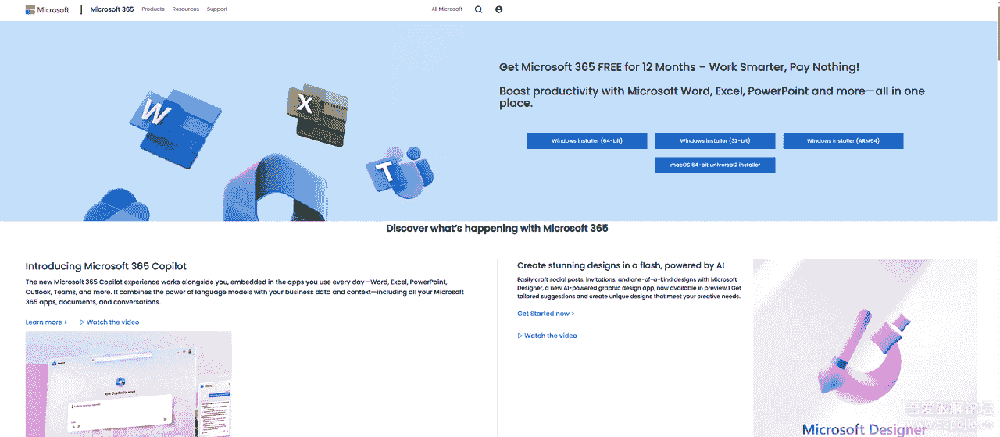
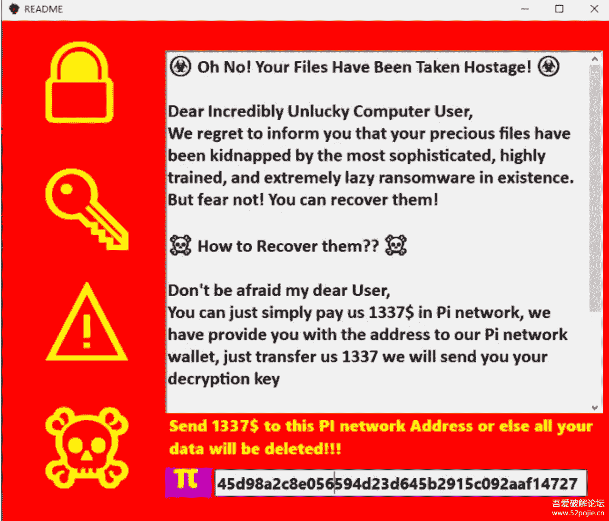

# [PC样本分析] 【病毒分析】伪造微软官网+勒索加密+支付威胁，CTF中勒索病毒解密题目真实还原！

- 原帖: `https://www.52pojie.cn/forum.php?mod=viewthread&tid=2016130`
- 抓取时间: 2026-11-01T23:45:32

## 1.背景

该CTF挑战题目完整复现了黑客的攻击链路，攻击者通过伪造钓鱼页面引导受害者下载恶意软件。用户访问伪造的 Microsoft 365 官网后，在点击“`Windows Installer (64-bit)`”下载选项时，页面会自动跳转至伪造的 GitHub 项目链接，并下载加密器的恶意程序。

`1.PNG` (309.35 KB, 下载次数: 3)

[href="forum.php?mod=attachment&aid=Mjc2MjkxMXwxOTY4M2EwOHwxNzkzNTc2NzI5fDE2ODA4NnwyMDE2MTMw&nothumb=yes" target="_blank"](https://www.52pojie.cn/forum.php?mod=attachment&aid=Mjc2MjkxMXwxOTY4M2EwOHwxNzkzNTc2NzI5fDE2ODA4NnwyMDE2MTMw&nothumb=yes)

2025-3-18 16:34 上传

伪造Microsoft 365官网

受害者双击运行该程序后，勒索软件会访问远程服务器加载定制的`hacked.png`图片并当作壁纸，通过调用`api`遍历文件，判断文件后缀是否为`.Montelli`，加密完文件后创建一个被加了勒索后缀的文件，从而完成攻击链闭环。（目前该服务器已关停，无法访问该图片）

> 远程服务器：`https://raw.githubusercontent.com/R4ven1elia/something/refs/heads/main/hacked.png`

`2.PNG` (35.19 KB, 下载次数: 2)

[href="forum.php?mod=attachment&aid=Mjc2MjkxMnwwOTE1ZGFhYnwxNzkzNTc2NzI5fDE2ODA4NnwyMDE2MTMw&nothumb=yes" target="_blank"](https://www.52pojie.cn/forum.php?mod=attachment&aid=Mjc2MjkxMnwwOTE1ZGFhYnwxNzkzNTc2NzI5fDE2ODA4NnwyMDE2MTMw&nothumb=yes)

2025-3-18 16:34 上传

定制图片

在所有文件被添加`.Montelli`后缀后，会弹出的勒索提示信息告知受害者支付1337美元到黑客提供的Pi网络钱包地址。

> 翻译：
> 噢,不!你的文件被劫持了！
> 亲爱的极其不幸的电脑用户，
> 我们很遗憾地通知你，你珍贵的文件被现存最复杂、训练有素、极其懒惰的勒索软件绑架了。但是不要害怕！你可以找回他们！
> 如何恢复它们？
> 不要害怕，我亲爱的用户，
> 你可以简单地在Pi网络中支付我们1337美元，我们已经为你提供了我们Pi网络钱包的地址，只要转账给我们1337，我们会给你发送你的解密密钥
> 发送1337$到此Pl网络地址，否则您的所有数据将被删除！！

`3.PNG` (964.21 KB, 下载次数: 2)

[href="forum.php?mod=attachment&aid=Mjc2MjkxM3w5ODU0ZmRjYXwxNzkzNTc2NzI5fDE2ODA4NnwyMDE2MTMw&nothumb=yes" target="_blank"](https://www.52pojie.cn/forum.php?mod=attachment&aid=Mjc2MjkxM3w5ODU0ZmRjYXwxNzkzNTc2NzI5fDE2ODA4NnwyMDE2MTMw&nothumb=yes)

2025-3-18 16:34 上传

## 2.恶意文件基础信息

### 2.1 加密器基本信息

文件名 |
`office64` |
编译器
