# [PC样本分析] 一个恶意样本释放器的调试环境检测分析

- 原帖: https://www.52pojie.cn/forum.php?mod=viewthread&tid=2036052
- 抓取时间: 2026-11-01T23:44:48

找到一个恶意样本的释放器，里面对抗感觉挺多的，已经触及到知识盲区了，但是其中一些非常典型的环境检测我感觉还是值得分享出来的，如有错误，还望指正。

乍一看它有个微软的证书，还是合格的，猜测应该是偷的一个证书。

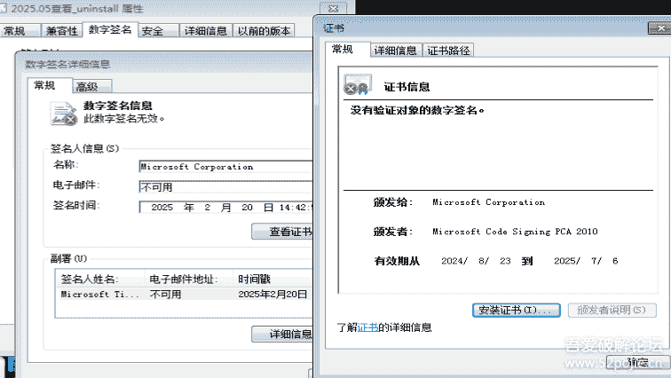
图片.png (88.48 KB, 下载次数: 0)
[href="forum.php?mod=attachment&aid=Mjc4MDY4Nnw0NDBlNjk4OXwxNzkzNTc2Njg1fDE2ODA4NnwyMDM2MDUy&nothumb=yes" target="_blank"](https://www.52pojie.cn/forum.php?mod=attachment&aid=Mjc4MDY4Nnw0NDBlNjk4OXwxNzkzNTc2Njg1fDE2ODA4NnwyMDM2MDUy&nothumb=yes)
2025-6-3 14:31 上传

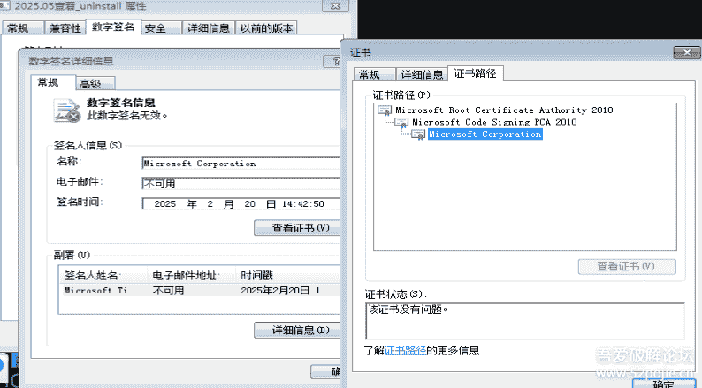
图片.png (98.67 KB, 下载次数: 1)
[href="forum.php?mod=attachment&aid=Mjc4MDY4N3wzYmVmNTFkZXwxNzkzNTc2Njg1fDE2ODA4NnwyMDM2MDUy&nothumb=yes" target="_blank"](https://www.52pojie.cn/forum.php?mod=attachment&aid=Mjc4MDY4N3wzYmVmNTFkZXwxNzkzNTc2Njg1fDE2ODA4NnwyMDM2MDUy&nothumb=yes)
2025-6-3 14:31 上传

网络流量中发现跟香港的ip地址137.220.135.233通信，微步ioc也显示该ip为恶意ip。

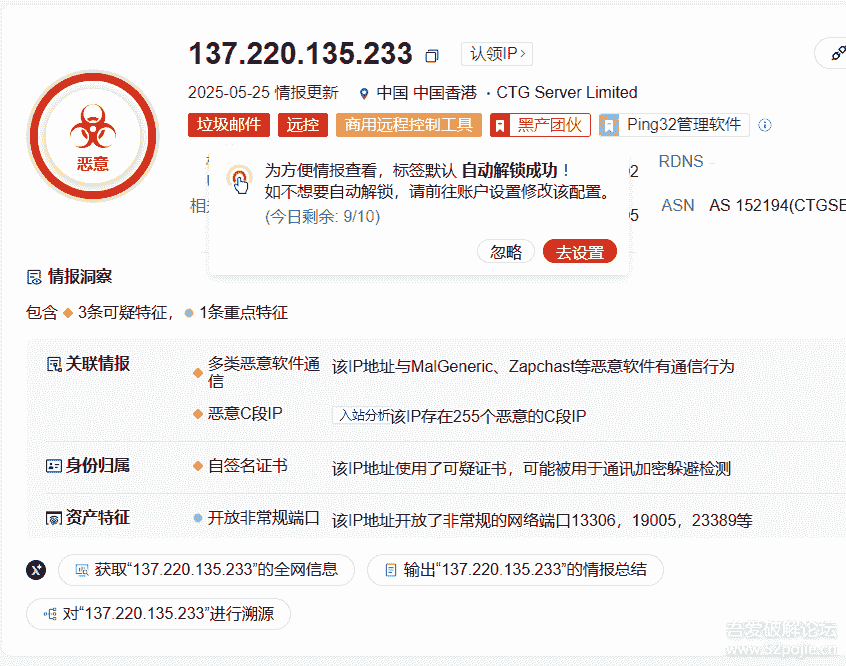
图片.png (98.76 KB, 下载次数: 1)
[href="forum.php?mod=attachment&aid=Mjc4MDY4OHw0MTI0ZDA5Y3wxNzkzNTc2Njg1fDE2ODA4NnwyMDM2MDUy&nothumb=yes" target="_blank"](https://www.52pojie.cn/forum.php?mod=attachment&aid=Mjc4MDY4OHw0MTI0ZDA5Y3wxNzkzNTc2Njg1fDE2ODA4NnwyMDM2MDUy&nothumb=yes)
2025-6-3 14:41 上传

## 主要静态分析

主要静态分析了调试环境检测：

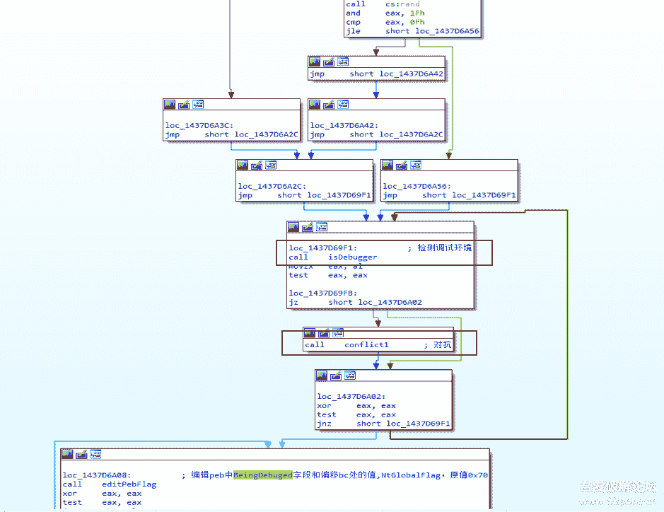
图片.png (103.6 KB, 下载次数: 1)
[href="forum.php?mod=attachment&aid=Mjc4MDY5MHwxODZlMTI1NHwxNzkzNTc2Njg1fDE2ODA4NnwyMDM2MDUy&nothumb=yes" target="_blank"](https://www.52pojie.cn/forum.php?mod=attachment&aid=Mjc4MDY5MHwxODZlMTI1NHwxNzkzNTc2Njg1fDE2ODA4NnwyMDM2MDUy&nothumb=yes)
2025-6-3 14:48 上传

### `isDebugger` 详情

看结构可以知道他是一个典型的多条件判断，总共有六点判断来综合验证是否是调试环境。

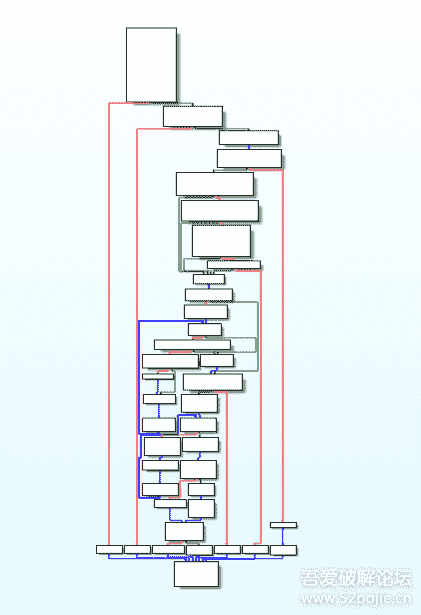
图片.png (26.63 KB, 下载次数: 1)
[href="forum.php?mod=attachment&aid=Mjc4MDY5MXwzZDY1OTU4OXwxNzkzNTc2Njg1fDE2ODA4NnwyMDM2MDUy&nothumb=yes" target="_blank"](https://www.52pojie.cn/forum.php?mod=attachment&aid=Mjc4MDY5MXwzZDY1OTU4OXwxNzkzNTc2Njg1fDE2ODA4NnwyMDM2MDUy&nothumb=yes)
2025-6-3 14:49 上传

#### 1、调用api检查是否是调试

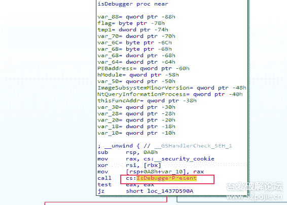
图片.png (79.49 KB, 下载次数: 1)
[href="forum.php?mod=attachment&aid=Mjc4MDY5Mnw0OTA4ZWRmZnwxNzkzNTc2Njg1fDE2ODA4NnwyMDM2MDUy&nothumb=yes" target="_blank"](https://www.52pojie.cn/forum.php?mod=attachment&aid=Mjc4MDY5Mnw0OTA4ZWRmZnwxNzkzNTc2Njg1fDE2ODA4NnwyMDM2MDUy&nothumb=yes)
2025-6-3 14:51 上传

#### 2、从内核结构进行偏移取值判断

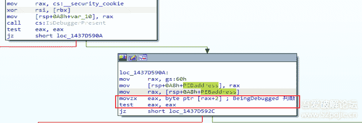
图片.png (44.88 KB, 下载次数: 1)
[href="forum.php?mod=attachment&aid=Mjc4MDY5M3xmMGU0OGQyZHwxNzkzNTc2Njg1fDE2ODA4NnwyMDM2MDUy&nothumb=yes" target="_blank"](https://www.52pojie.cn/forum.php?mod=attachment&aid=Mjc4MDY5M3xmMGU0OGQyZHwxNzkzNTc2Njg1fDE2ODA4NnwyMDM2MDUy&nothumb=yes)
2025-6-3 14:53 上传

#### 3、第三点应该是个冷门检测，看它查的字段迷惑了一段时间，后来看到这里比较`0x70`想到一些沙箱、调试器会改这个值，猜测是这样检测，不确定。

经大佬指正，这边偏移找错了，此处正确偏移字段应该是`+0x0bc` `NtGlobalFlag` `0x70`为调试值

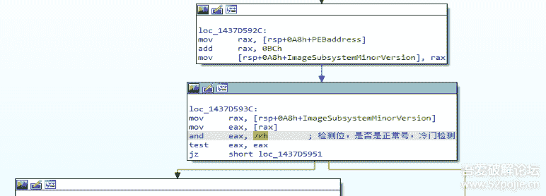
图片.png (46.54 KB, 下载次数: 2)
[href="forum.php?mod=attachment&aid=Mjc4MDY5NHxhOTA2ZmE3YXwxNzkzNTc2Njg1fDE2ODA4NnwyMDM2MDUy&nothumb=yes" target="_blank"](https://www.52pojie.cn/forum.php?mod=attachment&aid=Mjc4MDY5NHxhOTA2ZmE3YXwxNzkzNTc2Njg1fDE2ODA4NnwyMDM2MDUy&nothumb=yes)
2025-6-3 14:55 上传

#### 4、调用`NtQueryInformationProcess`获取信息，检查调试端口是否存在，调试端口存在会导致调用失败

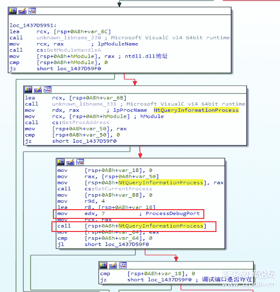
图片.png (117.52 KB, 下载次数: 1)
[href="forum.php?mod=attachment&aid=Mjc4MDY5NXwwZjZlZTBlYnwxNzkzNTc2Njg1fDE2ODA4NnwyMDM2MDUy&nothumb=yes" target="_blank"](https://www.52pojie.cn/forum.php?mod=attachment&aid=Mjc4MDY5NXwwZjZlZTBlYnwxNzkzNTc2Njg1fDE2ODA4NnwyMDM2MDUy&nothumb=yes)
2025-6-3 14:58 上传

#### 5、遍历检测这一段代码是不是有`CC`断点，如果打断点就中招，

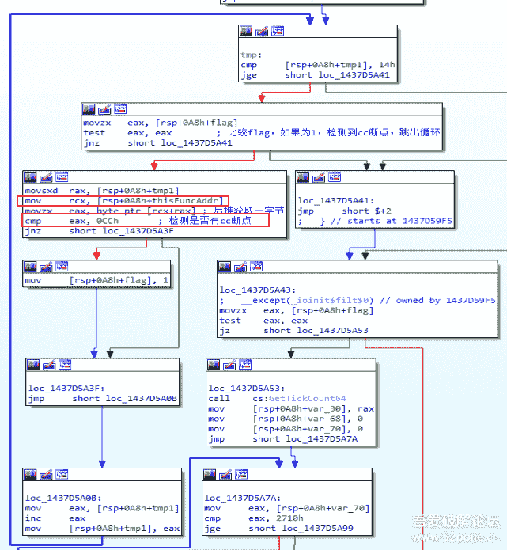
图片.png (132.7 KB, 下载次数: 2)
[href="forum.php?mod=attachment&aid=Mjc4MDY5Nnw0ZDMyMDA4Y3wxNzkzNTc2Njg1fDE2ODA4NnwyMDM2MDUy&nothumb=yes" target="_blank"](https://www.52pojie.cn/forum.php?mod=attachment&aid=Mjc4MDY5Nnw0ZDMyMDA4Y3wxNzkzNTc2Njg1fDE2ODA4NnwyMDM2MDUy&nothumb=yes)
2025-6-3 15:00 上传

#### 6、第六个就很常见了，两次时间差判断

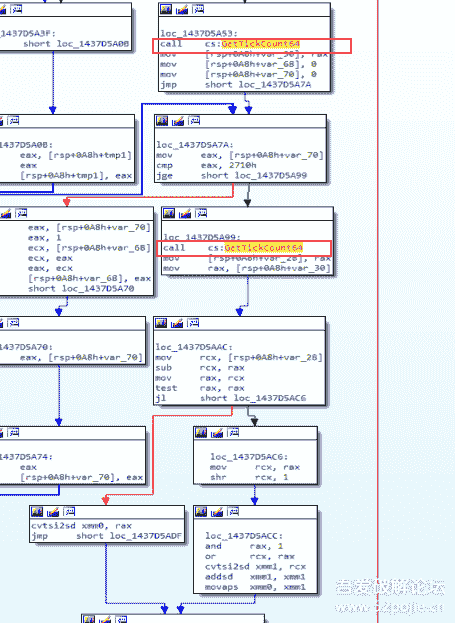
图片.png (115.14 KB, 下载次数: 1)
[href="forum.php?mod=attachment&aid=Mjc4MDY5N3wwYjk3MzJlYXwxNzkzNTc2Njg1fDE2ODA4NnwyMDM2MDUy&nothumb=yes" target="_blank"](https://www.52pojie.cn/forum.php?mod=attachment&aid=Mjc4MDY5N3wwYjk3MzJlYXwxNzkzNTc2Njg1fDE2ODA4NnwyMDM2MDUy&nothumb=yes)
2025-6-3 15:01 上传

## 对抗分析

对抗上面分析出来没太明白，触及到了知识盲区：

再次检测，然后有三种对抗情况

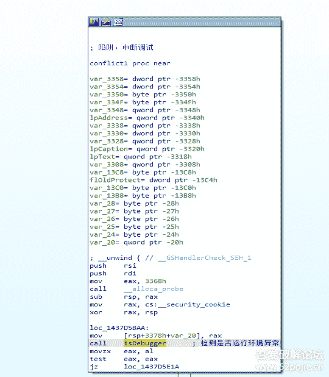
图片.png (102.21 KB, 下载次数: 1)
[href="forum.php?mod=attachment&aid=Mjc4MDY5OHwxM2Y5YWE2MnwxNzkzNTc2Njg1fDE2ODA4NnwyMDM2MDUy&nothumb=yes" target="_blank"](https://www.52pojie.cn/forum.php?mod=attachment&aid=Mjc4MDY5OHwxM2Y5YWE2MnwxNzkzNTc2Njg1fDE2ODA4NnwyMDM2MDUy&nothumb=yes)
2025-6-3 15:04 上传

#### 第一种是注册异常？这一块不是太懂。

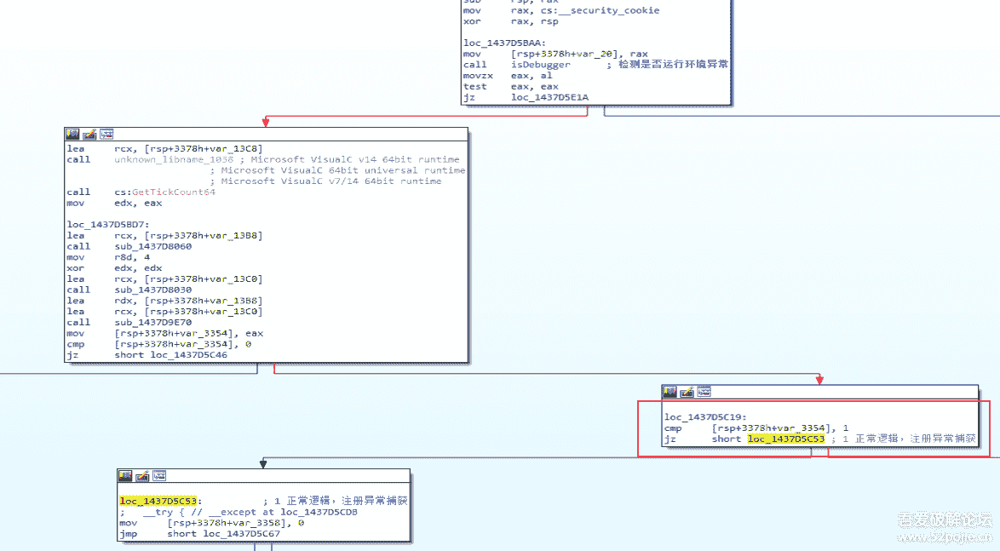
图片.png (121.62 KB, 下载次数: 1)
[href="forum.php?mod=attachment&aid=Mjc4MDY5OXxjZTc3YjljN3wxNzkzNTc2Njg1fDE2ODA4NnwyMDM2MDUy&nothumb=yes" target="_blank"](https://www.52pojie.cn/forum.php?mod=attachment&aid=Mjc4MDY5OXxjZTc3YjljN3wxNzkzNTc2Njg1fDE2ODA4NnwyMDM2MDUy&nothumb=yes)
2025-6-3 15:06 上传

#### 2、第二种情况是直接动态修改检测的代码开头，改成了`jmp`，然后主动引发异常中断调试。

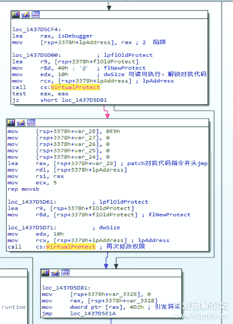
图片.png (120.58 KB, 下载次数: 1)
[href="forum.php?mod=attachment&aid=Mjc4MDcwMHwxY2M3ZWRiNXwxNzkzNTc2Njg1fDE2ODA4NnwyMDM2MDUy&nothumb=yes" target="_blank"](https://www.52pojie.cn/forum.php?mod=attachment&aid=Mjc4MDcwMHwxY2M3ZWRiNXwxNzkzNTc2Njg1fDE2ODA4NnwyMDM2MDUy&nothumb=yes)
2025-6-3 15:09 上传

#### 3、第三种是直接进了一个死循环，调试运行就是一直没反应。

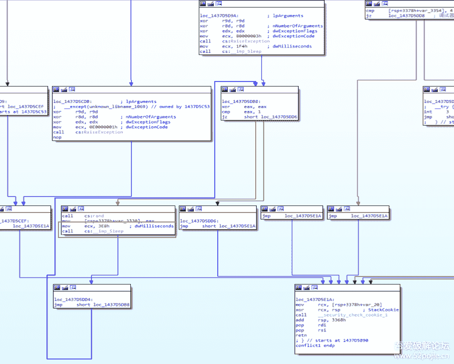
图片.png (136.56 KB, 下载次数: 1)
[href="forum.php?mod=attachment&aid=Mjc4MDgxM3xiZTg2YmIzY3wxNzkzNTc2Njg1fDE2ODA4NnwyMDM2MDUy&nothumb=yes" target="_blank"](https://www.52pojie.cn/forum.php?mod=attachment&aid=Mjc4MDgxM3xiZTg2YmIzY3wxNzkzNTc2Njg1fDE2ODA4NnwyMDM2MDUy&nothumb=yes)
2025-6-4 09:27 上传

## 释放文件对抗

后面释放文件实际也是一种对抗，但是目前没找到怎么过这种：

创建大量线程，线程创建线程杀死线程，套娃行为，其中某一个线程触发释放文件，完全没头绪怎么断到这个释放文件的线程，只有某一次误打误撞断到过，他是直接映射到内存直接运行的，没有落地文件。

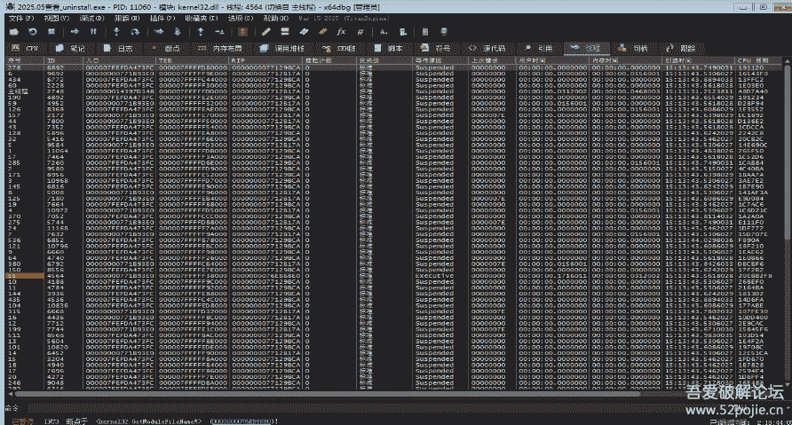
图片.png (477.85 KB, 下载次数: 1)
[href="forum.php?mod=attachment&aid=Mjc4MDcwM3w3YjIzNTY1M3wxNzkzNTc2Njg1fDE2ODA4NnwyMDM2MDUy&nothumb=yes" target="_blank"](https://www.52pojie.cn/forum.php?mod=attachment&aid=Mjc4MDcwM3w3YjIzNTY1M3wxNzkzNTc2Njg1fDE2ODA4NnwyMDM2MDUy&nothumb=yes)
2025-6-3 15:17 上传

算是我目前遇到的比较难理解的，以此记录一下。
