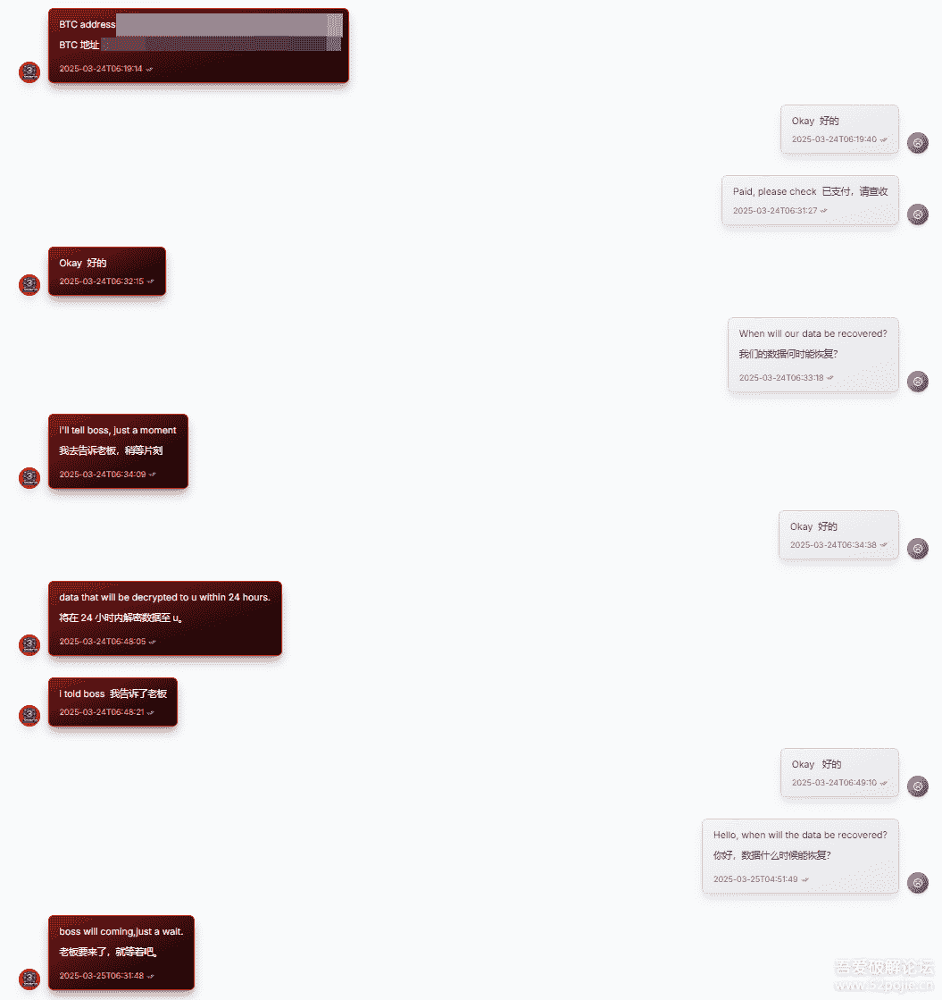
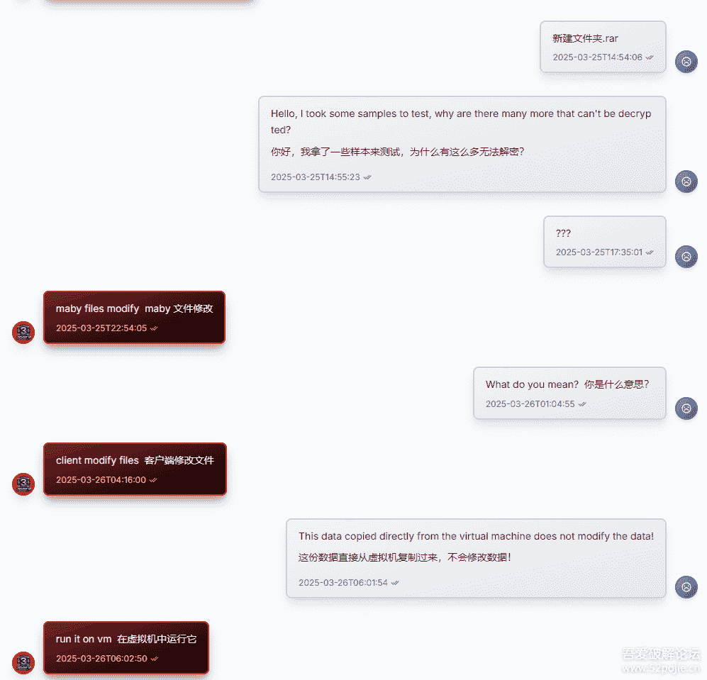
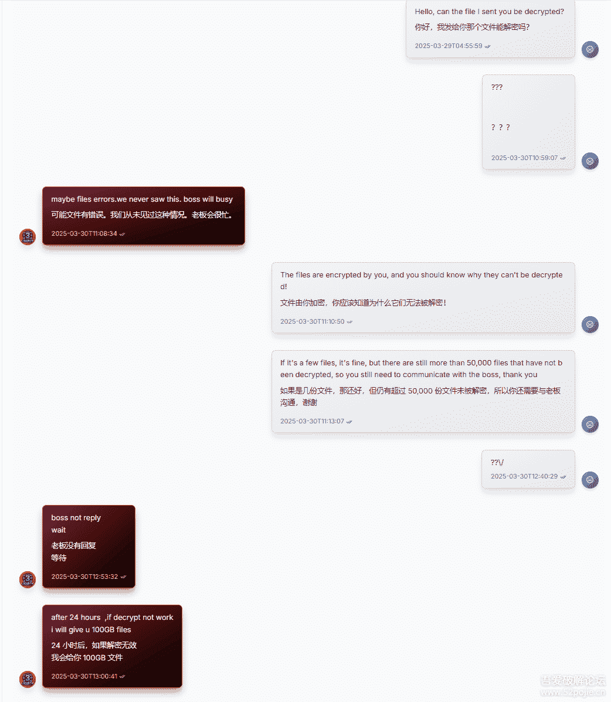
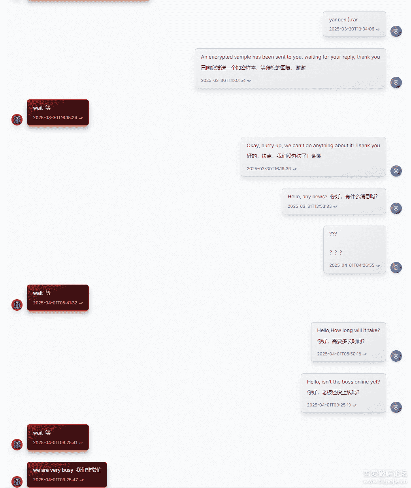
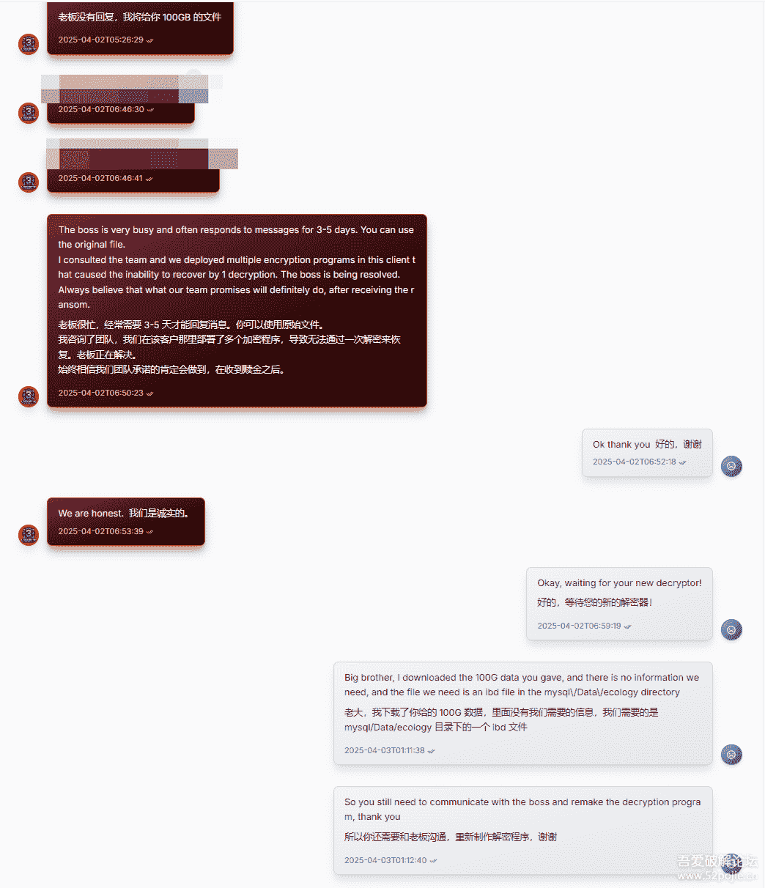
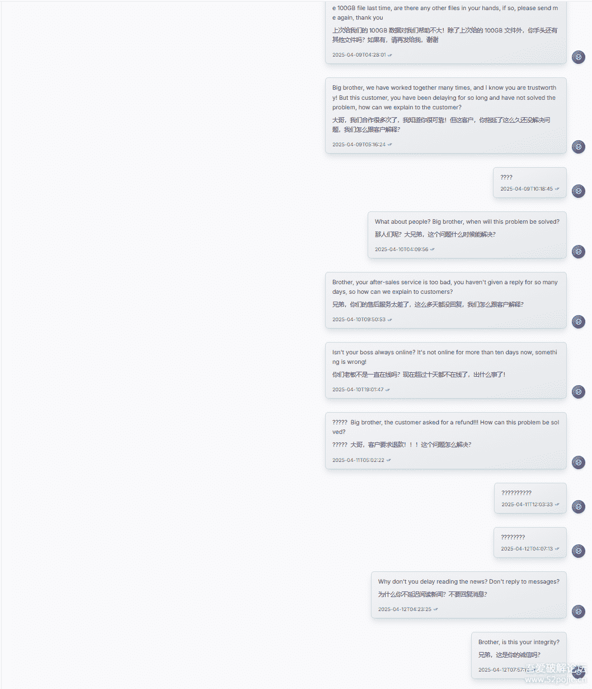
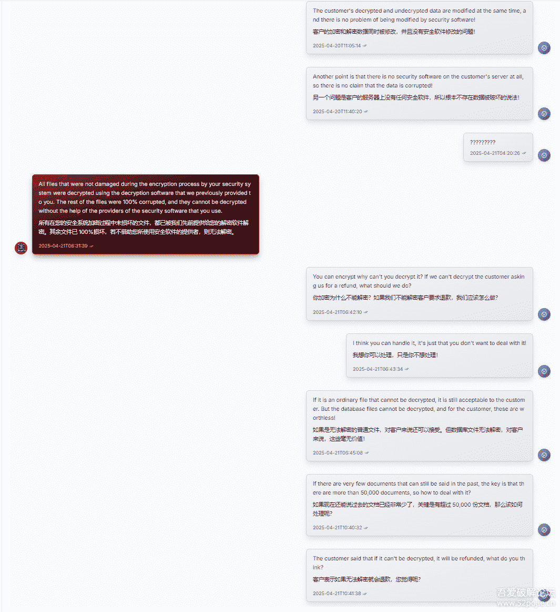

# [PC样本分析] 【病毒分析】交了巨额赎金依旧无法解密？最新 LockBit 4.0 解密器分析

- 原帖：https://www.52pojie.cn/forum.php?mod=viewthread&tid=2041914
- 抓取时间：2026-11-01T23:44:32

> 前情提要：LockBit 是自 2019 年以来最活跃的勒索软件组织之一，采用双重勒索策略并具备高度专业化运营能力。尽管在 2024 年遭遇国际打击并被揭露核心身份，该组织仍迅速恢复并于 2025 年推出 LockBit 4.0 版本。2025 年 5 月，其运营数据库泄露暴露了大量内部细节。详情可见[相关链接](https://mp.weixin.qq.com/s/Nvo8LwwezCw2JzbxXeLH6A)。

## 1. 背景

客户在遭遇勒索事件后因业务中断极为焦急，遂委托第三方公司代为与黑客进行谈判，并按照对方要求支付了巨额赎金，成功获取了解密器。然而在实际使用过程中发现，该解密器恢复效果极差：大量文件，尤其是体积较大的数据库文件未能成功解密，部分已“解密完成”的文件也严重损坏，无法正常打开或使用。第三方公司多次尝试再次联系黑客寻求技术支持，但对方已彻底失联，未再回应，导致数据恢复陷入困境。最终，第三方公司在无力解决问题的情况下，将客户引荐至我们团队，希望借助专业技术手段修复受损文件并挽回关键数据。

> 我们不建议受害者向黑客支付赎金购买所谓的恢复工具，因为在整个交易过程中主导权完全掌握在黑客手中，支付手段多为比特币等匿名加密货币，既难以追溯也无法保障交易安全，黑客可能在收款后拒绝提供解密工具，或者故意发送错误密钥，导致数据依然无法恢复，受害者也缺乏有效的申诉途径和法律保障，因此支付赎金不仅不能确保数据恢复，详情可参考文章[相关链接](https://mp.weixin.qq.com/s/zgO3ODYOVNcUDBa9RHZR_g)。

为协助客户最大程度挽回损失，我们在获取原始解密器后，第一时间对其进行了逆向分析，最终发现其在处理大文件时存在明显逻辑缺陷。通过修复该问题，我们成功恢复了大量此前无法解密的关键数据文件。本文将重点介绍此次解密器逆向分析的关键过程与修复技术细节。

### 1.1 聊天记录展示

以下为该客户与 LockBit 黑客组织在赎金谈判期间的部分聊天记录截图。该谈判记录来源于 2025 年 5 月 LockBit 团伙被执法机构打击后泄露的大量运营数据，我们通过对其中的谈判日志进行梳理和还原，成功定位到该客户的完整交互过程。目前，该谈判页面已被黑客关闭，原始对话 ID 无法通过公开入口访问。我们已将相关内容导入至 SAR 勒索情报平台的“谈判分析”模块，并对其语义内容进行归类标注，平台也集成了“一键翻译”功能，帮助用户高效、直观地理解英文沟通中的关键威胁、推脱话术及赎金策略。

`1.png`（178.92 KB，下载次数：3）

[附件链接](https://www.52pojie.cn/forum.php?mod=attachment&aid=Mjc4NTU4N3xlNmM4OWMxMXwxNzkzNTc2NjY5fDE2ODA4NnwyMDQxOTE0&nothumb=yes)

2025-6-27 10:03 上传

[图 1] 客户支付赎金

`2.png`（204.65 KB，下载次数：1）

[附件链接](https://www.52pojie.cn/forum.php?mod=attachment&aid=Mjc4NTU4OHw5ZDAxMTc2Y3wxNzkzNTc2NjY5fDE2ODA4NnwyMDQxOTE0&nothumb=yes)

2025-6-27 10:03 上传

[图 2] 客户反馈使用黑客提供的解密器解密后显示很多文件无法修复，解密器存在问题

`3.png`（250.97 KB，下载次数：4）

[附件链接](https://www.52pojie.cn/forum.php?mod=attachment&aid=Mjc4NTU4OXxlNDY3ZjIwOXwxNzkzNTc2NjY5fDE2ODA4NnwyMDQxOTE0&nothumb=yes)

2025-6-27 10:03 上传

[图 3] 客户发给黑客恢复异常文件，黑客表示从未遇到该情况，开始推脱问题

`4.png`（219.88 KB，下载次数：3）

[附件链接](https://www.52pojie.cn/forum.php?mod=attachment&aid=Mjc4NTU5MHxmN2VlZjFmMHwxNzkzNTc2NjY5fDE2ODA4NnwyMDQxOTE0&nothumb=yes)

2025-6-27 10:03 上传

[图 4] 黑客持续拖延

`5.png`（313.39 KB，下载次数：3）

[附件链接](https://www.52pojie.cn/forum.php?mod=attachment&aid=Mjc4NTU5MXw4NGM5MGI1MnwxNzkzNTc2NjY5fDE2ODA4NnwyMDQxOTE0&nothumb=yes)

2025-6-27 10:03 上传

[图 5] 黑客提供了恢复文件，但客户验证后非所需文件

`6.png`（307.83 KB，下载次数：1）

[附件链接](https://www.52pojie.cn/forum.php?mod=attachment&aid=Mjc4NTU5MnxhOWY5ZjgyOHwxNzkzNTc2NjY5fDE2ODA4NnwyMDQxOTE0&nothumb=yes)

2025-6-27 10:03 上传

[图 6] 客户反馈问题，黑客长时间未回复

`7.png`（345.72 KB，下载次数：3）

[附件链接](https://www.52pojie.cn/forum.php?mod=attachment&aid=Mjc4NTU5M3wwNzYwNWFhOXwxNzkzNTc2NjY5fDE2ODA4NnwyMDQxOTE0&nothumb=yes)

2025-6-27 10:03 上传

[图 7] 客户申请退款，黑客不予理会

在支付赎金后，由于解密效果严重不达预期，第三方公司曾多次尝试向黑客申请退款，但对方已不再回应，彻底失联。至此，客户初次委托的这家负责代谈和支付赎金的公司也已无计可施。最终，第三方公司将客户引荐至我们团队。我们在详细分析加密逻辑与解密器结构后，成功修复了解密逻辑中的关键问题，帮助客户完整恢复了数万个受影响的重要文件。

下文将对该解密器的技术机制进行深入分析，并在第四章我们会公开发布针对此次事件免费的恢复工具。如果您也遭遇了类似问题，欢迎联系我们协助处理——更重要的是，面对勒索攻击切勿盲目缴纳赎金，应在专业团队协助下开展分析研判与恢复评估。这次能够挽回，更多时候则可能再无机会。

### 1.2 谈判模式解析

| 角色层级 | 关键职责 | 典型细节 | 价值/收益 |
|---|---|---|---|
| 核心团队（Boss） |  |  |  |
