# [PC样本分析] 记一次多重释放的样本分析

- 原帖：https://www.52pojie.cn/forum.php?mod=viewthread&tid=2047889
- 抓取时间：2026-11-01T23:44:13

## 样本母体属性

- 文件：`软件安装3.0.2.exe`
- 大小：5809792 字节
- 修改时间：2025年7月18日, 11:58:25
- MD5：425A2E8F2E345E3551D8CEE37E67502B
- SHA1：227DFDDD589446767965CE5B8714C5B92A565488
- CRC32：8A5BA707

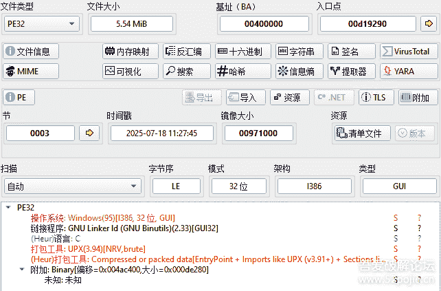

`image.png`（51.19 KB，下载次数：3；2025-7-23 14:27 上传）

[附件下载](https://www.52pojie.cn/forum.php?mod=attachment&aid=Mjc5MTE3NHw3MzJkOWY4NXwxNzkzNTc2NjUxfDE2ODA4NnwyMDQ3ODg5&nothumb=yes)

样本带有壳，脱壳后信息：

- 文件：`软件安装3.0.2.exe`
- 大小：10405504 字节
- 修改时间：2025年7月18日, 11:58:25
- MD5：100E3EFB0FA7E7B72DCA807BC5907DBD
- SHA1：107CB3AA462800A2115DF2CEB1A8CDAFA2E80484
- CRC32：8CD0D524

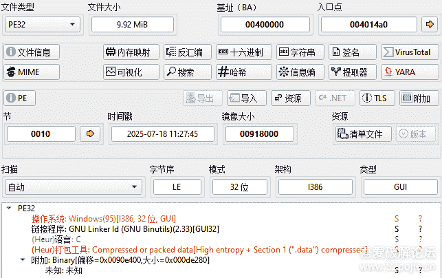

`image.png`（43.1 KB，下载次数：2；2025-7-23 14:28 上传）

[附件下载](https://www.52pojie.cn/forum.php?mod=attachment&aid=Mjc5MTE3OHw3MGRmODVmMXwxNzkzNTc2NjUxfDE2ODA4NnwyMDQ3ODg5&nothumb=yes)

具体分析：

## 一阶段样本母体行为

样本首选判断是否是 VMware 平台，如果是虚拟机则执行时钟应用混淆分析，如果不是虚拟机则执行恶意代码，分别通过简单的异或函数解出需要导入的函数、解密密钥等，分配内存，解密另一个 pe 文件并执行。

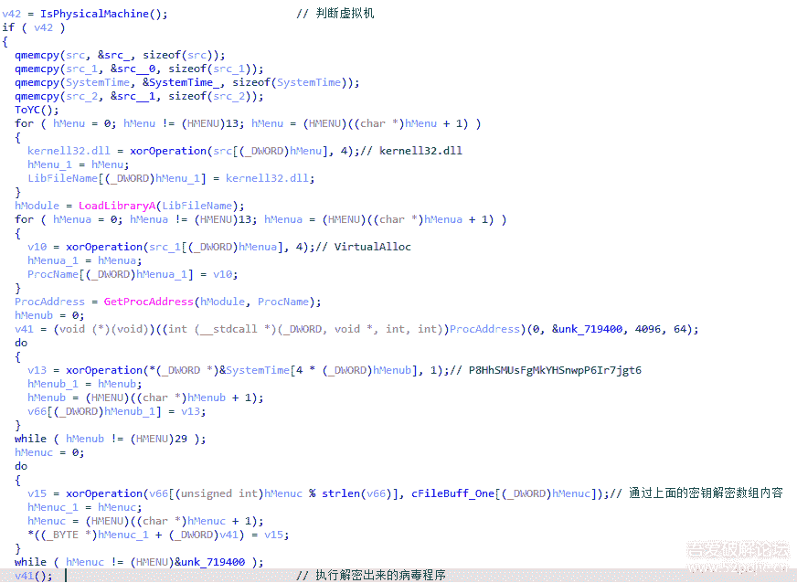

`image.png`（58.37 KB，下载次数：2；2025-7-23 14:29 上传）

[附件下载](https://www.52pojie.cn/forum.php?mod=attachment&aid=Mjc5MTE3OXwyM2UwMDNiNXwxNzkzNTc2NjUxfDE2ODA4NnwyMDQ3ODg5&nothumb=yes)

通过动调解密出来新的 pe 文件，提取文件。

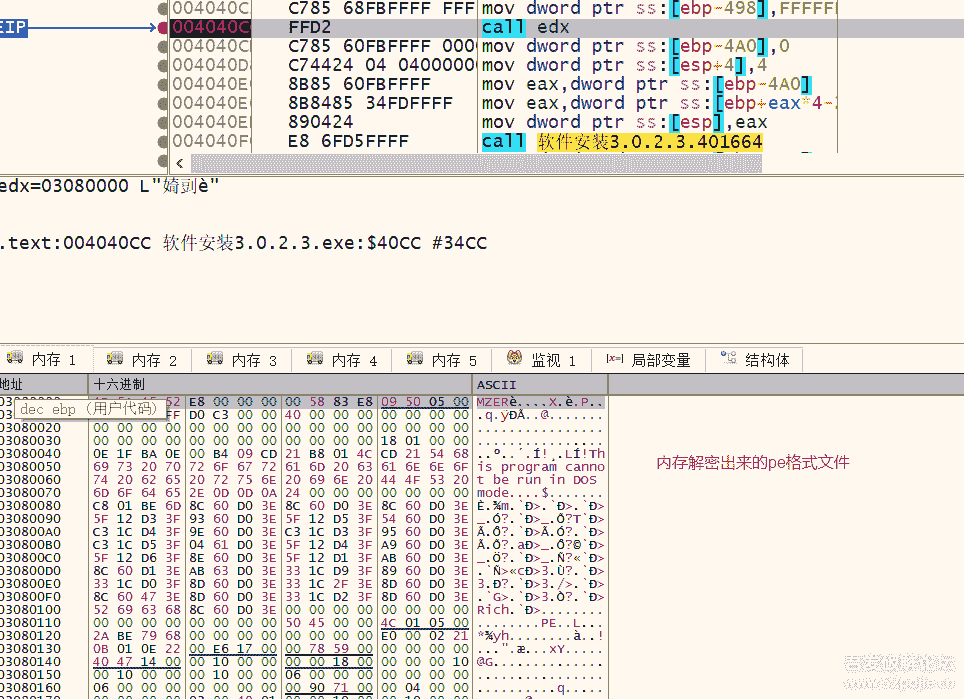

`image.png`（113.73 KB，下载次数：2；2025-7-23 14:29 上传）

[附件下载](https://www.52pojie.cn/forum.php?mod=attachment&aid=Mjc5MTE4MXw4Yzk2YTVmNHwxNzkzNTc2NjUxfDE2ODA4NnwyMDQ3ODg5&nothumb=yes)

## 二阶段解密后 DLL 行为

### 解密后的 PE 格式文件信息

可以看到是近期编译的文件：

- 文件：`软件安装3.0.2.3_03080000.bin`
- 大小：7446528 字节
- 修改时间：2025年7月21日, 15:14:43
- MD5：FC766A94329C18119A1FF5C6703F73D8
- SHA1：6A5790C22237B2F01CE141D868627F47CBD503B8
- CRC32：55D0379C

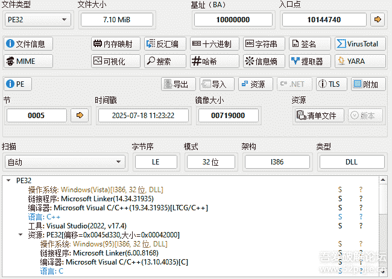

`image.png`（50.23 KB，下载次数：2；2025-7-23 14:30 上传）

[附件下载](https://www.52pojie.cn/forum.php?mod=attachment&aid=Mjc5MTE4NHw2NWRiNWE4MXwxNzkzNTc2NjUxfDE2ODA4NnwyMDQ3ODg5&nothumb=yes)

### 具体行为

通过导出函数看是病毒本体。

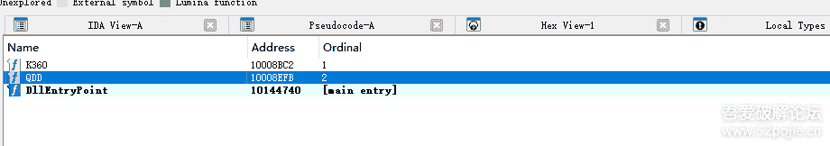

`image.png`（12.94 KB，下载次数：3；2025-7-23 14:30 上传）

[附件下载](https://www.52pojie.cn/forum.php?mod=attachment&aid=Mjc5MTE4NXxlYTE5NjM0NnwxNzkzNTc2NjUxfDE2ODA4NnwyMDQ3ODg5&nothumb=yes)

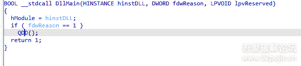

`image.png`（12.49 KB，下载次数：2；2025-7-23 14:30 上传）

[附件下载](https://www.52pojie.cn/forum.php?mod=attachment&aid=Mjc5MTE4NnxhM2Q4ZjkyMnwxNzkzNTc2NjUxfDE2ODA4NnwyMDQ3ODg5&nothumb=yes)

隐藏控制台，并调用 `K360()` 函数。

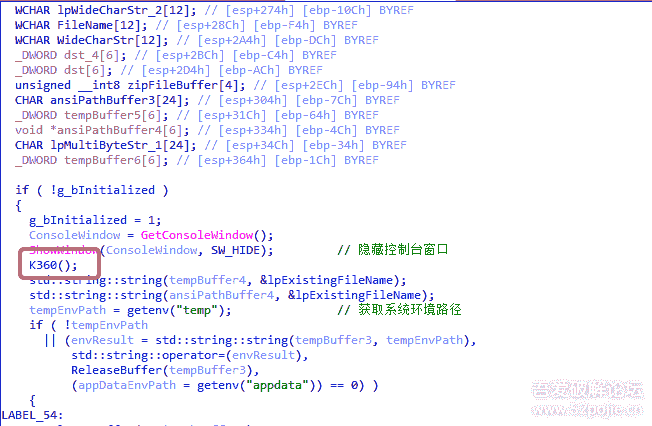

`image.png`（45.94 KB，下载次数：3；2025-7-23 14:30 上传）

[附件下载](https://www.52pojie.cn/forum.php?mod=attachment&aid=Mjc5MTE4N3w5NDFhMDdhOHwxNzkzNTc2NjUxfDE2ODA4NnwyMDQ3ODg5&nothumb=yes)

`K360()` 是一个完整的木马投放器：它把三个恶意文件（`exe`、`dll`、`dat`）从资源段提取出来，并用随机路径+隐藏属性部署到 `C:\ProgramData`；随后再创建一个指向木马 `exe` 的快捷方式，全程无提示、无窗口，最终让受害者在点击看似无害的快捷方式时自动运行木马生成随机数并创建路径。

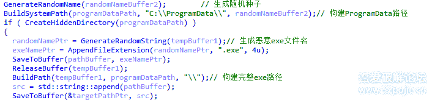

`image.png`（24.99 KB，下载次数：2；2025-7-23 14:31 上传）

[附件下载](https://www.52pojie.cn/forum.php?mod=attachment&aid=Mjc5MTE4OHwwYjk1ZTY1YXwxNzkzNTc2NjUxfDE2ODA4NnwyMDQ3ODg5&nothumb=yes)

从资源段提取资源分别是 `exe`、`dll`、数据文件。

`image.png`（15.25 KB，下载次数：2；2025-7-23 14:31 上传）

[附件下载](https://www.52pojie.cn/forum.php?mod=attachment&aid=Mjc5MTE4OXw1MjlkZjZhNHwxNzkzNTc2NjUxfDE2ODA4NnwyMDQ3ODg5&nothumb=yes)

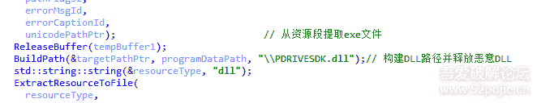

`image.png`（16.04 KB，下载次数：1；2025-7-23 14:31 上传）

[附件下载](https://www.52pojie.cn/forum.php?mod=attachment&aid=Mjc5MTE5MHwwZTljMDYxZXwxNzkzNTc2NjUxfDE2ODA4NnwyMDQ3ODg5&nothumb=yes)

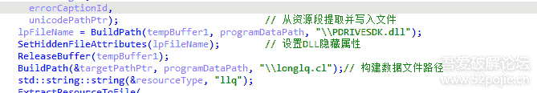

`image.png`（18.31 KB，下载次数：2；2025-7-23 14:31 上传）

[附件下载](https://www.52pojie.cn/forum.php?mod=attachment&aid=Mjc5MTE5MXw4NjNhZmU1NXwxNzkzNTc2NjUxfDE2ODA4NnwyMDQ3ODg5&nothumb=yes)

设置隐藏属性，并创建指向病毒的快捷方式。

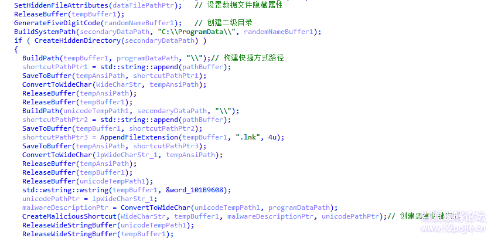

`image.png`（52.28 KB，下载次数：3；2025-7-23 14:32 上传）

[附件下载](https://www.52pojie.cn/forum.php?mod=attachment&aid=Mjc5MTE5M3xjNDQ1OTBjNnwxNzkzNTc2NjUxfDE2ODA4NnwyMDQ3ODg5&nothumb=yes)

## 第三阶段解密数据分析

### 提取第三阶段数据信息

- 文件：`k360.exe`
- 大小：2563072 字节
- 文件版本：1.1.0.1338
- 修改时间：2025年7月22日, 9:51:03
- MD5：A0C571316C1356EE40B15AECDB4CBC3D
- SHA1：21FC82BBCD8213C7B5C59E5BB2A8E976EFA00D42
- CRC32：252A598D

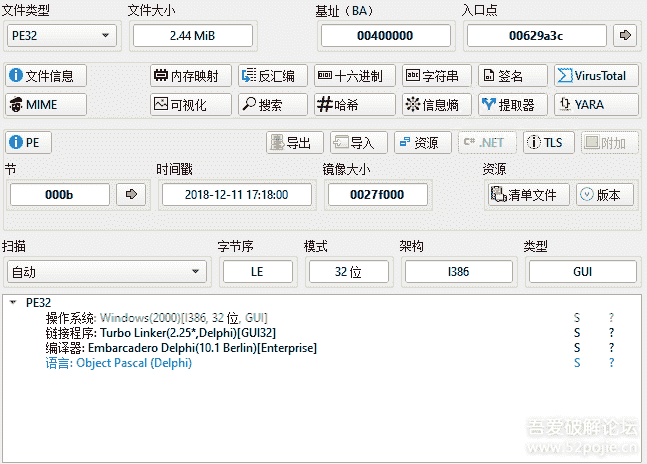

`image.png`（49.65 KB，下载次数：2；2025-7-23 14:32 上传）

[附件下载](https://www.52pojie.cn/forum.php?mod=attachment&aid=Mjc5MTE5NHxhYTgxNmMxM3wxNzkzNTc2NjUxfDE2ODA4NnwyMDQ3ODg5&nothumb=yes)

#### `dll`

- 文件：`PDRIVESDK.dll`
- 大小：270336 字节
- 修改时间：2025年7月22日, 9:50:46
- MD5：FA088DE9F713E30D6374B77EAE2A8999
- SHA1：2EE08CB0168438864C1B28145B817D900050E4FB
- CRC32：663C7E51

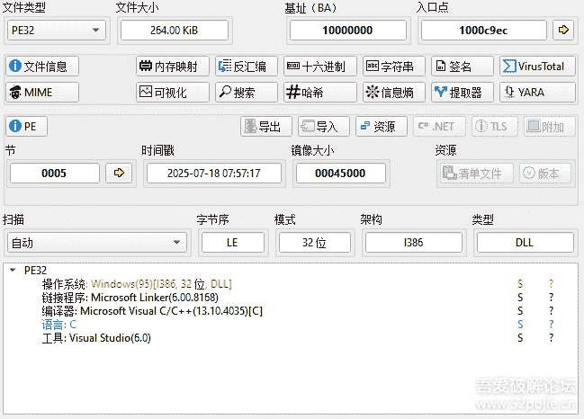

`image.png`（46.05 KB，下载次数：2；2025-7-23 14:33 上传）

[附件下载](https://www.52pojie.cn/forum.php?mod=attachment&aid=Mjc5MTE5NXwxYzQ2MGNiNnwxNzkzNTc2NjUxfDE2ODA4NnwyMDQ3ODg5&nothumb=yes)

#### 加密的文件

- 文件：`longlq.cl`
- 大小：1304590 字节
- 修改时间：2025年7月22日, 9:51:28
- MD5：2ADC35691F6A41EF0654FBF21EC4CB82
- SHA1：4E084EC05533016EE6F4524350CA2724FB05A7E9
- CRC32：30FC7467

### 具体行为

获取自身启动路径获取用户名，并把自身复制到 `AppData` 目录，生成三个路径供接下来使用。

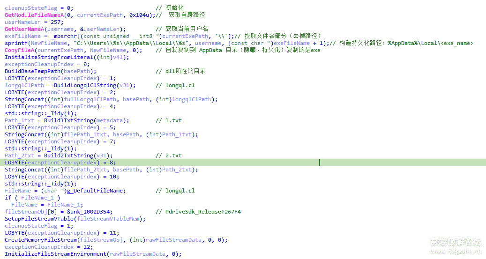

`image.png`（65.97 KB，下载次数：2；2025-7-23 14:33 上传）

[附件下载](https://www.52pojie.cn/forum.php?mod=attachment&aid=Mjc5MTE5NnwyZGQxNjMyNnwxNzkzNTc2NjUxfDE2ODA4NnwyMDQ3ODg5&nothumb=yes)

读取文件。

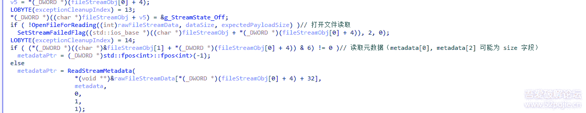

`image.png`（31.36 KB，下载次数：1）

[href="forum.php?mod=attachment&aid=Mjc5MTE5N3w4NzU1YTMzYXwxNzkzNTc2NjUxfDE2ODA4NnwyMDQ3ODg5&nothumb=yes" target="_blank"](https://www.52pojie.cn/forum.php?mod=attachment&aid=Mjc5MTE5N3w4NzU1YTMzYXwxNzkzNTc2NjUxfDE2ODA4NnwyMDQ3ODg5&nothumb=yes)

2025-7-23 14:33 上传

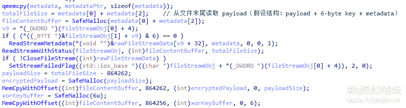

`image.png`（35.89 KB，下载次数：3）

[href="forum.php?mod=attachment&aid=Mjc5MTE5OHw5ODI5ZDc5MXwxNzkzNTc2NjUxfDE2ODA4NnwyMDQ3ODg5&nothumb=yes" target="_blank"](https://www.52pojie.cn/forum.php?mod=attachment&aid=Mjc5MTE5OHw5ODI5ZDc5MXwxNzkzNTc2NjUxfDE2ODA4NnwyMDQ3ODg5&nothumb=yes)

2025-7-23 14:34 上传

### 读取加密数据

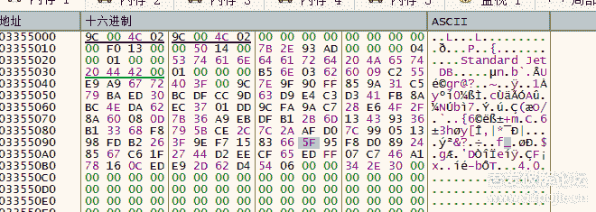

`image.png`（78.19 KB，下载次数：2）

[href="forum.php?mod=attachment&aid=Mjc5MTE5OXw4NDIxZjEzZHwxNzkzNTc2NjUxfDE2ODA4NnwyMDQ3ODg5&nothumb=yes" target="_blank"](https://www.52pojie.cn/forum.php?mod=attachment&aid=Mjc5MTE5OXw4NDIxZjEzZHwxNzkzNTc2NjUxfDE2ODA4NnwyMDQ3ODg5&nothumb=yes)

2025-7-23 14:34 上传

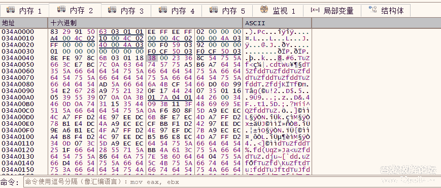

`image.png`（76.37 KB，下载次数：2）

[href="forum.php?mod=attachment&aid=Mjc5MTIwMHxlZDM4NjE2NHwxNzkzNTc2NjUxfDE2ODA4NnwyMDQ3ODg5&nothumb=yes" target="_blank"](https://www.52pojie.cn/forum.php?mod=attachment&aid=Mjc5MTIwMHxlZDM4NjE2NHwxNzkzNTc2NjUxfDE2ODA4NnwyMDQ3ODg5&nothumb=yes)

2025-7-23 14:34 上传

### 异或密钥

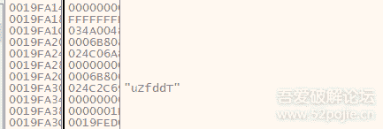

`image.png`（13.19 KB，下载次数：3）

[href="forum.php?mod=attachment&aid=Mjc5MTIwMnwyZGRhN2MzNnwxNzkzNTc2NjUxfDE2ODA4NnwyMDQ3ODg5&nothumb=yes" target="_blank"](https://www.52pojie.cn/forum.php?mod=attachment&aid=Mjc5MTIwMnwyZGRhN2MzNnwxNzkzNTc2NjUxfDE2ODA4NnwyMDQ3ODg5&nothumb=yes)

2025-7-23 14:34 上传

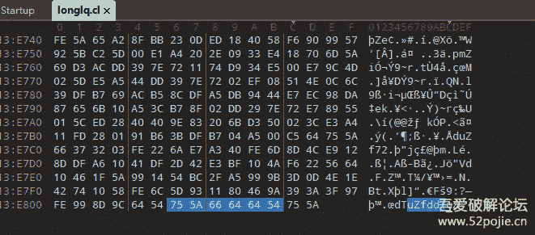

`image.png`（204.55 KB，下载次数：3）

[href="forum.php?mod=attachment&aid=Mjc5MTIwNHwxMWFjMmNkMHwxNzkzNTc2NjUxfDE2ODA4NnwyMDQ3ODg5&nothumb=yes" target="_blank"](https://www.52pojie.cn/forum.php?mod=attachment&aid=Mjc5MTIwNHwxMWFjMmNkMHwxNzkzNTc2NjUxfDE2ODA4NnwyMDQ3ODg5&nothumb=yes)

2025-7-23 14:35 上传

### 创建线程并执行

其实解密出来还是一个 PE 格式的`dll`。

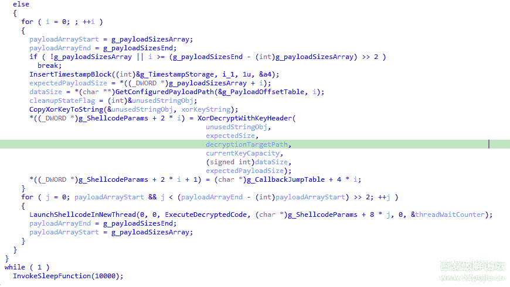

`image.png`（44.78 KB，下载次数：2）

[href="forum.php?mod=attachment&aid=Mjc5MTIwNnxmZDAxMzYzMnwxNzkzNTc2NjUxfDE2ODA4NnwyMDQ3ODg5&nothumb=yes" target="_blank"](https://www.52pojie.cn/forum.php?mod=attachment&aid=Mjc5MTIwNnxmZDAxMzYzMnwxNzkzNTc2NjUxfDE2ODA4NnwyMDQ3ODg5&nothumb=yes)

2025-7-23 14:35 上传

### 解密后数据

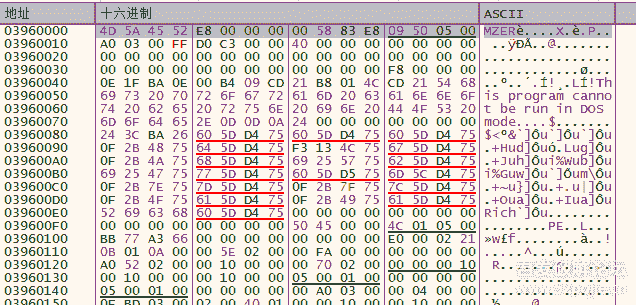

`image.png`（53.34 KB，下载次数：3）

[href="forum.php?mod=attachment&aid=Mjc5MTIwOHwwN2QwODU4NnwxNzkzNTc2NjUxfDE2ODA4NnwyMDQ3ODg5&nothumb=yes" target="_blank"](https://www.52pojie.cn/forum.php?mod=attachment&aid=Mjc5MTIwOHwwN2QwODU4NnwxNzkzNTc2NjUxfDE2ODA4NnwyMDQ3ODg5&nothumb=yes)

2025-7-23 14:35 上传

## 第四阶段解密数据分析

### 提取第四阶段数据信息

- 文件：`k360_03960000.bin`
- 大小：241664 字节
- 修改时间：2025年7月22日，15:09:10
- MD5：`D9F6AB1CCDF92FBFDE0FFBEF20655FCB`
- SHA1：`CA8E76D714FFAEC9EEB3D58A56E7BAB3E50A6C3C`
- CRC32：`007A1E1D`

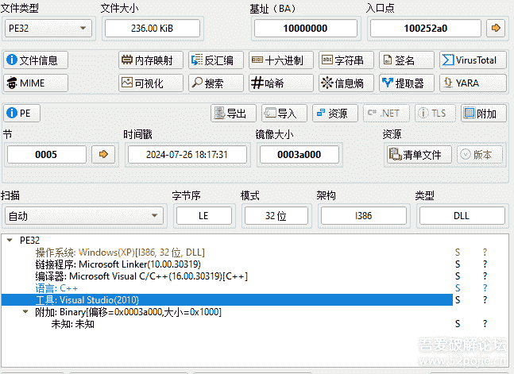

`image.png`（55.13 KB，下载次数：2）

[href="forum.php?mod=attachment&aid=Mjc5MTIxMHwxMTE3ZTM4NXwxNzkzNTc2NjUxfDE2ODA4NnwyMDQ3ODg5&nothumb=yes" target="_blank"](https://www.52pojie.cn/forum.php?mod=attachment&aid=Mjc5MTIxMHwxMTE3ZTM4NXwxNzkzNTc2NjUxfDE2ODA4NnwyMDQ3ODg5&nothumb=yes)

2025-7-23 14:35 上传

### 具体行为

直接在入口点调用病毒主函数。

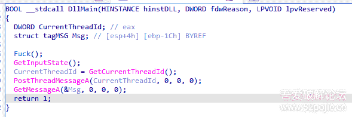

`image.png`（18.28 KB，下载次数：3）

[href="forum.php?mod=attachment&aid=Mjc5MTIxMXw0MDg0YjMyOHwxNzkzNTc2NjUxfDE2ODA4NnwyMDQ3ODg5&nothumb=yes" target="_blank"](https://www.52pojie.cn/forum.php?mod=attachment&aid=Mjc5MTIxMXw0MDg0YjMyOHwxNzkzNTc2NjUxfDE2ODA4NnwyMDQ3ODg5&nothumb=yes)

2025-7-23 14:36 上传

### 检测杀毒软件

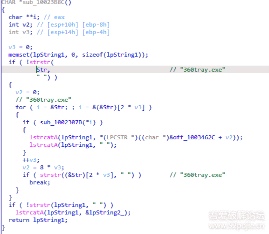

`image.png`（27.3 KB，下载次数：3）

[href="forum.php?mod=attachment&aid=Mjc5MTIxM3wwY2I2MTgxZXwxNzkzNTc2NjUxfDE2ODA4NnwyMDQ3ODg5&nothumb=yes" target="_blank"](https://www.52pojie.cn/forum.php?mod=attachment&aid=Mjc5MTIxM3wwY2I2MTgxZXwxNzkzNTc2NjUxfDE2ODA4NnwyMDQ3ODg5&nothumb=yes)

2025-7-23 14:36 上传

### 病毒功能分发器

病毒的功能分发器，是一个功能非常全面的远程控制木马（`RAT`）的命令处理器。它通过一个中心化的指令码来控制恶意软件的几乎所有行为，包括：

- **持久化**：写入注册表`Run`项、注册为服务。
- **信息窃取**：键盘记录、屏幕截图/录屏、文件操作。
- **系统控制**：远程桌面、执行任意命令、关机。
- **权限提升**：尝试以管理员身份重启。
- **隐蔽与清理**：清除日志、杀死`explorer`进程。
- **扩展能力**：下载并执行新文件、加载插件、建立代理隧道。

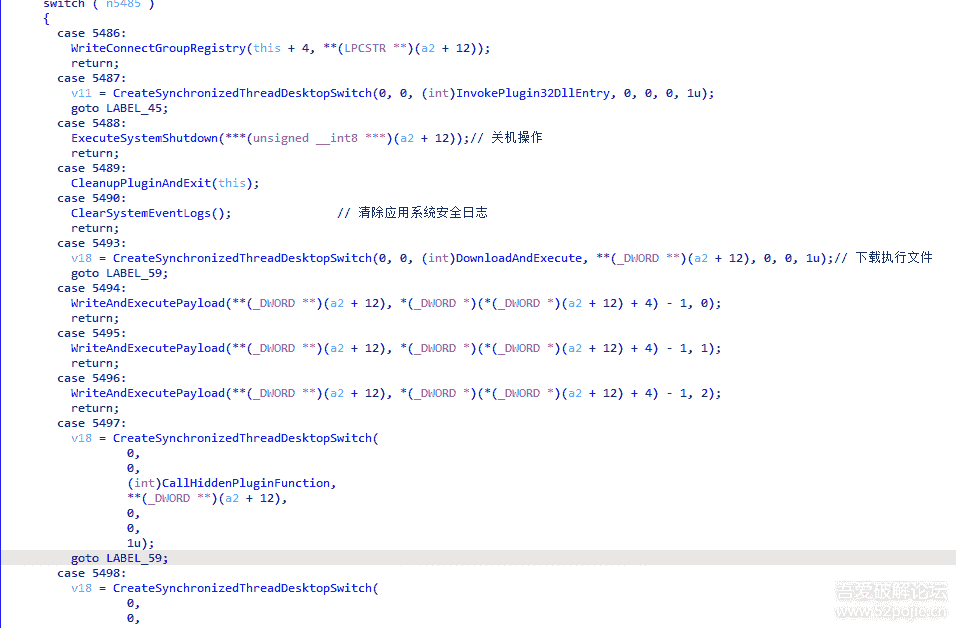

`image.png`（49.42 KB，下载次数：2）

[href="forum.php?mod=attachment&aid=Mjc5MTIxNXw5YmEzZjFjYnwxNzkzNTc2NjUxfDE2ODA4NnwyMDQ3ODg5&nothumb=yes" target="_blank"](https://www.52pojie.cn/forum.php?mod=attachment&aid=Mjc5MTIxNXw5YmEzZjFjYnwxNzkzNTc2NjUxfDE2ODA4NnwyMDQ3ODg5&nothumb=yes)

2025-7-23 14:36 上传

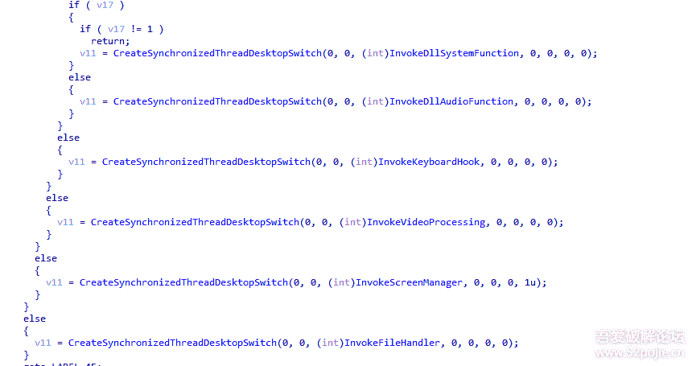

`image.png`（29.46 KB，下载次数：2）

[href="forum.php?mod=attachment&aid=Mjc5MTIxNnxmYmVkYWRiMXwxNzkzNTc2NjUxfDE2ODA4NnwyMDQ3ODg5&nothumb=yes" target="_blank"](https://www.52pojie.cn/forum.php?mod=attachment&aid=Mjc5MTIxNnxmYmVkYWRiMXwxNzkzNTc2NjUxfDE2ODA4NnwyMDQ3ODg5&nothumb=yes)

2025-7-23 14:36 上传

### 安全提醒

该病毒处心积虑使用多种方法、多重释放的方式隐藏自身，大家也要擦亮眼睛，不要下载执行可疑文件。下载程序需要去官网下载，最后是病毒的信息，还有外联的 IP 地址。

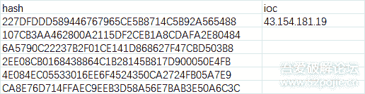

`image.png`（18.04 KB，下载次数：1）

[href="forum.php?mod=attachment&aid=Mjc5MTIxN3wzNTFmNmEwY3wxNzkzNTc2NjUxfDE2ODA4NnwyMDQ3ODg5&nothumb=yes" target="_blank"](https://www.52pojie.cn/forum.php?mod=attachment&aid=Mjc5MTIxN3wzNTFmNmEwY3wxNzkzNTc2NjUxfDE2ODA4NnwyMDQ3ODg5&nothumb=yes)

2025-7-23 14:41 上传
