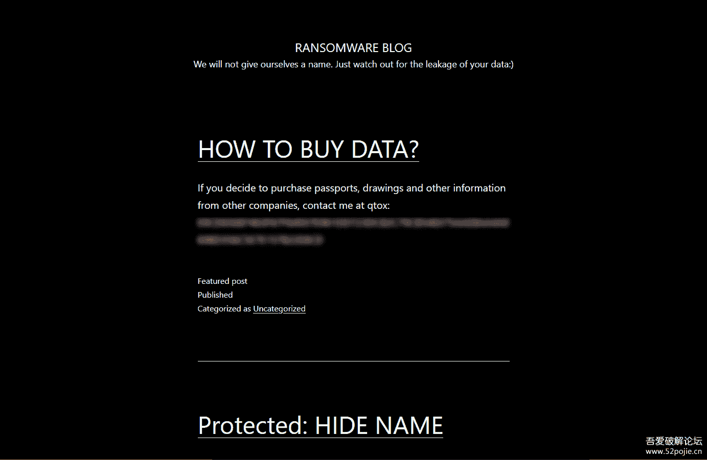
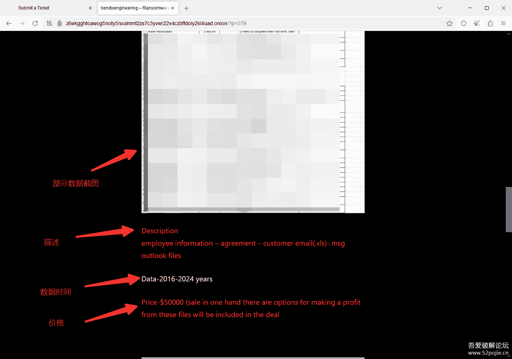
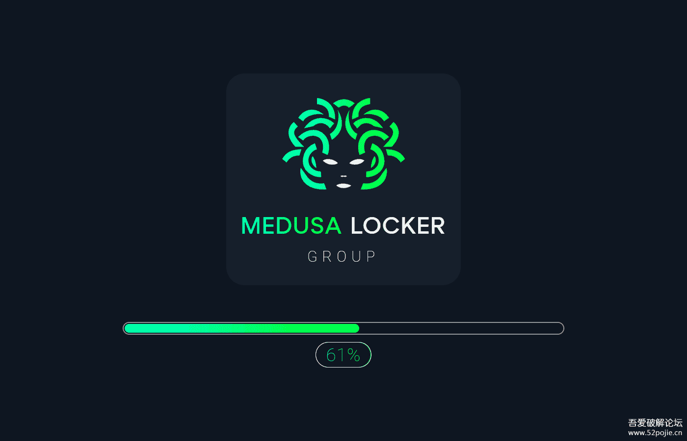
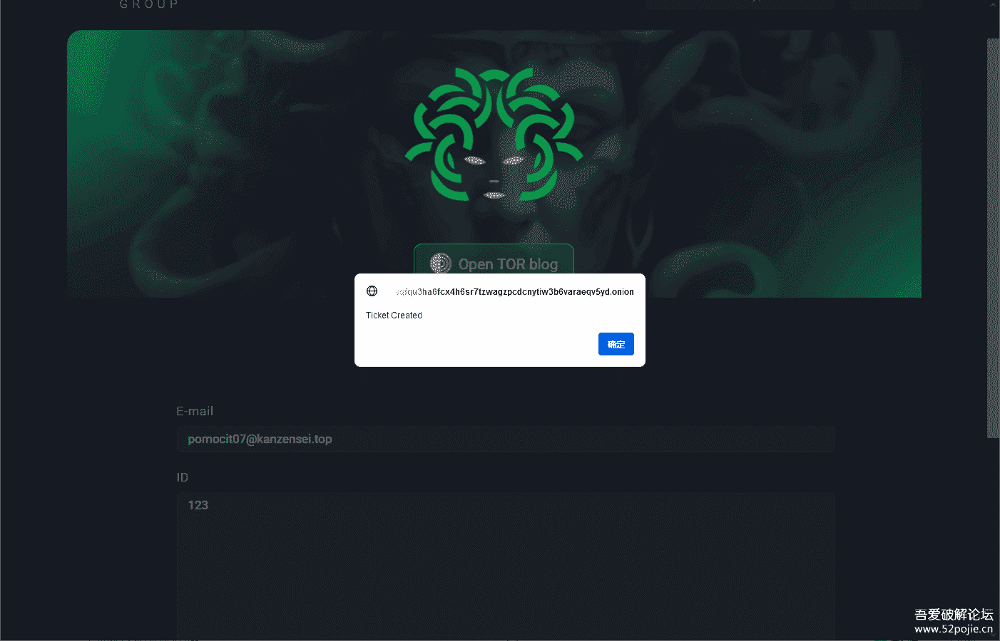
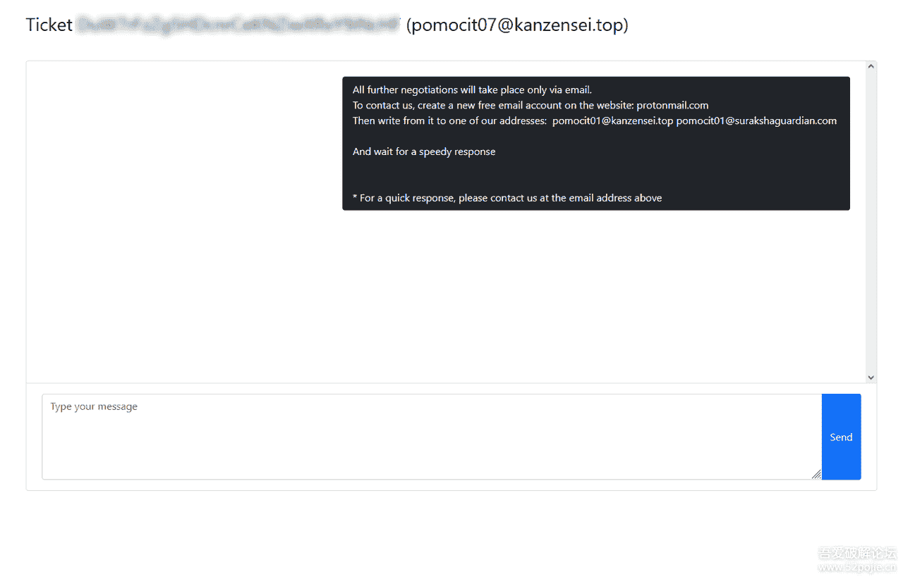

# [PC样本分析] 【病毒分析】MEDUSA LOCKER勒索windows版本分析
- 原帖: `https://www.52pojie.cn/forum.php?mod=viewthread&tid=2061911`
- 抓取时间: 2026-11-01T23:43:48

## 1.背景
### 1.1 家族介绍
MEDUSA LOCKER 家族于 2019 年 9 月出现，MEDUSA LOCKER 家族通常通过有漏洞的远程桌面协议（RDP）配置获取受害者设备访问权限，攻击者还经常使用电子邮件钓鱼和垃圾邮件活动——直接将勒索软件附加到电子邮件中——作为初始入侵渠道。

MEDUSA LOCKER 对受害者的数据进行加密，并在包含加密文件的每个文件夹中留下带有勒索信。勒索信指示受害者向特定的比特币钱包地址提供勒索软件付款。MEDUSA LOCKER 似乎根据观察到的赎金支付拆分作为勒索软件即服务（RaaS）模型运行。典型的 RaaS 模型涉及勒索软件开发人员和在受害者系统上部署勒索软件的各种附属公司。MEDUSA LOCKER 家族付款似乎始终在附属公司之间分配，附属公司收到 55% 到 60% 的赎金;以及接收剩余部分的开发人员。

### 1.2 平台介绍
MEDUSA LOCKER家族提供两个暗网地址：一个是博客，另一个是聊天室。博客中留有Tox联系方式，并会公开受害者的信息，点击特定受害者后，可以查看其详细的泄露数据和赎金要求；聊天室则要求输入ID和联系邮箱，且支持上传一个被加密的文件进行测试。提交后，系统将为受害者生成一个聊天室，供其与MEDUSA LOCKER家族进行私密交流，其他人无法查看该对话内容。

#### 1.2.1 博客页

`1.png` (73.15 KB, 下载次数: 3)
[href="forum.php?mod=attachment&aid=MjgwNDQ5MXwwMGIwOTExYXwxNzkzNTc2NjI1fDE2ODA4NnwyMDYxOTEx&nothumb=yes" target="_blank"](https://www.52pojie.cn/forum.php?mod=attachment&aid=MjgwNDQ5MXwwMGIwOTExYXwxNzkzNTc2NjI1fDE2ODA4NnwyMDYxOTEx&nothumb=yes)
2025-9-22 17:00 上传
博客首页

`2.png` (82.13 KB, 下载次数: 3)
[href="forum.php?mod=attachment&aid=MjgwNDQ5MnxjZmYzMTYyOXwxNzkzNTc2NjI1fDE2ODA4NnwyMDYxOTEx&nothumb=yes" target="_blank"](https://www.52pojie.cn/forum.php?mod=attachment&aid=MjgwNDQ5MnxjZmYzMTYyOXwxNzkzNTc2NjI1fDE2ODA4NnwyMDYxOTEx&nothumb=yes)
2025-9-22 17:00 上传
数据详情页

#### 1.2.2 聊天室页

`3.png` (59.08 KB, 下载次数: 4)
[href="forum.php?mod=attachment&aid=MjgwNDQ5M3w5YWQ2NjhhMXwxNzkzNTc2NjI1fDE2ODA4NnwyMDYxOTEx&nothumb=yes" target="_blank"](https://www.52pojie.cn/forum.php?mod=attachment&aid=MjgwNDQ5M3w5YWQ2NjhhMXwxNzkzNTc2NjI1fDE2ODA4NnwyMDYxOTEx&nothumb=yes)
2025-9-22 17:00 上传
加载进入聊天室

`4.png` (282.84 KB, 下载次数: 3)
[href="forum.php?mod=attachment&aid=MjgwNDQ5NHw5OTJjNDQyOHwxNzkzNTc2NjI1fDE2ODA4NnwyMDYxOTEx&nothumb=yes" target="_blank"](https://www.52pojie.cn/forum.php?mod=attachment&aid=MjgwNDQ5NHw5OTJjNDQyOHwxNzkzNTc2NjI1fDE2ODA4NnwyMDYxOTEx&nothumb=yes)
2025-9-22 17:00 上传
成功创建聊天室

`5.png` (129.76 KB, 下载次数: 2)
[href="forum.php?mod=attachment&aid=MjgwNDQ5NXxmZGQ4MDVhMnwxNzkzNTc2NjI1fDE2ODA4NnwyMDYxOTEx&nothumb=yes" target="_blank"](https://www.52pojie.cn/forum.php?mod=attachment&aid=MjgwNDQ5NXxmZGQ4MDVhMnwxNzkzNTc2NjI1fDE2ODA4NnwyMDYxOTEx&nothumb=yes)
2025-9-22 17:00 上传
聊天室页面

## 2.恶意文件基础信息
### 2.1 恶意文件基本信息
文件名 | `bh538.exe` | 编译器
