# [分享] 勒索病毒自救手册

- 原帖: https://www.52pojie.cn/forum.php?mod=viewthread&tid=2063697
- 抓取时间: 2026-11-01T23:43:44

## 前言

勒索病毒威胁已经成为当前最受关注的网络安全风险之一。而结合信息窃取和泄露的二次勒索模式，使得勒索病毒的危害进一步加深。针对个人、企业、政府机关、各类机构的攻击层出不穷，在勒索病毒威胁面前，没有人能够置身事外。在勒索病毒处置中，如能及时正确处置，可有效降低勒索病毒带来的损失，避免病毒影响进一步扩散。360 反病毒部是国内最早开始追踪勒索病毒的团队，提供的反勒索服务已累计为超万例勒索病毒救援求助提供帮助，我们将通过本文对勒索病毒的常规处置方法、解密方法、安全加固方案和其它一些常见问题进行解答，希望以此为企事业单位和广大网民提供帮助。

360 反病毒部是 360 政企安全集团的核心能力支持部门，由一批常年在网络安全一线进行对抗防御的专家组成，负责流行病毒木马的监测、防御、处置和新安全威胁研究。维护着 360 高级主动防御系统、360 反勒索服务等基础安全服务，并为用户提供了横向渗透防护、无文件攻击防护、软件劫持防护、挖矿木马防护等多项防护功能，保护广大网民上网安全。

## 处置篇

发现被感染勒索病毒之后，第一时间的正确处置能有效降低勒索病毒带来的损失，避免病毒影响进一步扩散，更快找到解决方案。对于企业而言，往往是多台设备同时被勒索病毒攻击，且同一内网之中可能还存在其它尚未被感染设备。针对这一情况，为了避免勒索病毒进一步扩散，我们提供以下处理流程方案供参考。

### 一、阻断勒索病毒进一步扩散

发现中毒机器，首先应先阻断勒索病毒继续加密文件和进一步扩散。有两个可行方案，但无论采取哪个方案，都应在第一时间对中毒机器进行断网处理(关闭网络能阻止勒索病毒在内网横向传播以及攻击者对当前设备的持续控制)。具体方案如下：

若发现设备中还有未被加密文件，应及时切断网络并关闭计算机。关闭计算机能及时阻止勒索病毒继续加密文件，且避免再次直接开机。

若发现文件均已被加密，可切断网络之后，联系专业技术人员，查看病毒程序是否还在运行。若还在运行，则可尝试抓取内存dump，为后续解密提供帮助。

### 二、了解攻击具体情况

#### (一) 了解受影响情况

包括：
&#61548; 哪些机器受到攻击，影响情况如何，是否存在备份，备份是否可用。
&#61548; 哪些机器未受到攻击，是否可暂时隔离下线处理等。
&#61548; 机器感染勒索病毒的开始时间。
&#61548; 网络拓扑情况，中招机器和未中招机器在网络中的分布情况等。
&#61548; 存储有敏感信息的设备是否被异常访问，是否存在数据泄露风险。

对企业信息资产的全面排查，是避免由于慌乱出现遗漏，为后续工作埋下隐患。此处需要结合企业自身设备情况进行灵活排查。

对于中招情况不明，已经关闭下线的机器，如需排查损失情况，建议对磁盘或环境做备份后，在隔离网内开机或上线查看，以免有残存的开机自启动病毒再次启动后加密文件。另外需要主要的是，管理员通过远程登录到被感染设备查看情况时，一定不要将本地磁盘映射过去。因为勒索病毒可能还在运行，映射过去会导致该磁盘文件被加密。

#### (二) 了解中招勒索病毒情况

可以通过以下方面来了解所感染勒索病毒情况：

1. 病毒留下的勒索信息

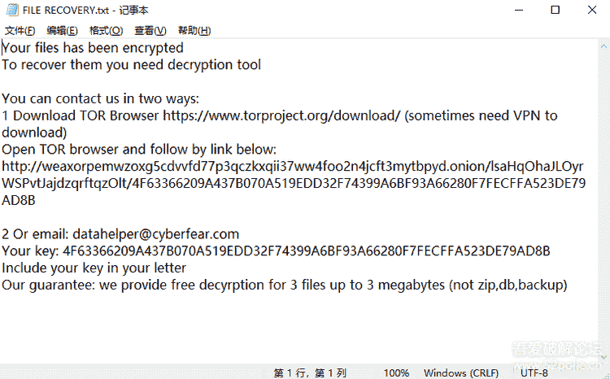

t11e3f4274f20aad8e5151cb2e0.png (201.93 KB, 下载次数: 2)

[href="forum.php?mod=attachment&aid=MjgwNjM2OXw4NmQ0ZWQ0NnwxNzkzNTc2NjIxfDE2ODA4NnwyMDYzNjk3&nothumb=yes" target="_blank"](https://www.52pojie.cn/forum.php?mod=attachment&aid=MjgwNjM2OXw4NmQ0ZWQ0NnwxNzkzNTc2NjIxfDE2ODA4NnwyMDYzNjk3&nothumb=yes)

2025-10-1 11:43 上传

2. 被病毒加密的文件

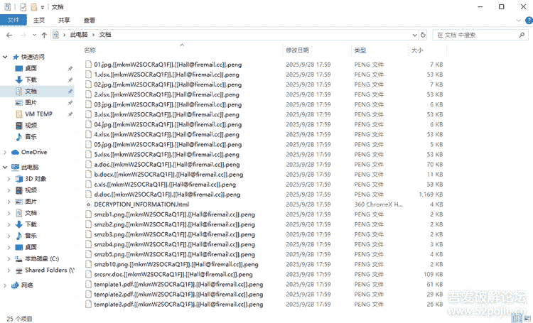

t11e3f4274fc615f59694caf733.png (281.91 KB, 下载次数: 2)

[href="forum.php?mod=attachment&aid=MjgwNjM3MHw5YTFkNDQwMXwxNzkzNTc2NjIxfDE2ODA4NnwyMDYzNjk3&nothumb=yes" target="_blank"](https://www.52pojie.cn/forum.php?mod=attachment&aid=MjgwNjM3MHw5YTFkNDQwMXwxNzkzNTc2NjIxfDE2ODA4NnwyMDYzNjk3&nothumb=yes)

2025-10-1 11:43 上传

3. 被加密后的桌面背景

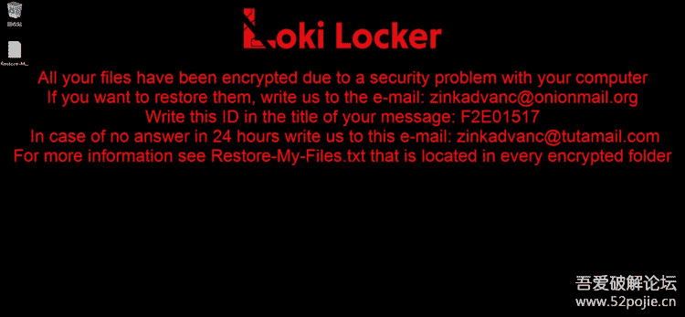

t11e3f4274f92ce3038f826a72b.png (153.02 KB, 下载次数: 2)

[href="forum.php?mod=attachment&aid=MjgwNjM3MXw3YTU3ZWM1OHwxNzkzNTc2NjIxfDE2ODA4NnwyMDYzNjk3&nothumb=yes" target="_blank"](https://www.52pojie.cn/forum.php?mod=attachment&aid=MjgwNjM3MXw3YTU3ZWM1OHwxNzkzNTc2NjIxfDE2ODA4NnwyMDYzNjk3&nothumb=yes)

2025-10-1 11:44 上传

4. 发现的可疑样本

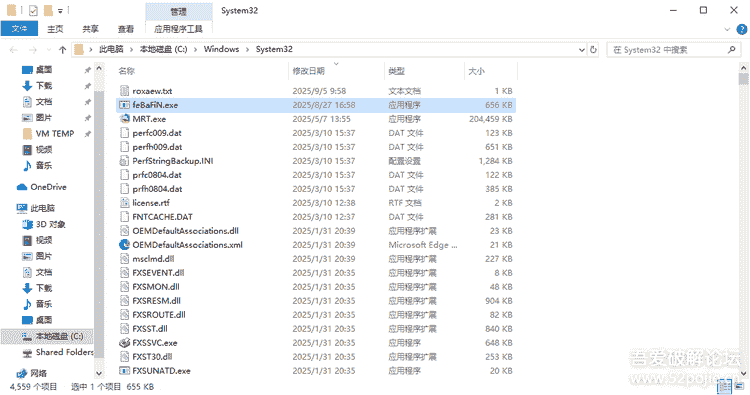

t11e3f4274fb8ad2ca2613ee8c6.png (164.12 KB, 下载次数: 0)

[href="forum.php?mod=attachment&aid=MjgwNjM3MnxmMjY4MTViN3wxNzkzNTc2NjIxfDE2ODA4NnwyMDYzNjk3&nothumb=yes" target="_blank"](https://www.52pojie.cn/forum.php?mod=attachment&aid=MjgwNjM3MnxmMjY4MTViN3wxNzkzNTc2NjIxfDE2ODA4NnwyMDYzNjk3&nothumb=yes)

2025-10-1 11:44 上传

5. 弹窗信息

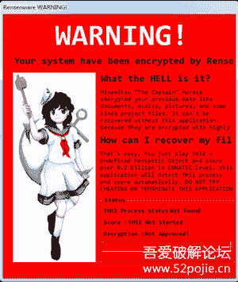

t0111d6b1ddf1e631bd.png (81.69 KB, 下载次数: 2)

[href="forum.php?mod=attachment&aid=MjgwNjM3N3w4MGUwMWE4NnwxNzkzNTc2NjIxfDE2ODA4NnwyMDYzNjk3&nothumb=yes" target="_blank"](https://www.52pojie.cn/forum.php?mod=attachment&aid=MjgwNjM3N3w4MGUwMWE4NnwxNzkzNTc2NjIxfDE2ODA4NnwyMDYzNjk3&nothumb=yes)

2025-10-1 11:44 上传

在准备完成上述文件之后，可以通过360勒索病毒搜索引擎查询所中勒索病毒情况。更多操作可参见解密篇

注：勒索病毒的特征信息是经常会改变的，紧靠一些文件名和弹窗信息无法绝对准确判断勒索病毒种类，最终勒索病毒的认定还需要通过分析提取到的病毒样本确定。

#### (三) 黑客攻击方式排查

该信息一般需要专业人员进行排查，以下几个渠道均可与360政企安全相关技术人员取得联系：
&#61548; 在360安全卫士中申请反勒索服务。
&#61548; 360论坛的勒索病毒板块反馈。
&#61548; 360勒索病毒搜索引擎查询结果中提到的勒索病毒救援群。

若企业内部有专门的信息安全管理人员，也可尝试自行排查。

以下是2024年受勒索病毒入侵方式占比情况，可供参考

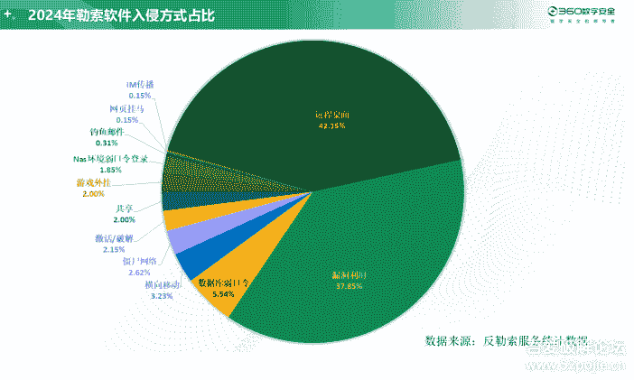

t11e3f4274f6d03b54e66cce8ed.png (142.51 KB, 下载次数: 2)

[href="forum.php?mod=attachment&aid=MjgwNjM3OXxiYjY0Y2RkM3wxNzkzNTc2NjIxfDE2ODA4NnwyMDYzNjk3&nothumb=yes" target="_blank"](https://www.52pojie.cn/forum.php?mod=attachment&aid=MjgwNjM3OXxiYjY0Y2RkM3wxNzkzNTc2NjIxfDE2ODA4NnwyMDYzNjk3&nothumb=yes)

2025-10-1 11:45 上传

远程桌面

检查 Windows 日志中的安全日志以及防火墙日志等,同时排查内网穿透类与远控代理类软件。

共享设置

检查是否只有共享出去的文件被加密,具体可参考“Q2 勒索病毒是否会在内网中 横向转播？”中的共享自查。

激活/[//www.52pojie.cn" target="_blank" class="relatedlink"](https://www.52pojie.cn:href="https)

检查中招之前是否有下载未知激活工具或者破解软件。

僵尸网络

僵尸网络传播勒索病毒之前通常曾在受害感染设备部署过其它病毒木马，可通过使 用杀毒软件进行查杀进行判断。

第三方账户

检查是否有软件厂商提供固定密码的账户或安装该软件会新增账户。包括远程桌面、 数据库等涉及到口令的软件。

软件漏洞

根据系统环境，针对性进行排查，例如常见被攻击环境 `Java`、通达 OA、致远 OA 等。查 web 日志、排查域控与设备补丁情况等。

页面挂马

检查中毒之前浏览器的历史访问记录，是否存在可疑网站，特别是访问时出现过页 面跳转网站。

钓鱼邮件

检查邮件记录和中毒前一段时间的网址访问记录，检查是否点击过可疑链接或下载、 运行过附件中的程序、脚本等。并注意：熟人邮件或常用网址并不绝对安全，也许排查。

U 盘蠕虫

U 盘蠕虫下发勒索病毒之前通常也是长期驻扎在系统中，也会残留一些病毒木马在 系统中，可通过杀毒软件查杀识别。

数据库弱口令

检查 `sql` 日志，Windows 日志中的应用程序日志。

主动运行

检查打开程序与文件记录。

`NAS` 弱口令

检查 NAS 日志。

`VNC` 弱口令

检查服务器 VNC 配置

排查公司流量情况，以上排查都应该格外关注非工作时段和海外 ip 的访问情况

勒索病毒投递阶段的攻击者，往往是采用多种技术手段相结合进行病毒投递的，需要对 中招环境的各种可能攻击途径都进行排查。由于近年来，窃取数据进行勒索的案例大量增加， 对于企业数据是否失窃或者泄密也应进行排查。

### 三、及时处理未感染设备，避免再次遭遇攻击

a) 口令更换，因无法确定黑客掌握了内部多少机器的口令，同一内网下设备口令均应更换。包括但不 限于涉及远程桌面、`mysql`、`mssql` 和 `Tomcat` 等任何涉及网络登录的口令。

b) 根据排查发现的攻击方式与隐患，及时修补漏洞，短时间内无法修补的，坚决不能再次 上线。

c) 在未完成全部检查前，有机器需要上线的，应关闭文件共享，如果无法关闭的，应该限 制访问权限，内网中可能还有尚未找到的被感染机器，有文件共享的话，共享文件可能 会被加密。

### 四、中毒设备处理

中招设备如果要再次投入使用的，应该对安全问题进行一一排查，可参见：安全加固篇 ->定期排查项。

在未查清中招原因的情况下，不建议进行如下操作：

格式化磁盘、重装系统、恢复系统等彻底破坏中招环境的其它操作。

彻底删除发现的可疑程序，病毒文件。如果发现可疑文件后，可以将文件打包为一 个加密压缩包后再进行删除或转移。

清除所有的勒索信息和被加密文件，这可能会影响后续文件的恢复。

### 五、安全加固

已经感染过勒索病毒，或者之前感染过挖矿木马的设备，再次感染勒索病毒的风险非常 高，对于中招设备，排查原因并进行加固是非常必要的。

详细操作请参考安全加固篇

## 解密篇

### Q1 中勒索病毒，不知是否可解？

#### A1

可以到 360 勒索病毒搜索引擎查询所感染勒索病毒家族近况。支持输入后缀、黑客邮 箱等关键词查询，也支持上传被加密文件或黑客留下的勒索提示信息进行查询。针对查询结 果：

若查询结果显示可解，可通过 360 解密大师解密被加密文件(360 安全卫士→功能大全 →360 解密大师)。

若查询结果显示“暂时无法解密”，可以过一段时间再来查询，360 解密大师会不断更 新版本。

如果查询不到您所中的勒索病毒属于哪个家族，可以通过该页面中的 `QQ` 群反馈给管理 人员协助核实。若属于新型勒索病毒，相关技术人员会尝试研究该家族是否可解。

### Q2 想恢复数据，能否提供付费解密服务？

#### A2

如果查询结果提示“暂时无法解密”，说明我们的技术人员已对该家族进行过研究，但是暂时没有找到技术破解的方案。目前我们暂不提供技术破解以外的其他形式解密服务，也 没有可以推荐的第三方服务商。若您认为确有必要寻求付费解密，可自行联系黑客付费购买 密钥，或通过联系第三方购买相关服务。

重要说明：第三方服务商所提供的解密方案为中介性质服务，代替用户与黑客取得联系 并操作后续的付费、解密流程，本质上并不具备技术破解能力。

### Q3 购买密钥需要注意什么？

#### A3

首先，我们不推荐任何形式的交付赎金行为。若您执意要购买密钥，我们建议应注意以下几点：

&#9899; 不建议直接向黑客付款。直接向黑客付款存在很大风险：
其一是可能拿到的解密工具并不能使用；
其二是可能存在密钥不对，无法解密您的文件；
其三是黑客可能会再次甚至多次向您索要赎金。

&#9899; 若必须向黑客付款，可在支付前先向黑客发送 1 到 2 个被加密文件，确认能解密成功后 再确定是否付款。

&#9899; 通过淘宝、搜索引擎或其它方式联系到的解密服务商，正式开展解密工作前一定要签订合同，明确解密不成功是否需要付款等问题，必要时可要求上门服务。

&#9899; 不要咨询过多第三方商家。因为第三方大多都是去找黑客购买密钥。过多的联系第三方 商家，会造成黑客收到多次关于你设备的咨询，这可能导致黑客觉察到你对数据恢复有 强烈需求，从而提高赎金。

&#9899; 不要过度描述自己文件的重要性或自身的经济实力，这可能会造成解密商或黑客提高佣 金或赎金要求。

### Q4 360 制作解密工具耗时多长？

#### A4

解密时间无法估计。若勒索病毒已知，而我们当前又无法给出技术破解方案，说明该勒

索病毒的加密算法不存在显著的技术漏洞。只能等待黑客的私钥被公开或泄露，或是有其它

的技術性突破。而这些都是无法做出时间上的预期的。

若该勒索病毒属于未知家族，可联系技术人员查看是否能在被加密机器上找到加密程序

或其它线索。若能找到，可尝试研究是否可解。

### Q5 数据恢复方式是否有效？

#### A5

少部分勒索病毒由于其加密文件所使用的方式问题，导致有机会通过数据恢复软件找回

部分文件。但目前多数勒索病毒加密后的文件并不能直接找回。

此外，很多勒索病毒加密文件时为了保证效率，只加密文件头部固定大小的数据，所以

部分数据库有机会通过数据修复的方法进行恢复。但该方法并不能保证能 100%修复，可能

仍有部分数据丢失，其它格式的文件通过该方法恢复的机会则很小。

## 安全加固篇

面对严峻的勒索病毒威胁态势，我们分别为个人用户和企业用户给出有针对性的安全建 议。希望能够帮助尽可能多的用户全方位的保护计算机安全，免受勒索病毒感染。

### 一、 针对个人用户的安全建议

对于普通用户，我们给出以下建议，以帮助用户免遭勒索病毒攻击。

#### (一) 养成良好的安全习惯

1. 电脑应当安装具有高级威胁防护能力和主动防御功能的安全软件，不随意退出安全软件或关闭防护功能，对安全软件提示的各类风险行为不要轻易采取放行操作。

2. 可使用安全软件的漏洞修复功能，第一时间为操作系统和浏览器，常用软件打好补丁，以免病毒利用漏洞入侵电脑。

3. 尽量使用安全浏览器，减少遭遇挂马攻击、钓鱼网站的风险。

4. 重要文档、数据应经常做备份，一旦文件损坏或丢失，也可以及时找回。

5. 电脑设置的口令要足够复杂，包括数字、大小写字母、符号且长度至少应该有8位，不使用弱口令，以防攻击者破解。

#### (二) 减少危险的上网操作

1. 不要浏览来路不明的色情、赌博等不良信息网站，此类网站经常被用于发起挂马、钓鱼攻击。

2. 不要轻易打开陌生人发来的邮件附件或邮件正文中的网址链接。也不要轻易打开扩展名为`js`、`vbs`、`wsf`、`bat`、`cmd`、`ps1`等脚本文件和`exe`、`scr`、`com`等可执行程序，对于陌生人发来的压缩文件包，更应提高警惕，先使用安全软件进行检查后再打开。

3. 电脑连接移动存储设备（如U盘、移动硬盘等），应首先使用安全软件检测其安全性。

4. 对于安全性不确定的文件，可以选择在安全软件的沙箱功能中打开运行，从而避免木马对实际系统的破坏。

#### (三) 采取及时的补救措施

1. 安装360安全卫士并开启反勒索服务，一旦电脑被勒索软件感染，可以通过360反勒索服务寻求帮助，以尽可能的减小自身损失。

### 二、 针对企业用户的安全建议

#### (一) 企业安全规划建议

对企业信息系统的保护，是一项系统化工程，在企业信息化建设初期就应该加以考虑，建设过程中严格落实，防御勒索病毒也并非难事。对企业网络的安全建设，我们给出下面几方面的建议。

1. 安全规划

&#61548; 网络架构，业务、数据、服务分离，不同部门与区域之间通过`VLAN`和子网分离，减少因为单点沦陷造成大范围的网络受到攻击。

## 1. 网络安全
- 内外网隔离，合理设置DMZ区域，对外提供服务的设备要做严格管控。减少企业被外部攻击的暴露面。
- 安全设备部署，在企业终端和网络关键节点部署安全设备，并日常排查设备告警情况。
- 权限控制，包括业务流程权限与人员账户权限都应该做好控制，如控制共享网络权限，原则上以最小权限提供服务。降低因为单个账户沦陷而造成更大范围影响。
- 数据备份保护，对关键数据和业务系统做备份，如离线备份，异地备份，云备份等，避免因为数据丢失、被加密等造成业务停摆，甚至被迫向攻击者妥协。
- 敏感数据隔离，对敏感业务及其相关数据做好网络隔离，如有必要甚至建议做好设备之间的物理隔离。避免双重勒索病毒在入侵后轻易窃取到敏感数据，对公司业务和机密信息造成重大威胁。

## 2. 安全管理
- 账户口令管理，严格执行账户口令安全管理，重点排查弱口令问题，口令长期不更新问题，账户口令共用问题，内置、默认账户问题。
- 补丁与漏洞扫描，了解企业数字资产情况，将补丁管理作为日常安全维护项目，关注补丁发布情况，及时更新系统、应用系统、硬件产品安全补丁。定期执行漏洞扫描，发现设备中存在的安全问题。
- 权限管控，定期检查账户情况，尤其是新增账户。排查账户权限，及时停用非必要权限，对新增账户应有足够警惕，做好登记管理。
- 内网强化，进行内网主机加固，定期排查未正确进行安全设置，未正确安装安全软件设备，关闭设备中的非必要服务，提升内网设备安全性。

## 3. 人员管理
- 人员培训，对员工进行安全教育，培养员工安全意识，如识别钓鱼邮件、钓鱼页面等。
- 行为规范，制定工作行为规范，指导员工如何正常处理数据，发布信息，做好个人安全保障。如避免员工将公司网络部署，服务器设置发布到互联网之中。

## (二) 发现遭受勒索病毒攻击后的处理流程
1. 发现中毒机器应立即关闭其网络和该计算机。关闭网络能阻止勒索病毒在内网横向传播，关闭计算机能及时阻止勒索病毒继续加密文件。
2. 联系安全厂商，对内部网络进行排查处理。
3. 公司内部所有机器口令均应更换，你无法确定黑客掌握了内部多少机器的口令。

## (三) 遭受勒索病毒攻击后的防护措施
1. 比照“企业安全规划建议”中的事项，对未尽事项目进行及时更正或加强。
2. 检测系统和软件中的安全漏洞，及时打上补丁。
   - 是否有新增账户
   - `Guest`是否被启用
   - `Windows`系统日志是否存在异常
   - 杀毒软件是否存在异常拦截情况
3. 检查登录口令要有足够的长度和复杂性，并更新安全度不足或疑似已经泄露的登录口令。
4. 对尚未被加密的重要文件进行及时备份，避免依然存在活跃的勒索病毒对重要数据进行新一轮加密。
5. 加强对敏感数据的隔离，如可行，尽可能完全断开敏感数据与外界的一切连接。避免具有多重勒索功能的病毒进一步获取更多的重要信息作为勒索筹码。

## 三、 不建议支付赎金
最后——无论是个人用户还是企业用户，都不建议支付赎金！
支付赎金不仅变相鼓励了勒索攻击行为，而且解密的过程还可能会带来新的安全风险。可以尝试通过备份、数据恢复、数据修复等手段挽回部分损失。比如：部分勒索病毒只加密文件头部数据，对于某些类型的文件（如数据库文件），可以尝试通过数据修复手段来修复被加密文件。如果不得不支付赎金的话，可以尝试和黑客协商来降低赎金价格，同时在协商过程中要避免暴露自己真实身份信息和紧急程度，以免黑客漫天要价。

## 勒索病毒问答
### Q1 勒索病毒是否有传播性？
**A1** 理论上病毒代码可以带有任意形式的恶意功能，因此无法保证特定一款勒索病毒不具有传播性。但就目前实际捕获到的勒索病毒来看，更多的勒索病毒自身并不具备自主传播的特征（`WannaCry`是个例外）。然而这并不代表其不会影响到局域网内的其他机器，受影响的机器会有如下几类情形。
1. 和被感染机器在同一内网，并与被感染机器共享部分文件夹。由于被感染机器能直接访问到该文件夹，如果没有设置适当的权限控制，病毒就能将该共享文件夹加密。 自查是否只有共享被加密：`win+r` 输入 `cmd`，然后输入 `net share` 回车。即可看到当前设备共享了哪些文件夹。
也可通过计算机管理查看：
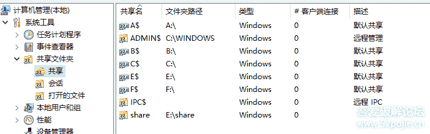
t11e3f4274fe369b63334bc35e5.png (41.28 KB, 下载次数: 1)
[href="forum.php?mod=attachment&aid=MjgwNjM4MHxmZWVjYjYyMHwxNzkzNTc2NjIxfDE2ODA4NnwyMDYzNjk3&nothumb=yes" target="_blank"](https://www.52pojie.cn/forum.php?mod=attachment&aid=MjgwNjM4MHxmZWVjYjYyMHwxNzkzNTc2NjIxfDE2ODA4NnwyMDYzNjk3&nothumb=yes)
2025-10-1 11:46 上传
对于自行添加的共享文件夹，可以调整权限，如果没有使用需求的，可以直接关闭共享。
2. 黑客利用被感染机器作为跳板，尝试通过扫描同网段端口、查看远程桌面登录记录 、Nday漏洞攻击等方式攻击内网其他机器。

### Q2 文件已被加密，但扫不出病毒？
**A2** 勒索病毒受害者经常在发现中毒后第一时间会使用杀毒软件进行查杀，但杀毒软件却没有查杀到可疑文件，这种现象很常见，也有很多种可能情况：
大部分情况下，勒索病毒在加密完文件后便会自删除，留下被加密的文件，而被加密文件不带毒。
黑客将勒索提示信息写入到开机启动项，用户关机重启后会弹出勒索窗口，那是黑客留下的勒索提示信息文档，用来指导用户如何联系他们支付赎金恢复文件。一般只是文档，本身并不具备加密功能，也不是病毒。
本机并非被勒索病毒直接感染机器，仅因和中毒机器进行了文件共享导致共享文件夹被加密。这种勒索病毒程序是在其它设备中的，当然计算机中没有病毒。

### Q3 如何判断系统是否还存在勒索病毒？
**A3** 部分中招用户在文件恢复后不确定系统是否安全，想知道如何处理才能尽可能保证此次攻击事件遗留问题都被解决。针对此问题我们给出以下处理流程。
在断网处理后的感染设备上新建文档，看文件是否会被加密。若被加密，说明勒索病毒仍在运行，可使用最新带离线病毒包的360杀毒进行查杀，如果360杀毒无法正常安装，可尝试在`winpe`下进行查杀。
在完成步骤一之后，确认没有存在的病毒存在，建议连网使用360安全卫士对该设备进行彻底查杀。注意需要清理杀毒软件的信任区。
查杀完毕后对系统常规项进行检查，具体项目请参考安全加固→定期排查项。

## 其它常见问题
### Q1 不知道为什么就中招了，想知道具体中毒原因
**A1** 下面总结几个常见的中毒原因：
- 开启了远程桌面 ，设置的密码太简单、或使用初始密码，被登录投毒。太简单、或使用初始密码，被登录投毒。
- 下载了激活工具或者破解软件导致中毒文件被加密。
- 设置了共享文件夹，局域网内有其它机器中招，导致共享文件夹的数据被其它机器的病毒加密。
- 运行了钓鱼邮件中的附件导致中毒文件被加密。
- 系统中存在漏洞导致中毒文件被加密。
- U盘蠕虫导致文件被加密。
- 其它弱口令攻击，例如`mysql`，`tomcat`等。
对于不确定什么原因导致文件被加密的，可以提交反勒索服务，联系我们的工作人员协助您来排查具体中招原因。具体操作流程可参考360反勒索服务。

### Q2 勒索病毒是否会在内网中横向转播？
**A2** 大部分黑客在投毒之前会先尝试拿到内网中更多机器的权限，手段不限，常见手段如下：
弱口令攻击
包括远程桌面弱口令、数据库弱口令、`tomcat`弱口令、共享文件夹弱口令等等。
漏洞攻击
如永恒之蓝相关漏洞、`java`漏洞、`weblogic`漏洞、泛微OA漏洞等等。
非主动传播
中毒机器所在内网种存在部分机器设置了共享文件夹，并且未设置访问权限，导致中毒机器能直接访问到该机器的文件，从而导致文件被加密。
因此，内网中中毒机器应及时断网，找到中毒原因后再做处理。同时应立即修改内网中所有机器的密码，因为黑客登录用户机器后都会尝试收集内网中其他机器的口令。

### Q3 插入U盘文件被加密了，那文件还能备份吗？
**A3** 插入U盘，U盘中的文件被加密了，说明勒索病毒还在系统中运行。需要结束掉该勒索病毒。被加密的文件本身不带病毒。只需防范好U盘蠕虫的运行，就可以放心备份到其他地方。

### Q4 中毒系统需要重装吗？
**A4** 建议找到具体中招原因后再重装。在过往的案例中，存在因病毒入侵途径未被找到并及时封堵所导致的多次中招案例，且存在付款后再次被加密案例。

### Q5 我安装了NSAtools为什么还是中了勒索病毒？
**A5** `NSAtools`只是一个针对“`WANNACRY`勒索病毒的防护工具”，并非是针对所有勒索病毒的免疫工具。勒索病毒的传播渠道很多，安装了`NSAtools`只是关闭了一条勒索病毒的传播渠道。

## 附录 360安全卫士功能介绍
### 360反勒索服务
开启反勒索服务后，若遭遇勒索病毒入侵，360安全卫士为您免费提供解密赔付服务。

t11e3f4274f387d8a3ae9bfcafe.png (147.85 KB, 下载次数: 1)
[href="forum.php?mod=attachment&aid=MjgwNjM4MXxkMDlkNjBlNHwxNzkzNTc2NjIxfDE2ODA4NnwyMDYzNjk3&nothumb=yes" target="_blank"](https://www.52pojie.cn/forum.php?mod=attachment&aid=MjgwNjM4MXxkMDlkNjBlNHwxNzkzNTc2NjIxfDE2ODA4NnwyMDYzNjk3&nothumb=yes)
2025-10-1 11:46 上传

### 360勒索病毒搜索引擎
360勒索病毒搜索引擎长期采集各种勒索病毒特征，总结了上万款勒索病毒特征。受害者可以通过该引擎快速了解所中勒索病毒属于哪个家族以及是否可解。
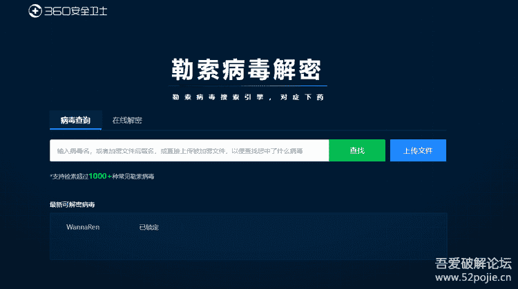
t11e3f4274f7ea5287019c8df9c.png (138.76 KB, 下载次数: 2)
[href="forum.php?mod=attachment&aid=MjgwNjM4MnxhNDE1YzA4N3wxNzkzNTc2NjIxfDE2ODA4NnwyMDYzNjk3&nothumb=yes" target="_blank"](https://www.52pojie.cn/forum.php?mod=attachment&aid=MjgwNjM4MnxhNDE1YzA4N3wxNzkzNTc2NjIxfDE2ODA4NnwyMDYzNjk3&nothumb=yes)
2025-10-1 11:46 上传

### 360解密大师
360解密大师累积支持解密勒索病毒超过340种。已支持解密的勒索病毒家族，通过解密大师就能扫描出并解密文件。温馨提示,360解密大师只能识别已知可解家族，对于尚未支持的家族，是扫描不出被加密文件。（360安全卫士→功能大全→360解密大师）
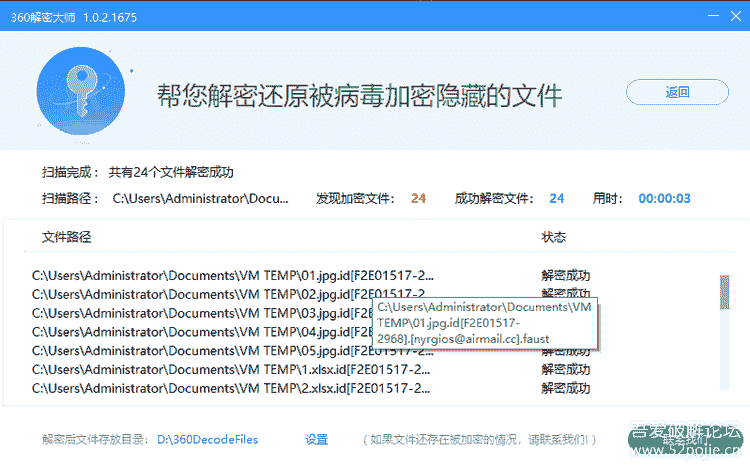
t11e3f4274f6fc82e63e80c9990.png (205.87 KB, 下载次数: 2)
[href="forum.php?mod=attachment&aid=MjgwNjM4M3xlMDUzMDc3YnwxNzkzNTc2NjIxfDE2ODA4NnwyMDYzNjk3&nothumb=yes" target="_blank"](https://www.52pojie.cn/forum.php?mod=attachment&aid=MjgwNjM4M3xlMDUzMDc3YnwxNzkzNTc2NjIxfDE2ODA4NnwyMDYzNjk3&nothumb=yes)
2025-10-1 11:47 上传

### 360文档卫士
可以通过文档卫士备份保护文件。默认保护`*.doc`,`*.docx`,`*.xls`,`*.xlsx`,`*.ppt`,`*.pptx`,`*.pdf`。当然你还可以通过自定义规则来设置你想保护的文件格式。（360安全卫士→功能大全→360文档卫士)
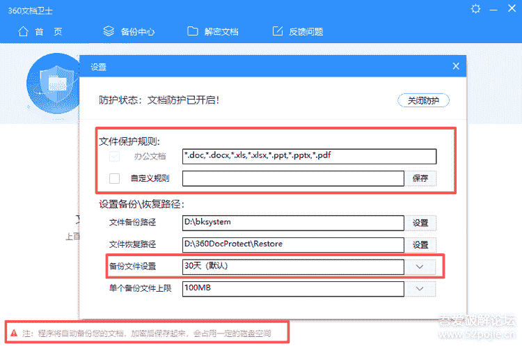
t11e3f4274f1ef565adcbf6c957.png (105.36 KB, 下载次数: 0)
[href="forum.php?mod=attachment&aid=MjgwNjM4NHw5YTEyZmIxNnwxNzkzNTc2NjIxfDE2ODA4NnwyMDYzNjk3&nothumb=yes" target="_blank"](https://www.52pojie.cn/forum.php?mod=attachment&aid=MjgwNjM4NHw5YTEyZmIxNnwxNzkzNTc2NjIxfDE2ODA4NnwyMDYzNjk3&nothumb=yes)
2025-10-1 11:47 上传

### 系统安全防护
360安全卫士的系统安全防护功能，能针对远程桌面弱口令，`mysql`弱口令，`mssql`弱口令等进行拦截以及风险提示。但仍不建议用户使用弱口令。 （360安全卫士→功能大全→系统安全防护）
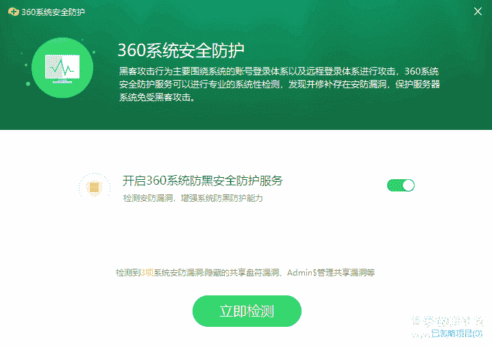
t11e3f4274fac7d6006744354f4.png (96.09 KB, 下载次数: 2)
[href="forum.php?mod=attachment&aid=MjgwNjM4NXxiYTI2YjIyOHwxNzkzNTc2NjIxfDE2ODA4NnwyMDYzNjk3&nothumb=yes" target="_blank"](https://www.52pojie.cn/forum.php?mod=attachment&aid=MjgwNjM4NXxiYTI2YjIyOHwxNzkzNTc2NjIxfDE2ODA4NnwyMDYzNjk3&nothumb=yes)
2025-10-1 11:47 上传

### Web服务攻击防护
Web服务攻击作为勒索攻击的重要入口，已成为勒索组织投毒最主要的攻击渠道之一。360的Web服务攻击防护功能可以对流行的攻击行为提供入口防御能力。
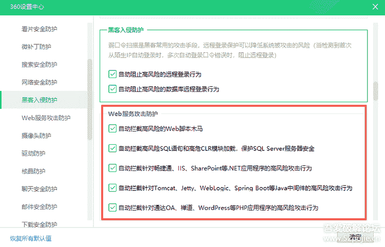
t11e3f4274fd9fccc1a4367b7a0.png (175.21 KB, 下载次数: 2)
[href="forum.php?mod=attachment&aid=MjgwNjM4Nnw1ZTlmMzEyMXwxNzkzNTc2NjIxfDE2ODA4NnwyMDYzNjk3&nothumb=yes" target="_blank"](https://www.52pojie.cn/forum.php?mod=attachment&aid=MjgwNjM4Nnw1ZTlmMzEyMXwxNzkzNTc2NjIxfDE2ODA4NnwyMDYzNjk3&nothumb=yes)
2025-10-1 11:47 上传

### 漏洞防护
360安全卫士有完整的漏洞修复和防护能力，不仅对常见软件漏洞和操作系统漏洞利用方式进行根源拦截，还会第一时间支持对新增漏洞的拦截支持。
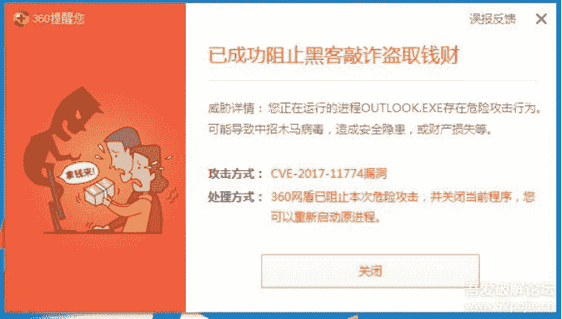
t11e3f4274f89175969bf174592.png (228.87 KB, 下载次数: 0)
[href="forum.php?mod=attachment&aid=MjgwNjM4N3xkZDI1MTAyMHwxNzkzNTc2NjIxfDE2ODA4NnwyMDYzNjk3&nothumb=yes" target="_blank"](https://www.52pojie.cn/forum.php?mod=attachment&aid=MjgwNjM4N3xkZDI1MTAyMHwxNzkzNTc2NjIxfDE2ODA4NnwyMDYzNjk3&nothumb=yes)
2025-10-1 11:48 上传

### 挂马网站防护
针对勒索病毒的防护，更高效可靠的防护时间点应该是其攻击传播阶段。其中GandCrab、Paradsie两个家族都利用到了网站挂马来传播勒索病毒，针对这一情况，360安全大脑能第一时间监控并识别该网站的恶意行为并作出拦截。

t11e3f4274f70b55407550b6c93.png (69.46 KB, 下载次数: 2)
[href="forum.php?mod=attachment&aid=MjgwNjM4OHwwMTI3OGM5N3wxNzkzNTc2NjIxfDE2ODA4NnwyMDYzNjk3&nothumb=yes" target="_blank"](https://www.52pojie.cn/forum.php?mod=attachment&aid=MjgwNjM4OHwwMTI3OGM5N3wxNzkzNTc2NjIxfDE2ODA4NnwyMDYzNjk3&nothumb=yes)
2025-10-1 11:48 上传

钓鱼邮件防护能力

钓鱼邮件一直以来都是勒索病毒传播的重要渠道，冒充国际快递，国际警方等诱惑用户下载运行邮件附件的案例数不胜数。针对这一情况，360安全大脑精准识别邮件附件中潜藏的病毒木马，替用户快速检测附件中是否存在问题。

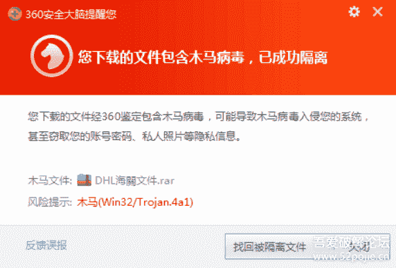

`t11e3f4274fb656eb90649c9057.png` (90.5 KB, 下载次数: 2)

[href="forum.php?mod=attachment&aid=MjgwNjM4OXw3NWYzNmNlY3wxNzkzNTc2NjIxfDE2ODA4NnwyMDYzNjk3&nothumb=yes" target="_blank"](https://www.52pojie.cn/forum.php?mod=attachment&aid=MjgwNjM4OXw3NWYzNmNlY3wxNzkzNTc2NjIxfDE2ODA4NnwyMDYzNjk3&nothumb=yes)

2025-10-1 11:48 上传

## U盘蠕虫防护

针对U盘蠕虫类的传播方式，360 U盘助手在原有检测基础上增加了更多对勒索病毒相关信息的识别，在U盘接入系统时即可报出其中暗藏的病毒木马。

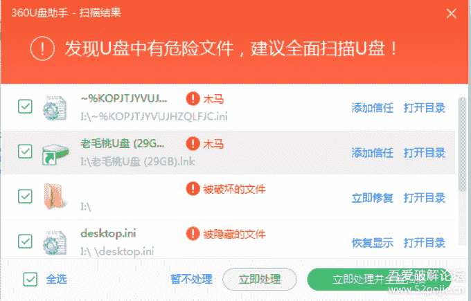

`t11e3f4274fa0d6051f5ca5d832.png` (100.39 KB, 下载次数: 2)

[href="forum.php?mod=attachment&aid=MjgwNjM5MHw1ZGU1YjRhMnwxNzkzNTc2NjIxfDE2ODA4NnwyMDYzNjk3&nothumb=yes" target="_blank"](https://www.52pojie.cn/forum.php?mod=attachment&aid=MjgwNjM5MHw1ZGU1YjRhMnwxNzkzNTc2NjIxfDE2ODA4NnwyMDYzNjk3&nothumb=yes)

2025-10-1 11:48 上传

## 综合防护能力

针对勒索病毒的行为识别，一直是360安全卫士防御勒索病毒的重要手段。通过对智能识别引擎的不断改进，360对勒索病毒的检出能力获得了进一步提高，另一项勒索病毒的重要防护能力，就是360安全卫士所使用的智能诱捕技术。通过对设置的陷阱文档的随机化与位置优化，使得我们的智能诱捕技术未被任何一家流行的勒索病毒免疫，同时也能保证勒索病毒的全命中。

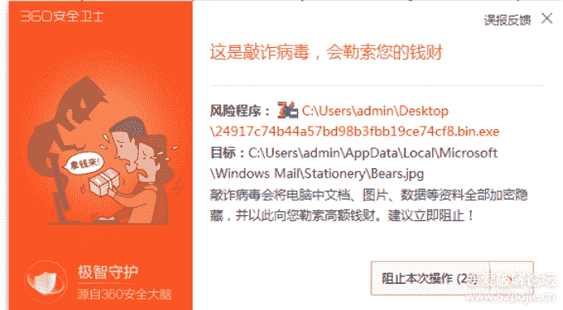

`t11e3f4274f34aa342b8b3f4151.png` (152.66 KB, 下载次数: 1)

[href="forum.php?mod=attachment&aid=MjgwNjM5MXwxNTQzMGU2ZXwxNzkzNTc2NjIxfDE2ODA4NnwyMDYzNjk3&nothumb=yes" target="_blank"](https://www.52pojie.cn/forum.php?mod=attachment&aid=MjgwNjM5MXwxNTQzMGU2ZXwxNzkzNTc2NjIxfDE2ODA4NnwyMDYzNjk3&nothumb=yes)

2025-10-1 11:48 上传

## 内核防护能力

注入类技术配合驱动滥用技术已成为APT组织、红队、勒索团伙及各类黑产组织在入侵横向移动与反取证中首选或常用的工具链之一，因为它们能从用户态或内核态直接绕过或破坏主流安全防护。在启用360核晶防护的设备中可有效抵御此类对抗攻击行为，提高守护设备的安全基线。

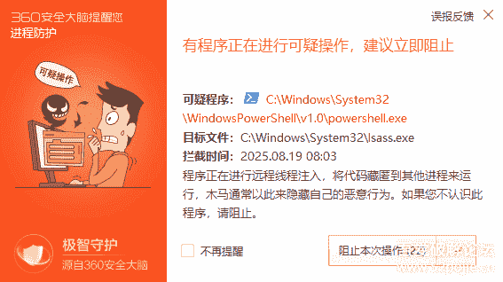

`t11e3f4274f455b484d5c08d1fc.png` (68.42 KB, 下载次数: 2)

[href="forum.php?mod=attachment&aid=MjgwNjM5MnwzNmI0MDJiYXwxNzkzNTc2NjIxfDE2ODA4NnwyMDYzNjk3&nothumb=yes" target="_blank"](https://www.52pojie.cn/forum.php?mod=attachment&aid=MjgwNjM5MnwzNmI0MDJiYXwxNzkzNTc2NjIxfDE2ODA4NnwyMDYzNjk3&nothumb=yes)

2025-10-1 11:49 上传
