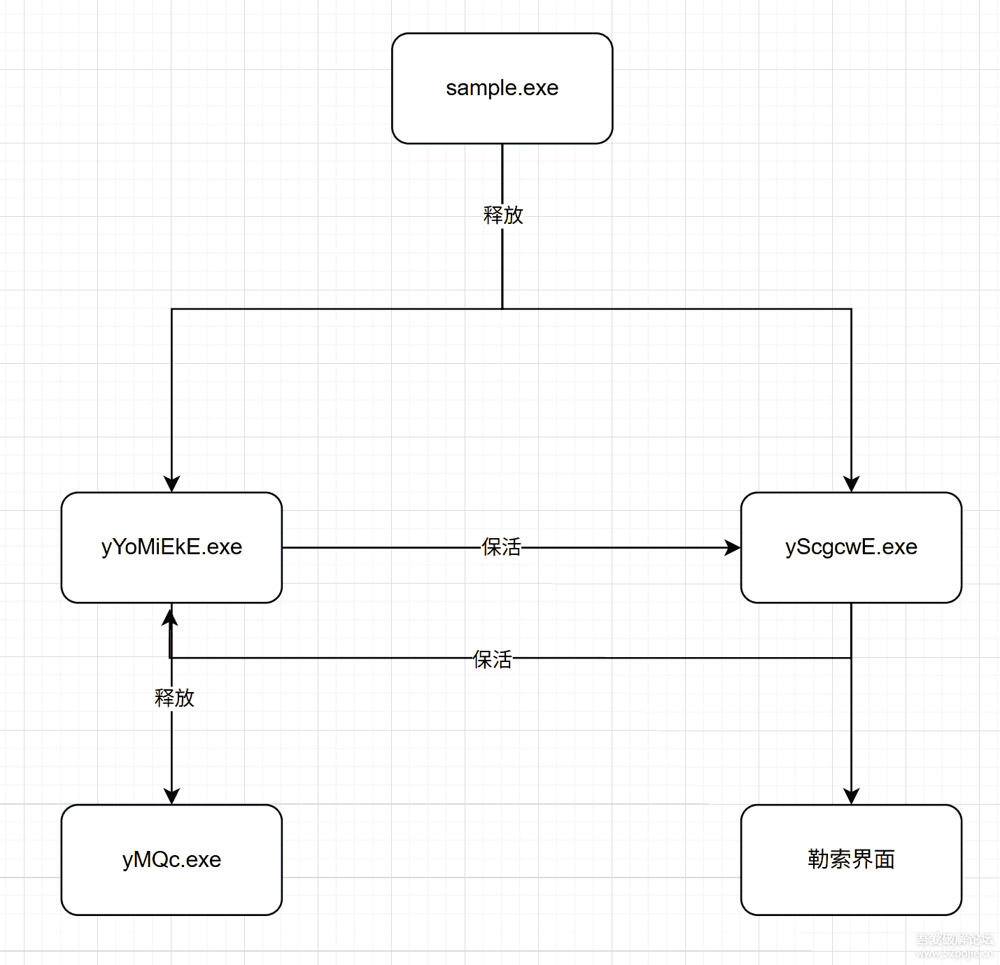
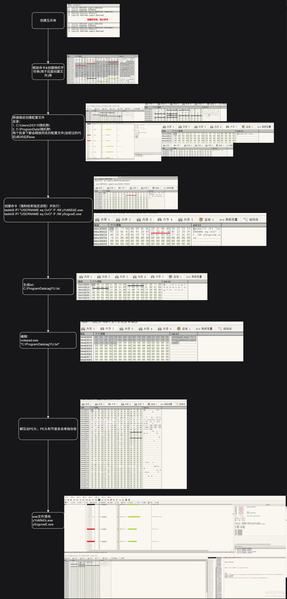
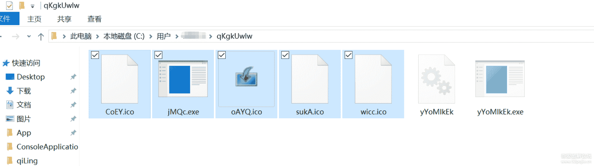
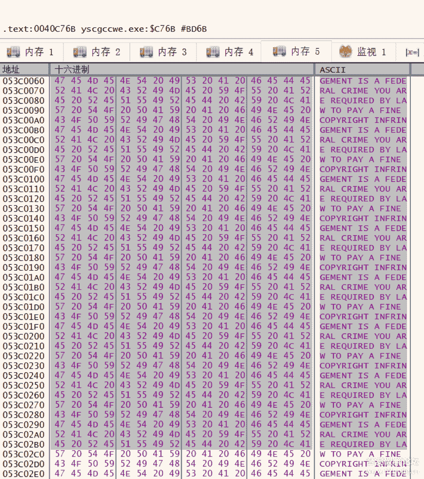

# [PC样本分析] 某绒面试题

- 原帖：<https://www.52pojie.cn/forum.php?mod=viewthread&tid=2067431>
- 抓取时间：2026-11-01T23:43:37

文件和介绍均来自站内的 [某绒面试题_勒索](https://www.52pojie.cn/forum-32-1.html) - [吾爱](https://www.52pojie.cn) - 52pojie.cn，需要的可以去那边下载，主要是试下大佬们的面试题学习学习。

`1.jpg`（73.3 KB，下载次数：1） - [下载附件](https://www.52pojie.cn/forum.php?mod=attachment&aid=MjgwOTQyOHwxYWM2MDJkOXwxNzkzNTc2NjE0fDE2ODA4NnwyMDY3NDMx&nothumb=yes) - 2025-10-22 21:29 上传

## 1. `sample.exe`

`21.png`（1.65 MB，下载次数：1） - [下载附件](https://www.52pojie.cn/forum.php?mod=attachment&aid=MjgwOTQzM3wyMWZhYzNlMXwxNzkzNTc2NjE0fDE2ODA4NnwyMDY3NDMx&nothumb=yes) - 2025-10-22 21:32 上传

## 2. `yYoMIkEk.exe`

通过 `sleep` 控制频率，循环遍历进程检测 `yScgccwE.exe` 是否已经启动，如果没有则通过 `createProcess` 拉起。

每隔一段时间会 send `"GET / HTTP/1.1\r\nHost: google.com\r\n\r\ngoogle.com.au"` 到 `198.18.0.36`。

遍历文件，释放文件：

`3.jpg`（164.83 KB，下载次数：1） - [下载附件](https://www.52pojie.cn/forum.php?mod=attachment&aid=MjgwOTQzNXw0NDM4ZTEzZXwxNzkzNTc2NjE0fDE2ODA4NnwyMDY3NDMx&nothumb=yes) - 2025-10-22 21:33 上传

注册启动项。

## 3. `yScgccwE.exe`

类似 `yYoMIkEk.exe`，保活（检测 `yYoMIkEk.exe`）和网络连接也是有的。

### 1. 勒索文本

`4.jpg`（648.21 KB，下载次数：1） - [下载附件](https://www.52pojie.cn/forum.php?mod=attachment&aid=MjgwOTQzNHxjZmVmM2JiMXwxNzkzNTc2NjE0fDE2ODA4NnwyMDY3NDMx&nothumb=yes) - 2025-10-22 21:33 上传

### 2. 最终显示新窗口显示勒索信息
