# [PC样本分析] 【病毒分析】虚拟化平台的噩梦！揭秘BEAST勒索软件（Linux ESXi版）的加密机制与对...

- 原帖: https://www.52pojie.cn/forum.php?mod=viewthread&tid=2075586
- 抓取时间: 2026-11-01T23:43:22

## 1. 背景与家族溯源

### 1.1 家族概况：跨平台的狩猎者

在上一期文章中，我们深入剖析了 BEAST勒索软件（Windows版） 的图形化界面与反取证手段，揭示了其如何利用人性化的GUI降低攻击门槛。然而，作为一个成熟的 RaaS（勒索软件即服务）组织，BEAST 的野心远不止于个人终端，其触角早已伸向了更为核心的服务器领域。

[//www.52pojie.cn/thread-2074387-1-1.html" target="_blank" rel="noopener noreferrer nofollow"](https://www.52pojie.cn/thread-2074387-1-1.html:href="https)

Beast 家族（又称 Monster）自 2022 年活跃以来，不断迭代其技术军火库。除了 Windows 版本，该组织还开发了针对 Linux、NAS 以及 VMware ESXi 虚拟化平台的专用加密器，意图对企业的数据中心进行毁灭性打击。

值得一提的是，该组织在 2024 年 8 月推出了一个离线构建器（Offline Builder）。这意味着附属黑客无需连接控制台，即可在本地生成针对 Linux/ESXi 的勒索样本，大大降低了攻击门槛并提高了隐蔽性，使得该威胁更具泛滥之势。

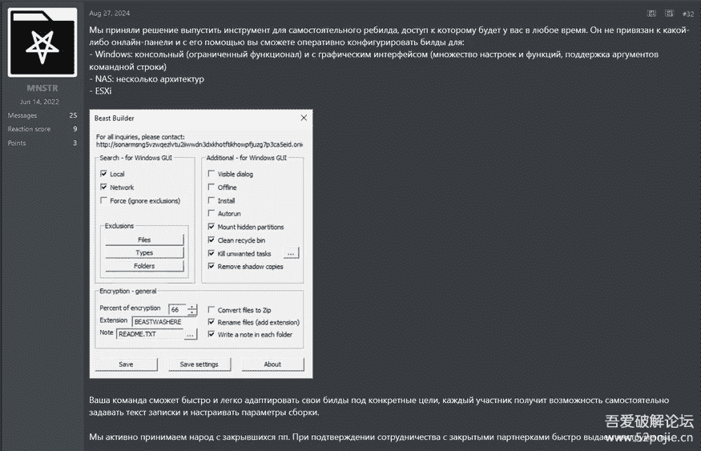
1.png (251.14 KB, 下载次数: 0)
[href="forum.php?mod=attachment&aid=MjgxNjcyOHw0OWIyODEyYXwxNzkzNTc2NjAwfDE2ODA4NnwyMDc1NTg2&nothumb=yes" target="_blank"](https://www.52pojie.cn/forum.php?mod=attachment&aid=MjgxNjcyOHw0OWIyODEyYXwxNzkzNTc2NjAwfDE2ODA4NnwyMDc1NTg2&nothumb=yes)
2025-11-25 16:23 上传
Beast Offline Builder 界面

### 1.2 攻击偏好与地缘特征

与 Windows 版本一致，Linux 版本的 BEAST 同样表现出强烈的地缘政治特征。其样本中硬编码了针对 独联体（CIS）国家 的避让逻辑，一旦检测到受害主机位于俄罗斯、白俄罗斯等国，便会停止运行。

其攻击目标主要集中在承载核心业务数据的服务器及虚拟化环境，尤其是制造业和医疗保健行业的数据中心，这些行业对业务连续性要求极高，往往更容易被迫支付赎金。

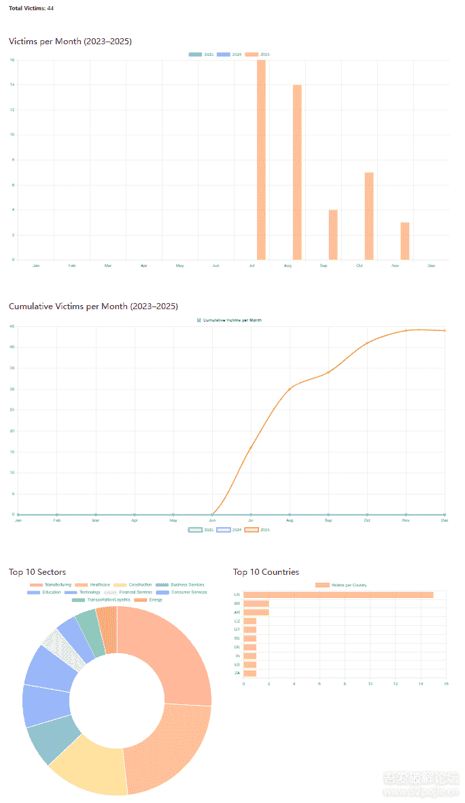
2.png (60.75 KB, 下载次数: 0)
[href="forum.php?mod=attachment&aid=MjgxNjcyOXw2MTJkNmRkZXwxNzkzNTc2NjAwfDE2ODA4NnwyMDc1NTg2&nothumb=yes" target="_blank"](https://www.52pojie.cn/forum.php?mod=attachment&aid=MjgxNjcyOXw2MTJkNmRkZXwxNzkzNTc2NjAwfDE2ODA4NnwyMDc1NTg2&nothumb=yes)
2025-11-25 16:23 上传
受害者行业统计图

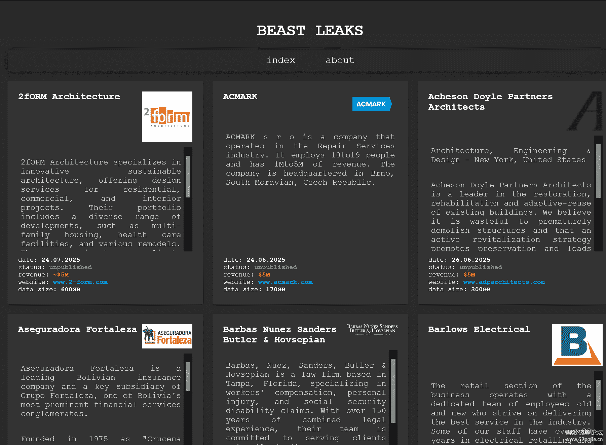
3.png (329.89 KB, 下载次数: 0)
[href="forum.php?mod=attachment&aid=MjgxNjczMHxiZDY2MWFhNnwxNzkzNTc2NjAwfDE2ODA4NnwyMDc1NTg2&nothumb=yes" target="_blank"](https://www.52pojie.cn/forum.php?mod=attachment&aid=MjgxNjczMHxiZDY2MWFhNnwxNzkzNTc2NjAwfDE2ODA4NnwyMDc1NTg2&nothumb=yes)
2025-11-25 16:23 上传
Beast 泄露站点界面

## 2. 攻击手法 (TTPs)

针对 Linux 和 ESXi 环境，Beast 采用了一套更为直接和暴力的攻击链，旨在最大程度地破坏系统可用性：
- 初始入侵： 利用弱口令爆破 `SSH` 服务，或利用未修补的组件漏洞（如 WebLogic、Fastjson 等）获取服务器权限，建立初始立足点。
- 环境破坏： 在加密前，利用 ESXi 命令行工具（`esxcli`）强制终止正在运行的虚拟机进程，确保虚拟磁盘文件（`.vmdk`）解除占用并被释放，以便顺利进行加密。
- 双重勒索： 窃取服务器敏感数据后，通过高强度加密算法锁定文件，迫使受害者支付赎金。

## 3. 样本基础信息

我们捕获并分析了 BEAST 针对 Linux/ESXi 平台的加密器样本，其基本画像如下：

### 3.1 恶意文件指纹

- 文件名： `encrypter-linux-esxi-x64.run`
- 架构： ELF 64-bit (AMD64)
- 文件大小： 1,651,832 字节
- 字节序： Little Endian
- 操作系统： Unix (0) [AMD64, 64 位, EXEC]
- MD5： 5537ad7dc406c473b7fb03c5b5c942fc
- SHA1： 44859c70f218d58bf2684c26261332dd77759e33
- SHA256： cc9eaeea38a8ed458832adec77283fc67695b4852e77fb00d64f290e6ed922df

### 3.2 感染症状

加密完成后，文件将被追加特定的 UUID 后缀。
- 加密后缀： `.{uuid}.helper` （注：不同于 Windows 版的 `.BEASET`，Linux 版通常使用 `.helper`）
- 勒索信： `README.TXT`

> 
勒索信内容摘要：
"YOUR FILES ARE ENCRYPTED... To be sure we have the decryptor and it works you can send an email..."

攻击者留下了联系邮箱 helper001@firemail.cc，并警告受害者不要尝试自行恢复，否则可能导致永久性数据丢失。

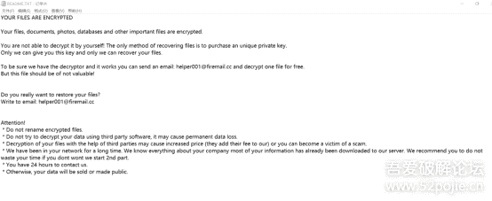
4.png (59.9 KB, 下载次数: 0)
[href="forum.php?mod=attachment&aid=MjgxNjczMXw1NGRjYTc5ZHwxNzkzNTc2NjAwfDE2ODA4NnwyMDc1NTg2&nothumb=yes" target="_blank"](https://www.52pojie.cn/forum.php?mod=attachment&aid=MjgxNjczMXw1NGRjYTc5ZHwxNzkzNTc2NjAwfDE2ODA4NnwyMDc1NTg2&nothumb=yes)
2025-11-25 16:23 上传
勒索信内容

### 3.3 加密测试

我们使用测试文件 `sierting.txt` 进行模拟加密。

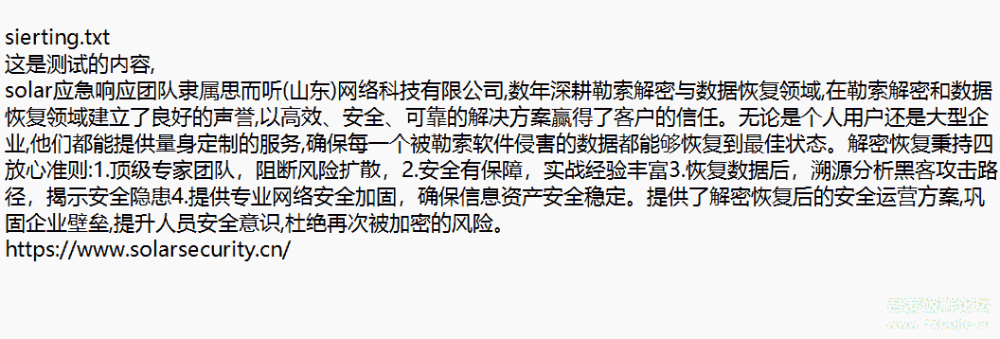
5.png (62.23 KB, 下载次数: 0)
[href="forum.php?mod=attachment&aid=MjgxNjczMnxkZmRhODk3ZXwxNzkzNTc2NjAwfDE2ODA4NnwyMDc1NTg2&nothumb=yes" target="_blank"](https://www.52pojie.cn/forum.php?mod=attachment&aid=MjgxNjczMnxkZmRhODk3ZXwxNzkzNTc2NjAwfDE2ODA4NnwyMDc1NTg2&nothumb=yes)
2025-11-25 16:23 上传

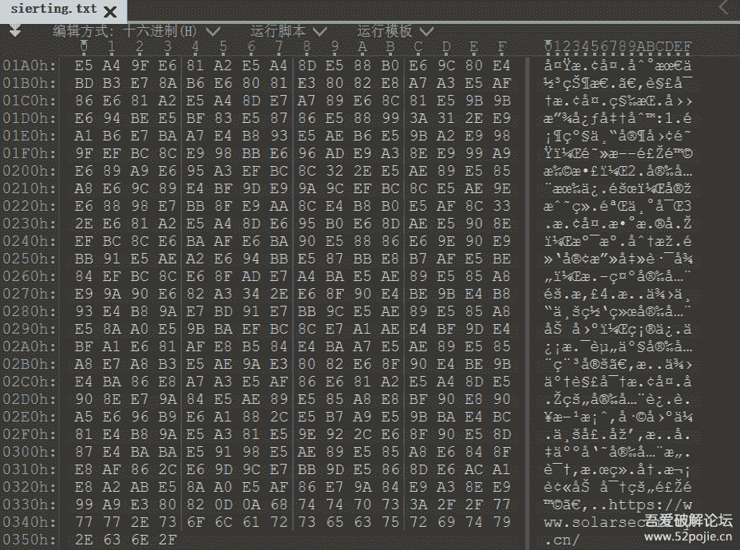
6.png (321.38 KB, 下载次数: 0)
[href="forum.php?mod=attachment&aid=MjgxNjczM3xmMzFmOTE3NnwxNzkzNTc2NjAwfDE2ODA4NnwyMDc1NTg2&nothumb=yes" target="_blank"](https://www.52pojie.cn/forum.php?mod=attachment&aid=MjgxNjczM3xmMzFmOTE3NnwxNzkzNTc2NjAwfDE2ODA4NnwyMDc1NTg2&nothumb=yes)
2025-11-25 16:23 上传
原始文件十六进制视图

加密后的文件头部和内容均被破坏，且文件末尾被写入了特定的加密标志和元数据。

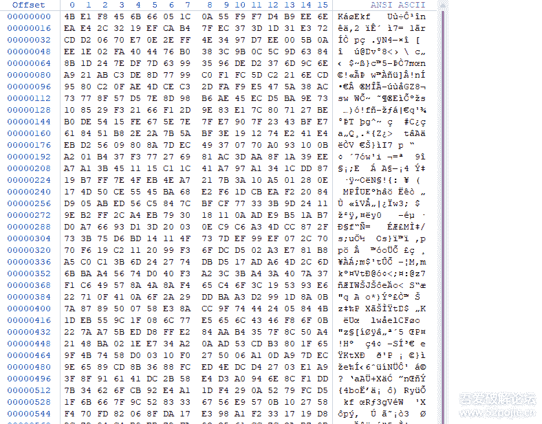
7.png (99.83 KB, 下载次数: 0)
[href="forum.php?mod=attachment&aid=MjgxNjczNHxlMmE3NTEzN3wxNzkzNTc2NjAwfDE2ODA4NnwyMDc1NTg2&nothumb=yes" target="_blank"](https://www.52pojie.cn/forum.php?mod=attachment&aid=MjgxNjczNHxlMmE3NTEzN3wxNzkzNTc2NjAwfDE2ODA4NnwyMDc1NTg2&nothumb=yes)
2025-11-25 16:23 上传
加密后文件十六进制视图

## 4. 逆向分析：拆解 Linux 版执行流程

### 4.1 程序执行流程图

样本的执行逻辑清晰明了，主要包含配置解析、环境检查、虚拟机查杀和文件加密四个阶段：

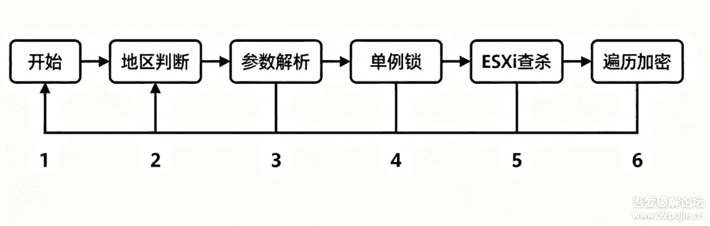
8.png (304.56 KB, 下载次数: 0)
[href="forum.php?mod=attachment&aid=MjgxNjczNXxmY2RhNzNkOHwxNzkzNTc2NjAwfDE2ODA4NnwyMDc1NTg2&nothumb=yes" target="_blank"](https://www.52pojie.cn/forum.php?mod=attachment&aid=MjgxNjczNXxmY2RhNzNkOHwxNzkzNTc2NjAwfDE2ODA4NnwyMDc1NTg2&nothumb=yes)
2025-11-25 16:23 上传
程序执行流程图

### 4.2 详细行为分析

#### 4.2.1 地区白名单检查 (Region Check)

与 Windows 版如出一辙，程序启动后首先检测系统语言环境。代码中维护了一份硬编码的白名单。
- 逻辑： 程序会获取当前的 `LANG` 环境变量或系统语言设置。如果检测到系统语言属于以下白名单国家代码，程序将直接退出。这是一种典型的“自我保护”机制，以规避特定地区的法律风险。
- 白名单列表： AM (亚美尼亚), AZ (阿塞拜疆), BY (白俄罗斯), CY (塞浦路斯), GE (格鲁吉亚), KZ (哈萨克斯坦), KG (吉尔吉斯斯坦), MD (摩尔多瓦), RU (俄罗斯), TJ (塔吉克斯坦), TM (土库曼斯坦), UA (乌克兰), UZ (乌兹别克斯坦), VN (越南)。


9.png (73.81 KB, 下载次数: 0)
[href="forum.php?mod=attachment&aid=MjgxNjczNnw5MjM4MzllMXwxNzkzNTc2NjAwfDE2ODA4NnwyMDc1NTg2&nothumb=yes" target="_blank"](https://www.52pojie.cn/forum.php?mod=attachment&aid=MjgxNjczNnw5MjM4MzllMXwxNzkzNTc2NjAwfDE2ODA4NnwyMDc1NTg2&nothumb=yes)
2025-11-25 16:23 上传

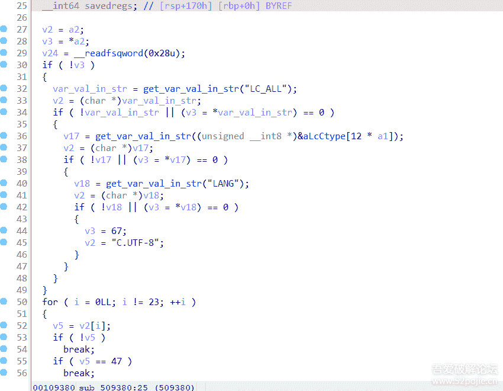
10.png (56.65 KB, 下载次数: 0)
[href="forum.php?mod=attachment&aid=MjgxNjczN3w5OWRhMDZjN3wxNzkzNTc2NjAwfDE2ODA4NnwyMDc1NTg2&nothumb=yes" target="_blank"](https://www.52pojie.cn/forum.php?mod=attachment&aid=MjgxNjczN3w5OWRhMDZjN3wxNzkzNTc2NjAwfDE2ODA4NnwyMDc1NTg2&nothumb=yes)
2025-11-25 16:23 上传

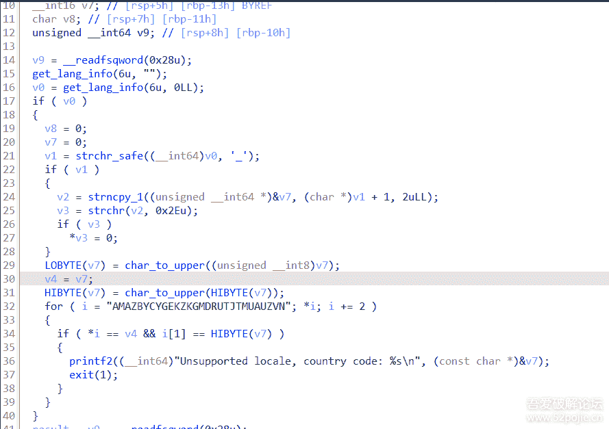
11.png (56.42 KB, 下载次数: 0)
[href="forum.php?mod=attachment&aid=MjgxNjczOHw4YzZkMzYyNnwxNzkzNTc2NjAwfDE2ODA4NnwyMDc1NTg2&nothumb=yes" target="_blank"](https://www.52pojie.cn/forum.php?mod=attachment&aid=MjgxNjczOHw4YzZkMzYyNnwxNzkzNTc2NjAwfDE2ODA4NnwyMDc1NTg2&nothumb=yes)
2025-11-25 16:23 上传
地区判断代码视图

#### 4.2.2 配置数据解密与解析

样本内部存储了加密的配置数据，运行后使用 `ChaCha20` 算法配合硬编码的密钥（`Key`）和随机数（`Nonce`）进行解密。

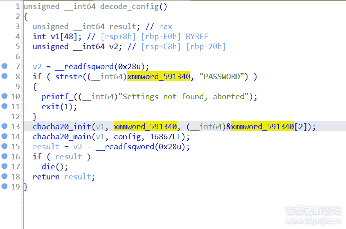
12.png (42.04 KB, 下载次数: 0)
[href="forum.php?mod=attachment&aid=MjgxNjczOXxkNDAwNzNhZXwxNzkzNTc2NjAwfDE2ODA4NnwyMDc1NTg2&nothumb=yes" target="_blank"](https://www.52pojie.cn/forum.php?mod=attachment&aid=MjgxNjczOXxkNDAwNzNhZXwxNzkzNTc2NjAwfDE2ODA4NnwyMDc1NTg2&nothumb=yes)
2025-11-25 16:23 上传
ChaCha20解密配置代码视图

使用chacha20算法,硬编码的密钥解密配置数据.
Key:
```
b'u\xe5\x1b
```
Nonce:
```
b'\xaa\xda8\xae\x15\xab\xc2~H\xcc2\x9d'
```
解密后的配置结构体包含了加密百分比、后缀名、勒索信内容等关键信息。

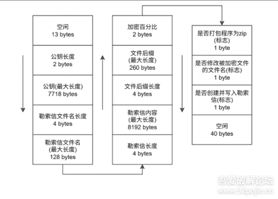
13.png (73.62 KB, 下载次数: 0)
[href="forum.php?mod=attachment&aid=MjgxNjc0MHw3ODRhODE0MHwxNzkzNTc2NjAwfDE2ODA4NnwyMDc1NTg2&nothumb=yes" target="_blank"](https://www.52pojie.cn/forum.php?mod=attachment&aid=MjgxNjc0MHw3ODRhODE0MHwxNzkzNTc2NjAwfDE2ODA4NnwyMDc1NTg2&nothumb=yes)
2025-11-25 16:23 上传
配置文件结构示意图

随后，程序会解析命令行参数，支持多种运行模式，赋予攻击者极大的灵活性：
- `-a`, `--auto`: 自动处理 ESXi 虚拟机（核心功能，自动终止 VM 进程并加密）
- `-d`, `--daemon`: 以守护进程方式后台运行
- `-h`: 延时启动（小时）
- `-m`: 延时启动（分钟）
- `-s`: 延时启动（秒）
- `-l`, `--log`: 输出日志文件
- `-p`: 指定加密百分比
- `-e`: 自定义后缀名
- `-x`: 自定义勒索信文件名
- `-c`: 加密后是否修改文件名
- `-w`: 是否写入勒索信

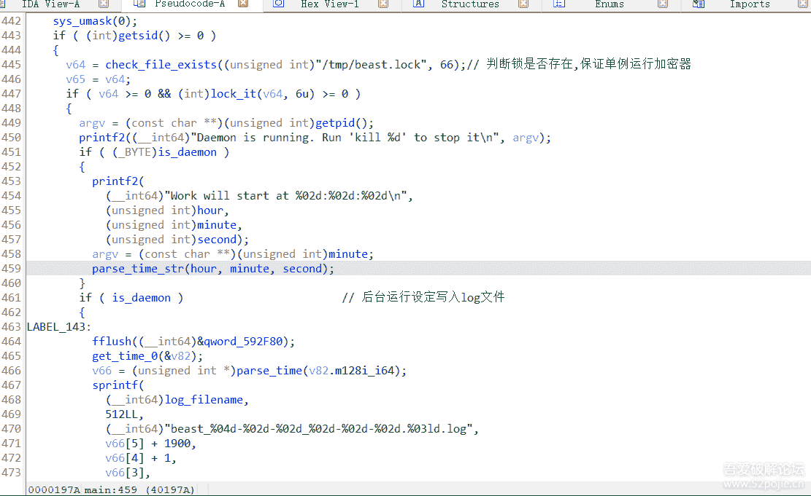
14.png (74.88 KB, 下载次数: 0)


[href="forum.php?mod=attachment&aid=MjgxNjc0MXwwMDU3MTdjNnwxNzkzNTc2NjAwfDE2ODA4NnwyMDc1NTg2&nothumb=yes" target="_blank"](https://www.52pojie.cn/forum.php?mod=attachment&aid=MjgxNjc0MXwwMDU3MTdjNnwxNzkzNTc2NjAwfDE2ODA4NnwyMDc1NTg2&nothumb=yes)

2025-11-25 16:23 上传

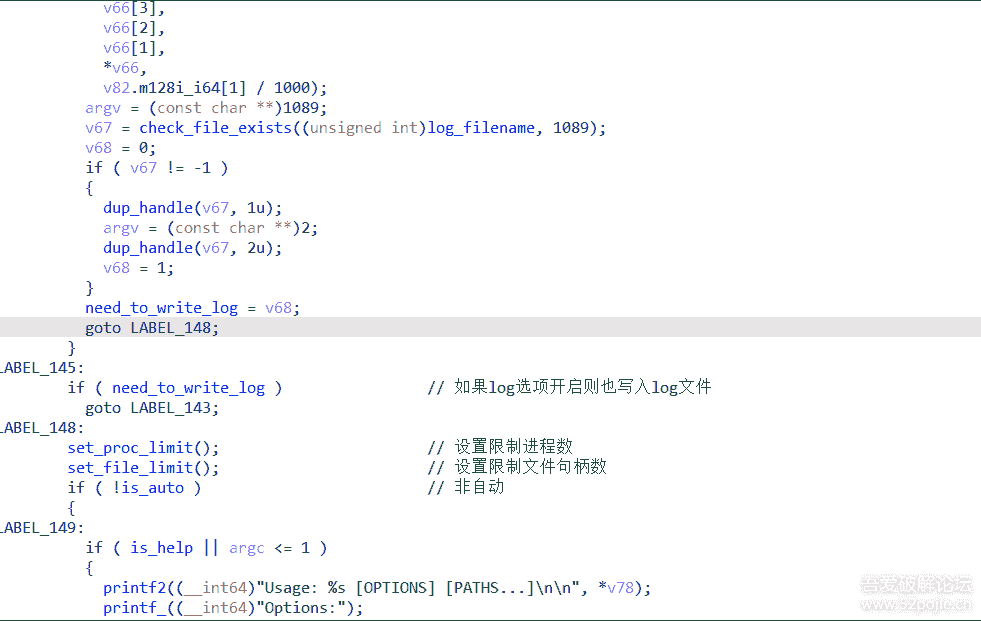

15.png (47.05 KB, 下载次数: 0)

[href="forum.php?mod=attachment&aid=MjgxNjc0Mnw0NDk3YzcxZHwxNzkzNTc2NjAwfDE2ODA4NnwyMDc1NTg2&nothumb=yes" target="_blank"](https://www.52pojie.cn/forum.php?mod=attachment&aid=MjgxNjc0Mnw0NDk3YzcxZHwxNzkzNTc2NjAwfDE2ODA4NnwyMDc1NTg2&nothumb=yes)

2025-11-25 16:23 上传

命令行参数解析代码片段视图

程序还会根据配置判断是否读取自定义的勒索信内容并拷贝至内存中。

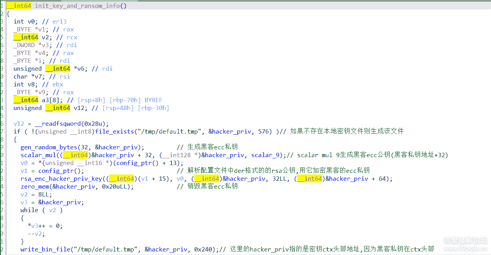

16.png (75.33 KB, 下载次数: 0)

[href="forum.php?mod=attachment&aid=MjgxNjc0M3w3NTljZWFiMnwxNzkzNTc2NjAwfDE2ODA4NnwyMDc1NTg2&nothumb=yes" target="_blank"](https://www.52pojie.cn/forum.php?mod=attachment&aid=MjgxNjc0M3w3NTljZWFiMnwxNzkzNTc2NjAwfDE2ODA4NnwyMDc1NTg2&nothumb=yes)

2025-11-25 16:23 上传

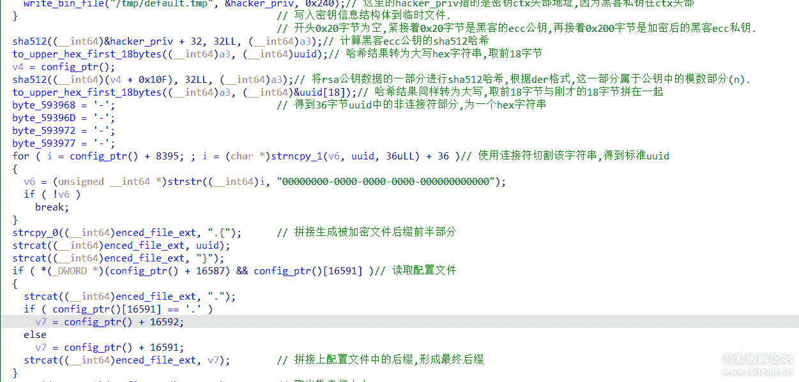

17.png (77.97 KB, 下载次数: 0)

[href="forum.php?mod=attachment&aid=MjgxNjc0NHxjMWU0Nzk4NXwxNzkzNTc2NjAwfDE2ODA4NnwyMDc1NTg2&nothumb=yes" target="_blank"](https://www.52pojie.cn/forum.php?mod=attachment&aid=MjgxNjc0NHxjMWU0Nzk4NXwxNzkzNTc2NjAwfDE2ODA4NnwyMDc1NTg2&nothumb=yes)

2025-11-25 16:23 上传

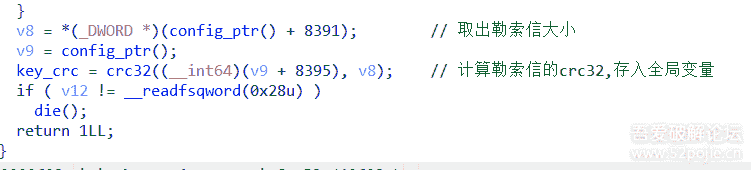

18.png (19.33 KB, 下载次数: 0)

[href="forum.php?mod=attachment&aid=MjgxNjc0NXw3MDE5MWNiOHwxNzkzNTc2NjAwfDE2ODA4NnwyMDc1NTg2&nothumb=yes" target="_blank"](https://www.52pojie.cn/forum.php?mod=attachment&aid=MjgxNjc0NXw3MDE5MWNiOHwxNzkzNTc2NjAwfDE2ODA4NnwyMDc1NTg2&nothumb=yes)

2025-11-25 16:23 上传

读取自定义勒索信代码视图

### 4.2.3 单例运行锁

为了防止重复运行导致系统资源耗尽或加密冲突，样本会在 `/tmp/` 目录下创建锁文件 `beast.lock`。

- 操作： 检查 `/tmp/beast.lock` 是否存在，如果存在则表明已有实例在运行，程序退出。
- 对抗点： 如果使用了 `-d` (daemon) 模式，样本在退出时会删除该锁文件，实现自我清理。

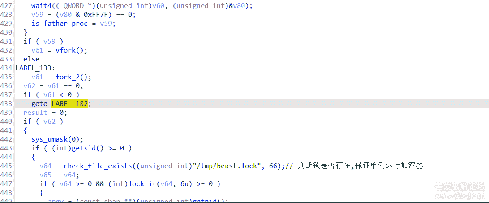

19.png (45.09 KB, 下载次数: 0)

[href="forum.php?mod=attachment&aid=MjgxNjc0Nnw1NDE4OTc3MHwxNzkzNTc2NjAwfDE2ODA4NnwyMDc1NTg2&nothumb=yes" target="_blank"](https://www.52pojie.cn/forum.php?mod=attachment&aid=MjgxNjc0Nnw1NDE4OTc3MHwxNzkzNTc2NjAwfDE2ODA4NnwyMDc1NTg2&nothumb=yes)

2025-11-25 16:23 上传

- 单例锁检查代码视图

### 4.2.4 ESXi 虚拟机查杀 (Kill VM Processes)

这是该样本针对虚拟化环境最致命的一击。为了能够加密正在运行的虚拟机磁盘文件（`.vmdk`、`.vswp`），病毒必须先停止这些虚拟机，解除文件占用。

遍历与终止： 程序会调用 `esxcli vm process list` 命令获取当前所有运行中的虚拟机的 `World ID`。随后，它会循环调用 `esxcli vm process kill -t hard -w {WorldID}`，强制关闭每一个虚拟机进程。

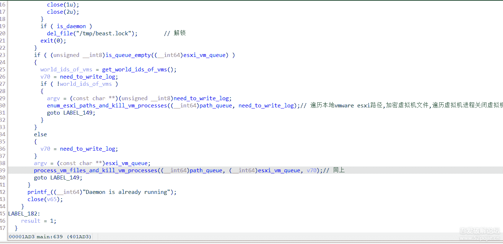

20.png (60.97 KB, 下载次数: 0)

[href="forum.php?mod=attachment&aid=MjgxNjc0N3w1OTY1NGY4MXwxNzkzNTc2NjAwfDE2ODA4NnwyMDc1NTg2&nothumb=yes" target="_blank"](https://www.52pojie.cn/forum.php?mod=attachment&aid=MjgxNjc0N3w1OTY1NGY4MXwxNzkzNTc2NjAwfDE2ODA4NnwyMDc1NTg2&nothumb=yes)

2025-11-25 16:23 上传

- 处理本地虚拟机文件入口代码视图

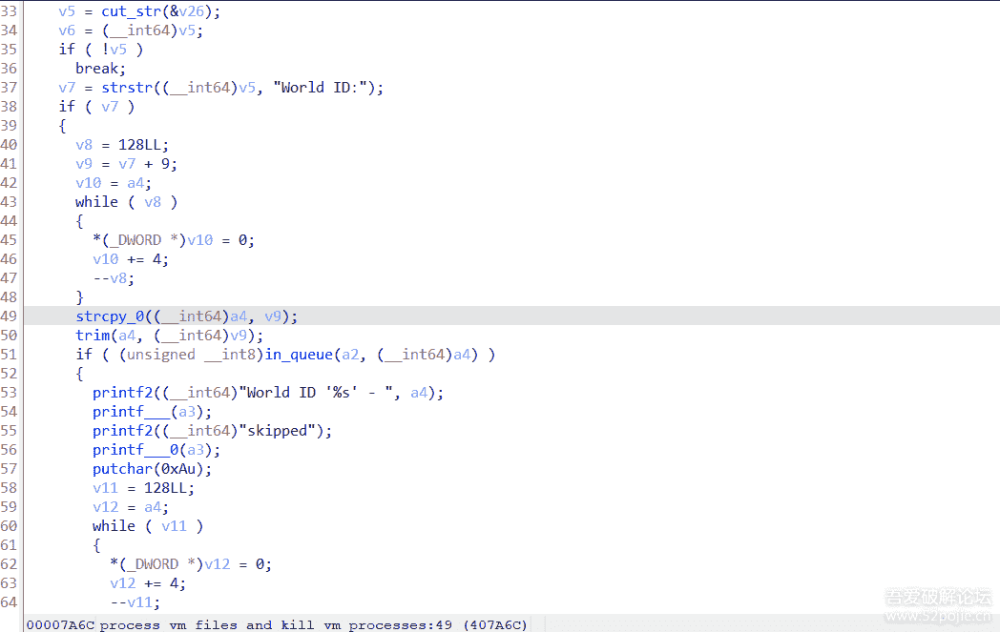

21.png (55.18 KB, 下载次数: 0)

[href="forum.php?mod=attachment&aid=MjgxNjc0OHxmYzFmMTg5MXwxNzkzNTc2NjAwfDE2ODA4NnwyMDc1NTg2&nothumb=yes" target="_blank"](https://www.52pojie.cn/forum.php?mod=attachment&aid=MjgxNjc0OHxmYzFmMTg5MXwxNzkzNTc2NjAwfDE2ODA4NnwyMDc1NTg2&nothumb=yes)

2025-11-25 16:23 上传

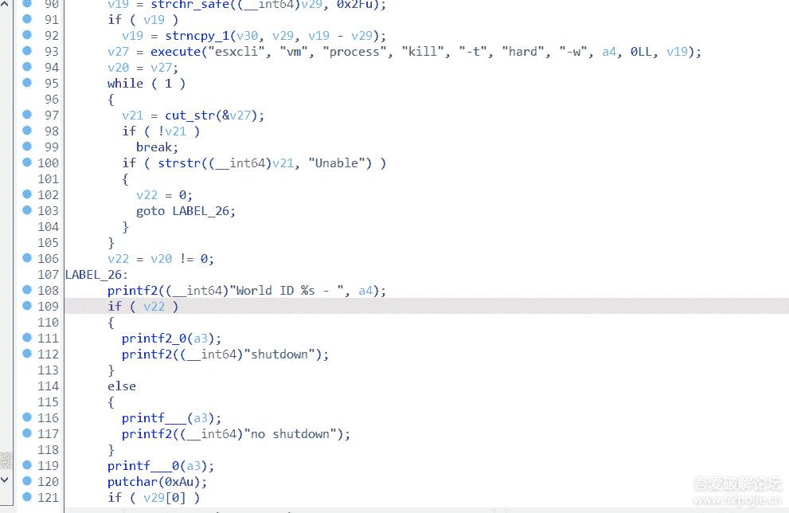

22.png (61.11 KB, 下载次数: 0)

[href="forum.php?mod=attachment&aid=MjgxNjc0OXw1N2YwYTUwNHwxNzkzNTc2NjAwfDE2ODA4NnwyMDc1NTg2&nothumb=yes" target="_blank"](https://www.52pojie.cn/forum.php?mod=attachment&aid=MjgxNjc0OXw1N2YwYTUwNHwxNzkzNTc2NjAwfDE2ODA4NnwyMDc1NTg2&nothumb=yes)

2025-11-25 16:23 上传

ESXi 虚拟机查杀循环代码

修改配置： 除了终止进程，它还会修改虚拟机的配置文件，甚至更改磁盘文件的后缀名（如将 `.vmdk` 改名），使其无法被 ESXi 系统识别和启动，进一步增加恢复难度。

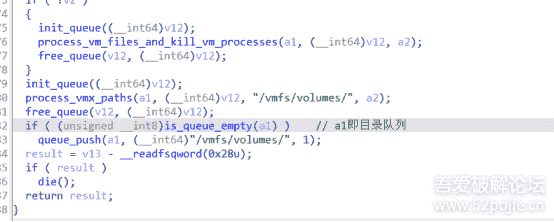

23.png (52.41 KB, 下载次数: 0)

[href="forum.php?mod=attachment&aid=MjgxNjc1MHxkYzFjMjNiMXwxNzkzNTc2NjAwfDE2ODA4NnwyMDc1NTg2&nothumb=yes" target="_blank"](https://www.52pojie.cn/forum.php?mod=attachment&aid=MjgxNjc1MHxkYzFjMjNiMXwxNzkzNTc2NjAwfDE2ODA4NnwyMDc1NTg2&nothumb=yes)

2025-11-25 16:23 上传

修改 VM 磁盘后缀代码

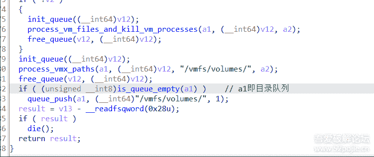

24.png (34.17 KB, 下载次数: 0)

[href="forum.php?mod=attachment&aid=MjgxNjc1MXwyZDJhZGQ1MnwxNzkzNTc2NjAwfDE2ODA4NnwyMDc1NTg2&nothumb=yes" target="_blank"](https://www.52pojie.cn/forum.php?mod=attachment&aid=MjgxNjc1MXwyZDJhZGQ1MnwxNzkzNTc2NjAwfDE2ODA4NnwyMDc1NTg2&nothumb=yes)

2025-11-25 16:23 上传

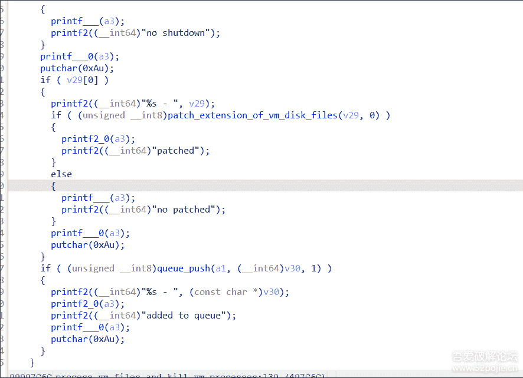

25.png (50.18 KB, 下载次数: 0)

[href="forum.php?mod=attachment&aid=MjgxNjc1MnxhOTFjYTg0MnwxNzkzNTc2NjAwfDE2ODA4NnwyMDc1NTg2&nothumb=yes" target="_blank"](https://www.52pojie.cn/forum.php?mod=attachment&aid=MjgxNjc1MnxhOTFjYTg0MnwxNzkzNTc2NjAwfDE2ODA4NnwyMDc1NTg2&nothumb=yes)

2025-11-25 16:24 上传

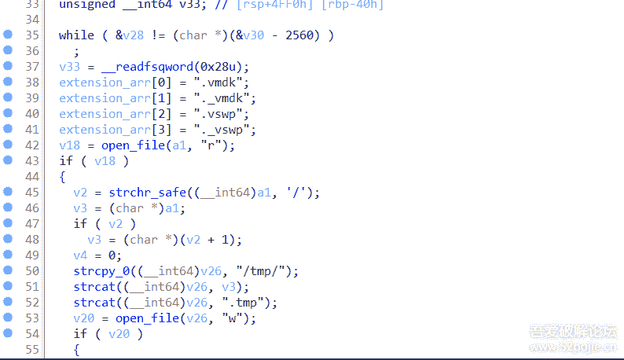

26.png (50.39 KB, 下载次数: 0)

[href="forum.php?mod=attachment&aid=MjgxNjc1M3xhYWQwNmM3M3wxNzkzNTc2NjAwfDE2ODA4NnwyMDc1NTg2&nothumb=yes" target="_blank"](https://www.52pojie.cn/forum.php?mod=attachment&aid=MjgxNjc1M3xhYWQwNmM3M3wxNzkzNTc2NjAwfDE2ODA4NnwyMDc1NTg2&nothumb=yes)

2025-11-25 16:24 上传

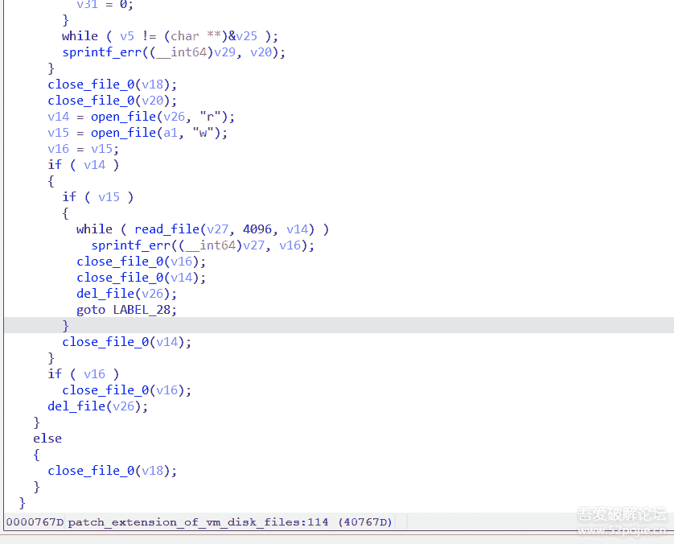

27.png (41.57 KB, 下载次数: 0)

[href="forum.php?mod=attachment&aid=MjgxNjc1NHw2NTBmYmI3NnwxNzkzNTc2NjAwfDE2ODA4NnwyMDc1NTg2&nothumb=yes" target="_blank"](https://www.52pojie.cn/forum.php?mod=attachment&aid=MjgxNjc1NHw2NTBmYmI3NnwxNzkzNTc2NjAwfDE2ODA4NnwyMDc1NTg2&nothumb=yes)

2025-11-25 16:24 上传

根据world id停止虚拟机进程或跳过代码视图

### 4.2.5 目录遍历与加密

样本采用了 生产者-消费者 模型来高效处理文件遍历和加密任务。它会初始化文件队列和路径队列，递归扫描系统目录。

- 初始化队列： 初始化文件队列、路径队列以及 ESXi 虚拟机队列。


28.png (30.09 KB, 下载次数: 0)

[href="forum.php?mod=attachment&aid=MjgxNjc1NXwyZGJjZTk3MHwxNzkzNTc2NjAwfDE2ODA4NnwyMDc1NTg2&nothumb=yes" target="_blank"](https://www.52pojie.cn/forum.php?mod=attachment&aid=MjgxNjc1NXwyZGJjZTk3MHwxNzkzNTc2NjAwfDE2ODA4NnwyMDc1NTg2&nothumb=yes)

2025-11-25 16:24 上传

初始化队列代码视图

- 递归扫描： 将路径加入队列，循环处理。对于每个目录，调用 `list_files` 获取文件列表。

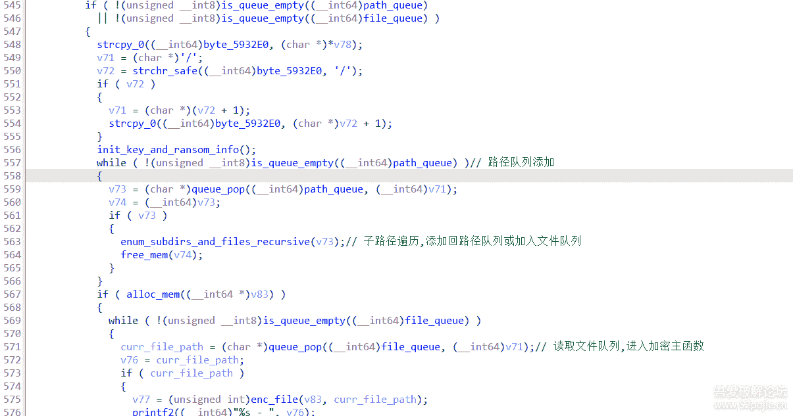

29.png (69.59 KB, 下载次数: 0)

[href="forum.php?mod=attachment&aid=MjgxNjc1Nnw3NWMxMjE5NXwxNzkzNTc2NjAwfDE2ODA4NnwyMDc1NTg2&nothumb=yes" target="_blank"](https://www.52pojie.cn/forum.php?mod=attachment&aid=MjgxNjc1Nnw3NWMxMjE5NXwxNzkzNTc2NjAwfDE2ODA4NnwyMDc1NTg2&nothumb=yes)

2025-11-25 16:24 上传

- 目录遍历循环代码视图

- 过滤： 在遍历过程中，程序会避开特定的系统关键目录（如 `/tmp/`、`/sys/`、`/proc/`）以及自身的日志文件、锁文件和勒索信，防止系统崩溃或自我加密。

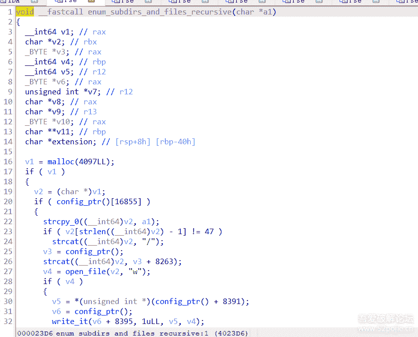

30.png (61.56 KB, 下载次数: 0)

[href="forum.php?mod=attachment&aid=MjgxNjc1N3wzYjgxMDQyOXwxNzkzNTc2NjAwfDE2ODA4NnwyMDc1NTg2&nothumb=yes" target="_blank"](https://www.52pojie.cn/forum.php?mod=attachment&aid=MjgxNjc1N3wzYjgxMDQyOXwxNzkzNTc2NjAwfDE2ODA4NnwyMDc1NTg2&nothumb=yes)

2025-11-25 16:24 上传

- 文件过滤与入队代码视图

### 4.2.6 文件加密逻辑 (The Core)

BEAST Linux 版同样采用了 ChaCha20 流加密算法，并根据文件大小实施不同的加密策略，以平衡速度和破坏性。

- 密钥交换与初始化：
- 使用 Curve25519 算法。首先，如果本地不存在临时密钥文件，则生成黑客的 ECC 私钥，计算出公钥，并用配置文件中的 RSA 公钥加密黑客的 ECC 私钥。然后，将 RSA 加密后的私钥和其他信息写入临时文件。
- 在加密每个文件时，生成随机的文件私钥，结合黑客的公钥计算出共享密钥。最后，对共享密钥进行 SHA512 哈希，取前 32 字节作为 ChaCha20 的加密密钥，紧接的 12 字节作为 Nonce。

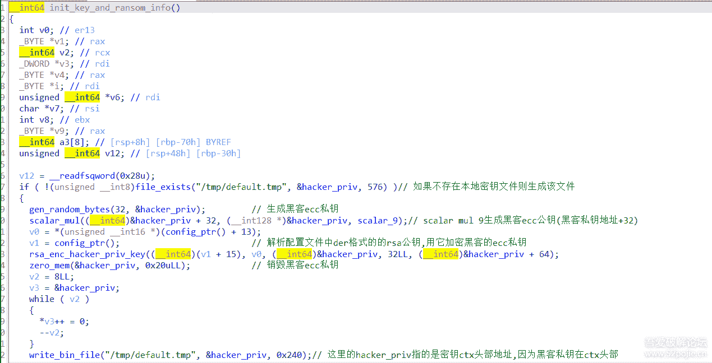

31.png (75.13 KB, 下载次数: 0)

[href="forum.php?mod=attachment&aid=MjgxNjc1OHw3ZWU0ZmY3NXwxNzkzNTc2NjAwfDE2ODA4NnwyMDc1NTg2&nothumb=yes" target="_blank"](https://www.52pojie.cn/forum.php?mod=attachment&aid=MjgxNjc1OHw3ZWU0ZmY3NXwxNzkzNTc2NjAwfDE2ODA4NnwyMDc1NTg2&nothumb=yes)

2025-11-25 16:24 上传

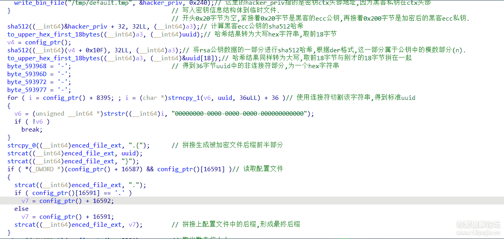

32.png (78.31 KB, 下载次数: 0)


[href="forum.php?mod=attachment&aid=MjgxNjc1OXxlZDgwMWE3N3wxNzkzNTc2NjAwfDE2ODA4NnwyMDc1NTg2&nothumb=yes" target="_blank"](https://www.52pojie.cn/forum.php?mod=attachment&aid=MjgxNjc1OXxlZDgwMWE3N3wxNzkzNTc2NjAwfDE2ODA4NnwyMDc1NTg2&nothumb=yes)

2025-11-25 16:24 上传

初始化密钥信息代码视图

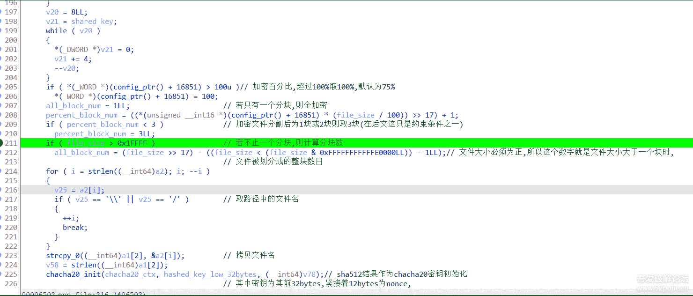

`33.png` (77.56 KB, 下载次数: 0)

[href="forum.php?mod=attachment&aid=MjgxNjc2MHxiNjExMzAxZXwxNzkzNTc2NjAwfDE2ODA4NnwyMDc1NTg2&nothumb=yes" target="_blank"](https://www.52pojie.cn/forum.php?mod=attachment&aid=MjgxNjc2MHxiNjExMzAxZXwxNzkzNTc2NjAwfDE2ODA4NnwyMDc1NTg2&nothumb=yes)

2025-11-25 16:24 上传

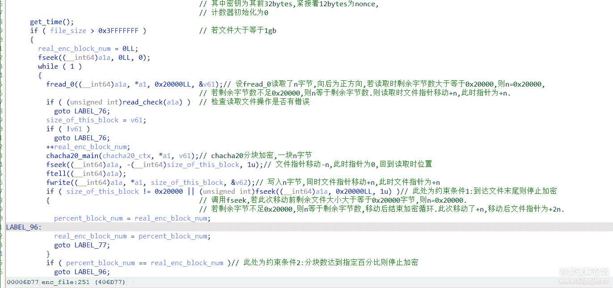

`34.png` (76.24 KB, 下载次数: 0)

[href="forum.php?mod=attachment&aid=MjgxNjc2MXwxODUxYzRmMnwxNzkzNTc2NjAwfDE2ODA4NnwyMDc1NTg2&nothumb=yes" target="_blank"](https://www.52pojie.cn/forum.php?mod=attachment&aid=MjgxNjc2MXwxODUxYzRmMnwxNzkzNTc2NjAwfDE2ODA4NnwyMDc1NTg2&nothumb=yes)

2025-11-25 16:24 上传

## 文件加密主函数：密钥生成与交换

### 分块策略

- 大文件（>= 1GB）：采用“间歇性”加密。
  - 剩余字节数 `[0x40000, +∞)`：加密 `0x20000` 字节（128KB），跳过 `0x20000` 字节。
  - 剩余字节数 `[0x20000, 0x40000]`：加密 `0x20000` 字节，跳至文件末尾。
  - 剩余字节数 `(0, 0x20000]`：加密剩余所有字节。
  - 这种策略确保了即使是巨大的虚拟机磁盘文件，也能在短时间内被破坏。
- 中等文件（128KB - 1GB）：同样采用分块加密，但分块数量受文件大小和配置的加密百分比约束（`percent_blocks_num`）。
- 小文件（ 全文加密。

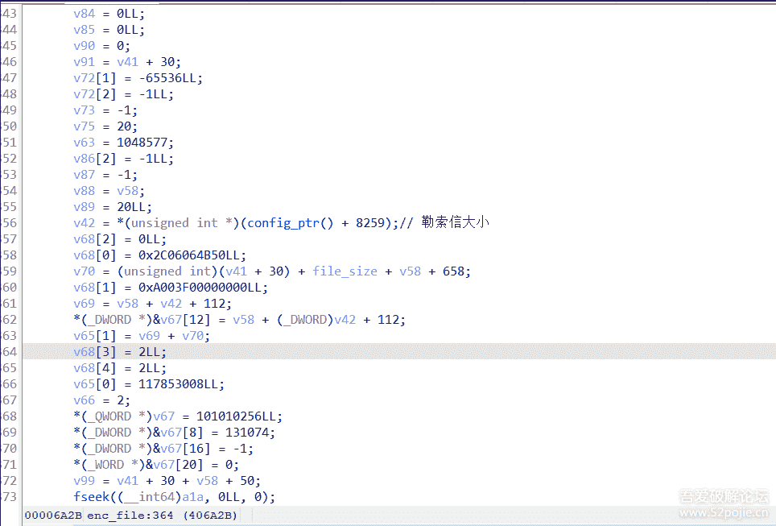

`35.png` (61.83 KB, 下载次数: 0)

[href="forum.php?mod=attachment&aid=MjgxNjc2MnxiZjc5YTVjMnwxNzkzNTc2NjAwfDE2ODA4NnwyMDc1NTg2&nothumb=yes" target="_blank"](https://www.52pojie.cn/forum.php?mod=attachment&aid=MjgxNjc2MnxiZjc5YTVjMnwxNzkzNTc2NjAwfDE2ODA4NnwyMDc1NTg2&nothumb=yes)

2025-11-25 16:24 上传

### 分块加密循环逻辑

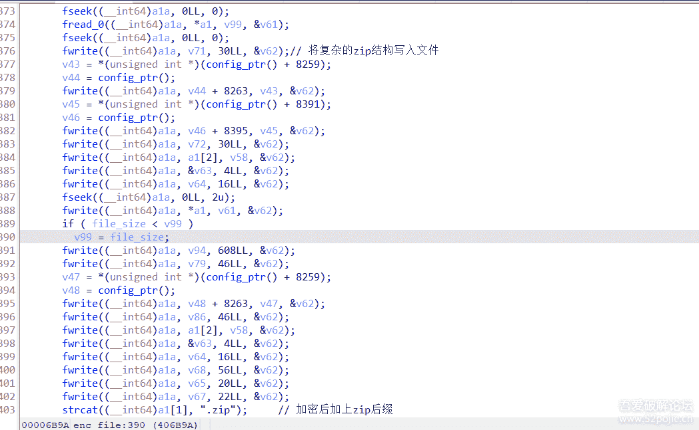

`36.png` (95.28 KB, 下载次数: 0)

[href="forum.php?mod=attachment&aid=MjgxNjc2M3xjYmQxZjc4NXwxNzkzNTc2NjAwfDE2ODA4NnwyMDc1NTg2&nothumb=yes" target="_blank"](https://www.52pojie.cn/forum.php?mod=attachment&aid=MjgxNjc2M3xjYmQxZjc4NXwxNzkzNTc2NjAwfDE2ODA4NnwyMDc1NTg2&nothumb=yes)

2025-11-25 16:24 上传

### 分块加密结构

- 文件尾部标记：加密完成后，会在文件末尾写入加密标志 `0x00... 0x66, 0x6B, 0xEA, 0x57, 0x1A, 0xBE, 0x16, 0x66` 及相关的元数据（如加密公钥、RSA加密的黑客私钥、分块信息、原始文件大小等）。这部分信息对于解密是必不可少的。

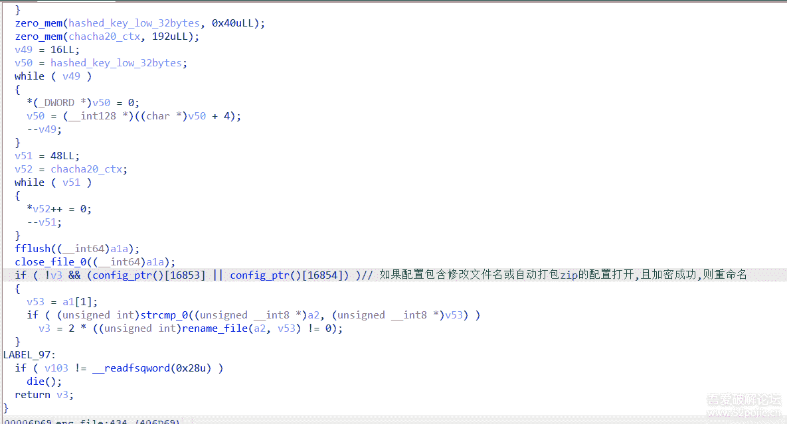

`37.png` (50.42 KB, 下载次数: 0)

[href="forum.php?mod=attachment&aid=MjgxNjc2NHw0OGQ1MzkyNHwxNzkzNTc2NjAwfDE2ODA4NnwyMDc1NTg2&nothumb=yes" target="_blank"](https://www.52pojie.cn/forum.php?mod=attachment&aid=MjgxNjc2NHw0OGQ1MzkyNHwxNzkzNTc2NjAwfDE2ODA4NnwyMDc1NTg2&nothumb=yes)

2025-11-25 16:24 上传

写入文件尾部结构代码视图

### 4.2.7 结束工作

加密完成后，程序会销毁内存中的黑客 ECC 私钥，输出统计信息（总文件数、加密文件数、失败文件数等）。如果配置了 `-d` 后台模式，还会删除 `/tmp/beast.lock` 锁文件，抹除运行痕迹。

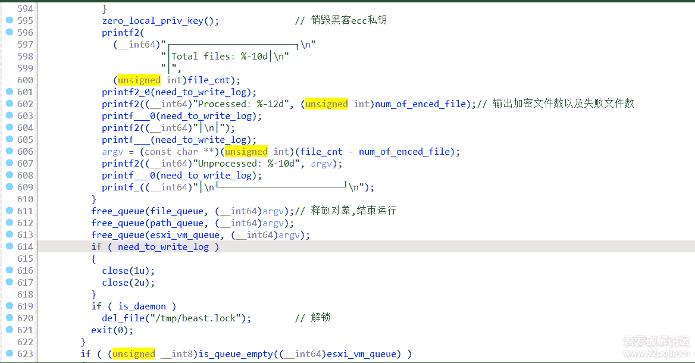

`38.png` (76.32 KB, 下载次数: 0)

[href="forum.php?mod=attachment&aid=MjgxNjc2NXwyOWM5OTQ1NHwxNzkzNTc2NjAwfDE2ODA4NnwyMDc1NTg2&nothumb=yes" target="_blank"](https://www.52pojie.cn/forum.php?mod=attachment&aid=MjgxNjc2NXwyOWM5OTQ1NHwxNzkzNTc2NjAwfDE2ODA4NnwyMDc1NTg2&nothumb=yes)

2025-11-25 16:24 上传

清理与退出代码视图

## 5. 总结与防护建议

相比 Windows 版本，Linux/ESXi 版的 BEAST 勒索软件更加纯粹和致命。它摒弃了花哨的 GUI，专注于通过命令行参数高效地摧毁虚拟化环境。其 ESXi 进程查杀 和 分块加密 机制，使其成为企业核心数据中心的重大威胁。

针对此类威胁，建议企业采取以下防护措施：

- 虚拟化环境加固：限制 ESXi 管理接口（SSH/Web）的访问权限，仅允许受信任的 IP 连接，并启用严格的账户审计和多因素认证。
- 补丁管理：及时修补 vCenter、ESXi 以及 Linux 服务器上的已知漏洞（如 WebLogic 反序列化漏洞等），防止攻击者利用漏洞获取初始访问权限。
- 异地离线备份：勒索软件通常会破坏本地备份。务必建立“空气墙”隔离的离线备份机制，确保在极端情况下能恢复核心业务数据。
- 行为监控：部署针对 Linux 服务器的主机安全产品，重点监控 `esxcli` 命令的异常调用、大批量文件后缀修改以及异常的进程终止行为。
