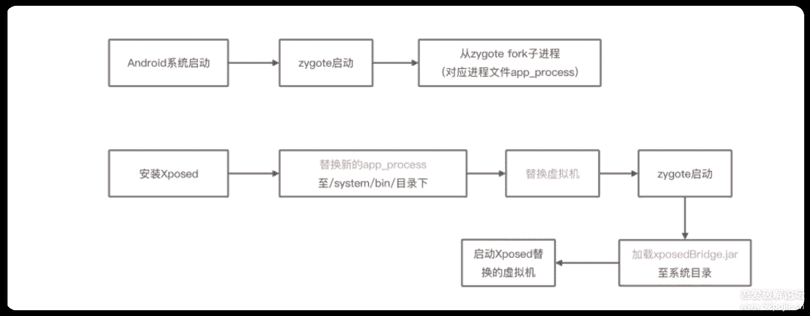

# [Android 原创] 《安卓逆向这档事》七、Sorry，会Hook真的可以为所欲为-Xposed快速上手(上)模块编..

- 原帖: https://www.52pojie.cn/forum.php?mod=viewthread&tid=1740944
- 抓取时间: 2026-11-01T21:51:05

`QQ_DVfA4hBztt.png` (631.4 KB, 下载次数: 6)

[`href="forum.php?mod=attachment&aid=MjU4Nzc4MXxiODcxNzdlOXwxNzkzNTY5ODYzfDE2ODA4NnwxNzQwOTQ0&nothumb=yes" target="_blank"`](https://www.52pojie.cn/forum.php?mod=attachment&aid=MjU4Nzc4MXxiODcxNzdlOXwxNzkzNTY5ODYzfDE2ODA4NnwxNzQwOTQ0&nothumb=yes)

2023-2-2 13:31 上传

## 一、课程目标

1. 了解Xposed原理及发展
2. 从0到1编写xposed模块
3. 配置ubuntu的逆向环境
4. 了解xposed的常用Api

## 二、工具

1. 教程Demo(更新)
2. `jadx-gui`
3. 雷电模拟器
4. vmware
5. Android Studio

## 三、课程内容

### 1.什么是Xposed？

Xposed是一款可以在不修改APK的情况下影响程序运行的框架，基于它可以制作出许多功能强大的模块，且在功能不冲突的情况下同时运作。在这个框架下，我们可以编写并加载自己编写的插件APP，实现对目标apk的注入拦截等。

### 2.Xposed原理

用自己实现的`app_process`替换掉了系统原本提供的`app_process`，加载一个额外的jar包，入口从原来的：`com.android.internal.osZygoteInit.main()`被替换成了：`de.robv.android.xposed.XposedBridge.main()`，

创建的Zygote进程就变成Hook的Zygote进程了，从而完成对zygote进程及其创建的Dalvik/ART虚拟机的劫持(zytoge注入)

`chrome_ZigoTxOFYW.png` (84.52 KB, 下载次数: 6)

[`href="forum.php?mod=attachment&aid=MjU4Nzc3OHxkYTc2YWYxMXwxNzkzNTY5ODYzfDE2ODA4NnwxNzQwOTQ0&nothumb=yes" target="_blank"`](https://www.52pojie.cn/forum.php?mod=attachment&aid=MjU4Nzc3OHxkYTc2YWYxMXwxNzkzNTY5ODYzfDE2ODA4NnwxNzQwOTQ0&nothumb=yes)

2023-2-2 13:31 上传

### 3.Xposed的发展及免root框架

| 名称 | 地址 | 支持版本 | 是否免root |
| --- | --- | --- | --- |
| xposed |  |  |  |
