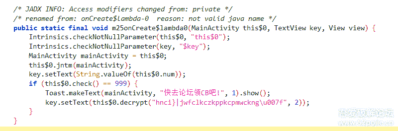
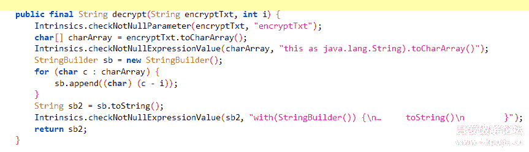
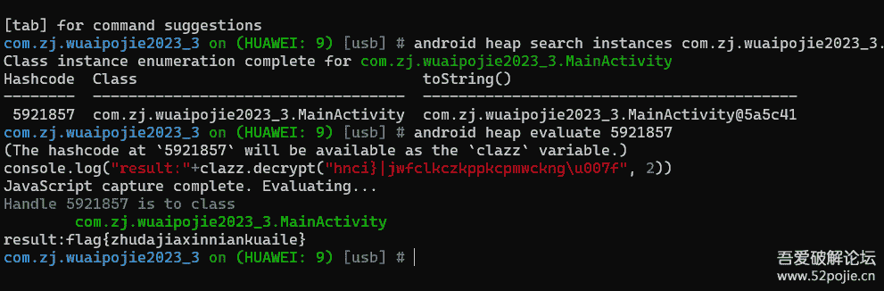
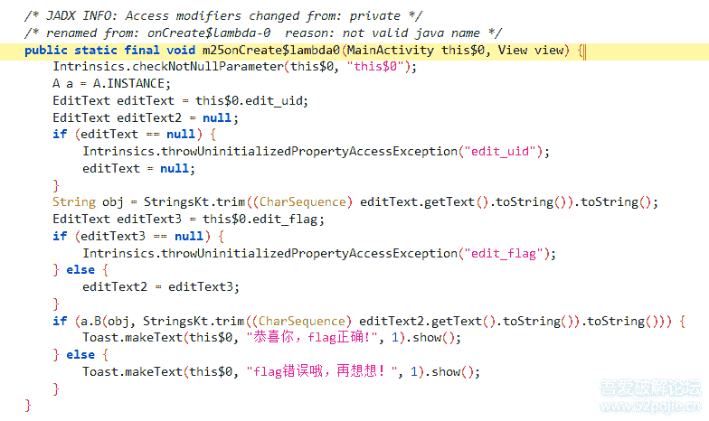
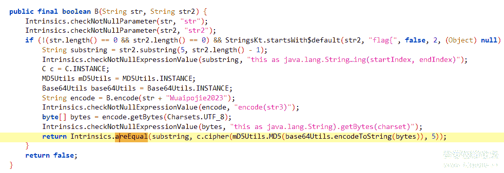
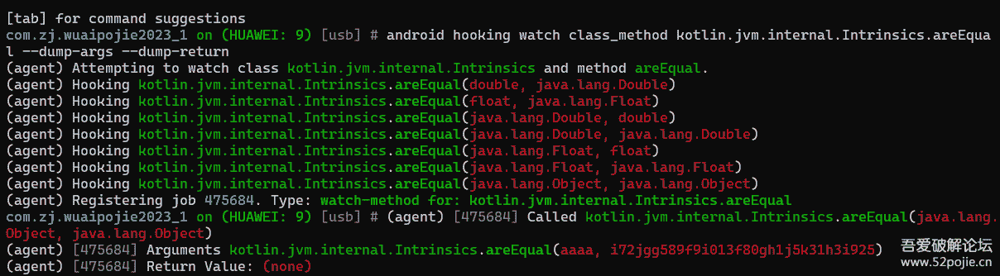

# [Android CTF] 使用`objection`对吾爱破解2023春节安卓初级题进行快速解题

- 原帖：https://www.52pojie.cn/forum.php?mod=viewthread&tid=1742935
- 抓取时间：2026-11-01T21:49:47

## 一、解题领红包之三 {Android 初级题}

### 1、分析代码

可以知道调用函数`decrypt("hnci}|jwfclkczkppkcpmwckng\u007f", 2)`可以直接得到答案。

[`image1.png` (32.47 KB, 下载次数: 2)](https://www.52pojie.cn/forum.php?mod=attachment&aid=MjU4OTAzNnw4M2Q5MWM2MXwxNzkzNTY5Nzg1fDE2ODA4NnwxNzQyOTM1&nothumb=yes) · 2023-2-7 12:26 上传

[`image2.png` (27.76 KB, 下载次数: 2)](https://www.52pojie.cn/forum.php?mod=attachment&aid=MjU4OTAzN3w2MzJlZTMzN3wxNzkzNTY5Nzg1fDE2ODA4NnwxNzQyOTM1&nothumb=yes) · 2023-2-7 12:26 上传

### 2、使用`objection`命令得到`flag`

启动 frida 环境，启动 APP。

使用`objection`附加 APP，附加命令：`objection -g com.zj.wuaipojie2023_1 explore`

首先搜索对象：`android heap search instances com.zj.wuaipojie2023_3.MainActivity`

直接调用实例的方法`decrypt()`，调用方法：`android heap evaluate 5921857`，其中`5921857`为实例句柄

然后输入：`console.log("result:"+clazz.decrypt("hnci}|jwfclkczkppkcpmwckng\u007f",2))`

输入完成后，按 ESC 退出编辑器，按回车执行，得到结果。

[`image3.png` (63.98 KB, 下载次数: 2)](https://www.52pojie.cn/forum.php?mod=attachment&aid=MjU4OTAzOHwwY2Q4OTYzN3wxNzkzNTY5Nzg1fDE2ODA4NnwxNzQyOTM1&nothumb=yes) · 2023-2-7 12:26 上传

最终得到答案：`flag{zhudajiaxinniankuaile}`

## 二、解题领红包之四 {Android 初级题}

### 1、分析代码

可以看出输入`uid`和`flag`后，会调用函数`com.zj.wuaipojie2023_1.A.B(String str, String str2)`，在`B()`中最终调用`Intrinsics.areEqual(substring, c.cipher(mD5Utils.MD5(base64Utils.encodeToString(bytes)), 5))`进行比较，`areEqual`的第二个参数就是我们需要的`flag`。

[`image4.png` (43.89 KB, 下载次数: 0)](https://www.52pojie.cn/forum.php?mod=attachment&aid=MjU4OTAzOXwzNTllNTZhZnwxNzkzNTY5Nzg1fDE2ODA4NnwxNzQyOTM1&nothumb=yes) · 2023-2-7 12:26 上传

[`image5.png` (42.7 KB, 下载次数: 5)](https://www.52pojie.cn/forum.php?mod=attachment&aid=MjU4OTA0MHw2YTQyYTQ4YXwxNzkzNTY5Nzg1fDE2ODA4NnwxNzQyOTM1&nothumb=yes) · 2023-2-7 12:26 上传

### 2、使用`objection`命令得到`flag`

启动 frida 环境，启动 APP。

使用`objection`附加 APP，附加命令：`objection -g com.zj.wuaipojie2023_1 explore`

对方法`areEqual`进行 hook，命令格式：`android hooking watch class_method kotlin.jvm.internal.Intrinsics.areEqual --dump-args --dump-return`

然后在 APP 中输入`uid=123456`，`flag`随便输入，比如输入`flag{aaaa}`

在`objection`中就可以打印出函数`areEqual`的参数，第二个参数为`i72jgg589f9i013f80gh1j5k31h3i925`，所以`uid=123456`对应的答案为：`flag{i72jgg589f9i013f80gh1j5k31h3i925}`。其他用户可以在 APP 输入自己的`uid`得到对应的`flag`。

[`image6.png` (100.02 KB, 下载次数: 3)](https://www.52pojie.cn/forum.php?mod=attachment&aid=MjU4OTA0MXxlNzczYjYzOHwxNzkzNTY5Nzg1fDE2ODA4NnwxNzQyOTM1&nothumb=yes) · 2023-2-7 12:26 上传
