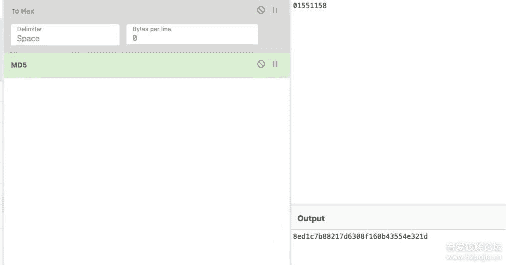

# [Android CTF] 【2023】春节解题领红包之七

- 原帖：https://www.52pojie.cn/forum.php?mod=viewthread&tid=1743632
- 抓取时间：2026-11-01T21:49:38

## 前言

一直很犹豫是否要写这篇题解，毕竟回看分析过程，猜测和幸运的部分居多，倘若给大家带来错误的误导，还请海涵。

作为一个萌新，尽量把思考的过程带给大家，以下分析，纯属猜测。

## 准备工作

1. 用 `unidbg` 运行目标函数，参考十一七大佬的帖子：https://www.52pojie.cn/thread-1742121-1-1.html
2. 获取三种 `trace`，代码大致如下：

```java
        String traceFile = "/unidbg/unidbg-android/src/test/java/com/tracecode.txt";
        PrintStream traceStream;
        try {
            traceStream = new PrintStream(Files.newOutputStream(Paths.get(traceFile)), true);
        } catch (IOException e) {
            throw new RuntimeException(e);
        }
        emulator.traceCode(module.base, module.base+module.size).setRedirect(traceStream); // 整个执行流

        String traceWFile = "/unidbg/unidbg-android/src/test/java/com/tracewrite.txt";
        PrintStream traceStream;
        try {
            traceStream = new PrintStream(Files.newOutputStream(Paths.get(traceFile)), true);
        } catch (IOException e) {
            throw new RuntimeException(e);
        }
        emulator.traceWrite().setRedirect(traceWFile); // 内存写入监听

        String traceRFile = "/unidbg/unidbg-android/src/test/java/com/traceread.txt";
        PrintStream traceStream;
        try {
            traceStream = new PrintStream(Files.newOutputStream(Paths.get(traceFile)), true);
        } catch (IOException e) {
            throw new RuntimeException(e);
        }
        emulator.traceRead().setRedirect(traceRFile); // 内存读取监听
```

## 第一轮分析

需要变动输入参数，所以每次变动需要重新获取 `trace`。

第一轮我使用的参数为：

```java
        String uid = "01551158"; //hex 形式为：30 31 35 35 31 31 35 38

        String flag = "flag{AAAAABBBBBBBBBBCCCCCCCCCCDDDDDDDDDD===}";// uid随意，只要8位就行，flag从java层看只限制了44位的输入，没有其他限制，相信很多人都和我一样输入的类似格式的flag
```

在 `tracecode` 中全局搜索字符串 `01551158` 的 `hex` 形式（为什么是 `hex`，因为传进去它在内存中就这样）。

发现一处可疑的运算：

```text
[2901170b] 0x40019ff8: "add w9, w9, w23" w9=0xd76aa478 w23=0x35353130 => w9=0xc9fd5a8
[29011c0b] 0x40019ffc: "add w9, w9, w28" w9=0xc9fd5a8 w28=0x67452301 => w9=0x73e4f8a9
[3601000b] 0x4001a000: "add w22, w9, w0" w9=0x73e4f8a9 w0=0x98badcfe => w22=0xc9fd5a7
```

Q:为什么是 `35353130`

A:因为是小端序

Q:为什么用的8位16进制去搜索

A:计算的时候往往分块，太长了搜不到，太短了重复的太多，该样本8位刚好能搜到，lucky（哈希运算的时候一般都可以，对称加密这种往往会逐字节运算，需要结合地址等因素分析）

Q:为什么可疑

A:任何在执行流中，有输入参数参与的运算指令都要高度警惕，包括但不限于 `add`、`sub`、`eor`、`orr`

`0xd76aa478`，`md5` 的k表第一个，`0x67452301`，`md5` 的魔数，可以判断和 `md5` 有关，测试下 `01551158` 的 `md5` 结果是否在 `tracewrtie` 中出现过



微信图片_20230208224945.jpg (20.96 KB, 下载次数: 0)

[href="forum.php?mod=attachment&aid=MjU4OTQ2OHw0MTgwNmJjNnwxNzkzNTY5Nzc2fDE2ODA4NnwxNzQzNjMy&nothumb=yes" target="_blank"](https://www.52pojie.cn/forum.php?mod=attachment&aid=MjU4OTQ2OHw0MTgwNmJjNnwxNzkzNTY5Nzc2fDE2ODA4NnwxNzQzNjMy&nothumb=yes)

2023-2-8 22:49 上传

```text
Memory WRITE at 0xbffff0dc, data size = 4, data value = 0xb8c7d18e, PC=RX@0x40019e6c[lib52pojie.so]0x19e6c, LR=RX@0x40019e6c[lib52pojie.so]0x19e6c
Memory WRITE at 0xbffff0e0, data size = 4, data value = 0x30d61782, PC=RX@0x40019e6c[lib52pojie.so]0x19e6c, LR=RX@0x40019e6c[lib52pojie.so]0x19e6c
Memory WRITE at 0xbffff0e4, data size = 4, data value = 0x430b168f, PC=RX@0x40019e6c[lib52pojie.so]0x19e6c, LR=RX@0x40019e6c[lib52pojie.so]0x19e6c
Memory WRITE at 0xbffff0e8, data size = 4, data value = 0x1d324e55, PC=RX@0x40019e6c[lib52pojie.so]0x19e6c, LR=RX@0x40019e6c[lib52pojie.so]0x19e6c
```

## Hook 敏感的外部函数

```java
            emulator.attach().addBreakPoint(module.findSymbolByName("sprintf").getAddress(), new BreakPointCallback() {
            @Override
            public boolean onHit(Emulator emulator, long address) {
                final RegisterContext context = emulator.getContext();
                final Pointer buffer = context.getPointerArg(0);

                emulator.attach().addBreakPoint(context.getLRPointer().peer, new BreakPointCallback() {
                    @Override
                    public boolean onHit(Emulator emulator, long address) {
                        String result = buffer.getString(0);
                        System.out.println("sprintf: "+result);
                        return true;
                    }
                });
                return true;
            }
        });
```

```text
sprintf: 8e
sprintf: d1
sprintf: c7
sprintf: b8
sprintf: 82
sprintf: 17
sprintf: d6
sprintf: 30
sprintf: 8f
sprintf: 16
sprintf: 0b
sprintf: 43
sprintf: 55
sprintf: 4e
sprintf: 32
sprintf: 1d
```

分析函数后发现把 `hex` 转为了字符串，在 `tracewrite` 搜索到：

```text
Memory WRITE at 0x40293060, data size = 8, data value = 0x3862376331646538, PC=RX@0x400dc148[libc.so]0x1c148, LR=RX@0x40011aec[lib52pojie.so]0x11aec
```

Q:为什么选这个

A:因为感觉重要……如果有带 `random` 的也建议 `hook` 上，这个样本没看到

Q:为什么不继续用搜索法

A:因为搜不出头绪，只能考虑多输出点信息

到这里可以得到的结果是：

`md5_hexdigests(uid)`

再往下搜不到头绪，分析一下 `flag` 在执行流中的处理。

直接搜2字节以上 `hex` 未搜到，猜测是逐字节运算，从 `traceread` 中进行匹配，原则为，地址连续，值为 `flag{AAAAABBBBBBBBBBCCCCCCCCCCDDDDDDDDDD===}` 的 `hex` 形式，找到如下可疑读取位置：

```text
Memory READ at 0x40293030, data size = 1, data value = 0x66, PC=RX@0x4001d04c[lib52pojie.so]0x1d04c, LR=unidbg@0xc07c38b2
Memory READ at 0x40293031, data size = 1, data value = 0x6c, PC=RX@0x4001d04c[lib52pojie.so]0x1d04c, LR=unidbg@0xc07c38b2
Memory READ at 0x40293032, data size = 1, data value = 0x61, PC=RX@0x4001d04c[lib52pojie.so]0x1d04c, LR=unidbg@0xc07c38b2
Memory READ at 0x40293033, data size = 1, data value = 0x67, PC=RX@0x4001d04c[lib52pojie.so]0x1d04c, LR=unidbg@0xc07c38b2
Memory READ at 0x40293034, data size = 1, data value = 0x7b, PC=RX@0x4001d04c[lib52pojie.so]0x1d04c, LR=unidbg@0xc07c38b2
```

从 `tracecode` 中检索，条件为：指令带 `ldr`，加载地址为 `0x40293030`，加载数据为 `0x66`。

找到如下可疑代码：

```text
[08014039] 0x4001c84c: "ldrb w8, [x8]" x8=0x40293030 => w8=0x66
[08014039] 0x4001d07c: "ldrb w8, [x8]" x8=0x40293030 => w8=0x66
```

分析第一处 `0x4001c84c`：

```text
[08014039] 0x4001c84c: "ldrb w8, [x8]" x8=0x40293030 => w8=0x66
[280100b9] 0x4001c850: "str w8, [x9]" w8=0x66 x9=0xbfffedf0
[280140b9] 0x4001c854: "ldr w8, [x9]" x9=0xbfffedf0 => w8=0x66
[890340b9] 0x4001c858: "ldr w9, [x28]" x28=0xbfffed90 => w9=0x378d30aa
[8a0340b9] 0x4001c85c: "ldr w10, [x28]" x28=0xbfffed90 => w10=0x378d30aa
[1ff50071] 0x4001c860: "cmp w8, #0x3d" w8=0x66 => nzcv: N=0, Z=0, C=1, V=0
```

判断是否为 `=` 号（`hex` 为 `0x3d`），为 `=` 号会结束循环。

第二处 `0x4001d07c`：

```text
[08014039] 0x4001d07c: "ldrb w8, [x8]" x8=0x40293030 => w8=0x66
[490140b9] 0x4001d080: "ldr w9, [x10]" x10=0xbfffeea0 => w9=0x0
[4a0180b9] 0x4001d084: "ldrsw x10, [x10]" x10=0xbfffeea0 => x10=0x0
[2b050011] 0x4001d088: "add w11, w9, #1" w9=0x0 => w11=0x1
[a90358f8] 0x4001d08c: "ldur x9, [x29, #-0x80]" fp=0xbffff120 => x9=0xbfffed70
[7f110071] 0x4001d090: "cmp w11, #4" w11=0x1 => nzcv: N=1, Z=0, C=0, V=0
[28692a38] 0x4001d094: "strb w8, [x9, x10]" w8=0x66 x9=0xbfffed70 x10=0x0
```

将数据从 `0x40293030` 写入 `0xbfffed70`，继续往下匹配 `0xbfffed70` 的 `ldr` 指令，找到如下位置：

```text
[08014039] 0x4001c8c0: "ldrb w8, [x8]" x8=0xbfffed70 => w8=0x66
[290380b9] 0x4001c8c4: "ldrsw x9, [x25]" x25=0xbfffeec0 => x9=0x0
[4a2944f9] 0x4001c8c8: "ldr x10, [x10, #0x850]" x10=0x4006a000 => x10=0x275cb5e4
[4901098b] 0x4001c8cc: "add x9, x10, x9" x10=0x275cb5e4 x9=0x0 => x9=0x275cb5e4
[8add8352] 0x4001c8d0: "mov w10, #0x1eec" w10=0x275cb5e4 => w10=0x1eec
[0a15a372] 0x4001c8d4: "movk w10, #0x18a8, lsl #16" w10=0x1eec => w10=0x18a81eec
[29696a38] 0x4001c8d8: "ldrb w9, [x9, x10]" x9=0x275cb5e4 x10=0x18a81eec => w9=0x41
[8a0340b9] 0x4001c8dc: "ldr w10, [x28]" x28=0xbfffed90 => w10=0x378d30aa
[8b0340b9] 0x4001c8e0: "ldr w11, [x28]" x28=0xbfffed90 => w11=0x378d30aa
[1f01096b] 0x4001c8e4: "cmp w8, w9" w8=0x66 w9=0x41 => nzcv: N=0, Z=0, C=1, V=0

.

.

.

[08014039] 0x4001c8c0: "ldrb w8, [x8]" x8=0xbfffed70 => w8=0x66
[290380b9] 0x4001c8c4: "ldrsw x9, [x25]" x25=0xbfffeec0 => x9=0x1
[4a2944f9] 0x4001c8c8: "ldr x10, [x10, #0x850]" x10=0x4006a000 => x10=0x275cb5e4
[4901098b] 0x4001c8cc: "add x9, x10, x9" x10=0x275cb5e4 x9=0x1 => x9=0x275cb5e5
[8add8352] 0x4001c8d0: "mov w10, #0x1eec" w10=0x275cb5e4 => w10=0x1eec
[0a15a372] 0x4001c8d4: "movk w10, #0x18a8, lsl #16" w10=0x1eec => w10=0x18a81eec
```


```
[29696a38] 0x4001c8d8: "ldrb w9, [x9, x10]" x9=0x275cb5e5 x10=0x18a81eec => w9=0x42
[8a0340b9] 0x4001c8dc: "ldr w10, [x28]" x28=0xbfffed90 => w10=0x378d30aa
[8b0340b9] 0x4001c8e0: "ldr w11, [x28]" x28=0xbfffed90 => w11=0x378d30aa
[1f01096b] 0x4001c8e4: "cmp w8, w9" w8=0x66 w9=0x42 => nzcv: N=0, Z=0, C=1, V=0
```

从`0x4001c8d8`指令处读取连续字符串比较,断点输出该处结果：

```
[21:00:31 250]RX@0x4004d4d0[lib52pojie.so]0x4d4d0, md5=b84972b003d68c044bf8fec28b89764a, hex=4142434445464748494a4b4c4d4e4f505152535455565758595a6162636465666768696a6b6c6d6e6f707172737475767778797a303132333435363738392b2fd7440000bc2600006b6200005e13000089570000e235000035710000af090000784d0000132f0000c46b0000f11a0000
size: 112
0000: 41 42 43 44 45 46 47 48 49 4A 4B 4C 4D 4E 4F 50    ABCDEFGHIJKLMNOP
0010: 51 52 53 54 55 56 57 58 59 5A 61 62 63 64 65 66    QRSTUVWXYZabcdef
0020: 67 68 69 6A 6B 6C 6D 6E 6F 70 71 72 73 74 75 76    ghijklmnopqrstuv
0030: 77 78 79 7A 30 31 32 33 34 35 36 37 38 39 2B 2F    wxyz0123456789+/
0040: D7 44 00 00 BC 26 00 00 6B 62 00 00 5E 13 00 00    .D...&..kb..^...
0050: 89 57 00 00 E2 35 00 00 35 71 00 00 AF 09 00 00    .W...5..5q......
0060: 78 4D 00 00 13 2F 00 00 C4 6B 00 00 F1 1A 00 00    xM.../...k......
^-----------------------------------------------------------------------------^
```

貌似是base64解码过程的汇编，重新调整`flag`为44位base64值进行第二轮trace

## 第二轮分析

第二轮使用的参数为：

```
        String uid = "01551158"; //md5 hex为:38 65 64 31 63 37 62 38 38 32 31 37 64 36 33 30 38 66 31 36 30 62 34 33 35 35 34 65 33 32 31 64

        String flag = "OGVkMWM3Yjg4MjE3ZDYzMDhmMTYwYjQzNTU0ZTMyMWQ=";// 理论上只要44位base64编码字符串就行，这里我选择的是base64(md5(uid)) hex为：4f 47 56 6b 4d 57 4d 33 59 6a 67 34 4d 6a 45 33 5a 44 59 7a 4d 44 68 6d 4d 54 59 77 59 6a 51 7a 4e 54 55 30 5a 54 4d 79 4d 57 51 3d
```

得到第二份`tracecode`，大小为51w行

检查`tracewrtie`

```
Memory WRITE at 0x40293030, data size = 8, data value = 0x334d574d6b56474f, PC=RX@0x400dc148[libc.so]0x1c148, LR=RX@0x40011aec[lib52pojie.so]0x11aec
Memory WRITE at 0x40293040, data size = 8, data value = 0x6d68444d7a59445a, PC=RX@0x400dc148[libc.so]0x1c148, LR=RX@0x40011aec[lib52pojie.so]0x11aec
Memory WRITE at 0x4029304c, data size = 8, data value = 0x3055544e7a516a59, PC=RX@0x400dc148[libc.so]0x1c148, LR=RX@0x40011aec[lib52pojie.so]0x11aec
Memory WRITE at 0x40293054, data size = 8, data value = 0x3d51574d794d545a, PC=RX@0x400dc148[libc.so]0x1c148, LR=RX@0x40011aec[lib52pojie.so]0x11aec
```

可以看出确实进行了base64解码

Q:为什么十一七大佬的是86w行

A:他打印的整个执行流，我只打印了目标样本内的执行流，对于`libc`等部分的执行只在导入函数部分分析（顺便一提，第一轮`tracecode`的大小为16w行，行数的巨增也说明了我们可能走对了一部分）

由于两边同为32位，我认为应该是判断应该进行逐字节比较了，直接选择检索`tracecode`，第一次我选择的条件为：指令带`cmp`， 操作数据有一个为`0x38`, 操作寄存器与寄存器：

```
[7f01026b] 0x4001aabc: "cmp w11, w2" w11=0x38 w2=0x30 => nzcv: N=0, Z=0, C=1, V=0
[9f02026b] 0x400180b0: "cmp w20, w2" w20=0x38 w2=0x40 => nzcv: N=1, Z=0, C=0, V=0
```

找到两处，`w11`均不是取自`md5_hex(uid)`或者`base64_decode(flag)`

第二次选择条件为：指令带`eor`，操作数据有一个为`0x38`, 操作寄存器与寄存器：

```
[f5010c4a] 0x4001f308: "eor w21, w15, w12" w15=0x8b w12=0x38 => w21=0xb3
[f5010c4a] 0x4001f308: "eor w21, w15, w12" w15=0x9b w12=0x38 => w21=0xa3
[f5010c4a] 0x4001f308: "eor w21, w15, w12" w15=0xab w12=0x38 => w21=0x93
[f5010c4a] 0x4001f308: "eor w21, w15, w12" w15=0x69 w12=0x38 => w21=0x51
[0f020f4a] 0x40010668: "eor w15, w16, w15" w16=0x38 w15=0xb3 => w15=0x8b
[0f020f4a] 0x40010668: "eor w15, w16, w15" w16=0x38 w15=0xa3 => w15=0x9b
[0f020f4a] 0x40010668: "eor w15, w16, w15" w16=0x38 w15=0x93 => w15=0xab
[0f020f4a] 0x40010668: "eor w15, w16, w15" w16=0x38 w15=0x51 => w15=0x69
```

分析第二个地址`0x40010668`：

```
[ef697038] 0x4001064c: "ldrb w15, [x15, x16]" x15=0xbffff218 x16=0x0 => w15=0xb3
[500140f9] 0x40010650: "ldr x16, [x10]" x10=0xbffff0e0 => x16=0x40293060
[190140f9] 0x40010654: "ldr x25, [x8]" x8=0xbffff100 => x25=0x0
[106a7938] 0x40010658: "ldrb w16, [x16, x25]" x16=0x40293060 x25=0x0 => w16=0x38
[39014039] 0x4001065c: "ldrb w25, [x9]" x9=0xbffff0f0 => w25=0x0
[1a0140f9] 0x40010660: "ldr x26, [x8]" x8=0xbffff100 => x26=0x0
[9b0140b9] 0x40010664: "ldr w27, [x12]" x12=0xbffff0c0 => w27=0x37fa57cd
[0f020f4a] 0x40010668: "eor w15, w16, w15" w16=0x38 w15=0xb3 => w15=0x8b
```

加载地址`0x40293090`，是`md5(uid)`解码结果,往上搜索`0xbffff218`的`str`位置，找到如下位置：

```
[4c686c38] 0x4001f2f8: "ldrb w12, [x2, x12]" x2=0x40293090 x12=0x0 => w12=0x38
[4f0140f9] 0x4001f2fc: "ldr x15, [x10]" x10=0xbfffebe0 => x15=0x0
[6f686f38] 0x4001f300: "ldrb w15, [x3, x15]" x3=0xbfffec80 x15=0x0 => w15=0x8b
[560140f9] 0x4001f304: "ldr x22, [x10]" x10=0xbfffebe0 => x22=0x0
[f5010c4a] 0x4001f308: "eor w21, w15, w12" w15=0x8b w12=0x38 => w21=0xb3
[35683638] 0x4001f30c: "strb w21, [x1, x22]" w21=0xb3 x1=0xbffff218 x22=0x0
```

加载地址`0x40293090`，是base64解码结果，同时他也是`eor`检索加载的第一个地址

在`0x40010668`读取位置`0xbffff218`:

```
[21:54:17 404]unidbg@0xbffff218, md5=10d94724f7d75c16dc010473421a28a9, hex=b3c698a4f3ef74a393b001b047569cb05107cdc67cddabf3a5080fd7eafebc990000000000000000000000000000000000000000000000000000000000000000000000000000000000000000000000000000000000000000000000000000000000000000000000000000000000000000
size: 112
0000: B3 C6 98 A4 F3 EF 74 A3 93 B0 01 B0 47 56 9C B0    ......t.....GV..
0010: 51 07 CD C6 7C DD AB F3 A5 08 0F D7 EA FE BC 99    Q...|...........
0020: 00 00 00 00 00 00 00 00 00 00 00 00 00 00 00 00    ................
0030: 00 00 00 00 00 00 00 00 00 00 00 00 00 00 00 00    ................
0040: 00 00 00 00 00 00 00 00 00 00 00 00 00 00 00 00    ................
0050: 00 00 00 00 00 00 00 00 00 00 00 00 00 00 00 00    ................
0060: 00 00 00 00 00 00 00 00 00 00 00 00 00 00 00 00    ................
```

将该值`base64:s8aYpPPvdKOTsAGwR1acsFEHzcZ83avzpQgP1+r+vJk=` 然后作为输入，即可使`0x40010668`处的`eor`全为0，

将`uid = 01551158`, `base64:s8aYpPPvdKOTsAGwR1acsFEHzcZ83avzpQgP1+r+vJk=` 得到结果通过（样本使用了`gettimeofday`函数获取了时间，要在apk上得到同样结果需要重新读取值）

Q:为什么先检查第二个地址

A:因为是假定这个位置在做`uid`和`flag`的解码结果是否相等，要从后往前看

Q:为什么读取`0xbffff218`得到的和我的结果不一样：

A:`0xbffff218`这个值有时间戳参与计算，分析的时候发现该值和`uid`，`flag`均无关系，没有深入分析

Q:为什么第一次用`cmp`，第二次用`eor`检索

A:因为当`w8 = w9`时，`eor w8, w8，w9 =>  w8=0` ,可以代替`cmp`的效果，即判断两者相等

Q:为什么不使用`ida`等反编译工具，是不是为了装逼

A:菜鸡我啊，不会反混淆，丢到`ida`里感觉混淆很严重，就在没打开过`ida`（手动泪目）

Q:为什么只看见了几个特征的时候，比如第一个魔数，K表第一个值，就确认它是md5加密

A:试一试，刚好成功了

## 总结

【感受】分析时充满了很多幸运的成分，刚好就看见了关键点，感觉就好像白嫖了吾爱币，考虑到这点还是写了这个帖子

感谢大家的观看，祝大家2023新年大吉！
