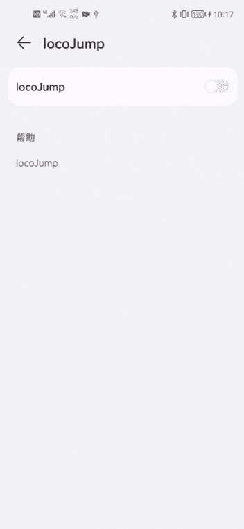
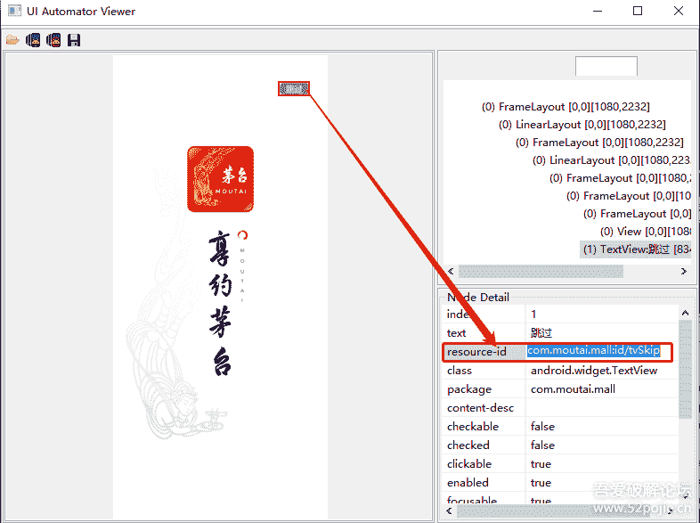

# [Android 原创] 安卓自动化之无障碍模式

- 原帖：https://www.52pojie.cn/forum.php?mod=viewthread&tid=1746330
- 抓取时间：2026-11-01T21:48:17
- 预计阅读时间：5分钟

MIUI14更新后，李跳跳等工具便出现问题，为了满足使用的需求，便开始研究实现过程，下面是学习记录，解决方案请直接跳至第6点。

## 1. `AccessibilityService`无障碍服务

无障碍服务主要是用来协助残障用户更好的使用手机，但是各位大佬基于无障碍服务开发了很多玩法，例如抢红包、跳广告等，接下来我们新建个项目来实现跳广告功能。

### 1.1 创建服务

```kotlin
class MyAccessibilityService : AccessibilityService() {
    private val TAG = javaClass.simpleName

    override fun onAccessibilityEvent(event: AccessibilityEvent?) {
        Log.e(TAG, "onAccessibilityEvent$event")
        if (event?.eventType == TYPE_WINDOW_CONTENT_CHANGED) {
            if (event.className == "android.widget.TextView") {
                //获取跳过按钮并点击
                try {
                    val nodeInfo = rootInActiveWindow
                    if (nodeInfo != null) {
                        skip(nodeInfo, "跳过")
                    }
                } catch (e: Error) {
                    Log.e(TAG, "$e")
                }
            }
        }
    }

    /**
     * 匹配跳过规则
     */
    private fun skip(nodeInfo: AccessibilityNodeInfo?, str: String?) {
        val nodeInfoList = nodeInfo?.findAccessibilityNodeInfosByText(str)
        if (nodeInfoList == null || nodeInfoList.isEmpty()) {
            //页面跳转过程中，有可能获取不到
            return
        }
        for (info in nodeInfoList) {
            val charSequence = info.text
            if (charSequence != null) {
                val msg = charSequence.toString()
                if (msg.contains("跳过")) {
                    info.performAction(ACTION_CLICK)
                    Toast.makeText(this, "跳过广告", Toast.LENGTH_SHORT).show()
                }
            }
        }
    }

    override fun onInterrupt() {
    }
}
```

### 1.2 配置服务

在`res`目录下新建`service_config.xml`文件，名称可以自定义，下一步会用到。

### 1.3 添加清单文件

```xml
<service
    android:name=".MyAccessibilityService"
    android:permission="android.permission.BIND_ACCESSIBILITY_SERVICE">
    <intent-filter>
        <action android:name="android.accessibilityservice.AccessibilityService" />
    </intent-filter>
    <meta-data
        android:name="android.accessibilityservice"
        android:resource="@xml/service_config" />
</service>
```

### 1.4 启动服务

```kotlin
override fun onCreate(savedInstanceState: Bundle?) {
    super.onCreate(savedInstanceState)
    setContentView(R.layout.activity_main)
    //跳转无障碍模式设置界面
    startActivity(Intent(Settings.ACTION_ACCESSIBILITY_SETTINGS))
}
```

## 2. 实现无障碍功能



[2023021510501.gif](https://www.52pojie.cn/forum.php?mod=attachment&aid=MjU5MTEyMHwzYjJlZjJlZHwxNzkzNTY5Njk0fDE2ODA4NnwxNzQ2MzMw&nothumb=yes)（2.38 MB，下载次数：1，2023-2-17 09:11 上传）

## 3. 获取UI布局

### 3.1 `findAccessibilityNodeInfosByText`

在1.1中使用`findAccessibilityNodeInfosByText`来进行模糊匹配，为了满足精准匹配的需求，我们也可以通过获取id来实现（`findAccessibilityNodeInfosByViewId`）。

### 3.2 `findAccessibilityNodeInfosByViewId`

使用`uiautomatorviewer`工具分析app界面。

> 注意：工具路径在安卓SDK中 `C:\Users\XX\AppData\Local\Android\Sdk\tools\bin\uiautomatorviewer.bat`，运行的命令框请勿关闭。



[202302151037173.png](https://www.52pojie.cn/forum.php?mod=attachment&aid=MjU5MTExN3w1NWVhODc3OXwxNzkzNTY5Njk0fDE2ODA4NnwxNzQ2MzMw&nothumb=yes)（82.84 KB，下载次数：2，2023-2-17 09:01 上传）

```kotlin
private fun skip(nodeInfo: AccessibilityNodeInfo?) {
    val nodeInfoList = nodeInfo?.findAccessibilityNodeInfosByViewId("com.moutai.mall:id/tvSkip")
    if (nodeInfoList == null || nodeInfoList.isEmpty()) {
        //页面跳转过程中，有可能获取不到
        return
    }
    for (info in nodeInfoList) {
        info.performAction(ACTION_CLICK)
        Toast.makeText(this, "跳过广告", Toast.LENGTH_SHORT).show()
    }
}
```

### 3.3 遍历父节点

通过获取父节点的`AccessibilityNodeInfo`，再通过该对象的`getChild()`方法来查询目标节点。

```kotlin
private fun findInfo(
    info: AccessibilityNodeInfo?,
    str: String?,
): AccessibilityNodeInfo? {
    if (info == null) return null

    if (info.childCount == 0) {
        if (info.text!=null){
            if (info.text.toString().contains(str!!)) {
                info.performAction(ACTION_CLICK)
                Log.e("findInfo","$info")
            }
            return info
        }
    } else {
        for (i in 0 until info.childCount) {
            findInfo(info.getChild(i), str)
        }
    }

    return null
}
```

## 4. 遇到的问题

### 4.1 android `findAccessibilityNodeInfosByViewId` return null although the node id exists

遇到这个问题时排查下获取到的`nodeInfo`是不是根活动视图，如果没有解决，再看下配置文件`accessibilityEventTypes`中的设置。

最初是使用`event!!.source`来获取，该方法是获取当前界面的可访问节点信息，但在跳转过程中有可能获取不到。

## 5. 防范方式

1. 重写`TextView`的`findViewsWithText`方法
2. `Event`干扰
3. 使用`onTouch`代替`onClick`

## 6. MIUI14 使用跳过功能

进入开发者选项--》启用MIUI功能--》关闭--》开启无障碍模式--》开启跳过广告的app--》重新启用MIUI功能

亲测使用正常！

以上就是无障碍服务的学习过程，如果有好的建议和想法可以留言或者私信，如果想深入了解可以访问[developer.android.google.cn/guide/topics/ui/accessibility/service?hl=zh-cn](https://developer.android.google.cn/guide/topics/ui/accessibility/service?hl=zh-cn)，方便的话给个赞或者评分吧。
